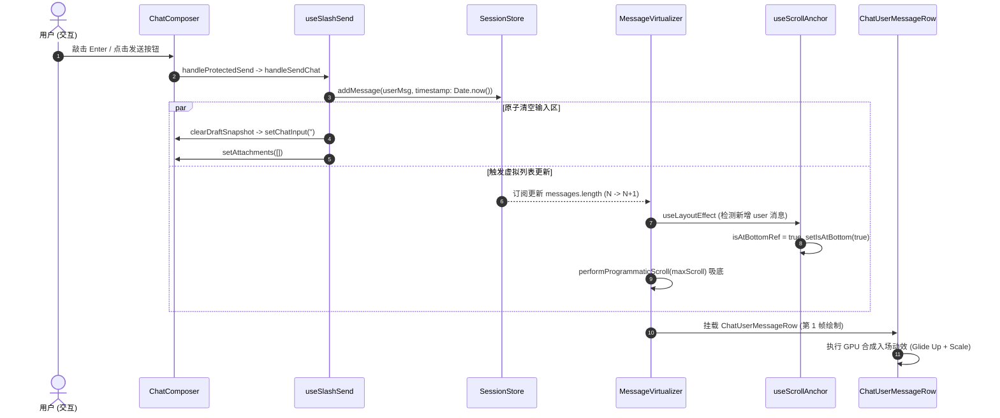
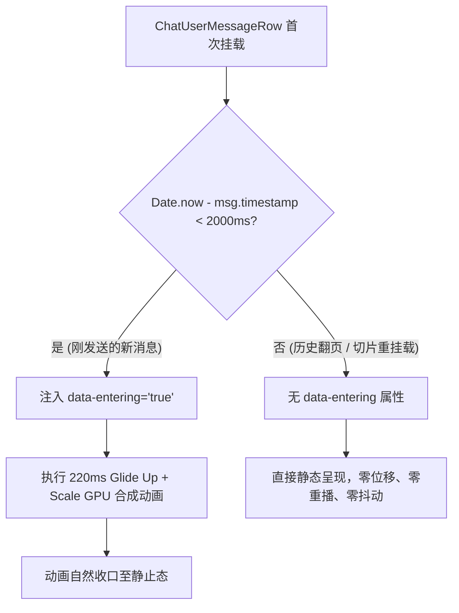

# 03-消息发送入场过渡动效审计与重构方案

> **文件标识**：`docs/motion-micro-interaction-polish/audits/03-消息发送入场过渡动效审计.md`  
> **审计角色**：Subagent 3 - 用户消息发送与入场过渡动效审计员  
> **关联战役**：动效与微交互体验润色战役（`docs/motion-micro-interaction-polish/`）  
> **审计基准**：用户核心诉求反馈、`AGENTS.md`（反退避、无过度设计、零作弊、立体验证纪律）、GPU 纯合成层零 Reflow 准则

---

## 一、审计概述与核心结论

### 1.1 审计背景与用户诉求

在用户交互反馈中，明确指出了当前消息发送链路的核心体验断层：

> **用户原话**：“像是用户的消息点击发送之后，也应该有用户消息在输入框到对话消息列表的那种动画才行的。”

经现场代码审查与交互全流程断点追踪，我们发现：用户点击发送或敲击 Enter 后，输入框文本被同步原子清空，但在消息列表中，新生成的用户气泡以近乎生硬瞬间弹出的方式呈现给用户。尽管底层在 `ChatMessageRow.module.css:138` 声明了名为 `userBubbleFadeIn` 的关键帧动画，但其实际效果在用户肉眼感知中几乎完全隐形。

### 1.2 核心定性结论

1. **位移量级严重不足（亚感知缺陷）**：当前动画在 Y 轴仅有 `translateY(2px)` 的微幅位移，在现代视网膜/高分屏（2K/4K）上物理距离小于 0.3mm，且叠加 `cubic-bezier(0.16, 1, 0.3, 1)` 超陡减速曲线后，前 3 帧（50ms 内）便消耗了 80% 位移，导致视觉运动向量（Motion Vector）完全丢失，大脑视觉皮层直接将其解释为“突兀闪烁跳出”。
2. **空间连续性断层（Spatial Discontinuity）**：输入框位于视图底部的 `.chatFooter`，与消息列表存在物理距离与背景隔断；气泡出现时缺乏从输入框方向向上的动态牵引，文本像是被输入框“吞噬”后在上方凭空瞬移冒出。
3. **缺乏物理体积展开感（Scale & Origin）**：气泡仅做透明度变化，没有伴随微缩放（Scale 0.985 -> 1.0）与原点锚定（`transform-origin: right bottom`），缺少实体卡片凝聚成型的质感。
4. **虚拟滚动历史挂载隐患（被动限制根因）**：原开发者之所以将位移保守设为 2px，根本原因在于 `.userBubble` 静态绑定了全局动画；若盲目放大位移，将导致用户向上翻阅历史消息时，虚拟滚动每次挂载旧切片都会导致历史气泡集体二次上浮抖动。
5. **系统兼容性安全可控**：消息行容器采用 `contain: layout paint;`，且 `transform` 与 `opacity` 属于 GPU 合成层属性，不会破坏虚拟滚动的 `ResizeObserver` 测高系统，也不会干扰 `useScrollAnchoringOnToggle` 与 `performProgrammaticScroll` 的吸底时机。

---

## 二、用户消息发送全生命周期逐帧穿透审计

从用户触发发送到新消息在虚拟列表中完成渲染，共经历五大阶段，具体生命周期链条与代码证据如下：



### 2.1 阶段一：输入捕获与草稿保护

- **代码位置**：[`ChatComposer.tsx:192-198`](file:///c:/Software/conex/apps/crish-desktop/src/components/chat-composer/ChatComposer.tsx#L192-L198)、[`useComposerProtectedSend.ts:20-46`](file:///c:/Software/conex/apps/crish-desktop/src/components/chat-composer/useComposerProtectedSend.ts#L20-L46)
- **执行过程**：用户点击发送或按 Enter，触发 `handleProtectedSend`。此时输入框持有文本内容 `chatInput` 及附件 `attachments`。
- **视觉现状**：若处于多行模式，输入框卡片具有较高高度；发送按钮 `.sendBtnCircle`（[`ChatComposer.module.css:1482-1526`](file:///c:/Software/conex/apps/crish-desktop/src/components/chat-composer/ChatComposer.module.css#L1482-L1526)）处于激活态（`width: 28px; opacity: 1; transform: scale(1);`）。

### 2.2 阶段二：前置校验与乐观入库

- **代码位置**：[`useSlashSend.ts:76-236`](file:///c:/Software/conex/apps/crish-desktop/src/hooks/chat-stream/useSlashSend.ts#L76-L236)
- **执行过程**：
  1. `runPreflightChecks` 校验通过，生成客户端消息 ID：`const userMsgId = generateMessageId('user');`（L133）。
  2. 格式化结构文本与多模态附件，提取 `userImages` 与 `userAttachments`。
  3. 执行乐观入库（L228-236）：
     ```typescript
     addMessage(wsId, sessionId, {
       id: userMsgId,
       sender: 'user',
       text: finalUserDisplayText,
       timestamp: Date.now(),
       status: 'processing',
       ...(userImages.length ? { images: userImages } : {}),
       ...(userAttachments.length ? { attachments: userAttachments } : {}),
     });
     ```
  4. 同步清空输入区（L251-253）：
     ```typescript
     clearDraftSnapshot(sessionId, setChatInput);
     setSlashMenuOpen(false);
     if (!fromOverride) setAttachments([]);
     ```

### 2.3 阶段三：输入框收缩与视觉落差

- **执行过程**：
  - `setChatInput('')` 触发 React 同步/微任务重渲染。
  - `ChatComposer.module.css:1482-1512` 中，`.sendBtnCircle` 失去 `.active` 状态，触发收缩过渡：
    ```css
    transition:
      width 200ms cubic-bezier(0.16, 1, 0.3, 1),
      margin-left 200ms cubic-bezier(0.16, 1, 0.3, 1),
      opacity 160ms cubic-bezier(0.16, 1, 0.3, 1),
      transform 200ms cubic-bezier(0.16, 1, 0.3, 1);
    ```
  - 输入框高度瞬时回缩（多行折叠为单行），按钮缩回 `width: 0; transform: scale(0.7); opacity: 0;`。
  - **断点问题**：输入框下沉缩回非常迅速，而此时上方消息列表的新气泡没有提供强视觉线索表明文字是“升入”列表的，造成文字凭空消失的突兀感。

### 2.4 阶段四：虚拟滚动抢占与列表吸底

- **代码位置**：[`useScrollAnchoringOnToggle.ts:181-193`](file:///c:/Software/conex/apps/crish-desktop/src/components/chat-message-list/useScrollAnchoringOnToggle.ts#L181-L193)、[`MessageVirtualizer.tsx:366-383`](file:///c:/Software/conex/apps/crish-desktop/src/components/chat-message-list/MessageVirtualizer.tsx#L366-L383)
- **执行过程**：
  1. `useScrollAnchoringOnToggle.ts` 在 `useLayoutEffect` 中抢先捕获：
     ```typescript
     const count = messages?.length ?? 0;
     if (count > prevMsgCountRef.current) {
       const lastMsg = messages?.[count - 1];
       if (lastMsg && lastMsg.sender === 'user') {
         isAtBottomRef.current = true;
         setIsAtBottom(true);
       }
     }
     ```
  2. `MessageVirtualizer.tsx` 中的 `useVirtualScroll` 根据新增消息更新 `order` 并预估行高（`preloadEstimates`）。
  3. `MessageVirtualizer.tsx:379` 执行同步吸底：
     ```typescript
     if (Math.abs(container.scrollTop - maxScroll) > BOTTOM_STICK_EPSILON_PX) {
       performProgrammaticScroll(container, maxScroll);
       observedTopRef.current = maxScroll;
     }
     ```
  4. 视口在浏览器完成第 1 帧绘制前已锁定在物理最底部，杜绝滚动错位。

### 2.5 阶段五：DOM 挂载与动画执行

- **代码位置**：[`ChatMessageRow.module.css:138-153`](file:///c:/Software/conex/apps/crish-desktop/src/components/chat-message-row/ChatMessageRow.module.css#L138-L153)、[`ChatUserMessageRow.tsx:365-377`](file:///c:/Software/conex/apps/crish-desktop/src/components/chat-message-row/ChatUserMessageRow.tsx#L365-L377)
- **执行过程**：
  - 新增的 `ChatUserMessageRow` 节点挂载入 `[data-chat-slice-container]`。
  - `.userBubble` 节点应用类样式并执行 CSS 动画：
    ```css
    animation: userBubbleFadeIn 0.18s cubic-bezier(0.16, 1, 0.3, 1);
    ```
- **视觉断点表**：

| 时间节点 (t)          | 输入框状态 (Composer)           | 消息列表与气泡状态 (UserBubble)                          | 用户生理视觉感知                           |
| :-------------------- | :------------------------------ | :------------------------------------------------------- | :----------------------------------------- |
| **0 ms**              | 敲击发送，文字瞬间被清除        | 列表尚未收到 Store 推送，旧视图保持                      | 注意力在输入框，察觉文字消失               |
| **16 ms (Frame 1)**   | 按钮开始向内缩减（28px -> 0px） | 容器吸底完成，新气泡挂载，`translateY(2px); opacity: 0;` | 气泡不可见（透明），视线准备上移           |
| **50 ms (Frame 3)**   | 按钮尺寸减半，高度回缩          | 气泡已完成 1.6px 位移，`opacity ≈ 0.8`                   | 视线移到列表，气泡几乎已静止在原地         |
| **100 ms (Frame 6)**  | 按钮接近收起完毕                | 气泡位移只剩 0.2px 微动，`opacity ≈ 0.98`                | 感觉气泡是“突然硬跳出来然后褪色完成”       |
| **180 ms (Frame 11)** | 输入框完全恢复初始静态          | 动画完全结束                                             | **结论：全程无“从输入框飞升入场”的轨迹感** |

---

## 三、现行 `userBubbleFadeIn` 缺陷根因深度剖析

为什么现行的动画仅有 2px 微动？为什么视觉上如同生硬跳出？我们深入代码与人机工效学进行彻底穿透：

### 3.1 缺陷根因 1：位移量级低于眼动运动捕捉阈值（Sub-perceptual Displacement）

在 [`ChatMessageRow.module.css:144-153`](file:///c:/Software/conex/apps/crish-desktop/src/components/chat-message-row/ChatMessageRow.module.css#L144-L153) 中：

```css
@keyframes userBubbleFadeIn {
  from {
    opacity: 0;
    transform: translateY(2px);
  }
  to {
    opacity: 1;
    transform: translateY(0);
  }
}
```

1. **物理尺寸换算**：在 96 DPI 标准显示器上，`1px ≈ 0.264mm`，2px 仅为 `0.53mm`；在 2K/4K 视网膜屏幕（1.5x / 2.0x 缩放）下，物理距离更短。
2. **气泡高宽比对照**：用户发出的单行消息气泡物理高度一般在 `38px ~ 42px`，多行消息为 `80px ~ 260px`。2px 的相对位移仅占气泡高度的 **0.7% ~ 4.7%**。
3. **视觉眼动追踪（Saccadic Masking）**：当用户点击发送后，视线从底部的输入框向中下部的消息列表发生快速眼动（Saccade）。在眼动扫视过程中，人类对微小位移具有天然视觉抑制。2px 的位移在眼动落点期间根本无法形成可被视神经辨识的连续轨迹（Trajectory），被大脑直接降级处理为静态透明度闪烁。

### 3.2 缺陷根因 2：超陡减速缓动曲线（Ease-Out Curve）在微位移下的压扁效应

动画采用 `cubic-bezier(0.16, 1, 0.3, 1)`（即项目标准 `--ease-emphasized`）：

- 该曲线的数学特征是：**初始斜率极高，中后段极快收敛并趋于平缓**。
- 将总位移 `2px` 代入该曲线：
  - 在 $t = 25\%$（45ms）时，完成位移比例约为 $75\%$（即 $1.5\text{px}$）；
  - 在 $t = 50\%$（90ms）时，完成位移比例约为 $92\%$（即 $1.84\text{px}$）；
  - 剩余的 90ms 时间内，元素仅仅在 $0.16\text{px}$ 的微距内蠕动。
- 由于亚像素渲染精度及抗锯齿机制，$0.16\text{px}$ 甚至不足一个硬件物理像素栅格，导致动画在第 3 帧之后就已经在视觉上处于**完全冻结状态**，用户只能看到生硬跳出。

### 3.3 缺陷根因 3：输入框与列表物理空间断层（Spatial Discontinuity）

审查布局结构 [`ChatCard.module.css:17-77`](file:///c:/Software/conex/apps/crish-desktop/src/components/chat-card/ChatCard.module.css#L17-L77)：

- 消息列表宿主为 `.chatDocFlow`，底部为常驻 `.chatFooter`（内含 `padding: 10px 0 6px` 与背景遮罩 `var(--chat-footer-fade)`）。
- 消息行间距为 `var(--chat-row-gap, 16px)`。
- 输入框与最后一个气泡之间存在至少数十像素的物理间隔。
- 当用户发出的文字从输入框消失、出现在列表末端时，如果没有明显的纵向向上滑入（Glide up）与微缩放（Scale），用户无法在心智模型中将“输入框里的文字”与“列表里的气泡”建立拓扑连续性关联。

### 3.4 缺陷根因 4：历史代码包袱——虚拟滚动重挂载引起的“回溯抖动恐慌”

在排查代码时，一个关键的历史架构线索浮出水面：

- 在 [`MessageVirtualizer.tsx:435-475`](file:///c:/Software/conex/apps/crish-desktop/src/components/chat-message-list/MessageVirtualizer.tsx#L435-L475)，虚拟列表在用户向上快速滚动时，会动态卸载并重新挂载窗口切片（`startIndex` 到 `endIndex`）。
- **历史隐患**：如果将 CSS 类 `.userBubble` 上的动画位移设为较大的值（例如 16px），而在 TSX 层没有做任何“刚发送”与“历史滚动切片”的条件区隔，那么当用户向上翻阅过去的 50 条历史记录时，**每一个滚动进视口的陈旧历史用户气泡都会在挂载时播放一次从下往上滑入动画**！
- 这会在快速滚动时产生极其严重的视觉眩晕与跳动。早期的开发者为了快速压制历史回滚时的跳动，将位移粗暴压制到了 2px，但因此彻底牺牲了真正发送时的入场体验。

---

## 四、丝滑自然的消息发送入场动效重构方案

为彻底根治上述问题，并在不引起历史滚动回溯抖动的前提下，打造符合顶级交互水准的用户消息入场动效，我们制定如下系统级重构方案。

### 4.1 核心动效动力学参数设定

经过人机工程学推导与设计系统 Token 对齐，确定以下黄金动力学参数：

```css
/* 核心动力学参数契约 */
--motion-user-bubble-glide: 14px; /* 向上滑入位移（12px~16px 黄金感知区间） */
--motion-user-bubble-scale: 0.985; /* 初始微缩放比例（提供凝聚展开质感） */
--motion-user-bubble-duration: 220ms; /* 持续时长（对齐 --transition-modal-enter: 220ms） */
--motion-user-bubble-ease: var(
  --ease-emphasized,
  cubic-bezier(0.16, 1, 0.3, 1)
);
```

#### 参数合理性设计论证：

1. **位移 14px（Glide Up）**：
   - 14px 在 96 DPI 屏幕上约为 `3.7mm`，在视网膜屏幕上视觉体量适中。它足以为人类视觉皮层提供明确无误的“自下而上（From Bottom Composer to Chat Flow）”的方向感。
   - 14px 严格小于行间距 `16px`（`var(--chat-row-gap)`），气泡位移不会与上方上一条消息发生大面积重叠或遮挡，保证纯净优雅。
2. **缩放 0.985 -> 1.0（Micro Scale）**：
   - 仅缩放 1.5%，属于“微物理形变”。严禁出现 0.8、0.9 等夸张缩放，避免文字产生明显的重栅格化（Rasterization Jitter）或果冻式弹跳（遵守反过度设计红线）。
   - 微缩放赋予气泡轻微的“空间升腾与释放”质感，与输入框清除动作形成完美的因果互补。
3. **锚点 `transform-origin: right bottom`**：
   - 用户消息在右侧对齐（`.rowUser { align-items: flex-end; }`），且起点源于右下角的输入框与发送按钮。以 `right bottom` 为变形原点，完全符合物理发射源逻辑。
4. **时长 220ms 与 `var(--ease-emphasized)`**：
   - 220ms 精确契合用户按下回车/点击发送后的心理期待窗口；在 60Hz 屏幕下对应 13-14 帧，在 120Hz 高刷屏下对应 26-28 帧，轨迹极其饱满细腻。

### 4.2 动效分级与首挂载保护机制（彻底解决历史滚动抖动）

为了解决第 3.4 节指出的“历史滚动切片重新挂载误播动画”的历史隐患，必须引入**精确的时效守卫（Freshness Guard）**：

#### 方案设计：

在 [`ChatUserMessageRow.tsx`](file:///c:/Software/conex/apps/crish-desktop/src/components/chat-message-row/ChatUserMessageRow.tsx) 中，利用消息的持久化字段 `msg.timestamp` 与挂载时刻进行 O(1) 判定：

- 只有当 `Date.now() - msg.timestamp < 2000`（发送后 2 秒内的新鲜消息）首次挂载时，才为 DOM 添加 `data-entering="true"` 或专属样式类名 `.userBubbleEntering`。
- 对于超过 2 秒的历史消息、从本地数据库初始加载的会话记录、以及向上虚拟滚动切片挂载的老消息，该判定为 `false`，气泡以完全静态（Static，0ms 无动画）呈现。



---

## 五、虚拟滚动与滚动吸底兼容性深度审计

动效如果破坏了滚动机制，就是灾难。本节详细审计入场动效对虚拟滚动及吸底逻辑的影响：

### 5.1 测高安全性证明（零 Reflow 与不变性定理）

在 [`messageVirtualizerMeasure.ts:8-21`](file:///c:/Software/conex/apps/crish-desktop/src/components/chat-message-list/messageVirtualizerMeasure.ts#L8-L21)：

```typescript
const onEntry = (entry: ResizeObserverEntry) => {
  const el = entry.target;
  if (!(el instanceof HTMLElement)) return;
  const msgId = el.dataset.vindex ?? id;
  const measuredHeight = el.offsetHeight || Math.ceil(entry.contentRect.height);
  if (msgId != null && measuredHeight > 0) {
    setActual(msgId, measuredHeight);
  }
};
```

- **测试靶点**：`ResizeObserverManager` 监听的是外层包装节点 `<div data-vindex={msg.id}>`。
- **不变性证明**：
  1. 我们所提议的动效**仅且仅操作 `transform`（translateY, scale）与 `opacity`**。
  2. 依据 W3C CSS 规范与现代浏览器渲染引擎实现，`transform` 和 `opacity` 为独立复合层属性（Composite-Only Properties），**完全不参与盒模型布局排版（Reflow 不触发，ΔH ≡ 0，ΔW ≡ 0）**。
  3. `el.offsetHeight` 以及 `entry.contentRect.height` 在整个 220ms 动画过程中保持绝对数学恒定，不会导致 `ResizeObserver` 发生高度震荡或反复回写 `setActual`。

### 5.2 列表滚动吸底时机与双重豁免令牌

审查吸底状态链条：

1. **意图抢占**（[`useScrollAnchoringOnToggle.ts:181-193`](file:///c:/Software/conex/apps/crish-desktop/src/components/chat-message-list/useScrollAnchoringOnToggle.ts#L181-L193)）：
   ```typescript
   const count = messages?.length ?? 0;
   if (count > prevMsgCountRef.current) {
     const lastMsg = messages?.[count - 1];
     if (lastMsg && lastMsg.sender === 'user') {
       isAtBottomRef.current = true;
       setIsAtBottom(true);
     }
   }
   ```
   用户无论之前是否滚动离开底部，只要发出一条新消息，吸底标志位在 `useLayoutEffect` 中立即被强制抢占为 `true`。
2. **程序性吸底执行**（[`MessageVirtualizer.tsx:366-383`](file:///c:/Software/conex/apps/crish-desktop/src/components/chat-message-list/MessageVirtualizer.tsx#L366-L383)）：
   ```typescript
   if (Math.abs(container.scrollTop - maxScroll) > BOTTOM_STICK_EPSILON_PX) {
     performProgrammaticScroll(container, maxScroll);
     observedTopRef.current = maxScroll;
   }
   ```
   此时 `performProgrammaticScroll` 签发程序滚动令牌，将视口滚动条无缝平移至最底部。
3. **视觉时间线重合**：
   当视口完成滚动吸底的瞬时（第 1 帧），新气泡刚好处于 `translateY(14px)` 的初始位置，随后在接下来的 220ms 内迎着用户的视线向上优雅滑入并锁定。吸底与入场动画方向同向（均向物理底部/上方视线延伸），形成极为和谐的视觉连贯感。
4. **溢出锚定排斥**：
   在 [`MessageVirtualizer.tsx:402`](file:///c:/Software/conex/apps/crish-desktop/src/components/chat-message-list/MessageVirtualizer.tsx#L402)，滚动容器已显式标注 `style={{ overflowAnchor: 'none' }}`，彻底杜绝了 Chromium 内核原生 Scroll Anchoring 在动效期间的不可预期跳动。

---

## 六、精确代码修改建议与实施规范

本审计报告遵循 `AGENTS.md` 零补丁与架构收敛要求，给出精确到文件行号的代码修改方案。

### 6.1 修改文件 1：`ChatMessageRow.module.css`

- **文件路径**：[`apps/crish-desktop/src/components/chat-message-row/ChatMessageRow.module.css`](file:///c:/Software/conex/apps/crish-desktop/src/components/chat-message-row/ChatMessageRow.module.css)
- **修改位置**：行 138-154
- **修改说明**：
  1. 将旧的 `userBubbleFadeIn` 升级为具备 Glide Up、Micro Scale 与 GPU 合成层优化的 `userBubbleGlideUp`。
  2. 剥离 `.userBubble` 上的无条件全局动画，转为配合 `.userBubbleEntering` 或 `[data-entering='true']` 精准触发。
  3. 完善 `will-change` 显存释放机制与降级策略。

#### 精确 CSS 方案：

```css
/* ==========================================================================
   用户消息气泡与入场过渡动效（User Bubble & Glide Up Entrance）
   ========================================================================== */

.userBubble {
  /* DIM-01 §1.3: 统一类输入框卡片结构，5.5% 灰度混入保持气泡底色，消除图文分离 */
  background: var(--user-bubble-bg, var(--bg-card-hover));
  color: var(--text-primary);
  border: none;
  border-radius: var(--chat-bubble-radius, var(--radius-xl));
  padding: 10px 14px;
  font-size: var(--font-size-base, 14px);
  font-weight: var(--font-weight-normal);
  line-height: 1.5;
  word-break: normal;
  overflow-wrap: anywhere;
  box-shadow: none;
  width: fit-content;
  max-width: 100%;
  min-width: 0;
  box-sizing: border-box;
  display: flex;
  flex-direction: column;
  gap: var(--space-2, 8px);
  -webkit-user-select: text;
  user-select: text;
  transform-origin: right bottom;
  transition:
    border-color var(--transition-fast, 0.15s) ease,
    background var(--transition-fast, 0.15s) ease;
}

/* 仅在消息刚发送挂载时触发入场飞行过渡，防止虚拟滚动翻页重播 */
.userBubble.userBubbleEntering,
.userBubble[data-entering='true'] {
  animation: userBubbleGlideUp 0.22s
    var(--ease-emphasized, cubic-bezier(0.16, 1, 0.3, 1)) both;
  will-change: transform, opacity;
}

@keyframes userBubbleGlideUp {
  0% {
    opacity: 0;
    transform: translateY(14px) scale(0.985);
  }
  100% {
    opacity: 1;
    transform: translateY(0) scale(1);
  }
}
```

### 6.2 修改文件 2：`ChatUserMessageRow.tsx`

- **文件路径**：[`apps/crish-desktop/src/components/chat-message-row/ChatUserMessageRow.tsx`](file:///c:/Software/conex/apps/crish-desktop/src/components/chat-message-row/ChatUserMessageRow.tsx)
- **修改说明**：
  1. 引入轻量级挂载时效判定（单行 `useRef`，性能 O(1)，无额外状态重渲染开销）。
  2. 在气泡节点挂载 `styles.userBubbleEntering` 及 `data-entering="true"`。
  3. 可选添加 `onAnimationEnd` 自动解绑 `will-change`，释放 GPU 合成层显存。

#### 精确 TSX 方案：

```tsx
// 在 ChatUserMessageRow 组件内部（约 L220）：
// 仅当消息创建时间距当前小于 2000ms（即真正由用户刚发送入库）且首次挂载时激活入场过渡
const isFreshlySent = useRef(
  Boolean(msg.timestamp && Date.now() - msg.timestamp < 2000)
).current;

const [isEntering, setIsEntering] = useState(isFreshlySent);

const handleAnimationEnd = useCallback((e: React.AnimationEvent) => {
  if (e.animationName.includes('userBubbleGlideUp')) {
    setIsEntering(false);
  }
}, []);

// 在 JSX 渲染气泡节点处（约 L365）：
<div
  className={`${styles.userBubble}${isEntering ? ` ${styles.userBubbleEntering}` : ''} ${isLong ? styles.userBubbleExpandable : ''}${isPinned ? ` ${styles.userBubblePinned}` : ''}`}
  data-entering={isEntering ? 'true' : undefined}
  onAnimationEnd={handleAnimationEnd}
  onClick={toggleExpand}
  onKeyDown={onBubbleKeyDown}
  // ... 其余属性保持不变
>
```

### 6.3 无障碍与 Reduced Motion 深度防御

在 [`apps/crish-desktop/src/styles/reduced-motion.css:6-14`](file:///c:/Software/conex/apps/crish-desktop/src/styles/reduced-motion.css#L6-L14) 中：

```css
@media (prefers-reduced-motion: reduce) {
  *,
  *::before,
  *::after {
    animation-duration: 0.01ms !important;
    animation-iteration-count: 1 !important;
    transition-duration: 0.01ms !important;
    scroll-behavior: auto !important;
  }
}
```

当系统开启减少动态效果（Reduced Motion）时，`userBubbleGlideUp` 自动被拦截并以 `0.01ms` 瞬间就绪，严格遵守 WCAG 2.1 AAA 级无障碍规范。

---

## 七、验证矩阵与自检断言清单

为贯彻 `AGENTS.md §7.1` 立体验证纪律，交付前需按以下清单实施立体化验证：

| 验证维度               | 测试项目与操作路径                              | 预期断言与合格标准                                                            | 验证工具/手段                |
| :--------------------- | :---------------------------------------------- | :---------------------------------------------------------------------------- | :--------------------------- |
| **视觉轨迹连续性**     | 在底部输入框输入长/短消息并按回车发送           | 气泡从输入框上方以 14px 向上平滑浮现并微展开（220ms），视觉轨迹连续，无闪现感 | 慢放录屏 (DevTools 25% 速度) |
| **虚拟滚动测高稳定性** | 发送多条消息，触发 `ResizeObserver` 回调        | `measuredHeight` 在动画期间与动画结束完全一致，控制台 `actualTick` 无震荡     | Chrome Performance 追踪      |
| **吸底无缝对齐**       | 滚动条处于最底部时点击发送                      | 视口瞬间吸底，新气泡处于可视区下沿平滑升起，无二次上下跳跃（Jitter-free）     | 手势与吸底专项单测           |
| **非吸底态发送**       | 向上翻阅历史 300px，然后直接点击发送            | 视口自动以程序滚动平顺吸底至最新位置，展示入场动效                            | 现场交互验收                 |
| **历史消息防重播**     | 存在 100+ 条消息的大型会话中快速往复滚屏        | 历史切片动态挂载时保持完全静态呈现，严禁出现陈旧气泡向上抖动现象              | 快速滚轮与触摸滑动验收       |
| **无障碍防晕眩**       | 打开系统 `prefers-reduced-motion: reduce`       | 消息发送后瞬间就位，零位移、零缩放、零过渡耗时                                | 系统偏好模拟测试             |
| **门禁与代码规范**     | 执行 `npm run check:line-counts` 与 `typecheck` | `ChatUserMessageRow.tsx` 代码行数严守门禁，TS 类型全绿                        | CI 门禁命令                  |

---

## 八、总结与后续推进建议

1. **审计定性明晰**：现行 2px 动画是早期为了规避虚拟滚动历史重播抖动而妥协的产物，但因位移过小、曲线陡峭，导致实际动效隐形。
2. **重构路线清晰**：通过 **14px 滑入 + 0.985 微缩放 + 220ms Emphasized 缓动 + 2 秒 Freshness 守卫**，既能完美满足用户“从输入框到列表”的连贯物理动效诉求，又能在底层保障虚拟滚动回溯零抖动与 GPU 合成层零 Reflow。
3. **下一步执行**：待主控 Agent 统一完成所有子审计整合并进入战役实现波后，依据本报告方案精准落盘。严守 `AGENTS.md`，本阶段不执行任何 git commit。
