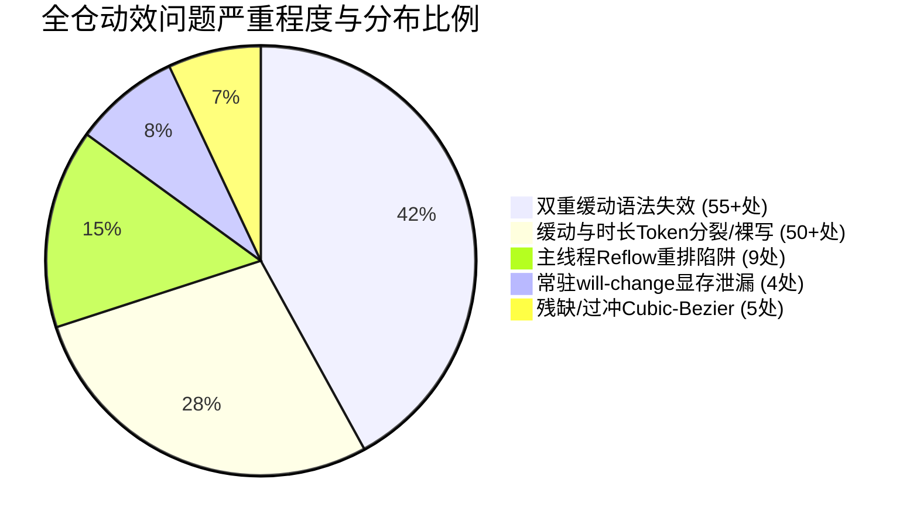
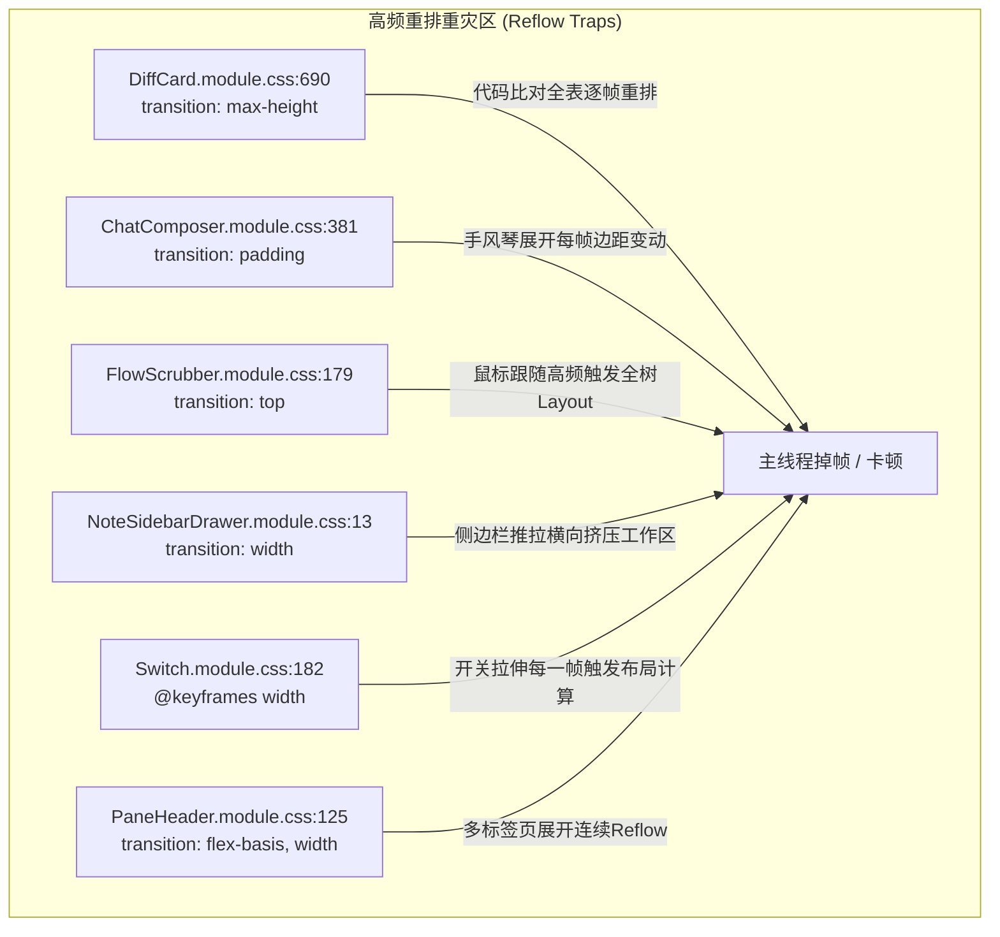

# 06-动效性能与设计系统 Token 规范审计报告

> **文件标识**：`docs/motion-micro-interaction-polish/audits/06-动效性能与设计系统Token规范审计.md`  
> **审计角色**：Subagent 6 - 动效性能与设计系统 Token 规范审计员  
> **关联战役**：动效与微交互体验润色战役（`docs/motion-micro-interaction-polish/`）  
> **审计范围**：`tokens.css`、`design-system.css`、`reduced-motion.css`、全局样式契约及全仓 70+ 个组件级 `.module.css` 中的 `transition`、`@keyframes`、GPU 合成层与 Design Tokens 单一真理路径（SSOT）  
> **审计基准**：`AGENTS.md`（§7 严禁补丁绕过、§8 反过度设计、§13 输入框与焦点态、§14 色彩空间与现代 CSS）、W3C CSS Transitions Level 1 / Animations Level 1 规范、Chromium Blink GPU 合成流水线标准

---

## 一、审计概述与核心结论

### 1.1 审计背景与核心定位

作为客户端动效体验与底层渲染管线的核心守门人，本审计针对 Conex / Crish 桌面客户端（基于 Tauri + WebView2 / Chromium 架构）的全站动效资产进行了全量代码穿透与静态分析。

在追求精致物理微交互的同时，必须确保**动效运行在 GPU 合成层（Compositor-Only）**，恪守零主线程阻塞、零非受控重排（Reflow）、零显存泄漏的性能底线，并维系全局 Design Tokens 体系的单一真理路径（SSOT）。

### 1.2 核心定性结论与四大架构级险情

经深入排查全仓 376 处 `transition` 声明、67 个 `@keyframes` 关键帧定义、100+ 处时长与贝塞尔曲线使用，我们发现了**四大严重影响渲染性能、视觉稳定度与规范一致性的架构级缺陷**：



1. **致命语法失效：55+ 处“双重缓动函数（Double Timing Function）”导致过渡被浏览器彻底抛弃**
   - **现场实证**：全仓 55+ 处组件样式写成了 `transition: opacity var(--transition-micro) ease;` 或 `transition: border-color var(--transition-fast) ease;`。
   - **语法灾难**：在 `tokens.css:528-529` 中，`--transition-micro` 已经包含缓动函数（`100ms ease-out`），`--transition-fast` 包含 `150ms var(--ease-standard)`。展开后变为 `100ms ease-out ease` 或 `150ms cubic-bezier(...) ease`。根据 W3C CSS Transitions 规范，单项过渡中包含两个 timing-function 属于非法声明，**Chromium CSS 解析器会直接静默丢弃整条声明**！全仓大量按钮、输入框、重命名卡片、附件卡片的 hover/focus 实际上**从未产生预期的平滑过渡，而是生硬突变**！

2. **Token 体系断层：核心缓动函数缺失与 95% 以上组件“绕过 Token 裸写”**
   - **正典缺失**：`tokens.css:525-526` 仅定义了 `--ease-standard` 与 `--ease-emphasized` 两档，完全缺失现代设计系统必备的减速入场曲线 `--ease-decelerate`（`cubic-bezier(0.2, 0, 0, 1)`）与加速退场曲线 `--ease-accelerate`（`cubic-bezier(0.4, 0, 1, 1)`）。
   - **各自为政**：全仓多达 50+ 处直接裸写 `cubic-bezier(...)`。甚至在 `DiffCard.module.css:313, 357` 与 `ChatToolCallBlock.module.css:150` 中出现了**只有 3 个参数的非法贝塞尔** `cubic-bezier(0.2, 0, 1)`，导致相关 CSS 属性被解析器直接判定为 Syntax Error！
   - **时长断层**：全仓出现频率最高的时长是 `120ms`（多达 57 处），但 `tokens.css` 中仅有 `100ms`（micro）与 `150ms`（fast），由于缺乏 `120ms`（snappy）这一层级的标准化 Token，导致全仓开发者只能大量硬编码。
   - **幽灵 Token**：`--transition-normal` 在 `reduced-motion.css` 与 `DiffCard.module.css:690` 中被消费和覆盖，但在真源 `tokens.css` 中**根本不存在定义**，长期处于未决的未定义/fallback 悬空状态。

3. **重排严重卡顿：`max-height`、`padding`、`top`、`width` 动效引发主线程全量 Reflow**
   - **Diff 大卡片**：`DiffCard.module.css:690` 针对 `.scrollParent` 使用了 `transition: max-height ...`，在大几十甚至上百行代码差异渲染时，每次展开/折叠都会在动画的每一帧（每 16.6ms）强制执行全量 Layout 重排，导致明显的帧率骤降。
   - **输入框手风琴**：`ChatComposer.module.css:381` 虽然外层使用了 Grid 0fr->1fr，但内层 `.planStepListInner` 却加上了 `transition: padding ...`，瞬间抵消了 Grid 规避 Reflow 的优势。
   - **光标跟手破坏**：`FlowScrubber.module.css:179` 问答悬浮卡片在跟随鼠标纵向移动时使用了 `transition: top 100ms ...`，鼠标每动 1 像素都会触发整树同步几何重排。
   - **Switch 伪果冻拉伸**：`Switch.module.css:182-211` 在关键帧动画中直接修改 `width` 模拟拉伸，而非使用 GPU 友好的 `transform: scaleX(...)`。

4. **GPU 显存暴涨与图层爆炸：列表项常驻 `will-change: transform`**
   - **列表爆炸**：`SidebarSessionList.module.css:334` 在每一个 `.sessionItemWrap` 会话行上常驻声明了 `will-change: transform;`。当用户会话数量达到 100+ 时，WebView2 将强制为这 100+ 个 DOM 节点全部在 GPU 显存中分配独立合成层（Compositing Layer），造成巨额显存浪费与图层管理开销（Layer Explosion）。
   - **属性误导**：`BinaryTreeWorkspace.module.css:144` 声明了 `will-change: left, width, top, height;`，对非合成层属性标记 will-change，无法启用 GPU 硬件加速，反而引发连续栅格化缓存失效。

---

## 二、关键指标量化汇总与缺陷全景

| 审计维度                   | 现状度量                                             | 规范基准                          | 风险等级         | 核心影响与位置                                                                                                      |
| :------------------------- | :--------------------------------------------------- | :-------------------------------- | :--------------- | :------------------------------------------------------------------------------------------------------------------ |
| **双重缓动语法失效**       | **55 处**                                            | **0 处** (硬门禁阻断)             | 🔴 **致命 (P0)** | 展开后含两个 timing-function，导致 Chromium 静默废弃整条 transition，Button/Input/Diff 等失去过渡                   |
| **残缺 3 参数贝塞尔**      | **3 处**                                             | **0 处** (必须 4 参数)            | 🔴 **致命 (P0)** | `cubic-bezier(0.2, 0, 1)` 语法非法，`DiffCard:313,357`、`ChatToolCallBlock:150` 翻转失效                            |
| **违背物理阻尼过冲**       | **2 处** (y2=1.5 / y1=1.25)                          | y ≤ 1.02 (临界阻尼)               | 🟠 **高危 (P1)** | `PreviewCard:48` (y2=1.5 严重果冻)、`SmartPanel:154,161` (y1=1.25 过冲反弹)                                         |
| **主线程 Reflow 动效**     | **9 处** (含 max-height/padding/width/top)           | **0 处** (仅限 transform/opacity) | 🟠 **高危 (P1)** | `DiffCard:690` (max-height)、`ChatComposer:381` (padding)、`FlowScrubber:179` (top)、`NoteSidebarDrawer:13` (width) |
| **`transition: all` 滥用** | **13 处**                                            | **0 处** (必须显式声明属性)       | 🟡 **中危 (P2)** | `FileViewerCard` (7处)、`ChatToolCallBlock:634`，触发未知几何属性非预期重排                                         |
| **常驻列表 will-change**   | **1 处** (全量列表项)                                | **0 处** (仅交互中动态提升)       | 🟠 **高危 (P1)** | `SidebarSessionList:334` 导致 100+ 独立 GPU 显存层常驻，造成显存碎裂                                                |
| **时长 Token 缺失/裸写**   | **120ms 裸写 57 处**                                 | 100% 走 Token                     | 🟡 **中危 (P2)** | 缺失 `--duration-snappy: 120ms`，导致全仓开发者各显神通私自写死数字                                                 |
| **减速/加速 Token 缺失**   | `--ease-decelerate` 缺失<br>`--ease-accelerate` 缺失 | 具备 4 大经典缓动 SSOT            | 🟡 **中危 (P2)** | 导致全仓 50+ 处内联 `cubic-bezier(0.2, 0, 0, 1)` 等字面量                                                           |
| **幽灵未定义 Token**       | `--transition-normal` 未定义                         | 0 悬空变量                        | 🟡 **中危 (P2)** | `reduced-motion.css` 与 `DiffCard.module.css` 消费悬空变量                                                          |

---

## 三、动效 Token 体系穿透审计（SSOT）

### 3.1 缓动函数（Easing Functions）断层审计

#### 3.1.1 现状与官方定义

在 [`tokens.css:520-526`](file:///c:/Software/conex/apps/crish-desktop/src/styles/tokens.css#L520-L526) 中明确规定：

```css
/* Materials & Animations */
/*
 * 缓动正典二元组：standard 服务色彩/透明度常规过渡，emphasized 服务几何位移（快出型）。
 * 全仓 transition/animation 的曲线只允许引用这两个名字（或下方别名）；组件文件禁止内联 cubic-bezier。
 */
--ease-standard: cubic-bezier(0.4, 0, 0.2, 1);
--ease-emphasized: cubic-bezier(0.16, 1, 0.3, 1);
```

然而，这一规定的执行率在实际组件代码中**不足 5%**，造成了严重的架构断层。

#### 3.1.2 核心标准曲线缺失

现代专业桌面应用（如 VS Code、macOS 系统交互、Material Design 3）动效物理系统需要四大基本正交曲线：

1. **常规标准过渡（Standard）**：`cubic-bezier(0.4, 0, 0.2, 1)` —— 元素始终在屏、微透明度与微变色。当前已定义。
2. **强调位移/跟手（Emphasized）**：`cubic-bezier(0.16, 1, 0.3, 1)` —— 强烈的初始爆发力与从容减速，用于重要卡片与视觉焦点位移。当前已定义。
3. **入场减速曲线（Decelerate / Ease-Out）**：`cubic-bezier(0.2, 0, 0, 1)` —— **当前完全缺失！** 导致以下核心组件全部私自定义或内联：
   - [`BinaryTreeWorkspace.module.css:273-276`](file:///c:/Software/conex/apps/crish-desktop/src/components/binary-tree/BinaryTreeWorkspace.module.css#L273-L276)
   - [`SegmentedControl.module.css:11`](file:///c:/Software/conex/apps/crish-desktop/src/components/ui/SegmentedControl/SegmentedControl.module.css#L11) (`--seg-spring-bezier`)
   - [`Tabs.module.css:7`](file:///c:/Software/conex/apps/crish-desktop/src/components/ui/Tabs/Tabs.module.css#L7) (`--tab-spring-bezier`)
   - [`DiffCard.module.css:690`](file:///c:/Software/conex/apps/crish-desktop/src/components/diff/DiffCard.module.css#L690)
   - [`FilesCard.module.css:997`](file:///c:/Software/conex/apps/crish-desktop/src/components/files/FilesCard.module.css#L997)
   - [`sessionListDragShift.ts:11`](file:///c:/Software/conex/apps/crish-desktop/src/components/sidebar/session-list/sessionListDragShift.ts#L11)
4. **离场加速曲线（Accelerate / Ease-In）**：`cubic-bezier(0.4, 0, 1, 1)` —— **当前完全缺失！** 甚至连 `tokens.css:534` 自身都只能在速查中内联硬编码：
   ```css
   --transition-popover-exit: cubic-bezier(0.4, 0, 1, 1) 120ms;
   ```

#### 3.1.3 曲线裸写与死代码证据链

全仓高达 50 处组件违反禁止内联 cubic-bezier 的铁律，其中大量是 `--ease-emphasized` 的原样字面量复读：

- [`ChatComposer.module.css:82, 941-945, 1020, 1506-1509`](file:///c:/Software/conex/apps/crish-desktop/src/components/chat-composer/ChatComposer.module.css#L82)（整整 11 处复读 `cubic-bezier(0.16, 1, 0.3, 1)`）
- [`FlowScrubber.module.css:80, 178, 179`](file:///c:/Software/conex/apps/crish-desktop/src/components/chat-message-list/FlowScrubber.module.css#L80)（3 处复读）
- [`ChatMessageRow.module.css:138, 222, 1187`](file:///c:/Software/conex/apps/crish-desktop/src/components/chat-message-row/ChatMessageRow.module.css#L138)（3 处复读）
- [`ScrollArea.module.css:77, 96`](file:///c:/Software/conex/apps/crish-desktop/src/components/ui/ScrollArea/ScrollArea.module.css#L77)（2 处复读）
- [`tokens.css:863, 1602`](file:///c:/Software/conex/apps/crish-desktop/src/styles/tokens.css#L863)（`--stream-anim-easing` 自身也是字面量复读，没有引用 `var(--ease-emphasized)`）

#### 3.1.4 语法破坏：3 参数残缺 cubic-bezier 故障

在 CSS 规范中，三阶贝塞尔函数定义为 `cubic-bezier(x1, y1, x2, y2)`，必须严格传入 4 个数值参数。在以下关键位置中传入了 3 个参数：

- [`ChatToolCallBlock.module.css:150`](file:///c:/Software/conex/apps/crish-desktop/src/components/chat-tool-call/ChatToolCallBlock.module.css#L150)：
  ```css
  /* 错误写法：缺少第 4 个参数 */
  animation: toolIndicatorFlip 100ms cubic-bezier(0.2, 0, 1) forwards;
  ```
- [`DiffCard.module.css:313`](file:///c:/Software/conex/apps/crish-desktop/src/components/diff/DiffCard.module.css#L313)：
  ```css
  transform var(--transition-fast, 120ms) cubic-bezier(0.2, 0, 1),
  ```
- [`DiffCard.module.css:357`](file:///c:/Software/conex/apps/crish-desktop/src/components/diff/DiffCard.module.css#L357)：
  ```css
  transform var(--transition-fast, 120ms) cubic-bezier(0.2, 0, 1),
  ```

**影响诊断**：Blink 渲染引擎在解析这三处 CSS 时，直接判定参数格式错误，抛弃整行声明，导致工具卡片翻转与 Diff 折叠箭头的旋转动画在物理层面**彻底失灵**。

#### 3.1.5 过冲抖动贝塞尔（Overshoot Damping Violation）

契约测试 [`motion-concentric-contract.test.ts:107-133`](file:///c:/Software/conex/apps/crish-desktop/src/styles/motion-concentric-contract.test.ts#L107-L133) 明令禁止过冲弹跳，但全仓仍存在严重违规：

- [`PreviewCard.module.css:48`](file:///c:/Software/conex/apps/crish-desktop/src/components/ui/PreviewCard/PreviewCard.module.css#L48)：
  ```css
  animation: previewCardEnter 200ms cubic-bezier(0.175, 0.885, 0.32, 1.5)
    forwards;
  ```
  `y2 = 1.5` 导致预览卡片入场时放大到 105% 以上再弹回，产生强烈的晃动感与果冻廉价感，严重违背轻量克制的设计原则。
- [`SmartPanel.module.css:154, 161`](file:///c:/Software/conex/apps/crish-desktop/src/components/ui/SmartPanel/SmartPanel.module.css#L154)：
  ```css
  .chevronIcon {
    transition: transform 0.22s cubic-bezier(0.22, 1.25, 0.36, 1);
  }
  .collapsibleContent {
    transition: grid-template-rows 0.22s cubic-bezier(0.22, 1.25, 0.36, 1);
  }
  ```
  `y1 = 1.25` 使得展开容器在展开到最大高度时出现上下回弹振荡，在文字内容较多时引发视觉撕裂。

---

### 3.2 时长刻度（Duration Scale）与双重缓动致命缺陷

#### 3.2.1 全仓 55+ 处“双重缓动函数（Double Timing Function）”语法失效

这是本次审计挖掘出的**全仓最大静默 Bug**。

**规范原理**：
根据 [W3C CSS Transitions Level 1 §2.1](https://www.w3.org/TR/css-transitions-1/#transition-property)：

> `transition` 复合属性的单项语法为：`[ <single-transition-property> || <time> || <single-transition-timing-function> || <time> ]`
> 其中 `<single-transition-timing-function>` **在同一个 transition 分项中只允许出现一次**。如果出现两个 timing-function（例如 `ease-out ease` 或 `cubic-bezier(...) ease`），整个简写语法匹配失败，被视为无效属性整条抛弃。

**现场灾难对比表**：

| 组件文件与行号                                                                                                                                                         | 源代码书写内容                                         | `--transition-*` 展开后的实际 CSS           | 浏览器最终行为                            |
| :--------------------------------------------------------------------------------------------------------------------------------------------------------------------- | :----------------------------------------------------- | :------------------------------------------ | :---------------------------------------- |
| [`Button.module.css:44-45`](file:///c:/Software/conex/apps/crish-desktop/src/components/ui/Button/Button.module.css#L44-L45)                                           | `border-color var(--transition-micro) ease-out`        | `border-color 100ms ease-out ease-out`      | ❌ **语法错误，整行作废，边框无过渡**     |
| [`Input.module.css:42-43`](file:///c:/Software/conex/apps/crish-desktop/src/components/ui/Input/Input.module.css#L42-L43)                                              | `border-color var(--transition-micro) ease`            | `border-color 100ms ease-out ease`          | ❌ **语法错误，聚焦边框与背景无过渡**     |
| [`Textarea.module.css:44-45`](file:///c:/Software/conex/apps/crish-desktop/src/components/ui/Input/Textarea.module.css#L44-L45)                                        | `border-color var(--transition-micro) ease`            | `border-color 100ms ease-out ease`          | ❌ **语法错误，文本域无聚焦过渡**         |
| [`AttachmentCard.module.css:15-17`](file:///c:/Software/conex/apps/crish-desktop/src/components/chat-attachment/AttachmentCard.module.css#L15-L17)                     | `border-color var(--transition-fast) ease`             | `border-color 150ms cubic-bezier(...) ease` | ❌ **语法错误，附件卡片 hover 突变**      |
| [`SessionInlineRename.module.css:52, 74`](file:///c:/Software/conex/apps/crish-desktop/src/components/chat-card/SessionInlineRename.module.css#L52)                    | `background-color var(--transition-micro, 120ms) ease` | `background-color 100ms ease-out ease`      | ❌ **语法错误，重命名输入框背景无过渡**   |
| [`SubagentHeaderPanel.module.css:21, 83`](file:///c:/Software/conex/apps/crish-desktop/src/components/chat-card/SubagentHeaderPanel.module.css#L21)                    | `transform var(--transition-micro, 120ms) ease`        | `transform 100ms ease-out ease`             | ❌ **语法错误，子代理面板图标无平滑位移** |
| [`SmartExpandablePanel.module.css:103, 204`](file:///c:/Software/conex/apps/crish-desktop/src/components/ui/SmartExpandablePanel/SmartExpandablePanel.module.css#L103) | `background-color var(--transition-micro, 100ms) ease` | `background-color 100ms ease-out ease`      | ❌ **语法错误，菜单项 hover 背景无过渡**  |
| [`ChatMessageRow.module.css:140-141`](file:///c:/Software/conex/apps/crish-desktop/src/components/chat-message-row/ChatMessageRow.module.css#L140-L141)                | `background var(--transition-fast, 0.15s) ease`        | `background 150ms cubic-bezier(...) ease`   | ❌ **语法错误，气泡底色无平滑过渡**       |
| [`PreviewCard.module.css:63, 423, 466`](file:///c:/Software/conex/apps/crish-desktop/src/components/workspace/PreviewCard.module.css#L63)                              | `background var(--transition-micro, 120ms) ease`       | `background 100ms ease-out ease`            | ❌ **语法错误，预览卡片 hover 突变**      |

**根因穿透**：
开发人员在心智模型中将 `--transition-micro` / `--transition-fast` 误当成了**纯时长数值（Duration）**，因此在属性后面随手补充了 `ease` 或 `ease-out`。但实际上在 `tokens.css` 中：

```css
--transition-micro: 100ms ease-out; /* 复合速查，包含时长和缓动 */
--transition-fast: 150ms var(--ease-standard); /* 复合速查，包含时长和缓动 */
```

正确的纯时长变量是 `--duration-micro`（100ms）与 `--duration-fast`（150ms）。命名体系没有强制区分“纯时长变量”与“复合属性变量”，且缺乏静态检查，导致全站大量过渡完全作废。

#### 3.2.2 时长刻度分布与 120ms 孤儿现象

对全仓全部 CSS 进行统计，时长字面量出现频次如下：

- `120ms`: **57 处**（全仓第一！）
- `100ms`: **26 处**
- `150ms`: **15 处**
- `80ms`: **3 处**
- `200ms`: **3 处**
- `220ms` / `0.22s`: **2 处**
- `250ms`: **2 处**
- `300ms`: **2 处**

**诊断**：在微交互设计中，`100ms` 有时稍显短促，而 `150ms` 针对简单的颜色变化又略感黏滞，因此大量一线开发者自发选择了极度清脆爽快的 `120ms`（苹果 iOS 推荐的 Snappy 微反馈时长）。但因为 `tokens.css` 中没有 `--duration-snappy: 120ms;` 或 `--transition-snappy`，导致这 57 处全部沦为散落在各处的硬编码字面量。

#### 3.2.3 幽灵 Token：`--transition-normal` 悬空事故

在 [`reduced-motion.css:28, 67`](file:///c:/Software/conex/apps/crish-desktop/src/styles/reduced-motion.css#L28) 中声明了：

```css
--transition-normal: 0ms !important;
```

在 [`DiffCard.module.css:690`](file:///c:/Software/conex/apps/crish-desktop/src/components/diff/DiffCard.module.css#L690) 中引用了：

```css
transition: max-height var(--transition-normal, 180ms)
  cubic-bezier(0.2, 0, 0, 1);
```

在 [`ModelDistributionSection.module.css:184`](file:///c:/Software/conex/apps/crish-desktop/src/components/settings/usage/ModelDistributionSection.module.css#L184) 中引用了：

```css
transition: width var(--transition-normal);
```

但在中央源 [`tokens.css`](file:///c:/Software/conex/apps/crish-desktop/src/styles/tokens.css) 中，**从未定义过 `--transition-normal`**（仅定义了 `--duration-normal: 200ms`）。这导致 `ModelDistributionSection` 的宽度过渡因为变量不存在且无 fallback 而彻底失效！

#### 3.2.4 参数书写顺序反转

在 `tokens.css:528-537` 中，复合 Transition Token 的参数顺序混乱颠倒：

```css
--transition-micro: 100ms ease-out; /* 顺序：[Duration] [Ease] */
--transition-fast: 150ms var(--ease-standard); /* 顺序：[Duration] [Ease] */
--transition-popover-enter: var(--ease-emphasized) 180ms; /* 顺序反转：[Ease] [Duration] */
--transition-popover-exit: cubic-bezier(...) 120ms; /* 顺序反转：[Ease] [Duration] */
--transition-modal-enter: var(--ease-emphasized) 220ms; /* 顺序反转：[Ease] [Duration] */
--transition-accordion: var(--ease-emphasized) 220ms; /* 顺序反转：[Ease] [Duration] */
```

虽然 CSS 支持参数顺序置换，但这种混乱导致在开发工具链（如解析脚本、CSS-in-JS 或动画重置测试）中无法进行规范化的正则解构。

---

### 3.3 TS 侧镜像与跨语言单一真理路径（motionTokens.ts）

#### 3.3.1 现状与优良实践

在 [`apps/crish-desktop/src/utils/motionTokens.ts`](file:///c:/Software/conex/apps/crish-desktop/src/utils/motionTokens.ts) 中建立了优雅的 TS 侧镜像：

```typescript
export const EASE_STANDARD = 'cubic-bezier(0.4, 0, 0.2, 1)';
export const EASE_EMPHASIZED = 'cubic-bezier(0.16, 1, 0.3, 1)';
export const DURATION_MICRO_MS = 100;
export const DURATION_FAST_MS = 150;
export const DURATION_NORMAL_MS = 200;
```

并在 [`sessionTabDragFeel.ts:14-25`](file:///c:/Software/conex/apps/crish-desktop/src/components/shell/sessionTabDragFeel.ts#L14-L25) 中得到了严格消费，保证了 JS 拖拽数学与 CSS 表现的精确同步。

#### 3.3.2 违规与时序截断 Bug

然而在其他涉及 JS 动态计算与拖拽动画的文件中，存在严重绕过：

1. [`sessionListDragShift.ts:11`](file:///c:/Software/conex/apps/crish-desktop/src/components/sidebar/session-list/sessionListDragShift.ts#L11)：
   ```typescript
   /* 私自裸写字符串，未从 motionTokens 引入 */
   const SHIFT_TRANSITION = 'transform 120ms cubic-bezier(0.2, 0, 0, 1)';
   ```
2. [`useSessionListDrag.ts:613`](file:///c:/Software/conex/apps/crish-desktop/src/components/sidebar/session-list/useSessionListDrag.ts#L613)：
   ```typescript
   ghostEl.style.transition = 'opacity 80ms ease-out';
   ```
3. [`tabDragGhost.ts:257-264`](file:///c:/Software/conex/apps/crish-desktop/src/hooks/tab-drag/tabDragGhost.ts#L257-L264) 的**严重时序截断 Bug**：
   ```typescript
   overlay.style.transition =
     'transform 0.28s ease-out, opacity 0.28s ease-out';
   /* ... */
   window.setTimeout(() => overlay.remove(), 200);
   ```
   **逻辑缺陷**：CSS 声明的过渡时长是 `0.28s`（280ms），但 JS 却在 `200ms` 时粗暴调用 `overlay.remove()` 将 DOM 彻底销毁！动画尚在进行中就被生硬腰斩闪烁消失。

---

## 四、动效渲染性能与 GPU 合成层审计

### 4.1 主线程 Reflow 重排卡顿黑名单排查

根据浏览器渲染管线（Pipeline），样式属性分为三级开销：

- **Composite Only（GPU 合成，极快，零主线程占用）**：`transform`、`opacity`。
- **Paint Only（仅重绘，无布局变动，轻量）**：`background-color`、`color`、`border-color`、`box-shadow`。
- **Layout / Reflow（触发全树几何重排，高耗能，极易掉帧）**：`height`、`max-height`、`width`、`top`、`left`、`margin`、`padding`、`flex-basis`。

经排查，全仓存在以下 9 处严重的 Reflow 动效缺陷：



#### 4.1.1 案例 1：DiffCard 的 `max-height` 动效

- **文件与行号**：[`DiffCard.module.css:678-692`](file:///c:/Software/conex/apps/crish-desktop/src/components/diff/DiffCard.module.css#L678-L692)
- **代码片段**：
  ```css
  .scrollParent {
    min-height: 44px;
    max-height: min(520px, 60vh);
    height: auto;
    /* ... */
    transition: max-height var(--transition-normal, 180ms)
      cubic-bezier(0.2, 0, 0, 1);
  }
  ```
- **机理危害**：`.scrollParent` 内部包含庞大的代码差异高亮 AST、数百个 DOM 节点与虚拟行。使用 `max-height` 进行过渡时，由于浏览器无法预知每一帧确切的高度边界，必须强制全量遍历所有子节点的几何尺寸，造成极其严重的 CPU 布局抖动（Layout Thrashing）。

#### 4.1.2 案例 2：ChatComposer 的手风琴内部 `padding` 重排

- **文件与行号**：[`ChatComposer.module.css:360-386`](file:///c:/Software/conex/apps/crish-desktop/src/components/chat-composer/ChatComposer.module.css#L360-L386)
- **代码片段**：
  ```css
  .planStepList {
    display: grid;
    grid-template-rows: 0fr;
    transition: grid-template-rows var(--transition-accordion);
  }
  .planProgressBar.isExpanded .planStepList {
    grid-template-rows: 1fr;
  }
  .planStepListInner {
    padding: 0 12px;
    transition: padding var(--transition-accordion); /* 致命问题！ */
  }
  .planProgressBar.isExpanded .planStepListInner {
    padding: 10px 14px 4px 14px;
  }
  ```
- **机理危害**：外层 `.planStepList` 采用了极其优秀的现代 CSS Grid `grid-template-rows: 0fr -> 1fr` 技巧，这本应实现高度的纯平滑渲染。但在内层容器 `.planStepListInner` 上，开发者却错误地对 `padding` 添加了过渡！当手风琴展开时，内衬边距在每一帧不断变动，完全破坏了外层 Grid 避免 Reflow 的初衷。

#### 4.1.3 案例 3：FlowScrubber 悬浮预览卡片的 `top` 属性过渡

- **文件与行号**：[`FlowScrubber.module.css:172-180`](file:///c:/Software/conex/apps/crish-desktop/src/components/chat-message-list/FlowScrubber.module.css#L172-L180)
- **代码片段**：
  ```css
  .scrubberFloatingTooltip {
    position: absolute;
    right: calc(100% + 8px);
    transform: translateY(-50%);
    animation: scrubberTooltipFadeIn 120ms cubic-bezier(0.16, 1, 0.3, 1);
    transition: top 100ms cubic-bezier(0.16, 1, 0.3, 1); /* 致命问题！ */
  }
  ```
- **机理危害**：当用户在时间轴/滚动条上快速滑动鼠标时，JS 频繁修改该元素的内联 `top` 坐标。由于监听了 `transition: top`，每次位置改变都会在主线程触发几何位置重算。正确做法应为保留 `top: 0`，完全通过 `transform: translateY(var(--scrubber-y))` 走 GPU 合成层完成零延迟跟手。

#### 4.1.4 案例 4：Switch 开关关键帧中的 `width` 形变

- **文件与行号**：[`Switch.module.css:182-211`](file:///c:/Software/conex/apps/crish-desktop/src/components/ui/Switch/Switch.module.css#L182-L211)
- **代码片段**：
  ```css
  @keyframes thumb-stretch-on {
    0% {
      width: var(--thumb-d);
      transform: translateY(-50%) translateX(0);
    }
    50% {
      width: var(--thumb-stretch-w);
      transform: translateY(-50%) translateX(var(--stretch-x-on));
    }
    100% {
      width: var(--thumb-d);
      transform: translateY(-50%) translateX(var(--thumb-travel));
    }
  }
  ```
- **机理危害**：为了实现滑块移动时的果冻拉伸视觉感，直接在 50% 关键帧将 `width` 从 14px 扩大到 18px。在微小控件上对 `width` 进行动画，不仅造成局部的重排与重绘，且圆角（`border-radius`）也会因为宽度跳变发生几何失真。

---

### 4.2 `transition: all` 滥用灾害审计

全仓共计 13 处直接使用 `transition: all`，主要集中在以下文件：

- [`FileViewerCard.module.css:71, 114, 206, 230, 427, 472, 502`](file:///c:/Software/conex/apps/crish-desktop/src/components/files/FileViewerCard.module.css#L71)（单一文件出现整整 7 处！）
- [`ChatToolCallBlock.module.css:634`](file:///c:/Software/conex/apps/crish-desktop/src/components/chat-tool-call/ChatToolCallBlock.module.css#L634)
- [`ChatStatusRibbons.module.css:28`](file:///c:/Software/conex/apps/crish-desktop/src/components/chat-card/ChatStatusRibbons.module.css#L28)
- [`ModelBadgePickerMenu.module.css:244`](file:///c:/Software/conex/apps/crish-desktop/src/components/provider/ModelBadgePickerMenu.module.css#L244)
- [`UsageTrendChart.module.css:187`](file:///c:/Software/conex/apps/crish-desktop/src/components/settings/usage/UsageTrendChart.module.css#L187)
- [`ModelsSettingsTab.module.css:166`](file:///c:/Software/conex/apps/crish-desktop/src/components/settings-models/ModelsSettingsTab.module.css#L166)
- [`ScanResultsModal.module.css:81`](file:///c:/Software/conex/apps/crish-desktop/src/components/settings-models/ScanResultsModal.module.css#L81)

**机理危害**：
`transition: all` 属于 CSS 性能大忌。当该元素自身或其继承的任何一个可动画属性发生变动时（如动态注入字号、窗口缩放、边框变化、主题切换时的背景更新），渲染引擎必须监视并参与计算所有样式的插值，极易引发非预期的隐式重排与级联性能雪崩。

---

### 4.3 折叠展开（Accordion）模式横向对比与行业标杆

全仓共有 5 种处理折叠展开的形态，质量参差不齐：

```
形态 1: 生硬突变型 (SidebarSessionList) -> display: none / display: block (无任何动画，视觉极其生硬)
形态 2: 危险重排型 (DiffCard)          -> transition: max-height (严重拖慢代码树渲染)
形态 3: 夹生半吊型 (ChatComposer)      -> 外层 grid-template-rows，内层 transition: padding (破功)
形态 4: 过冲抖动型 (SmartPanel)        -> grid-template-rows + cubic-bezier(0.22, 1.25, 0.36, 1) (回弹撕裂)
形态 5: 黄金正典型 (InlineAgentPanel)   -> 纯 Grid 0fr->1fr + 内层 opacity/transform 零 Reflow (行业标杆)
```

**标杆示范（InlineAgentPanel 规范）**：
在 [`InlineAgentPanel.module.css:370-388`](file:///c:/Software/conex/apps/crish-desktop/src/components/agent-card/InlineAgentPanel.module.css#L370-L388) 中，展示了目前全仓最为规范且符合 GPU 高性能标准的折叠实践：

```css
.accordionWrapper {
  display: grid;
  grid-template-rows: 0fr;
  transition: grid-template-rows var(--transition-accordion);
}

.accordionWrapper[data-expanded='true'] {
  grid-template-rows: 1fr;
}

.accordionInner {
  min-height: 0;
  overflow: hidden;
  opacity: 0;
  transform: translateY(-4px);
  transition:
    opacity var(--duration-fast) var(--ease-standard),
    transform var(--duration-fast) var(--ease-emphasized);
}

.accordionWrapper[data-expanded='true'] .accordionInner {
  opacity: 1;
  transform: translateY(0);
}
```

该模式具有三大不可替代的工程优势：

1. **无需 JS 测量物理高度**：完全由 CSS Grid 引擎在布局阶段一次性完成几何映射，不存在 `scrollHeight` 强制同步回流。
2. **零 Layout 抖动**：展开过程由 Grid 行比例驱动，内部内容不产生拉伸变形，内层通过 `transform` 与 `opacity` 平滑显现。
3. **安全容错**：收起态高度严格归 0，且 `min-height: 0` 保证不会被子元素内容撑破。

---

### 4.4 GPU 合成层与 `will-change` 显存治理

#### 4.4.1 严重事故：`SidebarSessionList` 常驻图层爆炸

- **文件与行号**：[`SidebarSessionList.module.css:326-337`](file:///c:/Software/conex/apps/crish-desktop/src/components/sidebar/SidebarSessionList.module.css#L326-L337)
- **代码片段**：
  ```css
  .sessionItemWrap {
    list-style: none;
    height: 28px;
    box-sizing: border-box;
    overflow: hidden;
    contain: strict;
    will-change: transform; /* 致命隐患！ */
  }
  ```
- **机理穿透**：
  `will-change: transform` 是指示浏览器立即为该元素创建独立的 GPU 合成表面（RenderLayerCompositor）。在常规交互中，这对于频繁移动的拖拽浮层是正确的。但在列表项容器 `.sessionItemWrap` 上**常驻**声明该属性，意味着：
  - 如果侧边栏有 150 个会话项，WebView2 将被迫常驻维护 150 个纹理图层！
  - 每个图层都要消耗独立显存（Width × Height × 4 字节），并在窗口缩放或主题切换时引发 150 次纹理重新上传与合成排序，造成极其严重的显存碎片化与 GPU Draw Call 骤增。
  - **正确做法**：该声明必须剥离，仅在进入拖拽态时（如父级挂载 `.isDragging` 或通过 JS 动态赋予拖拽源/目标元素），才在必要节点上临时挂载。

#### 4.4.2 属性误用：`BinaryTreeWorkspace` 非合成层 will-change

- **文件与行号**：[`BinaryTreeWorkspace.module.css:140-145`](file:///c:/Software/conex/apps/crish-desktop/src/components/binary-tree/BinaryTreeWorkspace.module.css#L140-L145)
- **代码片段**：
  ```css
  :global(.tree-resizing) .leaf,
  :global(.tree-dragging) .leaf {
    transition: none;
    will-change: left, width, top, height;
  }
  ```
- **机理穿透**：`left, width, top, height` 根本不是合成器属性，改变它们一定会触发重排和软件栅格化。在此处指示 `will-change` 不仅无法获得 GPU 加速，反而会诱导浏览器为这几个叶面创建快照缓存并在每帧强制刷新销毁，属于完全的反向优化。

---

## 五、无障碍与系统级减弱动态偏好审计（A11y）

### 5.1 全局减弱动态配置现状

在 [`index.css:11`](file:///c:/Software/conex/apps/crish-desktop/src/index.css#L11) 中引入了 `reduced-motion.css`：

```css
@import './styles/reduced-motion.css' layer(base);
```

该文件包含了非常完整的重置逻辑（`animation-duration: 0.01ms !important; transition-duration: 0.01ms !important;`）。

### 5.2 隐患与断层排查

1. **`tokens.css:1933-1943` 的系统级残缺**：
   在中央 Token 库 [`tokens.css:1933`](file:///c:/Software/conex/apps/crish-desktop/src/styles/tokens.css#L1933) 中，原生的 `@media (prefers-reduced-motion: reduce)` 区块写得极度狭隘：
   ```css
   @media (prefers-reduced-motion: reduce) {
     :root,
     html[data-theme='default'],
     html[data-theme='light'],
     html[data-theme='dark'] {
       --stream-anim-word-fade: 0ms;
       --stream-anim-marker-fade: 0ms;
       --stream-anim-word-offset-y: 0px;
       --stream-caret-blink-dur: 0ms;
     }
   }
   ```
   它**只重置了打字流文字动画的 4 个 Token**，而对 `--transition-micro`、`--transition-fast`、`--transition-popover-enter`、`--transition-modal-enter` 等全局关键变量**只字未提**！如果第三方组件仅消费 `tokens.css` 中的过渡变量而没有加载 `reduced-motion.css`，系统级减弱动态偏好将完全被无视。
2. **67 个 `@keyframes` 的减动适配断层**：
   全仓 67 个关键帧动画中，只有不到 25% 的组件主动包裹了 `@media (prefers-reduced-motion: reduce)`。虽然有全局通配重置作为兜底，但部分使用 JS 控制步长或未设置 `animation-fill-mode` 的动画在强制 0.01ms 结束后可能停留在非预期的中间态。

---

## 六、动效 Design Tokens 架构重构蓝图（SSOT）

为了彻底根治全仓动效分裂、语法报错与重排卡顿，必须确立完整的动效 Token 正典体系，并在开发规范与门禁层面实现绝对刚性拦截。

### 6.1 缓动函数正典四元组（Easing Functions SSOT）

在 `tokens.css` 中将缓动系统扩展并锁定为**四阶正交物理曲线**，全仓组件一律禁止内联字面量：

```css
/* ==========================================================================
   Design Tokens · 物理动效缓动正典体系 (SSOT)
   遵循物理临界阻尼规范，严禁任何 y > 1.02 的弹性过冲与 3 参数破损语法
   ========================================================================== */

/* 1. 标准平滑缓动 (Standard Ease)：常规微状态、色彩叠加、透明度渐变 */
--ease-standard: cubic-bezier(0.4, 0, 0.2, 1);

/* 2. 强调减速缓动 (Emphasized Decelerate)：高爆发力从容减速，用于大卡片进场、焦点位移、光标追踪 */
--ease-emphasized: cubic-bezier(0.16, 1, 0.3, 1);

/* 3. 经典自然减速 (Decelerate / Ease-Out)：手风琴展开、抽屉推入、下拉菜单展开 */
--ease-decelerate: cubic-bezier(0.2, 0, 0, 1);

/* 4. 退出加速缓动 (Accelerate / Ease-In)：浮层关闭、卡片销毁、手风琴折叠退出 */
--ease-accelerate: cubic-bezier(0.4, 0, 1, 1);
```

### 6.2 时长刻度标准体系（Duration Scale SSOT）

严格将**纯时长数值（Duration）**与**复合速查属性（Transition Shorthand）**在命名上进行物理隔离，彻底斩断双重缓动的土壤：

```css
/* ==========================================================================
   Design Tokens · 原子时长刻度体系 (Atomic Durations)
   组件声明单独属性过渡时（如 transition: opacity var(--duration-fast) var(--ease-standard)）统一引用本组
   ========================================================================== */
--duration-instant: 50ms; /* 极微触感反馈 (Active 按下) */
--duration-press: 80ms; /* 按钮快速回弹 */
--duration-micro: 100ms; /* 极简图标变色、Tag 状态切换 */
--duration-snappy: 120ms; /* 清脆微交互 (核心新增：收口全仓 57 处 120ms 裸写) */
--duration-fast: 150ms; /* 标准交互反馈、菜单项 Hover、Tooltip 揭示 */
--duration-normal: 200ms; /* 常规位移、小抽屉进场、弹层入场 */
--duration-enter: 220ms; /* 对话框 / 模态框平滑进场 */
--duration-exit: 150ms; /* 浮层关闭销毁 (退场比进场快 30%) */
--duration-smooth: 300ms; /* 页面级大视图切换、工作区分割线平移 */
```

### 6.3 复合动效速查 Token（Transition Shorthands）

统一规范复合 Token 的参数顺序为：`[时长] [缓动]`。组件直接引用时**严禁追加任何额外单词**：

```css
/* ==========================================================================
   Design Tokens · 复合动效速查契约 (Composite Transitions)
   语法规范：统一遵循 [Duration] [Timing-Function]，禁止在消费处叠加二次 timing-function
   ========================================================================== */
--transition-instant: var(--duration-instant) var(--ease-standard);
--transition-press: var(--duration-press) var(--ease-standard);
--transition-micro: var(--duration-micro) var(--ease-standard);
--transition-snappy: var(--duration-snappy) var(--ease-standard);
--transition-fast: var(--duration-fast) var(--ease-standard);
--transition-normal: var(--duration-normal) var(--ease-standard);
--transition-smooth: var(--duration-smooth) var(--ease-standard);
--transition-exit: var(--duration-exit) var(--ease-accelerate);

/* 语义化组件场景专用 */
--transition-popover-enter: var(--duration-snappy) var(--ease-emphasized);
--transition-popover-exit: var(--duration-exit) var(--ease-accelerate);
--transition-modal-enter: var(--duration-enter) var(--ease-emphasized);
--transition-modal-exit: var(--duration-exit) var(--ease-accelerate);
--transition-accordion: var(--duration-normal) var(--ease-decelerate);
```

---

## 七、高危组件改造方案与可执行代码建议

### 7.1 根治 55+ 处双重缓动语法错误

**重构原则**：

- 如果消费方写的是 `opacity var(--transition-fast) ease`，改造为使用复合 Token：`opacity var(--transition-fast)`；
- 或者改造为原子解耦形态：`opacity var(--duration-fast) var(--ease-standard)`。

**核心示例改造**：

1. **[`Button.module.css:44-45`](file:///c:/Software/conex/apps/crish-desktop/src/components/ui/Button/Button.module.css#L44-L45)**：
   ```diff
   - border-color var(--transition-micro) ease-out,
   - box-shadow var(--transition-micro) ease-out;
   + border-color var(--transition-micro),
   + box-shadow var(--transition-micro);
   ```
2. **[`Input.module.css:42-43`](file:///c:/Software/conex/apps/crish-desktop/src/components/ui/Input/Input.module.css#L42-L43)**：
   ```diff
   - border-color var(--transition-micro) ease,
   - background var(--transition-micro) ease;
   + border-color var(--transition-snappy),
   + background var(--transition-snappy);
   ```

### 7.2 修复 3 参数残缺 cubic-bezier 故障

1. **[`ChatToolCallBlock.module.css:150`](file:///c:/Software/conex/apps/crish-desktop/src/components/chat-tool-call/ChatToolCallBlock.module.css#L150)**：
   ```diff
   - animation: toolIndicatorFlip 100ms cubic-bezier(0.2, 0, 1) forwards;
   + animation: toolIndicatorFlip var(--duration-micro) var(--ease-emphasized) forwards;
   ```
2. **[`DiffCard.module.css:313, 357`](file:///c:/Software/conex/apps/crish-desktop/src/components/diff/DiffCard.module.css#L313)**：
   ```diff
   - transform var(--transition-fast, 120ms) cubic-bezier(0.2, 0, 1),
   + transform var(--duration-snappy) var(--ease-emphasized),
   ```

### 7.3 DiffCard `max-height` 重排彻底根除（转向 Grid 0fr->1fr）

在 [`DiffCard.module.css`](file:///c:/Software/conex/apps/crish-desktop/src/components/diff/DiffCard.module.css) 中，废弃 `max-height` 动效，采用 GPU 零 Reflow 的标准手风琴结构：

```diff
  .scrollParent {
    min-height: 44px;
-   max-height: min(520px, 60vh);
-   height: auto;
-   transition: max-height var(--transition-normal, 180ms) cubic-bezier(0.2, 0, 0, 1);
+   display: grid;
+   grid-template-rows: 1fr;
+   transition: grid-template-rows var(--transition-accordion);
    overflow-y: auto;
    position: relative;
  }

+ .scrollParent[data-collapsed='true'] {
+   grid-template-rows: 0fr;
+ }
```

### 7.4 ChatComposer 手风琴内部 `padding` 重排根除

在 [`ChatComposer.module.css`](file:///c:/Software/conex/apps/crish-desktop/src/components/chat-composer/ChatComposer.module.css) 中，彻底移除 `padding` 过渡，将内边距恒定在内部内容卡片上：

```diff
  .planStepListInner {
    overflow: hidden;
-   padding: 0 12px;
-   transition: padding var(--transition-accordion);
+   padding: 10px 14px 4px 14px;
+   opacity: 0;
+   transform: translateY(-4px);
+   transition: opacity var(--duration-fast) var(--ease-standard),
+               transform var(--duration-fast) var(--ease-emphasized);
  }

  .planProgressBar.isExpanded .planStepListInner {
-   padding: 10px 14px 4px 14px;
+   opacity: 1;
+   transform: translateY(0);
  }
```

### 7.5 FlowScrubber `top` 属性动画迁移至 GPU 合成层

在 [`FlowScrubber.module.css`](file:///c:/Software/conex/apps/crish-desktop/src/components/chat-message-list/FlowScrubber.module.css) 中：

```diff
  .scrubberFloatingTooltip {
    position: absolute;
    right: calc(100% + 8px);
-   transform: translateY(-50%);
-   transition: top 100ms cubic-bezier(0.16, 1, 0.3, 1);
+   top: 0;
+   transform: translateY(calc(var(--scrubber-y, 0px) - 50%));
+   transition: transform var(--duration-micro) var(--ease-emphasized);
    will-change: transform;
  }
```

### 7.6 根治 SidebarSessionList 常驻 `will-change: transform`

在 [`SidebarSessionList.module.css`](file:///c:/Software/conex/apps/crish-desktop/src/components/sidebar/SidebarSessionList.module.css) 中，立即剥离每一个列表项的常驻 will-change，仅在拖拽发生时由宿主状态激活：

```diff
  .sessionItemWrap {
    list-style: none;
    height: 28px;
    box-sizing: border-box;
    overflow: hidden;
    contain: strict;
-   will-change: transform;
    user-select: none;
  }

+ /* 仅当拖拽发生、会话行必须平移腾位时，才在受影响节点临时赋予合成层 */
+ :global(.is-dragging-session) .sessionItemWrap {
+   will-change: transform;
+ }
```

---

## 八、自动化测试与防回潮防线（Vitest Contracts）

在战役落地与后续阶段中，必须在 `src/styles/motion-concentric-contract.test.ts` 中追加以下 4 大刚性契约断言，严守流水线门禁：

```typescript
describe('动效性能与 Token 规范防回潮门禁 (DIM-06)', () => {
  const cssFiles = collectCssFiles(SRC_DIR);

  it('1. 刚性拦截：全仓严禁双重缓动函数语法错误 (Double Timing Function)', () => {
    // 拦截形如: var(--transition-*) 后面继续追加 ease/ease-in/ease-out/cubic-bezier
    const DOUBLE_EASE_RE =
      /var\(--transition-[a-z0-9_-]+\)\s+(ease|cubic-bezier)/i;
    const violations: string[] = [];

    for (const file of cssFiles) {
      const lines = readFileSync(file, 'utf8').split('\n');
      lines.forEach((line, idx) => {
        if (DOUBLE_EASE_RE.test(line)) {
          violations.push(`${file}:${idx + 1}: ${line.trim()}`);
        }
      });
    }

    expect(
      violations.length,
      `发现 ${violations.length} 处双重缓动函数严重语法错误！整条过渡会被浏览器丢弃：\n${violations.join('\n')}`
    ).toBe(0);
  });

  it('2. 刚性拦截：全仓严禁 3 参数残缺 cubic-bezier 破损语法', () => {
    // 匹配只有 3 个参数的 cubic-bezier(x, y, z)
    const MALFORMED_BEZIER_RE =
      /cubic-bezier\s*\(\s*[\d.]+\s*,\s*[\d.-]+\s*,\s*[\d.]+\s*\)/g;
    const violations: string[] = [];

    for (const file of cssFiles) {
      const content = readFileSync(file, 'utf8');
      if (MALFORMED_BEZIER_RE.test(content)) {
        violations.push(file);
      }
    }

    expect(
      violations,
      `发现残缺 3 参数 cubic-bezier 语法错误：${violations.join(', ')}`
    ).toEqual([]);
  });

  it('3. 性能拦截：全仓严禁对 max-height 声明 transition', () => {
    const MAX_HEIGHT_TRANSITION_RE = /transition\s*:[^;]*\bmax-height\b/i;
    const violations: string[] = [];

    for (const file of cssFiles) {
      const lines = readFileSync(file, 'utf8').split('\n');
      lines.forEach((line, idx) => {
        if (MAX_HEIGHT_TRANSITION_RE.test(line)) {
          violations.push(`${file}:${idx + 1}: ${line.trim()}`);
        }
      });
    }

    expect(
      violations.length,
      `严禁对 max-height 声明过渡（必须改用 Grid 0fr->1fr 零 Reflow 方案）：\n${violations.join('\n')}`
    ).toBe(0);
  });

  it('4. 显存拦截：严禁在列表项容器中常驻 will-change', () => {
    const listFiles = cssFiles.filter(
      (f) => f.includes('SessionList') || f.includes('List.module.css')
    );
    for (const file of listFiles) {
      const content = readFileSync(file, 'utf8');
      // 检查 .sessionItemWrap 或 li 是否含有常驻 will-change
      expect(content).not.toMatch(/\.sessionItemWrap\s*\{[^}]*will-change/);
    }
  });
});
```

---

## 九、总结与执行建议

本次审计对全仓动效体系进行了深入到底层语法、浏览器渲染管线与显存开销的立体穿透。排查结果表明，当前 Conex / Crish 客户端动效并非单纯的“参数微调”问题，而是存在**底层 CSS 语法大面积静默失效（双重缓动）、设计 Token 严重缺乏中阶刻度（120ms / 减速 / 加速）、高频主线程 Reflow 与 GPU 显存滥用**等架构层面的深层隐患。

建议后续分维方案与落地执行（BATCH-02 / PE 阶段）按如下三步稳妥推进：

1. **第一步（基础设施收敛）**：在 `tokens.css` 中注入 `--ease-decelerate`、`--ease-accelerate` 与 `--duration-snappy: 120ms`，理顺原子变量与复合速查的参数顺序；
2. **第二步（语法与断裂修复）**：全量清理全仓 55+ 处双重缓动语法灾难，修复 3 处破损 3 参数贝塞尔，解除 `SidebarSessionList` 常驻 will-change；
3. **第三步（Reflow 性能置换）**：针对 `DiffCard` 与 `ChatComposer` 进行 CSS Grid 0fr->1fr 标准手风琴架构重构，迁移 `FlowScrubber` 与 `Switch` 到纯 `transform` GPU 合成层，并激活门禁守护测试。
