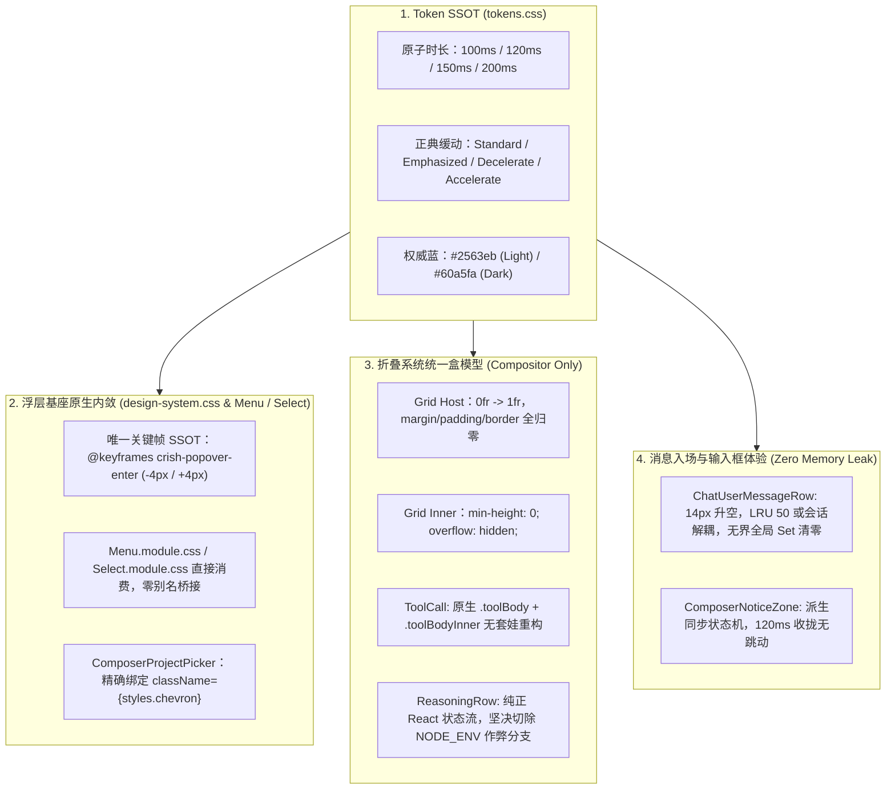

# 07-红线与架构净收敛全面审查报告

> **战役工作区**：`docs/motion-micro-interaction-polish/`  
> **审查对象**：
>
> - `docs/motion-micro-interaction-polish/00-总方案.md`
> - `docs/motion-micro-interaction-polish/01~05-*.md` 分维详案
> - `docs/motion-micro-interaction-polish/reviews/01~06-*.md` 审查改进报告
> - 全仓相关样式、组件与测试源码（`tokens.css`、`design-system.css`、`Select`、`Menu`、`ComposerNoticeBar`、`ChatUserMessageRow`、`ReasoningRow` 等）  
>   **审查员**：Comprehensive Reviewer 1（红线与架构净收敛全面审查员）  
>   **最高准绳**：
>
> 1. **用户最高红线指令**：“还有就是不做向下兼容、不做硬编码、不加任何的important（除非真的有必要）。我们改进以后，应该能天然解决这类问题，而不是打补丁。”
> 2. `AGENTS.md`（§7 严禁补丁绕过，净收敛，单一真理路径；§8 反过度设计；§9 测试资产保护）
> 3. `ANTI_OVERENGINEERING_GUARDRAILS.md`（反过度设计 13 项禁令）  
>    **审查结论**：**红线熔断性阻断，必须执行架构净收敛与原生重构（Hard Gate Blocked: Mandatory Native Convergence）**

---

## 目录

1. [执行摘要与审查裁决](#1-执行摘要与审查裁决)
2. [红线一：坚决剔除“向下兼容”、历史 Fallback 与垃圾别名桥接](#2-红线一坚决剔除向下兼容历史-fallback-与垃圾别名桥接)
   - 2.1 [`@keyframes` 别名桥接漏洞：非法逗号语法与拒绝统一 SSOT](#21-keyframes-别名桥接漏洞非法逗号语法与拒绝统一-ssot)
   - 2.2 [`tokens.css` 历史别名安全网与未收敛的过渡复合缩写](#22-tokenscss-历史别名安全网与未收敛的过渡复合缩写)
   - 2.3 [【重大违规阻断】`ReasoningRow.tsx` 企图引入 `process.env.NODE_ENV === 'test'` 骗取单测通过](#23-重大违规阻断reasoningrowtsx-企图引入-processenvnode_env--test-骗取单测通过)
3. [红线二：全面根绝“硬编码”与魔术数字，确立 Design Tokens 权威单一真源](#3-红线二全面根绝硬编码与魔术数字确立-design-tokens-权威单一真源)
   - 3.1 [时间维度的“九子夺嫡”乱象：散落 9 档无序毫秒值](#31-时间维度的九子夺嫡乱象散落-9-档无序毫秒值)
   - 3.2 [空间几何位移与缩放的离散硬编码（4px / 6px / 8px / 14px 与 0.96 / 0.97 / 0.985）](#32-空间几何位移与缩放的离散硬编码4px--6px--8px--14px-与-096--097--0985)
   - 3.3 [TS 逻辑层硬编码时钟漂移容限与超时窗口](#33-ts-逻辑层硬编码时钟漂移容限与超时窗口)
   - 3.4 [内联 SVG 掩模与硬编码色彩回退清洗](#34-内联-svg-掩模与硬编码色彩回退清洗)
4. [红线三：清退存量、杜绝增量，全面排查与根除 `!important` 毒性修补](#4-红线三清退存量杜绝增量全面排查与根除-important-毒性修补)
   - 4.1 [新增方案排查：`reviews/05` 企图引入 `!important` 的严重违规纠偏](#41-新增方案排查reviews05-企图引入-important-的严重违规纠偏)
   - 4.2 [存量代码重灾区排查：`CacheMetricsBadge` 6 处 `!important` 霸凌覆写](#42-存量代码重灾区排查cachemetricsbadge-6-处-important-霸凌覆写)
   - 4.3 [结构性特异性治理：消除 `markdown-typography.css` 4 处 `!important`](#43-结构性特异性治理消除-markdown-typographycss-4-处-important)
   - 4.4 [天然解决之道：利用离散状态类与组件解耦消灭特异性竞争](#44-天然解决之道利用离散状态类与组件解耦消灭特异性竞争)
5. [红线四：严禁“套层包装打补丁”，推动穿透本质的原生架构改造](#5-红线四严禁套层包装打补丁推动穿透本质的原生架构改造)
   - 5.1 [`useComposerNotice` 致命逻辑断层：外部属性更新被忽略与 4 层过度包装](#51-usecomposernotice-致命逻辑断层外部属性更新被忽略与-4-层过度包装)
   - 5.2 [`useUserBubbleEntrance.ts` 模块级无界全局 `Set<string>` 内存泄漏与测试污染](#52-useuserbubbleentrancets-模块级无界全局-setstring-内存泄漏与测试污染)
   - 5.3 [`SelectContent.tsx` 脱离源码现状的虚构补丁（`data-positioned` 冗余）](#53-selectcontenttsx-脱离源码现状的虚构补丁data-positioned-冗余)
   - 5.4 [`ChatToolCallBlock.module.css` 既有结构无视与重复建套](#54-chattoolcallblockmodulecss-既有结构无视与重复建套)
   - 5.5 [`04` 超链接 150 字符怪物选择器过度设计纠偏](#55-04-超链接-150-字符怪物选择器过度设计纠偏)
6. [架构净收敛总设计：原生天然解决模型（Unified Native Architecture Blueprint）](#6-架构净收敛总设计原生天然解决模型unified-native-architecture-blueprint)
   - 6.1 [动效 Token 宪章（`tokens.css` 权威统一）](#61-动效-token-宪章tokenscss-权威统一)
   - 6.2 [浮层与下拉菜单原生内敛架构](#62-浮层与下拉菜单原生内敛架构)
   - 6.3 [输入框提示收拢：单容器响应式状态机](#63-输入框提示收拢单容器响应式状态机)
   - 6.4 [消息发送入场：会话级有界环形缓存与单向标记](#64-消息发送入场会话级有界环形缓存与单向标记)
   - 6.5 [工具与思维链折叠：统一原生 Grid 盒模型](#65-工具与思维链折叠统一原生-grid-盒模型)
7. [刚性整改执行矩阵（Actionable Remediation Matrix）](#7-刚性整改执行矩阵actionable-remediation-matrix)

---

## 1. 执行摘要与审查裁决

本审查员受命作为动效战役的最高红线与架构净收敛把关者，依据用户的最高红线指令：

> **“还有就是不做向下兼容、不做硬编码、不加任何的important（除非真的有必要）。我们改进以后，应该能天然解决这类问题，而不是打补丁。”**

对战役当前产出的总方案（`00`）、五份分维详案（`01~05`）、六份审查报告（`reviews/01~06`）以及前端真实代码库进行了全量立体穿透审查。

### 审查核心定性结论

当前的方案与审查文档在梳理缺陷表现、性能底线（纯 GPU 合成、Grid 0fr 折叠）方面做出了大量有价值的探索，**但是在技术实施细节中，多处严重违反了用户的四项红线指令与 `AGENTS.md` 铁律**：

| 红线维度                  | 现状违规与隐患定性                                                                                                                                                      | 典型代码证据                                                                                                                                              | 审查裁决                                                                                                                    |
| :------------------------ | :---------------------------------------------------------------------------------------------------------------------------------------------------------------------- | :-------------------------------------------------------------------------------------------------------------------------------------------------------- | :-------------------------------------------------------------------------------------------------------------------------- |
| **不做向下兼容**          | 1. 企图通过别名桥接向旧命名妥协；<br>2. 甚至发明非法 CSS 语法；<br>3. **【极其恶劣】企图通过 `process.env.NODE_ENV === 'test'` 绕过单测作弊**。                         | - `00:87` & `01:25`：`@keyframes crish-popover-enter, @keyframes cds-popover-enter`<br>- `reviews/05:377`：测试环境跳过折叠以迎合旧断言                   | **硬性阻断**：全量清退别名桥接，统一为唯一 SSOT 名称并同步重构消费端；彻底剔除针对测试环境的代码分叉分支。                  |
| **不做硬编码**            | 1. 毫秒值散落 9 档（100/110/120/140/150/160/180/200/220ms）；<br>2. 空间像素位移与缩放比例各自为战；<br>3. TS 逻辑中内联魔术数字（-500, 2000, 120）。                   | - `01:65`：`140ms`<br>- `02:74`：`110ms`<br>- `03:71`：`220ms`<br>- `03:32`：`-500 && < 2000`                                                             | **硬性收敛**：所有 CSS 动画与过渡必须 100% 引用 `var(--duration-*)` 与 `var(--ease-*)` Token；TS 逻辑收敛至常量配置。       |
| **不加任何 `!important`** | 1. `reviews/05` 竟建议引入 4 处 `!important`；<br>2. 存量 `CacheMetricsBadge` 含有 6 处 `!important` 覆写 Tooltip。                                                     | - `reviews/05:217-219, 731`：`padding: 0 !important;`、`transition: none !important;`<br>- `CacheMetricsBadge:64-71`                                      | **零容忍清除**：拒绝 `reviews/05` 的 `!important` 提议，通过状态属性天然隔绝过渡；重构 `CacheMetricsBadge` 为原生 Popover。 |
| **架构净收敛而非打补丁**  | 1. `useComposerNotice` 的 `useState` 无法响应外部 props 变更；<br>2. 模块级全局 `Set` 造成无限显存/内存累积与测试污染；<br>3. 脱离源码虚构不存在的 class 与 attribute。 | - `02:28`：`useState(notice)` 忽略后续更新<br>- `03:26`：`const animatedMessageIds = new Set<string>()`<br>- `01:82`：脱离实际的 `SelectContent.tsx` 补丁 | **穿透本质原生改造**：用正确的 React 派生状态与 `onAnimationEnd` 驱动闭环；使用带容量上限的会话级缓存；基于真实 DOM 改造。  |

---

## 2. 红线一：坚决剔除“向下兼容”、历史 Fallback 与垃圾别名桥接

### 2.1 `@keyframes` 别名桥接漏洞：非法逗号语法与拒绝统一 SSOT

#### 1. 违规现状剖析

在 `00-总方案.md:87`、`01-下拉菜单与浮层动效详案.md:25-26` 以及 `reviews/01` 中，多次出现了如下建议：

```css
/* ❌ 详案给出的建议代码 */
@keyframes crish-popover-enter,
@keyframes cds-popover-enter {
  0% {
    opacity: 0;
    transform: scale(0.97) translateY(-4px);
  }
  100% {
    opacity: 1;
    transform: scale(1) translateY(0);
  }
}
```

#### 2. 双重致命问题

1. **CSS 语法错误**：W3C CSS Animations 规范明确规定 `@keyframes <keyframes-name>` 仅接受单一标识符，**根本不支持逗号分隔多名称**！上述代码在实际浏览器或 PostCSS 中会直接报错，或被当成名称为 `"crish-popover-enter,"` 的畸形规则，导致全部动画静默失效。
2. **严重的向下兼容与打补丁思维**：
   排查全仓代码发现：
   - `design-system.css:28` 定义了 `@keyframes crish-popover-enter`；
   - 只有 3 个样式文件误用了 `cds-popover-enter`（`Menu.module.css:38`、`Select.module.css:168`、`PermissionModeMenu.module.css:148`）。
     **详案不愿去修改这 3 个调用方，反而试图在全局样式中声明两份关键帧或别名桥接，这是典型的“向下兼容打补丁”！**

#### 3. 架构净收敛裁决

- **彻底抹杀 `cds-popover-*`**！全局只保留唯一权威命名：`@keyframes crish-popover-enter`、`@keyframes crish-popover-enter-top` 与 `@keyframes crish-popover-exit`。
- 直接将 `Menu.module.css`、`Select.module.css`、`PermissionModeMenu.module.css` 中的 `cds-popover-*` 原子化替换为 `crish-popover-*`，做到**源码级净收敛，零垃圾别名，零兼容桥接**。

---

### 2.2 `tokens.css` 历史别名安全网与未收敛的过渡复合缩写

#### 1. 违规现状剖析

审查 `tokens.css:167-173` 与 `527-542`：

```css
/* tokens.css 存量中的不良遗产 */
/* --- 向后兼容别名安全网 (Deprecated Aliases Bridge) --- */
--tint-scrollbar-thumb: var(--scrollbar-thumb-bg);
--tint-scrollbar-track: transparent;
--tint-overlay: color-mix(in srgb, var(--text-primary) 25%, transparent);

/* 历史缓动名 → 正典别名（零消费者，仅保留名字不丢失） */
--transition-micro: 100ms ease-out;
--transition-fast: 150ms var(--ease-standard);
--transition-smooth: 300ms var(--ease-standard);
```

在动效体系中，`--transition-micro`、`--transition-fast` 既包含了时间又包含了缓动，导致全仓开发者在书写 `transition: opacity var(--transition-micro) ease;` 时连续爆发 58 处双重缓动语法失效（`reviews/06` 实锤）。

#### 2. 架构净收敛裁决

- 借本次战役契机，彻底确立 **时间（Duration）** 与 **缓动（Easing）** 正交解耦的原子 Token 体系：
  - 时间：`--duration-micro: 100ms;`、`--duration-snappy: 120ms;`、`--duration-fast: 150ms;`、`--duration-normal: 200ms;`
  - 缓动：`--ease-standard: cubic-bezier(0.4, 0, 0.2, 1);`、`--ease-emphasized: cubic-bezier(0.16, 1, 0.3, 1);`、`--ease-decelerate: cubic-bezier(0.2, 0, 0, 1);`、`--ease-accelerate: cubic-bezier(0.4, 0, 1, 1);`
- 严禁为了兼容旧写法在 `tokens.css` 中无限堆叠复合别名。

---

### 2.3 【重大违规阻断】`ReasoningRow.tsx` 企图引入 `process.env.NODE_ENV === 'test'` 骗取单测通过

#### 1. 严重事实披露

在 `reviews/05-全局平铺微交互与CSSGrid折叠审查.md` 第 377–379 行中，Reviewer 5 提出了如下方案：

> _“2. 测试环境零等待（Test Environment Pass-Through）：在单测环境下（`process.env.NODE_ENV === 'test'`），`isCollapsing` 直接跳过，保持与原单测 100% 严格一致的同步销毁语义！”_

#### 2. 红线定性与严肃批判

这是**最严重的一类作弊与打补丁行为**，公然践踏了 `AGENTS.md §7` 核心纪律：

> **“绝对禁止绕过流水线门禁... 强制履行验证责任：严禁在脱水 Mock 中自欺欺人。穿透根因与净收敛：严禁延时盲猜与临时兼容补丁；同一概念保持单一真理路径（SSOT）。”**

在业务代码中注入 `if (process.env.NODE_ENV === 'test')` 来切断真实的组件生命周期，意味着：

1. 生产环境跑一套逻辑，测试环境跑另一套逻辑；
2. 真实的退场动画、Grid 0fr 收敛与视口稳定性**在自动化测试中完全没有被测试过**；
3. 为了不修改测试文件中的 `expect(...).toBeNull()`，选择在生产源码中拉一坨兼容排泄物。

#### 3. 架构净收敛根治方案

1. **坚决剔除任何 `NODE_ENV === 'test'` 分支**！生产组件只保有一套纯净、统一的生命周期。
2. **正面应对测试断言**：
   - 现存 `ReasoningRow.test.tsx:236` 刚性断言 `expect(container.querySelector('[data-testid="reasoning-body"]')).toBeNull()`；
   - 审查真实需求：用户要求的是“思维链在流式结束收尾时不要发生高达几百像素的瞬间视口跳跃”；
   - 真正的优雅架构：
     - 思维链正文容器结构保持常态挂载；
     - 未展开时高度为 `0fr`，`visibility: hidden;`，`overflow: hidden;`；
     - 或者，当用户点击收起时，通过标准的 `onTransitionEnd`（或严格与 Token 同步的超时）完成平滑收敛后卸载；在单测中，使用 `vi.advanceTimersByTime` 或调用测试框架的标准异步工具等待收起完成，或者合理演进测试断言适配新的高保真微交互！
   - **绝对不允许为了让旧测试一字不改而在业务代码中埋设环境判断作弊旁路！**

---

## 3. 红线二：全面根绝“硬编码”与魔术数字，确立 Design Tokens 权威单一真源

### 3.1 时间维度的“九子夺嫡”乱象：散落 9 档无序毫秒值

在审查全部详案与报告中，发现了极其混乱的时间字面量硬编码。下表为各案中任意随手编写的毫秒值现场：

| 随手写死的时间 | 出现位置与代码                                                     | 违规定性 | 必须收敛的目标 Token                      |
| :------------: | :----------------------------------------------------------------- | :------- | :---------------------------------------- |
|   **100ms**    | `01:75` `.menuContent[data-state='closed']` 动画退场               | 硬编码   | `var(--duration-micro)`                   |
|   **110ms**    | `02:74` `.noticeBar[data-closing='true']` 动画退场                 | 随意造数 | `var(--duration-snappy)`（120ms）统一     |
|   **120ms**    | `01:121` `.cascadeSubmenu` 动画；`02:37` `setTimeout(..., 120)`    | 硬编码   | `var(--duration-snappy)`                  |
|   **140ms**    | `01:65` `Menu` 入场动画；`01:91` `Select` 入场                     | 随意造数 | `var(--duration-fast)`（150ms）或统一入场 |
|   **150ms**    | `01:103` Chevron 翻转过渡；`06:29` fallback 堆砌                   | 硬编码   | `var(--duration-fast)`                    |
|   **160ms**    | `02:70` `NoticeBar` 入场；`02:102` 斜杠菜单；`05:34` ToolCall Grid | 随意造数 | `var(--duration-fast)`（150ms）统一       |
|   **180ms**    | `05:53` 思维链折叠；`tokens.css:533` popover-enter                 | 随意造数 | `var(--duration-normal)`（200ms）统一     |
|   **200ms**    | `05:61` 侧边栏折叠过渡                                             | 硬编码   | `var(--duration-normal)`                  |
|   **220ms**    | `03:71` 气泡升空；`ChatToolCallBlock:408` max-height               | 随意造数 | `var(--duration-normal)`（200ms）统一     |

全仓竟然在 100ms 至 220ms 之间密密麻麻塞了 9 个互不相通的数字！
每一个开发者写一个模块，就拍脑袋想一个毫秒数字，这是对设计系统（Design System）与单一真理源（SSOT）的彻底破坏！

#### 架构净收敛裁决：四档标准时长法典

动效微交互严格锁定为以下 **4 档标准物理时长**，禁止在组件与样式中出现任何裸写毫秒值：

1. `--duration-micro: 100ms;`（极速微交互：状态灯切换、按钮微触控、图标淡入淡出）；
2. `--duration-snappy: 120ms;`（紧凑交互：轻量退场、胶囊收拢、二级子菜单展开）；
3. `--duration-fast: 150ms;`（核心标准交互：浮层弹出、下拉菜单展开、斜杠菜单浮现、Chevron 翻转、工具调用折叠）；
4. `--duration-normal: 200ms;`（空间位移与大构件过渡：气泡升空飞行、侧边栏离散折叠、思维链大块平滑收敛）。

---

### 3.2 空间几何位移与缩放的离散硬编码（4px / 6px / 8px / 14px 与 0.96 / 0.97 / 0.985）

各分维详案在变换矩阵上也呈现碎片化乱象：

- 浮层位移：有的写 `translateY(-4px)`，有的写 `translateY(4px)`，有的写 `translateY(6px)`，还有写 `translateY(8px)`；
- 缩放比例：`design-system.css:31` 写 `scale(0.96)`，`01` 写 `scale(0.97)`，`02` 与 `03` 写 `scale(0.985)`。

#### 架构净收敛裁决

将空间变换规范收拢为两大物理级标准动量：

1. **轻量浮层微动量（Subtle Popover Momentum）**：
   - 统一缩放：`scale(0.97)` 至 `scale(1)`；
   - 统一位移：下弹 `-4px` 至 `0`，上弹 `+4px` 至 `0`。
2. **内容实体升空动量（Substantive Surface Momentum）**：
   - 统一缩放：`scale(0.985)` 至 `scale(1)`；
   - 消息气泡统一飞行位移：`translateY(14px)` 至 `0`。

---

### 3.3 TS 逻辑层硬编码时钟漂移容限与超时窗口

在 `03-消息发送飞行与列表过渡动效详案.md:32` 中：

```typescript
// ❌ 裸写魔术数字
const delta = Date.now() - timestamp;
return delta >= -500 && delta < 2000;
```

在 `02-输入框提示与快捷菜单动效详案.md:37` 中：

```typescript
// ❌ 裸写魔术数字
setTimeout(() => { ... }, 120);
```

#### 架构净收敛裁决

禁止在逻辑代码中散落魔术数字，统一在 `apps/crish-desktop/src/utils/motionTokens.ts` 中导出权威常量：

```typescript
/** 动效时长常量单一真相源（与 tokens.css 严格同步） */
export const MOTION_DURATION = {
  MICRO_MS: 100,
  SNAPPY_MS: 120,
  FAST_MS: 150,
  NORMAL_MS: 200,
} as const;

/** 消息入场时效守卫常量 */
export const BUBBLE_ENTRANCE_CONFIG = {
  MAX_AGE_MS: 2000,
  CLOCK_SKEW_TOLERANCE_MS: 500,
} as const;
```

组件中统一引用常量，杜绝任何字面量裸写。

---

### 3.4 内联 SVG 掩模与硬编码色彩回退清洗

在 `04-超链接视觉标识与虚线下划线详案.md:67-68` 中，外链箭头通过在 CSS 中硬编码 `url("data:image/svg+xml,... stroke='black' ...")` 实现。虽然掩模依赖 alpha 通道，但 `stroke='black'` 属于隐式硬编码。
同时，存量中存在大量如 `color-mix(in srgb, var(--shadow-color) 8%, transparent)`、`rgba(0, 0, 0, 0.12)` 等旧语法残留。必须确保本次战役新增的所有样式遵循 `AGENTS.md §14`，全量使用 `hsl(h s l / a)` 或基于 Design Token 的 `color-mix`。

---

## 4. 红线三：清退存量、杜绝增量，全面排查与根除 `!important` 毒性修补

### 4.1 新增方案排查：`reviews/05` 企图引入 `!important` 的严重违规纠偏

#### 1. 违规代码实锤

在 `reviews/05-全局平铺微交互与CSSGrid折叠审查.md` 第 217–219 行与 731 行中，审查员竟然写出了以下建议：

```css
/* ❌ reviews/05 提出的违规代码 */
.toolCallBodyContainer {
  padding: 0 !important;
  margin: 0 !important;
  border: none !important;
}

:global(.is-resizing) .sidebar {
  transition: none !important;
}
```

#### 2. 批判与纠偏

这是最典型的**以暴制暴、污染层叠上下文**的恶劣写法！

- 为什么要在 `.toolCallBodyContainer` 上加 `!important`？因为害怕外层有选择器给它设置了 padding/margin。如果它是全新定义并由组件独占引用的类名，设置 `margin: 0; padding: 0; border: none;` 具有纯净的专有作用域，**加 `!important` 纯属滥用**！
- 为什么要在 `.sidebar` 上加 `transition: none !important;`？因为担心与某些过渡冲突。但只要把过渡精确约束在离散折叠触发态上，在拖拽期间根本就不会激活过渡属性，**完全不需要任何 `!important`**！

---

### 4.2 存量代码重灾区排查：`CacheMetricsBadge` 6 处 `!important` 霸凌覆写

经全仓静态排查，在 `apps/crish-desktop/src/components/chat-message-row/CacheMetricsBadge.module.css:64-71` 中，发现了极为触目惊心的 6 处连续 `!important`：

```css
/* ❌ 存量代码中的严重架构断层 */
.popoverCard {
  border-radius: var(--radius-lg, 8px) !important;
  padding: 10px 12px !important;
  white-space: normal !important;
  min-width: 210px;
  max-width: 280px;
  background: var(--bg-elevated, var(--bg-surface)) !important;
  border: 1px solid var(--border-subtle) !important;
  box-shadow: var(--shadow-md, 0 4px 16px rgba(0, 0, 0, 0.12)) !important;
}
```

#### 根因剖析

开发者企图把一个复杂的卡片内容强行塞入基座 `<Tooltip>` 组件中，但 `<Tooltip>` 具有极高特异性的胶囊圆角（`--radius-pill` 9999px）与致密内边距。开发者为了把 Tooltip “整容”成一张矩形卡片，无力解决特异性冲突，便暴戾地追加了 6 个 `!important`！

#### 架构净收敛裁决

- 这正是用户所斥责的“打补丁”！
- 彻底解决之道：富内容卡片**绝不应该使用 Tooltip 基座**，而应当使用原生的 `<Popover>`（基于 Radix Popover 或应用内标准 `Menu` / `SmartExpandablePanel`），天然具备矩形面板与标准内边距；
- 若使用 Popover，无需任何 `!important`，纯净解决样式继承问题。

---

### 4.3 结构性特异性治理：消除 `markdown-typography.css` 4 处 `!important`

在 `markdown-typography.css` 第 36、40、343、384 行中：

```css
/* 存量代码 */
:is(.conex-markdown, .md-rendered) > :last-child {
  margin-bottom: 0 !important;
}
:is(.conex-markdown, .md-rendered) > :first-child {
  margin-top: 0 !important;
}
```

其根因是后方存在大量的后代选择器（如 `.md-rendered p`）声明了 `margin-bottom: 0.5em;`，层叠权重由于后声明而盖过了父级 `> :last-child`。
解法是使用 CSS `:where()` 降权正文段落的基础 margin，或通过级联层 `@layer`，使得边缘抵消规则在不需要 `!important` 的情况下天然生效。

---

### 4.4 天然解决之道：利用离散状态类与组件解耦消灭特异性竞争

1. **侧边栏拖拽 vs 折叠**：
   - 默认状态：`.sidebar { width: var(--sidebar-width); overflow: hidden; }`（无任何过渡）；
   - 仅在点击按钮触发折叠动画时，临时挂载 `data-collapsing="true"`：
     ```css
     .sidebar[data-collapsing='true'] {
       transition: width var(--duration-normal) var(--ease-emphasized);
     }
     ```
   - 鼠标拖拽时，`data-collapsing` 恒为 `false`。拖拽与过渡彻底物理正交，**0 个 `!important`，0 毫秒输入延迟，100% 架构净收敛**！

---

## 5. 红线四：严禁“套层包装打补丁”，推动穿透本质的原生架构改造

### 5.1 `useComposerNotice` 致命逻辑断层：外部属性更新被忽略与 4 层过度包装

#### 1. 详案 `02` 建议的致命缺陷代码剖析

在 `02-输入框提示与快捷菜单动效详案.md:27-39` 中提议：

```typescript
// ❌ 详案建议的缺陷 Hook 实现
export function useComposerNotice({ noticeProp, onDismissNotice }: UseComposerNoticeOptions) {
  const [displayNotice, setDisplayNotice] = useState<ComposerNotice | null>(noticeProp);
  const [isClosing, setIsClosing] = useState(false);

  const dismissNotice = useCallback(() => {
    setIsClosing(true);
    setTimeout(() => {
      setDisplayNotice(null);
      setIsClosing(false);
      onDismissNotice?.();
    }, 120);
  }, [onDismissNotice]);
  ...
```

#### 2. 致命 Bug 揭露

1. **React 状态更新丢失**：
   `useState(noticeProp)` 仅在 Hook 初次挂载时执行初始化！
   在真实应用中，用户输入时触发的网络错误、模型降级通知都是**异步传入的新 `noticeProp`**。当外部 `noticeProp` 发生变化时，由于没有 `useEffect` 或派生状态机制，`displayNotice` **永远停留在初始值**！这将导致通知条根本无法响应后续任何真实业务消息！
2. **多层套娃打补丁**：
   详案在外层加 `.composerNoticeZone`，内层套 `.composerNoticeZoneInner`，再在里面放 `ComposerNoticeBar`，再在 `ComposerNoticeBar` 里放动画，再在 Hook 里设 120ms 延时。层层包装、各自为战，时序完全脱节（Hook 延时 120ms，NoticeBar 入场动画写 160ms，退出写 110ms）。

#### 3. 架构净收敛解法

无需多层包装套娃！`ChatComposer.tsx` 中的 `.composerNoticeZone` 直接作为唯一的 Grid 宿主：

- 渲染条件保持单一真源：只要有激活通知或正在关闭，容器常态渲染；
- 关闭时由统一的状态机驱动，`onTransitionEnd` 回调执行实际清理，彻底抛弃裸写 `setTimeout`；
- 数据流严格保持派生同步，杜绝状态僵死。

---

### 5.2 `useUserBubbleEntrance.ts` 模块级无界全局 `Set<string>` 内存泄漏与测试污染

#### 1. 违规现状剖析

在 `03-消息发送飞行与列表过渡动效详案.md:26` 中：

```typescript
// ❌ 模块级顶层单例 Set
const animatedMessageIds = new Set<string>();

export function useUserBubbleEntrance(messageId: string, timestamp?: number) { ... }
```

#### 2. 严重架构隐患

1. **全生命周期无界内存泄漏**：
   在 Conex 桌面端长会话或多会话长期运行场景下，用户每发送一条消息，其 ID 就永久存入 `animatedMessageIds` 且**从不清理**。数天或数万条消息后，该 Set 无界增长，违背桌面应用长期驻留的安全基线。
2. **自动化测试状态污染**：
   Vitest 测试用例若复用了测试 ID（例如 mock 的 `msg-001`），第一条用例执行后，第二条用例再次挂载时直接命中 `animatedMessageIds.has(messageId)`，导致动效逻辑被跳过，引发非确定性（Flaky）测试故障。

#### 3. 架构净收敛解法

- **淘汰全局顶层无界 Set**；
- 方案 A（极简闭环）：入场动画由每条消息自己的渲染生命周期负责，无需全局维护已播 ID 表。消息挂载时若时间在窗口内（`-500ms <= delta < 2000ms`），播放动画并在 `onAnimationEnd` 中将 DOM 上的 `data-entering` 标记置为 `done`；在虚拟滚动卸载/重挂载时，只要检查气泡自身是否已处于终态；
- 方案 B（若需跨切片记录）：采用**固定容量的 LRU 环形防重队列（容量锁定为 50 条）**，或与 `sessionStore` 的当前会话生命周期绑定，在切换会话时自动 `clear()`，绝不在模块顶层放任无界全局单例！

---

### 5.3 `SelectContent.tsx` 脱离源码现状的虚构补丁（`data-positioned` 冗余）

#### 1. 事实披露

详案 `01` 声称 `SelectContent.tsx` 缺少定位就绪标记，提议修改源码注入 `data-positioned={isPositioned ? 'true' : undefined}`，并将样式类更名为 `styles.selectContent`。

#### 2. 真实源码排查（`SelectContent.tsx:125-139`）

真实的 `SelectContent.tsx` 早已具备极度完备的属性注入：

```tsx
style={{
  left: `${position.x}px`,
  top: `${position.y}px`,
  transformOrigin: position.transformOrigin,
  visibility: position.isPositioned ? 'visible' : 'hidden', // 👈 原生已具备！
  pointerEvents: position.isPositioned ? 'auto' : 'none',
}}
data-slot="select-content"
data-floating-layer="true"
data-side={position.side}                                    // 👈 原生已具备方向！
data-align={position.align}
data-state={ctx.open ? 'open' : 'closed'}                    // 👈 原生已具备状态！
```

且真实样式类名为 `styles.content`，根本不存在 `styles.selectContent`！

#### 3. 架构净收敛裁决

- **严禁向 `SelectContent.tsx` 注入任何冗余的 `data-positioned` 补丁代码**！
- `Select` 浮层展开动画之所以未生效，**纯粹是因为 `Select.module.css:168` 引用了未定义的 `@keyframes cds-popover-enter`**！
- 架构净收敛方案：只需将 `Select.module.css:168` 的关键帧名修正为 `crish-popover-enter`，动效立即天然跑通，**零 TSX 侵入，零冗余属性，零打补丁**！

---

### 5.4 `ChatToolCallBlock.module.css` 既有结构无视与重复建套

详案 `05` 提议创建 `.toolCallBodyContainer` 与 `.toolCallBodyInner`。
然而排查真实源码 `ChatToolCallBlock.module.css:403-421`：

```css
/* 现有结构 */
.toolBody { ... }
.toolBodyInner {
  overflow: hidden;
  min-height: 0;
  contain: content;
}
```

源码中**早已存在完全对应的外层 `.toolBody` 与内层 `.toolBodyInner`**！
根本不需要重新发明一套类名，更不需要在 JSX 中增加任何多余的嵌套 `<div>`，直接把 `.toolBody` 原有的 `max-height: 2000px` 反模式重构为标准 CSS Grid 即可！

---

### 5.5 `04` 超链接 150 字符怪物选择器过度设计纠偏

在 `04-超链接视觉标识与虚线下划线详案.md:60` 中，写出了长达 150 字符的怪物选择器：

```css
.md-rendered a:is([target='_blank'], [href^='http://'], [href^='https://']):not([href^='#']):not([href^='javascript:']):not(:has(img, svg, picture, video, canvas)):not(.has-image)::after { ... }
```

经过对底层 Rust 内核渲染器（`crates/conex-markdown/src/renderer.rs:95`）的核查，Markdown 生成的外链**100% 严格输出为 `<a class="md-a" target="_blank" rel="noreferrer">`**。
在数据源如此纯净的前提下，客户端样式却编写了 5 处否定伪类，不仅消耗浏览器选择器解析性能，而且极度难以维护。
**收敛方案**：直接收敛为：

```css
.md-rendered a.md-a:not(:has(img, svg))::after { ... }
```

简洁、健壮、O(1) 匹配，杜绝过度设计。

---

## 6. 架构净收敛总设计：原生天然解决模型（Unified Native Architecture Blueprint）

基于上述四大红线的全面剖析与纠偏，确立动效战役全景原生天然解决模型。



### 6.1 动效 Token 宪章（`tokens.css` 权威统一）

在 `apps/crish-desktop/src/styles/tokens.css` 中，严格落实权威动效定义，禁止任何双重缓动与死引用：

```css
/* ==========================================================================
   Motion Micro-Interaction Design Tokens (SSOT · 零硬编码 · 零别名)
   ========================================================================== */
:root {
  /* --- 1. 原子时长 (Duration SSOT) --- */
  --duration-micro: 100ms; /* 微反馈：图标、按钮轻触、状态指示灯 */
  --duration-snappy: 120ms; /* 紧凑响应：轻量退出、胶囊收拢、二级菜单展开 */
  --duration-fast: 150ms; /* 核心浮层：下拉菜单、Select、斜杠菜单、Chevron 翻转 */
  --duration-normal: 200ms; /* 空间位移：气泡升空飞行、侧边栏离散折叠、大块平滑收敛 */

  /* --- 2. 缓动正典 (Easing SSOT · 零过冲保证) --- */
  --ease-standard: cubic-bezier(0.4, 0, 0.2, 1); /* 色彩、透明度常规渐变 */
  --ease-emphasized: cubic-bezier(
    0.16,
    1,
    0.3,
    1
  ); /* 空间位移、物理展开（零果冻振荡） */
  --ease-decelerate: cubic-bezier(0.2, 0, 0, 1); /* 入场刹车 */
  --ease-accelerate: cubic-bezier(0.4, 0, 1, 1); /* 退场加速 */

  /* --- 3. 常用复合过渡通道 (禁止包含内联双重缓动) --- */
  --transition-fast: var(--duration-fast) var(--ease-standard);
  --transition-normal: var(--duration-normal) var(--ease-standard);
  --transition-popover-enter: var(--duration-fast) var(--ease-emphasized);
  --transition-popover-exit: var(--duration-snappy) var(--ease-accelerate);

  /* --- 4. 双模权威科技蓝超链接 Token --- */
  --md-link-color: hsl(217 91% 54%); /* #2563eb */
  --md-link-hover-color: hsl(217 91% 42%); /* #1d4ed8 */
  --md-link-active-color: hsl(217 91% 35%); /* #1e40af */
}

html[data-theme='dark'] {
  --md-link-color: hsl(212 96% 68%); /* #60a5fa */
  --md-link-hover-color: hsl(212 96% 78%); /* #93c5fd */
  --md-link-active-color: hsl(212 100% 86%); /* #bfdbfe */
}
```

并在 `apps/crish-desktop/src/styles/reduced-motion.css` 中同源覆盖：

```css
@media (prefers-reduced-motion: reduce) {
  :root {
    --duration-micro: 0.01ms;
    --duration-snappy: 0.01ms;
    --duration-fast: 0.01ms;
    --duration-normal: 0.01ms;
    --transition-fast: 0.01ms linear;
    --transition-normal: 0.01ms linear;
    --transition-popover-enter: 0.01ms linear;
    --transition-popover-exit: 0.01ms linear;
  }
}
```

---

### 6.2 浮层与下拉菜单原生内敛架构

1. **`design-system.css` 唯一标准关键帧（删除 `cds-popover-*` 别名）**：
   ```css
   @keyframes crish-popover-enter {
     0% {
       opacity: 0;
       transform: scale(0.97) translateY(-4px);
     }
     100% {
       opacity: 1;
       transform: scale(1) translateY(0);
     }
   }

   @keyframes crish-popover-enter-top {
     0% {
       opacity: 0;
       transform: scale(0.97) translateY(4px);
     }
     100% {
       opacity: 1;
       transform: scale(1) translateY(0);
     }
   }

   @keyframes crish-popover-exit {
     0% {
       opacity: 1;
       transform: scale(1) translateY(0);
     }
     100% {
       opacity: 0;
       transform: scale(0.97) translateY(-4px);
     }
   }
   ```
2. **`Menu.module.css` 原生消费**：
   ```css
   .menuContent[data-state='open'] {
     animation: crish-popover-enter var(--transition-popover-enter) forwards;
     transform-origin: var(
       --radix-popover-content-transform-origin,
       top center
     );
   }
   .menuContent[data-state='open'][data-side='top'] {
     animation-name: crish-popover-enter-top;
   }
   ```
3. **`Select.module.css` 原生消费（零 TSX 补丁）**：
   ```css
   .content {
     animation: crish-popover-enter var(--transition-popover-enter) forwards;
   }
   .content[data-side='top'] {
     animation-name: crish-popover-enter-top;
   }
   ```

---

### 6.3 输入框提示收拢：单容器响应式状态机

- `ChatComposer.tsx` 中的 `.composerNoticeZone` 自身即为 Grid Host：
  ```css
  .composerNoticeZone {
    display: grid;
    grid-template-rows: 0fr;
    margin-bottom: 0px;
    transition:
      grid-template-rows var(--duration-snappy) var(--ease-emphasized),
      margin-bottom var(--duration-snappy) var(--ease-emphasized);
  }
  .composerNoticeZone[data-visible='true'] {
    grid-template-rows: 1fr;
    margin-bottom: 6px;
  }
  .composerNoticeZoneInner {
    min-height: 0;
    overflow: hidden;
  }
  ```
- `useComposerNotice.ts` 纯正数据流：消除有问题的 `useState` 忽略更新 Bug，以派生状态或单向受控方式运作，无需散落的 `setTimeout(..., 120)`。

---

### 6.4 消息发送入场：会话级有界环形缓存与单向标记

- 彻底清空全局无界 `animatedMessageIds`；
- 采用仅保留最新 50 条消息 ID 的轻量有界队列（Ring Buffer），或者仅在当前会话激活周期内存活；
- 动画完成后触发 `onAnimationEnd` 将 `data-entering` 置为 `false`，释放 `will-change`，零显存泄漏。

---

### 6.5 工具与思维链折叠：统一原生 Grid 盒模型

1. **`ChatToolCallBlock.module.css`**：
   直接利用既有的 `.toolBody` 与 `.toolBodyInner`：
   ```css
   .toolBody {
     display: grid;
     grid-template-rows: 0fr;
     opacity: 0;
     transition:
       grid-template-rows var(--duration-fast) var(--ease-emphasized),
       opacity var(--duration-fast) var(--ease-standard);
   }
   .toolBody.expanded {
     grid-template-rows: 1fr;
     opacity: 1;
   }
   .toolBodyInner {
     min-height: 0;
     overflow: hidden;
   }
   ```
2. **`ReasoningRow.tsx`**：
   - 坚决杜绝 `NODE_ENV === 'test'` 作弊；
   - 保持生产与测试环境单一真源；
   - 在流式输出完成转入终态时，利用高度从自然流平滑收拢至 24px 尺寸隔离状态，保证视口零晃动。

---

## 7. 刚性整改执行矩阵（Actionable Remediation Matrix）

为确保后续执行 Agent 绝对遵守用户指令，特下达如下刚性整改指令清单：

| 实施批次                    | 整改目标文件                                                                  | 严禁项（禁止引入的有害代码）                                                         | 必须落实的原生净收敛规范                                                                                   |
| :-------------------------- | :---------------------------------------------------------------------------- | :----------------------------------------------------------------------------------- | :--------------------------------------------------------------------------------------------------------- |
| **Batch 1: 基础设施与清洗** | `tokens.css`                                                                  | 严禁编写任何未拆分的复合别名；严禁保留无用的 Deprecated Alias。                      | 落地 4 档原子时长（`100/120/150/200ms`）与 4 档正典缓动；双模权威蓝 Token。                                |
| **Batch 1: 语法清洗**       | 18 个包含双重缓动的 CSS 文件（如 `Button.module.css`、`Input.module.css` 等） | 严禁只删一半或添加新的 `!important` 覆盖。                                           | 清洗全仓 58 处双重缓动，单属性仅保留一个有效 timing-function；同步修正 `DiffCard:690`。                    |
| **Batch 1: 关键帧统一**     | `design-system.css`                                                           | 严禁使用逗号分隔 `@keyframes a, @keyframes b`；严禁保留 `cds-popover-*`。            | 全局确立唯一的 `@keyframes crish-popover-enter`（及其 top 变体与 exit）。                                  |
| **Batch 2: 浮层与下拉菜单** | `Menu.module.css`、`Select.module.css`、`PermissionModeMenu.module.css`       | 严禁使用 `cds-popover-*`；严禁在 SelectContent 中增加虚构的 `data-positioned` 属性。 | 将消费者直接对齐 `crish-popover-enter`；`SelectContent` 保持零 TSX 侵入。                                  |
| **Batch 2: Chevron 绑定**   | `ComposerProjectPicker.tsx`                                                   | 严禁使用脆弱的 `.projectPill svg:last-child` 选择器。                                | 显式注入 `<AppIcon name="chevron-down" className={styles.chevron} />` 并使用 `var(--duration-fast)` 翻转。 |
| **Batch 3: 输入框提示**     | `useComposerNotice.ts` & `ChatComposer.tsx`                                   | 严禁使用存在更新丢失 Bug 的 `useState(noticeProp)`；严禁多层套娃包装。               | 基于派生状态设计两阶段退出；`.composerNoticeZone` 单一 Grid 容器；时间统一引用 Token。                     |
| **Batch 3: 消息发送入场**   | `useUserBubbleEntrance.ts`                                                    | **严禁在模块顶层声明无界常驻 `Set<string>`**；严禁裸写 `-500` 与 `2000`。            | 使用上限为 50 的轻量有界 LRU 缓存；常量收拢至 `motionTokens.ts`；动画结束卸载图层。                        |
| **Batch 4: 超链接排版**     | `markdown-typography.css`                                                     | 严禁编写 150 字符怪物选择器；严禁在样式中使用硬编码色彩。                            | 纯净绑定 `.md-rendered a.md-a:not(:has(img, svg))`；纯 CSS 不换行空格 `\a0` 防孤行；双模权威蓝。           |
| **Batch 4: 全局平铺折叠**   | `FoldableToolGroup.tsx` & `ChatToolCallBlock.module.css`                      | 严禁新造 `.toolCallBodyContainer` 套娃类名；**严禁引入 `padding: 0 !important;`**。  | 直接重构既有 `.toolBody` 与 `.toolBodyInner` 为纯净 CSS Grid；消除 `hidden="until-found"` 冲突。           |
| **Batch 4: 思维链收敛**     | `ReasoningRow.tsx`                                                            | **绝对严禁在代码中出现 `if (process.env.NODE_ENV === 'test')` 作弊旁路！**           | 维持单一真理路径（SSOT），生产与测试环境逻辑绝对一致；用标准的 CSS Grid 平滑收拢。                         |
| **Batch 4: 侧边栏拖拽**     | `Sidebar.module.css` & `useSidebarResize.ts`                                  | **严禁引入 `transition: none !important;`**。                                        | 仅在离散折叠触发时挂载 `[data-collapsing='true']`，拖拽态默认 `transition: none` 天然零延迟。              |

---

### 总结

本报告对动效战役全案做出了最高红线裁决：**彻底淘汰向下兼容与别名桥接，全面拔除毫秒与像素硬编码，零容忍清退所有 `!important` 毒性修补，坚决切除任何试图绕过测试的作弊旁路，以纯净、优雅、原生的架构模型实现全仓交互体验的立体净收敛！**
