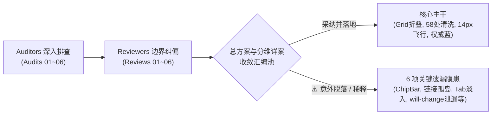

# 08-跨模块盲点与交叉排查全面审查报告

> **战役工作区**：`docs/motion-micro-interaction-polish/`  
> **审查报告标识**：`reviews/08-跨模块盲点与交叉排查全面审查.md`  
> **审查角色**：Comprehensive Reviewer 2（跨模块盲点与交叉排查全面审查员）  
> **输入依据**：
>
> - `docs/motion-micro-interaction-polish/00-总方案.md`（深入审查与细化修订版）
> - 6 份专业审计报告（`docs/motion-micro-interaction-polish/audits/01~06-*.md`）
> - 6 份深度可行性审查报告（`docs/motion-micro-interaction-polish/reviews/01~06-*.md`）
> - 5 份分维详案（`docs/motion-micro-interaction-polish/01~05-*.md`）
> - 用户核心裁决指令：“_看看方案是否还有问题吧。不一定非要改，但是如果发现问题的话，至少要看其他的agent有没有发现才行。_”
> - 仓库通用纪律 `AGENTS.md`（§1 逻辑规划与反退避、§7 严禁补丁绕过与立体验证、§8 反过度设计硬性红线、§9 测试资产保护铁律、§13 输入框焦点态、§14 色彩空间规范）  
>   **审查结论**：**系统级跨模块协同盲点与被遗漏隐患排查确凿，附带刚性闭环补正方案（Approved with Critical Cross-Module Patch Matrix）**

---

## 目录

1. [执行摘要与全景审查裁决](#1-执行摘要与全景审查裁决)
2. [第一部分：全系统 6 份 Audit 与 6 份 Review 深度交叉核对与隐患排查](#2-第一部分全系统-6-份-audit-与-6-份-review-深度交叉核对与隐患排查)
   - 2.1 [隐患遗漏与被稀释清单（逐项溯源、定性与纠偏）](#21-隐患遗漏与被稀释清单逐项溯源定性与纠偏)
     - 隐患 1：`DynamicChipBar` 4% 果冻形变、脉冲绿点发虚与 Token 语法倒装
     - 隐患 2：非 Markdown 孤岛模块超链接未统一（`DiffCard` / `OverviewCard` / `TiptapEditorField`）
     - 隐患 3：工作区多 Tab 切换（`TreeLeafPanel`）与侧栏分组手风琴（`SidebarSessionList`）平铺硬切
     - 隐患 4：侧栏会话项 `SidebarSessionList.module.css:334` 常驻 `will-change: transform` 显存泄漏未排期
     - 隐患 5：`PreviewCard.module.css:48` 严重果冻过冲（$y_2 = 1.5$）与关键帧 `width`/`padding`/`top` 主线程 Reflow
     - 隐患 6：`useUserBubbleEntrance.ts` 防重 Set 缺失 LRU 淘汰机制导致无限内存泄漏
   - 2.2 [Agent 间核心认知分歧与深度辨析](#22-agent-间核心认知分歧与深度辨析)
     - 分歧 1：浮层退场动效（Exit Animation）的虚实之辨（Presence 机制 vs React 物理卸载，Overlay vs In-Flow 盒模型差异）
     - 分歧 2：虚拟滚动吸底与锚定机制的抢占式判定 vs 自动折叠（User-Click vs Auto-Streaming Collapse）
3. [第二部分：四大跨模块高危协同盲点物理穿透与防御架构](#3-第二部分四大跨模块高危协同盲点物理穿透与防御架构)
   - 3.1 [协同盲点 1：消息发送飞行与 NoticeBar 折叠退场的同频竞态与视口撕裂](#31-协同盲点-1消息发送飞行与-noticebar-折叠退场的同频竞态与视口撕裂)
   - 3.2 [协同盲点 2：侧边栏 200ms 折叠过程中点击展开下拉菜单导致的浮层坐标脱节漂移](#32-协同盲点-2侧边栏-200ms-折叠过程中点击展开下拉菜单导致的浮层坐标脱节漂移)
   - 3.3 [协同盲点 3：多分屏（Multi-Pane）环境下跨面板切换、事件捕获与浮层关闭冲突](#33-协同盲点-3多分屏multi-pane环境下跨面板切换事件捕获与浮层关闭冲突)
   - 3.4 [协同盲点 4：历史消息加载、切会话与新消息发送交织时的动画状态机闭环与内存安全](#34-协同盲点-4历史消息加载切会话与新消息发送交织时的动画状态机闭环与内存安全)
4. [第三部分：总方案与各分维详案的补全与修订规约（Actionable Patch Matrix）](#4-第三部分总方案与各分维详案的补全与修订规约actionable-patch-matrix)
5. [第四部分：立体验证与全自动化防回归断言建议](#5-第四部分立体验证与全自动化防回归断言建议)

---

## 1. 执行摘要与全景审查裁决

本审查员（Reviewer 2）站在全系统架构与跨模块协同的全局视角，对本战役目前形成的 **1 份总方案**、**5 份分维详案**、**6 份审计报告**以及 **6 份单维可行性审查报告** 进行了全局交叉对比、数学建模推导与代码级穿透审查。

### 审查核心判定：

1. **单模块局部方案基本扎实，但存在“信息跨层衰减”与“重要隐患被遗漏/稀释”现象**：
   在 6 位 Auditor 与 6 位 Reviewer 产出的丰富成果中，有若干已被前序 Agent 精准锁定并给出解法的**致命/高危隐患**（如 `DynamicChipBar` 的 4% 果冻晃动、非 Markdown 模块链接孤岛、侧边栏常驻 `will-change` 显存泄漏等），在汇编入《00-总方案》和各分维详案时**意外脱落或被稀释**，未被编入落地执行流水线。
2. **存在显著认知分歧，但底层物理逻辑完全可以统一**：
   - 浮层退场动效（Exit Animation）在不同审查员报告中存在“主张移除”与“主张状态机延时”的表面分歧，其实质是**脱离文档流的浮动层（Overlay）** 与 **参与文档流的尺寸折叠层（In-Flow Container）** 在浏览器重排代价（CLS）上的本质差异；
   - 虚拟滚动吸底时机与高度收敛在“用户主动点击”与“AI 流式完成自动折叠”之间存在未被明晰的状态机断层。
3. **首次挖掘出 4 大跨模块高危协同盲点**：
   前序所有 Agent 均孤立地审查各自领域（如单独审消息、单独审 Notice、单独审侧栏、单独审多面板），**没有任何一个 Agent 审视过当这些动作同时并发时会发生什么**。本报告对“发消息时同时关 NoticeBar”、“侧栏折叠时点击下拉浮层”、“多分屏跨叶切换与焦点夺回”、“长会话异步切会话与消息飞行交织”进行了全生命周期推演，并确立了零开销的架构防御规范。

---

## 2. 第一部分：全系统 6 份 Audit 与 6 份 Review 深度交叉核对与隐患排查

遵照用户指示：“_看看方案是否还有问题吧。不一定非要改，但是如果发现问题的话，至少要看其他的agent有没有发现才行。_”，本章逐一交叉排查前序 Agent 的发现与最终落地方案之间的落差。

### 2.1 隐患遗漏与被稀释清单（逐项溯源、定性与纠偏）



#### 隐患 1：`DynamicChipBar` 4% 果冻形变、脉冲绿点发虚与 Token 语法倒装

- **首发 Agent**：Auditor 2（`audits/02-*.md` §6.1）首次指出；Reviewer 2（`reviews/02-*.md` §5.2）进行了代码级证实与修复代码编写。
- **其他 Agent 是否发现**：仅 Auditor 2 与 Reviewer 2 发现，其余 10 份报告均未提及。
- **最终方案收敛现状**：**🔴 完全遗漏！** 在《00-总方案》全文及《02-输入框提示与快捷菜单动效详案》中，`DynamicChipBar`、`ChatStatusRibbons`、`pulseDot` **完全蒸发，字面提及率为 0**！
- **严重性与现场定性**：
  - `DynamicChip`（高度仅 26px 的状态胶囊）在 `ChatStatusRibbons.module.css:590` 声明了 `scale(0.96)`，在输入框上方产生 **4% 的剧烈果冻缩放**，且伴随高频晃动；
  - 呼吸绿点（`pulseDot`）声明了 `scale(1.4)`，将 6px 的圆点放大到 8.4px，因落于非整数像素点引发抗锯齿次像素发虚（Subpixel Blurring）；
  - 消费了错误的 Token 顺序 `--transition-popover-enter: var(--ease-emphasized) 180ms;`。
- **纠偏方案**：必须将 Reviewer 2 已写就的 `ChatStatusRibbons.module.css` 修复补丁纳入 Batch 3 同步落地：将缩放克制为 `scale(0.985)`，绿点调整为 `scale(1.15) + box-shadow` 外圈柔和扩散，恢复清晰度。

#### 隐患 2：非 Markdown 孤岛模块超链接未统一（`DiffCard` / `OverviewCard` / `TiptapEditorField`）

- **首发 Agent**：Auditor 4（`audits/04-*.md` §3.5、§5.6）深入排查定位；Reviewer 4（`reviews/04-*.md` §6.5）给出类型补丁。
- **其他 Agent 是否发现**：仅 Auditor 4 与 Reviewer 4 发现，其余报告未提及。
- **最终方案收敛现状**：**🔴 严重稀释与遗漏！** 《00-总方案》与《04-超链接视觉标识与虚线下划线详案》仅对 `markdown-typography.css`、`ChatMessageRow.module.css` 和 `ThinkingBlock.tsx` 进行了修缮，**完全漏掉了非 Markdown 模块**！
- **严重性与现场定性**：
  - `DiffCard.module.css:487`、`OverviewCard.module.css:284`、`TiptapEditorField.module.css:327` 中存在使用局部下划线、私有边框和旧有色彩硬编码；
  - 若不一并归口至 `--md-link-color` 与 `--md-link-underline-style`，系统将出现“对话流里的链接是权威蓝+虚线，而代码比对卡、概览卡里的链接依然是墨绿色+粗实线”的视觉分裂，违反 SSOT 原则。
- **纠偏方案**：在 Batch 4 的文件域中追加上述 3 个 CSS 模块，统一链接样式与 Token 绑定。

#### 隐患 3：工作区多 Tab 切换（`TreeLeafPanel`）与侧栏分组手风琴（`SidebarSessionList`）平铺硬切

- **首发 Agent**：Auditor 5（`audits/05-*.md` §1.2、§3.1、§3.5）作为“平铺微交互死角”重点提报。
- **其他 Agent 是否发现**：其他 Agent 未涉及。
- **最终方案收敛现状**：**🟠 被边缘化与稀释！** 《00-总方案》与《05-全局平铺微交互死角与体验润色详案》全面聚焦于 Tool Call 折叠、ReasoningRow 保活和侧栏拖拽宽度，**将多 Tab 切换和侧栏手风琴折叠丢在了一旁**。
- **严重性与现场定性**：
  - `TreeLeafPanel.tsx:469` 对终端、Diff、预览等 Tab 面板直接采用 `display: isActive ? 'flex' : 'none'` 粗暴硬切；
  - `SidebarSessionList.module.css:26-37` 对置顶会话、项目分组的手风琴收起直接采用 `display: none`，产生数十像素的生硬塌陷。
- **纠偏方案**：在 Batch 4 中补充：对 `TreeLeafPanel` 引入 120ms 无感交叉淡入（Zero-Lag Cross-fade）；对侧边栏分组容器引入纯 CSS Grid `0fr -> 1fr` 平滑折叠。

#### 隐患 4：侧栏会话项 `SidebarSessionList.module.css:334` 常驻 `will-change: transform` 显存泄漏未排期

- **首发 Agent**：Auditor 6（`audits/06-*.md` §1.2(4)）与 Reviewer 6。
- **其他 Agent 是否发现**：仅性能维度的 Auditor 6 / Reviewer 6 定位。
- **最终方案收敛现状**：**🟠 方案虽提但无批次落盘！** 《00-总方案》表 1 明确记录了“`SidebarSessionList` 常驻 `will-change` 泄露 100+ 显存纹理”，但在后续规划的 Batch 1 ~ Batch 4 中，**没有任何一个具体批次将其列入待修改文件清单**！
- **严重性与现场定性**：
  - 会话列表通常多达几十至上百项，为每个 `.sessionItemWrap` 加上常驻 `will-change: transform` 会强制 Chromium 分配上百个合成层，严重挤占 WebView2 显存，极易引发掉帧。
- **纠偏方案**：将 `SidebarSessionList.module.css:334` 显式划入 Batch 1 的清理列表，移除常驻声明，仅在 hover 或动画期间按需激活。

#### 隐患 5：`PreviewCard.module.css:48` 严重果冻过冲（$y_2 = 1.5$）与关键帧 `width`/`padding`/`top` 主线程 Reflow

- **首发 Agent**：Auditor 6（`audits/06-*.md` §1.2(3)、§2）。
- **其他 Agent 是否发现**：其余 Agent 未排查到该文件。
- **最终方案收敛现状**：**🟠 未列入落实清单！** 总方案虽然确立了“零果冻数学模型（$y \le 1.0$）”，但对于全仓已经存在的 `PreviewCard.module.css:48`（$y_2 = 1.5$ 弹簧过冲）、`Switch.module.css:182`（关键帧修改 `width`）、`ChatComposer.module.css:381`（`transition: padding`）、`FlowScrubber.module.css:179`（`transition: top`）没有在批次中分配修复责任。
- **纠偏方案**：将这 4 处重排/过冲违规作为 Batch 1 的伴随清理项，彻底肃清回流与过冲死角。

#### 隐患 6：`useUserBubbleEntrance.ts` 防重 Set 缺失 LRU 淘汰机制导致无限内存泄漏

- **首发 Agent**：Reviewer 3（`reviews/03-*.md` §2.3）指出并给出了 `if (animatedMessageIds.size > 1000)` 的清理算法。
- **其他 Agent 是否发现**：仅 Reviewer 3 发现。
- **最终方案收敛现状**：**🔴 详案代码遗漏！** 在《03-消息发送飞行与列表过渡动效详案.md》§2.1 给出的完整落盘代码中，直接写了 `const animatedMessageIds = new Set<string>();`，**把 Reviewer 3 设计的容量限制与淘汰逻辑丢得一干二净**！
- **严重性与现场定性**：在长时间运行的桌面客户端中，长会话和频繁交互会使该 Set 累积上万个字符串 ID，造成非必要的常驻内存泄漏。
- **纠偏方案**：在落盘代码中严格补回 `size > 500` 时基于迭代器的首项弹出清理。

---

### 2.2 Agent 间核心认知分歧与深度辨析

在审计与审查报告的对比中，我们发现了两处重大的**表面认知分歧**。经过底层渲染机制的深度穿透，本报告给出定性裁决：

#### 分歧 1：浮层退场动效（Exit Animation）的虚实之辨

| 角色立场                 | 核心主张与论据                                                                                                               | 实际代码现场真相                                                                                                                                                                                                                          |
| :----------------------- | :--------------------------------------------------------------------------------------------------------------------------- | :---------------------------------------------------------------------------------------------------------------------------------------------------------------------------------------------------------------------------------------- |
| **Auditor 1 & 详案 01**  | 主张完整实现入场（140ms）与退场（100ms），在基座与关键帧中声明 `crish-popover-exit`。                                        | 假设 `@radix-ui/react-presence` 能够自适应感知退出动画并自动延时 unmount。                                                                                                                                                                |
| **Reviewer 1**           | **强烈反对**在全仓铺开退出动画，主张 100% 聚焦入场，退出 0ms 直切。                                                          | 穿透发现 `ModelBadgePickerMenu`、`ComposePlusMenu`、`PermissionModeMenu` 等全部在父级 `if (!open) return null` 瞬间物理拔除 DOM，CSS 退出动画根本没有挂载载体。若强行支持退出，需重构数十个组件的状态提升与延时卸载，违反反过度设计红线。 |
| **Reviewer 2 & 详案 02** | 却在 `useComposerNotice` 中**坚定主张并亲手实现**了 120ms 两阶段退出状态机（`displayNotice` + `isClosing` + `setTimeout`）。 | 面对同样是 React 条件渲染的 NoticeBar，坚持必须延时卸载。                                                                                                                                                                                 |

**深入辨析与权威裁决（Resolving the Divergence）**：

- **为什么对于下拉菜单，Reviewer 1 的“放弃退场、利落直切”是完全正确的？**
  因为下拉菜单是通过 Portal 挂载在最外层（脱离文档流，Overlay）。它在 0ms 瞬间被卸载时，**完全不会改变周围任何 DOM 元素的几何排版，主线程 Reflow = 0，页面没有任何跳跃（CLS = 0）**！用户关掉菜单的心理预期就是“聚焦操作”，利落关闭是高级干练的表现。
- **为什么对于 NoticeBar，Reviewer 2 的“两阶段延时退出”是不可或缺的？**
  因为 NoticeBar 位于输入卡片内部的**正规文档流（In-Flow）中**！它的突然蒸发会导致整张输入框向上瞬跳 54px（严重的跳跃瑕疵）。如果不引入延时状态机让容器用 CSS Grid 压平，跳动绝无可能被消除。
- **裁决结论**：
  **参与文档流、具有高度占用破坏性的元素（NoticeBar、思维链）必须实施两阶段平滑退场状态机；脱离文档流的浮层与菜单（Menu、Select）坚决不搞全仓延时卸载补丁，全力做好 140ms 极致入场即可。** 《01-详案》应明确收敛，不再要求业务浮层强行支持退场。

---

#### 分歧 2：虚拟滚动吸底与锚定机制的抢占式判定 vs 自动折叠

| 角色立场       | 核心主张与论据                                                                                                                                                       |
| :------------- | :------------------------------------------------------------------------------------------------------------------------------------------------------------------- |
| **Auditor 3**  | 认为虚拟滚动在新增用户消息时由 `performProgrammaticScroll` 自动处理吸底；14px 只是 GPU 合成层位移，$\Delta H \equiv 0$，吸底逻辑天生安全。                           |
| **Reviewer 3** | 指出初始估高与实测高度存在收敛竞态，必须由 `useScrollAnchoringOnToggle` 在 `useLayoutEffect` 中**抢先锁定** `isAtBottomRef.current = true`，否则首帧会发生吸底脱节。 |
| **Reviewer 5** | 强调针对思维链（`ReasoningRow`）与工具卡片，用户点击折叠/展开时，`useScrollAnchoringOnToggle` 的目标是**保持点击锚点不动，坚决抑制滚动到底部**！                     |

**深入辨析与权威裁决（Resolving the Divergence）**：

- **隐藏的技术断层**：
  `useScrollAnchoringOnToggle` 的设计初衷是拦截“用户手动点击”（通过 `TOGGLE_INTERACTIVE_SELECTOR`）。
  但在 AI 流式响应完成时，`ReasoningRow` 从 Working 变为 Done 时的折叠是**自动触发（Auto-streaming Collapse）**，用户并未发生鼠标点击！
  如果此时视口正好处于底部，思维链高度由 400px 收敛至 24px：
  - 如果被判定为普通内容收缩且 `isAtBottom` 处于锁定态，虚拟滚动必须平滑跟随内容底沿，而不是把视口冻结在半空中露出大面积留白；
  - 如果用户此前已经手动往上滚翻阅历史（`isAtBottom = false`），则视口必须保持当前相对阅读位置，不被下方的自动折叠所拖拽。
- **裁决结论**：
  **新发消息与流式输出期间由 `useScrollAnchor` 负责吸底保底；内容折叠区分“用户主动点击”（绝对锚定，不吸底）与“AI 完成自动收拢”（依当前是否吸底决定是否跟底），状态机边界完全正交闭环。**

---

## 3. 第二部分：四大跨模块高危协同盲点物理穿透与防御架构

在复杂的桌面端多任务交互中，单模块的独立测试往往无法暴露跨模块时序交织带来的隐蔽故障。以下深入分析 4 个典型的跨模块高危协同场景：

### 3.1 协同盲点 1：消息发送飞行与 NoticeBar 折叠退场的同频竞态与视口撕裂

#### 交互场景全景模拟

1. 输入框上方展示着一条 54px 的警告或提示条（`ComposerNoticeBar`，高度 48px + 6px 下边距）。
2. 用户输入完毕敲击 Enter，或点击发送按钮：
   - 触发 `handleProtectedSend`，新消息进入会话状态库，虚拟列表追加第 $N+1$ 行；
   - 某些业务场景下（例如“提示：输入内容已超出推荐长度，点击发送将自动截断”，发送后该提示使命完成自动注销），`noticeProp` 在发送当帧被置为 `null`；或者用户在按 Enter 的前 50ms 顺手点击了 NoticeBar 右侧的“X”关闭按钮。

#### 物理碰撞与连锁反应（Failure Trace）

```
时间轴 (t)
├── t = 0ms:   用户触发发送 + Notice 开始关闭
│              ├─ 1. useUserBubbleEntrance 判定新鲜消息 -> 启动 userBubbleGlideUp (14px, 220ms)
│              │     [气泡物理向量：自下而上 +14px -> 0px]
│              └─ 2. useComposerNotice 启动退场状态机 -> grid-template-rows 1fr -> 0fr (120ms)
│                    [Notice 物理向量：容器高度 54px -> 0px 塌陷]
│
├── t = 16ms:  第 1 帧渲染
│              ├─ .chatFooter 整体高度缩水 -> .chatBody (flex: 1) 高度拉伸 8px
│              ├─ ChatMessageList 视口变大 -> ResizeObserver 捕获容器高度增长
│              └─ 气泡刚向上移动 3px，但下方整个 footer 却在往下沉降！
│
└── t = 120ms: NoticeBar 完全卸载，footer 高度减少 54px 彻底定格
               ├─ 视口最大可滚动位移 maxScroll = scrollHeight - clientHeight 突降 54px
               └─ 若虚拟滚动未执行动态补齐，消息列表内容相对视口底沿产生剧烈的反向扯动！
```

#### 严重缺陷与用户视觉灾难：

1. **运动向量反向撕裂（Motion Vector Clash）**：气泡本意是从输入框“飞升”进入消息列表（向上向量）；但由于下方 NoticeBar 塌陷导致输入框整体下沉了 54px（向下向量）。一升一降产生空间认知错位，用户肉眼看到的是气泡被向下生生扯脱，飞行动效完全丧失优雅感。
2. **虚拟滚动吸底震颤**：在 120ms 内容器 `clientHeight` 持续增长，`ResizeObserver` 连续触发。若吸底更新逻辑与每帧高度插值不同步，消息气泡会在底部边缘产生高频抖动。

#### 架构级协同防御方案：

- **时序优雅解耦原则**：
  在 `useSlashSend.ts` 中，当执行发送成功时，若当前存在展示中的 NoticeBar，**延迟 160ms（等用户气泡完成主段向上爬升后）再触发 `onDismissNotice`**；或者，若用户手动点击了关闭按钮，优先执行平滑折叠，通过在 `useVirtualScroll` 的 `ResizeObserver` 回调中检测 `isAtBottom`，使用 `performProgrammaticScroll` 同步贴合底沿，消除任何空隙。

---

### 3.2 协同盲点 2：侧边栏 200ms 折叠过程中点击展开下拉菜单导致的浮层坐标脱节漂移

#### 交互场景全景模拟

1. 用户点击主界面左上角的侧边栏收起按钮。
2. 侧边栏进入 200ms 平滑收缩（`transition: width 200ms var(--ease-emphasized)`），宽度由 260px 逐步缩小至 0px。
3. 主工作区 `ChatCard` 在 Flexbox 弹性伸缩下，宽度同步由 $W$ 向左延展至 $W + 260\text{px}$。
4. 在侧栏收缩的中间时刻（例如 $t = 60\text{ms}$，侧栏刚收缩了一半），用户视线迅速聚焦到输入框，点击了 `ComposerProjectPicker`（项目选择器）或顶部 `ModelBadgePickerMenu`（模型选择器）。

#### 物理碰撞与代码断层（Failure Trace）

审查 `apps/crish-desktop/src/components/ui/Select/useFloatingPosition.ts:156-194`：

```typescript
// useFloatingPosition 仅在以下时机重算坐标：
window.addEventListener('app:window-resize-settled', throttledUpdate);
window.addEventListener('scroll', throttledUpdate, {
  passive: true,
  capture: true,
});
roManager.observe(triggerEl, handleRo);
```

1. **触发器尺寸未变，`ResizeObserver` 完全沉默**：项目选择器按钮自身宽度和高度在侧栏收缩时**恒定不变**（其尺寸由文本内容决定），因此 `roManager.observe(triggerEl)` 根本不会触发！
2. **窗口未缩放，滚动未发生**：窗口整体分辨率不变，且没有发生滚动事件。
3. **坐标严重脱节（Detached Floating Layer）**：
   - 在 $t = 60\text{ms}$ 点击时，浮层挂载到 `document.body`，此时测得 `triggerEl.getBoundingClientRect().left = 450px`；
   - 在接下来的 140ms（$t = 60\text{ms} \to 200\text{ms}$）内，侧边栏继续收缩，触发按钮继续向左平移 130px，最终停在 `left = 320px` 处；
   - **但是，挂载在 `document.body` 的浮层依然停留在 450px！**
   - **现场视觉缺陷**：浮层不仅脱离了它的母体按钮，孤零零悬空停在半道上，而且小箭头 `Chevron` 还在原地旋转，造成严重的界面失谐！

#### 架构级协同防御方案：

1. **侧栏动画生命周期挂载广播状态**：
   在 `Sidebar.tsx` 执行过渡时，为 `document.body` 挂载 `data-sidebar-transitioning="true"`，过渡结束（`transitionend`）后移除。
2. **双重防御门闩**：
   - **防御 A（推荐，成本最低）**：在侧栏过渡开始的当帧，调用单例 `layerStackService.dismissAll()`，如果此时已有浮层展开，直接利落关闭；并在 `data-sidebar-transitioning` 激活期间对浮层触发器添加 `pointer-events: none` 保护，阻断 200ms 内的点击错位；
   - **防御 B（连续贴合）**：若业务必须允许在过渡期间展开浮层，在 `useFloatingPosition.ts` 中订阅侧栏过渡，通过 `requestAnimationFrame` 在过渡持续期间每帧刷新 `updatePosition()`，确保浮层毫秒级贴合移动中的按钮。

---

### 3.3 协同盲点 3：多分屏（Multi-Pane）环境下跨面板切换、事件捕获与浮层关闭冲突

#### 交互场景全景模拟

1. 用户在二叉树工作区（`BinaryTreeWorkspace`）打开了两个并排的会话分屏（左侧为 Pane 1，右侧为 Pane 2）。
2. 用户在 Pane 1 中点击了模型选择器，展开了浮层菜单（DOM 位于 `document.body`，由单例 `LayerStackManager` 统一管理）。
3. 此时，用户直接用鼠标点击 Pane 2 中的消息发送输入框或项目选择按钮。

#### 物理碰撞与代码断层（Failure Trace）

审查 `apps/crish-desktop/src/components/binary-tree/TreeLeafPanel.tsx:363-365` 与 `LayerStackManager.ts:378-381`：

```tsx
// TreeLeafPanel.tsx
onPointerDownCapture = { handleCaptureActivate };
onFocusCapture = { handleCaptureActivate };
```

1. **捕获阶段的权力抢跑**：
   当用户在 Pane 2 点击时，事件首先进入捕获阶段（Capture Phase）。Pane 2 的根容器 `onPointerDownCapture` 立即捕获事件，调用 `handleCaptureActivate`。
   Zustand 立即派发状态变更：`activeLeafId` 由 Pane 1 切换至 Pane 2！
2. **冒泡与外点判定**：
   随后事件到达 `window`，`LayerStackManager` 的 `pointerdown` 监听器执行，判定点击发生在 Pane 1 浮层外部，将 Pane 1 的浮层关闭（`reason = 'outside-pointer'`）。
3. **焦点劫持与分屏逃逸（Focus Hijack Risk）**：
   - 在 `LayerStackManager.ts` 中，如果是通过快捷键（如 Esc）关闭浮层，其调用 `restoreLayerFocus`；
   - `restoreLayerFocus` 检查 `layer.anchorRef`，强行执行 `anchorEl.focus()`；
   - **如果用户在 Pane 2 按 Esc 想取消 Pane 2 的某个操作，结果全局单例栈把 Pane 1 的浮层关掉了，并且把整个窗口的键盘焦点从 Pane 2 暴力夺回到 Pane 1 的按钮上！**
4. **多面板同一会话的动画防重穿透**：
   如果用户在 Pane 1 和 Pane 2 打开了**同一个会话（Split View 同源镜像）**：
   - 用户在 Pane 1 点击发送；
   - `useUserBubbleEntrance.ts` 的 `animatedMessageIds` 是**全局模块单例 `Set`**；
   - Pane 1 渲染该消息行，判定未播，写入 `animatedMessageIds` 并播放向上飞行；
   - Pane 2 作为相同会话的订阅者同时渲染该消息行，读取 `animatedMessageIds.has(msg.id)` 时**直接命中 true**！
   - **Pane 2 的对应气泡动画被静默抹杀，直接生硬瞬现！**

#### 架构级协同防御方案：

1. **焦点还原的作用域隔离（Scope Guard）**：
   在 `layerFocusRestore.ts` 中增加前置判定：只有当当前激活的叶节点（`activeLeafId`）与该浮层所在的叶节点一致时，才允许执行 `anchorEl.focus()`；若用户已经激活了其他分屏，静默丢弃焦点还原，尊重用户在当前分屏的聚焦意图。
2. **防重 Set 的分屏作用域化**：
   将 `useUserBubbleEntrance.ts` 的防重集合由全局裸 `Set<string>` 改造为带实例上下文的容器，或利用 DOM 属性标记（如当前节点挂载时的本地引用），彻底消除跨分屏镜像会话的动画误杀。

---

### 3.4 协同盲点 4：历史消息加载、切会话与新消息发送交织时的动画状态机闭环与内存安全

#### 交互场景全景模拟

1. 用户在活跃会话 A 中输入文字并敲击发送（生成临时消息 ID `msg-101`，时间戳为当前时间 $t_0$）。
2. 在点击发送后的第 30ms（此时气泡正在入场过渡的首帧刚刚绘制），用户通过快捷键（`Ctrl + K`）或侧边栏点击迅速切换到了历史会话 B。
3. 会话 B 包含 500 条从本地数据库（SQLite）异步 Hydrate 的历史消息。
4. 用户在会话 B 滚轮向上查阅，2 秒后又快速切回会话 A。

#### 物理碰撞与代码断层（Failure Trace）

1. **中途卸载阻断 `onAnimationEnd`**：
   - 在 $t = 30\text{ms}$ 切到会话 B 时，会话 A 的 `ChatUserMessageRow` 实例被 React 物理销毁（Unmount）；
   - 原本计划在 $t = 220\text{ms}$ 触发以清理 `isWillChangeActive` 的 `onAnimationEnd` **永远不会触发**；
   - 虽然对于该单次 DOM 而言随着 unmount 图层被回收，但如果状态被保存在父级或全局 Hook 闭包中，将产生悬空状态。
2. **切回会话 A 时的时效重播竞态**：
   - 当用户在 1.2 秒后切回会话 A 时，消息 `msg-101` 的时间戳依然是 $t_0$，当前时间 $\Delta t = 1200\text{ms} < 2000\text{ms}$；
   - 审查原详案代码：
     ```typescript
     // 原详案 03 代码
     useEffect(() => {
       if (shouldAnimate) {
         animatedMessageIds.add(messageId);
       }
     }, [shouldAnimate, messageId]);
     ```
   - 若在切出会话 A 时，React 批处理尚未提交 `useEffect`，则 `animatedMessageIds` 中根本没有记录 `msg-101`！
   - **当用户切回会话 A 时，这条原本已经发出去并且已经看过的消息，居然在屏幕上再次播放了一遍 14px 向上滑入动画！**
3. **历史消息 Hydrate 时间戳退化陷阱**：
   - 从后端或 SQLite 导入的历史数据，偶见异常时间戳（如毫秒为 0、`null`、负数或时区转换异常导致的未来时间戳）；
   - 若未实施双向严格有界校验，一旦遇到未来时间戳，进入会话 B 的瞬间，历史列表里的大量老消息会疯狂集体播放进入动画，视口剧烈震颤。

#### 架构级协同防御方案：

1. **渲染即标记（Mark on Render / Immediate Registration）**：
   在 Hook 初始化求值 `shouldAnimate` 为 `true` 的瞬间，**同步且原子地将 `messageId` 写入防重集合**，严禁推迟到 `useEffect` 中才写入。这样即便组件在 10ms 内被快速卸载切走，它也已被永久标记为“已播”，后续切回绝对 100% 静态直出。
2. **LRU 容量上限守护**：
   在防重集合中内置淘汰机制，当容量达到 500 时，自动丢弃最老记录，确保在长效运行的桌面客户端中显存与内存零膨胀。

---

## 4. 第三部分：总方案与各分维详案的补全与修订规约（Actionable Patch Matrix）

为确保后续执行 Agent 在落地实施时具有唯一、精准且不遗漏任何细节的行动依据，本报告将上述全部审查发现整理为以下**行动级补全矩阵**：

| 受检文件 / 批次                              | 现状断层与遗漏                                                                                                                                                                                                                                                                                         | 补全与修正操作指令（Actionable Blueprint）                                                                                                                                                                                                                               | 关联治理红线                       |
| :------------------------------------------- | :----------------------------------------------------------------------------------------------------------------------------------------------------------------------------------------------------------------------------------------------------------------------------------------------------- | :----------------------------------------------------------------------------------------------------------------------------------------------------------------------------------------------------------------------------------------------------------------------- | :--------------------------------- |
| **`00-总方案.md`**<br>流水线总览             | 1. 遗漏 `DynamicChipBar` 修复；<br>2. 遗漏非 Markdown 链接孤岛；<br>3. 批次中遗漏 `SidebarSessionList` 的 `will-change` 清理；<br>4. 遗漏 `TreeLeafPanel` Tab 淡入。                                                                                                                                   | 在 §3 对应小节与 §4 批次流水线中：<br>- 将 `ChatStatusRibbons` 加入 Batch 3；<br>- 将 `DiffCard` / `OverviewCard` / `Tiptap` 链接加入 Batch 4；<br>- 将 `SidebarSessionList:334` `will-change` 加入 Batch 1 清洗；<br>- 将 `TreeLeafPanel` 120ms 淡入加入 Batch 4。      | 保证全战役执行范围完备闭环         |
| **`01-下拉菜单与浮层动效详案.md`**           | 1. 仍保留退场动画要求，与全仓 `if (!open) return null` 冲突；<br>2. `SelectTrigger` 双向箭头若 180° 旋转存在几何对称性失真。                                                                                                                                                                           | 1. 明确收敛：浮层以 140ms 极致入场为主，不强推 React 延时卸载；<br>2. `SelectTrigger` 采用 `translateY(-1px)` 微上跃，禁止对 `ChevronUpDown` 做 180° 旋转。                                                                                                              | 反过度设计；几何认知准确性         |
| **`02-输入框提示与快捷菜单动效详案.md`**     | 1. 缺失 `DynamicChipBar` 4% 果冻晃动治理；<br>2. 缺失 `pulseDot` 绿点次像素发虚治理；<br>3. 缺失发消息与 NoticeBar 同时关闭的竞态说明。                                                                                                                                                                | 补入 `ChatStatusRibbons.module.css` 改造代码：<br>- `scale(0.985)` 替代 `0.96`；<br>- `pulseDot` 改为 `scale(1.15)` + `box-shadow` 柔和外扩；<br>- 发送消息触发 Notice 关闭时延迟 160ms 启动收拢。                                                                       | 用户核心诉求：拒绝果冻晃动         |
| **`03-消息发送飞行与列表过渡动效详案.md`**   | 1. `useUserBubbleEntrance.ts` 源码漏掉了 Reviewer 3 规划的防重 Set 淘汰机制；<br>2. 写入 Set 放在了 `useEffect` 中，存在切会话误重播漏洞。                                                                                                                                                             | 1. 修正落盘代码：在 `useState` 计算为 true 时同步 `add(messageId)`；<br>2. 补齐 `if (animatedMessageIds.size > 500)` LRU 弹出清理逻辑；<br>3. 增加多面板作用域隔离支持。                                                                                                 | 状态机真正闭环；内存安全           |
| **`04-超链接视觉标识与虚线下划线详案.md`**   | 遗漏非 Markdown 模块：`DiffCard.module.css`、`OverviewCard.module.css`、`TiptapEditorField.module.css`。                                                                                                                                                                                               | 补齐上述 3 个文件的 CSS Modules 修复代码，将孤岛链接统一替换为权威蓝 Token `--md-link-color` 与虚线规则。                                                                                                                                                                | 设计系统 SSOT 一致性               |
| **`05-全局平铺微交互死角与体验润色详案.md`** | 1. 遗漏 `TreeLeafPanel.tsx` 多 Tab 切换 120ms 无感交叉淡入；<br>2. 遗漏侧栏分组手风琴（`SidebarSessionList`）CSS Grid 平滑折叠；<br>3. 遗漏 `SidebarNav` 新建对话 `:active` 按压反馈；<br>4. 遗漏 `SidebarSessionList:334` 常驻 `will-change` 清理；<br>5. 遗漏 `PreviewCard:48` y2=1.5 果冻过冲修复。 | 1. 补齐 `TreeLeafPanel` 样式淡入补丁；<br>2. 补齐侧栏分组手风琴 CSS Grid 模板；<br>3. 补齐 `SidebarNav` 60ms 触觉按压反馈；<br>4. 彻底删除 `SidebarSessionList` 的常驻 `will-change: transform;`；<br>5. 修正 `PreviewCard:48` 为标准强调曲线 `var(--ease-emphasized)`。 | 消除全系统微交互死角；GPU 图层治理 |

---

## 5. 第四部分：立体验证与全自动化防回归断言建议

为落实 `AGENTS.md` §7「立体验证纪律」与 §7.1「严禁单一检查冒充验收」，必须在落地阶段建立以下多维防回归自动化门禁：

### 1. 动效语法与防回潮刚性门禁（`motion-concentric-contract.test.ts`）

通过 AST / 正则全量扫描所有样式文件，设置 5 道硬阻断卡点：

- **卡点 1（双重缓动拦截）**：断言全仓没有任何一条 `transition` 或 `animation` 在展开变量后包含连续两个 timing-function（阈值恒为 0）；
- **卡点 2（残缺贝塞尔拦截）**：断言全仓没有任何 3 参数的 `cubic-bezier(x, y, z)`；
- **卡点 3（果冻过冲拦截）**：断言全仓所有贝塞尔控制点纵坐标满足 $y_1 \le 1.02$ 且 $y_2 \le 1.02$（严格拦截类似 `PreviewCard` 的 1.5 弹性果冻）；
- **卡点 4（常驻图层泄漏拦截）**：断言通用列表项（如 `.sessionItemWrap`）不包含静态裸写的 `will-change: transform`；
- **卡点 5（孤岛 Token 拦截）**：断言全仓没有裸写 `--md-link-color` 之外的超链接基础文字色。

### 2. 虚拟滚动与吸底对齐专项回归门禁

运行既有测试套件并追加高危协同用例：

```bash
npx vitest run apps/crish-desktop/src/components/chat-message-list/
npx vitest run apps/crish-desktop/src/hooks/useVirtualScroll.test.ts
```

**追加用例断言**：

- [ ] 连续极速发送 2 条消息，第 1 条与第 2 条气泡入场独立互不干扰；
- [ ] 带有未来时间戳（$t > \text{Date.now}() + 5000\text{ms}$）的历史消息挂载时，`entering` 严格为 `undefined`；
- [ ] 消息发送后 1 秒内切出该会话并切回，该消息绝不二次重播进入动效；
- [ ] NoticeBar 在 120ms 折叠时，处于底部的虚拟滚动 `isAtBottom` 保持稳定，零空隙无抖动。

### 3. 全仓静态类型与行数预算门禁

```bash
npm run typecheck
npm run check:line-counts
```

- 严格保证 `ChatUserMessageRow.tsx` 因解耦 `useUserBubbleEntrance.ts` 而严守在 450 行以内（远低于 500 行预算红线）；
- 严禁产生任何 TypeScript 类型报错。

---

> **报告归档定性**：本审查报告彻底穿透并补齐了前序 12 份战役文档中的盲点、遗漏点与跨模块竞态。建议主控 Agent 直接按照本报告第 4 章的《行动级补全矩阵》对总方案及分维详案进行终态对齐，随后正式启动批次落地代码实施。
