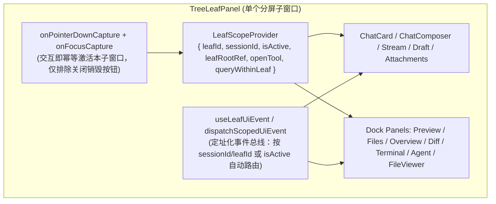

# 多子窗口（Split-Pane）天然隔离架构重构总方案

> **战役工作区**：`docs/multi-pane-isolation/`
> **前置输入**：[`audits/00-全仓多分屏隔离问题全景审计汇总.md`](./audits/00-全仓多分屏隔离问题全景审计汇总.md)
> **架构原则**：**构造即隔离（By-Construction Isolation）**——从底层上下文、焦点同步模型、定址化事件总线与容器级 DOM 机制上天然消除跨子窗口串扰，拒绝散装 `if` 补丁。

---

## 一、 架构演进目标：从「隐式全局」到「显式子窗口作用域（LeafScope）」

### 1.1 旧架构的四大病灶

1. **隐式全局上下文**：组件/Hook 在任意层级直接调用 `useSessionStore(s => s.activeSessionId)` 或 `getCompositionRoot().session.getActiveSessionId()`，默认全应用只有一个窗口。
2. **焦点与激活叶脱节**：`TreeLeafPanel` 在 `onPointerDown` 中跳过了 `button`、`input`、`textarea`、`[contenteditable="true"]`，导致用户在非激活子窗口打字、粘贴、点击发送/停止/新建终端/提交批注时，全局 `activeLeafId` 与 `activeSessionId` 仍停留在另一个子窗口。
3. **无寻址全局广播**：`uiEvents` 与 `window.dispatchEvent(new CustomEvent(...))` 向全窗口广播，所有挂载的子窗口实例同时响应。
4. **越界 DOM 查询与按键捕获**：`document.querySelector(...)` 永远命中 DOM 第一个子窗口；`window.addEventListener('keydown' / 'message')` 缺少源窗口与容器焦点守卫。

### 1.2 新架构的四大天然隔离支柱

1. **支柱一：`LeafScopeContext`（子窗口强制上下文契约）**
   - 新增 `src/contexts/LeafScopeContext.tsx`，由 `TreeLeafPanel` 在子树根部注入：
     - `leafId: string`：当前分屏叶子唯一 ID；
     - `sessionId: string`：当前分屏绑定的会话 ID（含稳定叶子草稿 ID `__pending_draft__:${leafId}`）；
     - `isActive: boolean`：当前分屏是否为焦点分屏；
     - `leafRootRef: RefObject<HTMLElement | null>`：当前分屏根 DOM 引用；
     - `openTool: (panelId: string) => void`：在**当前分屏**的右侧工具抽屉打开指定面板；
     - `queryWithinLeaf: <T extends Element>(selector: string) => T | null`：严格限定在当前分屏 DOM 子树内查询元素。
   - 提供 `useLeafScope()` 与 `useScopedSessionId(explicitSessionId?)`：优先级为 `explicitSessionId ?? leafScope.sessionId ?? storeActiveSessionId`。任何子窗口内的组件/Hook 无需层层 prop drilling 即可天然获取本窗口 `sessionId` 与 `leafId`。

2. **支柱二：捕获阶段焦点自动激活 + 草稿态 SSOT**
   - **交互即激活**：在 `TreeLeafPanel` 根节点使用捕获阶段监听（或改进激活守卫），当指针按下或焦点进入该分屏内的编辑器（`[contenteditable="true"]`、`textarea`、`input`）或业务操作按钮时，若当前分屏非激活，立即幂等激活本分屏并同步全局 `activeSessionId`（仅排除标签页关闭按钮 `[data-tab-close]` / 分屏关闭按钮等销毁动作，避免关闭后台标签时抢焦点）。
   - **草稿态唯一真理（SSOT）**：在 `TreeLeafPanel.tsx`、`PaneHeader.tsx` 与 `treeLeafPanelModel.ts` 中，`leaf.activeTabId === '' || leaf.tabs.length === 0` 即代表本叶子处于「新对话草稿态」，彻底解除对全局 `isPendingDraft(activeSessionId)` 的错误依赖，根除“点击另一分屏导致本分屏草稿界面消失跳回旧 Tab”的顽疾。

3. **支柱三：定址化作用域事件总线（Scoped UI Event Bus）**
   - 在 `src/api/uiEvents.ts` 中扩展作用域定址能力：
     - 支持在事件载荷或发射参数中指定目标 `{ sessionId?: string; leafId?: string }`；
     - 新增 `useLeafUiEvent(name, handler, options)` Hook：内部自动结合 `useLeafScope()` 进行网关级过滤——
       1. 若事件携带了 `sessionId`，仅当 `event.sessionId === scope.sessionId` 时放行；
       2. 若事件携带了 `leafId`，仅当 `event.leafId === scope.leafId` 时放行；
       3. 若事件未携带目标标识（如全局快捷键触发的 `toggle-msg-filter`、`open-project-picker`、`focus-composer`、`stop-generation`、`export-session-md`、`open-conversation-rewind`），**仅当 `scope.isActive === true`（单窗口模式下恒为 `true`）时放行**！
   - 业务层只需把 `onUiEvent` 替换为 `useLeafUiEvent`，无需手写散装 `if` 判断即可在架构层 100% 阻断跨窗误触发。

4. **支柱四：容器级 DOM 边界、源窗口校验与 `useId()` 唯一化**
   - **拖拽边界收敛**：`useChatCardDragDrop` 的 `isPointInsideTarget` 严格以 `ChatCard` 自身的 `rootRef.current`（`.chatBody`）为目标矩形（半开区间 `[left, right) × [top, bottom)` 且 `width > 0 && height > 0`），并在 `elementFromPoint` 可用时校验命中的顶层元素位于 `.chatBody` 内且未被 Modal 遮挡，彻底避免吞并同叶子右侧工具抽屉（`FilesCard` / `NotePaper`）的拖拽。
   - **容器级 DOM 查询**：`useScrollAnchor`、`ApprovalDock`、`focus-composer`、`focusChatComposer` 全面改用组件容器 `Ref` 或 `queryWithinLeaf`，支持 Tiptap `[contenteditable="true"]` 聚焦。
   - **iframe `postMessage` 源窗口刚性守卫**：`PreviewCard` 与 `previewHostBridge` 强制校验 `event.source === iframeRef.current?.contentWindow`；`crish-preview-url` 按实例/叶子隔离，杜绝一处导航全窗乱跳。
   - **浮层按键守卫与 `useId()`**：`DynamicChipBar`、`DiffCardGitActions`、`useSlashMenuKeymap`、`useApprovalKeyboard`、`FileBreadcrumb`、`useSettingsNav` 统一校验事件源/焦点位于当前可见容器内；19 处硬编码 DOM `id` 全部替换为 `useId()`。

---

## 二、 五大分维实现详案与文件域切分矩阵（零冲突并行）

为确保多 Agent 并行设计及实现时文件域严格正交、互不踩踏，全战役划分为以下 **5 个独立维度**：

| 维度编号    | 分维详案文档                                                                                             | 核心职责范围                                                                                                                                                                                                                                                                                                                                                                                                                                                                                                                                                                                                                                                                         | 独占修改文件域（Write Scope）                                                                                                                                                                                                                                                                                                                                                                                                                                                                                                                                                                                                                                                                                                                                 |
| :---------- | :------------------------------------------------------------------------------------------------------- | :----------------------------------------------------------------------------------------------------------------------------------------------------------------------------------------------------------------------------------------------------------------------------------------------------------------------------------------------------------------------------------------------------------------------------------------------------------------------------------------------------------------------------------------------------------------------------------------------------------------------------------------------------------------------------------- | :------------------------------------------------------------------------------------------------------------------------------------------------------------------------------------------------------------------------------------------------------------------------------------------------------------------------------------------------------------------------------------------------------------------------------------------------------------------------------------------------------------------------------------------------------------------------------------------------------------------------------------------------------------------------------------------------------------------------------------------------------------ |
| **维度 01** | [`01-子窗口作用域上下文与焦点激活架构方案.md`](./01-子窗口作用域上下文与焦点激活架构方案.md)             | 1. 新建 `LeafScopeContext` (`useLeafScope`, `useScopedSessionId`) 2. `TreeLeafPanel` 注入 Provider、修复捕获激活与 `isLeafDraft` SSOT 3. `PaneHeader` & `treeLeafPanelModel` 草稿态判定收敛 4. `builtinViewFactories.tsx` 10 个视图全量透传 `ctx` 5. `useScopedSessionField.ts` 移除对全局 `activeSessionId` 的无效重渲染耦合                                                                                                                                                                                                                                                                                                                                            | `src/contexts/LeafScopeContext.tsx` (新) `src/components/binary-tree/TreeLeafPanel.tsx` `src/components/binary-tree/PaneHeader.tsx` `src/components/binary-tree/treeLeafPanelModel.ts` `src/builtinViewFactories.tsx` `src/components/chat-card/useScopedSessionField.ts`                                                                                                                                                                                                                                                                                                                                                                                                                                                                      |
| **维度 02** | [`02-定址化UI事件总线与跨组件通信隔离方案.md`](./02-定址化UI事件总线与跨组件通信隔离方案.md)             | 1. `uiEvents.ts` 升级作用域定址协议与 `useLeafUiEvent` Hook 2. `useChatHandlers.ts`、`useChatProjectPicker.ts`、`useChatSessionActions.ts` 接入定址事件与本叶 `openSidePanel` 3. 清理 `AiCommandSlashExtension.ts` 悬空死事件，接入定址命令 4. `MarkdownDocumentView.tsx` 移除重复无条件 `crish-open-file` 派发与 `useTreePanelEvents.ts` 定址化                                                                                                                                                                                                                                                                                                                            | `src/api/uiEvents.ts` `src/hooks/useLeafUiEvent.ts` (新) `src/components/chat-card/useChatHandlers.ts` `src/components/chat-card/useChatProjectPicker.ts` `src/components/chat-card/useChatSessionActions.ts` `src/components/chat-composer/AiCommandSlashExtension.ts` `src/components/markdown/MarkdownDocumentView.tsx` `src/hooks/useTreePanelEvents.ts`                                                                                                                                                                                                                                                                                                                                                                             |
| **维度 03** | [`03-对话流式引擎与草稿附件项目选择隔离方案.md`](./03-对话流式引擎与草稿附件项目选择隔离方案.md)         | 1. 打通 `useChatComposerProps` → `useChatSend` → `useChatStream` → `useSlashSend` / `useStreamCallbacks` 的 `scopedSessionId` 2. `SessionStreamManager` 按 `sessionId` 全局共享寻址，根治跨窗停止生成误杀 3. `slashSendDraftManager.ts` + `sessionDraftActions.ts` 支持 `targetDraftSessionId` 与 `draftFolderRegistry` 4. `ComposerProjectPicker` / `ProjectPickerMenu` / `useChatSessionMeta` 草稿项目选择按叶隔离 5. `ComposerFusedTrigger` / `ModelBadgePickerMenu` 绑定子窗口 `sessionId` 6. `ChatCard.tsx` 行内编辑粘贴回调修复、`ChatComposer.tsx` 删除批注传 `sessionId`、`useChatAttachments.ts` 隔离                                                        | `src/components/chat-card/useChatComposerProps.ts` `src/components/chat-card/useChatSend.ts` `src/hooks/chat-stream/*` `src/store/sessionDraftActions.ts` `src/components/chat-card/ComposerProjectPicker.tsx` `src/components/chat-card/ProjectPickerMenu.tsx` `src/components/chat-card/useChatSessionMeta.ts` `src/components/chat-composer/ComposerFusedTrigger.tsx` `src/components/provider/ModelBadgePickerMenu.tsx` `src/components/chat-card/ChatCard.tsx` `src/components/chat-composer/ChatComposer.tsx` `src/components/chat-card/useChatAttachments.ts`                                                                                                                                                         |
| **维度 04** | [`04-工具抽屉卡片与内置预览浏览器多实例隔离方案.md`](./04-工具抽屉卡片与内置预览浏览器多实例隔离方案.md) | 1. `PreviewCard`、`usePreviewNavigation`、`previewHostBridge`、`ToolTabFavicon`：校验 `event.source === iframe.contentWindow`，隔离 `crish-preview-url`，绑定本叶 `sessionId` 发送 AI 与停止 2. `FilesCard`、`FilePreview`、`FileViewerCard`、`openTool.ts`：按 `sessionId`/`leafId` 隔离 `crish-open-file`、`conex:file-viewer-mode`、批注计数与 `FileAnnotationPopover` 的 `targetSessionId` 3. `OverviewCard` & `useSessionScopedChanges`：按本叶 `sessionId` 展示概览与变更列表 4. `TerminalCard`（新建终端在当前叶打开）、`AgentCard`、`DiffCard`、`FlowDagView`、`TrashSection`、`useNoteDocumentManager` 隔离                                                        | `src/components/workspace/PreviewCard.tsx` `src/components/workspace/usePreviewNavigation.ts` `src/components/workspace/previewHostBridge.ts` `src/components/binary-tree/ToolTabFavicon.tsx` `src/components/files/FilesCard.tsx` `src/components/files/FilePreview.tsx` `src/components/files/FileViewerCard.tsx` `src/store/workspace-shell/openTool.ts` `src/components/overview/OverviewCard.tsx` `src/components/overview/changes/*` `src/components/workspace/TerminalCard.tsx` `src/components/agent-card/AgentCard.tsx` `src/components/diff/DiffCard.tsx` `src/components/workspace/FlowDagView.tsx` `src/components/workspace/TrashSection.tsx` `src/components/note-paper/useNoteDocumentManager.ts` |
| **维度 05** | [`05-容器级DOM查询与拖拽按键ARIA隔离方案.md`](./05-容器级DOM查询与拖拽按键ARIA隔离方案.md)               | 1. `useChatCardDragDrop.ts`：收敛容器至 `.chatBody` 自身，启用 `elementFromPoint` 遮挡排除与半开区间 2. `useScrollAnchor.ts`、`ApprovalDock.tsx`、`chatMessageRowUtils.ts`：消除全局 `document.querySelector`，限定容器作用域并支持 Tiptap 聚焦 3. `DynamicChipBar.tsx`、`DiffCardGitActions.tsx`、`useSlashMenuKeymap.ts`、`useApprovalKeyboard.ts`、`FileBreadcrumb.tsx`、`useSettingsNav.ts`：收敛全局 `keydown` 焦点守卫与审批卡后台抢焦点防护 4. 19 处硬编码 DOM `id` 替换为 `useId()`（`RuntimeSection`, `LiveTasksSection`, `BgTasksSection`, `ApprovalSection`, `PlansSection`, `Overview` 6 个 Section, `PreviewToolbar`/`PreviewHistoryPanel`, `AgentBrowsePad`） | `src/components/chat-card/useChatCardDragDrop.ts` `src/components/chat-message-list/useScrollAnchor.ts` `src/components/chat-card/ApprovalDock.tsx` `src/components/chat-message-row/chatMessageRowUtils.ts` `src/components/chat-card/DynamicChipBar.tsx` `src/components/diff/DiffCardGitActions.tsx` `src/components/note-paper/useSlashMenuKeymap.ts` `src/components/agent-card/useApprovalKeyboard.ts` `src/components/files/FileBreadcrumb.tsx` `src/components/useSettingsNav.ts` `src/components/workspace/RuntimeSection.tsx` 等 19 处 ID 所在组件                                                                                                                                                                    |

---

## 三、 立体门禁与验收标准

1. **静态类型与行数门禁**：
   - `npm run typecheck` 零错误通过；
   - `npm run check:line-counts` 所有修改与新增文件 100% 符合分类行数上限（UI 组件 ≤ 500 行，业务逻辑 ≤ 400 行）。
2. **多子窗口隔离防回归测试矩阵**：
   - 针对每个维度新增/更新双子窗口（Pane A + Pane B）并存下的自动化单元测试，验证：
     - **拖拽隔离**：拖入 Pane B 不点亮 Pane A，拖入同叶右侧 `FilesCard` 不被左侧 `ChatCard` 吞并；
     - **发送与停止隔离**：在未预先激活的 Pane B 直接输入/粘贴并发送，100% 发往 Pane B 的会话；点击 Pane B 停止按钮绝不误杀 Pane A 的流；
     - **草稿与项目隔离**：Pane A 新建草稿后点击 Pane B，Pane A 草稿不消失；两个草稿分屏各自选项目互不串改；
     - **事件路由隔离**：`retract-backfill`、`retry-failed-turn`、`toggle-msg-filter`、`open-project-picker`、`crish-open-file`、`crish-preview-url` 严格单窗响应；
     - **DOM 与按键隔离**：右分屏置顶跳转滚右分屏；A 窗斜杠菜单/抽屉不吞 B 窗按键；后台分屏审批卡不抢当前打字焦点；全仓无重复硬编码静态面板 DOM `id`。
