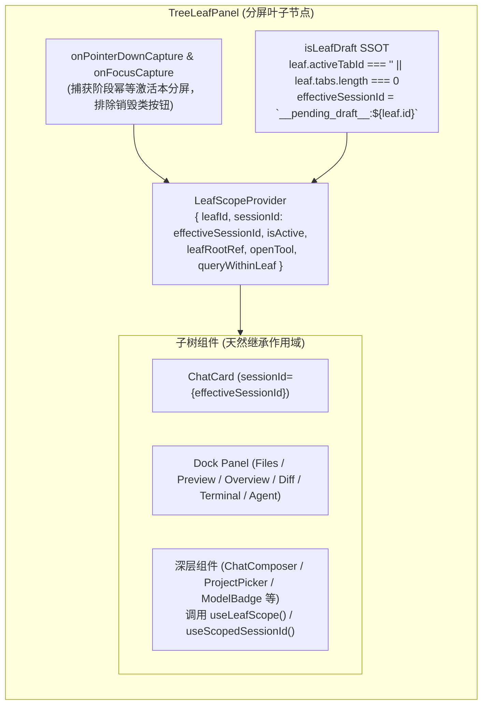

# 维度 01：子窗口作用域上下文与焦点激活架构方案

> **所属战役**：[`docs/multi-pane-isolation/`](./00-总方案.md)
> **前置输入**：[`audits/00-全仓多分屏隔离问题全景审计汇总.md`](./audits/00-全仓多分屏隔离问题全景审计汇总.md)（维度 A：A-01、A-06；维度 B：B-01、B-06、B-07；维度 C：C-03）
> **架构原则**：**构造即隔离（By-Construction Isolation）**——在二叉树分屏叶子根节点注入统一的作用域上下文 `LeafScopeContext`，实现捕获阶段无死角焦点同步与草稿态 SSOT，根治隐式全局 `activeSessionId` 耦合。

---

## 一、 问题根因与审计映射

在二叉树多分屏架构中，每个分屏叶子（`TreeLeafPanel`）代表一个独立的交互工作空间。然而，既有实现存在三个基础性架构断裂：

| 审计编号        | 涉及模块                                                           | 精确代码位置                                                                           | 核心断裂与故障表现                                                                                                                                                                                                                                                                                    |
| :-------------- | :----------------------------------------------------------------- | :------------------------------------------------------------------------------------- | :---------------------------------------------------------------------------------------------------------------------------------------------------------------------------------------------------------------------------------------------------------------------------------------------------- |
| **A-01**        | `TreeLeafPanel.tsx`                                                | `components/binary-tree/TreeLeafPanel.tsx:108-131`                                     | `handleActivate` 在 `target.closest('button, input, textarea, [contenteditable="true"]')` 时直接 `return` 放弃激活分屏。用户直接点击非激活分屏的输入框打字、粘贴、或点击发送/停止/批注提交时，全局 `activeLeafId` 与 `activeSessionId` 仍停留在前一个分屏，导致所有依赖全局状态的逻辑全部作用到旁窗！ |
| **B-01**        | `TreeLeafPanel.tsx` `PaneHeader.tsx` `treeLeafPanelModel.ts` | `TreeLeafPanel.tsx:86-91` `PaneHeader.tsx:112-116` `treeLeafPanelModel.ts:18-24` | 错误依赖全局 `isPendingDraft(activeSessionId)` 判定单个分屏是否处于草稿态（`isLeafDraft`）。当分屏 A 点击「新建对话」处于草稿态时，用户点击分屏 B，全局 `activeSessionId` 切换为分屏 B 的真实会话，分屏 A 的 `isLeafDraft` 瞬间变为 `false`，界面被强制折叠或跳回 `tabs[0]`，草稿状态被无情冲掉！     |
| **B-06 / C-03** | `builtinViewFactories.tsx`                                         | `builtinViewFactories.tsx:15-93`                                                       | 10 个视图工厂中，仅 `chat` 与 `terminal` 透传了部分 `sessionId`，其余 8 个视图（`files`, `file-viewer`, `preview`, `overview`, `diff`, `agent`, `settings`, `note-paper`）全量丢弃 `ctx.sessionId` 与 `ctx.leafId`，导致卡片只能向全局 store 寻址。                                                   |
| **B-07**        | `useScopedSessionField.ts`                                         | `components/chat-card/useScopedSessionField.ts:16-24`                                  | Selector 内部强行依赖 `state.activeSessionId` 做回退。即便调用方显式传入了固定 `sessionId`，只要用户在其他分屏切换焦点，所有非激活分屏全部被动触发重渲染。                                                                                                                                            |

---

## 二、 核心架构设计

### 2.1 整体架构拓扑

### 2.2 支柱一：`LeafScopeContext` 强制作用域契约

在 `apps/crish-desktop/src/contexts/LeafScopeContext.tsx` 中定义并导出：

- `LeafScopeValue`：
  - `inLeafScope: boolean`：标识是否位于分屏叶子内部；
  - `leafId: string | null`：当前分屏唯一叶子 ID；
  - `sessionId: string | null`：当前分屏绑定的会话 ID（已物化会话 ID 或叶子草稿 ID `__pending_draft__:${leafId}`）；
  - `isActive: boolean`：当前分屏是否为焦点分屏；
  - `leafRootRef: React.RefObject<HTMLElement | null>`：当前分屏 DOM 根节点；
  - `openTool: (panelId: string) => void`：在当前分屏的右侧工具抽屉打开指定面板；
  - `queryWithinLeaf: <T extends Element>(selector: string) => T | null`：严格限制在当前叶子 DOM 树内查找。
- 派生 Hook：
  - `useLeafScope()`：读取完整作用域；
  - `useScopedSessionId(explicitSessionId?: string | null)`：
    $$\text{sessionId} = \text{explicitSessionId} \;\;?\?\;\; \text{leafScope.sessionId} \;\;?\?\;\; \text{store.activeSessionId}$$
    提供无缝向后兼容，使组件无需逐层修改 Props 即可天然获得本子窗口绑定的会话。
- 事件网关纯函数：
  - `shouldConsumeScopedEvent(detail, target)`：根据 `sessionId`、`leafId` 与 `isActive` 判定是否放行。
  - **单测向后兼容护栏（Reviewer Guard-1）**：若 `inLeafScope === false` 且未提供 `overrides.sessionId`，网关回退至 `useSessionStore.getState()?.activeSessionId` 或全局放行，绝不破坏存量单测。

### 2.3 支柱二：捕获阶段焦点自动激活（Capture-Phase Activation）

在 `TreeLeafPanel` 根节点注册：

- `onPointerDownCapture`
- `onFocusCapture`

激活守卫规则：

1. **销毁类按钮排除白名单**：
   若事件源目标处于 `[data-tab-close]`, `[data-pane-close]`, `[data-prevent-leaf-activate="true"]` 或 `aria-label` / `title` 包含「关闭」的按钮内，则**跳过激活**，允许用户关闭后台标签页或分屏而不抢夺前台打字焦点。
2. **幂等性守卫**：
   若当前叶子已经是全局激活叶子（`isActive === true && activeSessionId === effectiveSessionId`），则直接返回，避免无意义的 store dispatch。
3. **交互即激活**：
   对于除销毁按钮外的任何交互（如点击输入框、点击发送按钮、在富文本中聚焦、点击批注、点击工具面板等），立即同步分派：
   - `setActiveLeaf(leaf.id)`
   - `setActiveSessionId(effectiveSessionId)`

### 2.4 支柱三：草稿态唯一真理（Draft State SSOT）

彻底破除对全局 `isPendingDraft(activeSessionId)` 的跨窗假定：

1. **叶子草稿态定义**：
   $$\text{isLeafDraft} \iff \text{leaf.activeTabId} === '' \;\lor\; \text{leaf.tabs.length} === 0$$
   每个分屏叶子是否处于「新对话草稿态」，完全由自身的 `tabs` 结构决定，与全局当前谁获得焦点毫无关联！
2. **草稿 ID 稳定性**：
   处于草稿态时，叶子的绑定会话 ID 稳定为：
   $$\text{leafDraftId} = \text{`__pending_draft__:${leaf.id}`}$$
   在整个草稿生命周期中，该 ID 作为草稿缓冲区索引与作用域定址标识，直到用户发送首条消息物化为真实会话。
3. **`PaneHeader` 与标签页同步**：
   `PaneHeader.tsx` 使用纯粹的 `leaf.activeTabId === ''` 标识草稿高亮，消除其他分屏焦点切换导致的 UI 闪烁与退化。

### 2.5 支柱四：`builtinViewFactories` 全量透传与 `useScopedSessionField` 解耦

1. **`builtinViewFactories.tsx` 10 个视图工厂全面赋能**：
   通过 `ctx.sessionId` 与 `ctx.leafId` 将上下文传递给所有视图卡片，并在 `TreeLeafPanel` 中统一外挂 `LeafScopeProvider`，使所有挂载卡片无论是通过 Props 还是 Context 均能精确识别宿主分屏。
2. **`useScopedSessionField.ts` 解耦**：
   当调用方已提供 `sessionId` 或处于 `LeafScopeContext` 内时，Selector 仅订阅该具体 `sessionId` 的会话数据，不再在 Selector 函数内订阅 `state.activeSessionId`，杜绝焦点切换时的全仓多余重渲染。

---

## 三、 文件改动范围与接口契约

1. `apps/crish-desktop/src/contexts/LeafScopeContext.tsx`（已建立并完善向后兼容网关）
2. `apps/crish-desktop/src/components/binary-tree/TreeLeafPanel.tsx`
3. `apps/crish-desktop/src/components/binary-tree/PaneHeader.tsx`
4. `apps/crish-desktop/src/components/binary-tree/treeLeafPanelModel.ts`
5. `apps/crish-desktop/src/builtinViewFactories.tsx`
6. `apps/crish-desktop/src/components/chat-card/useScopedSessionField.ts`

---

## 四、 验收断言与测试矩阵

1. **草稿保活测试**：分屏 A 处于草稿态，点击分屏 B，分屏 A 的草稿视图不消失、输入框内容不丢失、不会退回到 `tabs[0]`。
2. **捕获激活测试**：在分屏 B（非激活）直接点击输入框打字，分屏 B 立即被设为激活分屏，全局 `activeSessionId` 变为分屏 B 的会话。
3. **关闭按钮不抢焦点测试**：分屏 A 正在打字，点击分屏 B 标签栏上的关闭按钮关闭后台 Tab，分屏 A 焦点不被强行抢夺。
4. **单测向后兼容**：所有未包裹 `LeafScopeProvider` 的既有单测继续 100% 正常运行。
