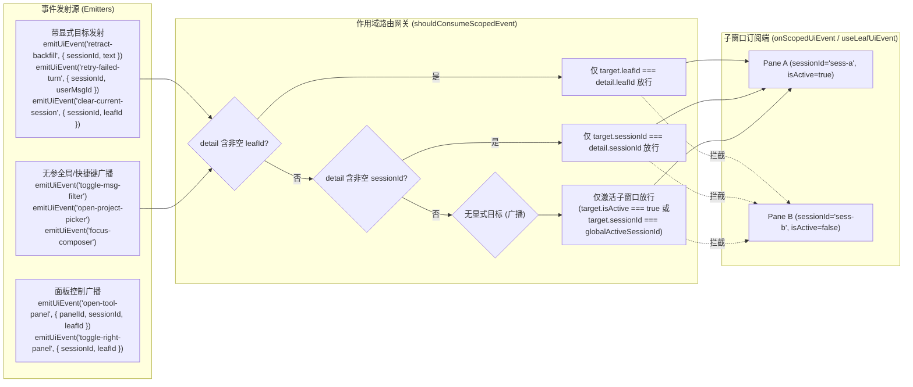

# 维度 02：定址化 UI 事件总线与跨组件通信隔离架构详案

> **所属战役**：[`docs/multi-pane-isolation/`](./00-总方案.md)
> **前置输入**：[`audits/00-全仓多分屏隔离问题全景审计汇总.md`](./audits/00-全仓多分屏隔离问题全景审计汇总.md)（维度 B：B-01 ~ B-05、B-09；维度 A：A-04/A-05；维度 C：C-03；维度 D：D-02）
> **架构原则**：**构造即隔离（By-Construction Isolation）**——在 `uiEvents.ts` 与 `useLeafUiEvent.ts` 网关层建立统一的作用域寻址协议，消除无目标全局广播对后台子窗口（Split-Pane Leaf）的横向污染，严禁在业务组件内散装堆砌 `if (sessionId !== activeSessionId) return` 补丁。

---

## 一、 问题根因与审计映射

在单窗口时代，`src/api/uiEvents.ts` 构建在 `window.dispatchEvent(new CustomEvent('crish-*'))` 之上，所有事件默认向全窗口广播，且各 `ChatCard` / `TreeLeafPanel` 实例通过 `onUiEvent` 无条件订阅。当二叉树工作区切分为多个并存的对话子窗口（Pane A + Pane B）时，暴露出以下系统性串扰：

| 审计编号        | 涉及事件 / 模块                                                                                  | 精确代码位置                                                                                                                                                    | 跨分屏污染根因与故障表现                                                                                                                                                                                                                                                                                                                                                                              |
| :-------------- | :----------------------------------------------------------------------------------------------- | :-------------------------------------------------------------------------------------------------------------------------------------------------------------- | :---------------------------------------------------------------------------------------------------------------------------------------------------------------------------------------------------------------------------------------------------------------------------------------------------------------------------------------------------------------------------------------------------- |
| **B-01 (A-04)** | `'retract-backfill'`                                                                             | `components/chat-card/useChatHandlers.ts:118-123`                                                                                                               | `onUiEvent('retract-backfill')` 未经作用域网关过滤，且 `suppressRetractBackfillRef` 为组件实例私有。在分屏 A 撤回消息或原位编辑重发时，分屏 B 收到广播并调用 `backfillFromBoundaryText`，导致分屏 B 输入框草稿被分屏 A 旧消息强行覆盖。                                                                                                                                                               |
| **B-02 (A-05)** | `'retry-failed-turn'`                                                                            | `components/chat-card/useChatHandlers.ts:398-405`                                                                                                               | `onUiEvent('retry-failed-turn')` 未校验事件目标 `sessionId` 是否属于当前 `ChatCard`。点击一次错误栏「重试」，$N$ 个挂载的 `ChatCard` 同时对目标会话发起 $N$ 次并发重生成。                                                                                                                                                                                                                            |
| **B-03**        | `'toggle-msg-filter'`<br>`'open-project-picker'`                                                 | `components/chat-card/useChatProjectPicker.ts:44-53`                                                                                                            | 顶栏菜单或快捷键触发无参广播后，所有挂载分屏同时弹出消息过滤条或项目选择器弹窗，并在 `requestAnimationFrame` 中争抢 `.focus()`。                                                                                                                                                                                                                                                                      |
| **B-04**        | `'export-session-md'`<br>`'open-conversation-rewind'`<br>`'stop-generation'`                     | `components/chat-card/useChatHandlers.ts:71-108`<br>`components/chat-card/useChatSessionActions.ts:209-213`                                                     | 触发一次事件，所有分屏同时导出各自会话的 Markdown、同时发起回溯预览请求弹出多个 Toast、或同时触发停止生成。                                                                                                                                                                                                                                                                                           |
| **B-05 / C-03** | `'crish-open-file'`<br>`openSidePanel` / `handleViewPlan`                                        | `components/chat-card/useChatSessionActions.ts:75-80, 112-136`<br>`components/markdown/MarkdownDocumentView.tsx:185-192`<br>`hooks/useTreePanelEvents.ts:25-52` | ① `openPathInFilesPanel` 硬编码调用 `openToolInActiveTab('files')` 并派发无 `sessionId` 的 `crish-open-file`；<br>② `handleViewPlan` / `openSidePanel` 不支持传入目标 `sessionId`，在非激活分屏点击打开抽屉会跳到全局焦点分屏；<br>③ `MarkdownDocumentView` 未携带所属叶子作用域且对外部链接未做隔离守卫；<br>④ `useTreePanelEvents` 忽略事件携带的 `leafId` / `sessionId`，一律回落 `activeLeafId`。 |
| **B-09**        | `'crish:chat-clear'`<br>`'crish:chat-stop'`<br>`'crish:chat-compact'`<br>`'crish:open-settings'` | `components/chat-composer/AiCommandSlashExtension.ts:31, 44, 77, 160`                                                                                           | 编辑器斜杠命令直接派发无人监听的悬空 `CustomEvent('crish:*')`，且未携带当前编辑器所属分屏的 `{ sessionId, leafId }` 作用域。                                                                                                                                                                                                                                                                          |
| **D-02**        | `'focus-composer'`                                                                               | `components/chat-card/useChatProjectPicker.ts:54-66`                                                                                                            | 全局 `document.querySelector('textarea[data-chat-composer]...')` 既不支持 Tiptap `[contenteditable="true"]` 富文本输入框，又永远命中 DOM 树第一个（左侧）分屏。                                                                                                                                                                                                                                       |

---

## 二、 核心架构设计：定址化作用域事件总线（Scoped UI Event Bus）

### 2.1 数据流与网关拓扑



### 2.2 `UiEventMap` 定址契约扩展（`src/api/uiEvents.ts`）

1. **定义统一作用域寻址接口 `UiEventScopeTarget`**：
   ```ts
   export interface UiEventScopeTarget {
     sessionId?: string;
     leafId?: string;
   }
   ```
2. **升级子窗口级事件载荷（100% 向后兼容无参调用）**：
   - 将原本载荷为 `void` 的子窗口级事件升级为 `void | UiEventScopeTarget`：
     - `'open-project-picker': void | UiEventScopeTarget`
     - `'open-scheduled': void | UiEventScopeTarget`
     - `'open-chat': void | UiEventScopeTarget`
     - `'open-overview': void | UiEventScopeTarget`
     - `'open-tasks': void | UiEventScopeTarget`
     - `'toggle-msg-filter': void | UiEventScopeTarget`
     - `'export-session-md': void | UiEventScopeTarget`
     - `'open-conversation-rewind': void | UiEventScopeTarget`
     - `'clear-current-session': void | UiEventScopeTarget`
     - `'focus-composer': void | UiEventScopeTarget`
     - `'stop-generation': void | UiEventScopeTarget`
     - `'toggle-right-panel': void | UiEventScopeTarget`
   - 为带业务字段的事件补充可选定址字段：
     - `'open-agent-panel': { agentId?: string; sessionId?: string; leafId?: string }`
     - `'open-tool-panel': { panelId: string; sessionId?: string; leafId?: string }`
     - `'thinking-title-changed': { sessionId: string; leafId?: string }`
     - `'retract-backfill': { sessionId: string; text: string; leafId?: string }`
     - `'retry-failed-turn': { sessionId: string; userMsgId?: string; userMessageId?: string; assistantMsgId?: string; leafId?: string }`
3. **条件类型推导守恒（`HasDetail` & `EmitArgs` & `UiEventDetail`）**：
   - 使用 `void extends UiEventMap[K]` 判定参数可选性：当事件类型为 `void | UiEventScopeTarget` 时，调用方既可不传参 `emitUiEvent('stop-generation')`（或别名 `dispatchUiEvent('stop-generation')`），也可显式传入定址目标 `emitUiEvent('stop-generation', { sessionId, leafId })`；
   - `UiEventDetail<K>` 对 `void | UiEventScopeTarget` 自动收窄为 `UiEventScopeTarget | undefined`，无参监听回调 `() => void` 与带参监听回调 `(detail) => ...` 均完美通过 TypeScript 严格类型检查。

### 2.3 网关路由判定矩阵（`shouldConsumeScopedEvent` & `onScopedUiEvent`）

在 `src/contexts/LeafScopeContext.tsx` 与 `src/hooks/useLeafUiEvent.ts` 中，任何通过 `onScopedUiEvent(name, handler, getTarget)` 或 `useLeafUiEvent(name, handler, overrides)` 注册的监听器，在事件到达时动态调用 `getTarget()` 获取当前子窗口的最新 `{ sessionId, leafId, isActive }`，并按以下真值表严格裁决：

| 事件载荷 (`detail`)            | 当前子窗口上下文 (`target`)                           | 判定规则                                                        |        路由结果        | 典型业务场景                                                                |
| :----------------------------- | :---------------------------------------------------- | :-------------------------------------------------------------- | :--------------------: | :-------------------------------------------------------------------------- |
| `{ leafId: 'leaf-1', ... }`    | `target.leafId === 'leaf-1'`                          | 显式 `leafId` 优先精确匹配                                      |        ✅ 放行         | 从编辑器 DOM 派发 `/clear`、`/stop` 或工具栏定址切换                        |
| `{ leafId: 'leaf-1', ... }`    | `target.leafId === 'leaf-2'`                          | 显式 `leafId` 不匹配                                            |        ❌ 拦截         | 阻断分屏 A 的叶级指令串入分屏 B                                             |
| `{ sessionId: 'sess-a', ... }` | `target.sessionId === 'sess-a'`                       | 显式 `sessionId` 精确匹配                                       |        ✅ 放行         | `retract-backfill`、`retry-failed-turn`、`thinking-title-changed`           |
| `{ sessionId: 'sess-a', ... }` | `target.sessionId === 'sess-b'` 或 `null`             | 显式 `sessionId` 不匹配                                         |        ❌ 拦截         | 彻底根治跨窗撤回草稿覆盖（B-01）与 $N$ 倍重复重试（B-02）                   |
| `undefined` 或 `{}`（无目标）  | `target.isActive === true`                            | 处于 `LeafScopeProvider` 且为激活叶                             |        ✅ 放行         | 全局快捷键触发 `toggle-msg-filter`、`open-project-picker`、`focus-composer` |
| `undefined` 或 `{}`（无目标）  | `target.isActive === false`                           | 处于 `LeafScopeProvider` 且为非激活叶                           |        ❌ 拦截         | 阻断后台分屏同时弹出项目选择器、搜索框或同时导出 Markdown                   |
| `undefined` 或 `{}`（无目标）  | `isActive === undefined`（单Hook测试/未挂载Provider） | 比对 `target.sessionId === store.activeSessionId`（若全局非空） | 仅匹配全局活跃会话放行 | 兼容独立 Hook 单元测试与未包裹 Provider 的降级场景                          |

---

## 三、 各业务模块改造详单

### 3.1 `src/components/chat-card/useChatHandlers.ts`

1. **接入 `onScopedUiEvent` 消除跨窗污染**：
   - 将 `'retract-backfill'`、`'retry-failed-turn'`、`'export-session-md'`、`'open-conversation-rewind'` 全面切换为 `onScopedUiEvent(name, handler, () => ({ sessionId }))`；
   - 支持可选 `onToggleMsgFilter` 回调并通过 `onScopedUiEvent('toggle-msg-filter', ...)` 路由至激活分屏；
   - 支持 `'clear-current-session'` 定址清空当前会话消息与输入框草稿；
   - 在 `'retry-failed-turn'` 中同时兼容 `userMsgId` 与 `userMessageId` 字段，确保单窗精准重跑当轮。
2. **修复 C-03（`handleViewPlan` 定址打开抽屉）**：
   - 新增并导出 `handleViewPlan`，内部调用 `openSidePanel('files', sessionId)`（当未注入 `openSidePanel` 时直接调用 `openToolInSession(sessionId, 'files')`），确保查看计划文件时严格在当前 `ChatCard` 所属分屏打开右侧文件抽屉，绝不误开全局焦点分屏。

### 3.2 `src/components/chat-card/useChatProjectPicker.ts`

1. **接入 `onScopedUiEvent` 隔离浮层与状态**：
   - 读取 `useLeafScope()`，将 `'open-project-picker'`、`'toggle-msg-filter'`、`'focus-composer'`、`'open-scheduled'`、`'open-chat'` 切换为 `onScopedUiEvent`，确保快捷键或命令触发时仅当前激活分屏（或显式目标分屏）响应。
2. **修复 D-02（`focus-composer` 容器级 Tiptap 聚焦）**：
   - 废除全局 `document.querySelector('textarea[data-chat-composer]...')`；
   - 优先在当前叶子作用域容器（`leafScope.leafRootRef.current` → `[data-leaf-id]` → `[data-session-id]` → `.chatBody`）内查询 `.tiptap[contenteditable="true"], [data-chat-composer] [contenteditable="true"], textarea[data-chat-composer], textarea.chat-input, .chat-composer textarea, .composer-textarea, .chat-footer textarea, [contenteditable="true"]` 并调用 `.focus()`，同时解决 Tiptap 无法聚焦与跨分屏抢左窗焦点的问题。

### 3.3 `src/components/chat-card/useChatSessionActions.ts`

1. **`openSidePanel` 支持目标 `targetSessionId`**：
   - 签名扩展为 `openSidePanel: (panelId: 'terminal' | 'diff' | 'preview' | 'tasks' | 'files', targetSessionId?: string | null) => void`；
   - 当传入显式 `targetSessionId` 时直接调用 `openToolInSession(targetSessionId, panelId)`，否则调用本叶绑定的 `handleGlobalTabClick(panelId)`。
2. **`openPathInFilesPanel` 作用域化**：
   - 打开项目内文件时，优先按当前子窗口 `activeSessionId` 调用 `openToolInSession(activeSessionId, 'files')`（无会话时回退 `openToolInActiveTab('files')`），并在派发的 `crish-open-file` 事件 `detail` 中附带 `sessionId`；
   - 打开项目外绝对路径代码文件时，传入 `openFileViewerInSession(activeSessionId, trimmed, 'plain')` 确保在当前分屏打开查看器。
3. **统一 `onScopedUiEvent` 订阅会话级事件**：
   - 使用 `onScopedUiEvent`（传入 `() => ({ sessionId: activeSessionId })`）统一管理 `'clear-current-session'`、`'export-session-md'`、`'open-conversation-rewind'`、`'thinking-title-changed'`、`'stop-generation'`，并与 `useChatHandlers` 通过 `subscribeLifecycleEvents: false` 协同，保证生产环境与独立 Hook 单测均零重复订阅。

### 3.4 `src/components/chat-composer/AiCommandSlashExtension.ts`

1. **清退悬空 `crish:*` 死事件并桥接定址 `dispatchUiEvent`**：
   - 从 `editor.view.dom.closest('[data-leaf-id], [data-session-id]')` 动态提取当前编辑器所在的 `{ sessionId, leafId }` 作用域目标；
   - `/clear`：调用 `dispatchUiEvent('clear-current-session', target)`，由当前子窗口 `useChatSessionActions` / `useChatHandlers` 消费清空；
   - `/stop`：调用 `dispatchUiEvent('stop-generation', target)`，仅终止当前分屏流式生成；
   - `/compact`：改为插入 `/compact ` 指令文本（与 `/goal `、`/schedule ` 一致，交由 `useSlashSend` → `runPreflightChecks` 的 `core_compact_now` 链路按当前分屏会话执行压缩），彻底消除无监听的 `crish:chat-compact` 死事件；
   - `/settings`：直接调用 `openSettings()` 打开工作台设置中心，消除无监听的 `crish:open-settings` 死事件。

### 3.5 `src/components/markdown/MarkdownDocumentView.tsx` & `src/hooks/useTreePanelEvents.ts`

1. **`MarkdownDocumentView.tsx`**：
   - 接入 `useLeafScope()`，点击 `.md-path-link` 时，仅当 `cleanPath` 为非外部 URL 的本地路径时才派发 `crish-open-file`；
   - 若当前处于子窗口作用域内（`scope.sessionId` / `scope.leafId` 或 DOM 祖先带有 `[data-session-id]` / `[data-leaf-id]`），将其注入 `crish-open-file` 的 `detail` 中，防止其他分屏的 `FilesCard` 被同步切换。
2. **`useTreePanelEvents.ts`**：
   - 监听 `'open-tool-panel'`、`'toggle-right-panel'`、`'open-agent-panel'`、`'open-overview'`、`'open-tasks'` 以及 DOM `'crish-open-file'` / `'crish-open-terminal'`；
   - 当事件载荷携带 `leafId` 时优先调用 `openToolInLeaf(leafId, panelId)`；携带 `sessionId` 时优先调用 `openToolInSession(sessionId, panelId)`；均未携带时回退 `openToolInActiveTab(panelId)`（`activeLeafId`）。

---

## 四、 验收断言与防回归测试矩阵

| 测试套件路径                                                            | 覆盖场景与核心断言                                                                                                                                                                                                                                                                                                                                                                                                                                                                                                                                                                                                                                                                                                                                                                                                                                                            |
| :---------------------------------------------------------------------- | :---------------------------------------------------------------------------------------------------------------------------------------------------------------------------------------------------------------------------------------------------------------------------------------------------------------------------------------------------------------------------------------------------------------------------------------------------------------------------------------------------------------------------------------------------------------------------------------------------------------------------------------------------------------------------------------------------------------------------------------------------------------------------------------------------------------------------------------------------------------------------- |
| `src/hooks/__tests__/useLeafUiEvent.test.tsx`                           | 1. 携带 `sessionId` 的事件（`retract-backfill`、`retry-failed-turn`、`thinking-title-changed`）仅命中匹配 `sessionId` 的子窗口，另一子窗口零触发；<br>2. 携带 `leafId` 的事件（`open-tool-panel`、`toggle-right-panel`、`stop-generation`）仅命中匹配 `leafId` 的子窗口；<br>3. 无参广播事件（`toggle-msg-filter`、`open-project-picker`、`focus-composer`、`export-session-md`、`open-conversation-rewind`、`clear-current-session`）在双分屏下严格仅由 `isActive=true`（或匹配全局 `activeSessionId`）的焦点分屏消费。                                                                                                                                                                                                                                                                                                                                                      |
| `src/components/chat-card/__tests__/useChatHandlers.isolation.test.tsx` | 双分屏（Pane A `session-a` + Pane B `session-b`）同时挂载 `useChatHandlers` 与 `useChatProjectPicker`：<br>1. **A-04 (`retract-backfill`)**：向 `session-a` 派发撤回回填，仅 Pane A 的 `setChatInput` 被调用，Pane B 草稿纹丝不动；<br>2. **A-05 (`retry-failed-turn`)**：向 `session-b` 派发失败重试，仅 Pane B 触发 `runStreamingAssistant`，绝不双窗并发重发；<br>3. **`toggle-msg-filter` & `open-project-picker`**：派发无参事件，仅当前激活分屏切换搜索栏/打开项目选择器；<br>4. **`export-session-md` & `open-conversation-rewind`**：派发无参或定址事件，仅目标分屏执行导出或回溯预览；<br>5. **C-03 (`handleViewPlan`)**：在非激活分屏 B 调用 `handleViewPlan`，严格调用 `openSidePanel('files', 'session-b')`；<br>6. **D-02 (`focus-composer`)**：在激活分屏 B 触发 `focus-composer`，精准聚焦分屏 B 内的 `.tiptap[contenteditable="true"]`，不抢左分屏 A 的焦点。 |
