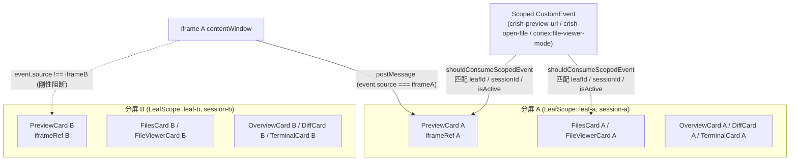

# 维度 04：工具抽屉卡片与内置预览浏览器多实例隔离方案

> **所属战役**：`docs/multi-pane-isolation/`
> **关联总方案**：[`00-总方案.md`](./00-总方案.md)
> **覆盖审计项**：`B-05`、`B-06`、`B-07`、`B-09`、`B-10`、`C-01`、`C-02`、`C-03`、`C-04`、`C-05`、`C-06`、`A-09`、`A-10`

---

## 一、 现状病灶与根因分析

在多子窗口（Split-Pane）并存场景下，每个分屏叶子（`TreeLeafPanel`）右侧均可独立展开工具抽屉（Dock），同时挂载 `PreviewCard`、`FilesCard`、`FileViewerCard`、`OverviewCard`、`DiffCard`、`TerminalCard`、`AgentCard`、`FlowDagView`、`TrashSection` 与 `NotePaper` 等多实例组件。旧实现存在四类系统性串扰：

1. **预览浏览器跨窗 `postMessage` 污染与 URL 广播劫持（`C-02`、`B-06`、`B-09`）**：
   - `PreviewCard.tsx:184` 与 `previewHostBridge.ts:248` 在监听 `window.addEventListener('message')` 时未校验 `event.source === iframeRef.current?.contentWindow`，导致分屏 A 的 iframe 内页面跳转或 DOM Inspector 悬停/拾取事件直接污染分屏 B 的 `PreviewCard` 状态与浮层；
   - `usePreviewNavigation.ts:126` 内部导航时调用无静默标记的 `setPreviewUrl(url)`，触发全局无目标 `crish-preview-url` 广播，强制所有其他分屏的 `PreviewCard` 与 `ToolTabFavicon` 同步跳转并改写图标；
   - `PreviewCard.tsx:58, 71, 253` 的 AI 协同状态、停止按钮（派发悬空死事件 `crish:chat-stop`）与「发送到 AI」按钮硬编码读取全局 `activeSessionId`。
2. **文件树、单文件查看器与选区批注串窗（`B-05`、`B-07`、`C-04`、`A-09`）**：
   - `FilesCard.tsx:216-235` 无条件响应全局 `crish-open-file` 事件，且批注计数角标调用无参 `countPendingFileAnnotations()`（读取全局 `activeSessionId`）；
   - `FilesCard.tsx:450` 与 `FileViewerCard.tsx:448` 未向 `FileAnnotationPopover` 传入当前子窗口的 `targetSessionId`，导致在非激活分屏划词提交代码批注时落入全局激活会话池；
   - `openTool.ts:328` 派发 `conex:file-viewer-mode` 未携带目标 `leafId` / `sessionId`，两个分屏打开同名文件时切换 `plain` / `diff` 模式会互相联动篡改。
3. **概览、变更、终端、子智能体、编排图与回收站绑死全局会话（`C-03`、`C-05`、`C-06`）**：
   - `OverviewCard.tsx` 与 `useSessionScopedChanges.ts` 直接调用 `useSessionField(selectActiveSession)`，导致所有分屏的总览面板显示相同会话数据；
   - `TerminalCard.tsx:118` 点击 `+` 新建终端调用无参 `openNewTerminalInActiveTab()`，在非激活分屏点击会把新终端开到全局焦点分屏；
   - `AgentCard.tsx`、`DiffCard.tsx`、`FlowDagView.tsx`、`TrashSection.tsx` 均直接读取全局 `activeSessionId`。
4. **笔记文档管理器双轨重复订阅与无守卫事件消费（`B-10`）**：
   - `useNoteDocumentManager.ts:117-123` 同时监听了 `window` 的 `conex:note-doc-written` DOM 事件和 `subscribeNoteDocWritten` 内存回调（`notifyNoteDocWritten` 同时触发二者），每次写入导致 2 倍冗余列表刷新；且缺少 `shouldConsumeScopedEvent` 作用域守卫。

---

## 二、 根源性隔离架构设计（By-Construction Isolation）



### 2.1 内置预览浏览器与 Favicon 多实例隔离（`PreviewCard` / `usePreviewNavigation` / `previewHostBridge` / `ToolTabFavicon`）

1. **`event.source` 源窗口刚性校验**：
   - 在 [`PreviewCard.tsx`](file:///c:/Software/conex/apps/crish-desktop/src/components/workspace/PreviewCard.tsx) 的 `window.addEventListener('message', handleMessage)` 入口首行强制执行：
     ```ts
     if (
       !iframeRef.current ||
       event.source !== iframeRef.current.contentWindow
     ) {
       return;
     }
     ```
   - 在 [`previewHostBridge.ts`](file:///c:/Software/conex/apps/crish-desktop/src/components/workspace/previewHostBridge.ts) 的 `subscribeToInspector(listener, iframeRef?)`（及别名 `attachPreviewHostBridge(iframeRef, listener)`）中，当传入 `iframeRef` 时强制校验：
     ```ts
     const iframe = unwrapIframe(iframeRef);
     if (
       !iframe ||
       (iframe.contentWindow && event.source !== iframe.contentWindow)
     ) {
       return;
     }
     ```
     彻底阻断分屏 A 的 iframe 消息触发分屏 B 的导航或 Inspector 浮层。
2. **预览导航与 Favicon 按叶定址**：
   - [`usePreviewNavigation.ts`](file:///c:/Software/conex/apps/crish-desktop/src/components/workspace/usePreviewNavigation.ts) 接入 `useLeafScope()` 与 `useScopedSessionId(opts.sessionId)`：
     - 组件内主动导航（`navigate` / `applyStackUrl`）时调用 `setPreviewUrl(url, { silent: true })` 仅做持久化与历史记录写入，不再广播无目标的 `crish-preview-url`；
     - 同时派发带本叶坐标的 `crish-preview-url-change` 事件：`detail: { url, leafId, sessionId }`；
     - 监听外部 `crish-preview-url` 时，通过 `shouldConsumeScopedEvent(detail, { leafId, sessionId, isActive })` 过滤，仅目标分屏（或无目标时的当前激活分屏）执行跳转。
   - [`ToolTabFavicon.tsx`](file:///c:/Software/conex/apps/crish-desktop/src/components/binary-tree/ToolTabFavicon.tsx) 接入 `useLeafScope()`，维护本实例 `tabUrl` 状态，仅当 `crish-preview-url-change` / `crish-preview-url` 通过 `shouldConsumeScopedEvent` 校验匹配本叶时才更新当前标签对应的站点 URL 与 Favicon。
3. **本叶会话绑定（AI 协同状态、停止与发送到 AI）**：
   - `PreviewCard` 通过 `useScopedSessionId(props.sessionId)` 读取所属子窗口会话 `scopedSessionId`；
   - `isAiStreaming` 基于 `s.sessionsById[scopedSessionId]` 计算；
   - `handleSendToAi` 将拾取到的 DOM 片段写入 `setComposerDraft(scopedSessionId, text)`；
   - `handleStopAi` 派发携带 `{ sessionId: scopedSessionId, leafId }` 的 `crish-stop-generation` 事件，清理原悬空死事件 `crish:chat-stop`。

### 2.2 文件面板、单文件查看器与代码批注按叶隔离（`FilesCard` / `FilePreview` / `FileViewerCard` / `openTool.ts`）

1. **`FilesCard.tsx` 作用域化**：
   - 支持可选 `{ initialPath?: string | null; sessionId?: string | null; leafId?: string | null }`，结合 `useLeafScope()` 与 `useScopedSessionId(sessionId)` 获取本子窗口上下文；
   - 批注计数角标调用 `countPendingFileAnnotations(scopedSessionId)` 并在 `scopedSessionId` 变化及 `crish-file-annotations-changed` 事件时同步更新；
   - 监听 `crish-open-file` 时通过 `shouldConsumeScopedEvent(detail, { sessionId: scopedSessionId, leafId: effectiveLeafId, isActive })` 过滤，杜绝一处点击文件全屏所有 `FilesCard` 同步跳文件；
   - 向 `<FilePreview>` 透传 `targetSessionId={scopedSessionId}`。
2. **`FilePreview.tsx` & `FileViewerCard.tsx` 批注归属修复**：
   - `FilePreview` 接收 `targetSessionId?: string | null` 并透传给 `<FileAnnotationPopover targetSessionId={targetSessionId} />`；
   - `FileViewerCard` 通过 `useScopedSessionId(props.sessionId)` 获取 `scopedSessionId` 并传给 `<FileAnnotationPopover targetSessionId={scopedSessionId} />`，确保在非激活分屏划词添加的代码批注 100% 挂入本分屏会话。
3. **`FileViewerCard.tsx` & `openTool.ts` 模式切换事件定址**：
   - `openFileViewerInSession` 在派发 `conex:file-viewer-mode` 微任务事件时附带 `{ canonicalTabId, mode: initialMode, leafId: activeId, sessionId: resolvedSessionId }`；
   - `FileViewerCard` 监听 `conex:file-viewer-mode` 时通过 `shouldConsumeScopedEvent` 校验，防止不同分屏查看同一文件时切换 `plain` / `diff` 互相干扰；
   - `FileViewerCard` 的「在文件树中定位」动作附带 `{ path: absolutePath, sessionId: scopedSessionId, leafId: effectiveLeafId }` 并优先调用 `leafScope.openTool('files')`。

### 2.3 总览、变更、终端、子智能体、编排图、回收站与笔记隔离

1. **`OverviewCard.tsx` & `useSessionScopedChanges.ts`**：
   - 均通过 `useScopedSessionId(explicitSessionId)` 获取当前子窗口绑定的 `sessionId`，从 `sessionsById[scopedSessionId]` 读取本子窗口会话的消息、子智能体列表、工作区路径与会话级派生文件改动列表。
2. **`TerminalCard.tsx` & `openTool.ts`**：
   - `TerminalCard` 使用 `useScopedSessionId(sessionIdProp)` 与 `useLeafScope()`；
   - 点击工具栏「新建终端」时，优先在当前子窗口 `leafScope.leafId` / `boundSessionId` 对应的叶子上调用 `openNewTerminalInLeaf` / `leafScope.openTool('terminal')`，根除在后台分屏点 `+` 却在焦点分屏冒出新终端的问题。
3. **`AgentCard.tsx` / `DiffCard.tsx` / `FlowDagView.tsx` / `TrashSection.tsx`**：
   - 全面使用 `useScopedSessionId(propSessionId)` 取代裸 `useSessionStore(s => s.activeSessionId)` / `selectActiveSession` / `getActiveSessionId()`；
   - `DiffCard` 打开文件查看器时显式传入 `openFileViewerInSession(scopedSessionId, filePath, 'plain')`。
4. **`useNoteDocumentManager.ts`**：
   - 移除与 `subscribeNoteDocWritten` 重复的 `window.addEventListener('conex:note-doc-written')` DOM 监听，消除单次写入 2 倍刷新；
   - 对 `subscribeNoteDocWritten` 及 `conex:attach-text-file` 接入 `shouldConsumeScopedEvent` 守卫，防止多记事本实例跨窗误消费。

---

## 三、 验收与防回归测试设计

新增单元测试 [`apps/crish-desktop/src/components/workspace/__tests__/dockToolsIsolation.test.tsx`](file:///c:/Software/conex/apps/crish-desktop/src/components/workspace/__tests__/dockToolsIsolation.test.tsx)，覆盖以下核心断言：

1. **双 `PreviewCard` 隔离**：
   - 同时挂载分屏 A（`leaf-a`, `sess-a`）与分屏 B（`leaf-b`, `sess-b`）的 `PreviewCard`；
   - 向 `window` 派发 `source === iframeA.contentWindow` 的 `preview:navigate` 及 `INSPECT_SELECT` `MessageEvent`，断言仅分屏 A 响应，分屏 B 状态零污染；
   - 派发带 `leafId: 'leaf-b'` 的 `crish-preview-url` 事件，断言仅分屏 B 跳转到目标地址，分屏 A 保持原地址不变。
2. **双 `FilesCard` 隔离**：
   - 同时挂载分屏 A（`leaf-a`, `sess-a`）与分屏 B（`leaf-b`, `sess-b`）的 `FilesCard`；
   - 向 `sess-a` 添加 2 条待发送文件批注、向 `sess-b` 添加 1 条批注，断言分屏 A 徽章显示 `2`、分屏 B 徽章显示 `1`；
   - 派发 `{ path: '...', leafId: 'leaf-b', sessionId: 'sess-b' }` 的 `crish-open-file` 事件，断言仅分屏 B 打开目标文件，分屏 A 维持原浏览态。
3. **双 `OverviewCard` / `DiffCard` 会话上下文隔离**：
   - 在全局 `activeSessionId = 'sess-a'` 时，分屏 A 与分屏 B 分别包裹 `<LeafScopeProvider sessionId="sess-a">` 与 `<LeafScopeProvider sessionId="sess-b">`，断言两个分屏各自展示 `sess-a` 与 `sess-b` 的专属会话标题、子智能体与 AI 改动数据。
