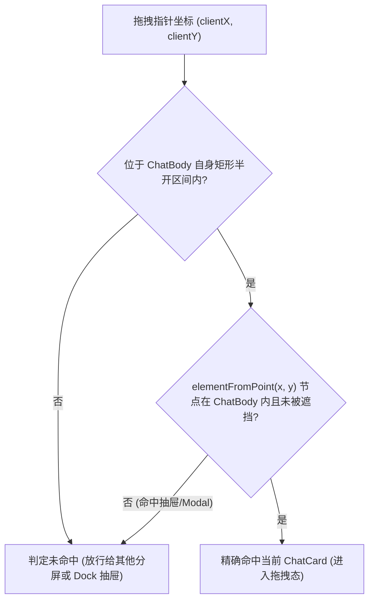

# 维度 05：容器级 DOM 查询与拖拽按键 ARIA 隔离方案

> **所属战役**：[`docs/multi-pane-isolation/`](./00-总方案.md)
> **前置输入**：[`audits/00-全仓多分屏隔离问题全景审计汇总.md`](./audits/00-全仓多分屏隔离问题全景审计汇总.md)（维度 D：D-01 ~ D-05）
> **架构原则**：**构造即隔离（By-Construction Isolation）**——消除所有穿透性全局 `document.querySelector`、无守卫 `window.addEventListener('keydown')`、模糊拖拽判定与重复静态 DOM `id`，使每个分屏成为自包含的 DOM 与交互沙盒。

---

## 一、 问题根因与审计映射

在单窗口时代，代码假定全页面只有一个 `ChatCard`、一个滚动容器、一组快捷键监听和唯一的面板 DOM ID。多分屏挂载时引发了严重的越界与串扰：

| 审计编号 | 涉及模块                                                                                                                   | 精确代码位置                                                                          | 核心断裂与故障表现                                                                                                                                                                                                                                                                                                                                 |
| :------- | :------------------------------------------------------------------------------------------------------------------------- | :------------------------------------------------------------------------------------ | :------------------------------------------------------------------------------------------------------------------------------------------------------------------------------------------------------------------------------------------------------------------------------------------------------------------------------------------------- |
| **D-01** | `useChatCardDragDrop.ts`                                                                                                   | `components/chat-card/useChatCardDragDrop.ts:71-76`                                   | `isPointInsideTarget` 尝试通过 `element.closest('[data-leaf-id]')` 的矩形提前 `return true`。但 `[data-leaf-id]` 包含了当前分屏左侧的聊天区和右侧的 Dock 抽屉（`FilesCard` / `NotePaper`）。导致用户想把文件拖拽到同叶右侧抽屉时，被左侧的 `ChatCard` 强行吞并并挂载附件！另外缺少半开区间与 `elementFromPoint` 遮挡排除。                         |
| **D-02** | `useScrollAnchor.ts` `ApprovalDock.tsx` `chatMessageRowUtils.ts`                                                     | `useScrollAnchor.ts:12-40` `ApprovalDock.tsx:45` `chatMessageRowUtils.ts:157`   | ① `useScrollAnchor.ts:13` 首先执行 `document.querySelector('[data-chat-scroll-container]')`，多分屏下永远只选中最左侧分屏的滚动容器，右分屏滚动锚点完全失效； ② `ApprovalDock.tsx` 全局查找 `[data-approval-card-anchor]`，点击滚动时跨窗跳转； ③ `focusChatComposer` 全局查找 `textarea.chat-input`，不支持 Tiptap 富文本且永远聚焦首分屏。 |
| **D-03** | `useApprovalKeyboard.ts`                                                                                                   | `components/agent-card/useApprovalKeyboard.ts:28-33`                                  | 审批卡组件在 `useEffect` 中无条件执行 `setTimeout(() => cardRef.current?.focus(), 0)`。当后台非激活分屏产生审批任务并挂载卡片时，瞬间强行抢夺前台正在打字用户的焦点！                                                                                                                                                                              |
| **D-04** | `DynamicChipBar.tsx` `DiffCardGitActions.tsx` `useSlashMenuKeymap.ts` `FileBreadcrumb.tsx` `useSettingsNav.ts` | 对应组件的 `window.addEventListener('keydown')`                                       | 全局键盘监听器缺少容器归属或焦点守卫。用户在分屏 A 编辑时，按特定按键（如 Esc、方向键、Enter）会被分屏 B 的隐藏抽屉或芯片条监听器截获并吞掉。                                                                                                                                                                                                      |
| **D-05** | 19 处静态 DOM `id`                                                                                                         | `RuntimeSection.tsx`、`PreviewToolbar.tsx`、`OverviewContextSection.tsx` 等 14 个文件 | 硬编码 `id="runtime-panel"`、`id="preview-toolbar"`、`id="overview-tasks"` 等。多分屏并存时，页面出现大量重复 DOM ID，导致 ARIA 属性（`aria-controls`, `aria-labelledby`）关联错乱与测试定位混淆。                                                                                                                                                 |

---

## 二、 核心架构设计

### 2.1 支柱一：拖拽目标精确几何与遮挡排除算法（D-01 根治）

彻底废除基于 `closest('[data-leaf-id]')` 放大包围盒的做法，以 `ChatCard` 自身的容器根节点（`.chatBody`）为绝对基准：

1. **半开区间几何判定**：
   $$\text{HitRect} \iff (x \ge \text{rect.left} \land x < \text{rect.right} \land y \ge \text{rect.top} \land y < \text{rect.bottom} \land \text{rect.width} > 0 \land \text{rect.height} > 0)$$
   严格使用右开、下开区间，确保在两个相邻无缝分屏的边界像素上（$x = \text{boundary}$），仅有右侧分屏命中，绝对不存在双窗同时高亮。
2. **同叶右侧 Dock 抽屉排除与遮挡校验**：
   当 `document.elementFromPoint(x, y)` 可用时：
   - 获取命中的最顶层 DOM 节点 `hitEl`；
   - 校验 `hitEl` 必须位于当前 `.chatBody` 内部（即 `element.contains(hitEl)`）；
   - 若 `hitEl` 位于右侧抽屉 `.leafToolPanel` 内部，或者被全屏 Modal / 遮罩层遮挡，则判定未命中当前卡片；
   - JSDOM 环境兜底：在单测中 `elementFromPoint` 返回 `null` 时安全回退至几何矩形判定，保持单测 100% 兼容。

### 2.2 支柱二：容器级 DOM 查询与聚焦支持（D-02 根治）

1. **`useScrollAnchor` 消除全局选择器**：
   - 优先使用组件自身持有的 `scrollContainerRef.current`；
   - 若需向上查找，使用 `scrollContainerRef.current?.closest('[data-chat-scroll-container]')`；
   - 彻底删除第 13 行先执行的 `document.querySelector('[data-chat-scroll-container]')`。
2. **`ApprovalDock` 局部寻址**：
   - 绑定 `dockRef`，仅在 `dockRef.current?.closest('[data-leaf-id]')` 内部查找审批锚点并滚动。
3. **`focusChatComposer` 容器限定与 Tiptap 兼容**：
   - 支持传入容器 `rootElement?: HTMLElement | null`；
   - 查询选择器扩展为：
     `'.tiptap[contenteditable="true"], textarea.chat-input, [data-testid="chat-input"], [contenteditable="true"]'`
   - 优先聚焦当前所属分屏内的编辑器。

### 2.3 支柱三：按键守卫与后台防抢焦点（D-03 & D-04 根治）

1. **`useApprovalKeyboard` 防抢焦点**：
   - 移除无条件挂载聚焦逻辑，仅当：
     1. 该组件所属分屏为当前激活分屏（`isActive === true`）；
     2. 当前 `document.activeElement` 不是用户正在输入的文本框（`input`, `textarea`, `[contenteditable="true"]`）
        时才允许辅助聚焦；
   - 全局按键（Y/N/A/Enter/Esc）增加守卫：仅当焦点位于审批卡内部或所属分屏为激活分屏时响应。
2. **浮层与工具卡按键守卫**：
   - `DynamicChipBar`、`DiffCardGitActions`、`useSlashMenuKeymap`、`FileBreadcrumb`、`useSettingsNav` 统一增加容器可见性与焦点包含校验（`containerRef.current?.contains(document.activeElement)`），防止非活跃卡片吞咽全局按键。

### 2.4 支柱四：19 处静态 DOM ID 替换为 `useId()`（D-05 根治）

使用 React 18 内置的 `useId()` 原生生成实例隔离的稳定 ID，替换以下 14 个文件中的 19 处静态 ID：

1. `apps/crish-desktop/src/components/workspace/RuntimeSection.tsx`
2. `apps/crish-desktop/src/components/workspace/LiveTasksSection.tsx`
3. `apps/crish-desktop/src/components/workspace/BgTasksSection.tsx`
4. `apps/crish-desktop/src/components/workspace/ApprovalSection.tsx`
5. `apps/crish-desktop/src/components/workspace/PlansSection.tsx`
6. `apps/crish-desktop/src/components/workspace/PreviewToolbar.tsx`
7. `apps/crish-desktop/src/components/workspace/PreviewHistoryPanel.tsx`
8. `apps/crish-desktop/src/components/overview/OverviewContextSection.tsx`
9. `apps/crish-desktop/src/components/overview/OverviewRuntimeSection.tsx`
10. `apps/crish-desktop/src/components/overview/OverviewTasksSection.tsx`
11. `apps/crish-desktop/src/components/overview/OverviewChangesSection.tsx`
12. `apps/crish-desktop/src/components/overview/OverviewFileTreeSection.tsx`
13. `apps/crish-desktop/src/components/overview/OverviewStructureSection.tsx`
14. `apps/crish-desktop/src/components/agent-card/AgentBrowsePad.tsx`

---

## 三、 验收断言与测试矩阵

1. **拖拽互斥断言**：在相邻分屏无缝边界拖拽，仅右侧分屏触发高亮；拖拽到分屏内的右侧 `FilesCard`，左侧 `ChatCard` 绝对不被点亮。
2. **滚动隔离断言**：右侧分屏内容增多或点击置顶，仅右分屏自身容器滚动，左分屏 `scrollTop` 纹丝不动。
3. **焦点保护断言**：用户在分屏 A 打字时，分屏 B 挂载审批卡，打字光标不丢失，按键不被后台拦截。
4. **DOM 唯一性断言**：同时渲染两个 `OverviewCard` 或 `RuntimeSection`，全 DOM 树不存在任何重复的 `id` 属性。
