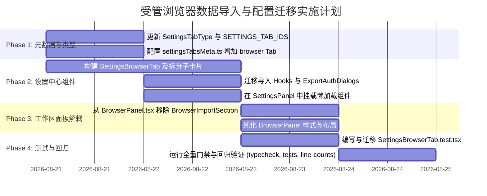

# 03-受管浏览器数据导入与配置迁移至设置面板方案

> **文档定位**：战役 `native-browser-and-panel-standardization` 分析详案。
> **核心目标**：深入审查浏览器数据导入（书签/历史/登录态）及运维区块现状，设计将其从工作区右侧交互面板（`BrowserPanel.tsx`）彻底剥离，并优雅迁移至全局设置中心（`SettingsPanel.tsx`）的完整落地方案。
> **编码要求**：UTF-8 无 BOM、中文撰写、严谨代码变更点与接口定义。

---

## 1. 调研背景与核心动机

### 1.1 现状与架构痛点

在当前的桌面端实现中，受管浏览器面板（`apps/crish-desktop/src/components/workspace/BrowserPanel.tsx`）作为 AI 协同浏览器的交互视口，承载了以下核心能力：
1. **实时画面呈现**：通过 Tauri Channel 接收引擎捕获的 Chrome 画面并在 Canvas 上进行高帧率流式渲染（`FrameCanvas.tsx`）；
2. **多模态输入转发**：捕获用户的鼠标点击、移动、滚动及键盘输入并转发至 CDP（`InputLayer.tsx`）；
3. **输入法桥接**：处理 IME 中文输入法组合串并在 `compositionend` 时整串注入（`useImeBridge.ts`）；
4. **协作接管状态机**：监控 AI 操作状态与人工介入接管（`IndicatorBar.tsx` / `usePanelStatus.ts`）。

然而，历史在推进 G-4 收尾（U6 导入 UI）时，将**数据导入与离线运维区块**（`BrowserImportSection.tsx`）直接内嵌在 `BrowserPanel.tsx` 底部。该区块包含了：
- Chrome 书签文件（JSON）的选择、拖拽与路径导入；
- Chrome 历史数据库（SQLite History 库）的只读读取与导入；
- 受管浏览器登录态（Storage State: Cookies & Origins）的两段式授权导出与 JSON 导入；
- 已导入书签与历史记录的折叠展开、列表浏览、条数截断与刷新控制。

**这带来了显著的架构断层与产品体验问题**：
1. **职责严重混杂**：右侧工作区面板本应是专注「高频、实时、轻量」的 AI 浏览器协同交互视口，却被堆叠了大量「低频、静态、重度」的数据导入与运维表单；
2. **挤占宝贵视口高度**：导入表单、文本域和列表视图占据了大量纵向高度，严重压缩了 Canvas 画面与控制按钮的可见面积；
3. **数据生命周期错位**：书签与历史记录导入后是落库到本机的全局 SQLite 数据库（`imported_bookmarks` / `imported_history` 表），其资产属性属于应用全局数据沉淀，生命周期与单个工作区或具体浏览器会话完全独立；
4. **会话耦合与性能开销**：每次打开右侧浏览器面板，都会初始化数据导入的所有 Hook 与状态管理，增加了不必要的渲染开销。

### 1.2 重构核心目标

1. **彻底纯化工作区面板**：从 `BrowserPanel.tsx` 中彻底移除 `BrowserImportSection`，使 `BrowserPanel` 100% 专注于实时 Canvas 渲染、输入转发、IME 桥接与会话状态指示；
2. **规范沉淀至设置中心**：在设置中心（`SettingsPanel.tsx`）开辟专属的「受管浏览器」（`browser`）设置 Tab，采用标准 `SettingsUI` 设计系统（`SettingsPage` / `SettingsSection` / `SettingsCard` / `SettingsRow`）进行优雅承载；
3. **架构资产与业务逻辑无损平移**：完整保留并复用已有的四个数据管理 Hook（`useBookmarksImport`, `useHistoryImport`, `useStorageImport`, `useExportAuth`）、两段式确认对话框（`ExportAuthDialogs`）以及与 Rust 引擎/conex-db 的交互契约；
4. **平滑解决会话依赖**：在设置中心内优雅处理登录态导入/导出对受管浏览器运行状态（`browserRunning`）的依赖，提供直观的状态感知与便捷控制；
5. **门禁与测试资产对齐**：严格遵守单文件行数门禁（UI ≤ 500 行、业务逻辑 ≤ 400 行），迁移并扩充完整的单元测试套件。

---

## 2. 现存 BrowserImportSection 及其四个 Hook 深度审查

### 2.1 模块结构与数据流动全景

```mermaid
flowchart TD
    subgraph BrowserImportSection [BrowserImportSection 主编排]
        BusyState["BusyKind 统一忙碌状态机<br/>(bookmarks | bookmarksPath | history | storageExport | storageImport | list | null)"]
    end

    subgraph Hooks [业务与状态 Hooks (import-hooks/)]
        BM["useBookmarksImport<br/>- 文件三通道装载<br/>- JSON 校验与落库"]
        HIST["useHistoryImport<br/>- History 库路径解析<br/>- 90天/1000条只读读取<br/>- 已导入列表管理"]
        STOR["useStorageImport<br/>- storage_state 校验<br/>- 会话注入与脱敏统计"]
        AUTH["useExportAuth<br/>- ① 授权读取确认<br/>- ② 域名清单脱敏预览<br/>- 前端显式另存为"]
    end

    subgraph UIComponents [纯展示壳组件]
        EAD["ExportAuthDialogs<br/>(两段式 ConfirmDialog 纯展示)"]
        ILB["ImportedListBlock<br/>(已导入书签/历史列表展示)"]
    end

    subgraph CoreBridge [底层 API 与 Rust 引擎命令]
        API_BM["browser_import_bookmarks (JSON)"]
        API_HIST["browser_import_history (Path)"]
        API_L_BM["browser_list_bookmarks"]
        API_L_HIST["browser_list_history (since, limit)"]
        API_EXP_STOR["browser_export_storage_state (authorized: true)"]
        API_IMP_STOR["browser_import_storage_state (JSON)"]
    end

    subgraph DB [本地存储层 (conex-db)]
        DB_BM[("imported_bookmarks 表<br/>PK: (url, name)")]
        DB_HIST[("imported_history 表<br/>PK: (url, visited_at)")]
    end

    BrowserImportSection --> Hooks
    BrowserImportSection --> UIComponents
    BM --> API_BM --> DB_BM
    HIST --> API_HIST --> DB_HIST
    HIST --> API_L_BM & API_L_HIST
    STOR --> API_IMP_STOR
    AUTH --> API_EXP_STOR
```

### 2.2 四个 Hook 的现状、状态与行为剖析

#### 1. `useBookmarksImport.ts`（书签导入域）
- **职责**：拥有 Chrome Bookmarks JSON 导入的全生命周期。
- **输入支持三通道**：
  - 文件选择器：`<input type="file" accept=".json,application/json">`，通过 `FileReader` 读取；
  - 拖拽区域：`dropZone` 捕获 `dataTransfer.files[0]`；
  - 本机路径输入：输入 Chrome 用户数据目录下的 `Bookmarks` 路径，通过 `readTextFileAtPath`（动态加载 Tauri `@tauri-apps/plugin-fs`，非 Tauri 环境优雅降级）读取。
- **大小上限与校验**：严格限制文件大小 ≤ 10MB（`BROWSER_IMPORT_MAX_BYTES`）。
- **落库与统计**：调用 `importBookmarks(json)`（命令：`browser_import_bookmarks`），解析后执行 `INSERT OR IGNORE` 写入 `imported_bookmarks` 表。返回 `BookmarksImportPayload`（`inserted`, `skippedDupes`, `parsedItems`, `skippedInvalid`, `depthCutoff`, `droppedDupes`, `truncated`）。
- **反馈原则**：成功统计在组件行内以 `role="status"` 呈现（产品禁令：成功提示不打扰 toast）；仅错误走 `toast.show` + 行内 `role="alert"`。

#### 2. `useHistoryImport.ts`（历史导入与已导入列表管理）
- **职责**：拥有 Chrome History SQLite 库导入，以及已导入书签/历史的列表查询与展示。
- **历史导入行为**：
  - 接收用户输入的 Chrome `History` 文件绝对路径；
  - 调用 `importHistory(path)`（命令：`browser_import_history`）；
  - 引擎侧以 `SQLITE_OPEN_READ_ONLY` 打开该库，提取最近 90 天（`HISTORY_DEFAULT_DAYS = 90`）、上限 1000 条（`HISTORY_DEFAULT_LIMIT = 1000`）的访问记录，落库至 `imported_history` 表。
- **已导入列表管理**：
  - 支持 `listTab`（`'bookmarks' | 'history' | null`）折叠切换；
  - 书签列表：调用 `listBookmarks()`，按导入时间倒序展示 `(name, folder_path, url)`；
  - 历史列表：调用 `listHistory(since, limit)`，支持自定义 `historyLimit`（默认 50，防非法值回落）与刷新按钮，展示本地格式化时间 `visited_at`、标题与 URL。

#### 3. `useStorageImport.ts`（登录态注入）
- **职责**：将标准 Playwright 兼容的 `storage_state` JSON（包含 `cookies` 与 `origins`）注入当前运行中的受管浏览器。
- **输入形式**：支持选择 `.json` 文件装载，或在 `textarea` 中直接粘贴 JSON 字符串。
- **前置门禁**：必须要求受管浏览器正在运行（`browserRunning === true`），因为 storage 命令不触发浏览器的惰性拉起；未启动时命令会返回 `tool.browser.not_ready` 错误。
- **安全与脱敏**：调用 `importStorageState(json)`（命令：`browser_import_storage_state`），返回脱敏统计 `StorageImportPayload`（`cookies`, `origins`, `localStorageItems`, `injectedScripts`, `injectedItems`, `droppedDupes`, `skippedEmptyName`），绝不回显任何敏感 cookie 明文。

#### 4. `useExportAuth.ts`（登录态两段式导出与安全另存为）
- **职责**：从受管浏览器中导出当前会话的 Cookie/Storage 状态。
- **两段式安全确认与零副作用机制**：
  - **第一段：显式授权对话框**（`exportAuthOpen`）：明确告知用户即将读取会话 cookie，未确认前绝不调用底层 API（`authorized=false` 命令直接拒绝，零副作用）；
  - **后端实读（内存传递）**：用户确认后，传 `authorized=true` 调用 `exportStorageState`，返回 JSON 字符串**仅在前端内存中持有，绝不落盘到引擎日志或磁盘镜像**；
  - **第二段：脱敏预览对话框**（`exportPreviewOpen`）：解析 JSON 中的 cookie 数量、origin 数量与涉及的**去重域名清单**（`parseStorageStatePreview`），展示给用户核对；
  - **前端显式另存为**：用户再次确认后，通过前端 `downloadTextFile` 生成命名为 `browser-storage-state-YYYYMMDD-HHmmss.json` 的文件下载，存储位置完全由用户文件对话框决定。

---

## 3. 设置中心（Settings）结构与设计系统调研

### 3.1 `settingsTabsMeta.ts` 的元数据驱动架构

```ts
export type TabMeta = {
  id: TabType;
  label: string;      // 侧栏中文标签
  icon: LucideIcon;   // Lucide 图标组件
  group: string;      // 中文分组（个人 / 智能 / 工作 / 安全）
  keywords: string[]; // 搜索别名（同义词、英文、缩写）
  demoOnly?: boolean;
};
```

1. **白名单与分组机制**：`FORMAL_TAB_IDS` 控制侧栏常规显示的 Tab 列表，分为 4 大语义分组：
   - **「个人」**：`profile`（账户/数据）、`appearance`（外观）、`personalize`（通用设置）；
   - **「智能」**：`models`（模型）、`usage`（用量）、`rules`（规则）；
   - **「工作」**：`devices`（多端互通）、`schedule`（定时任务）、`plugins`（扩展）、`shortcuts`（快捷键）、`diagnostics`（状态诊断）；
   - **「安全」**：`security`（安全）。
2. **搜索与导航**：`tabMatchesQuery` 对 `label`、`group`、`id` 以及 `keywords` 进行多维度实时匹配，支持在设置面板顶部搜索框直接键盘漫游与过滤。
3. **路由规范化**：`normalizeSettingsTabId` 支持历史别名兼容（如旧的 `skills` / `mcp` 映射至 `plugins`）。

### 3.2 `SettingsPanel.tsx` 容器与渲染机制

1. **模态全屏容器**：基于 `Dialog` 实现 `variant="fullscreen"`，自带顶栏窗口控制（`WindowControls`）与拖拽区域；
2. **侧栏与键盘导航**：`SettingsSidebar` 实现无障碍 Tablist、Roving Tabindex 焦点管理与实时搜索状态计数；
3. **内容区按需懒加载**：右侧 `tabpanel` 内容采用 `React.lazy` + `Suspense` + `AppErrorBoundary` 进行隔离渲染，每个 Tab 拥有独立的加载状态与错误边界，互不影响；
4. **全局 Store 驱动**：通过 `useSettingsUiStore` 的 `settingsActiveTab` / `openSettings(tabId)` 支持全应用任意入口的深链跳转。

### 3.3 `SettingsPersonalizeTab.tsx` 的模式对比

`SettingsPersonalizeTab.tsx` 采用了 `SettingsSchemaRenderer` 声明式表单体系：
- 适用于简单的 Key-Value 静态配置（如回答风格 `responseStyle`、消息快捷键 `sendShortcut`、面板合并开关 `tabModeEnabled` 等）；
- 其本质是映射到后端 `Settings` 结构体并通过 `saveSettingsEx` 保存。
- **结论**：受管浏览器数据导入具有动态文件装载、拖拽交互、多步确认模态框、分页列表查看与受管进程状态联动等复杂特性，**不适宜塞入静态 Schema 表单，而应当作为拥有独立 UI 架构的标准设置 Tab 或卡片**。

### 3.4 `SettingsUI.tsx` 设计系统组件规范

设置中心提供了标准的基础视觉组件，严格遵循克制、平整的设计 Token：
- `<SettingsPage title="..." meta={...}>`：页面骨架，包含一级标题与右上角元状态插槽；
- `<SettingsSection title="...">`：语义分块，提供清晰的标题与内容间距；
- `<SettingsCard>`：白色/深色圆角卡片，内聚具体设置项；
- `<SettingsRow icon={...} title={...} desc={...} control={...} />`：标准双栏设置行，左侧为标题与辅助说明，右侧为交互控件（按钮、下拉菜单、开关或徽章）。

---

## 4. 方案设计：受管浏览器数据管理落位设置中心

### 4.1 落位选型深度权衡与最终裁决

| 候选方案 | 方案描述 | 优势 | 劣势 | 裁决结论 |
|---|---|---|---|---|
| **方案 A：塞入 `profile`（账户）** | 在 `SettingsProfileTab.tsx` 的「数据」区域下增加浏览器数据导入 Section | 与现有的「导入外部对话」在形式上靠近 | `SettingsProfileTab` 已达 300 行，并入后将突破 500 行 UI 门禁；书签历史非用户账号属性，语义不纯 | ❌ **否决** |
| **方案 B：塞入 `personalize`（通用设置）** | 在 `SettingsPersonalizeTab.tsx` 中嵌入表单 | 属于客户端偏好 | 与其声明式 Schema 架构冲突，破坏单一职责 | ❌ **否决** |
| **方案 C：新增独立 `browser` 设置 Tab**（「受管浏览器」） | 在 `settingsTabsMeta.ts` 新增 `browser` Tab，归入「工作」分组，创建模块化 `SettingsBrowserTab` | ① 职责高度内聚，专注受管浏览器全流程配置；<br/>② 完美匹配设计系统；<br/>③ 预留未来浏览器配置扩展（如代理、启动参数、无头模式）；<br/>④ 单文件行数可控（≤200 行主编排 + 拆分子卡片） | 侧栏新增一个 Tab 项（但通过精准 keywords 可极速搜索） | ✅ **采纳（推荐方案）** |

### 4.2 设置面板全新「受管浏览器」Tab 界面架构

```
┌─────────────────────────────────────────────────────────────────────────────┐
│ 设置 · 受管浏览器                                    [ 运行中 · http://... ] │
├─────────────────────────────────────────────────────────────────────────────┤
│ ┌─ 浏览器运行状态 ────────────────────────────────────────────────────────┐ │
│ │  [图标] 运行状态      当前页面：https://example.com      [ 停止 ] [ 急停 ]│ │
│ └─────────────────────────────────────────────────────────────────────────┘ │
│                                                                             │
│ ┌─ 数据导入 ──────────────────────────────────────────────────────────────┐ │
│ │  书签导入 (Chrome Bookmarks)                                              │ │
│ │  支持 JSON 文件选择、拖拽装载或路径直接读取                 [ 选择文件 ] [ 导入 ]│ │
│ │  [ 拖入 Chrome Bookmarks JSON 文件至此区域 ]                              │ │
│ │  ─────────────────────────────────────────────────────────────────────── │ │
│ │  历史记录导入 (Chrome History SQLite)                                     │ │
│ │  输入 History 库文件绝对路径（只读提取最近 90 天数据）      [ 导入历史记录 ]│ │
│ └─────────────────────────────────────────────────────────────────────────┘ │
│                                                                             │
│ ┌─ 会话登录态管理 ────────────────────────────────────────────────────────┐ │
│ │  导出当前会话登录态                                                       │ │
│ │  需运行中浏览器；经双重授权确认与脱敏预览后导出 JSON        [ 导出登录态 ]│ │
│ │  ─────────────────────────────────────────────────────────────────────── │ │
│ │  导入登录态到受管浏览器                                                   │ │
│ │  支持 Playwright 兼容 storage_state JSON 注入               [ 导入登录态 ]│ │
│ │  [ 粘贴 storage_state JSON 文本域 / 选择 JSON 文件 ]                      │ │
│ └─────────────────────────────────────────────────────────────────────────┘ │
│                                                                             │
│ ┌─ 本机已导入数据浏览 ────────────────────────────────────────────────────┐ │
│ │  已导入书签 / 历史数据查看                                                │ │
│ │  [ 书签列表 (展开) ] [ 历史列表 ]    Limit: [ 50 ]  [ 刷新 ]               │ │
│ │  ┌─────────────────────────────────────────────────────────────────────┐│ │
│ │  │ · GitHub  (书签栏 / 开发)   https://github.com                      ││ │
│ │  │ · 语雀    (顶层)            https://yuque.com                       ││ │
│ │  └─────────────────────────────────────────────────────────────────────┘│ │
│ └─────────────────────────────────────────────────────────────────────────┘ │
└─────────────────────────────────────────────────────────────────────────────┘
```

### 4.3 浏览器会话依赖（`browserRunning`）的平滑解决

由于登录态的读取与注入必须与运行中的 Chrome CDP 进程交互：
1. **状态感知解耦**：在 `SettingsBrowserTab` 中通过 `useBrowserSession()` 直接获取全局会话状态（`state`, `url`, `busy`, `start`, `stop`, `kill`）；
2. **状态联动控制**：
   - 顶部提供「浏览器运行状态」卡片，直观呈现当前状态（`未启动` / `启动中` / `运行中` / `已停止` / `异常`）；
   - 若未启动，登录态导出/导入按钮处于禁用态，并展示友好 Tooltip：“需先启动受管浏览器会话”，同时卡片右侧提供“启动浏览器”按钮，用户可直接在设置页一键拉起；
   - 若已运行，登录态操作即刻点亮，并可直接查看当前页面 URL。
3. **书签与历史导入的免依赖性**：书签（JSON 解析）与历史（SQLite 只读文件解析）直接操作离线文件并落库本地 `conex-db`，**不受浏览器是否运行影响，任何时刻均可自由操作**。

---

## 5. 详细代码变更点与接口定义

### 5.1 类型与元数据定义更新

#### 1. `apps/crish-desktop/src/store/types.ts`
在 `SettingsTabType` 联合类型中增加 `'browser'`：

```diff
 export type SettingsTabType =
   | 'profile'
   | 'appearance'
   | 'personalize'
   | 'models'
   | 'usage'
   | 'devices'
   | 'schedule'
   | 'rules'
   | 'shortcuts'
   | 'skills'
   | 'mcp'
   | 'plugins'
   | 'security'
-  | 'diagnostics';
+  | 'diagnostics'
+  | 'browser';
```

#### 2. `apps/crish-desktop/src/store/layout-helpers/store-types.ts`
同步更新 `SETTINGS_TAB_IDS` 白名单常量：

```diff
 export const SETTINGS_TAB_IDS = [
   'profile',
   'appearance',
   'personalize',
   'models',
   'usage',
   'devices',
   'schedule',
   'rules',
   'shortcuts',
   'skills',
   'mcp',
   'plugins',
   'security',
   'diagnostics',
+  'browser',
 ] as const satisfies readonly SettingsTabType[];
```

#### 3. `apps/crish-desktop/src/components/settingsTabsMeta.ts`
注册 `browser` Tab 的元数据与搜索关键词：

```diff
 const FORMAL_TAB_IDS: TabType[] = [
   'profile',
   'appearance',
   'personalize',
   'models',
   'usage',
   'devices',
   'rules',
   'schedule',
   'plugins',
   'shortcuts',
   'security',
   'diagnostics',
+  'browser',
 ];

 export const TAB_META: TabMeta[] = [
   // ... 既有 tabs
+  {
+    id: 'browser',
+    label: '受管浏览器',
+    icon: Lucide.Compass,
+    group: '工作',
+    keywords: [
+      '受管浏览器',
+      '浏览器',
+      '书签',
+      '历史',
+      '登录态',
+      'Chrome',
+      'cookie',
+      'cookies',
+      'storage',
+      'browser',
+      'import',
+      'bookmarks',
+      'history',
+    ],
+  },
 ];
```

### 5.2 设置面板主容器挂载

#### `apps/crish-desktop/src/components/settings/SettingsPanel.tsx`
增加懒加载引入并在 `TAB_COMPONENTS` 中注册：

```diff
+const SettingsBrowserTab = lazy(() =>
+  import('./SettingsBrowserTab').then((m) => ({
+    default: m.SettingsBrowserTab,
+  }))
+);

 const TAB_COMPONENTS: Record<
   TabType,
   { label: string; Component: React.ComponentType<TabComponentProps> }
 > = {
   profile: { label: '个人资料', Component: SettingsProfileTab },
   appearance: { label: '外观', Component: SettingsAppearanceTab },
   personalize: { label: '通用设置', Component: SettingsPersonalizeTab },
   models: { label: '模型', Component: ModelsSettingsTab },
   plugins: { label: '扩展', Component: SettingsExtensionsTab },
   skills: { label: '扩展', Component: SettingsExtensionsTab },
   mcp: { label: '扩展', Component: SettingsExtensionsTab },
   usage: { label: '用量', Component: SettingsUsageTab },
   devices: { label: '多端互通', Component: SettingsDevicesTab },
   schedule: { label: '定时任务', Component: SettingsScheduleTab },
   rules: { label: '规则', Component: SettingsRulesTab },
   shortcuts: { label: '快捷键', Component: SettingsShortcutsTab },
   security: { label: '安全', Component: SettingsSecurityTab },
   diagnostics: { label: '状态诊断', Component: StatusDiagnosticsPanel },
+  browser: { label: '受管浏览器', Component: SettingsBrowserTab },
 };
```

### 5.3 模块化新组件实现规划

为满足单文件行数限制（UI ≤ 500 行，业务逻辑 ≤ 400 行），我们在 `apps/crish-desktop/src/components/settings/` 目录下构建结构清晰的子组件群：

```
apps/crish-desktop/src/components/settings/
├── SettingsBrowserTab.tsx                  # Tab 主入口与全局编排 (≤ 200 行)
├── SettingsBrowserTab.module.css           # 专用样式模块
├── browser-settings/                       # 细分子模块
│   ├── BrowserSessionStatusCard.tsx        # 浏览器状态指示与启动/停止卡片 (≤ 120 行)
│   ├── BrowserBookmarksCard.tsx            # 书签文件选择/拖拽/路径导入卡片 (≤ 180 行)
│   ├── BrowserHistoryCard.tsx              # 历史记录路径导入卡片 (≤ 120 行)
│   ├── BrowserStorageCard.tsx              # 登录态两段式导出与导入卡片 (≤ 180 行)
│   └── BrowserImportedDataCard.tsx         # 已导入书签与历史数据浏览卡片 (≤ 160 行)
```

#### 1. `SettingsBrowserTab.tsx` 主入口实现核心代码示例

```tsx
import React, { useId, useState } from 'react';
import { SettingsPage } from './SettingsUI';
import { useBrowserSession } from '../workspace/useBrowserSession';
import { useBookmarksImport } from '../workspace/browser-panel/import-hooks/useBookmarksImport';
import { useHistoryImport } from '../workspace/browser-panel/import-hooks/useHistoryImport';
import { useStorageImport } from '../workspace/browser-panel/import-hooks/useStorageImport';
import { useExportAuth } from '../workspace/browser-panel/import-hooks/useExportAuth';
import type { BusyKind } from '../workspace/browser-panel/import-hooks/browserImportShared';
import { ExportAuthDialogs } from '../workspace/browser-panel/ExportAuthDialogs';
import { BrowserSessionStatusCard } from './browser-settings/BrowserSessionStatusCard';
import { BrowserBookmarksCard } from './browser-settings/BrowserBookmarksCard';
import { BrowserHistoryCard } from './browser-settings/BrowserHistoryCard';
import { BrowserStorageCard } from './browser-settings/BrowserStorageCard';
import { BrowserImportedDataCard } from './browser-settings/BrowserImportedDataCard';

export const SettingsBrowserTab: React.FC = () => {
  const baseId = useId();
  const [busy, setBusy] = useState<BusyKind>(null);

  // 1. 全局受管浏览器会话状态
  const session = useBrowserSession();
  const running = session.state === 'running';

  // 2. 既有 4 个数据导入 Hook
  const bookmarks = useBookmarksImport({ busy, setBusy });
  const history = useHistoryImport({ busy, setBusy });
  const storage = useStorageImport({ busy, setBusy });
  const exportAuth = useExportAuth({
    setBusy,
    setStorageError: storage.setStorageError,
  });

  return (
    <SettingsPage
      title="受管浏览器"
      meta={
        running ? (
          <span className="settings-head-meta-success" role="status">
            会话运行中
          </span>
        ) : null
      }
    >
      {/* 1. 运行状态卡片 */}
      <BrowserSessionStatusCard session={session} />

      {/* 2. 书签导入卡片 */}
      <BrowserBookmarksCard
        baseId={baseId}
        busy={busy}
        bookmarks={bookmarks}
      />

      {/* 3. 历史记录导入卡片 */}
      <BrowserHistoryCard
        baseId={baseId}
        busy={busy}
        history={history}
      />

      {/* 4. 登录态管理卡片 */}
      <BrowserStorageCard
        baseId={baseId}
        busy={busy}
        browserRunning={running}
        storage={storage}
        onOpenExport={() => exportAuth.setExportAuthOpen(true)}
      />

      {/* 5. 已导入数据查看卡片 */}
      <BrowserImportedDataCard
        baseId={baseId}
        busy={busy}
        list={history}
      />

      {/* 6. 两段式导出确认弹窗 */}
      <ExportAuthDialogs
        busy={busy}
        exportAuthOpen={exportAuth.exportAuthOpen}
        setExportAuthOpen={exportAuth.setExportAuthOpen}
        exportPreviewOpen={exportAuth.exportPreviewOpen}
        setExportPreviewOpen={exportAuth.setExportPreviewOpen}
        exportPreview={exportAuth.exportPreview}
        setExportPreview={exportAuth.setExportPreview}
        setExportedJson={exportAuth.setExportedJson}
        runExportAuth={exportAuth.runExportAuth}
        runExportSave={exportAuth.runExportSave}
      />
    </SettingsPage>
  );
};
```

### 5.4 从 `BrowserPanel.tsx` 中彻底移除运维区块

#### `apps/crish-desktop/src/components/workspace/BrowserPanel.tsx`
移除对 `BrowserImportSection` 的引用及 JSX 节点：

```diff
-import { BrowserImportSection } from './browser-panel/BrowserImportSection';

 export const BrowserPanel: React.FC<BrowserPanelProps> = ({
   frameChannelFactory,
 }) => {
   // ... 状态与 Frame 逻辑保持不变 ...

   return (
     <div className={styles.panel} data-state={state}>
       <div className={styles.status} role="status" aria-label="浏览器运行状态">
         {/* 状态图标与描述 */}
       </div>

       {state === 'running' ? (
         <div className={styles.aiReady} role="status">
           <span className={styles.readyDot} aria-hidden />
           {BROWSER_AI_READY_TEXT}
         </div>
       ) : null}

       {running ? (
         <div className={styles.frameStageWrap} data-frame-state={frameState}>
           <FrameCanvas
             frameState={frameState}
             lastFrame={lastFrame}
             canvasRef={canvasRef}
           />
           <InputLayer
             active={frameState === 'active'}
             getFrameMeta={() => lastFrame}
             onUserInput={onUserInput}
           />
           <IndicatorBar
             status={status}
             aiActionText={null}
             onTogglePause={status === 'paused' ? resume : pause}
           />
           <div className={styles.frameIndicator} role="status">
             <span className={styles.frameIndicatorDot} aria-hidden />
             {frameIndicatorText(frameState)}
           </div>
         </div>
       ) : null}

       <div className={styles.actions} role="group" aria-label="浏览器控制">
         {/* 启动 / 停止 / 急停 按钮 */}
       </div>
-
-      <BrowserImportSection
-        browserRunning={running}
-      />
     </div>
   );
 };
```

---

## 6. 测试与质量保障方案

### 6.1 单元测试资产平移与强化

原 `BrowserImportSection.test.tsx` 包含了 550+ 行全面的断言逻辑，覆盖了各种边界情况。迁移过程中，应直接重构为 `SettingsBrowserTab.test.tsx`，确保既有测试资产**100% 不丢失**并增强以下场景：

1. **设置 Tab 导航与渲染断言**：
   - 验证在设置中心侧栏选择「受管浏览器」时，各 Card 区块正常挂载；
   - 验证根据 `useBrowserSession` 的状态，登录态按钮的禁用/启用及提示 Tooltip 状态正确联动。
2. **书签导入全链路断言**：
   - 文件选择输入触发、文件拖拽 `drop` 触发、路径输入读取触发；
   - 统计数据格式化渲染（`inserted`, `skippedDupes`, `parsedItems` 等）；
   - 结构化错误消息行内 `role="alert"` 与 `toast` 提示。
3. **历史导入全链路断言**：
   - 路径输入与导入执行；
   - 成功统计行内展示与错误拦截。
4. **登录态两段式导出与另存为断言**：
   - 授权对话框未确认时取消（零副作用验证，`invoke` 不触发）；
   - 确认授权后，脱敏预览展示去重域名清单；
   - 二次确认后，触发前端 `downloadTextFile` 另存为，验证默认文件名格式符合 `browser-storage-state-YYYYMMDD-HHmmss.json`。
5. **已导入列表查询与展示断言**：
   - 书签列表展开渲染（路径层级展示、URL 呈现、收起动作）；
   - 历史记录分页截断 `limit` 传参、本地时间格式化展示与刷新按钮。
6. **`BrowserPanel.test.tsx` 回归验证**：
   - 确保从 `BrowserPanel` 移除导入区块后，原有的 10 个测试用例（启动、停止、急停、崩溃恢复、状态机迁移）持续全部绿灯。

### 6.2 CI 门禁与质量检查清单

在方案执行完毕后，执行以下标准验证套件，确保零缺陷交付：

```bash
# 1. 检查前端单文件代码行数门禁（UI ≤ 500 行，业务逻辑 ≤ 400 行）
npm run check:line-counts

# 2. 全量 TypeScript 类型检查
npm run typecheck

# 3. 运行设置与浏览器相关单元测试
npx vitest run src/components/settings/SettingsBrowserTab.test.tsx src/components/workspace/BrowserPanel.test.tsx
```

---

## 7. 实施路线图与落地分工建议



### 7.1 分步落地阶段说明

- **阶段一（元数据与路由）**：在 `types.ts`、`store-types.ts`、`settingsTabsMeta.ts` 中注册 `browser` Tab，确保设置侧栏和搜索能够感知到该页面；
- **阶段二（设置组件构建）**：在 `components/settings/` 下创建 `SettingsBrowserTab.tsx` 及子卡片，适配 `SettingsUI` 设计系统，并接入 `useBrowserSession` 与 4 个导入 Hook；
- **阶段三（工作区面板解耦）**：从 `BrowserPanel.tsx` 彻底移除 `BrowserImportSection`，释放交互视口高度；
- **阶段四（测试与回归）**：完成 `SettingsBrowserTab.test.tsx` 编写，跑通 `npm run typecheck`、`npm test` 与 `check:line-counts`。

---

## 8. 总结

本方案通过将浏览器数据导入与配置从 `BrowserPanel.tsx` 彻底剥离并平移至设置中心 `SettingsPanel.tsx`，实现了：
1. **工作台交互视口彻底纯化**：AI 协作浏览器面板专注于流畅的实时帧流与双向交互；
2. **数据资产管理归位**：书签、历史与登录态管理作为本地全局配置沉淀于设置中心，符合桌面软件标准人机交互模型；
3. **架构资产 100% 复用与安全守卫**：四 hook、两段式授权确认与脱敏另存为机制无损平移，无任何业务逻辑回退；
4. **结构优雅合规**：遵循单文件行数分级门禁与 `SettingsUI` 设计语言，具备出色的可维护性与扩展性。
