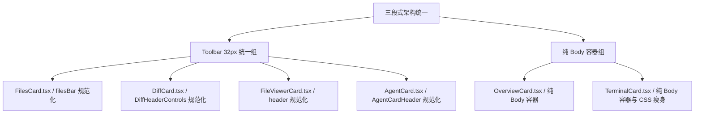

# 右侧面板三段式架构规范化与改造方案

> **文档定位**：战役详案文档  
> **战役工作区**：`docs/native-browser-and-panel-standardization/`  
> **目标**：全面调研除应用预览之外的所有右侧面板，制定标准的三段式（Header 38px + Toolbar 32px + Body）改造方案，严格对齐基准范例规范。

---

## 1. 战役背景与架构总纲

### 1.1 背景与现状断层
在桌面工作区二叉树布局（`BinaryTreeWorkspace`）与右侧坞（Right Dock）架构中，各个面板经历了多次历史迭代，导致顶栏布局和高度规范出现不同程度的漂移与分叉：
1. **高度标准不一**：
   - `FilesCard` 的 `filesBar` 采用 `min-height: 36px` 配合动态 padding，实际高度经常被撑至 36px~40px；
   - `DiffCard` 的 `DiffHeaderControls` 设定为 `34px`，同时 CSS 中仍残留大量 `36px` 的旧版类名；
   - `FileViewerCard` 的 `header` 设定为 `34px`；
   - `AgentCard` 的 `AgentCardHeader` 设定为 `min-height: 28px`，导致视觉高度明显偏矮且不稳定；
   - `OverviewCard` 与 `TerminalCard` 作为纯 Body 面板，部分样式和结构中仍遗留伪 Toolbar 的痕迹。
2. **边框与层级紊乱**：
   - 外部叶子外壳 `LeafToolTabStrip` 已规范为 38px 无下边框（透明底/卡片底，视觉分界交由内部容器）；
   - 各面板内部 Toolbar 的下边框样式、粗细（`border-subtle` / `hairline` / `rgba`）不统一，部分组件出现双重边框或边框缺失；
   - 控件边框（激活态、悬停态）存在较深的硬黑框或魔术数字投影。
3. **按钮与图标尺寸碎片化**：
   - 按钮尺寸在 `20px`、`22px`、`24px`、`26px`、`28px` 之间随意混用；
   - 图标尺寸在 `12px`、`13px`、`14px`、`15px` 之间参差不齐；
   - 间距（gap/margin）存在历史补丁式的负 margin 或不均等 margin。

### 1.2 标准三段式架构定义
根据项目现代设计系统规范，右侧面板统一遵循标准**三段式架构（Three-Tier Panel Architecture）**：

```
┌───────────────────────────────────────────────────────────┐
│ Row 1: Header (38px) — 统一由 LeafToolTabStrip 承载       │
│ [Tab 1 (26px)] [Tab 2 (26px)] [+]      [⛶ 最大化] [⇥ 坞收起] │
├───────────────────────────────────────────────────────────┤
│ Row 2: Toolbar (32px, 底部 1px 边框) — 面板专属次级工具栏  │
│ [⬅ 26px] [🔄 26px] [面包屑/选择器 24px]        [功能胶囊/动作组]│
├───────────────────────────────────────────────────────────┤
│ Row 3: Body (Flex: 1, 自适应滚动/容器) — 纯内容区          │
│                                                           │
│                                                           │
│                      面板主体内容流                        │
│                                                           │
│                                                           │
└───────────────────────────────────────────────────────────┘
```

> **注意（纯 Body 容器特例）**：对于 `OverviewCard` 和 `TerminalCard` 等无需专属次级操作栏的面板，属于 **0-Toolbar 纯 Body 容器**，由 Row 1 (Header 38px) 直接衔接 Row 3 (Body Flex: 1)，内部严禁插入伪 Toolbar。

---

## 2. 三段式基准范例规范与设计 Token 契约

### 2.1 核心几何规格基准表

| 层次 / 构件 | 规范标准值 | 关键 CSS 规则 / Token | 核心要求与禁止项 |
| :--- | :--- | :--- | :--- |
| **Row 1: Header** | **38px** | `height: 38px; min-height: 38px; max-height: 38px; flex: 0 0 38px;` | **无下边框（`border-bottom: none !important;`）**；由外部 `LeafToolTabStrip` 统一提供，卡片内不得重复渲染 Tab Header。 |
| **Header Tab 项** | **26px** | `height: 26px; border-radius: var(--radius-sm, 4px); padding: 0 4px 0 7px;` | 字体 12px，图标 13px/14px，间距 4px，激活态发丝边框 + 柔和阴影。 |
| **Header 固定操作** | **28px** | `width: 28px; height: 28px; border-radius: var(--radius-md, 6px);` | 最大化/收起坞等常驻控制按钮，图标 14px。 |
| **Row 2: Toolbar** | **32px** | `height: 32px; min-height: 32px; max-height: 32px; flex: 0 0 32px;` | **底部 1px 边框（`border-bottom: 1px solid var(--border-subtle);`）**；内边距 `padding: 0 8px;`；背景 `var(--bg-card, var(--bg-primary))`。 |
| **Toolbar 图标按钮** | **26px × 26px** | `width: 26px; height: 26px; min-width: 26px; border-radius: var(--radius-sm, 4px); padding: 0;` | 统一 `display: inline-flex; align-items: center; justify-content: center;`，悬停 `var(--bg-hover)`，激活态 `var(--tint-active)`。 |
| **Toolbar 图标大小** | **14px** | `size={14}`，`strokeWidth={1.75}` | 统一 14px；极特殊微型图标（如 X 关闭符、下拉小箭头）允许 12px~13px。 |
| **Toolbar 嵌入控件** | **24px** | `height: 24px; min-height: 24px; max-height: 24px; border-radius: var(--radius-sm, 4px);` | 输入框、下拉选择器（`Select`）、分段切换胶囊（`SegmentedTab`）、组合打开胶囊（`OpenCapsule`）统一高度 24px，在 32px Toolbar 内精准垂直居中（上/下各留 4px 留白）。 |
| **Toolbar 间距节奏** | **4px 等距** | `gap: 4px;`（或 `var(--space-1, 4px)`） | **消除所有自定义 `margin-left` / `margin-right`**；完全由 Flex 容器的 `gap: 4px` 保证视觉节奏一致。 |
| **Row 3: Body** | **Flex: 1** | `flex: 1; min-height: 0; min-width: 0; width: 100%;` | 溢出控制采用 `overflow: auto / hidden`；内部不得再包含顶部分隔线干扰。 |

### 2.2 设计 Token 与色彩/边框规范
1. **边框色**：统一使用 `var(--border-subtle)`（基线）或 `var(--border-color)`（分界），禁止散落内联 `rgba(0,0,0,0.08)` 或未知 hex 颜色。
2. **焦点态与激活态**：严格遵守根目录 `AGENTS.md` §13 纪律，相对基线灰色混入文本色不得超过 10%（`color-mix(in srgb, var(--border-color) 90%, var(--text-primary) 10%)`），禁止粗黑框。
3. **Tooltip 悬停**：所有图标按钮与截断文本必须使用自定义 `<Tooltip>` 组件包裹，禁止使用 HTML 原生 `title` 属性。

---

## 3. 分面板现状调研与标准化改造方案

### 3.1 `FilesCard.tsx`（文件浏览器面板）

#### 3.1.1 现状问题分析
- **文件位置**：`apps/crish-desktop/src/components/files/FilesCard.tsx`、`FilesCard.module.css`、`FileActions.tsx`、`FileBreadcrumb.tsx`。
- **现存问题**：
  1. `.filesBar` 在 CSS 中设置 `min-height: var(--card-header-min-height, 36px)`，`padding: 4px 8px`，导致整体高度膨胀到 36px 甚至 40px，未能锁定为 32px。
  2. 导航按钮 `.filesNavBtn` 使用 `var(--control-height-sm, 28px)`（28px × 28px），导致内部图标居中偏移且占用过大垂直空间。
  3. 目录面包屑 `FileBreadcrumb` 与路径输入框未对齐 24px 基准。
  4. 筛选输入框 `.filesPathFilter` 与 `FileActions` 内的打开方式胶囊 `.filesOpenCapsule` 存在 `margin-left: var(--space-1)` 等多余的外边距。
  5. 内部的图标大小有 `size={15}`（CornerLeftUp, RotateCw）和 `size={14}`（Search, X）混合。

#### 3.1.2 改造计划
1. **Toolbar 容器规范化（`FilesCard.module.css`）**：
   ```css
   .filesBar {
     display: flex;
     align-items: center;
     gap: 4px;
     padding: 0 8px;
     height: 32px;
     min-height: 32px;
     max-height: 32px;
     flex: 0 0 32px;
     border-bottom: 1px solid var(--border-subtle);
     flex-shrink: 0;
     background: var(--bg-card, #ffffff);
     box-sizing: border-box;
     overflow: visible;
     position: relative;
     z-index: var(--z-card-footer, 2);
   }
   ```
2. **按钮与图标规范化**：
   - 将 `.filesNavBtn` 尺寸重构为标准 `26px × 26px`，`border-radius: 4px`，`padding: 0`。
   - 将 `CornerLeftUp`、`RotateCw` 等图标统一为 `size={14}`，`strokeWidth={1.75}`。
3. **控件与胶囊对齐（24px）**：
   - 筛选输入框 `.filesPathFilter`：高度锁定 `24px`，`border-radius: 4px`，字体 12px。
   - `FileBreadcrumb` 容器高度对齐 24px，芯片 `.filesBcChip` 高度与行高适配。
   - `FileActions.tsx` 内部的打开方式胶囊 `.filesOpenCapsule`：高度锁定 `24px`，消除 `margin-left`，与左侧元素依靠 Flex `gap: 4px` 自然等距分隔。
4. **清理冗余 CSS**：移除 `.filesNavBtnSm`、旧的 36px 变量引用及多余 padding。

---

### 3.2 `DiffCard.tsx`（代码变更审查面板）

#### 3.2.1 现状问题分析
- **文件位置**：`apps/crish-desktop/src/components/diff/DiffCard.tsx`、`DiffHeaderControls.tsx`、`DiffCard.module.css`。
- **现存问题**：
  1. `DiffHeaderControls` 的顶层容器 `.compactHeader` 高度为 `34px`（`--diff-header-height, 34px`），与标准 32px 存在 2px 偏差。
  2. CSS 中残留了大量废弃顶栏样式，例如 `.toolbar`（`min-height: 36px`）、`.currentHeader`（`min-height: 36px`）、`.sourceSeg` 等未使用的历史样式。
  3. 来源切换胶囊 `.sourceTab` 高度为 22px，内边距较小；分割线 `.headerDivider` 高度为 16px。
  4. 回合/分支选择器 `.inlineSelect` 高度为 26px，垂直占用偏大。
  5. 动作按钮 `.actionBtn` 内的图标使用 `size={13}`，低于标准的 14px。
  6. 搜索行 `.searchRow` 展开时内边距为 `4px 8px 6px`，下边框和高度未做精细对齐。

#### 3.2.2 改造计划
1. **Toolbar 容器规范化（`DiffCard.module.css`）**：
   ```css
   .compactHeader {
     display: flex;
     align-items: center;
     justify-content: space-between;
     height: 32px;
     min-height: 32px;
     max-height: 32px;
     flex: 0 0 32px;
     padding: 0 8px;
     background: var(--bg-card, #ffffff);
     border-bottom: 1px solid var(--border-subtle);
     box-sizing: border-box;
     user-select: none;
     flex-shrink: 0;
   }
   ```
2. **来源切换胶囊（AI / Git）与上下文选择器规范化**：
   - `.sourceSegment` 外层高度锁定 `24px`，`padding: 2px`，`border-radius: 4px`。
   - `.sourceTab` 内部选项高度 `20px`，字号 12px，图标 12px/13px。
   - `.headerDivider` 分割线高度 `14px`，颜色 `var(--border-subtle)`。
   - 下拉选择器 `.inlineSelect` 内部触发器高度调整为 `24px`，字体 12px，与 Toolbar 完美对齐。
3. **右侧动作按钮组规范化**：
   - `.actionBtn` 统一为 `26px × 26px`，`border-radius: 4px`。
   - 图标统一为 `size={14}`（`Columns2`, `List`, `Copy`, `GitCommit`, `Search`, `Trash2`）。
   - 按钮间距严格保持 `gap: 4px`。
4. **搜索条展开态规范化**：
   - `.searchRow` 高度定为 `32px`（`height: 32px; padding: 0 8px;`），输入框高度 `24px`，确保展开时与标准工具栏行高一致。
5. **死代码清理**：清理 `DiffCard.module.css` 中第 15~108 行已废弃的旧版 `.toolbar`、`.sourceSeg`、`.toolbarActions` 等死代码。

---

### 3.3 `FileViewerCard.tsx`（单文件源码查看面板）

#### 3.3.1 现状问题分析
- **文件位置**：`apps/crish-desktop/src/components/files/FileViewerCard.tsx`、`FileViewerCard.module.css`。
- **现存问题**：
  1. `.header` 设定为 `height: 34px; min-height: 34px; padding: 0 10px; gap: 8px;`，高出标准 2px，且内边距与标准 8px 不一致。
  2. 模式切换胶囊 `.compareToggleRow` 包含 `margin: 0 8px; border-radius: 8px; padding: 2px;`，使用了多余的外边距。
  3. 右侧动作按钮 `.actBtn` 尺寸为 `24px × 24px`，偏小且与标准 `26px` 不符。
  4. 打开方式胶囊 `.filesOpenCapsule` 的边框和背景与通用控件未完全对齐。
  5. 复制按钮和更多按钮的分割线 `.actionSep` 边距偏大。

#### 3.3.2 改造计划
1. **Toolbar 容器规范化（`FileViewerCard.module.css`）**：
   ```css
   .header {
     display: flex;
     align-items: center;
     justify-content: space-between;
     gap: 4px;
     height: 32px;
     min-height: 32px;
     max-height: 32px;
     flex: 0 0 32px;
     padding: 0 8px;
     border-bottom: 1px solid var(--border-subtle);
     background: var(--bg-card, #ffffff);
     flex-shrink: 0;
     box-sizing: border-box;
   }
   ```
2. **模式切换胶囊（仅看变更 / 完整代码）规范化**：
   - 消除 `margin: 0 8px`，改用 Flex 布局和 `gap: 4px`。
   - 胶囊高度锁定 `24px`，`border-radius: 4px`。
   - 内部 `.toggleTab` 高度 `20px`，`padding: 0 8px`，字体 11px/12px，激活态浅底加柔和发丝。
3. **打开方式胶囊与操作按钮规范化**：
   - 打开方式胶囊 `.filesOpenCapsule`：高度 `24px`，`border-radius: 4px`，左侧主按钮 + 右侧下拉箭头。
   - 复制与更多动作按钮 `.actBtn`：尺寸规范为 `26px × 26px`，`border-radius: 4px`，图标统一 `size={14}`。
   - 分割线 `.actionSep`：高度 `14px`，边距收敛。

---

### 3.4 `AgentCard.tsx`（智能体协作体侧栏详情面板）

#### 3.4.1 现状问题分析
- **文件位置**：`apps/crish-desktop/src/components/agent-card/AgentCard.tsx`、`AgentCardHeader.tsx`、`AgentCard.module.css`。
- **现存问题**：
  1. `AgentCardHeader` 在 CSS 中设定为 `min-height: 28px; padding: 4px 8px;`，`.agentCardHeaderSlim` 设定为 `min-height: 28px; padding: 3px 6px;`。由于高度偏小（28px），与其他面板的 32px Toolbar 形成明显的高低落差。
  2. 控制按钮 `.agentCardBtn` 尺寸为 `24px × 24px`，未达到标准的 26px。
  3. 标题行 `.agentCardTitleRow` 间距写为 `gap: 5px`，状态徽标 `.agentCardBadge` 的内边距和高度未锁定。
  4. 停止按钮图标为 `size={12}`，关闭按钮图标为 `size={14}`，按钮内图标尺寸存在偏差。

#### 3.4.2 改造计划
1. **Toolbar 容器规范化（`AgentCard.module.css`）**：
   ```css
   .agentCardHeader {
     display: flex;
     align-items: center;
     justify-content: space-between;
     gap: 4px;
     height: 32px;
     min-height: 32px;
     max-height: 32px;
     flex: 0 0 32px;
     padding: 0 8px;
     border-bottom: 1px solid var(--border-subtle);
     background: var(--bg-card, #ffffff);
     flex-shrink: 0;
     box-sizing: border-box;
   }
   ```
2. **标题与状态徽标区规范化**：
   - 返回按钮（多子代理场景）：尺寸 `26px × 26px`，图标 `ChevronLeft`（`size={14}`）。
   - 机器人图标 `Bot`：统一 `size={14}`，`strokeWidth={1.75}`。
   - 标题 `.agentCardTitle`：字号 12px/13px，字重 500，单行省略。
   - 状态徽标（`AgentStatusChip`、失败原因、待审批、时长）：统一高度 `18px`，`border-radius: 4px`，字号 11px，居中对齐。
3. **操作按钮组规范化**：
   - 停止按钮、关闭/返回按钮：统一为 `26px × 26px`，`border-radius: 4px`。
   - 停止图标 `Square`：`size={12}`（实体填充），居中于 26px 按钮；关闭图标 `X`：`size={14}`。
   - 按钮间距为 `gap: 4px`。
4. **清理冗余类名**：将 `.agentCardHeaderSlim` 与 `.agentCardHeader` 合并，消除不一致的 padding 覆盖。

---

### 3.5 `OverviewCard.tsx`（工作区总览面板）

#### 3.5.1 现状问题分析
- **文件位置**：`apps/crish-desktop/src/components/overview/OverviewCard.tsx`、`OverviewHeader.tsx`、`OverviewCard.module.css`。
- **架构定位**：
  - `OverviewCard` 是全局工作区状态与卡片导航中心，属于典型的 **0-Toolbar 纯 Body 容器**。
  - Header 38px 统一由外部 `LeafToolTabStrip` 提供。
  - 当前组件内部有 `OverviewHeader`，渲染了工作区路径 chip（`.metaLine`）和进度条 `ProgressSection`，直接作为 Body 的顶部首块内容。
  - 存在的问题是：部分子组件试图通过局部 border 模拟独立工具条，导致内边距节奏与滚动容器脱节。

#### 3.5.2 改造计划
1. **纯 Body 容器规范化**：
   - 根容器 `.card`：
     ```css
     .card {
       display: flex;
       flex-direction: column;
       flex: 1 1 auto;
       height: 100%;
       min-height: 0;
       min-width: 0;
       width: 100%;
       overflow-y: auto;
       overflow-x: hidden;
       background: var(--bg-card, #ffffff);
       box-sizing: border-box;
       padding: 8px 10px 16px;
       gap: 8px;
     }
     ```
   - 严禁在 `OverviewCard` 顶部添加 32px 的伪 Toolbar。
2. **首部 `OverviewHeader` 融入 Body 流**：
   - `OverviewHeader` 作为 Body 流内首个卡片区块，内边距统一收敛，背景与发丝边框与后续各 Section（Tasks, Agents, Background, Schedule, Changes）保持统一圆角（`var(--radius-lg, 8px)`）与发丝边框（`1px solid var(--border-subtle)`）。
3. **消除冗余顶部分隔线**：确保 `LeafToolTabStrip` (38px) 底部与 `OverviewCard` 首部无双重发丝边框冲突。

---

### 3.6 `TerminalCard.tsx`（交互式终端面板）

#### 3.6.1 现状问题分析
- **文件位置**：`apps/crish-desktop/src/components/workspace/TerminalCard.tsx`、`TerminalCard.module.css`。
- **架构定位**：
  - 纯终端容器（VS Code 风格），属于典型的 **0-Toolbar 纯 Body 容器**。
  - Header 38px 由外部 `LeafToolTabStrip` 提供（显示终端 Tab、添加 Tab、最大化、关闭等）。
  - 存在问题：在 `TerminalCard.module.css` 中残留了历史版本的大量死代码，包括 `.toolbar`（36px）、`.bar`（36px）、`.mirrorStrip`（多行镜像条）、`.searchRow`、`.inputRow` 等近 300 行已废弃的旧版 DOM 样式，增加了维护成本与样式污染风险。

#### 3.6.2 改造计划
1. **纯 Body 容器与 Xterm 视图规范化**：
   - 根容器 `.panel` 保持 `flex: 1; height: 100%; overflow: hidden; background: var(--terminal-bg);`。
   - 内部 `.interactiveHost` 和 `.xtermWrap` 100% 撑满 Body，内边距统一为 `padding: 4px 6px 6px`。
2. **PTY 缺失状态横幅规范化**：
   - `.fallbackBanner` 保持为柔和的状态提示栏，背景采用 `var(--terminal-bar-fill)`，高度自适应，边框为发丝下边框。
3. **大规模死代码清理**：
   - 从 `TerminalCard.module.css` 中彻底删除已废弃的 `.toolbar`（第 13~46 行）、`.mirrorStrip` 及相关子项（第 48~135 行）、`.bar` 及相关子项（第 233~298 行）、`.searchRow` 及相关子项（第 335~386 行）、`.inputRow` 等历史遗留样式，将 CSS 文件体积缩减 60% 以上。

---

## 4. 全局组件改动清单与任务分解



### 4.1 改动任务与文件矩阵

| 序号 | 目标文件 | 改动类型 | 具体改动重点 |
| :--- | :--- | :--- | :--- |
| **T1** | `apps/crish-desktop/src/components/files/FilesCard.tsx`<br>`apps/crish-desktop/src/components/files/FilesCard.module.css` | 样式与结构调整 | 1. 锁定 `.filesBar` 为 `32px` 高度，`padding: 0 8px`，底部 1px 边框；<br>2. 按钮尺寸重构为 `26px × 26px`，图标统一 `14px`；<br>3. 筛选输入框与动作胶囊高度锁定 `24px`，消除 `margin-left`；<br>4. 统一 `gap: 4px`。 |
| **T2** | `apps/crish-desktop/src/components/diff/DiffHeaderControls.tsx`<br>`apps/crish-desktop/src/components/diff/DiffCard.module.css` | 样式与结构调整 | 1. 锁定 `.compactHeader` 为 `32px` 高度（修正 34px 偏差），`padding: 0 8px`；<br>2. 来源切换胶囊与分支选择器高度锁定 `24px`；<br>3. 动作按钮尺寸锁定 `26px × 26px`，图标统一 `14px`（修正 13px）；<br>4. 规范搜索展开行高度为 `32px`；<br>5. 清理历史废弃 `.toolbar` 等死代码。 |
| **T3** | `apps/crish-desktop/src/components/files/FileViewerCard.tsx`<br>`apps/crish-desktop/src/components/files/FileViewerCard.module.css` | 样式与结构调整 | 1. 锁定 `.header` 为 `32px` 高度（修正 34px 偏差），`padding: 0 8px`；<br>2. 模式切换胶囊消除 `margin: 0 8px`，高度锁定 `24px`；<br>3. 打开方式胶囊高度锁定 `24px`；<br>4. 复制与更多按钮锁定 `26px × 26px`，图标统一 `14px`（修正 24px 按钮）。 |
| **T4** | `apps/crish-desktop/src/components/agent-card/AgentCardHeader.tsx`<br>`apps/crish-desktop/src/components/agent-card/AgentCard.module.css` | 样式与结构调整 | 1. 锁定 `AgentCardHeader` 为 `32px` 高度（修正 28px 浮动高度），`padding: 0 8px`；<br>2. 状态/时长/待批徽标高度锁定 `18px`；<br>3. 停止与关闭控制按钮尺寸锁定 `26px × 26px`，图标规范为 `14px`（停止块 12px 居中）；<br>4. 合并 `.agentCardHeaderSlim`，统一使用 `gap: 4px`。 |
| **T5** | `apps/crish-desktop/src/components/overview/OverviewCard.tsx`<br>`apps/crish-desktop/src/components/overview/OverviewCard.module.css` | 样式与结构调整 | 1. 确认无伪 Toolbar 插入，保持标准纯 Body 容器；<br>2. 规范首屏 `OverviewHeader` 的内边距与边框，平滑衔接 `LeafToolTabStrip` (38px)；<br>3. 统一各 Accordion Section 的间距步长与卡片发丝边框。 |
| **T6** | `apps/crish-desktop/src/components/workspace/TerminalCard.tsx`<br>`apps/crish-desktop/src/components/workspace/TerminalCard.module.css` | 样式与死代码清理 | 1. 确认纯 Body 容器定位，Xterm 全屏容器铺满 Body；<br>2. 规范 PTY 缺失 Fallback Banner 的视觉样式；<br>3. 全量清理 `TerminalCard.module.css` 中近 300 行已废弃的旧 Toolbar / Mirror / Search 样式。 |

---

## 5. 跨组件共性逻辑与封装建议

为了防止未来再次出现高度与控件尺寸漂移，建议在后续迭代中沉淀轻量级 UI 构件（位于 `@/components/ui` 或各模块子目录）：

1. **`PanelToolbar` 标准工具栏容器**：
   - 固定提供 `height: 32px; padding: 0 8px; border-bottom: 1px solid var(--border-subtle); display: flex; align-items: center; gap: 4px;` 的标准样式；
   - 自动阻断任何子元素的高度溢出。
2. **`ToolbarIconButton` 标准工具栏按钮**：
   - 统一封装 `size="sm"`（`26px × 26px`），内置自定义 `<Tooltip>`，严格限制内部 Lucide 图标为 `size={14}`；
   - 统一 hover / active / disabled 的视觉微交互。
3. **`ToolbarSegmentedControl` 分段切换胶囊**：
   - 统一封装 `24px` 高度胶囊容器与 `20px` 内部选项，解决 `DiffCard`（AI/Git）、`FileViewerCard`（变更/完整代码）、`FilesCard`（Markdown/源码）多处重复实现的问题。

---

## 6. 验证计划与验收断言

### 6.1 视觉与几何验收断言（像素级检查）
1. **Header 38px 几何断言**：
   - 在 WebView / Tauri MCP 运行时中检查，所有右侧面板在激活状态下，顶部 `LeafToolTabStrip` 的 `getBoundingClientRect().height` 严格恒等于 `38.0px`。
   - `LeafToolTabStrip` 底部 `border-bottom-width` 为 `0px`（无下边框）。
2. **Toolbar 32px 几何断言**：
   - `FilesCard` 的 `.filesBar`、`DiffCard` 的 `.compactHeader`、`FileViewerCard` 的 `.header`、`AgentCard` 的 `.agentCardHeader` 的 `getBoundingClientRect().height` 严格恒等于 `32.0px`。
   - Toolbar 底部边框严格为 `1px solid`（计算样式 `border-bottom-width: 1px`）。
   - Toolbar 内所有图标按钮（除了下拉胶囊外）的尺寸严格恒等于 `26.0px × 26.0px`。
   - Toolbar 内所有 Lucide 图标的 svg 视口严格恒等于 `14.0px × 14.0px`（极特殊微型符号除外）。
   - Toolbar 内部相邻元素间距严格为 `4.0px`。
3. **纯 Body 面板断言**：
   - `OverviewCard` 和 `TerminalCard` 内无任何高度为 `32px` 或 `34px` 的二级工具栏，直接由 Body 填充，首行内容与 38px Header 之间无重复发丝边框。

### 6.2 功能与回归测试断言
1. **自动化类型与测试门禁**：
   - 执行 `npm run typecheck` 保证 0 TS 错误；
   - 执行 `npm run test:coverage -- --project=unit` 保证现有单元测试全绿通过；
   - 执行 `npm run check:line-counts` 保证无行数超标。
2. **交互功能完整性**：
   - 文件树：展开、收起、双击打开、路径复制、筛选过滤无故障；
   - 代码变更：回合切换、分支切换、分栏/合并视图切换、提交面板展开无遮挡；
   - 单文件查看：完整代码与差异切换、打开方式下拉菜单弹出定位精准；
   - 协作体侧栏：子 Agent 切换、补充指示输入、消息自动滚底正常；
   - 终端：Xterm 正常渲染、自适应 resize 无黑边。
