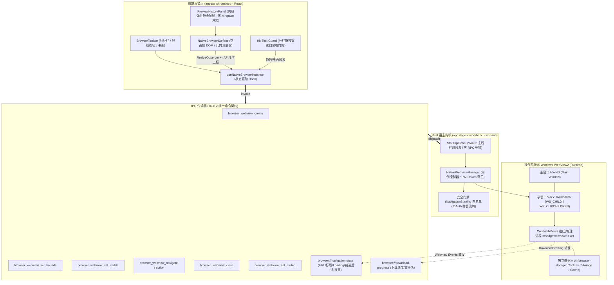
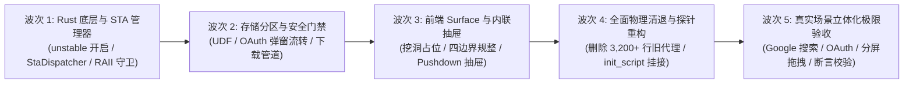

# 原生浏览器彻底改造与子 Webview 架构总方案 (审定整合版)

> **战役工作区**：`docs/native-browser-overhaul/`  
> **文档定位**：战役实现总纲（00-总方案）  
> **最高原则**：**“非必要不兼容。不允许打补丁，不允许硬编码，有合理的抽象，适合未来的功能需求，代码尽量简洁，具有优秀的可维护性。需要删除的代码就删除，需要系统性的重构。”**  
> **输入基准**：`analysis/01~06` 调研、`01~04` 核心分维详案、`audits/01~04` 4 大独立审计挑刺报告

---

## 一、改造背景与根本问题定义

### 1.1 现状痛点现场
用户在 Conex 桌面端「浏览器」面板中访问 Google、GitHub、技术文档或日常网页，在 Google 搜索框输入内容提交时，界面立即被 Chromium / WebView2 原生沙盒强制阻断，展现红白禁止图标与报错：
> **“已阻止此内容。请与网站所有者联系以解决此问题。”**（`ERR_BLOCKED_BY_RESPONSE`）

### 1.2 架构根因与历史原罪
1. **伪浏览器本质**：依赖 DOM `<iframe sandbox="..." />` 渲染；
2. **标头刚性阻断**：公网主流网站下发 `X-Frame-Options: SAMEORIGIN` 与 `CSP: frame-ancestors 'self'`，内核级绝对禁止任何第三方以 iframe 嵌入；
3. **代理方案的破损与失效**：试图依赖 Vite 开发服务器代理（`crishPreviewProxyPlugin`）剥离响应头。然而当用户在 Google 搜索提交时，网页内跳转或表单直接发往 Google 源站，脱离代理直连触发沙盒拦截；
4. **历史包袱严重冗余**：存在 Vite 前端代理（约 200 行）、Axum 后端透明代理（约 1,350 行）、侵入式正则注入脚本（约 240 行），代码脆弱且生产构建外部网站必白屏。

### 1.3 核心改造目标
彻底物理剔除所有 iframe、Vite 代理与 Axum 代理，利用 Tauri 2.11 原生 Multi-Webview 特性，打造与标杆 `pi-desktop` 同等工业水准的**原生子 Webview 真实浏览器**：
- **顶层浏览视口（Top-level Browsing Context）**：免受任何 XFO / CSP 嵌入限制，无阻碍自由浏览全网；
- **真实登录态持久化**：独立的 UserDataFolder 存储分区（`browser-storage/`），Cookie / Storage 跨重启完好留存；
- **全链路净收敛**：直接物理删除 3,000+ 行历史代理与胶水代码，零向下兼容包袱。

---

## 二、四大审计挑刺与关键整改结论（吸纳 Audits 01~04 成果）

| 审计维度 | 揪出的核心缺陷与死穴 | 落地整改方案（SSOT） |
| :--- | :--- | :--- |
| **架构与反补丁 (Audit 01)** | 遗漏了后端 Axum 代理服务（`preview_proxy.rs` 等超 1,350 行）；个别详案仍想保留双轨代理兜底。 | **一票否决双轨妥协**：删除 `toProxyPreviewUrl`，全量直连原生；将 Axum 代理全部文件纳入物理删除清单。 |
| **底层与并发 (Audit 02)** | 误以为 `async fn` 能防死锁，Tokio 跨套间直调 COM 会触发 `RPC_E_WRONG_THREAD`；未保存 `EventRegistrationToken` 导致 Edge 僵尸进程泄漏。 | 设计 `StaDispatcher` 确保 COM 100% 在主线程 STA 执行；引入 `EventTokenRegistry` RAII 守卫确定性释放句柄。 |
| **前端与几何 (Audit 03)** | 仅考虑全局 Modal，未考虑历史下拉抽屉（PreviewHistoryPanel）等局部浮层被子 HWND 裁切；125% DPI 累积舍入漏出 1px 细线缝隙。 | 将历史抽屉重构为**内联弹性折叠抽屉（Inline Pushdown Drawer）**自然下推视口；采用四边界独立外对齐取整算法。 |
| **公网复杂场景 (Audit 04)** | 弹窗转全屏新 Tab 斩断 `window.opener` 导致第三方 OAuth 登录（如 Google 登录 Spotify）死锁；缺失 `DownloadStarting` 导致下载静默丢失。 | 基于弹窗特征动态挂载受控模态 Webview 并传入 `put_NewWindow` 维系通信链；接入 `DownloadStarting` 与下载进度事件。 |

---

## 三、系统整体架构设计

### 3.1 总体架构拓扑图

---

## 四、历史代理死代码物理清理清单（净收敛 >3,200 行）

坚决落实**“非必要不兼容，需要删除的代码就删除”**，彻底清理以下历史文件与模块：

### 4.1 前端死代码删除清单
1. `apps/crish-desktop/vite.config.ts`：物理删除 `crishPreviewProxyPlugin` 定义及 `plugins` 注册（约 200 行）；
2. `apps/crish-desktop/dev-server/previewBridgeScript.ts`：彻底物理删除（237 行）；
3. `apps/crish-desktop/dev-server/sameOriginRequest.ts`：彻底物理删除（42 行）；
4. `apps/crish-desktop/src/components/workspace/previewHostBridge.ts` & `previewProtocol.ts`：彻底物理删除（约 350 行）；
5. `apps/crish-desktop/src/components/workspace/previewCardLib.ts`：彻底删除 `toProxyPreviewUrl`、`safeIframeSrc` 中的代理分支及相关兼容单测（约 150 行）。

### 4.2 后端死代码删除清单
1. `apps/agent-workbench/src-tauri/src/server/preview_proxy.rs`：彻底物理删除（493 行）；
2. `apps/agent-workbench/src-tauri/src/server/preview_headers.rs`：彻底物理删除（180 行）；
3. `apps/agent-workbench/src-tauri/src/server/preview_injector.rs`：彻底物理删除（120 行）；
4. `apps/agent-workbench/src-tauri/src/server/preview_proxy_tests.rs`：彻底物理删除（约 300 行）；
5. `apps/agent-workbench/src-tauri/src/server/router/mod.rs`：注销 `/v1/preview/proxy` 路由端点；
6. `apps/agent-workbench/src-tauri/src/browser/frame_stream.rs` & `panel_input.rs`：清理过时的 CDP 截屏流伪装资产（约 1,200 行）。

---

## 五、实施波次规划（Execution Waves）

---

## 六、反退避刚性验收断言（Non-Retreat Assertions）

1. **[断言 A1 · 任意公网网页自由浏览]**：
   在地址栏输入 `https://google.com` 并搜索，输入回车即时展示结果，**绝对零拦截、零“已阻止此内容”红白拦截页**；
2. **[断言 A2 · 登录态跨重启持久化]**：
   登录 Google 或 GitHub 账号，关闭并完全重启 Conex 应用，账号依然处于已登录状态；
3. **[断言 A3 · 第三方 OAuth 联合登录时序闭环]**：
   在第三方网站发起 Google/GitHub 登录，弹窗认证完成后父页面自动登录成功，`window.opener` 管道畅通无死锁；
4. **[断言 A4 · 大文件下载与 Blob 导出]**：
   在 GitHub Release 点击 zip 下载或在线绘图网站导出图片，下载正常落盘于系统 Downloads 目录并伴随进度通知；
5. **[断言 A5 · 分栏拖拽与 Airspace 零撕裂]**：
   拖拽二叉树分栏滑块时无粘手、无卡顿，地址栏历史抽屉展开时视口平滑下推，无任何截断遮挡；
6. **[断言 A6 · 架构净收敛零死代码]**：
   全量物理删除 3,200+ 行历史代理与伪装代码，构建与测试门禁全绿通过。

---

## 七、战役文件体系索引

- 📄 [00-INDEX.md](./00-INDEX.md)（战役总索引与状态锚点）
- 📄 [01-分维-Tauri2原生子Webview管理器与Rust内核实现.md](./01-分维-Tauri2原生子Webview管理器与Rust内核实现.md)
- 📄 [02-分维-前端占位挖洞与几何同步引擎实现.md](./02-分维-前端占位挖洞与几何同步引擎实现.md)
- 📄 [03-分维-安全分区权限门控与旧代理清退方案.md](./03-分维-安全分区权限门控与旧代理清退方案.md)
- 📄 [04-分维-DOM原生拾取与AI协同能力演进.md](./04-分维-DOM原生拾取与AI协同能力演进.md)
- 📁 `audits/`（4 大独立挑刺与整改审计报告）
- 📁 `analysis/`（6 大基础架构调研报告）
