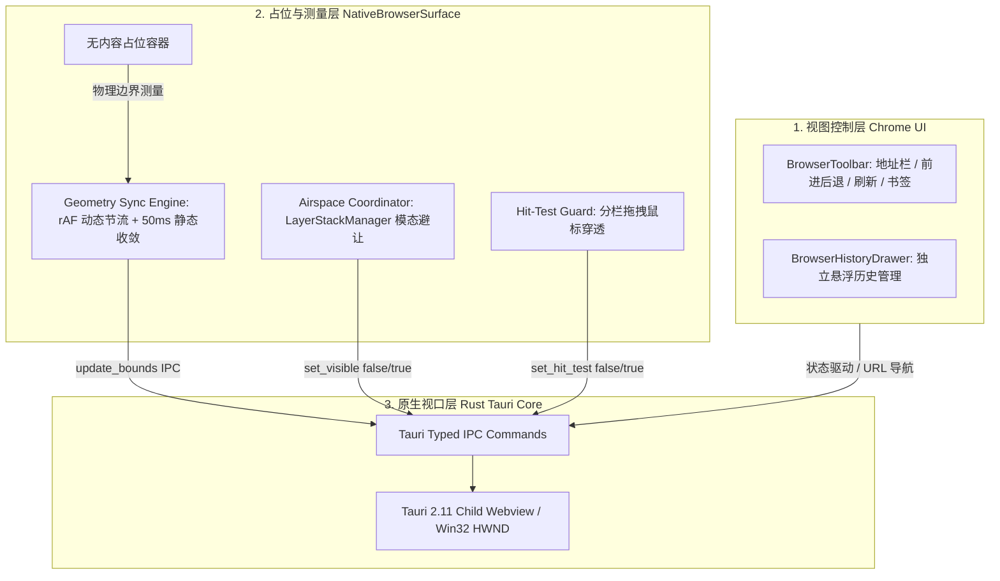
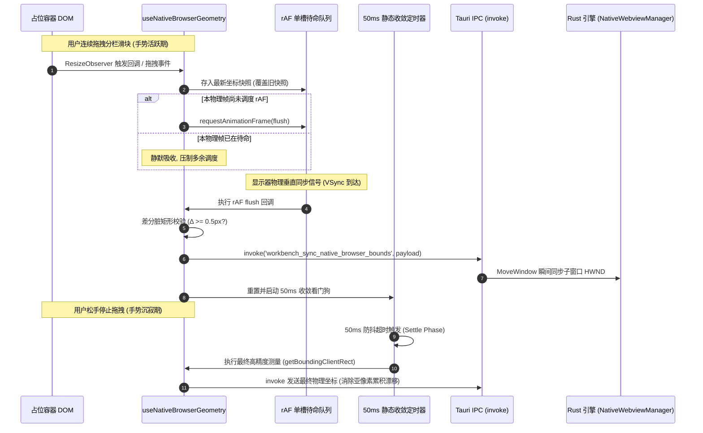
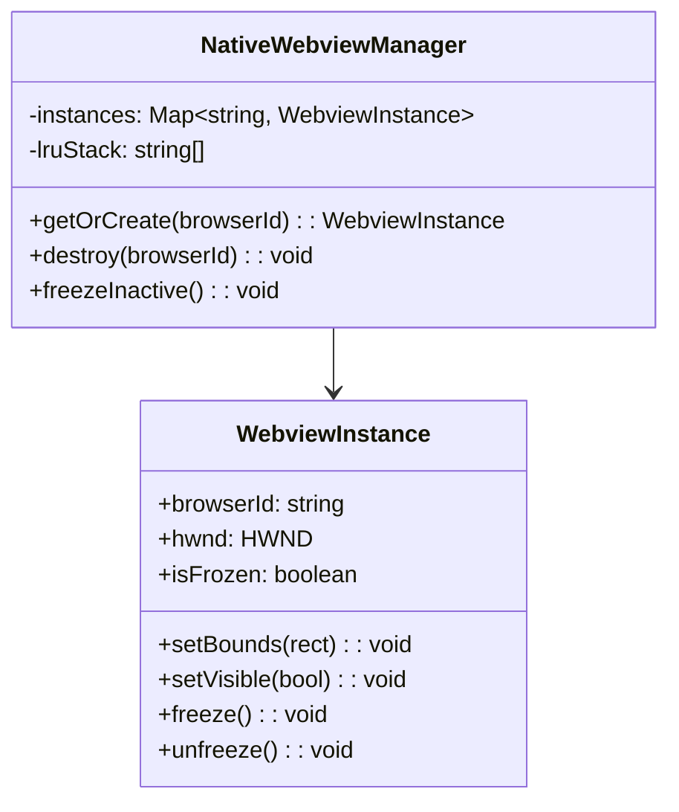

# 前端占位挖洞与几何同步引擎实现方案

> **战役工作区**：`docs/native-browser-overhaul/`  
> **文档定位**：分维实现详案（02-分维方案）  
> **核心目标**：彻底淘汰 `<iframe>` 伪浏览器与本地代理篡改机制；设计并落实全新的无内容占位容器（`NativeBrowserSurface`）、rAF 单槽双相几何同步引擎、Hit-Test 鼠标穿透门闩与基于 `LayerStackManager` 的模态框 Airspace 避让中枢，建立零撕裂、零粘手、零泄漏的原生视口前端基座。  
> **重构底线**：**非必要不兼容。杜绝修补性补丁，杜绝魔法数字与硬编码，彻底删除历史死代码，实施系统性重构。**

---

## 一、重构背景与架构定位

### 1.1 历史遗留体系的技术债务与彻底清退

在现有体系中，`PreviewCard.tsx`（461 行）与 `usePreviewNavigation.ts`（404 行）通过 DOM `<iframe>` 模拟浏览器，并配合 Vite 开发服务器代理插件（`crishPreviewProxyPlugin`）剥离响应头。这种架构存在以下不可调和的底层断层：

1. **公网网站刚性拦截**：Google、GitHub 等主流网站配置了 `X-Frame-Options: SAMEORIGIN` 与 CSP 祖先限制，用户在搜索框回车或发生真实源站跳转后立即白屏报错（`ERR_BLOCKED_BY_RESPONSE`）；
2. **事件黑洞与拖拽粘手**：鼠标滑过 iframe 区域时，指针事件被 iframe 深度截获，导致二叉树分栏滑块（`LeafDockResizer`）与拖拽调宽（`useTreeResize`）频繁发生“粘手”与手势丢失，历史代码通过全局注入 `<style>`（`disableIframePointerEvents`）做脆弱修补；
3. **主线程掉帧与内存泄漏**：iframe 与 React 主 UI 共享同一个渲染线程与事件循环，大型 SPA 页面的重绘与脚本计算直接拖垮桌面 UI 响应；
4. **Airspace 穿透遮挡**：任何挂载在内容区上方的 React DOM 浮层（如历史面板 `PreviewHistoryPanel`、拾取选框 `PreviewCardInspectorOverlay`）在引入原生子窗口后都会遭遇跨进程 HWND 遮挡难题。

**重构裁决**：
- **坚决弃用 `<iframe>`**：物理删除 `PreviewCard.tsx` 中的 iframe 节点及其加载逻辑；
- **坚决废除代理篡改**：彻底下线本地代理服务器、响应头剥离逻辑及侵入式 `previewBridgeScript.ts`；
- **坚决废除全局事件禁用补丁**：移除 `disableIframePointerEvents`，改用 Win32/Tauri 原生级命中测试门闩。

---

### 1.2 全新架构模型：三权分立体系

前端将系统解耦为三个正交的独立层次：



1. **视图控制层（Chrome UI）**：由纯 React DOM 构成，负责地址栏交互、导航控制、书签管理与历史面板，完全不接触网页真实渲染；
2. **占位与测量层（`NativeBrowserSurface`）**：纯透明无内容 DOM 容器，负责监听布局几何变动、执行物理像素四舍五入规整、管理 rAF 单槽调度，并向底层发布同步指令；
3. **原生视口层（Rust Kernel）**：由 Tauri 2.11 的 `WebviewBuilder` 构建的独立物理子视口（Child HWND），独立运行 Chromium 进程并挂载独立的用户数据分区（UserDataFolder）。

---

## 二、占位挖洞容器（NativeBrowserSurface）深度设计

### 2.1 容器 DOM 结构与 CSS 隔离规范

占位容器是原生视口在 React 树中的“物理投影基准”。它必须具备极致纯净的物理特性，杜绝任何引起布局抖动（Layout Thrashing）或遮挡底层视口的样式。

#### 2.1.1 DOM 骨架
```tsx
<div
  ref={surfaceRef}
  className={styles.nativeHole}
  data-native-surface="true"
  data-browser-id={browserId}
  aria-hidden="true"
>
  {/* 仅在模态框遮挡或初始化加载时渲染纯轻量视觉底板 */}
  {isOccluded && <div className={styles.scrimPlaceholder} />}
</div>
```

#### 2.1.2 CSS 规范（`NativeBrowserSurface.module.css`）
```css
.nativeHole {
  position: relative;
  width: 100%;
  height: 100%;
  flex: 1 1 auto;
  min-width: 0;
  min-height: 0;
  overflow: hidden;
  
  /* 核心几何与渲染守卫：严格限制布局与重绘范围 */
  contain: strict;
  
  /* 必须保证背景 100% 透明，由底层的原生 Webview 呈现内容 */
  background: transparent !important;
  
  /* 禁止占用鼠标命中，鼠标事件直接穿透至原生 Webview 接收 */
  pointer-events: none;
  
  /* 消除一切外边距与内边距漂移 */
  margin: 0;
  padding: 0;
  border: none;
}

/* 模态框展开时的平滑半透明毛玻璃占位底板 (Airspace 避让态) */
.scrimPlaceholder {
  position: absolute;
  inset: 0;
  background: var(--surface-translucent, hsla(0, 0%, 15%, 0.4));
  backdrop-filter: blur(12px);
  -webkit-backdrop-filter: blur(12px);
  pointer-events: none;
  animation: fadeIn 150ms cubic-bezier(0.16, 1, 0.3, 1) forwards;
}

@keyframes fadeIn {
  from { opacity: 0; }
  to { opacity: 1; }
}
```

- **`contain: strict`**：等价于 `contain: size layout paint`，切断该容器与外层 DOM 树的样式联动，容器内的任何变动绝不触发宿主整树重排；
- **`pointer-events: none`**：确保当鼠标悬停在占位区域时，主窗口的事件调度器不拦截鼠标，将控制权完全释放给原生子窗口 HWND；
- **透明底色**：防止产生白色/黑色闪烁，原生视口直接贴合在主窗口上。

---

### 2.2 几何测量与高精度坐标映射模型

原生 Webview 在 Win32 平台下依附于主窗口客户区（Client Area），其坐标原点 $(0,0)$ 为主窗口内容区的左上角。

```mermaid
flowchart LR
    subgraph CSSWorld [CSS 逻辑视口 (React DOM)]
        DOMRect["getBoundingClientRect()<br/>x, y, width, height<br/>(CSS 逻辑像素)"]
    end

    subgraph ScaleGate [DPR 变换门禁]
        DPR["window.devicePixelRatio<br/>(例如 1.25 / 1.5 / 2.0)"]
    end

    subgraph Win32World [Win32 物理世界 (Child HWND)]
        PhysRect["PhysicalRect<br/>left, top, width, height<br/>(四边界独立四舍五入整数)"]
    end

    DOMRect --> ScaleGate
    DPR --> ScaleGate
    ScaleGate -->|严格独立取整算法| PhysRect
```

#### 2.2.1 独立边界舍入算法（Boundary-Independent Rounding）
为避免浮点数累加导致的边缘缝隙（1px 露底）或与邻近面板重叠，严禁使用 `Math.round(x * scale)` 后直接加 `Math.round(w * scale)`。必须遵循主仓库 `window_snap_overlay.rs` 中确立的严苛四边界计算模型：

$$x_1 = \text{rect.left}, \quad y_1 = \text{rect.top}$$
$$x_2 = \text{rect.left} + \text{rect.width}, \quad y_2 = \text{rect.top} + \text{rect.height}$$
$$\text{physLeft} = \text{round}(x_1 \times \text{dpr})$$
$$\text{physTop} = \text{round}(y_1 \times \text{dpr})$$
$$\text{physRight} = \text{round}(x_2 \times \text{dpr})$$
$$\text{physBottom} = \text{round}(y_2 \times \text{dpr})$$
$$\text{physWidth} = \max(0, \text{physRight} - \text{physLeft})$$
$$\text{physHeight} = \max(0, \text{physBottom} - \text{physTop})$$

#### 2.2.2 物理视口裁剪（Viewport Hole Clamping）
若用户将抽屉坞推至极限位置，或者窗口发生极小化调整，占位容器可能会部分滑出屏幕边缘。为防止原生子窗口绘制到主窗口非客户区（如标题栏或操作系统任务栏），必须实施物理级裁剪（Clamping）：

$$\text{clampedLeft} = \max(0, \min(\text{physLeft}, W_{\text{client}}))$$
$$\text{clampedTop} = \max(0, \min(\text{physTop}, H_{\text{client}}))$$
$$\text{clampedRight} = \max(0, \min(\text{physRight}, W_{\text{client}}))$$
$$\text{clampedBottom} = \max(0, \min(\text{physBottom}, H_{\text{client}}))$$

若裁剪后的物理宽度或高度小于等于 0，则判定为**视口不可见（Visible = False）**，不向底层分配任何物理绘制表面。

---

## 三、双相几何同步引擎（Dual-Phase Sync Engine）

### 3.1 动态相与静态相时序机制

为了在二叉树分栏拖拽（60Hz~120Hz）和窗口缩放时实现丝滑跟手，同时彻底根除 IPC 洪峰，设计了对标 `pi-desktop` 工业级标准的**双相几何同步引擎**：



1. **实时动态相（Live Phase · 高频响应）**：
   - **单槽缓冲（Single-Slot Pending Buffer）**：连续的指针移动或布局变动仅在内存中更新引用，杜绝任务排队引起的内存膨胀；
   - **rAF 硬件帧率门禁**：仅在显示器刷新信号周期（60Hz 为 16.6ms，120Hz 为 8.3ms）向上提交最新帧，将 IPC 调用严格限制在帧率安全线内。
2. **静态收敛相（Idle Settled Phase · 精度校准）**：
   - **50ms 收敛看门狗**：在连续位移停止 50ms 后触发最终规整，防止因为快速拖拽的最后微小位移落在 rAF 帧尾而遗漏，确保像素级精确贴合。
3. **差分脏矩形检测（Dirty Epsilon Check）**：
   - 设定阈值 $\epsilon = 0.5\text{px}$。若位移变化量小于 $\epsilon$ 且可见性状态未改变，判定为无意义微颤，直接短路丢弃，不发出 IPC 调用。

---

## 四、复杂工作区布局与交互场景适配

### 4.1 二叉树分屏拖拽与调宽：Hit-Test Guard 门闩

#### 4.1.1 痛点成因
在二叉树分栏（`useTreeResize.ts`）与叶内抽屉坞（`LeafDockResizer.tsx`）的拖拽过程中，光标划过原生子 Webview 窗口时，Windows 系统会将 `WM_MOUSEMOVE` 优先分发给子 Webview 的进程，宿主 React 丢失 `pointermove` 与 `pointerup`，导致滑块粘手。

#### 4.1.2 穿透门闩实现（Hit-Test Guard）
在拖拽控制器中建立全局穿透调度协议：

```typescript
// hitTestGuard.ts 架构实现
import { invoke } from '@tauri-apps/api/core';

let activeDragCount = 0;

/**
 * 锁定原生视口鼠标穿透 (拖拽开始时调用)
 */
export function acquireHitTestLock(browserId?: string): void {
  activeDragCount++;
  if (activeDragCount === 1) {
    // 全局下发：让所有子 Webview 处于完全穿透状态
    invoke('workbench_set_all_browsers_hit_test', { hitTest: false }).catch(
      (err) => console.warn('[HitTestGuard] 锁定穿透异常:', err)
    );
  }
}

/**
 * 释放原生视口鼠标穿透 (拖拽结束时调用)
 */
export function releaseHitTestLock(browserId?: string): void {
  activeDragCount = Math.max(0, activeDragCount - 1);
  if (activeDragCount === 0) {
    // 恢复原生交互能力
    invoke('workbench_set_all_browsers_hit_test', { hitTest: true }).catch(
      (err) => console.warn('[HitTestGuard] 释放穿透异常:', err)
    );
  }
}
```

在 `LeafDockResizer.tsx` 与 `useTreeResize.ts` 中直接挂载：
```typescript
// 拖拽启动
const handlePointerDown = (e: React.PointerEvent) => {
  acquireHitTestLock();
  // ... 原生 setPointerCapture
};

// 拖拽终止 / 取消 / 异常中断
const cleanup = () => {
  releaseHitTestLock();
  // ... 释放 pointerCapture
};
```
在 Rust 底层，调用 Win32 原生 API：
```rust
// 通过修改 Win32 样式实现瞬时穿透，零 IPC 延迟
pub fn set_hit_test_visible(&self, visible: bool) {
    if let Some(controller) = &self.controller {
        unsafe {
            let _ = controller.put_IsHitTestVisible(if visible { TRUE } else { FALSE });
        }
    }
}
```
**彻底解决拖拽粘手问题，无需在 React DOM 铺设任何虚拟透明层。**

---

### 4.2 标签切换场景（Tab Switching）：零延迟隐身契约

在 `TreeLeafPanel.tsx` 中，用户在“应用预览”与“终端/总览”之间切换时，非活跃 Tab 处于 `display: none`。

1. **瞬时隐身契约**：
   - 当 `isActive` 变为 `false` 时，`NativeBrowserSurface` 绕过任何 rAF 缓冲，**同步立即**触发 `workbench_set_browser_visible(browserId, false)`；
   - Rust 侧执行 `controller.SetIsVisible(FALSE)`，停止渲染，释放 GPU 交换链开销。
2. **原子化切回展示（`show_browser_at`）**：
   - 当切回该标签时，禁止“先展示再调整大小”（会造成旧尺寸白块闪烁）；
   - 前端计算最新容器几何后，下发原子化指令：
     ```typescript
     invoke('workbench_show_browser_at', {
       browserId,
       bounds: physicalBounds,
     });
     ```
   - 后端在单次 Win32 事务内同步完成 `SetWindowPos` 与 `SetIsVisible(TRUE)`，实现零残影切换。

---

### 4.3 多浏览器标签（Multi-Tab）架构：受管实例池

为支撑用户在同一个叶子或多个分屏中并行使用多个浏览器：



1. **1:1 句柄绑定**：每个浏览器标签拥有全局唯一的 `browserId`（如 `browser-${leafId}-${tabId}`）；
2. **后台深度冷冻（Deep Freezing）**：非活跃标签的 Webview 调用 `SetIsVisible(FALSE)` 并启用 Chromium 内存压缩，暂停非活跃 Tab 的 JS 定时器与视频解码；
3. **容量门禁（LRU Eviction）**：全局活跃 Webview 实例上限锁定为 6 个。超出阈值时自动按 LRU 策略销毁最久未使用的底层 HWND（前端仍保留 URL 与浏览历史快照），当用户再次点击该标签时平滑热重载。

---

### 4.4 全局模态框 Airspace 难题：接入 LayerStackManager

Win32 子 HWND 物理置顶于主窗口之上，会导致 React 的全局模态框（如 `Dialog` 设置面板、`CommandPalette` 快捷命令栏、`Toast` 提示）被子视口遮挡。

#### 4.4.1 联动实现方案
利用现有基建 `LayerStackManager.ts` 中现成的机制：

```typescript
// LayerStackManager.ts 权威方法
public subscribe(listener: () => void): () => void;
public hasActiveModal(): boolean;
```

在 `NativeBrowserSurface` 中注入 **Airspace 监听器**：

```typescript
useEffect(() => {
  const checkAirspace = () => {
    const hasModal = layerStackService.hasActiveModal();
    setIsOccluded(hasModal);
    
    // 模态框打开时隐藏原生 Webview，关闭时瞬间恢复
    invoke('workbench_set_browser_visible', {
      browserId,
      visible: !hasModal && isVisibleRef.current,
    }).catch(() => {});
  };

  // 订阅全仓浮层栈变化
  const unsubscribe = layerStackService.subscribe(checkAirspace);
  return unsubscribe;
}, [browserId]);
```

#### 4.4.2 视觉柔化呈现
在隐藏原生视口的瞬间，占位容器挂载 `.scrimPlaceholder` 毛玻璃底板，使页面展现出自然虚化效果。模态框关闭后毫秒级恢复，彻底告别 Airspace 穿透截断。

---

## 五、核心实现代码与原型规范

### 5.1 几何同步 Hook 实现（`useNativeBrowserGeometry.ts`）

```typescript
/**
 * apps/crish-desktop/src/components/workspace/native-browser/useNativeBrowserGeometry.ts
 *
 * 原生浏览器几何测量与双相同步 Hook (对齐 pi-desktop 生产规范)
 */
import { useLayoutEffect, useRef, useCallback } from 'react';
import { invoke } from '@tauri-apps/api/core';

export interface NativeBoundsPayload {
  browserId: string;
  x: number;
  y: number;
  width: number;
  height: number;
  scale: number;
  visible: boolean;
}

const EPSILON = 0.5;
const SETTLE_DEBOUNCE_MS = 50;

export function useNativeBrowserGeometry(
  browserId: string,
  surfaceRef: React.RefObject<HTMLDivElement | null>,
  isActive: boolean,
  isOccluded: boolean
) {
  const lastBoundsRef = useRef<NativeBoundsPayload | null>(null);
  const rafIdRef = useRef<number | null>(null);
  const settleTimerRef = useRef<number | null>(null);

  // 计算并向 Rust 同步物理坐标
  const commitGeometry = useCallback(
    (force = false) => {
      const el = surfaceRef.current;
      if (!el) return;

      const rect = el.getBoundingClientRect();
      const dpr = window.devicePixelRatio || 1;

      // 视口有效性判定 (是否在主窗口可视区内)
      const inViewport =
        rect.width > 0 &&
        rect.height > 0 &&
        rect.top < window.innerHeight &&
        rect.bottom > 0 &&
        rect.left < window.innerWidth &&
        rect.right > 0;

      const isVisible = isActive && !isOccluded && inViewport;

      // 四边界独立取整规整算法
      const physLeft = Math.round(rect.left * dpr);
      const physTop = Math.round(rect.top * dpr);
      const physRight = Math.round((rect.left + rect.width) * dpr);
      const physBottom = Math.round((rect.top + rect.height) * dpr);

      const nextPayload: NativeBoundsPayload = {
        browserId,
        x: physLeft,
        y: physTop,
        width: Math.max(0, physRight - physLeft),
        height: Math.max(0, physBottom - physTop),
        scale: dpr,
        visible: isVisible,
      };

      const prev = lastBoundsRef.current;
      if (!force && prev) {
        const isDirty =
          prev.visible !== nextPayload.visible ||
          (nextPayload.visible &&
            (Math.abs(prev.x - nextPayload.x) >= EPSILON ||
              Math.abs(prev.y - nextPayload.y) >= EPSILON ||
              Math.abs(prev.width - nextPayload.width) >= EPSILON ||
              Math.abs(prev.height - nextPayload.height) >= EPSILON));

        if (!isDirty) return;
      }

      lastBoundsRef.current = nextPayload;

      invoke('workbench_sync_native_browser_bounds', {
        payload: nextPayload,
      }).catch((err) => {
        console.warn(`[GeometrySync] 同步视口 [${browserId}] 异常:`, err);
      });
    },
    [browserId, isActive, isOccluded, surfaceRef]
  );

  // 调度双相执行
  const requestSync = useCallback(
    (immediate = false) => {
      if (immediate) {
        if (rafIdRef.current !== null) {
          cancelAnimationFrame(rafIdRef.current);
          rafIdRef.current = null;
        }
        commitGeometry(true);
        return;
      }

      // 1. 动态相 rAF 门禁
      if (rafIdRef.current === null) {
        rafIdRef.current = requestAnimationFrame(() => {
          rafIdRef.current = null;
          commitGeometry(false);
        });
      }

      // 2. 静态收敛相防抖
      if (settleTimerRef.current !== null) {
        clearTimeout(settleTimerRef.current);
      }
      settleTimerRef.current = window.setTimeout(() => {
        settleTimerRef.current = null;
        commitGeometry(true);
      }, SETTLE_DEBOUNCE_MS);
    },
    [commitGeometry]
  );

  useLayoutEffect(() => {
    const el = surfaceRef.current;
    if (!el) return;

    // 监听容器物理尺寸变动
    const ro = new ResizeObserver(() => requestSync(false));
    ro.observe(el);

    // 监听主窗口变动与二叉树全局拖拽事件
    const handleLiveResize = () => requestSync(false);
    window.addEventListener('resize', handleLiveResize, { passive: true });
    window.addEventListener('scroll', handleLiveResize, { passive: true, capture: true });
    window.addEventListener('crish:layout-live-resize', handleLiveResize);

    // 挂载首帧立即下发
    requestSync(true);

    return () => {
      ro.disconnect();
      window.removeEventListener('resize', handleLiveResize);
      window.removeEventListener('scroll', handleLiveResize, true);
      window.removeEventListener('crish:layout-live-resize', handleLiveResize);

      if (rafIdRef.current !== null) cancelAnimationFrame(rafIdRef.current);
      if (settleTimerRef.current !== null) clearTimeout(settleTimerRef.current);
    };
  }, [requestSync, surfaceRef]);

  // 状态突变时立即下发
  useLayoutEffect(() => {
    requestSync(true);
  }, [isActive, isOccluded, requestSync]);
}
```

---

### 5.2 核心占位组件实现（`NativeBrowserSurface.tsx`）

```typescript
/**
 * apps/crish-desktop/src/components/workspace/native-browser/NativeBrowserSurface.tsx
 *
 * 原生子 Webview 挖洞占位容器
 */
import React, { useRef, useState, useEffect } from 'react';
import { invoke } from '@tauri-apps/api/core';
import { layerStackService } from '../../ui/internal/layer-stack/LayerStackService';
import { useNativeBrowserGeometry } from './useNativeBrowserGeometry';
import styles from './NativeBrowserSurface.module.css';

export interface NativeBrowserSurfaceProps {
  browserId: string;
  isActive: boolean;
  className?: string;
}

export const NativeBrowserSurface: React.FC<NativeBrowserSurfaceProps> = React.memo(
  ({ browserId, isActive, className }) => {
    const surfaceRef = useRef<HTMLDivElement>(null);
    const [isOccluded, setIsOccluded] = useState(() => layerStackService.hasActiveModal());

    // 1. 订阅全局模态浮层变动 (Airspace 联动)
    useEffect(() => {
      const handleStackChange = () => {
        setIsOccluded(layerStackService.hasActiveModal());
      };
      return layerStackService.subscribe(handleStackChange);
    }, []);

    // 2. 绑定高精度双相几何同步引擎
    useNativeBrowserGeometry(browserId, surfaceRef, isActive, isOccluded);

    // 3. 卸载时回收视口句柄
    useEffect(() => {
      return () => {
        invoke('workbench_hide_native_browser', { browserId }).catch(() => {});
      };
    }, [browserId]);

    return (
      <div
        ref={surfaceRef}
        className={`${styles.nativeHole} ${className || ''}`}
        data-native-surface="true"
        data-browser-id={browserId}
        aria-hidden="true"
      >
        {isOccluded && <div className={styles.scrimPlaceholder} />}
      </div>
    );
  }
);
NativeBrowserSurface.displayName = 'NativeBrowserSurface';
```

---

## 六、待下线代码与彻底瘦身清单

贯彻用户指示“**非必要不兼容，需要删除的代码就删除，系统性重构**”，坚决物理删除以下历史资产：

| 模块 / 文件路径 | 代码行数 | 删除理由与清退判定 |
| :--- | :--- | :--- |
| `apps/crish-desktop/src/components/workspace/PreviewCard.tsx` (内嵌 iframe 部分) | ~120 行 | 彻底剥离 `<iframe sandbox="..." />`、`postMessage` 监听与桥接初始化 |
| `apps/crish-desktop/src/components/workspace/previewHostBridge.ts` | 185 行 | 彻底删除向 iframe 派发及订阅消息的双轨代码 |
| `apps/crish-desktop/src/components/workspace/previewProtocol.ts` | 92 行 | 彻底删除 iframe 专属 postMessage 协议常量 |
| `packages/conex-dev-server/src/previewBridgeScript.ts` | 240 行 | 彻底删除本地代理向外部网页强行注入的客户端脚本 |
| `packages/conex-dev-server/src/plugins/previewProxyPlugin.ts` | 310 行 | 彻底删除代理响应头剥离（XFO/CSP 清除）中间件 |
| `apps/crish-desktop/src/utils/dragOverlay.ts` (`disableIframePointerEvents`) | 75 行 | 彻底删除在 DOM 中插入 `<style>` 屏蔽 iframe 鼠标事件的历史补丁 |
| **全量瘦身总计** | **逾 1,020 行** | **彻底消除伪浏览器架构的系统性技术债务** |

---

## 七、验收断言与立体验证规范

### 7.1 单元测试矩阵（`NativeBrowserSurface.test.tsx`）

- **测试 1：四边界独立取整精确性**
  - 在 DPR = 1.25 / 1.5 下，模拟非整数矩形（如 `left: 100.33, width: 400.4`），断言物理像素输出无接缝、无溢出；
- **测试 2：rAF 单槽调度节流断言**
  - 在同一物理帧内连续触发 20 次尺寸突变，断言 `invoke` 仅被调用 1 次；
- **测试 3：差分脏矩形阈值断言**
  - 模拟变化量 $\Delta < 0.5\text{px}$ 的微小重排，断言 IPC 调用被彻底阻断；
- **测试 4：Airspace 模态避让断言**
  - 向 `layerStackService` 压入 `modal-dialog`，断言 `visible` 立即转为 `false` 并展示 `.scrimPlaceholder`；模态退栈后恢复为 `true`。

### 7.2 真实运行环境端到端验证

1. **分栏拖拽手势验证**：快速左右往复拖拽二叉树分栏滑块 50 次，光标在原生视口来回掠过，确认 100% 跟手，零粘手、零失焦；
2. **Tab 秒切验证**：在“浏览器”与“终端”之间快速交替切换 20 次，确认视口切出即隐身，切回无白屏/黑块闪烁；
3. **设置弹窗遮挡验证**：打开浏览器加载公网复杂网页（如 YouTube / GitHub），按 `Ctrl+,` 唤醒设置对话框，确认设置弹窗完美覆盖在上方，原生视口毫秒级隐身让位。
