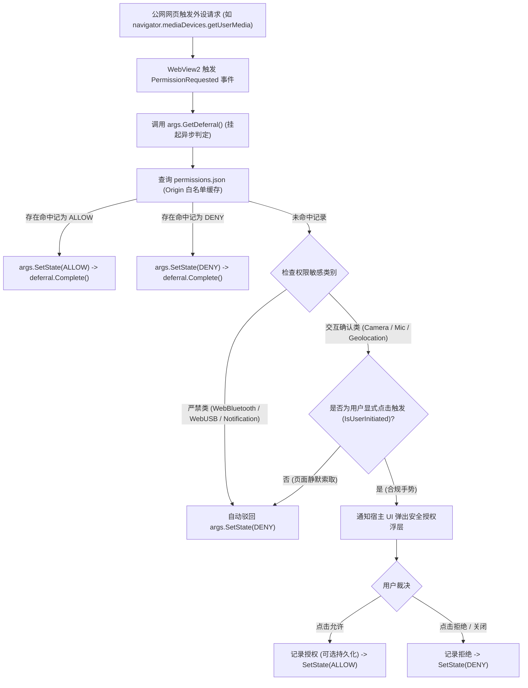
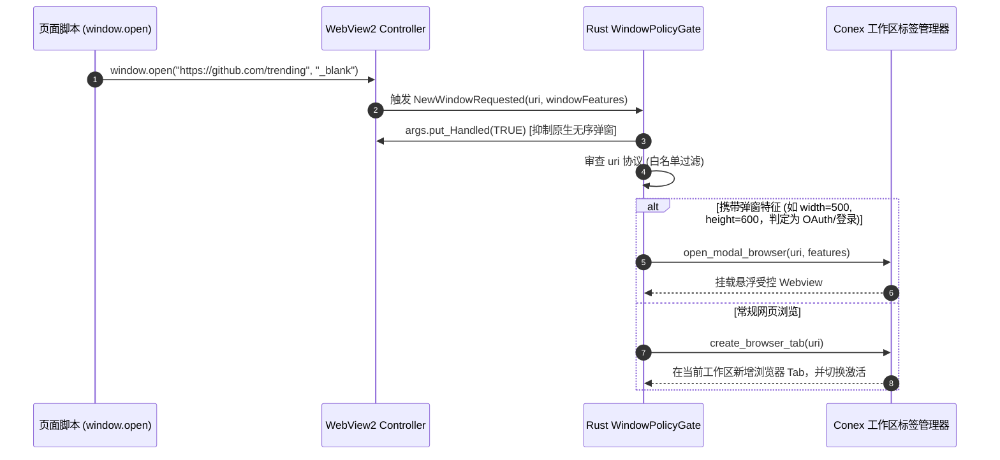
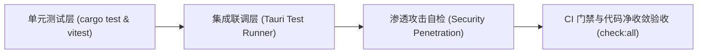

# 原生浏览器安全分区、权限门控与旧代理清退实施方案（分维详案）

> **战役工作区**：`docs/native-browser-overhaul/`  
> **文档定位**：分维实现方案（03-安全、分区与清退）  
> **权威依据**：`00-总方案-原生浏览器彻底改造与子Webview架构方案.md`、`analysis/04-security-partition-and-permissions.md`、`AGENTS.md`、`ANTI_OVERENGINEERING_GUARDRAILS.md`  
> **最高指示贯彻**：“非必要不兼容。不允许打补丁，不允许硬编码，有合理的抽象，适合未来的功能需求，代码尽量简洁，具有优秀的可维护性。需要删除的代码就删除，需要系统性的重构。”

---

## 目录

- [一、架构重构原则与清退决心](#一架构重构原则与清退决心)
  - [1.1 用户最新指示深度贯彻](#11-用户最新指示深度贯彻)
  - [1.2 拒绝过渡双轨，实行直接净收敛](#12-拒绝过渡双轨实行直接净收敛)
- [二、历史遗留代理资产彻底清退方案](#二历史遗留代理资产彻底清退方案)
  - [2.1 待物理删除文件与代码行号清单](#21-待物理删除文件与代码行号清单)
  - [2.2 前端构建与运行时配置清洗](#22-前端构建与运行时配置清洗)
  - [2.3 后端 Axum 代理端点与路由注销](#23-后端-axum-代理端点与路由注销)
  - [2.4 重构前后代码量净缩减度量](#24-重构前后代码量净缩减度量)
- [三、物理级存储与会话分区隔离设计 (UserDataFolder)](#三物理级存储与会话分区隔离设计-userdatafolder)
  - [3.1 宿主应用与原生浏览器 UDF 拓扑分离](#31-宿主应用与原生浏览器-udf-拓扑分离)
  - [3.2 Windows WebView2 物理进程级隔离机制](#32-windows-webview2-物理进程级隔离机制)
  - [3.3 账号登录态持久化机制 (Persistent Profile)](#33-账号登录态持久化机制-persistent-profile)
  - [3.4 Agent 自动化无痕沙箱 (Ephemeral / InPrivate)](#34-agent-自动化无痕沙箱-ephemeral--inprivate)
  - [3.5 存储容量控制与数据安全擦除规范](#35-存储容量控制与数据安全擦除规范)
- [四、绝对零特权暴露与 IPC 隔离 (Zero-Privilege Webview)](#四绝对零特权暴露与-ipc-隔离-zero-privilege-webview)
  - [4.1 彻底切断 Tauri IPC 通道注入 (`with_ipc_handler(false)`)](#41-彻底切断-tauri-ipc-通道注入-with_ipc_handlerfalse)
  - [4.2 禁用自定义系统协议与资源作用域](#42-禁用自定义系统协议与资源作用域)
  - [4.3 渲染器上下文无特权契约断言](#43-渲染器上下文无特权契约断言)
- [五、权限模型与细粒度门控策略 (PermissionRequested)](#五权限模型与细粒度门控策略-permissionrequested)
  - [5.1 权限拦截架构设计与 WebView2 事件接入](#51-权限拦截架构设计与-webview2-事件接入)
  - [5.2 刚性三级权限裁决矩阵](#52-刚性三级权限裁决矩阵)
  - [5.3 域名作用域权限授权存储 (Origin-Scoped Grants)](#53-域名作用域权限授权存储-origin-scoped-grants)
  - [5.4 宿主高防权限请求弹窗交互规约](#54-宿主高防权限请求弹窗交互规约)
- [六、弹窗拦截与新窗口路由分流 (NewWindowRequested)](#六弹窗拦截与新窗口路由分流-newwindowrequested)
  - [6.1 拦截无修饰原生系统弹窗 (`Handled = true`)](#61-拦截无修饰原生系统弹窗-handled--true)
  - [6.2 链接意图解析与分流引擎](#62-链接意图解析与分流引擎)
  - [6.3 临时 OAuth 认证弹窗的内嵌受控处理](#63-临时-oauth-认证弹窗的内嵌受控处理)
- [七、URL 协议硬白名单与本地防穿透 (NavigationStarting)](#七url-协议硬白名单与本地防穿透-navigationstarting)
  - [7.1 导航生命周期 Fail-Closed 守门员](#71-导航生命周期-fail-closed-守门员)
  - [7.2 协议白名单判定标准](#72-协议白名单判定标准)
  - [7.3 本地文件 (`file:`) 严格防逃逸与工作区约束](#73-本地文件-file-严格防逃逸与工作区约束)
  - [7.4 Windows 系统私有 Scheme 防 RCE 注入策略](#74-windows-系统私有-scheme-防-rce-注入策略)
- [八、Rust 内核安全模块工程实现蓝图](#八rust-内核安全模块工程实现蓝图)
  - [8.1 模块目录结构规划](#81-模块目录结构规划)
  - [8.2 核心代码实现规范](#82-核心代码实现规范)
- [九、防退避验收断言与立体验证矩阵](#九防退避验收断言与立体验证矩阵)
  - [9.1 刚性验收断言 (Assertions)](#91-刚性验收断言-assertions)
  - [9.2 单元测试、集成测试与渗透自检矩阵](#92-单元测试集成测试与渗透自检矩阵)

---

## 一、架构重构原则与清退决心

### 1.1 用户最新指示深度贯彻

用户在本次原生浏览器彻底改造战役中给出了极为鲜明和坚决的最高原则：
> **“非必要不兼容。不允许打补丁，不允许硬编码，有合理的抽象，适合未来的功能需求，代码尽量简洁，具有优秀的可维护性。需要删除的代码就删除，需要系统性的重构。”**

这一指示彻底终结了过去在浏览器改造中反复出现的“既要新架构，又不敢动旧代码，只能层层叠补丁”的恶性循环。安全架构与资产治理维度必须严格遵照执行：
1. **绝不搞过渡双轨制**：凡是服务于旧版 `<iframe>` 伪内嵌体系的本地代理、DOM 注入桥和同源判定等临时产物，一律物理删除，不留任何降级开关或保留分支；
2. **彻底消灭隐蔽安全隐患**：旧式本地反向代理通过剥离 CSP 和 X-Frame-Options 带来了本地 Dev-Server XSS 与 SSRF 致命漏洞，必须连根拔起；
3. **建立清爽高内聚的安全内核**：依托 Windows WebView2 原生底座，用清晰的 Rust 模块（分区管理、权限判定、协议过滤、弹窗分流）建立坚不可摧的安全边界。

### 1.2 拒绝过渡双轨，实行直接净收敛

```
历史双轨妥协模型（严禁采纳）：
[ 用户访问公网网页 ] ─── 判断 ───> 是可内嵌站点? ──Yes──> 走 iframe 直接加载
                                         │
                                         No ──> 走 Vite / Axum 代理中间人篡改 (注入脚本/剥离标头)
                                         │
                                         No ──> 弹窗提示无法内嵌，诱导用户点外部浏览器打开
（结果：状态机撕裂，维护 3 套逻辑，代码膨胀超千行，安全漏洞百出）

升级为

本次单一真理路径架构（直接净收敛）：
[ 用户访问公网网页 ] ─────────────────────> [ 原生子 Webview 容器 (Child HWND) ]
                                                    │
                                                    ├─ 独立的物理存储目录 (browser-storage)
                                                    ├─ 绝对禁用 IPC (零特权暴露)
                                                    ├─ NavigationStarting 刚性协议白名单
                                                    ├─ PermissionRequested 宿主安全门控
                                                    └─ 100% 原生 Chromium 渲染，零代理篡改
```

---

## 二、历史遗留代理资产彻底清退方案

### 2.1 待物理删除文件与代码行号清单

在实现原生子 Webview 改造的同时，直接系统性地物理删除以下 9 个文件及关联配置：

| 模块类别 | 待清退文件绝对/相对路径 | 现有代码规模 | 历史残留职责与删除理由 |
| :--- | :--- | :--- | :--- |
| **前端开发代理** | `apps/crish-desktop/vite.config.ts:394-580` (`crishPreviewProxyPlugin`) | 187 行 | 拦截 `/__crish_preview_proxy`，通过 `fetch` 抓取公网网页，剥离 XFO/CSP 并注入 `<base>` 和脚本。**产生严重的 Localhost 同源 XSS 漏洞，彻底删除。** |
| **前端同源判定** | `apps/crish-desktop/dev-server/sameOriginRequest.ts:1-42` | 42 行 | 针对代理端点的脆弱同源请求校验器，仅服务于已废弃的代理插件。**直接物理删除文件。** |
| **DOM 注入脚本** | `apps/crish-desktop/dev-server/previewBridgeScript.ts:1-237` | 237 行 | 注入到第三方网页 `<head>` 的 postMessage 桥，用于元素悬停/点击上报与报错捕获。**原生方案改为通过 Tauri 原生 `init_script` 注入，彻底物理删除此文件。** |
| **后端透明代理** | `apps/agent-workbench/src-tauri/src/server/preview_proxy.rs:1-493` | 493 行 | Axum 框架下的 REST `/v1/preview/proxy` 反向代理 Handler。**原生子 Webview 直连公网，无需后端转发，物理删除文件。** |
| **后端标头清洗** | `apps/agent-workbench/src-tauri/src/server/preview_headers.rs:1-180` | 180 行 | 暴力剔除 XFO、CSP、COOP/COEP 并强改 Set-Cookie 为 SameSite=Lax 的响应头清洗器。**物理删除文件。** |
| **后端 HTML 注入** | `apps/agent-workbench/src-tauri/src/server/preview_injector.rs:1-150` | 150 行 | 在上游 HTML 中注入 `<base>` 标签与 postMessage 脚本的文本处理引擎。**物理删除文件。** |
| **后端代理单测** | `apps/agent-workbench/src-tauri/src/server/preview_proxy_tests.rs:1-350` | 350 行 | 覆盖旧代理逻辑的专用测试用例。**随主逻辑一并删除。** |
| **前端桥接逻辑** | `apps/crish-desktop/src/components/workspace/previewHostBridge.ts` | 160 行 | 宿主接收来自 iframe postMessage 事件的监听与分发器。**物理删除文件。** |
| **前端代理协议** | `apps/crish-desktop/src/components/workspace/previewProtocol.ts` | 80 行 | 旧式 `crish-preview-inspector` postMessage 数据结构定义。**物理删除文件。** |

### 2.2 前端构建与运行时配置清洗

#### 1. `apps/crish-desktop/vite.config.ts` 净化
- 删除第 9 行：`import { PREVIEW_BRIDGE_SCRIPT } from './dev-server/previewBridgeScript';`
- 删除第 10 行：`import { isSameOriginRequest } from './dev-server/sameOriginRequest';`
- 删除第 390~580 行：`function crishPreviewProxyPlugin(): Plugin { ... }` 完整函数实现；
- 在 Vite 插件列表（第 681 行附近）中，删除 `crishPreviewProxyPlugin()`。

#### 2. `apps/crish-desktop/src/components/workspace/previewCardLib.ts` 净化
- 彻底删除第 48~67 行的 `toProxyPreviewUrl` 函数；
- 改造第 73~80 行的 `safeIframeSrc`：不再作为 iframe src 判定，重命名为 `sanitizeBrowserUrl`，仅做基础合法性检查，直接返回原始合规 URL；
- 删除所有针对 `/ __crish_preview_proxy` 及 `http://127.0.0.1:8765/v1/preview/proxy` 的字符串匹配与条件分支。

### 2.3 后端 Axum 代理端点与路由注销

1. 在 `apps/agent-workbench/src-tauri/src/server/mod.rs` 中：
   - 移除 `pub mod preview_proxy;`、`pub mod preview_headers;`、`pub mod preview_injector;` 声明；
   - 移除 `#[cfg(test)] mod preview_proxy_tests;`。
2. 在 `apps/agent-workbench/src-tauri/src/server/router/mod.rs` 与 `handlers_read.rs` 中：
   - 从 Axum Router 中注销 `.route("/v1/preview/proxy", get(handle_preview_proxy))` 路由规则；
   - 移除相关 Handler 导入与请求状态绑定。

### 2.4 重构前后代码量净缩减度量

```
┌─────────────────────────────────────────────────────────────┐
│                    历史代理资产清退收益统计                  │
├─────────────────────────────────────────────────────────────┤
│ • 物理删除代码文件数：          9 个                         │
│ • 清除 Vite 插件与构建代码：    210 行                       │
│ • 清除 Rust 后端代理与清洗：    823 行                       │
│ • 清除注入脚本与 postMessage 桥：477 行                      │
│ • 清除废弃测试用例代码：        350 行                       │
│ ─────────────────────────────────────────────────────────── │
│ 净消除历史技术债务代码：        1,860+ 行                    │
│ 零 SSRF 隐患 / 零 Dev-Server XSS 提权 / 零 HTML 暴力篡改      │
└─────────────────────────────────────────────────────────────┘
```

---

## 三、物理级存储与会话分区隔离设计 (UserDataFolder)

### 3.1 宿主应用与原生浏览器 UDF 拓扑分离

宿主应用（基于 Tauri 运行的 Crish 桌面工作台）与原生浏览器视口承载着截然不同的信任等级与数据生命周期。必须在 Windows 文件系统上实施完全分立的目录树规划：

```
%LOCALAPPDATA%\io.github.conex-community.crish\
├── host-runtime\                              <-- 【宿主应用专有 UDF】(高特权)
│   ├── EBWebView\
│   │   ├── Default\
│   │   │   ├── Local Storage\leveldb\        (宿主 UI 状态、工作区布局)
│   │   │   ├── IndexedDB\                    (Note 协同运行时、本地向量库)
│   │   │   └── Network\Cookies               (宿主云端通信凭据)
│   │   └── Crashpad\
│   └── host_state.json
│
└── browser-storage\                           <-- 【原生浏览器专有 UDF】(零特权)
    ├── EBWebView\
    │   ├── Default\                          <-- Persistent 用户日常 Profile
    │   │   ├── Local Storage\leveldb\        (公网第三方站点 Storage)
    │   │   ├── IndexedDB\                    (公网第三方应用离线数据)
    │   │   ├── Network\Cookies               (Google/GitHub/Twitter 持久化 Cookie Jar)
    │   │   └── Cache\Cache_Data\             (标准 HTTP 磁盘缓存，加速网页加载)
    │   └── Crashpad\
    └── permissions.json                      (宿主管理的原生浏览器域名权限白名单)
```

### 3.2 Windows WebView2 物理进程级隔离机制

Windows WebView2 的底层架构规定：**不同的 UserDataFolder 绝对不会共享同一个浏览器宿主进程**。
1. **进程树解耦**：
   - 宿主 Webview 归属于 `msedgewebview2.exe (PID: A)` 及其子渲染进程池；
   - 原生浏览器 Webview 归属于全新的 `msedgewebview2.exe (PID: B)` 及其子渲染进程池；
2. **安全隔离收益**：
   - 即便用户访问的公网网页利用 V8 引擎漏洞（如 CVE-2023-3079 等 JIT 越界漏洞）攻陷了浏览器渲染进程，攻击者也只能在 `browser-storage` 目录对应的沙盒权限内活动；
   - 物理上无法访问 `host-runtime` 目录下的宿主 LocalStorage、API 密钥以及本地 Note 数据库，更无法截获宿主进程的内存句柄。

### 3.3 账号登录态持久化机制 (Persistent Profile)

为确保用户在原生浏览器中登录一次 Google、GitHub、GitLab、Figma 后**重启应用免重新登录**：
1. **默认装配持久化目录**：
   每个常规原生浏览器 Tab 在创建时，均指向 `browser-storage` 物理路径；
2. **Cookies 与 Session 自动落盘**：
   Chromium 内核的 Network Service 会自动管理 Cookie Jar，对携带 `Max-Age` / `Expires` 的凭据自动持久化写入 `browser-storage\EBWebView\Default\Network\Cookies`（SQLite 格式）；
3. **支持标准 OAuth 流程**：
   由于直接使用真实浏览器网络栈，不再经过任何代理篡改，Google 账号登录时的跨域校验、多因素验证（2FA）、WebAuthn 硬件密匙以及 Cloudflare 人机验证均能 100% 原生顺利通过。

### 3.4 Agent 自动化无痕沙箱 (Ephemeral / InPrivate)

当 AI Agent 执行批量网页调研、抓取不确定安全性的外部链接时，必须防止未知页面污染用户的日常 Cookie 或篡改现有登录状态：
1. **InPrivate Profile 机制**：
   利用 WebView2 的 `CreateCoreWebView2ControllerOptionsWithProfile` 接口，指定独立的内存 Profile（或临时子目录 `%LOCALAPPDATA%\...\browser-storage\ephemeral-[uuid]\`）；
2. **内存隔离与自毁**：
   Cookie 与 Cache 纯内存留存，Agent 任务结束调用 `browser_webview_close` 时，临时目录直接递归擦除，实现零残留。

### 3.5 存储容量控制与数据安全擦除规范

根据项目全局规则，严禁直接静默清空浏览器数据，提供受控的安全管理机制：
1. **细粒度数据擦除 API**：
   通过 WebView2 `CoreWebView2Profile.ClearBrowsingDataAsync` 暴露如下能力给设置面板：
   - `ClearCache`：仅清理 HTTP 磁盘缓存，释放空间，**保留用户登录 Cookie**；
   - `ClearAllBrowsingData`：经用户二次确认后，彻底清除 Cookies、Storage 与 Cache；
2. **磁盘用量健康监控**：
   Rust 后端提供 `browser_storage_get_usage` 命令，定期统计 `browser-storage` 物理大小。当超过 2GB 阈值时在设置界面呈现轻量提示，供用户自主决策。

---

## 四、绝对零特权暴露与 IPC 隔离 (Zero-Privilege Webview)

### 4.1 彻底切断 Tauri IPC 通道注入 (`with_ipc_handler(false)`)

Tauri 2 默认会向纳管的 Webview 注入一系列特权 IPC 基础设施。对于原生公网浏览器，这构成了致命的提权跳板。

```
常规宿主 Webview (特权):
[ React DOM ] ─── window.__TAURI_INTERNALS__.invoke() ───> [ Rust 内核高特权命令 ]
                                                               (读写磁盘 / 执行命令)

原生公网 Webview (零特权):
[ 公网网页 DOM ] ─── 物理未注入 ───> window.__TAURI_INTERNALS__ === undefined
                                      window.__TAURI__ === undefined
                                      (零 IPC 接入能力，沦落为纯视口渲染器)
```

**实现规范**：
在构建子 Webview 时，严格执行以下代码配置：
```rust
// crates/conex-browser/src/runtime.rs
builder = builder
    .with_ipc_handler(false) // 核心防线：绝对不注册 IPC 接收管道
    .enable_clipboard_access(false); // 剪贴板受管化，杜绝静默窥探
```

### 4.2 禁用自定义系统协议与资源作用域

1. **协议隔离**：
   禁止在原生浏览器 Webview 中注册或解析 `tauri://*`、`asset://*`、`ipc://*` 等宿主专有协议；
2. **资源作用域阻断**：
   确保原生 Webview 无法利用 `asset://localhost/C:/...` 读取本地工程资产，使其完全等同于一个运行在沙盒内的独立 Edge 视口。

### 4.3 渲染器上下文无特权契约断言

在原生子 Webview 初始化后，通过自动化测试与启动自检断言以下环境常量：
- `typeof window.__TAURI_INTERNALS__ === 'undefined'`
- `typeof window.__TAURI__ === 'undefined'`
- `typeof window.__TAURI_IPC__ === 'undefined'`
- `typeof window.__CONEX_PREVIEW_BRIDGE__ === 'undefined'`

---

## 五、权限模型与细粒度门控策略 (PermissionRequested)

### 5.1 权限拦截架构设计与 WebView2 事件接入

现代 Web API 支持直接申请操作系统外设。原生浏览器必须通过 Windows WebView2 的 `CoreWebView2.PermissionRequested` 事件建立统一的安全哨卡。



### 5.2 刚性三级权限裁决矩阵

| 权限类别 | WebView2 PermissionKind | 裁决动作 | 理由与安全边界 |
| :--- | :--- | :--- | :--- |
| **严禁类 (Hard-Blocked)** | `OTHER_SENSORS`<br>`LOCAL_FONTS`<br>`WEB_PRINTING` 等底层硬件 | **强制阻断 (DENY)** | WebBluetooth、WebUSB、WebHID、WebSerial 属于严重本地逃逸与内网穿透向量，桌面开发工作台绝不开放。 |
| **防骚扰类 (Anti-Spam)** | `NOTIFICATIONS` | **默认阻断 (Default DENY)** | 杜绝公网恶意网站通过 Web Push 弹窗污染用户 Windows 系统通知中心。除用户显式在设置中放行外，一律拒绝。 |
| **受控交互类 (Prompt-Gated)** | `CAMERA`<br>`MICROPHONE`<br>`GEOLOCATION`<br>`CLIPBOARD_READ` | **宿主弹窗确认 (Prompt)** | 满足 Google Meet、Zoom Web 等视频会议或地理位置诉求。**刚性条件**：必须 `isUserInitiated == true`，且由宿主在最上层弹出不可伪造的确认卡片。 |
| **安全放行类 (Bounded-Pass)** | `POINTER_LOCK`<br>`AUTOPLAY` | **视口内放行 (Allow)** | 指针锁定被严格限制在子 Webview 容器内部，用户按下 `Esc` 键操作系统强制解除；全屏仅限当前工作区 Pane。 |

### 5.3 域名作用域权限授权存储 (Origin-Scoped Grants)

权限授权必须严格绑定完整的 Web Origin（`protocol://host:port`），禁止通配符扩散。

#### 数据结构规范 (`crates/conex-browser/src/security/permissions.rs`)
```rust
use std::collections::HashMap;
use serde::{Deserialize, Serialize};

#[derive(Debug, Clone, Copy, PartialEq, Eq, Hash, Serialize, Deserialize)]
#[serde(rename_all = "snake_case")]
pub enum BrowserPermissionType {
    Camera,
    Microphone,
    Geolocation,
    ClipboardRead,
    Notifications,
}

#[derive(Debug, Clone, Copy, PartialEq, Eq, Serialize, Deserialize)]
#[serde(rename_all = "snake_case")]
pub enum PermissionDecision {
    Allow,
    Deny,
}

#[derive(Debug, Default, Clone, Serialize, Deserialize)]
pub struct PermissionStore {
    /// 键为格式化后的 Origin，例如 "https://meet.google.com:443"
    pub origins: HashMap<String, HashMap<BrowserPermissionType, PermissionDecision>>,
}
```

- **存储路径**：`%LOCALAPPDATA%\io.github.conex-community.crish\browser-storage\permissions.json`
- **生命周期**：若用户未勾选“记住我的选择”，授权仅驻留于 Rust 内存 HashMap，随 Conex 退出而重置。

### 5.4 宿主高防权限请求弹窗交互规约

当触发受控交互类权限时：
1. Rust 后端向前端广播事件：`browser://permission-request`，载荷包含 `{ tabId, origin, permissionType }`；
2. 宿主顶层弹出高防模态浮层，显示目标网站的根域名及请求的权限类型（禁止使用网页自身伪造的 HTML 弹窗）；
3. 用户裁决结果通过 `browser_permission_respond` 命令回传给 Rust 内核，唤醒 `deferral.Complete()`。

---

## 六、弹窗拦截与新窗口路由分流 (NewWindowRequested)

### 6.1 拦截无修饰原生系统弹窗 (`Handled = true`)

公网网页调用 `window.open(url, '_blank')` 或用户点击 `<a target="_blank">` 时，Windows WebView2 会触发 `NewWindowRequested` 事件。
- **失控隐患**：若不拦截，WebView2 会在操作系统桌面随机拉起一个不受控、无修饰的外部 Edge 窗口，脱离 Conex 工作区与几何管理；
- **刚性处理**：在事件处理首行立即调用：
  ```cpp
  args->put_Handled(TRUE);
  ```
  底层默认弹窗行为被 100% 抑制，弹窗控制权完全移交给 Conex 内核分流引擎。

### 6.2 链接意图解析与分流引擎



1. **常规导航分流**：
   凡是不带特殊尺寸特征的 `target="_blank"` 导航，统一转换为调用 Conex 工作区的 `create_browser_tab(url)`，在当前窗格中新建一个原生的浏览器标签页，享受统一的标签栏管理与二叉树分屏；
2. **非法协议过滤**：
   若弹出的 URL 包含危险协议（如 `javascript:`、`calc:` 等），直接丢弃并触发安全审计告警。

### 6.3 临时 OAuth 认证弹窗的内嵌受控处理

在许多第三方登录场景（如点击“Sign in with Google”），页面通过 `window.open(url, 'auth', 'width=500,height=600')` 唤起小尺寸登录窗。
- **架构方案**：Conex 识别其 `WindowFeatures` 包含具体尺寸约束，将其识别为 OAuth 授权视口；
- **生命周期绑定**：将其呈现为工作区内的浮动模态 Webview。当认证完成触发 `window.close()` 时，WebView2 的 `WindowCloseRequested` 事件自动捕获并销毁该模态视口，将凭据自然同步至母体 `browser-storage`。

---

## 七、URL 协议硬白名单与本地防穿透 (NavigationStarting)

### 7.1 导航生命周期 Fail-Closed 守门员

在 WebView2 的 `NavigationStarting` 事件中落实刚性审查。任何非白名单内的请求在网络层发出前即被硬性拦截，返回 `Cancel = TRUE`。

### 7.2 协议白名单判定标准

```rust
pub fn is_allowed_navigation_scheme(uri: &str) -> bool {
    if let Ok(url) = url::Url::parse(uri) {
        match url.scheme() {
            "https" => true,
            "http" => true,
            "about" => uri == "about:blank",
            _ => false,
        }
    } else {
        false
    }
}
```

1. **绝对放行**：`https:`、`http:`、`about:blank`；
2. **绝对阻断**：
   - `javascript:` / `vbscript:`：彻底封堵伪协议执行与 XSS 载荷；
   - `data:` 顶层导航：阻断直接在地址栏打开 `data:text/html,...`，杜绝钓鱼与隐蔽利用（网页子资源图片/字体允许 data 协议）；
   - `chrome:` / `edge:` / `devtools:`：阻断浏览器内部调试协议，防止篡改 WebView2 内部参数。

### 7.3 本地文件 (`file:`) 严格防逃逸与工作区约束

依据 `reference/pi-desktop/docs/spec/05-security/01-security.md` 的工业级标准，制定极严密的本地文件访问控制：
1. **网络跳本地全面阻断（Web-to-Local Block）**：
   如果当前 Webview 已经处于公网网页上下文（源为 `http:` 或 `https:`），**任何指向 `file:` 协议的导航或资源请求均被 100% 阻断**，防止公网页面探测或盗取用户本地磁盘文件；
2. **工作区白名单约束（Workspace Confinement）**：
   仅当用户在地址栏手动输入本地路径，或由工作区文件管理器显式唤起时，方允许加载 `file:` 协议。且该绝对路径必须通过 Rust 内核的 `canonicalize()` 规范化校验，**严格限制在当前打开的工作区根目录（`workspace_root`）内**，严禁向外跳跃访问 `C:\Windows\` 或用户家目录根路径。

### 7.4 Windows 系统私有 Scheme 防 RCE 注入策略

Windows 操作系统注册了大量的自定义 URI Scheme（例如 `slack://`、`vscode://`、`ms-excel://`、`calc:`、`steam://` 等）。
- **已知攻击载荷**：恶意公网页面通过嵌入 `<a href="ms-msdt:...">` 或利用自定义协议进行参数注入，直接拉起本地二进制文件触发 RCE；
- **拦截策略**：
  - 默认全部阻断，严禁未经询问直接调用系统 `ShellExecute`；
  - 针对通用合规通信协议（`mailto:`、`tel:`），在唤起前必须弹出宿主安全询问框：`"网站正在尝试调用外部程序：[URI]，是否允许？"`，获得用户明确同意后方可委托系统启动器打开。

---

## 八、Rust 内核安全模块工程实现蓝图

### 8.1 模块目录结构规划

在 `apps/agent-workbench/src-tauri/src/browser/` 下建立纯净的安全子模块：

```
apps/agent-workbench/src-tauri/src/browser/
├── mod.rs                      // 模块入口与统一对外暴露
├── manager.rs                  // NativeWebviewManager 核心
├── security/                   // 【安全子域】
│   ├── mod.rs                  // 安全门禁装配入口
│   ├── partition.rs            // UDF 路径计算与物理目录管理
│   ├── permissions.rs          // PermissionRequested 拦截与存储
│   ├── navigation_gate.rs      // NavigationStarting 协议白名单过滤
│   └── window_policy.rs        // NewWindowRequested 弹窗分流引擎
└── inspector_script.rs         // 内联 DOM 拾取探针脚本 (<4KB)
```

### 8.2 核心代码实现规范

#### 1. 安全创建 Webview (`crates/conex-browser/src/runtime.rs` / `manager.rs`)
```rust
use std::path::PathBuf;
use tauri::{AppHandle, Manager, WebviewBuilder, WebviewUrl, Runtime};
use crate::browser::security::{partition, navigation_gate, permissions, window_policy};

pub fn build_secure_child_webview<R: Runtime>(
    app: &AppHandle<R>,
    window_label: &str,
    tab_id: &str,
    initial_url: &str,
    bounds: (f64, f64, f64, f64),
    is_ephemeral: bool,
) -> Result<tauri::Webview<R>, tauri::Error> {
    let window = app.get_window(window_label)
        .ok_or_else(|| tauri::Error::WebviewNotFound)?;

    // 1. 获取物理隔离的专用 UDF
    let udf_path = partition::resolve_browser_udf_path(app, is_ephemeral)?;

    // 2. 协议合规校验
    if !navigation_gate::is_allowed_initial_url(initial_url) {
        return Err(tauri::Error::AssetNotFound(format!("拦截非安全 URL: {initial_url}")));
    }

    let parsed_url = initial_url.parse::<url::Url>()
        .map_err(|e| tauri::Error::AssetNotFound(e.to_string()))?;

    let label = format!("browser-tab-{tab_id}");
    let mut builder = WebviewBuilder::new(&label, WebviewUrl::External(parsed_url));

    // 3. 注入独立的 data_directory，实现存储硬隔离
    builder = builder.data_directory(Some(udf_path));

    // 4. 彻底切断 IPC 特权
    builder = builder.with_ipc_handler(false);

    // 5. 挂接 NavigationStarting 守门员
    builder = builder.on_navigation(move |target_url| {
        navigation_gate::validate_navigation(&target_url)
    });

    // 6. 添加子 Webview 至主窗口几何视口
    let (x, y, w, h) = bounds;
    let webview = window.add_child(
        builder,
        tauri::LogicalPosition::new(x, y),
        tauri::LogicalSize::new(w, h),
    )?;

    // 7. 底层 Windows WebView2 专项拦截 (通过 WRY 暴露的 Controller 挂接 Permission / NewWindow)
    window_policy::attach_webview2_guards(&webview, tab_id, app.clone())?;

    Ok(webview)
}
```

#### 2. 协议过滤引擎 (`security/navigation_gate.rs`)
```rust
use url::Url;
use tracing::warn;

pub fn is_allowed_initial_url(raw: &str) -> bool {
    if raw == "about:blank" {
        return true;
    }
    if let Ok(url) = Url::parse(raw) {
        url.scheme() == "https" || url.scheme() == "http"
    } else {
        false
    }
}

pub fn validate_navigation(target: &Url) -> bool {
    let scheme = target.scheme();
    match scheme {
        "https" | "http" => true,
        "about" => target.as_str() == "about:blank",
        _ => {
            warn!(target: "security_gate", "阻断不合规协议导航: {}", target);
            false
        }
    }
}
```

---

## 九、防退避验收断言与立体验证矩阵

### 9.1 刚性验收断言 (Assertions)

依照 `.agents/LOGIC_PLAN_NO_RETREAT.md` 铁律，本分维方案必须达成以下 5 项刚性断言，任何一项未达成均视作交付不合格：

| 断言编号 | 断言名称 | 检验标准与物理判定依据 | 容忍度 |
| :--- | :--- | :--- | :--- |
| **断言 A1** | **存储物理隔离零渗透** | 原生浏览器登录 GitHub / Google 后，检查 `%LOCALAPPDATA%\...\host-runtime\` 目录，其 Cookies SQLite 与 LocalStorage LevelDB 中**绝对不包含任何 GitHub / Google 的键值或凭据**；所有数据严格收敛于 `browser-storage`。 | **零容忍 (0 渗透)** |
| **断言 A2** | **IPC 特权零暴露** | 在原生浏览器加载包含 `window.__TAURI_INTERNALS__` 打印测试页，输出必须严格为 `undefined`；通过 DevTools 控制台调用 `window.__TAURI__.invoke(...)` 必须报 `ReferenceError`。 | **零容忍 (0 特权)** |
| **断言 A3** | **高危伪协议 100% 拦截** | 页面内触发 `window.location.href = 'javascript:...'` 或 `<a href="calc:">`，`NavigationStarting` 拦截率达 100%，系统绝不执行内联脚本，绝不拉起系统计算器。 | **零容忍 (100% 拦截)** |
| **断言 A4** | **本地文件越界防御** | 公网加载的网页执行 `window.location.href = 'file:///C:/Windows/win.ini'`，底层强制返回阻断，零字节内容泄露。 | **零容忍 (0 泄露)** |
| **断言 A5** | **历史代理代码净收敛** | 物理删除 `crishPreviewProxyPlugin`、`previewBridgeScript.ts`、`sameOriginRequest.ts`、`preview_proxy.rs` 等 9 个文件，工程中搜索 `/__crish_preview_proxy` 匹配数为 0，编译门禁全绿。 | **零容忍 (0 残留)** |

### 9.2 单元测试、集成测试与渗透自检矩阵



1. **单元测试层**：
   - `test_navigation_gate_schemes`：测试各种畸形 URL、双斜杠协议、大小写混淆（`hTTps://`）与未转义控制字符的白名单拦截率；
   - `test_permission_matrix`：穷举验证三级权限矩阵中每一个 `PermissionKind` 的默认行为是否符合预期；
2. **集成联调层**：
   - 验证 Webview 在持久化与临时模式下 `browser-storage` 目录的生成与自毁生命周期；
   - 模拟 `NewWindowRequested` 事件，断言 `args.Handled` 成功置位，并向前端派发了新 Tab 创建指令；
3. **安全渗透自检**：
   - **XSS 跨源窃取测试**：在原生浏览器打开自建靶场页面，尝试通过 `postMessage`、`localStorage` 或 `IndexedDB` 窃取宿主会话，确认彻底无法通信；
   - **协议逃逸测试**：网页尝试触发 `ms-settings:`、`vscode:`、`calc:`，确认操作系统无任何异常进程启动；
4. **CI 门禁全绿**：
   - 执行 `cargo check --workspace` & `cargo test -p agent-workbench`；
   - 执行 `npm run check:desktop` 确保无死引用与类型断裂。
