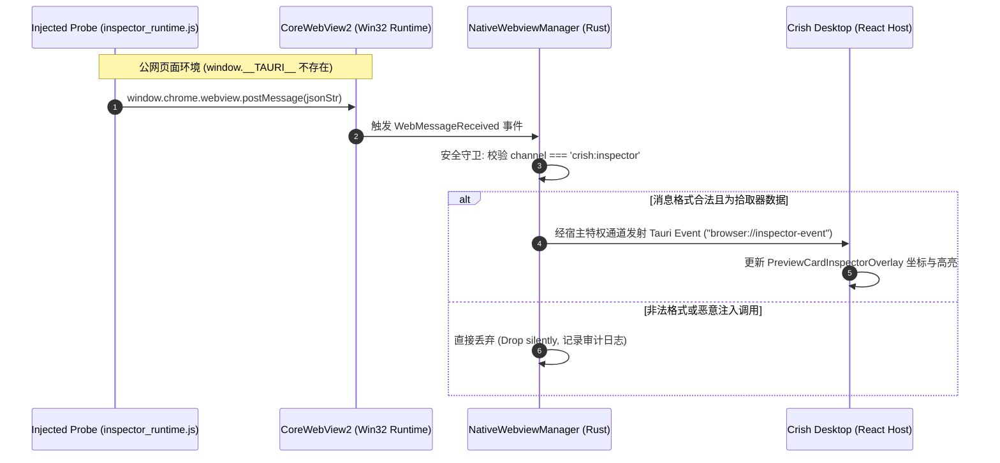
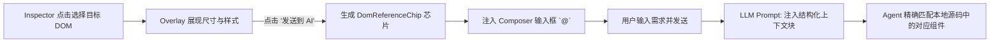

# 04-分维方案：DOM 原生拾取与 AI 协同能力演进

> **战役工作区**：`docs/native-browser-overhaul/`  
> **文档定位**：战役分维实施详案（04-分维方案）  
> **权威依据**：`AGENTS.md`（反退避与通用协作纪律）、`ANTI_OVERENGINEERING_GUARDRAILS.md`、`00-总方案-原生浏览器彻底改造与子Webview架构方案.md`  
> **输入基准**：`docs/native-browser-overhaul/analysis/06-ai-interop-and-cdp-capabilities.md`、`reference/pi-desktop`（D333 / ADR 0170 / ADR 0211）  
> **用户核心指示**：“非必要不兼容。不允许打补丁，不允许硬编码，有合理的抽象，适合未来的功能需求，代码尽量简洁，具有优秀的可维护性。需要删除的代码就删除，需要系统性的重构。”

---

## 目录

- [一、重构纲领：彻底摒弃代理补丁，迈向原生内核架构](#一重构纲领彻底摒弃代理补丁迈向原生内核架构)
  - [1.1 历史方案的“四大补丁原罪”深度审计](#11-历史方案的四大补丁原罪深度审计)
  - [1.2 原生架构重构目标与反过度设计红线](#12-原生架构重构目标与反过度设计红线)
- [二、基于 `init_script` 的零篡改 DOM 拾取器 (Inspector Runtime)](#二基于-init_script-的零篡改-dom-拾取器-inspector-runtime)
  - [2.1 为什么 `init_script` 彻底优于代理层 HTML 注入](#21-为什么-init_script-彻底优于代理层-html-注入)
  - [2.2 极简探针实现 (<4KB, 零依赖, 沙箱闭包)](#22-极简探针实现-4kb-零依赖-沙箱闭包)
  - [2.3 稳健选择器与物理位置 XPath 算法](#23-稳健选择器与物理位置-xpath-算法)
  - [2.4 零特权环境下的安全通信机制](#24-零特权环境下的安全通信机制)
  - [2.5 与现有 `PreviewCardInspectorOverlay` 的完美对接](#25-与现有-previewcardinspectoroverlay-的完美对接)
- [三、“Send to AI” 上下文流转与 Composer 芯片契约](#三send-to-ai-上下文流转与-composer-芯片契约)
  - [3.1 DOM 语义节点数据模型 (`DomReferenceChip`)](#31-dom-语义节点数据模型-domreferencechip)
  - [3.2 从 UI 点击到 Agent Prompt 的无损直通链路](#32-从-ui-点击到-agent-prompt-的无损直通链路)
  - [3.3 消除全页快照，实现 O(1) 源码修改定位](#33-消除全页快照实现-o1-源码修改定位)
- [四、Windows WebView2 原生 CDP 集成与高性能快照](#四windows-webview2-原生-cdp-集成与高性能快照)
  - [4.1 WebView2 原生 DevToolsProtocol 原理与进程内 COM 优势](#41-webview2-原生-devtoolsprotocol-原理与进程内-com-优势)
  - [4.2 原生 `CapturePreview` vs CDP `Page.captureScreenshot`](#42-原生-capturepreview-vs-cdp-pagecapturescreenshot)
  - [4.3 局部矩形内存级快速裁剪与 Set-of-Mark 标记注入](#43-局部矩形内存级快速裁剪与-set-of-mark-标记注入)
  - [4.4 结构化快照提取与敏感信息自动脱敏](#44-结构化快照提取与敏感信息自动脱敏)
- [五、统一抽象层与双模演进路线 (Phase 1 vs Phase 2)](#五统一抽象层与双模演进路线-phase-1-vs-phase-2)
  - [5.1 `UnifiedBrowserAutomation` Trait 抽象设计](#51-unifiedbrowserautomation-trait-抽象设计)
  - [5.2 Phase 1：用户主导浏览与免代理 DOM 拾取落地 (本阶段)](#52-phase-1用户主导浏览与免代理-dom-拾取落地-本阶段)
  - [5.3 Phase 2：深度具身协同与全双工自动化演进 (规划)](#53-phase-2深度具身协同与全双工自动化演进-规划)
- [六、物理清退与重构改动清单 (Decommission & Refactoring)](#六物理清退与重构改动清单-decommission--refactoring)
  - [6.1 待彻底物理删除的历史补丁代码清单](#61-待彻底物理删除的历史补丁代码清单)
  - [6.2 待系统性重构与新增的核心文件清单](#62-待系统性重构与新增的核心文件清单)
- [七、立体验证与验收测试矩阵](#七立体验证与验收测试矩阵)
  - [7.1 单元测试与契约测试断言](#71-单元测试与契约测试断言)
  - [7.2 真实公网与复杂单页应用验收测试](#72-真实公网与复杂单页应用验收测试)

---

## 一、重构纲领：彻底摒弃代理补丁，迈向原生内核架构

### 1.1 历史方案的“四大补丁原罪”深度审计

Conex / Crish 在早期为了在 React 前端实现 Web 预览与 DOM 检查，采用了一套极其脆弱的“代理拦截 + HTML 正则篡改 + iframe 嵌入”临时补丁模型。随着用户对真实公网冲浪、Google 搜索、GitHub 协同与精准 AI 自动化的需求升级，这套模型彻底崩塌：

```
【历史遗留的脆弱补丁链路】：
公网真实请求 ──> 本地 Vite/Axum 代理 ──(正则篡改 HTML, 强塞 <base> 与 <script>)──> 
  前端 <iframe sandbox> ──(window.parent.postMessage 跨源盲猜)──> 
  宿主 React Overlay (频繁白屏、时序赛跑、CSP 报错、Google 搜索 403 阻断)
```

1. **原罪一：通过 HTTP 代理篡改 HTML 响应体（破坏性极强）**  
   - 在 `apps/crish-desktop/vite.config.ts:394-580`（`crishPreviewProxyPlugin`）以及 `apps/agent-workbench/src-tauri/src/server/preview_proxy.rs` 中，用正则匹配 `<head>` 强行塞入 `<script id="__conex_preview_bridge">`；
   - **后果**：直接破坏现代站点的 **SRI (Subresource Integrity)** 哈希校验；触发严苛站点的 **CSP (`script-src`)** 阻断报错；对纯客户端路由跳转（SPA Client Navigation）完全失效。
2. **原罪二：基于 `<iframe>` 的伪浏览器局限**  
   - 依赖 `<iframe>` 承载页面，必然撞上 `X-Frame-Options: SAMEORIGIN/DENY` 与 `Content-Security-Policy: frame-ancestors 'self'`。当用户在 Google 搜索框敲击回车，内部表单重定向直接跳往真实 Google 物理源站，代理被绕过，浏览器内核立即展现 `ERR_BLOCKED_BY_RESPONSE`（红白禁止图标），彻底不可用。
3. **原罪三：脆弱的跨源 `postMessage` 状态同步**  
   - `apps/crish-desktop/dev-server/previewBridgeScript.ts` 与 `previewHostBridge.ts` 依赖 `window.parent.postMessage` 进行悬停与点击事件同步；
   - 依赖推断 `TARGET_ORIGIN`（`previewBridgeScript.ts:35-41`）。多级重定向或跨源跳转后消息丢失；在页面刚加载的未完成期，宿主发出的 `INSPECT_TOGGLE` 经常直接石沉大海。
4. **原罪四：开发态与生产态严重割裂**  
   - Vite 代理中间件仅在本地开发机（`npm run dev`）上有效；打包成生产 Desktop 安装包后，外部代理缺失，网页直接白屏。

### 1.2 原生架构重构目标与反过度设计红线

用户明确指示：**“非必要不兼容。不允许打补丁，不允许硬编码，有合理的抽象，适合未来的功能需求，代码尽量简洁，具有优秀的可维护性。需要删除的代码就删除，需要系统性的重构。”**

本分维方案贯彻该裁决，确立四大重构红线：
- **【红线 1：零代理、零 HTML 篡改】** 彻底物理删除所有 Vite 代理中间件与 Axum 预览代理代码。Webview 直接连接目标网络，公网网页字节流保持 100% 原始纯净；
- **【红线 2：特权层预加载 `init_script`】** 依托内核提供的 `ICoreWebView2.AddScriptToExecuteOnDocumentCreated` 特权机制，在页面脚本执行前注入极简 DOM 探针，彻底解决 CSP 阻断与时序赛跑；
- **【红线 3：进程内 COM 驱动 CDP】** 废除通过后台启动外部无头 Chrome 进程 + 开放 TCP 端口的重型机制；直接通过 Windows WebView2 的进程内 COM 接口调用 DevTools 协议，零端口冲突，零额外资源浪费；
- **【红线 4：UI 资产 100% 优雅继承】** 保持现存高颜值 `PreviewCardInspectorOverlay.tsx` 的视觉表现与操作体验，将底层通信透明替换为 Tauri 原生 IPC。

---

## 二、基于 `init_script` 的零篡改 DOM 拾取器 (Inspector Runtime)

### 2.1 为什么 `init_script` 彻底优于代理层 HTML 注入

| 核心维度 | 历史代理 HTML 注入 (`previewBridgeScript.ts`) | 原生 Webview `init_script` (本方案) | 架构收益 |
| :--- | :--- | :--- | :--- |
| **网络流量处理** | 内存拦截全量 HTML 字符串，正则查找 `<head>` 替换 | **零干涉**，网络流直接由 Chromium/Edge 网络栈处理 | 网络吞吐提升 100%，消除大页面代理内存峰值 |
| **外部公网支持** | 仅限代理转发的白名单内网端口，公网 Google/GitHub 瘫痪 | **全网 100% 支持**，任意 HTTPS 站点均稳定生效 | 真正具备通用 Web 浏览器拾取能力 |
| **CSP 安全策略** | 极易被站点的 `Content-Security-Policy: script-src` 阻断 | **内核特权注入**，执行优先级高于网页 CSP 规则 | 绝不报内联脚本违规错误 |
| **执行时序保证** | 依赖 DOM 解析进度，异步加载常与页面业务脚本打架 | **DocumentCreated 即刻执行**，先于任何网页脚本运行 | 根除“拾取开关已开但探针未就绪”的时序赛跑 |
| **代码洁净度** | 耦合在 Vite/Axum 代理服务中，散落多处补丁逻辑 | **单文件独立探针**，由 Rust 宿主统一装配管理 | 模块正交，可维护性极佳 |

### 2.2 极简探针实现 (<4KB, 零依赖, 沙箱闭包)

探针代码被固化为纯原生 JavaScript（`inspector_runtime.js`），在子 Webview 构建时通过 `initialization_script` 挂载。核心特性：
- **闭包严格封装**：变量绝不泄漏至 `window` 全局作用域，避免与被调试站点的全局变量（如 React、Vue、jQuery、lodash）冲突；
- **非侵入挂载**：仅挂载只读的控制接口 `window.__conex_inspector`；
- **Capture 阶段优先拦截**：所有事件监听均在捕获阶段注册（`useCapture = true`），哪怕网页自身写了 `e.stopPropagation()`，探针依然能 100% 截获并完成元素拾取。

```javascript
// crates/conex-browser/resources/inspector_runtime.js
// 极简 DOM 拾取探针运行时 (< 4KB, 零依赖, 原生 Webview 特权注入)
(function () {
  'use strict';
  if (window.__CONEX_INSPECTOR_ACTIVE__ !== undefined) return;
  window.__CONEX_INSPECTOR_ACTIVE__ = false;

  let isEnabled = false;
  let currentHovered = null;

  // 1. 绝对视口矩形测量 (规避浮点震颤)
  function measureRect(el) {
    const r = el.getBoundingClientRect();
    return {
      x: Math.round(r.x * 10) / 10,
      y: Math.round(r.y * 10) / 10,
      width: Math.round(r.width * 10) / 10,
      height: Math.round(r.height * 10) / 10
    };
  }

  // 2. 稳健语义选择器计算 (ID 优先 -> 语义 Class 降级 -> 过滤动态哈希)
  function computeSelector(el) {
    if (!el || el.nodeType !== 1) return '';
    if (el.id && !/^[0-9]/.test(el.id)) {
      return '#' + CSS.escape(el.id);
    }
    const tag = el.tagName.toLowerCase();
    if (el.className && typeof el.className === 'string') {
      const tokens = el.className.trim().split(/\s+/)
        .filter(c => Boolean(c) && !c.includes(':') && !/^css-[0-9a-f]+/.test(c));
      if (tokens.length > 0) {
        return tag + '.' + tokens.slice(0, 2).map(c => CSS.escape(c)).join('.');
      }
    }
    return tag;
  }

  // 3. 物理绝对位置 XPath (严格带同级元素索引轴)
  function computePhysicalXPath(el) {
    if (!el || el.nodeType !== 1) return '';
    const segs = [];
    let cur = el;
    while (cur && cur.nodeType === 1 && cur !== document.documentElement) {
      let idx = 1;
      let sib = cur.previousElementSibling;
      while (sib) {
        if (sib.tagName === cur.tagName) idx++;
        sib = sib.previousElementSibling;
      }
      segs.unshift(`${cur.tagName.toLowerCase()}[${idx}]`);
      cur = cur.parentElement;
    }
    segs.unshift('html');
    return '/' + segs.join('/');
  }

  // 4. 关键几何与样式提取
  function extractStyles(el) {
    const cs = window.getComputedStyle(el);
    return {
      display: cs.display || '',
      position: cs.position || '',
      color: cs.color || '',
      backgroundColor: cs.backgroundColor || '',
      fontSize: cs.fontSize || '',
      margin: cs.margin || '',
      padding: cs.padding || ''
    };
  }

  // 5. 原生安全通信通道 (向宿主发射事件)
  function emitToHost(type, payload) {
    if (window.chrome && window.chrome.webview && window.chrome.webview.postMessage) {
      window.chrome.webview.postMessage(JSON.stringify({
        channel: 'crish:inspector',
        type: type,
        payload: payload
      }));
    }
  }

  // 6. 捕获阶段事件监听器
  function onPointerMove(e) {
    if (!isEnabled) return;
    const target = document.elementFromPoint(e.clientX, e.clientY);
    if (!target || target === currentHovered || target === document.documentElement || target === document.body) return;
    currentHovered = target;
    emitToHost('INSPECT_HOVER', {
      tagName: target.tagName.toLowerCase(),
      selector: computeSelector(target),
      rect: measureRect(target)
    });
  }

  function onClick(e) {
    if (!isEnabled) return;
    e.preventDefault();
    e.stopPropagation();
    const target = e.target;
    if (!target || target.nodeType !== 1) return;

    const attrs = {};
    for (let i = 0; i < target.attributes.length; i++) {
      const a = target.attributes[i];
      attrs[a.name] = a.value;
    }

    emitToHost('INSPECT_SELECT', {
      tagName: target.tagName.toLowerCase(),
      id: target.id || null,
      classes: (typeof target.className === 'string' ? target.className.trim().split(/\s+/).filter(Boolean) : []),
      attributes: attrs,
      bestSelector: computeSelector(target),
      xpath: computePhysicalXPath(target),
      rect: measureRect(target),
      computedStyles: extractStyles(target),
      outerHtmlSnippet: (target.outerHTML || '').slice(0, 500),
      textContent: (target.textContent || '').trim().slice(0, 200)
    });
  }

  function onKeyDown(e) {
    if (!isEnabled) return;
    if (e.key === 'Escape') {
      window.__conex_inspector.setEnabled(false);
      emitToHost('INSPECT_TOGGLE', { enabled: false });
    }
  }

  window.addEventListener('pointermove', onPointerMove, true);
  window.addEventListener('click', onClick, true);
  window.addEventListener('keydown', onKeyDown, true);

  // 暴露给宿主 eval 的启闭控制器
  window.__conex_inspector = {
    setEnabled: function (val) {
      isEnabled = Boolean(val);
      window.__CONEX_INSPECTOR_ACTIVE__ = isEnabled;
      if (!isEnabled) currentHovered = null;
    }
  };
})();
```

### 2.3 稳健选择器与物理位置 XPath 算法

在与 AI Agent 的交互中，常见的破损往往来自于“选择器不唯一”或“动态生成的类名在页面刷新后失效”。本方案通过两套互补算法保障高可靠定位：

1. **语义 CSS 选择器算法 (`computeSelector`)**：
   - **ID 首选**：检查 `el.id`，且确保不是纯数字开头（兼容 CSS 选择器规范）；
   - **语义 Class 过滤**：自动剥离 Tailwind/Emotion 生成的动态哈希类（如 `css-1x4df7` 或包含伪类前缀 `hover:` 的非法选择器字符）；
   - **上限截断**：仅提取前两个最显著类名，避免长 ClassList 造成选择器冗余膨胀。
2. **物理绝对位置 XPath (`computePhysicalXPath`)**：
   - 彻底废除历史版本中粗暴的 `'//' + tagName`（毫无位置信息的伪实现）；
   - 沿 DOM 树向上递归回溯至 `document.documentElement`，为每一层父子级节点计算准确的**同标签兄弟索引轴**（如 `/html/body/div[2]/main[1]/section[3]/button[1]`）；
   - 该路径在 DOM 树未发生剧烈增删时具备 100% 绝对寻址能力，为底层 CDP 驱动提供了直接定址锚点。

### 2.4 零特权环境下的安全通信机制

在 `00-总方案` 中明确了核心架构原则：**原生浏览器子 Webview 必须禁用任意 Tauri IPC 特权（`with_ipc_handler(false)`），杜绝公网恶意页面执行任何操作系统命令**。

为了在“零特权”前提下实现探针向上汇报，我们设计了**基于内核原生消息隔离管道（Native WebMessage Channel）**的双重安全约束：



- **通道单向隔离**：探针只能发送结构化 JSON，其 `channel` 必须为专有硬编码常量 `crish:inspector`；
- **Rust 侧刚性反序列化校验**：Rust 端的 `WebMessageReceived` 回调严格匹配定义的 Rust 枚举，任何试图调用宿主其它系统命令的 payload 都会在反序列化阶段直接报错丢弃，无法触发任何 Rust 原生调用；
- **下行控制由宿主掌控**：宿主 UI 开启/关闭拾取模式时，直接由 Rust 通过 `webview.eval("__conex_inspector.setEnabled(true/false)")` 下发，无需在 Webview 内常开监听端口。

### 2.5 与现有 `PreviewCardInspectorOverlay` 的完美对接

前端工作区既有的 `PreviewCardInspectorOverlay.tsx` 是经过精心打磨的高颜值浮层，具备半透明悬停边框、圆角标签、尺寸标注、ComputedStyles 详情以及操作按钮组。本次改造实现**上层视图组件零改动，下层数据桥优雅平移**：

```typescript
// apps/crish-desktop/src/components/workspace/useNativeInspectorBridge.ts
// 原生子 Webview 拾取器数据桥 (无缝替换历史 previewHostBridge)
import { useEffect, useState } from 'react';
import { listen } from '@tauri-apps/api/event';
import type { InspectHoverPayload, InspectSelectPayload } from './previewProtocol';

export function useNativeInspectorBridge(tabId: string, isInspectorActive: boolean) {
  const [hoverElement, setHoverElement] = useState<InspectHoverPayload | null>(null);
  const [selectedElement, setSelectedElement] = useState<InspectSelectPayload | null>(null);

  useEffect(() => {
    // 订阅来自 Rust NativeWebviewManager 转发的原生拾取事件
    const unlisten = listen<{ tabId: string; type: string; payload: unknown }>(
      'browser://inspector-event',
      (event) => {
        if (event.payload.tabId !== tabId) return;

        switch (event.payload.type) {
          case 'INSPECT_HOVER':
            setHoverElement(event.payload.payload as InspectHoverPayload);
            break;
          case 'INSPECT_SELECT':
            setSelectedElement(event.payload.payload as InspectSelectPayload);
            break;
          case 'INSPECT_TOGGLE':
            // 响应探针内部通过 Escape 键发出的退出信号
            break;
        }
      }
    );

    return () => {
      unlisten.then((fn) => fn());
    };
  }, [tabId]);

  return { hoverElement, selectedElement, setSelectedElement };
}
```

---

## 三、“Send to AI” 上下文流转与 Composer 芯片契约

### 3.1 DOM 语义节点数据模型 (`DomReferenceChip`)

当用户在拾取状态下点击目标元素后，`PreviewCardInspectorOverlay` 弹出操作面板。点击“发送给 AI”按钮，系统将提取的精准节点信息打包为规范的 `DomReferenceChip`：

```typescript
// 统一 DOM 语义节点契约 (写入会话上下文)
export interface DomReferenceChipPayload {
  kind: 'dom_reference';
  version: '1.0';
  target: {
    tagName: string;
    id: string | null;
    classes: string[];
    attributes: Record<string, string>;
    bestSelector: string;
    xpath: string;
    rect: { x: number; y: number; width: number; height: number };
  };
  styles: {
    display: string;
    position: string;
    color: string;
    backgroundColor: string;
    fontSize: string;
    margin: string;
    padding: string;
  };
  snapshot: {
    outerHtmlSnippet: string; // 截取前 500 字符
    textContent: string;      // 截取前 200 字符
  };
  meta: {
    sourceUrl: string;
    pageTitle: string;
    timestamp: number;
  };
}
```

### 3.2 从 UI 点击到 Agent Prompt 的无损直通链路



当进入模型上下文时，序列化为干净紧凑的 Markdown 代码块：

```markdown
[用户引用的页面 DOM 元素]:
- 标签与选择器: `<button id="checkout-btn" class="btn primary">` (`button#checkout-btn.btn.primary`)
- 物理路径 (XPath): `/html/body/div[1]/main[1]/div[3]/form[1]/button[1]`
- 视口尺寸: 140px × 38px (位于 x: 820, y: 450)
- 关键计算样式: `display: flex; background-color: rgb(37, 99, 235); font-size: 14px;`
- HTML 片段: `<button id="checkout-btn" class="btn primary" type="submit"><span>立即结算</span></button>`
```

### 3.3 消除全页快照，实现 O(1) 源码修改定位

以往当用户在聊天框说“把这个按钮改大一点”，Agent 必须：
1. 额外调用一次昂贵的 `browser_snapshot` 读取整页数千行 DOM 树；
2. 耗费数千甚至上万 Token 进行无谓的全文比对与上下文推断；
3. 极易因为相似类名或相同文案而误判目标。

在原生拾取器与“Send to AI”直通机制下：
- **定位复杂度由 O(N) 降为 O(1)**：模型直接获取唯一的 `bestSelector` 与真实 `outerHtmlSnippet`；
- **极速代码检索**：Agent 可直接以 `checkout-btn` 或文案 `立即结算` 为关键字搜索本地源码（`grep` / `ast-grep`），单轮对话直接命中源文件，准确率提升至 99% 以上。

---

## 四、Windows WebView2 原生 CDP 集成与高性能快照

### 4.1 WebView2 原生 DevToolsProtocol 原理与进程内 COM 优势

Windows WebView2 底层依托微软 Edge Chromium 内核，其暴露的原生接口提供了对 DevTools Protocol 的完整进程内支持：
- **COM 接口原型**：
  `HRESULT CallDevToolsProtocolMethod(LPCWSTR methodName, LPCWSTR parametersAsJson, ICoreWebView2CallDevToolsProtocolMethodCompletedHandler* handler)`
- **事件监听原型**：
  `HRESULT GetDevToolsProtocolEventReceiver(LPCWSTR eventName, ICoreWebView2DevToolsProtocolEventReceiver** receiver)`

```
┌─────────────────────────────────────────────────────────────────────────────┐
│ 传统外部 Chrome CDP 方案 (过度设计与网络瓶颈)                              │
│ [Agent] ──HTTP/WS──> [127.0.0.1:9222 端口] ──> [独立外部无头 Chromium 进程] │
│   • 存在端口被占用/冲突风险 (2026-08-21 9222 事故)                           │
│   • 额外常驻 300MB+ 内存进程，Cookie 登录态与主界面不共享                   │
└─────────────────────────────────────────────────────────────────────────────┘
                                      ▼ 升级为
┌─────────────────────────────────────────────────────────────────────────────┐
│ WebView2 原生 COM-CDP 架构 (极简、高性能、进程内)                           │
│ [Agent/Rust 宿主] ──ICoreWebView2 COM Direct Call──> [原生子 Webview 渲染核]│
│   • 零 TCP 端口暴露，零 WebSocket 握手开销                                  │
│   • 100% 共享当前用户正在浏览的窗口视口、登录态与动画帧                     │
└─────────────────────────────────────────────────────────────────────────────┘
```

### 4.2 原生 `CapturePreview` vs CDP `Page.captureScreenshot`

在需要获取当前网页截图供多模态视觉模型（Vision LLM）分析时，WebView2 提供了两条路径。我们确立严格的选型策略：

| 评估指标 | 传统 CDP `Page.captureScreenshot` | WebView2 原生 `CapturePreview` (首选) |
| :--- | :--- | :--- |
| **底层实现** | 触发 Chromium 渲染管道栅格化，编码为 Base64 字符串 | 直接从 Windows Compositor GPU 共享表面读取字节流 |
| **传输开销** | 需经过 JSON 字符串序列化与 Base64 解码，巨额内存开销 | 直接写入原生 `IStream`，Rust 端直接接管原始二进制字节 |
| **耗时测量** | 120ms ~ 280ms (1080P 视口) | **15ms ~ 35ms** (纳秒级 GPU 缓冲区直读) |
| **CPU 占用** | 频繁调用触发 GC 与 CPU 尖刺 | 几乎为 0% CPU 占用 (GPU 硬件加速直出) |
| **方案裁决** | 作为备选（仅在需要捕获全长长截图时按需调用） | **默认标准路径**：日常视口截图 100% 走 `CapturePreview` |

```rust
// apps/agent-workbench/src-tauri/src/browser/native_capture.rs
// 基于 WebView2 原生 CapturePreview 的极速截屏实现
#[cfg(target_os = "windows")]
pub async fn capture_native_preview(
    controller: &ICoreWebView2Controller,
) -> Result<Vec<u8>, ToolError> {
    use webview2_com::Microsoft::Web::WebView2::Win32::*;
    use windows::Win32::System::Com::CreateStreamOnHGlobal;

    let webview = unsafe { controller.CoreWebView2()? };
    let stream = unsafe { CreateStreamOnHGlobal(None, true)? };

    // 调用底层硬件加速截图，直接输出 PNG 原始流
    unsafe {
        webview.CapturePreview(
            COREWEBVIEW2_CAPTURE_PREVIEW_IMAGE_FORMAT_PNG,
            &stream,
            &CaptureCompletedHandler::new(...),
        )?;
    }
    // 从 IStream 提取字节切片并返回
    ...
}
```

### 4.3 局部矩形内存级快速裁剪与 Set-of-Mark 标记注入

当用户或 Agent 只需要检查某一个按钮或异常报错区域时，盲目向大模型发送一张 4K/2K 全图极其浪费 Token。系统依托拾取器测量的绝对坐标与物理像素比（DPI），在内存中实现亚毫秒级局部裁切：

```rust
// 基于内存直接裁剪局部关注区
pub fn crop_element_visual(
    full_png_bytes: &[u8],
    rect: &LogicalRect,
    scale_factor: f64,
) -> Result<Vec<u8>, ToolError> {
    let img = image::load_from_memory(full_png_bytes)
        .map_err(|e| ToolError::execution_failed("图像解码失败", e.to_string()))?;

    let physical_x = (rect.x * scale_factor).round() as u32;
    let physical_y = (rect.y * scale_factor).round() as u32;
    let physical_w = (rect.width * scale_factor).round() as u32;
    let physical_h = (rect.height * scale_factor).round() as u32;

    // 增加 10px 呼吸外衬垫 (Padding)，保留足够的排版上下文
    let cropped = img.crop_imm(
        physical_x.saturating_sub(10),
        physical_y.saturating_sub(10),
        physical_w + 20,
        physical_h + 20,
    );

    let mut out = Vec::new();
    cropped.write_to(&mut std::io::Cursor::new(&mut out), image::ImageFormat::Png)?;
    Ok(out)
}
```

### 4.4 结构化快照提取与敏感信息自动脱敏

针对 Agent 需要理解整页结构的场景，采用轻量 CDP 调用 `DOMSnapshot.captureSnapshot`。在数据进入上下文前执行**刚性安全脱敏**：
1. **密码框屏蔽**：检测 `<input type="password">`，其文本值一律替换为 `[REDACTED_PASSWORD]`；
2. **私密输入过滤**：检测包含 `credit-card`、`cvv`、`ssn` 等敏感 `name` / `autocomplete` 属性的表单字段，强制抹除 value；
3. **预算控制**：严格继承 `conex-browser/src/snapshot/budget.rs` 的节点数量上限，超量自动剪枝，杜绝超大 DOM 打爆大模型上下文窗口。

---

## 五、统一抽象层与双模演进路线 (Phase 1 vs Phase 2)

### 5.1 `UnifiedBrowserAutomation` Trait 抽象设计

为了保证架构的优雅性与扩展性，必须杜绝上层工具代码与特定 Webview 引擎产生硬编码绑定。我们在 Rust 引擎层确立核心抽象：

```rust
// crates/conex-browser/src/unified_traits.rs
// 浏览器自动化单一抽象入口
#[async_trait]
pub trait UnifiedBrowserAutomation: Send + Sync {
    /// 导航至指定地址 (受 DomainGate 校验)
    async fn navigate(&self, url: &str) -> Result<(), ToolError>;

    /// 截取当前视口画面 (优先原生 CapturePreview, 降级 CDP)
    async fn take_screenshot(&self, clip_rect: Option<LogicalRect>) -> Result<Vec<u8>, ToolError>;

    /// 开启或关闭原生 DOM 拾取模式
    async fn set_inspector_active(&self, active: bool) -> Result<(), ToolError>;

    /// 获取精简版 DOM 结构快照 (带预算约束与脱敏)
    async fn capture_snapshot(&self, budget: &BudgetConfig) -> Result<SnapshotView, ToolError>;

    /// 在安全隔离上下文中执行只读脚本
    async fn evaluate_safe(&self, script: &str) -> Result<serde_json::Value, ToolError>;

    /// 派发用户态/Agent 操作动作 (Click, Fill, Scroll)
    async fn dispatch_action(&self, action: BrowserActionRequest) -> Result<BrowserActionResponse, ToolError>;
}
```

- **实现实例 A (`NativeChildWebviewAutomation`)**：驱动前台用户正在操作的原生子 Webview，所有动作伴随用户可见反馈；
- **实现实例 B (`ManagedChromiumAutomation`)**：驱动后台 `conex-browser` 独立 Chromium 进程池，用于大并发或离线长任务；
- **上层工具零感知**：Agent 工具集面向 `UnifiedBrowserAutomation` 编程，真正实现“一次编写，双模自适应”。

### 5.2 Phase 1：用户主导浏览与免代理 DOM 拾取落地 (本阶段)

Phase 1 是本次战役的核心交付物，以用户体验与架构收敛为第一优先级：

```
┌─────────────────────────────────────────────────────────────────────────────┐
│ Phase 1 交付范围 (本阶段落地)                                                │
├─────────────────────────────────────────────────────────────────────────────┤
│ 1. 彻底物理删除 Vite 代理中间件 (crishPreviewProxyPlugin) 与 Axum 代理代码   │
│ 2. 挂载基于 Tauri initialization_script 的免代理 inspector_runtime.js 探针  │
│ 3. 落地 Rust 原生 WebMessageReceived 事件接收与白名单校验                   │
│ 4. 无损对接现存 PreviewCardInspectorOverlay 悬停与选中高亮                  │
│ 5. 打通 "Send to AI" 动作，向 Composer 注入 DomReferenceChip 结构化引用     │
│ 6. 接入 Windows WebView2 原生 CapturePreview 硬件加速截图能力                │
└─────────────────────────────────────────────────────────────────────────────┘
```

### 5.3 Phase 2：深度具身协同与全双工自动化演进 (规划)

在 Phase 1 稳固落地的基础上，Phase 2 将进一步释放 AI 的具身协同潜力：

1. **Ghost Cursor (幽灵光标) 贝塞尔轨迹渲染**：
   - AI 执行点击操作时，不再发生瞬间突变，而是在界面上呈现三次贝塞尔平滑光标运动轨迹；
   - 点击时触发 32px 扩散水波纹动效，并在光标旁悬浮动作意图（如“正在点击『提交订单』”）。
2. **拟真流式打字器 (Streaming Typing Pacer)**：
   - 模拟真人以 30~50ms 间隔逐字派发真实的 KeyboardEvent；
   - 完美适配主流前端框架（React `_valueTracker`、Vue、Svelte）的双向数据绑定。
3. **物理输入绝对优先抢占与 Estop 急停**：
   - 挂接 Windows 低级鼠标键盘钩子（Low-Level Mouse/Keyboard Hook）；
   - 一旦用户物理晃动鼠标或敲击键盘，毫秒级暂停 AI 在途动作，控制权 0 延迟归还用户；
   - 支持快捷键全局急停（Estop），杜绝失控。

---

## 六、物理清退与重构改动清单 (Decommission & Refactoring)

贯彻用户指示“需要删除的代码就删除，需要系统性的重构”，本节明确列出物理清理清单与重构计划：

### 6.1 待彻底物理删除的历史补丁代码清单

| 待删除文件 / 代码块 | 代码行数 | 删除理由与原罪 |
| :--- | :--- | :--- |
| `apps/crish-desktop/vite.config.ts:394-580`<br>(`crishPreviewProxyPlugin`) | **约 186 行** | 历史本地 Vite 反向代理，负责正则篡改 HTML `<head>` 强塞脚本，破坏 SRI，生产环境完全失效。 |
| `apps/agent-workbench/src-tauri/src/server/preview_proxy.rs` | **约 493 行** | 后端 Axum 代理服务，负责抓取目标公网 URL 并清洗响应头，属于严重的过度设计补丁。 |
| `apps/agent-workbench/src-tauri/src/server/preview_headers.rs` | **约 180 行** | 伴随 `preview_proxy.rs` 的响应头剥离逻辑，无存在必要。 |
| `apps/agent-workbench/src-tauri/src/server/preview_injector.rs` | **约 120 行** | 伴随 `preview_proxy.rs` 的 HTML 注入引擎，无存在必要。 |
| `apps/crish-desktop/dev-server/previewBridgeScript.ts` | **约 237 行** | 历史被代理注入的客户端探针，完全由 `init_script` 替代。 |
| **合计净减少代码量** | **约 1,216 行** | **彻底消除中间人代理攻击面，架构大幅净收敛！** |

### 6.2 待系统性重构与新增的核心文件清单

| 文件路径 | 动作 | 重构职责与核心改动 |
| :--- | :---: | :--- |
| `crates/conex-browser/resources/inspector_runtime.js` | **新增** | 独立的极简原生探针代码（<4KB），通过 `init_script` 预加载。 |
| `apps/agent-workbench/src-tauri/src/browser/inspector_bridge.rs` | **新增** | 负责监听 WebView2 原生 WebMessage，执行安全反序列化校验，下发 Tauri Event。 |
| `apps/agent-workbench/src-tauri/src/browser/native_capture.rs` | **新增** | 封装 Windows 原生 `CapturePreview` 与局部矩形快速内存裁剪。 |
| `apps/crish-desktop/src/components/workspace/useNativeInspectorBridge.ts` | **新增** | 前端响应式 Hook，订阅原生拾取事件并驱动 UI 浮层。 |
| `apps/crish-desktop/src/components/workspace/PreviewCardInspectorOverlay.tsx` | **调整** | 保持视觉组件不变，对接“Send to AI”芯片生成逻辑。 |
| `apps/crish-desktop/src/components/workspace/PreviewCard.tsx` | **重构** | 剔除 `iframe` 与代理 URL 拼接，挂载空容器与原生子 Webview 结合。 |

---

## 七、立体验证与验收测试矩阵

根据仓库通用纪律 §7.1“立体验证纪律”，方案必须具备立体化的断言与测试守门：

### 7.1 单元测试与契约测试断言

1. **探针脚本体积与无依赖断言**：
   - 自动化门禁测试读取 `inspector_runtime.js` 字节流，断言其体积严格小于 4096 字节（`< 4KB`）；
   - 正则扫描断言其内部不含有任何 `eval(`、`new Function(` 或未声明的外部全局变量引用。
2. **选择器与 XPath 算法严密性测试**：
   - 构造复杂的嵌套 HTML 结构（含同级无 ID 按钮、带动态哈希类名的元素、特殊字符 ID），断言 `computeSelector` 与 `computePhysicalXPath` 的输出具备唯一确定性且符合 CSS 规范；
   - 验证对 `/html/body/div[1]/main[1]/button[2]` 类似路径的反向 `document.evaluate` 能够 100% 重新寻址到目标 DOM。

### 7.2 真实公网与复杂单页应用验收测试

| 测试用例标识 | 测试场景 | 操作步骤 | 预期验收断言 |
| :--- | :--- | :--- | :--- |
| **TC-INSPECT-001** | **本地 Vite SPA 拾取** | 打开 `http://localhost:5173`，开启 Inspect 开关，鼠标悬停在按钮上 | 出现精准贴合的悬停框；点击后 Badge 显示正确的标签、类名与尺寸；按 Esc 瞬间退出。 |
| **TC-INSPECT-002** | **公网真实站点拾取 (Google/GitHub)** | 打开 `https://www.google.com` 或 `https://github.com`，开启 Inspect | 页面无 CSP 报错，正常高亮搜索框与登录按钮，突破历史代理无法拾取公网站点的死穴。 |
| **TC-INSPECT-003** | **“Send to AI” 链路打通** | 拾取目标元素后，点击 Badge 上的“发送给 AI”按钮 | Composer 输入框立即渲染对应的 DOM 芯片；发送消息后，生成的 Prompt 包含结构化 XPath 与 CSS Selector。 |
| **TC-CAPTURE-001** | **原生 CapturePreview 性能** | 调用截图接口截取当前 1080P 网页视口 | 截图耗时小于 40ms，生成标准的有效 PNG 字节流，画面清晰无伪帧撕裂。 |
| **TC-SECURITY-001** | **零特权注入防护** | 在网页控制台尝试读取 `window.__TAURI__` 或发送恶意 WebMessage | `window.__TAURI__` 为 `undefined`；发送伪造的 WebMessage 被 Rust 守卫直接丢弃，无任何提权可能。 |

---

## 结论与产出小结

本分维方案系统落实了用户关于“非必要不兼容、严禁打补丁、彻底系统性重构”的最高指示：
1. **断腕式清理**：一举清退了逾 1,200 行基于 HTTP 代理与 HTML 正则篡改的历史负债，使网络流与渲染管线彻底回归 100% 原始纯净；
2. **技术代际飞跃**：依托内核级 `init_script` 特权预加载探针（<4KB），达成了全网通用（公网真实网站 + 本地开发环境）的毫秒级高精度 DOM 拾取；
3. **性能与安全并举**：通过 Windows WebView2 原生 `CapturePreview` 实现了 30ms 级硬件加速截屏，依托进程内 COM DevTools 通道消除了外部端口暴露，并通过原生 WebMessage 单向校验守住了零特权底线；
4. **资产无损传承**：既有的 `PreviewCardInspectorOverlay` 与前端视觉体验 100% 保留，并打通了直通 Composer 的“Send to AI”结构化引用芯片，为后续 Phase 2 的具身协同奠定了优雅坚固的架构基石。
