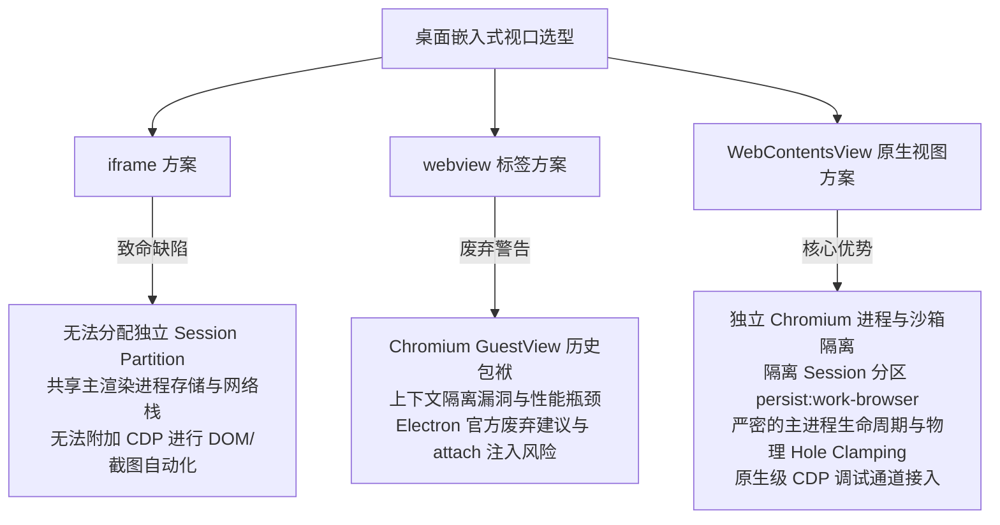
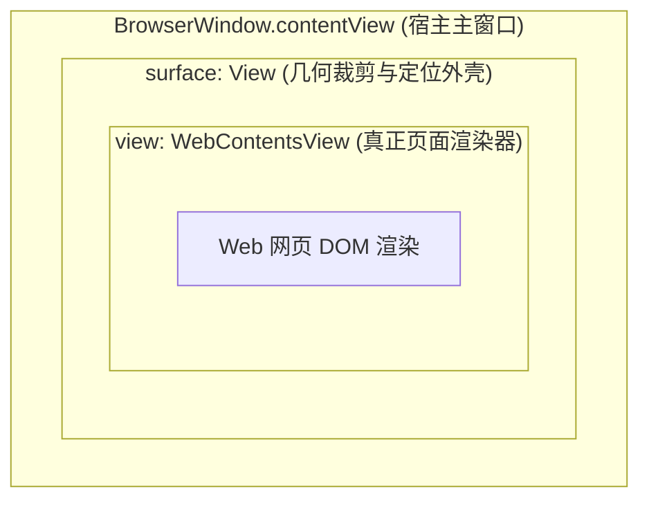
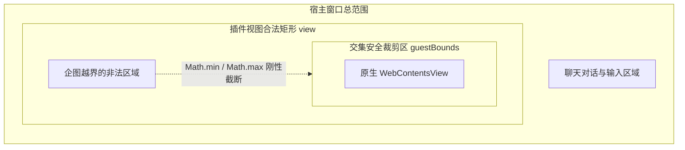
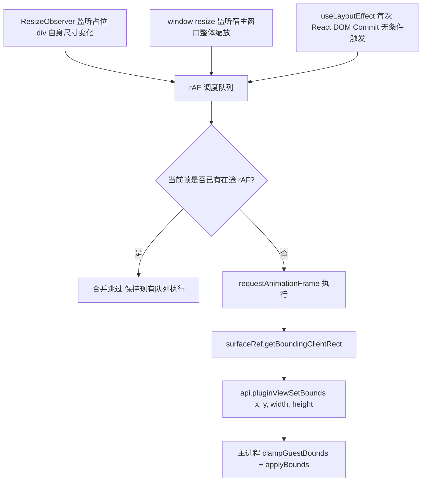
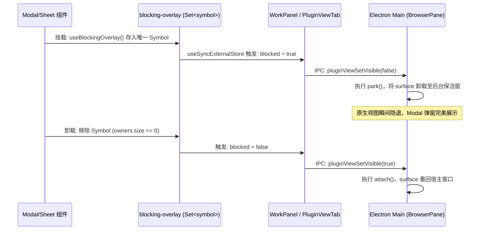
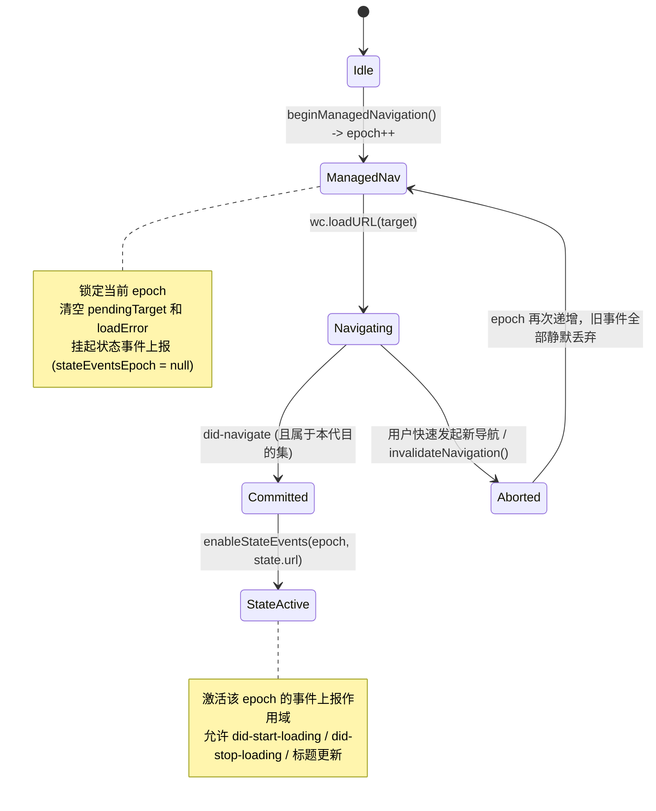
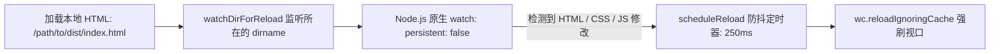
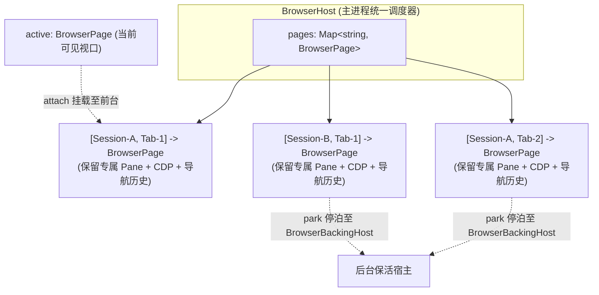

# pi-desktop 嵌入式原生浏览器（WebContentsView）架构拆解与精粹提取

> **文档定位**：战役调研与架构基准文档（Reference Architecture Analysis）  
> **研究对象**：`reference/pi-desktop` 原生浏览器子系统及其周边集成基础设施  
> **核心目标**：解构其基于 Electron `WebContentsView` 的现代原生视图集成方案，提炼几何同步、生命周期保活、浮层遮罩、导航时序锁与本地热重载的核心代码模式，为 Conex 原生浏览器改造提供高可靠、低缺陷的参考架构。

---

## 目录

1. [核心架构设计：Native View 选型与容器拓扑](#1-核心架构设计native-view-选型与容器拓扑)
   - 1.1 选型裁决：为什么坚决弃用 `<iframe>` 与 `<webview>`？
   - 1.2 双层容器架构：`surface: View` 与 `view: WebContentsView`
   - 1.3 边界安全裁剪：Hole Clamping 机制与沙箱防线
2. [几何同步与渲染生命周期](#2-几何同步与渲染生命周期)
   - 2.1 前端测量契约：`getBoundingClientRect` 与无损布局监听
   - 2.2 防抖与反饥饿调度：rAF 队列与 `useLayoutEffect` 的工程细节
   - 2.3 主进程几何渲染闭环与亚像素规整
3. [视图显隐与浮层遮罩策略（Overlay Blocking）](#3-视图显隐与浮层遮罩策略overlay-blocking)
   - 3.1 原生层叠冲突：Chromium 合成器层与 DOM 顶层矛盾
   - 3.2 引用计数遮罩体系：`blocking-overlay` 机制
   - 3.3 离屏后台保活：`BrowserBackingHost` 与无头窗口挂载
4. [导航控制与状态同步体系](#4-导航控制与状态同步体系)
   - 4.1 异步竞态防线：`navigationEpoch` 时序锁与事件作用域
   - 4.2 拦截与外跳策略：`setWindowOpenHandler` 与权限全面阻断
   - 4.3 细粒度状态同步：从 Blink 导航到 React 地址栏
5. [本地文件安全与热重载机制（Live Reload）](#5-本地文件安全与热重载机制live-reload)
   - 5.1 本地路径双层校验与逃逸防护
   - 5.2 目录监听与防抖静默刷新
6. [多会话与多标签保留架构（Retained Pages）](#6-多会话与多标签保留架构retained-pages)
   - 6.1 Session-Scoped 页面实例池
   - 6.2 聚焦与 CDP 自动化隔离
7. [对 Conex 改造的架构启示与移植蓝图](#7-对-conex-改造的架构启示与移植蓝图)

---

## 1. 核心架构设计：Native View 选型与容器拓扑

### 1.1 选型裁决：为什么坚决弃用 `<iframe>` 与 `<webview>`？

在桌面客户端中嵌入第三方网页或富交互 Web 界面时，主流方案通常有三类：`<iframe>`、`<webview>` 标签以及现代原生的 `WebContentsView`（或旧版的 `BrowserView`）。`pi-desktop` 在决策日志 **D100**、**D333** 以及 **ADR 0019**、**ADR 0104**、**ADR 0170** 中，经过严密论证全面倒向了 `WebContentsView`。



#### 1.1.1 淘汰 `<iframe>` 的根本原因（ADR 0104 §Alternatives）
1. **会话分区穿透风险**：Electron 无法为 `<iframe>` 分配独立的 `partition`。所有 iframe 均运行在宿主渲染进程的上下文和存储沙箱中，共享主窗口的 Cookies、LocalStorage、IndexedDB 和网络出口。
2. **安全策略失控**：无法施加严格的进程级沙箱及 `net.domains` 外部域名过滤。一旦加载包含不可信脚本的任意页面，主界面的凭据与内存状态将完全暴露。
3. **缺少调试与自动化接口**：宿主无法对一个同源或跨源的 iframe 精准附加 Chrome DevTools Protocol（CDP）会话，导致自动化 Agent 无法获取稳定的无损 AXTree、无法执行沙盒隔离的 `evaluate`、无法在不干扰主 UI 的情况下捕捉页面截图。

#### 1.1.2 淘汰 `<webview>` 标签的根本原因（01-security.md）
1. **Chromium 废弃历史包袱**：`<webview>` 底层依赖 Chromium 早期的 Chrome Apps `GuestView` 架构。在现代 Chromium OOPIF（Out-Of-Process Iframes）全面推行后，GuestView 维护成本极高，存在未修补的上下文隔离边缘边界。
2. **全局刚性封杀**：在 `pi-desktop` 的安全基线 `01-security.md` 中，主进程启动阶段通过 `app.on("web-contents-created")` 全局拦截所有 `<webview>` 的附加请求，直接销毁并抛错，避免任何组件滥用该标签：
   ```typescript
   // 核心安全原则：全仓禁止 webviewTag
   webPreferences: {
     webviewTag: false
   }
   ```

#### 1.1.3 选择 `WebContentsView` 的决定性理由
- **原生多进程隔离**：`WebContentsView` 由 Electron 主进程直接创建并持有，每个视口拥有完全独立的 OS 级 Chromium 渲染进程；
- **独立的会话命名空间**：通过指定 `partition: "persist:work-browser"`，彻底切断与宿主应用（及插件系统其他面板）的存储和 Cookie 共享；
- **底层 CDP 直接绑定**：主进程可以通过 `webContents.debugger.attach("1.3")` 直接对接 Chromium 的调试协议，无需任何网络 WebSocket 代理即可对页面进行无损分析与控制。

---

### 1.2 双层容器架构：`surface: View` 与 `view: WebContentsView`

在 `reference/pi-desktop/apps/desktop/electron/main/browser-view.ts` 中，`BrowserPane` 的实现揭示了一个极其优雅且深思熟虑的**双层原生视图容器拓扑**：



#### 源码还原（`browser-view.ts:486-503`）
```typescript
private ensureView(): WebContentsView {
  if (this.view && this.getWebContents()) return this.view;
  this.detach();
  if (this.view) this.surface?.removeChildView(this.view);

  // 1. 创建底层真实的 WebContentsView
  const view = new WebContentsView({
    webPreferences: {
      sandbox: true,
      contextIsolation: true,
      nodeIntegration: false,
      backgroundThrottling: true,
      partition: PARTITION, // "persist:work-browser"
    },
  });

  // 2. 创建中介容器 View 作为表现层表面 (Presentation Surface)
  const surface = new View();
  surface.addChildView(view);
  surface.setVisible(this.visible);
  surface.setBounds(this.bounds);
  this.surface = surface;

  // ... 绑定安全与导航监听器
  this.view = view;
  if (this.visible) this.attach();
  else this.park();
  return view;
}
```

#### 为什么必须采用双层 `surface -> view` 设计？
1. **解耦全局窗口绝对坐标与视口内部相对布局**：
   - 外层 `surface` 响应主窗口的全局绝对物理位置：`surface.setBounds(this.bounds)`。
   - 内层 `view` 始终以 `(0, 0)` 为原点充满 `surface`：`view.setBounds({ x: 0, y: 0, width: bounds.width, height: bounds.height })`。
   - 彻底避免了 Chromium 在处理嵌套多级偏移时的亚像素浮点坐标累计误差。
2. **支持“视口锁定截图”（Viewport Pinning）而不产生界面撕裂**：
   在自动化截屏（`captureScreenshot`）或特定 CDP 操作期间，页面需要临时冻结渲染尺寸或锁定视口以获得稳定截图。此时主进程设置 `viewportPinned = true`：
   ```typescript
   private applyBounds(): void {
     // 即使 Chromium 锁定了截图视口尺寸，外层 surface 仍可随窗口移动和被裁剪
     if (this.visible) this.surface?.setBounds(this.bounds);
     if (this.view && this.visible && !this.viewportPinned && this.getWebContents()) {
       this.view.setBounds({ x: 0, y: 0, width: this.bounds.width, height: this.bounds.height });
     }
   }
   ```
   **效果**：当用户在截屏瞬间拖动主窗口或调整面板宽度时，`surface` 立即发生硬件级裁剪，内层 `view` 即使处于尺寸锁定状态，其超出部分也会被原生裁剪，绝不会溢出并盖在主聊天的输入框或侧边栏之上。
3. **零开销的跨窗口迁移（Reparenting）**：
   当视图在“主前台窗口”和“后台隐藏保活窗口（`BrowserBackingHost`）”之间迁移时，只需对中介 `surface` 执行 `removeChildView` / `addChildView`，**完全无需销毁或重建内部昂贵的 `WebContentsView`**，保留了一切 DOM 树、WebGL 上下文、视频解码管道和滚动偏移量。

---

### 1.3 边界安全裁剪：Hole Clamping 机制与沙箱防线

在插件化工作面板（`ADR 0170`）中，浏览器不仅是一个独立组件，还可以作为随应用打包的插件（`pi.browser`）运行。为了杜绝第三方或受损插件通过伪造边界覆盖聊天界面，`browser-host.ts` 设计了刚性的 **Hole Clamping** 几何交集算法。

#### 数学交集计算（`browser-host.ts:31-48`）
```typescript
export function clampGuestBounds(
  view: BrowserRect,  // 宿主分配给插件视口的全局几何矩形
  hole: BrowserRect,  // 插件前端 DOM 上报的自身内部留白矩形
): BrowserRect | null {
  const x = Math.max(view.x, view.x + hole.x);
  const y = Math.max(view.y, view.y + hole.y);
  const right = Math.min(view.x + view.width, view.x + hole.x + hole.width);
  const bottom = Math.min(view.y + view.height, view.y + hole.y + hole.height);
  const width = Math.floor(right - x);
  const height = Math.floor(bottom - y);
  
  if (width < 1 || height < 1) return null;
  return {
    x: Math.floor(x),
    y: Math.floor(y),
    width,
    height,
  };
}
```



**安全保证**：主进程是最终的几何裁决者。无论前端上报的 hole 坐标如何恶意或错乱，原生视图都绝对无法突破 `view` 的物理范围，从根源上杜绝了利用透明遮罩或越界覆盖劫持主界面点击事件（Clickjacking）的可能。

---

## 2. 几何同步与渲染生命周期

### 2.1 前端测量契约：`getBoundingClientRect` 与无损布局监听

在前端 React 树中，原生视口处只是一个空 `div` 占位符（`PluginViewTab.tsx:132`）：
```tsx
return (
  <div className="work-plugin-view">
    <div ref={surfaceRef} className="work-plugin-view-surface" />
  </div>
);
```

前端如何保证在所有窗口调整、侧边栏折叠、Flex 弹性分配以及 CSS Transform 变换下，都能精准将坐标传递给底层原生视口？`pi-desktop` 采用了一套三维一体的监听网络：



---

### 2.2 防抖与反饥饿调度：rAF 队列与 `useLayoutEffect` 的工程细节

仔细阅读 `PluginViewTab.tsx:44-67`，可以看到极其老练的前端性能防御设计：

```typescript
const boundsFrameRef = useRef(0);

const reportBounds = useCallback(() => {
  // 核心反饥饿逻辑：若当前帧已挂起排队，则直接退出，绝不重新排队
  if (boundsFrameRef.current) return;
  
  boundsFrameRef.current = requestAnimationFrame(() => {
    boundsFrameRef.current = 0;
    const surface = surfaceRef.current;
    if (!surface || failed) return;
    const rect = surface.getBoundingClientRect();
    void api.pluginViewSetBounds({
      x: rect.x,
      y: rect.y,
      width: rect.width,
      height: rect.height,
    });
  });
}, [failed]);

// 为什么不用普通的 useEffect？
// ResizeObserver 不捕获由祖先布局或 Transform 导致的“纯位置移动”！
// 每一个 React layout commit 都在绘制前同步触发最终矩形复核。
useLayoutEffect(() => {
  reportBounds();
});
```

#### 关键技术内幕
1. **反饥饿模式（Anti-Starvation）**：
   常见的防抖常使用 `cancelAnimationFrame(timer)` 并重新设置新的 rAF。但在快速拖拽窗口分界线或持续的高频 React 状态更新中，**连续的 cancelAnimationFrame 会导致 rAF 回调永远无法被调度执行**，产生极为严重的卡顿迟滞（IPC Starvation）。  
   `pi-desktop` 的做法是：只要当前帧已经有了一个待执行的 rAF，就保留它。下一帧它被执行时，`surface.getBoundingClientRect()` 读到的自然就是那个时间点的最新物理 DOM 矩形！
2. **为什么需要无依赖项的 `useLayoutEffect`？**
   `ResizeObserver` 只能感知目标元素**自身宽高**的变化。如果父容器发生 `transform: translateX(...)`，或者侧边栏折叠导致整个工作区向左平移，占位 DOM 自身的 `width` 和 `height` 可能完全未变，`ResizeObserver` 会**完全静默**！唯有在每次 React Commit 阶段通过 `useLayoutEffect` 驱动检测，才能捕捉到纯位置（Position-Only）的位移。

---

### 2.3 主进程几何渲染闭环与亚像素规整

当坐标传递至主进程 `BrowserPane.setBounds`（`browser-view.ts:346-355`）时：
```typescript
setBounds(bounds: { x: number; y: number; width: number; height: number }): void {
  const safe = {
    x: Math.max(0, Math.round(Number(bounds.x) || 0)),
    y: Math.max(0, Math.round(Number(bounds.y) || 0)),
    width: Math.max(0, Math.round(Number(bounds.width) || 0)),
    height: Math.max(0, Math.round(Number(bounds.height) || 0)),
  };
  this.bounds = safe;
  this.applyBounds();
}
```
- **亚像素四舍五入（`Math.round`）**：Chromium 的 DOM 测量会返回高精度浮点数（例如 `320.45px`）。如果直接将浮点数传给原生窗口系统（Windows DirectComposition 或 macOS CoreAnimation），会产生亚像素采样模糊甚至边缘 1px 细线闪烁。主进程通过强制取整彻底规整坐标。
- **下限防护（`Math.max(0, ...)`）**：确保宽、高、坐标永不为负数，防止操作系统窗口底层 API 崩溃。

---

## 3. 视图显隐与浮层遮罩策略（Overlay Blocking）

### 3.1 原生层叠冲突：Chromium 合成器层与 DOM 顶层矛盾

在混合渲染桌面端架构中，**原生图层（Platform View）永远置顶**是 Chromium 架构的底层物理限制：

```
+--------------------------------------------------------+
| 操作系统窗口硬件渲染树 (Compositor Surface)            |
|                                                        |
|   [Native WebContentsView / Surface]  <-- 永远在最顶层  |
|          ^                                             |
|          | (物理遮挡，无法被任何 HTML 元素覆盖)         |
|          |                                             |
|   [Host HTML 渲染进程 DOM]                             |
|       ├── Modal Dialog (<dialog> 顶层)                 |
|       ├── Command Palette 命令面板                     |
|       ├── Settings Sheet 设置滑窗                      |
|       └── Toast 消息通知                               |
+--------------------------------------------------------+
```

即便前端将弹窗的 CSS 设置为 `z-index: 2147483647`，或者使用 HTML5 的 Top-Layer 原生 `<dialog>`，只要原生 `WebContentsView` 挂载在同一个区域，弹窗就会被原生网页无情遮盖，出现恶性穿透（Bleed-through）。

---

### 3.2 引用计数遮罩体系：`blocking-overlay` 机制

为了优雅、彻底地解决这一问题，`pi-desktop` 在渲染进程设计了精简而强韧的**全局遮罩引用计数器**：`reference/pi-desktop/apps/desktop/src/lib/blocking-overlay.ts`。

#### 全文源码实现（25 行精髓）
```typescript
import { useLayoutEffect, useSyncExternalStore } from "react";

// Native plugin views composite above the renderer, including its top layer.
// Count owners so dismissing one overlay cannot reveal a view under another.
const owners = new Set<symbol>();
const listeners = new Set<() => void>();
const notify = () => { for (const listener of listeners) listener(); };
const subscribe = (listener: () => void) => {
  listeners.add(listener);
  return () => { listeners.delete(listener); };
};
export const isBlockingOverlayActive = () => owners.size > 0;

export function useBlockingOverlay() {
  useLayoutEffect(() => {
    const owner = Symbol();
    owners.add(owner);
    notify();
    return () => { owners.delete(owner); notify(); };
  }, []);
}

export function useBlockingOverlayActive() {
  return useSyncExternalStore(subscribe, isBlockingOverlayActive, () => false);
}
```



#### 设计深度拆解
1. **`Set<symbol>` 引用计数**：
   桌面应用中极常出现“弹窗之上再开弹窗”的场景（例如设置面板中点击删除弹出生效确认框，或者在命令面板唤醒时出现 Toast）。如果使用简单的布尔值 `isBlocked = true/false`，当内层弹窗销毁时就会误将全局遮罩解除，导致原生视口瞬间穿透！通过注册唯一的 `Symbol()` 并统计集合大小（`owners.size > 0`），只有当最后一个浮层被完全关闭时，原生视口才会恢复可见。
2. **`useSyncExternalStore` 响应式接入**：
   原生订阅模式接入 React 18 并发渲染模型，零闪烁、零撕裂。
3. **前端消费端收敛**：
   在 `WorkPanel.tsx:1092` 中：
   ```tsx
   blocked={exiting || panelBlocked || blockingOverlayActive}
   ```
   只要面板处于退场动画中、处于拖拽调整大小状态、或者全局存在阻塞浮层，`blocked` 均为 `true`，指令直达原生层。

---

### 3.3 离屏后台保活：`BrowserBackingHost` 与无头窗口挂载

当原生视图被设置为不可见（`visible = false`）时，最简单直接的做法是将它从宿主窗口彻底移除（`removeChildView`）。**但这种做法在 AI 智能桌面中存在致命缺陷**：
- 当用户打开了设置弹窗（触发遮罩）或者切换了面板标签时，后台运行的 AI Agent 仍然需要通过 CDP 截取网页快照、抓取 AXTree、分析 DOM 或者执行无感表单填充。
- 如果将 `WebContentsView` 悬空脱离任何窗口，Chromium 会立即暂停其帧生成调度管道，页面时钟降频，CDP 的 `Page.captureScreenshot` 往往直接超时或返回纯黑/纯白画面。

为此，`pi-desktop` 实现了独创的 **后台离屏保活宿主**：`reference/pi-desktop/apps/desktop/electron/main/browser-backing-host.ts`。

```typescript
export class BrowserBackingHost {
  private window: BrowserWindow | null = null;
  private readonly surfaces = new Set<View>();

  attach(surface: View, size: { width: number; height: number }): BrowserWindow {
    let window = this.window;
    if (!window || window.isDestroyed()) {
      // 创建隐形原生窗口，禁止截断后台 Chromium 渲染
      window = new BrowserWindow({
        show: false,
        skipTaskbar: true,
        width: Math.max(1024, size.width),
        height: Math.max(768, size.height),
        webPreferences: {
          sandbox: true,
          contextIsolation: true,
          nodeIntegration: false,
          backgroundThrottling: false, // 禁用后台节流，保证渲染管道活跃
        },
      });
      this.window = window;
    }
    const [width, height] = window.getContentSize();
    if (width < size.width || height < size.height) {
      window.setContentSize(Math.max(width, size.width), Math.max(height, size.height));
    }
    if (!window.contentView.children.includes(surface)) {
      window.contentView.addChildView(surface);
    }
    this.surfaces.add(surface);
    return window;
  }

  detach(surface: View): void {
    const window = this.window;
    if (window && !window.isDestroyed() && window.contentView.children.includes(surface)) {
      window.contentView.removeChildView(surface);
    }
    this.surfaces.delete(surface);
    // 当没有任何被暂存的后台页面时，彻底释放该隐形窗口
    if (this.surfaces.size === 0) {
      this.window = null;
      if (window && !window.isDestroyed()) window.destroy();
    }
  }
}
```

#### `BrowserPane` 的停泊逻辑（`browser-view.ts:420-431`）
```typescript
/** A hidden native host keeps Chromium input/capture independent of the UI. */
private park(): void {
  if (!this.surface || !this.view || !this.getWebContents()) return;
  if (this.attachedWindow && this.attachedWindow !== this.window && !this.attachedWindow.isDestroyed()) return;
  this.detach(); // 从宿主主窗口移除
  const bounds = this.view.getBounds();
  const size = { width: bounds.width || 1024, height: bounds.height || 768 };
  if (!bounds.width || !bounds.height) this.view.setBounds({ x: 0, y: 0, ...size });
  this.surface.setBounds({ x: 0, y: 0, ...size });
  this.surface.setVisible(true);
  this.view.setVisible(true);
  // 无缝停靠到后台保活宿主上
  this.attachedWindow = this.backingHost.attach(this.surface, size);
}
```

**架构价值**：
1. **背景活跃不掉帧**：`backgroundThrottling: false` 保证即使脱离前台视线，Chromium 仍然正常执行 CSS 动画渲染、页面布局和 JS 定时器。
2. **CDP 截屏与操作高保真**：由于始终挂载在一个有效尺寸的 `BrowserWindow` 上，底层的 DirectComposition / Compositor 渲染管道持续工作，Agent 随时能够获得高分辨率物理截图。
3. **零垃圾无感销毁**：全自动化引用释放。只要某个视口重返前台或彻底关闭，当计数降为 0 时，离屏窗口被直接 `destroy()`，零常驻显存开销。

---

## 4. 导航控制与状态同步体系

### 4.1 异步竞态防线：`navigationEpoch` 时序锁与事件作用域

在复杂的网络与用户交互中，导航事件常常存在竞态条件：
- 用户在地址栏连续输入不同的 URL；
- 用户在前一个页面尚未完成加载时迅速切换了 Session 或重新发起了新的搜索；
- 单页应用客户端路由触发的 `did-navigate-in-page` 与异步网络请求相互穿插。

如果简单地直接在 `webContents.on("did-navigate")` 中把 URL 广播给前端，旧请求的延迟返回会导致当前正在查看的页面 URL 被前一个页面的晚到事件覆盖（幽灵跳转与状态污染）。

`BrowserPane` 设立了极度严谨的 **代数时序锁机制（Navigation Epoch）**：



#### 关键源码剖析（`browser-view.ts:579-612`）
```typescript
private beginManagedNavigation(): number {
  this.cancelPending?.();
  this.cancelPending = null;
  this.pendingTarget = null;
  this.loadError = null;
  const epoch = ++this.navigationEpoch; // 单调递增代数
  this.stateEventsEpoch = null;         // 封锁事件派发
  this.stateUrl = null;
  this.nativeNavigationPending = false;
  return epoch;
}

private enableStateEvents(epoch: number, url: string): void {
  // 必须严格与当前活跃 epoch 一致才开闸
  if (epoch !== this.navigationEpoch) return;
  this.stateEventsEpoch = epoch;
  this.stateUrl = url;
  this.nativeNavigationPending = false;
}

private hasCurrentStateEventScope(): boolean {
  return this.stateEventsEpoch === this.navigationEpoch && this.stateUrl !== null;
}
```

#### 原生点击与用户自主导航的甄别（`acceptNativeNavigation`）
如果用户点击了网页内的 `<a href="...">` 链接，该导航没有走宿主地址栏的 `navigateAndWait()`，如何防范它被误判？
1. 在 `wc.on("will-navigate")` 中，校验目标为安全 URL 后，标记 `this.nativeNavigationPending = this.hasCurrentStateEventScope();`。
2. 在 `did-navigate` 中调用 `this.acceptNativeNavigation(url)`：
   ```typescript
   private acceptNativeNavigation(url: string): boolean {
     if (!this.hasCurrentStateEventScope()) return false;
     if (url === this.stateUrl) {
       this.nativeNavigationPending = false;
       return true;
     }
     if (!this.nativeNavigationPending) return false;
     this.stateUrl = url;
     this.nativeNavigationPending = false;
     return true;
   }
   ```
   **效果**：完美将合法的主动在页点击纳入当前管理作用域，同时拦截所有来自旧已销毁 session 的迟滞事件。

---

### 4.2 拦截与外跳策略：`setWindowOpenHandler` 与权限全面阻断

嵌入式浏览器加载的是任意第三方或本地 Web 内容，必须施加固若金汤的边界防御：

```typescript
// 1. 弹窗全面接管：禁止内嵌打开新窗口
wc.setWindowOpenHandler(({ url }) => {
  const allowed = parseAllowedExternalUrl(url);
  if (allowed) {
    if (this.onOpenUrl) this.onOpenUrl(allowed);
    else void shell.openExternal(allowed); // 安全外跳系统默认浏览器
  }
  return { action: "deny" }; // 一票否决应用内原生窗口创建
});

// 2. 权限请求全面静默拒绝
wc.session.setPermissionRequestHandler((_wc, _permission, callback) => {
  callback(false); // 拒绝摄像头、麦克风、地理位置、系统通知等一切硬件权限
});

// 3. 导航方案校验 (Scheme Allowlist)
wc.on("will-navigate", (event, url) => {
  if (isAllowedHttpUrl(url)) {
    this.nativeNavigationPending = this.hasCurrentStateEventScope();
    return;
  }
  if (/^file:/i.test(url) && this.isAllowedFileUrl(url)) {
    this.nativeNavigationPending = this.hasCurrentStateEventScope();
    return;
  }
  // 严禁 javascript: / data: / blob: / 外部协议等注入跳转
  event.preventDefault();
});
```

- **外链安全白名单（`parseAllowedExternalUrl`）**：严格限制只允许标准化的 `http:`、`https:` 和 `mailto:` 协议。绝对禁止 `file:`、`cmd:` 或自定义协议唤醒 OS 外部程序，防止操作系统级命令注入漏洞。

---

### 4.3 细粒度状态同步：从 Blink 导航到 React 地址栏

浏览器地址栏需要实时反映真实的导航状态（前进/后退可用性、加载中 Spinner、标题、错误信息）：

```typescript
getState(): BrowserState | null {
  const wc = this.view?.webContents;
  if (!wc || wc.isDestroyed()) {
    return this.loadError ? {
      url: this.loadError.url,
      title: "",
      isLoading: false,
      loadError: this.loadError.message,
      canGoBack: false,
      canGoForward: false,
    } : null;
  }
  return {
    url: this.loadError?.url ?? this.pendingTarget ?? wc.getURL(),
    title: wc.getTitle(),
    isLoading: !this.loadError && (this.pendingTarget !== null || wc.isLoading()),
    ...(this.loadError ? { loadError: this.loadError.message } : {}),
    canGoBack: wc.navigationHistory.canGoBack(),
    canGoForward: wc.navigationHistory.canGoForward(),
  };
}
```

针对单页应用（SPA）的历史堆栈跳动（如 React Router `history.pushState`），监听 `did-navigate-in-page` 并进行三元组身份核实（`isMainFrame`、`processId`、`routingId`），防止 iframe 内部路由切换篡改宿主地址栏：
```typescript
wc.on("did-navigate-in-page", (_event, url, isMainFrame, processId, routingId) => {
  if (
    !isMainFrame ||
    !this.hasCurrentStateEventScope() ||
    url !== wc.getURL() ||
    processId !== wc.mainFrame.processId ||
    routingId !== wc.mainFrame.routingId
  ) return;
  this.enableStateEvents(this.navigationEpoch, url);
  push();
});
```

---

## 5. 本地文件安全与热重载机制（Live Reload）

在现代 AI Agent 与开发者工作流中，嵌入式浏览器不仅用于浏览公网 Web，还承担着本地 HTML/前端产物的实时预览职责（`ADR 0328`）。

### 5.1 本地路径双层校验与逃逸防护

`browser-view.ts` 将本地文件访问划分为了两级互锁机制：

```typescript
// 1. Agent 工具专用的工作区强约束（严格限定在项目根目录内）
export function resolveLocalFile(raw: string, root: string | null): string | null {
  // 必须严格保证 realPath === realRoot 或位于 realRoot 子树下（符号链接逃逸防御）
  if (!isWithinRoot(candidate, root)) return null;
  const real = resolveExistingFile(candidate);
  return real && isWithinRoot(real, root) ? real : null;
}

// 2. 用户浏览器专用的安全增强解析（ADR 0328）
function resolveBrowserLocalFile(raw: string, root: string | null): string | null {
  // 支持用户主动键入绝对路径或 file:// 打开本机任意文件
  if (/^file:/i.test(trimmed)) {
    const candidate = fileUrlToLocalPath(trimmed);
    return candidate ? resolveExistingFile(candidate) : null;
  }
  if (isAbsolute(trimmed)) return resolveExistingFile(trimmed);
  // 相对路径依然强制锚定在当前工作区内
  return resolveLocalFile(trimmed, root);
}
```

#### 跨源逃逸阻断（`isAllowedFileUrl`）
```typescript
private isAllowedFileUrl(url: string): boolean {
  const localPath = resolveBrowserLocalFile(url, this.fileRoot);
  if (!localPath) return false;
  if (this.fileRoot && isWithinRoot(localPath, this.fileRoot)) return true;
  // 关键防线：普通 Web 页面不能跨源跳入系统核心本地文件！
  // 只有当前页面自身已经是 file: 协议时，才允许跟随链接访问其他本地文件
  return this.view?.webContents.getURL().startsWith("file:") === true;
}
```

---

### 5.2 目录监听与防抖静默刷新

当用户在本地编辑前端 HTML/CSS 代码时，浏览器需要支持自动无损刷新（Live Reload）：



#### 源码还原（`browser-view.ts:444-465`）
```typescript
private watchDirForReload(dir: string): void {
  if (this.watcher && this.watchedDir === dir) return;
  this.clearLiveReload();
  try {
    // 监听整个父级目录，以便同级 CSS、JS 资源的变动同样触发预览刷新
    this.watcher = watch(dir, { persistent: false }, () => this.scheduleReload());
    this.watchedDir = dir;
  } catch {
    this.watcher = null;
    this.watchedDir = null;
  }
}

private scheduleReload(): void {
  if (this.reloadTimer) clearTimeout(this.reloadTimer);
  this.reloadTimer = setTimeout(() => {
    this.reloadTimer = null;
    const wc = this.view?.webContents;
    if (wc && !wc.isDestroyed() && wc.getURL().startsWith("file:")) {
      wc.reloadIgnoringCache(); // 强制跳过缓存刷新，呈现最新磁盘产物
    }
  }, LIVE_RELOAD_DEBOUNCE_MS); // 250ms 优雅防抖
}
```
- **`persistent: false` 的妙用**：避免 `fs.watch` 持久占用 Node 事件循环导致进程无法正常退出；
- 只要用户导航离开本地文件页面（例如跳入 `http://...`），系统在 `navigateAndWait` 中无条件触发 `clearLiveReload()`，完全释放文件描述符与定时器。

---

## 6. 多会话与多标签保留架构（Retained Pages）

在 `pi-desktop` 早期的设计中，浏览器只是一个单例页面；但在实际体验中，用户切换聊天会话、或者打开多个预览标签时，单例会导致上一个会话的表单输入、网页浏览进度全部丢失。

`browser-host.ts` 实现了 **Retained Host-Owned Browser Pages** 机制（`ADR 0170 §Clause 6`）：



### 核心管理机制
1. **复合键持久存储**：
   `key = JSON.stringify([sessionId, tabId])`。每个活跃的工作面板标签均拥有独立的 `BrowserPage` 结构体，内部持有独享的 `BrowserPane` 和 `BrowserCdp`。
2. **瞬时切换无需重载**：
   当用户在前端切换 Tab 或会话时，`setChromeSession` 仅需：
   ```typescript
   this.active?.pane.setVisible(false); // 旧视口停靠至后台
   this.active = page;
   this.applyGuest();                  // 新视口直接重绘显示
   ```
   没有任何白屏等待与网络重载，由于内存中始终保持着完整的 DOM 树与滚动状态，切换体验极其顺滑。
3. **精准会话生命周期绑定**：
   当某个 Session 被用户销毁时，`closeSession(sessionId)` 遍历清理该会话名下的所有保留页，调用 `cdp.detach()` 和 `pane.dispose()`，确保显存和渲染进程净收敛。

---

## 7. 对 Conex 改造的架构启示与移植蓝图

Conex 采用 **Rust 内核（`crates/`）+ Tauri 壳 + React 前端** 的架构体系。`pi-desktop` 在 Electron 中的成熟经验，为 Conex 的原生嵌入式浏览器改造提供了高价值的设计蓝本。

| 架构维度 | `pi-desktop` (Electron 实现) | Conex 改造移植蓝图 (Tauri / Rust / WebView2) |
| :--- | :--- | :--- |
| **底层视口选型** | `WebContentsView` | Windows 平台采用 **WebView2 CoreCompositionController** 或跨平台 Tauri Child Window (`WebviewWindowBuilder`) |
| **容器拓扑** | `surface: View` -> `view: WebContentsView` | Rust 端构建双层托管结构：外层用于跟随宿主布局裁剪，内层承载真实页面，避免亚像素形变 |
| **几何测量与上报** | React 占位 div + `useLayoutEffect` + rAF 去抖 | **完全照搬** `PluginViewTab` 的反饥饿 rAF 队列与 `getBoundingClientRect` 模式，通过 Tauri IPC 传递 |
| **层叠与浮层遮罩** | `blocking-overlay.ts` 全局 `Set<symbol>` 引用计数 | **完全照搬** `useBlockingOverlay()` 前端模型，当浮层开启时，通过 Rust 侧将 WebView2 临时隐藏或位移 |
| **后台保活调度** | `BrowserBackingHost` (无头隐藏窗口挂载) | Rust 侧保留非活动状态的 WebView 控制器实例，保证后台 Agent 抓取 DOM / 自动化截图时不被系统节流挂死 |
| **导航防竞态** | `navigationEpoch` 单调递增代数锁 | Rust 内核在会话与导航控制器中维护单调自增递增代数，对迟滞的页面提交事件实施拦截过滤 |
| **本地开发热重载** | Node.js `fs.watch` + 250ms 防抖静默强刷 | 结合 Rust 侧 `notify` crate 监听本地预览文件目录，触发 WebView 缓存绕过重载 |

---

## 8. 总结

`pi-desktop` 的嵌入式原生浏览器设计展现了极高的工程严谨性。它不仅在安全层面坚决舍弃了具有潜在隐患的 `<iframe>` 与 `<webview>`，还在原生混合渲染这一传统难题上，通过 **双层表面架构（Surface/View）**、**物理几何交集裁剪（Hole Clamping）**、**无饥饿 rAF 前端测量**、**引用计数浮层遮罩（Overlay Blocking）** 以及 **离屏无头保活宿主（BrowserBackingHost）**，构建了一套滴水不漏的工程闭环。

这一整套成熟模式，为 Conex 在推进原生浏览器重构时提供了坚实的理论支撑与经过生产验证的代码典范。
