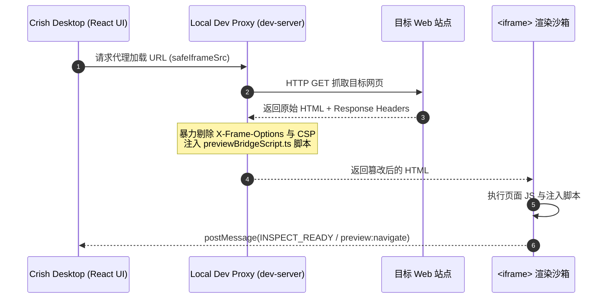
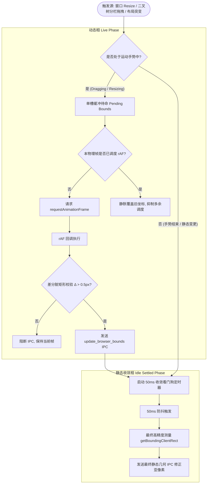
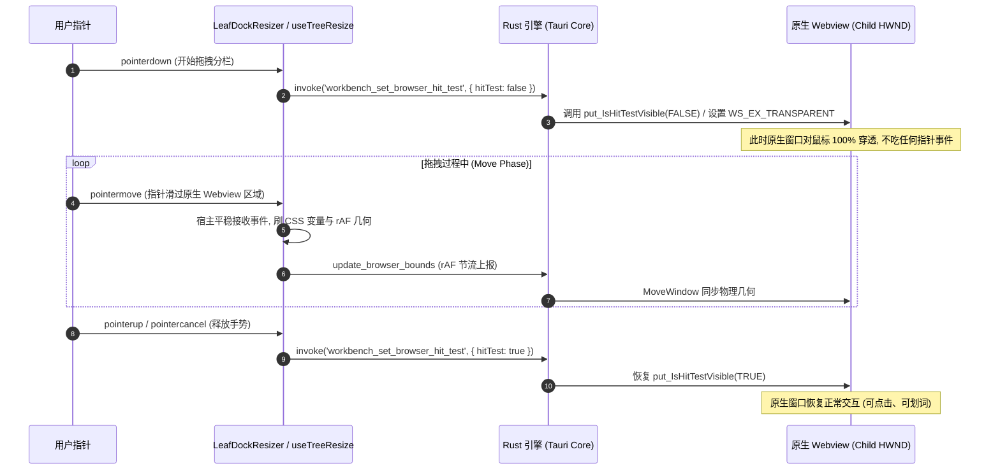
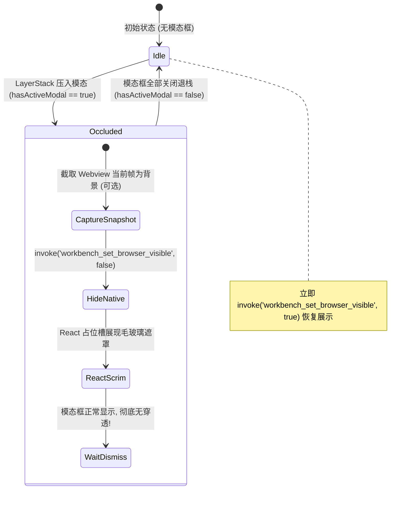

# 前端布局引擎与原生视口几何同步架构分析 (Frontend Layout & Native Surface Geometry Sync)

> **战役工作区**：`docs/native-browser-overhaul/`
> **文档定位**：分析阶段（Analysis）专项报告 03
> **核心目标**：解构当前基于 `<iframe>` 与本地代理注入的前端预览体系，设计全新的无内容占位容器（`NativeBrowserSurface`）与几何同步架构；彻底解决多分屏拖拽调宽、标签切换、多浏览器实例管理以及全局模态浮层（Airspace 穿透遮挡）等复杂交互场景下的系统性架构断层。

---

## 一、现状解构：Iframe 代理内嵌机制的系统性瓶颈

### 1.1 现有 `PreviewCard.tsx` 的架构实现与执行路径

在现有桌面端代码库中，`PreviewCard.tsx`（461 行）承担了“Web 应用预览”与“内置浏览器”的双重职责。其核心骨架如下：

```tsx
// PreviewCard.tsx:435-447 (简化示意)
<iframe
  ref={iframeRef}
  key={activeUrl}
  aria-label="预览页面"
  src={frameSrc ?? undefined}
  className={styles.iframe}
  sandbox="allow-scripts allow-same-origin allow-forms allow-popups allow-modals"
  referrerPolicy="no-referrer"
  loading="lazy"
  onLoad={handleFrameLoad}
  onError={nav.onFrameError}
/>
```

其底层导航链路依赖 `usePreviewNavigation.ts`（404 行），通过 `safeIframeSrc(activeUrl)` 将外部站点流量重定向至内置开发代理服务器（`dev-server`）。外部站点加载时，代理服务器强行剥离 HTTP 响应头中的 `X-Frame-Options` (XFO) 与 `Content-Security-Policy` (CSP)，并在 HTML 文本中注入客户端桥接脚本 `previewBridgeScript.ts`。

宿主与内嵌页面之间通过 W3C `window.postMessage` 实现双向通信（`CRISH_PREVIEW_HOST_SOURCE` 与 `CRISH_PREVIEW_INSPECTOR_SOURCE`），支撑 DOM 元素拾取、高亮（`INSPECT_HOVER` / `INSPECT_SELECT`）以及内部链接点击回传（`preview:navigate`）。



---

### 1.2 代理注入机制（Proxy Injection Bridge）的硬性技术缺陷

通过本地代理暴力重写 HTML 并内嵌在 `<iframe>` 中，存在不可调和的底层局限：

1. **复杂现代站点渲染全面崩溃**：
   - **OAuth / SSO 跨域联合登录失效**：Google、GitHub、Microsoft 等各大厂商的 OAuth 登录流程严格校验 `SameSite=Lax/Strict` Cookie 与 Sec-Fetch 元数据。在 iframe 中，第三方 Cookie 策略导致登录重定向无限循环或直接触发安全风控拦截（Bot Detection）。
   - **安全策略对抗（COOP / COEP / CSP-pinning）**：现代前端应用大量使用 `Cross-Origin-Opener-Policy` 与 `Cross-Origin-Embedder-Policy`。即便代理剥离了顶层头，页面引用的外部 CDN 脚本、WebAssembly 或 WebGPU/SharedArrayBuffer 资源依然会触发跨源策略拒绝。
   - **ServiceWorker 与缓存错乱**：通过代理服务器中转的站点，其 Origin 被替换为 `http://127.0.0.1:端口`，直接污染宿主本地存储（IndexedDB、CacheStorage、LocalStorage），不同预览站点间存在同源冲突与数据泄露隐患。

2. **主进程事件循环竞争与掉帧（Jank）**：
   - 现有的 `<iframe>` 与 Conex/Crish Desktop 的整个 React UI 运行在**同一个 WebView2 渲染进程**中。
   - 当目标预览站点执行重度 JavaScript 计算、大图重绘或发生内存泄漏时，React 侧的渲染帧率直接断崖式下跌，表现为输入法打字卡顿、二叉树拖拽撕裂、侧边栏展开迟滞。

3. **快捷键断层与事件黑洞**：
   - 当焦点落在 `<iframe>` 内部时，浏览器原生窗口事件被 iframe 深度截获。宿主全局快捷键（如 `Ctrl+K` 唤醒命令面板、`Ctrl+P` 快速查找、`Ctrl+W` 关闭标签）全部失灵，除非桥接脚本层层向上转发且没有发生异常。

4. **分屏拖拽粘手（Resizer Hijack）**：
   - 鼠标拖拽移动分栏滑块时，一旦光标掠过 `<iframe>` 区域，OS/浏览器会将 `pointermove` 吞入 iframe 内核，造成外层宿主丢失指针追踪。目前必须依赖 `disableIframePointerEvents()` 动态在全局插入 `<style>` 禁用所有 iframe 的 `pointer-events`，属于脆弱的全局补丁。

---

### 1.3 工具栏、浮层与内容区的过度耦合度剖析

现有 `PreviewCard.tsx` 不仅负责承载 `<iframe>`，还把以下子系统硬编码在同一组件树内：

- **`PreviewToolbar`**：前进、后退、刷新、主页、URL 地址输入框、书签按钮、历史切换按钮、外部打开、Inspector 拾取开关；
- **`PreviewHistoryPanel`**：历史与书签的下拉抽屉，使用绝对定位（`HIST_PANEL_ID`）；
- **`PreviewCardInspectorOverlay`**：高亮悬停元素选框的 React 覆盖层；
- **`PreviewStartPage`**：无 URL 时的本地服务端口发现卡片；
- **`usePreviewNavigation`**：导航栈逻辑、会话作用域事件处理。

**断层核心**：
如果直接引入操作系统原生 Webview（Tauri Child Webview / Win32 HWND），原生窗口是一块**独立的硬件渲染表面**，其绘制层叠上下文（Z-Order）脱离 Chromium DOM 树。若继续把 `PreviewHistoryPanel`、弹窗浮层或 Inspector Overlay 挂载在内容区容器内，原生 Webview 将会**硬性穿透（Punch Through）**遮挡所有 React DOM 浮层，导致下拉菜单被完全盖住无法点击。

因此，必须在架构层面执行**三权分立**：
1. **控制层（Chrome UI）**：地址栏、导航按钮、历史下拉菜单纯粹由 React DOM 渲染，在布局上与内容区并列；
2. **占位与测量层（NativeBrowserSurface）**：仅作为一个无内容的 DOM 几何哨兵，负责向底层上报物理坐标；
3. **原生视口层（Core Webview）**：由 Rust 引擎管理的原生 Webview 实例，依附于主窗口客户区，严格按哨兵坐标同步尺寸。

---

## 二、全新 `NativeBrowserSurface` 架构设计

### 2.1 彻底抛弃 iframe：无内容占位容器（Native Hole Container）

全新的 `NativeBrowserSurface` 组件不再包含任何 `<iframe>`、`<object>` 或 `<embed>`。它是一个绝对纯净的“几何镂空占位符”（Placeholder Hole）：

```tsx
<div
  ref={surfaceRef}
  className={styles.nativeHole}
  data-native-surface="true"
  data-browser-id={browserId}
  aria-hidden="true"
/>
```

```css
/* NativeBrowserSurface.module.css */
.nativeHole {
  position: relative;
  width: 100%;
  height: 100%;
  flex: 1 1 auto;
  min-width: 0;
  min-height: 0;
  overflow: hidden;
  /* 必须保证背景透明，由底层的原生 Webview 呈现内容 */
  background: transparent;
  /* 禁止占用鼠标命中，鼠标事件直接由原生 Webview 接收 */
  pointer-events: none;
  contain: strict;
}
```

- **零 DOM 负载**：无子节点，不解析任何外部网页 DOM，内存开销几乎为零；
- **样式隔离（`contain: strict`）**：严格限制布局、绘制和尺寸范围，防止内部重绘影响外部宿主；
- **可复用性**：无论是放在二叉树叶子主工作区（`TreeLeafPanel`），还是右侧抽屉坞（`LeafToolTabStrip`），只要挂载该组件，即可在对应物理坐标投射原生浏览器。

---

### 2.2 几何测量与高精度坐标映射模型

原生 Webview 是一个依附于 Tauri 主窗口（Main Window）客户区左上角的子窗口（Child HWND）。前端必须精确测量占位容器相对视口（Viewport）的逻辑像素，并换算为后端能识别的矩形。

#### 2.2.1 逻辑坐标测量
通过 `surfaceRef.current.getBoundingClientRect()` 提取视口矩形：
$$\text{Rect} = [x, y, w, h] = [\text{rect.left}, \text{rect.top}, \text{rect.width}, \text{rect.height}]$$

#### 2.2.2 设备像素比（DPR）与物理像素四舍五入
对齐主仓库在 `apps/agent-workbench/src-tauri/src/window_snap_overlay.rs` 中确立的严苛几何守卫（`PhysicalRect`）：
- 屏幕缩放因子 $\text{scale} = \text{window.devicePixelRatio}$；
- 为防止相邻边缘缝隙或浮点数累计漂移，必须对四条外边界线分别独立四舍五入，再计算宽高：
  $$\text{physLeft} = \text{round}(x \times \text{scale})$$
  $$\text{physTop} = \text{round}(y \times \text{scale})$$
  $$\text{physRight} = \text{round}((x + w) \times \text{scale})$$
  $$\text{physBottom} = \text{round}((y + h) \times \text{scale})$$
  $$\text{physWidth} = \text{physRight} - \text{physLeft}$$
  $$\text{physHeight} = \text{physBottom} - \text{physTop}$$

#### 2.2.3 视口可视性校验（Intersection Guard）
原生视口必须仅在真实可见时激活。当发生以下情况时，几何矩形判定为不可见（`visible = false`）：
1. 占位元素处于隐藏树枝（如祖先节点具有 `display: none`，此时 $w = 0 \lor h = 0$）；
2. 占位元素完全滑出主窗口可视区（$x + w \le 0 \lor y + h \le 0 \lor x \ge W_{\text{window}} \lor y \ge H_{\text{window}}$）；
3. 占位元素尺寸过小（如 $w < 10 \lor h < 10$）。

---

### 2.3 双相同步引擎：rAF 动态节流与 Idle 静态收敛

如果每次 DOM 几何变化都向 Rust 后端发送一次 Tauri IPC，在二叉树分栏拖拽（60Hz~120Hz）或快速窗口缩放时，将产生每秒数百次的 IPC 调用（IPC Flood），造成主线程 IPC 通道阻塞和严重的重绘卡顿。

我们引入对齐现代桌面容器架构（如 pi-desktop）的**双相几何同步引擎（Dual-Phase Sync Engine）**：



1. **实时动态相（Live Phase · 拖拽/手势中）**：
   - 依赖 `requestAnimationFrame`（rAF）单槽缓存。
   - 无论一帧内触发了多少次鼠标位移，最多仅在上屏前消费最新的一份几何坐标，严格锁定每物理帧最多 1 次 IPC（60Hz 下 16.6ms 间隔，120Hz 下 8.3ms 间隔）。
2. **静态收敛相（Idle Settled Phase · 手势停止后）**：
   - 当用户松开鼠标或停止缩放后，启动 50ms 防抖定时器。
   - 触发最终的高精度静态测量与边界校准，弥补手势中断时的亚像素舍入偏差。

---

### 2.4 差分脏矩形检测（Dirty Epsilon Check）与 IPC 负载防御

为避免因页面微小重排或浏览器内部浮点数舍入导致无意义的 IPC 穿透，我们在前端维护上一次已成功上报的物理矩形快照 `lastReportedBounds`。

设定差分阈值 $\epsilon = 0.5\text{px}$：
$$\Delta x = |x_{\text{curr}} - x_{\text{last}}|$$
$$\Delta y = |y_{\text{curr}} - y_{\text{last}}|$$
$$\Delta w = |w_{\text{curr}} - w_{\text{last}}|$$
$$\Delta h = |h_{\text{curr}} - h_{\text{last}}|$$

当且仅当满足下式或可见性（Visibility）发生突变时，才放行底层 IPC：
$$(\Delta x \ge \epsilon \lor \Delta y \ge \epsilon \lor \Delta w \ge \epsilon \lor \Delta h \ge \epsilon) \lor (v_{\text{curr}} \neq v_{\text{last}})$$

---

### 2.5 核心组件状态机与伪代码实现

```tsx
/**
 * NativeBrowserSurface.tsx 架构规范伪代码
 */
import React, { useEffect, useLayoutEffect, useRef } from 'react';
import { invoke } from '@tauri-apps/api/core';
import styles from './NativeBrowserSurface.module.css';

export interface NativeBrowserSurfaceProps {
  browserId: string;
  isActive: boolean;
  onBoundsChange?: (rect: DOMRect) => void;
}

interface BoundsPayload {
  browserId: string;
  x: number;
  y: number;
  width: number;
  height: number;
  scale: number;
  visible: boolean;
}

const EPSILON = 0.5;

export const NativeBrowserSurface: React.FC<NativeBrowserSurfaceProps> = React.memo(
  ({ browserId, isActive }) => {
    const surfaceRef = useRef<HTMLDivElement>(null);
    const lastBoundsRef = useRef<BoundsPayload | null>(null);
    const rafIdRef = useRef<number | null>(null);
    const settleTimerRef = useRef<number | null>(null);

    // 核心几何同步执行体
    const syncGeometry = (force = false) => {
      const el = surfaceRef.current;
      if (!el) return;

      const rect = el.getBoundingClientRect();
      const dpr = window.devicePixelRatio || 1;
      
      // 判断元素在主窗口视口内的有效可见性
      const isVisible =
        isActive &&
        rect.width > 0 &&
        rect.height > 0 &&
        rect.top < window.innerHeight &&
        rect.bottom > 0 &&
        rect.left < window.innerWidth &&
        rect.right > 0;

      const nextPayload: BoundsPayload = {
        browserId,
        x: Math.round(rect.left * dpr),
        y: Math.round(rect.top * dpr),
        width: Math.round(rect.width * dpr),
        height: Math.round(rect.height * dpr),
        scale: dpr,
        visible: isVisible,
      };

      const prev = lastBoundsRef.current;
      if (!force && prev) {
        const isDirty =
          prev.visible !== nextPayload.visible ||
          (nextPayload.visible &&
            (Math.abs(prev.x - nextPayload.x) >= EPSILON ||
              Math.abs(prev.y - nextPayload.y) >= EPSILON ||
              Math.abs(prev.width - nextPayload.width) >= EPSILON ||
              Math.abs(prev.height - nextPayload.height) >= EPSILON));

        if (!isDirty) return;
      }

      lastBoundsRef.current = nextPayload;

      // 派发 IPC 到 Tauri Rust 内核
      invoke('workbench_sync_native_browser_bounds', { payload: nextPayload }).catch(
        (err) => console.warn('[NativeBrowserSurface] 同步几何异常:', err)
      );
    };

    // 调度 rAF 节流更新
    const scheduleUpdate = () => {
      if (rafIdRef.current !== null) return;
      rafIdRef.current = requestAnimationFrame(() => {
        rafIdRef.current = null;
        syncGeometry(false);
      });

      // 静态收敛防抖
      if (settleTimerRef.current !== null) {
        clearTimeout(settleTimerRef.current);
      }
      settleTimerRef.current = window.setTimeout(() => {
        settleTimerRef.current = null;
        syncGeometry(true);
      }, 50);
    };

    // 监听 ResizeObserver
    useLayoutEffect(() => {
      const el = surfaceRef.current;
      if (!el) return;

      const ro = new ResizeObserver(() => scheduleUpdate());
      ro.observe(el);

      window.addEventListener('resize', scheduleUpdate, { passive: true });
      window.addEventListener('scroll', scheduleUpdate, { passive: true, capture: true });

      // 首帧立即挂载测量
      syncGeometry(true);

      return () => {
        ro.disconnect();
        window.removeEventListener('resize', scheduleUpdate);
        window.removeEventListener('scroll', scheduleUpdate, true);
        if (rafIdRef.current !== null) cancelAnimationFrame(rafIdRef.current);
        if (settleTimerRef.current !== null) clearTimeout(settleTimerRef.current);
      };
    }, [browserId]);

    // 当 active 状态突变时立即响应
    useEffect(() => {
      syncGeometry(true);
    }, [isActive]);

    // 组件卸载时释放原生视口
    useEffect(() => {
      return () => {
        invoke('workbench_hide_native_browser', { browserId }).catch(() => {});
      };
    }, [browserId]);

    return (
      <div
        ref={surfaceRef}
        className={styles.nativeHole}
        data-native-surface="true"
        data-browser-id={browserId}
      />
    );
  }
);
NativeBrowserSurface.displayName = 'NativeBrowserSurface';
```

---

## 三、复杂工作区布局与交互场景深度适配

### 3.1 二叉树分屏与调宽场景（Tree Resizing & LeafDockResizer）

#### 3.1.1 拖拽分栏防粘手：Hit-Test Guard（原生鼠标穿透门闩）
在二叉树分屏（`useTreeResize.ts`）以及叶内工具抽屉（`LeafDockResizer.tsx`）的拖拽过程中，最大的死穴在于：**鼠标指针一旦滑动到原生 Webview 子窗口之上，Windows 操作系统内核会将鼠标消息直接分发给子窗口的 Win32 HWND**。这会导致：
1. 宿主 React 丢失 `pointermove` 与 `pointerup`；
2. 滑块卡死在半空中（粘手），释放鼠标后依然处于拖拽吸附状态；
3. 二叉树的 `setPointerCapture` 机制在跨跨进程 HWND 时遭遇平台级失效。

**架构根治策略：Hit-Test Guard 门闩**
无需在 React 层铺设笨重的透明 SVG 遮罩。当用户开始拖拽分栏或边缘 resizer 时，主调度器立即对底层原生 Webview 施加**命中测试屏蔽**：



#### 3.1.2 几何同步与 `ResizeObserverManager.suspendPanes` 的协同流转
在 `useTreeResize.ts`（Stage 06 Gated Resizing）中，拖拽启动时会通过 `collectSubtreeLeafIds` 识别形变叶子，并调用 `ResizeObserverManager.getInstance().suspendPanes(affectedLeafIds)` 冻结受影响叶子的 ResizeObserver。

- **断层规避**：如果 `NativeBrowserSurface` 纯粹依赖自身内部的 `ResizeObserver`，在 ResizeObserver 被挂起期间，它将无法感知分栏的实时移动，导致原生 Webview 在拖拽过程中静止，直到松手才突然瞬跳（Jerk）。
- **协同方案**：
  二叉树拖拽控制器 `useTreeResize` 内部维护了全局 rAF 循环（`applyLiveLayout`）。在 `applyLiveLayout` 刷新各叶子 DOM 几何的同时，通过自定义事件通道 `crish:layout-live-resize` 单向广播。`NativeBrowserSurface` 监听此事件，并在同一帧执行几何同步，确保**分栏滑块移动与原生视口缩放 100% 同频对齐，零延迟、零撕裂**。

---

### 3.2 标签切换场景（Tab Switching & Leaf Dock Drawer）

#### 3.2.1 `display: none` 场景下的零延迟隐身契约
在 `TreeLeafPanel.tsx:465-482` 中，右侧抽屉坞的标签切换采用的是 DOM 保持但样式隐藏的策略：

```tsx
<div
  key={pid}
  className={styles.dockPanelPane}
  style={{
    ...dockPaneFlexStyle,
    display: isPanelActive ? 'flex' : 'none',
  }}
  aria-hidden={!isPanelActive}
>
  {renderToolOutlet(pid)}
</div>
```

当用户从“应用预览（preview）”标签切换到“终端（terminal）”或“总览（overview）”时：
- 该容器节点被设为 `display: none`；
- 原生操作系统 Webview **不受 CSS `display: none` 约束**，如果前端不发指令，原生 Webview 依然会死死浮在“终端”面板上方！

**零延迟隐身状态机**：
1. `TreeLeafPanel` 在切换 tab 时，通过 Context 注入的 `isActive` 状态传导至 `NativeBrowserSurface`；
2. 一旦 `isActive === false`，`NativeBrowserSurface` 立即无条件向 Rust 发出 `workbench_set_browser_visible(browserId, false)`；
3. Rust 侧立即调用 Win32 原生指令：
   ```rust
   controller.SetIsVisible(FALSE)?;
   ```
4. 视口立即物理隐身，GPU 绘制流水线暂停，零开销。

#### 3.2.2 切回视口时的原子化恢复（`show_browser_at`）
当用户从其他标签切回“预览”标签时，容易产生一种经典视觉瑕疵（Flash of Stale Geometry）：
- 抽屉面板在非活跃期间尺寸可能被调整过；
- 若先调用 `set_visible(true)`，原生 Webview 会先在**旧坐标**渲染一瞬间，再跳到**新坐标**，产生肉眼可见的闪烁与黑块。

**原子化同步协议**：
切回活跃态时，前端不得分别调用“显示”与“改尺寸”，而是向后端下发原子化的复合指令：
```typescript
invoke('workbench_show_browser_at', {
  browserId,
  bounds: nextPhysicalBounds,
});
```
后端在单一 Win32 事务中，先通过 `SetWindowPos` 设定尺寸并附带 `SWP_NOREDRAW`，再设置 `SetIsVisible(TRUE)`，实现零残影无缝展示。

---

### 3.3 多浏览器标签架构选型：独立实例 vs 单实例复用

在实际生产场景中，用户可能在同一个 Leaf 的抽屉坞中打开两个浏览器（如“前端预览”与“API 文档”），或者在左右两个分屏叶子中各自打开一个浏览器。

针对底层 Native Webview 的生命周期组织，进行两套架构模型的权衡分析：

| 评估维度 | 方案 A：单实例复用切换（Single-Instance Reuse） | 方案 B：受管 Webview 实例池（Managed Instance Pool） |
| :--- | :--- | :--- |
| **内存开销** | **极低**（全局仅 1 个 Webview 实例，约 60MB） | **可控递增**（每个活跃标签 1 个实例，约 50MB~90MB/个） |
| **切换体验** | **灾难级**。切标签时必须销毁旧网页或重新加载 URL，滚动条复位、表单输入清空、DevTools 状态中断 | **原生丝滑**。切标签仅为 `SetIsVisible(false/true)`，瞬间恢复，DOM 与 JS 执行上下文 100% 保持 |
| **多屏同显** | **不支持**。无法同时在二叉树左右两个分屏中各自显示一个网页 | **完全支持**。不同叶子拥有不同的 `browserId`，各司其职同时渲染 |
| **并发任务** | 无法支撑。后台标签无法继续运行 Web 任务（如播放音频、长连接监听） | 完全支持。后台 Webview 可选择性降低定时器频率，但状态保持连贯 |
| **架构复杂度** | 表面简单，实则在 React 状态恢复与历史栈回填上极度繁琐脆弱 | 状态机正交清晰，每个浏览器标签与底层原生句柄 1:1 绑定 |

#### 推荐方案：受管 Webview 实例池（Managed Instance Pool）
我们采用**方案 B（受管实例池）**，并设立严苛的资源纪律：
1. **标识绑定**：每个浏览器标签分配唯一标识符 `browserId = browser-${leafId}-${tabId}`；
2. **轻量冷冻机制（Background Throttling）**：处于后台或非激活状态的 Webview 实例，除调用 `SetIsVisible(FALSE)` 剥离绘制上下文外，通知 Chromium 内核暂停高频 `requestAnimationFrame` 并冻结媒体流，将后台空闲 CPU 占用压制在 0.1% 以下；
3. **容量门禁（LRU Eviction）**：全局最多允许驻留 6 个活跃 Webview 实例。超出阈值时，自动按 LRU（最近最少使用）淘汰后台实例的物理句柄，仅在 React 侧保留 URL、标题与滚动快照；当用户再次点击该标签时平滑无感冷启动。

---

### 3.4 全局模态框与浮层遮挡：彻底根除 Airspace 难题

#### 3.4.1 Win32/Tauri 跨进程 HWND 层叠与 Airspace 根因
在桌面操作系统（尤其是 Windows）中，当主窗口客户区嵌入一个原生子窗口（Child HWND）时，操作系统窗口管理器（DWM）会赋予子 HWND 独立的层叠优先级。
主窗口的 Chromium 渲染表面由 DirectX SwapChain 呈现，而子 Webview 位于另一个完全独立的 SwapChain 上。**在操作系统图形渲染管线中，子窗口的像素会强行覆写父窗口的对应区域**。

这意味着：React 层通过 Portal 挂载在最外层的全局组件：
- **`Dialog`**（设置面板、确认对话框）；
- **`CommandPalette`**（Ctrl+K 快捷命令栏）；
- **`Toast`**（全局通知气泡）；
- **`DropdownMenu` / `Tooltip`**；

一旦它们在屏幕坐标上与原生 Webview 重叠，就会被原生 Webview 截断或遮蔽（即臭名昭著的 **Airspace Problem** / 空域遮盖难题）。

```
【遮挡灾难图解 (无让位机制)】
┌────────────────────────────────────────────────────────┐
│ 主窗口 (React DOM)                                     │
│                                                        │
│       ┌────────────────────────┐                       │
│       │ CommandPalette / 模态框 │                       │
│       │ (React Z-Index: 9999)  │                       │
│       └───────────┬────────────┘                       │
│                   │ 遭无情穿透截断!                     │
│ ┌─────────────────▼──────────────────────────────────┐ │
│ │ 原生 Webview (Child HWND)                          │ │
│ │ 物理 Z 序高于父窗口 SwapChain, 盖住模态框下半部分!   │ │
│ └────────────────────────────────────────────────────┘ │
└────────────────────────────────────────────────────────┘
```

#### 3.4.2 接入 `LayerStackManager` 单核中枢的避让架构
在深挖本仓库代码时，我们在 `apps/crish-desktop/src/components/ui/internal/layer-stack/LayerStackManager.ts` 中发现了前瞻性架构契约注释：

> **`LayerStackManager.ts:167-172`**：
> ```typescript
> /**
>  * 订阅浮层栈变化（入栈 / 出栈后同步回调）。返回退订函数。
>  * 供 DOM 之外、无法被遮罩覆盖的表面（原生子窗口）据 hasActiveModal() 自行让位。
>  */
> public subscribe(listener: () => void): () => void {
>   return this.stackListeners.subscribe(listener);
> }
> 
> public hasActiveModal(): boolean {
>   return this.layers.some(
>     (l) => l.modal || l.type === 'modal-dialog' || l.type === 'confirm-dialog'
>   );
> }
> ```

现有架构不仅早已确立了单核浮层调度中枢，连方法名和注释都严格对齐了“原生子窗口根据 `hasActiveModal()` 自行让位”的初心！

#### 3.4.3 快照冻结（Snapshot Freeze）与平滑隐身方案
我们建立 **Airspace Coordinator（空域避让协调器）**：



1. **模态激活**：当任何 Dialog、CommandPalette 展开时，`layerStackService` 广播通知；
2. **即刻避让**：所有活跃的 `NativeBrowserSurface` 监听回调，检测到 `hasActiveModal() === true` 时，立即发送 IPC 让原生 Webview 隐身（`visible: false`）；
3. **占位视觉保底**：在 `NativeBrowserSurface` 的 DOM 节点内，呈现一层轻量柔和的半透明背景或毛玻璃占位，用户感觉背景被自然虚化；
4. **模态解除**：用户按 Esc 或点击遮罩关闭模态后，浮层退栈，`hasActiveModal() === false`，原生视口毫秒级恢复显示。

---

## 四、前端与 Rust 内核通信契约设计（IPC Spec）

为确保几何同步的高性能与健壮性，统一规范前端与 Rust 底层之间的 IPC 契约：

### 4.1 前端调用命令（Invoke Commands）

```rust
// 1. 同步几何坐标与可见性 (rAF 节流)
#[tauri::command]
pub async fn workbench_sync_native_browser_bounds(
    app: tauri::AppHandle,
    payload: NativeBrowserBoundsPayload,
) -> Result<(), String>;

// 2. 切换鼠标穿透 (拖拽防粘手)
#[tauri::command]
pub async fn workbench_set_browser_hit_test(
    app: tauri::AppHandle,
    browser_id: String,
    hit_test: bool,
) -> Result<(), String>;

// 3. 显式隐藏视口 (Tab 离开 / 模态避让)
#[tauri::command]
pub async fn workbench_hide_native_browser(
    app: tauri::AppHandle,
    browser_id: String,
) -> Result<(), String>;

// 4. 原子化定位并显示 (Tab 切回防闪烁)
#[tauri::command]
pub async fn workbench_show_browser_at(
    app: tauri::AppHandle,
    browser_id: String,
    bounds: NativeBrowserBoundsPayload,
) -> Result<(), String>;

// 5. 彻底销毁浏览器实例 (标签关闭)
#[tauri::command]
pub async fn workbench_destroy_browser(
    app: tauri::AppHandle,
    browser_id: String,
) -> Result<(), String>;
```

### 4.2 结构体定义

```rust
#[derive(Debug, Clone, Serialize, Deserialize)]
#[serde(rename_all = "camelCase")]
pub struct NativeBrowserBoundsPayload {
    pub browser_id: String,
    /// 物理像素 X 坐标 (相对主窗口客户区)
    pub x: i32,
    /// 物理像素 Y 坐标 (相对主窗口客户区)
    pub y: i32,
    /// 物理宽度
    pub width: i32,
    /// 物理高度
    pub height: i32,
    /// 设备像素比
    pub scale: f64,
    /// 可视状态
    pub visible: bool,
}
```

---

## 五、总结与下一步实施建议

### 5.1 架构设计收敛清单

1. **废弃 iframe 与代理篡改**：彻底淘汰 `safeIframeSrc`、XFO/CSP 剥离、`previewBridgeScript.ts`；
2. **纯粹占位容器 `NativeBrowserSurface`**：以透明的 `<div className={styles.nativeHole} />` 作为几何基准；
3. **rAF 双相节流引擎**：动态相按单帧节流上限上报，静态相 50ms 收敛校准，差分脏矩形 $\epsilon = 0.5\text{px}$ 拦截 IPC 洪峰；
4. **Resizer 穿透保护（Hit-Test Guard）**：拖拽期间屏蔽原生 Webview 命中测试，彻底根除粘手故障；
5. **受管实例池（Managed Instance Pool）**：每个 Tab 独享原生句柄，后台深度冷冻节电，LRU 防内存膨胀；
6. **Airspace 避让中枢**：无缝接轨 `LayerStackManager.hasActiveModal()`，模态展开秒级隐身避让，彻底消除跨进程 HWND 穿透遮挡。

### 5.2 实施演进步骤

- **第一阶段（底层通道与组件骨架）**：编写 `NativeBrowserSurface.tsx`、实现 `workbench_sync_native_browser_bounds` Tauri 命令与 Win32 HWND 坐标绑定；
- **第二阶段（交互场景联调）**：在 `TreeLeafPanel` 与 `LeafDockResizer` 中接入 Hit-Test Guard 与标签切换状态机；
- **第三阶段（Airspace 接入）**：在 `NativeBrowserSurface` 中接入 `layerStackService` 订阅，验证全局设置对话框与命令面板的视觉避让；
- **第四阶段（自动化单测与门禁）**：编写 `NativeBrowserSurface.test.tsx`，对坐标换算、rAF 节流、可见性判定与卸载清理做 100% 覆盖断言。
