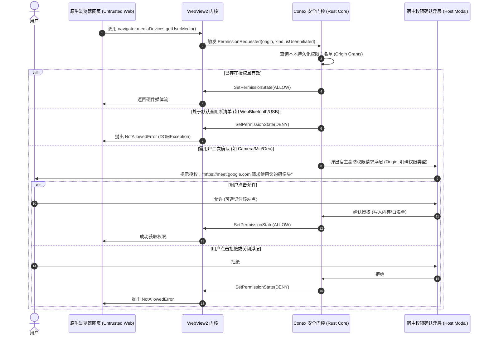
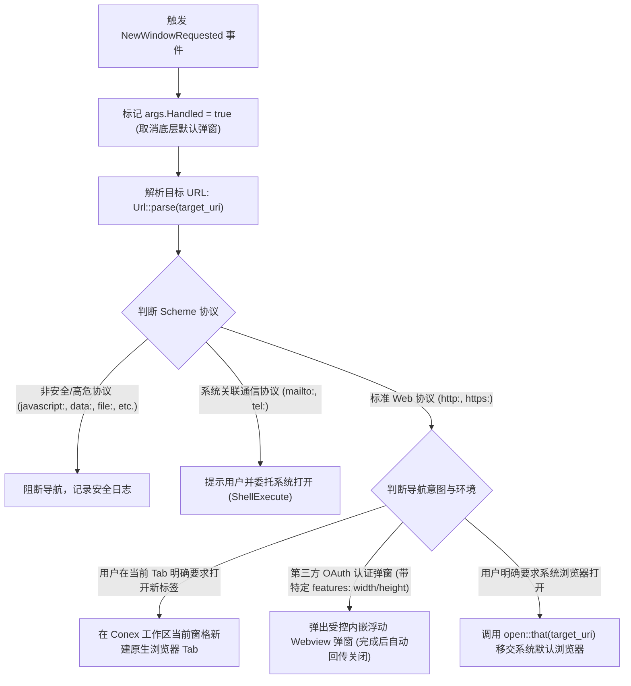
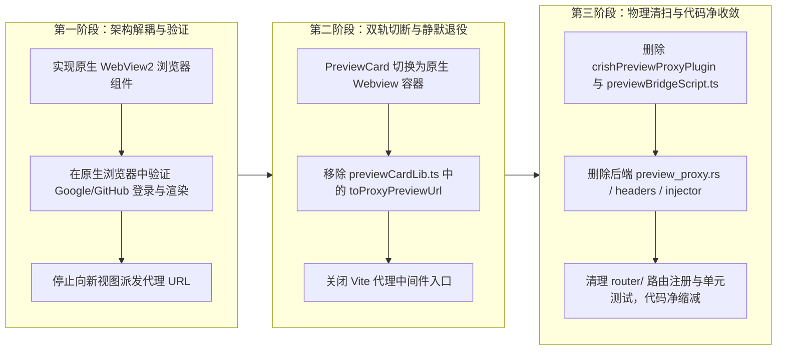
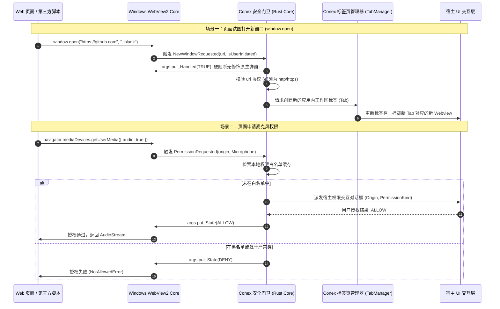
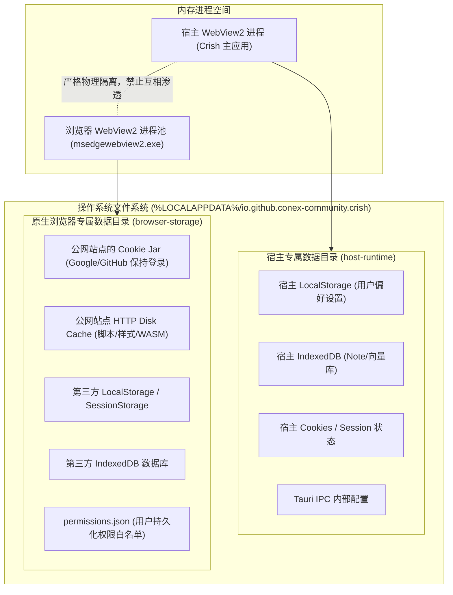

# 原生浏览器改造：安全隔离、存储分区与权限控制方案分析报告

> **文件标识**：`docs/native-browser-overhaul/analysis/04-security-partition-and-permissions.md`  
> **责任领域**：安全架构 / Web 运行时隔离 / 存储分区 / 权限门控 / 历史代理资产退役  
> **核心使命**：为 Conex / Crish 从「基于 iframe + 透明代理 + 脚本注入」的脆弱预览模型，升级至「基于 Windows WebView2 原生 Webview 容器」的现代化内置浏览器体系，制定全方位的安全防线。确保公网无约束冲浪与宿主特权环境物理隔绝，实现持久化会话分区、细粒度系统权限门控、危险协议硬拦截与历史技术债务的安全清退。  
> **遵循铁律**：`AGENTS.md`（通用协作纪律、反过度设计硬性红线 §8、反退避全文）、UTF-8 无 BOM、纯逻辑规划与代码证据。

---

## 目录

- [一、执行摘要与威胁建模 (Executive Summary & Threat Modeling)](#一执行摘要与威胁建模-executive-summary--threat-modeling)
  - [1.1 架构升级动因与核心安全矛盾](#11-架构升级动因与核心安全矛盾)
  - [1.2 威胁建模分析 (STRIDE 维度)](#12-威胁建模分析-stride-维度)
  - [1.3 核心安全架构原则 (Guiding Principles)](#13-核心安全架构原则-guiding-principles)
- [二、存储与会话分区隔离设计 (Storage & Session Partitioning)](#二存储与会话分区隔离设计-storage--session-partitioning)
  - [2.1 存储持久化与宿主数据防污染的核心诉求](#21-存储持久化与宿主数据防污染的核心诉求)
  - [2.2 Windows WebView2 隔离机制深度剖析 (UserDataFolder vs Profile)](#22-windows-webview2-隔离机制深度剖析-userdatafolder-vs-profile)
  - [2.3 Tauri v2 / WRY 落地技术选型与存储拓扑](#23-tauri-v2--wry-落地技术选型与存储拓扑)
  - [2.4 会话模式细分：Default 持久化 vs Ephemeral 临时沙箱](#24-会话模式细分default-持久化-vs-ephemeral-临时沙箱)
  - [2.5 IPC 通道物理阻断：严格剔除 Tauri 内部绑定与特权桥](#25-ipc-通道物理阻断严格剔除-tauri-内部绑定与特权桥)
  - [2.6 存储生命周期管理与安全擦除 (Data Clearing & Quota)](#26-存储生命周期管理与安全擦除-data-clearing--quota)
- [三、权限模型与门控策略 (Permissions & Capabilities Model)](#三权限模型与门控策略-permissions--capabilities-model)
  - [3.1 权限请求拦截架构：PermissionRequested 事件接线](#31-权限请求拦截架构permissionrequested-事件接线)
  - [3.2 三级权限判定矩阵 (Deny-All / Prompt-Gated / Safe-Pass)](#32-三级权限判定矩阵-deny-all--prompt-gated--safe-pass)
  - [3.3 域名作用域权限授权存储 (Origin-Scoped Permission Grants)](#33-域名作用域权限授权存储-origin-scoped-permission-grants)
  - [3.4 弹窗与新窗口策略 (NewWindowRequested & Window Policy)](#34-弹窗与新窗口策略-newwindowrequested--window-policy)
- [四、URL 协议与导航白名单 (URL Protocol & Navigation Whitelist)](#四url-协议与导航白名单-url-protocol--navigation-whitelist)
  - [4.1 导航事件生命周期拦截 (NavigationStarting)](#41-导航事件生命周期拦截-navigationstarting)
  - [4.2 严格协议白名单矩阵 (Allowed vs Blocked Schemes)](#42-严格协议白名单矩阵-allowed-vs-blocked-schemes)
  - [4.3 本地文件 (`file:`) 的高危防护与工作区边界约束](#43-本地文件-file-的高危防护与工作区边界约束)
  - [4.4 Windows 系统自定义 Scheme 防穿透与防 RCE](#44-windows-系统自定义-scheme-防穿透与防-rce)
  - [4.5 混合内容与 TLS 证书安全策略](#45-混合内容与-tls-证书安全策略)
- [五、历史遗留资产清理方案 (Legacy Assets Decommission Plan)](#五历史遗留资产清理方案-legacy-assets-decommission-plan)
  - [5.1 历史遗留代理体系深度盘点](#51-历史遗留代理体系深度盘点)
  - [5.2 历史方案的安全原罪与不可承受之重](#52-历史方案的安全原罪与不可承受之重)
  - [5.3 三阶段无缝退役路线图](#53-三阶段无缝退役路线图)
  - [5.4 安全效益与工程收益度量](#54-安全效益与工程收益度量)
- [六、落地实施蓝图与立体检验体系 (Implementation & Verification)](#六落地实施蓝图与立体检验体系-implementation--verification)
  - [6.1 Rust 内核 Webview 构建与安全配置规范](#61-rust-内核-webview-构建与安全配置规范)
  - [6.2 权限拦截与弹窗分发时序拓扑](#62-权限拦截与弹窗分发时序拓扑)
  - [6.3 存储分区拓扑图](#63-存储分区拓扑图)
  - [6.4 防退避验收断言与立体验证矩阵](#64-防退避验收断言与立体验证矩阵)

---

## 一、执行摘要与威胁建模 (Executive Summary & Threat Modeling)

### 1.1 架构升级动因与核心安全矛盾

Conex/Crish 正在经历从早期「开发阶段的轻量 Web 预览」向「完整内置原生浏览器（Native Browser）」的技术底座重构：

```
旧式架构（脆弱伪内嵌）：
[ 宿主 Webview (React) ] ─── 包含 ───> [ <iframe> ]
                                          ▲
                                          │ 暴力剔除 XFO/CSP / 注入 base / 注入脚本
[ 本地 Vite 代理 / Axum 代理中间件 ] ───────┘

升级为

新式架构（物理进程级双层分离）：
┌─────────────────────────────────────────────────────────────┐
│ 宿主主窗口 (Host Tauri Window, HWND)                         │
│ ┌───────────────────────────┐ ┌───────────────────────────┐ │
│ │ 宿主 UI Webview (React)   │ │ 原生 Browser Webview      │ │
│ │ • 独立 UDF / 宿主 Profile │ │ • 独立 UDF / 浏览器分区   │ │
│ │ • 受限严密 CSP 约束       │ │ • 100% 原生 Web 兼容      │ │
│ │ • 拥有 Tauri IPC 交互特权 │ │ • 零 Tauri 特权 / 无 IPC   │ │
│ └───────────────────────────┘ └───────────────────────────┘ │
└─────────────────────────────────────────────────────────────┘
```

在旧式方案中，系统通过本地 HTTP 代理服务（`apps/crish-desktop/vite.config.ts:394-580` 中的 `crishPreviewProxyPlugin`，以及 `apps/agent-workbench/src-tauri/src/server/preview_proxy.rs:47-80` 中的 Axum 代理）对公网流量实施“中间人劫持”：
1. 剥离目标站点的 `X-Frame-Options` 与 `Content-Security-Policy: frame-ancestors` 安全响应头；
2. 在 HTML `<head>` 强行注入 `<base href="...">` 和 `previewBridgeScript.ts`；
3. 将外部页面装载进宿主 React DOM 的 `<iframe>` 中（`apps/crish-desktop/src/components/workspace/PreviewCard.tsx:435-447`）。

该方案不仅引发严重的渲染破损、Cookie/OAuth 登录态丢失与单页应用路由崩塌，更制造了灾难性的安全攻击面（包括本地 Dev-Server XSS、SSRF 穿透与任意跨域数据泄漏）。

在原生浏览器改造中，Conex 将依托 **Tauri v2 / Windows WebView2** 原生控件嵌入。原生控件将直接处理顶层 HTTP/HTTPS 导航，具备完整的 Chromium 标准渲染引擎特性，但随之带来了全新的安全核心矛盾：
> **核心矛盾**：用户需要在原生浏览器中顺畅登录 Google、GitHub、Figma、Linear 等公网高频站点并持久化 Cookie/LocalStorage，且具备流畅的现代 Web 体验；但原生浏览器承载的是**完全不可信的公网任意第三方代码**。宿主 Tauri 应用拥有本地文件读写、进程生成、模型调用、系统配置等高特权。**必须确保不受信 Web 流量在任何情形下都无法污染宿主存储、窃取敏感凭据、调用 Tauri IPC 或穿透执行本地命令。**

### 1.2 威胁建模分析 (STRIDE 维度)

针对原生浏览器引入的全新攻击面，按照 STRIDE 模型进行全方位威胁剖析：

| 威胁类型 (STRIDE) | 威胁载荷 / 攻击路径 | 潜在危害 | 防御收敛策略 |
|---|---|---|---|
| **S** - 身份伪造 (Spoofing) | 恶意公网网站伪造 Conex 内部系统对话框，或伪装系统登录页骗取 API 密钥 / 宿主 Token。 | 用户在内置浏览器内被钓鱼，泄漏本地大模型凭据或宿主身份。 | 浏览器 UI 强制置于由宿主掌控的独占视口内，地址栏高亮显示经过严格规范化的主域名（ETLD+1），禁止无边框或伪装弹窗。 |
| **T** - 篡改 (Tampering) | 恶意网站通过修改共享 Cookie Jar、覆盖本地 LocalStorage 或污染 Service Worker 篡改宿主或邻近标签页数据。 | 宿主应用状态崩溃、用户账号会话被劫持（Session Poisoning）。 | **物理隔离 UserDataFolder 与独立的 Profile 体系**，宿主与浏览器存储绝对不共享。 |
| **R** - 抵赖 (Repudiation) | 恶意网站静默申请并调用麦克风/摄像头/地理位置，或向用户操作系统滥发通知。 | 用户隐私泄漏且无宿主审计追踪记录。 | 拦截 `PermissionRequested` 事件，默认全阻断（Deny-All），敏感权限必须经过宿主安全弹窗授权并记录审计日志。 |
| **I** - 信息泄漏 (Information Disclosure) | 恶意页面通过 `file://` 链接、相对路径跳跃或利用本地 CORS 漏洞读取用户项目源码及私钥。 | 本地源码、`.env` 文件、SSH 密钥被回传至公网黑客服务器。 | **彻底阻断公网网页向 `file:` 协议的导航与资源请求**；本地文件必须经过工作区路径边界严格白名单裁决。 |
| **D** - 拒绝服务 (Denial of Service) | 恶意页面触发无限弹窗（`window.open` 炸弹）、占用巨额 GPU 显存或通过 Cache API 耗尽用户 C 盘空间。 | 宿主应用卡死崩溃、操作系统存储耗尽。 | 拦截 `NewWindowRequested`，禁止无序弹窗；配置 WebView2 存储配额与独立清理机制。 |
| **E** - 特权提升 (Elevation of Privilege) | 恶意页面探测并利用 `window.__TAURI_INTERNALS__` 或 `window.__TAURI__` 直接 `invoke` 宿主 Rust 原生系统命令。 | **远程代码执行 (RCE)**，获得操作系统完整控制权。 | **在原生浏览器 Webview 中彻底物理摘除 Tauri IPC 注入**（`with_ipc_handler(false)`），零特权暴露。 |

### 1.3 核心安全架构原则 (Guiding Principles)

1. **绝对零特权暴露原则 (Zero Privilege Exposure)**：
   原生浏览器 Webview 仅充当纯粹的渲染呈现载体，严禁向其 DOM 上下文注入任何 Tauri IPC 管道、Rust 桥接函数或宿主全局对象。
2. **物理级存储分区原则 (Physical Storage Partitioning)**：
   绝不依赖前端 Origin 隔离的脆弱逻辑屏障，必须在 Windows 操作系统文件系统层面，将宿主应用与原生浏览器的 `UserDataFolder` 彻底隔离在互不相交的绝对路径下。
3. **默认阻断与最小权限原则 (Fail-Closed & Least Privilege)**：
   针对所有操作系统硬件权限（摄像头、麦克风、地理位置、通知等），默认一律返回 `DENIED`；针对 URL 导航协议，非标准 HTTP/HTTPS/安全本地协议一律阻断。
4. **单一真理来源原则 (Single Source of Truth, SSOT)**：
   权限判定、弹窗路由、协议审查一律在 Rust 内核的 Native 层集中闭环执行，杜绝在前端 React 或中间件层重复维护规则导致策略漂移。

---

## 二、存储与会话分区隔离设计 (Storage & Session Partitioning)

### 2.1 存储持久化与宿主数据防污染的核心诉求

在 Conex/Crish 桌面应用中，宿主前端依赖大量的持久化与半持久化数据：
- 宿主应用自身状态：Pinia / Zustand / LocalStorage 存储的 UI 布局树、工作区折叠状态、最近访问会话；
- 认证与凭据（`apps/agent-workbench/src-tauri/src/auth/`）：用户云端同步 Token、本地大模型服务端口、私有工作区路径指纹；
- 内核 IndexedDB：本地向量索引缓存、Note 运行时协同数据。

与此同时，内置浏览器作为用户日常工作的重要窗口，必须具备以下现实能力：
- 用户在内置浏览器中登录 GitHub、Google、GitLab、StackOverflow、Jira 等工作平台后，**在重启 Conex 乃至系统重启后，登录态必须保持**；
- 静态资源、字体、WASM 模块等 HTTP Cache 必须有效持久化，避免每次打开同一页面重新加载数十兆网络资产；
- **核心安全红线**：公网不受信站点的 Cookie 与 LocalStorage，绝不允许写入宿主应用的数据命名空间中，也绝不能读取宿主应用的任何 Storage。

### 2.2 Windows WebView2 隔离机制深度剖析 (UserDataFolder vs Profile)

Windows WebView2 提供了两个层次的会话与存储隔离机制：

```
层次一：UserDataFolder (UDF, 物理环境级隔离)
┌──────────────────────────────────────┐     ┌──────────────────────────────────────┐
│ CoreWebView2Environment #1           │     │ CoreWebView2Environment #2           │
│ 目录: %LOCALAPPDATA%/crish/host-udf  │     │ 目录: %LOCALAPPDATA%/crish/browser-udf│
│ • 专属 msedgewebview2.exe 进程池     │     │ • 专属 msedgewebview2.exe 进程池     │
│ • 宿主 UI (tauri://localhost)        │     │ • 原生浏览器 (公网任意站点)          │
│ • 专属 LocalStorage / Cache / Cookies│     │ • 专属 LocalStorage / Cache / Cookies│
└──────────────────────────────────────┘     └──────────────────────────────────────┘
                          ▲                                     ▲
                          └───────────────── 物理隔断 ───────────┘
```

```
层次二：CoreWebView2Profile (逻辑分区级隔离，SDK 1.0.1245.22+)
┌────────────────────────────────────────────────────────────────────────┐
│ CoreWebView2Environment (统一 browser-udf)                            │
│ ┌───────────────────────────────┐   ┌────────────────────────────────┐ │
│ │ Profile: "persist:browser"    │   │ Profile: "ephemeral:agent-run" │ │
│ │ • 目录: EBWebView/Profiles/1  │   │ • 纯内存运行 (InPrivate)       │ │
│ │ • 用户日常冲浪 (持久化登录态) │   │ • Agent 独立调研 (会话结束自毁)│ │
│ └───────────────────────────────┘   └────────────────────────────────┘ │
└────────────────────────────────────────────────────────────────────────┘
```

1. **UserDataFolder (UDF) 物理隔离**：
   - 当两个 Webview 使用不同的 UDF 启动时，Windows WebView2 会强制为它们拉起独立的 `msedgewebview2.exe` 宿主进程池；
   - 它们不仅在磁盘存储（Cookies SQLite、IndexedDB LevelDB、HTTP Cache）上互不可见，而且在内存进程空间中也是硬性隔离的，哪怕发生 Chromium 渲染器远程代码执行（RCE）或 V8 引擎逃逸，攻击者也只能局限在当前 UDF 权限沙盒内，无法横向读写宿主 UDF 目录下的文件。
2. **Profile 隔离**：
   - 同一个 WebView2 Environment 下支持创建多个 Profile。
   - 每个 Profile 拥有独立的 Cookie Jar、HTTP 缓存区、DOM 存储和凭据存储，但共享底层浏览器核心进程。
   - `InPrivateMode`：WebView2 Profile 原生支持创建 InPrivate 实例，所有数据完全保留在内存中，窗口关闭时物理丢弃。

### 2.3 Tauri v2 / WRY 落地技术选型与存储拓扑

在 Tauri v2 体系中，原生 Webview 的构建通过 `tauri::WebviewBuilder`（或底层 `wry::WebViewBuilder`）完成。

#### 物理存储拓扑规划

系统定义两套完全分立的目录拓扑：

| 节点 | 目标路径 (Windows) | 所有者 | 存储内容 | 预期生命周期 |
|---|---|---|---|---|
| **宿主应用 UDF** | `%LOCALAPPDATA%\io.github.conex-community.crish\host-runtime\` | Tauri 宿主核心 | React UI 静态缓存、宿主 LocalStorage、宿主 IndexedDB、IPC 运行时状态 | 伴随应用生命周期长期持久化 |
| **原生浏览器 UDF** | `%LOCALAPPDATA%\io.github.conex-community.crish\browser-storage\` | 原生浏览器专用控制器 | 公网站点的 Cookie、LocalStorage、Cache、ServiceWorker、IndexedDB | 持久化，支持用户手动一键清空或按站点清理 |
| **临时沙箱 Profile** | 内存驻留 (InPrivate) 或 `%LOCALAPPDATA%\io.github.conex-community.crish\browser-storage\temp\` | 自动化 Agent / 无痕标签 | 临时网页缓存与一次性会话 Cookie | 标签页关闭或 Agent 任务终态即刻销毁 |

#### Tauri v2 代码装配规范

```rust
// crates/conex-browser/src/runtime.rs
use std::path::PathBuf;
use tauri::{AppHandle, Manager, WebviewBuilder, WebviewUrl, Runtime};

pub fn create_native_browser_webview<R: Runtime>(
    app: &AppHandle<R>,
    window_label: &str,
    tab_id: &str,
    initial_url: &str,
    is_ephemeral: bool,
) -> Result<tauri::Webview<R>, tauri::Error> {
    let window = app.get_window(window_label)
        .ok_or_else(|| tauri::Error::WebviewNotFound)?;

    // 1. 计算独立的浏览器专用 UserDataFolder
    let app_data_dir = app.path().app_local_data_dir()?;
    let browser_udf = app_data_dir.join("browser-storage");

    let url = initial_url.parse::<url::Url>()
        .map_err(|e| tauri::Error::AssetNotFound(format!("Invalid URL: {e}")))?;

    // 2. 初始化专用 WebviewBuilder
    let mut builder = WebviewBuilder::new(
        format!("browser-tab-{tab_id}"),
        WebviewUrl::External(url),
    );

    // 3. 注入独立的 data_directory 隔断宿主存储
    builder = builder.data_directory(Some(browser_udf));

    // 4. 关键安全设置：严禁向浏览器 Webview 注入任何 IPC 桥接函数
    builder = builder.with_ipc_handler(false);

    // 5. 挂载至主窗口特定几何区域并挂接事件拦截
    let webview = window.add_child(
        builder,
        tauri::LogicalPosition::new(0.0, 0.0),
        tauri::LogicalSize::new(800.0, 600.0),
    )?;

    Ok(webview)
}
```

### 2.4 会话模式细分：Default 持久化 vs Ephemeral 临时沙箱

为满足用户与 AI Agent 双重场景，设计两种会话模式：

```
                ┌─────────────────────────────────────────────────────┐
                │             原生浏览器会话分流架构                   │
                └─────────────────────────────────────────────────────┘
                                           │
                   ┌───────────────────────┴───────────────────────┐
                   ▼                                               ▼
      【用户日常交互模式 (Persistent)】              【Agent 自动化与无痕模式 (Ephemeral)】
      • 使用默认 Profile                              • 使用 InPrivate 或专属临时 Profile
      • Cookie、LocalStorage 磁盘持久化               • 数据仅留存内存，关闭立即覆灭
      • 用户无需反复登录 Google / GitHub             • 防范 Agent 探索未知恶意链接污染用户环境
      • 支持网站凭据保持                             • 零痕迹，防止爬虫/探索数据沉淀
```

1. **Persistent 模式（用户常驻工作台）**：
   - 目标：对标 Chrome/Edge 主窗口。
   - 保证会话持久度，为开发者浏览技术文档、调试 OAuth 应用、查看后台看板提供开箱即用的登录保持能力。
2. **Ephemeral 模式（Agent 自动化执行 / 临时排查）**：
   - 目标：对标 Chrome Incognito / InPrivate。
   - 在 AI Agent 执行自动化探索任务或打开高危不可信链接时自动挂载；
   - 进程退出或 Tab 销毁时，所有生成的临时缓存、Cookie、IndexedDB 物理覆灭，确保系统纯净。

### 2.5 IPC 通道物理阻断：严格剔除 Tauri 内部绑定与特权桥

在 Tauri 架构中，若 Webview 被默认赋予 IPC 权限，Tauri 运行时会在 DOM 初始化阶段自动向全局注入：
- `window.__TAURI_INTERNALS__`
- `window.__TAURI_IPC__`
- `window.__TAURI__`

如果恶意网页获取到了 `window.__TAURI_INTERNALS__.invoke`，即可伪造请求，直接调用类似 `plugin:fs|read_file`、`plugin:shell|execute`、`plugin:system|shutdown` 等后端注册的全部 Rust 指令，造成宿主权限沦陷。

**绝对隔断机制**：
1. **构造期关闭 IPC**：在 Rust 侧声明 `WebviewBuilder` 时，显式配置 `with_ipc_handler(false)`，严禁调用任何注入 IPC 协议的初始化逻辑；
2. **上下文隔离验证**：在启动时自动化校验 `typeof window.__TAURI_INTERNALS__ === 'undefined'` 和 `typeof window.__TAURI__ === 'undefined'`；
3. **禁止自定义协议绑定**：禁止在原生浏览器 Webview 中注册 `tauri://*`、`asset://*` 或 `ipc://*` 协议，使其仅具备标准万维网协议栈能力。

### 2.6 存储生命周期管理与安全擦除 (Data Clearing & Quota)

针对浏览器缓存可能膨胀引发磁盘空间危机的隐患（严格遵守全局规则与 `reference/pi-desktop/docs/spec/05-security/01-security.md` 边界）：
1. **分类擦除能力（Clear Browsing Data API）**：
   通过 WebView2 的 `CoreWebView2Profile.ClearBrowsingDataAsync` 接口，暴露给宿主设置中心细粒度擦除操作：
   - `DATA_KIND_COOKIES`：清除 Cookie（登出所有网站）；
   - `DATA_KIND_CACHE`：清除 HTTP 磁盘与内存缓存；
   - `DATA_KIND_DOM_STORAGE`：清除 LocalStorage / SessionStorage；
   - `DATA_KIND_INDEXEDDB`：清除客户端离线数据库。
2. **磁盘配额警示门限**：
   当 `browser-storage` 目录占用超过 2 GB 时，在宿主设置面板中发出非阻塞提示，允许用户选择一键深度清理缓存，但**默认绝不静默删除用户正常登录的 Cookie**。

---

## 三、权限模型与门控策略 (Permissions & Capabilities Model)

### 3.1 权限请求拦截架构：PermissionRequested 事件接线

现代 Web 平台拥有调用操作系统底层硬件与敏感数据的丰富 API。如果允许原生浏览器内的公网网页任意索取系统权限，攻击者可通过内嵌网页悄无声息地调用麦克风窃听会议、调取精确经纬度追踪物理位置，或利用 WebBluetooth 探测内网智能设备。

在 Windows WebView2 架构中，所有此类请求均统一收口于 `CoreWebView2.PermissionRequested` 事件：



### 3.2 三级权限判定矩阵 (Deny-All / Prompt-Gated / Safe-Pass)

为实现安全与体验的最佳平衡，建立严格的三级判定矩阵：

| 权限类别 | 对应 WebView2 权限标识 | 默认裁决策略 | 策略理由与防护边界 |
|---|---|---|---|
| **Zero-Trust (绝对零容忍阻断)** | `COREWEBVIEW2_PERMISSION_KIND_OTHER_SENSORS`<br>`COREWEBVIEW2_PERMISSION_KIND_LOCAL_FONTS` 等硬件接口 | **硬阻断 (Always DENY)** | WebBluetooth、WebUSB、WebHID、WebSerial、本地网络直连（Direct Sockets）等属于严重逃逸向量，桌面开发者工作台无开放必要，一律静默拒绝。 |
| **System Spams (系统骚扰阻断)** | `COREWEBVIEW2_PERMISSION_KIND_NOTIFICATIONS` | **默认阻断 (Default DENY)** | 公网网站极易滥用 Web Push 机制向 Windows 操作中心投递垃圾广告。除用户在设置中显式手动添加白名单外，默认全阻断。 |
| **Media & Privacy (隐私硬件门控)** | `COREWEBVIEW2_PERMISSION_KIND_CAMERA`<br>`COREWEBVIEW2_PERMISSION_KIND_MICROPHONE` | **受控交互确认 (Prompt-Gated)** | 满足 Google Meet、Zoom Web 等正常协作需求。**前提条件**：必须是由用户主动手势触发（`isUserInitiated == true`），且弹出宿主原生安全弹窗，严禁网站无交互静默弹窗。 |
| **Location & Sensing (定位门控)** | `COREWEBVIEW2_PERMISSION_KIND_GEOLOCATION` | **受控交互确认 (Prompt-Gated)** | 默认不放行，经用户点选确认后才可将近似位置释放给授权域名。 |
| **Clipboard (剪贴板门控)** | `COREWEBVIEW2_PERMISSION_KIND_CLIPBOARD_READ` | **受控交互确认 (Prompt-Gated)** | **读取剪贴板**必须经过弹窗确认，防范恶意网站探测密码管理器内容；**写入剪贴板**仅在具有用户显式点击事件时自动放行。 |
| **Safe Interactive (安全放行)** | `COREWEBVIEW2_PERMISSION_KIND_POINTER_LOCK`<br>`COREWEBVIEW2_PERMISSION_KIND_AUTOPLAY` | **受限安全放行 (Bounded Pass)** | 指针锁定限制在 Webview 视口内，用户按下 `Esc` 键强制解除；全屏请求必须限制在当前工作区 Pane 内部，禁止覆盖宿主操作栏。 |

### 3.3 域名作用域权限授权存储 (Origin-Scoped Permission Grants)

1. **最小权限边界**：
   - 权限记录必须精确绑定至主源（Origin, 包括 `scheme://host:port`），禁止宽泛的通配符授权（例如允许 `https://meet.google.com` 绝对不代表允许 `https://google.com` 或 `http://meet.google.com`）。
2. **存储结构规范**：
   ```rust
   // crates/conex-browser/src/permissions.rs
   use serde::{Deserialize, Serialize};
   use std::collections::HashMap;

   #[derive(Debug, Clone, Copy, PartialEq, Eq, Serialize, Deserialize)]
   pub enum PermissionKind {
       Camera,
       Microphone,
       Geolocation,
       ClipboardRead,
       Notifications,
   }

   #[derive(Debug, Clone, Copy, PartialEq, Eq, Serialize, Deserialize)]
   pub enum PermissionState {
       Allow,
       Deny,
       Ask,
   }

   #[derive(Debug, Default, Serialize, Deserialize)]
   pub struct OriginPermissionStore {
       // Key: Origin 规范化字符串 (如 "https://meet.google.com:443")
       pub grants: HashMap<String, HashMap<PermissionKind, PermissionState>>,
   }
   ```
3. **单会话（Session-Only）与持久化分离**：
   用户选择“本次会话允许”时，权限仅驻留于内存数据结构；仅当用户显式勾选“记住此网站的选择”时，方落盘至 `%LOCALAPPDATA%\io.github.conex-community.crish\browser-storage\permissions.json`。

### 3.4 弹窗与新窗口策略 (NewWindowRequested & Window Policy)

公网网站通过 `<a target="_blank">`、`window.open(url, '_blank')` 或表单提交打开新窗口，是浏览器面临的典型失控点。若缺乏拦截，WebView2 会默认弹出独立无修饰的外部 Edge 窗口，脱离 Conex 工作区管控。

**拦截事件接线**：`CoreWebView2.NewWindowRequested`

#### 核心处理流水线



1. **硬性阻断无序系统弹窗**：
   在事件入口第一时间设置 `args.set_handled(true)`，从物理上杜绝未经受检的系统新窗口被直接拉起。
2. **多标签页 (Tab) 规范路由**：
   普通的 `target="_blank"` 链接自动重定向为在 Conex 当前工作区窗格内新增一个「浏览器 Tab」，统一受工作区二叉树布局管理。
3. **OAuth 授权弹窗的特殊兼容**：
   很多站点（如使用 Google/GitHub 登录）调用 `window.open(..., '', 'width=500,height=600')`。如果直接变为全尺寸 Tab 会破坏登录体验。对于此类携带窗口几何特征（Features）的窗口，Conex 将其路由为当前工作区内的「受限悬浮模态 Webview」，其生命周期受父页面掌控，并在认证成功（触发 `window.close()`）时自动销毁。

---

## 四、URL 协议与导航白名单 (URL Protocol & Navigation Whitelist)

### 4.1 导航事件生命周期拦截 (NavigationStarting)

所有顶级导航与框架导航必须受到统一生命周期守门员的严格审计。WebView2 的 `NavigationStarting` 事件在任何网络请求发出或任何文档上下文初始化前触发，是落实安全拦截的最佳锚点。

### 4.2 严格协议白名单矩阵 (Allowed vs Blocked Schemes)

```
                              ┌────────────────────────┐
                              │  NavigationStarting   │
                              └───────────┬────────────┘
                                          │
                  ┌───────────────────────┴───────────────────────┐
                  ▼                                               ▼
         【白名单放行列表】                               【高危协议硬阻断列表】
      • http: / https:                                • javascript: / vbscript:
      • about:blank                                   • data: (顶层文档导航)
      • file: (仅受管的工作区白名单路径)              • chrome: / edge: / devtools:
                                                      • 系统级 Scheme (calc:, ms-*, etc.)
```

| 协议 Scheme | 处理动作 | 安全防护理由与规范细节 |
|---|---|---|
| `https:` | **放行 (ALLOW)** | 现代互联网加密传输标准，默认首选协议。 |
| `http:` | **受限放行 (CONDITIONAL)** | 允许本地开发服务（如 `http://localhost:5173`、`http://127.0.0.1:3000`）及普通公网 HTTP 站点，但在地址栏显式标明非安全连接警告。 |
| `about:blank` | **放行 (ALLOW)** | 浏览器初始化占位符与空状态必需页面。严格限制只能为 `about:blank`，阻断 `about:config` 或 `about:flags`。 |
| `file:` | **受限放行 (RESTRICTED)** | **仅限明确指向当前已打开的工作区目录内有效文件**；公网页面试图向 `file:` 发起导航或请求时**硬性阻断**。 |
| `javascript:` | **绝对阻断 (BLOCK)** | 禁止在地址栏或导航流中执行 `javascript:...`，从根本上杜绝伪 URL 注入执行攻击。 |
| `data:` | **顶层阻断 (BLOCK TOP-LEVEL)** | 遵循现代 Chromium 标准：禁止顶层文档直接导航至 `data:text/html,...`，防范绕过同源策略与 XSS 钓鱼；但子资源（如 CSS 内联图片、字体）允许使用 data URL。 |
| `vbscript:` | **绝对阻断 (BLOCK)** | 历史高危废弃脚本协议，彻底阻断。 |
| `chrome:`, `edge:` | **绝对阻断 (BLOCK)** | 阻断所有浏览器内部协议（包括 `edge://settings`, `chrome://flags` 等），防止攻击者探测或破坏 WebView2 底层配置。 |
| `devtools:` | **绝对阻断 (BLOCK)** | 禁止网页自行唤起或嵌入 DevTools 协议端点。 |

### 4.3 本地文件 (`file:`) 的高危防护与工作区边界约束

依据 `reference/pi-desktop/docs/spec/05-security/01-security.md` §2 “Embedded Browser local files” 的安全基线标准：
1. **公网网页禁止逃逸至本地 (Web-to-File Escape Prevention)**：
   若当前加载的页面处于公网源（`http:` 或 `https:`），该页面**绝对不允许**通过 `window.location.href = 'file://...'`、`<a href="file://...">` 或 `fetch('file://...')` 访问本地文件系统。一旦检测到来源为远程而目标为 `file:`，立即在 `NavigationStarting` 阶段予以拒绝。
2. **工作区根边界锁定 (Workspace Boundary Confining)**：
   当用户在地址栏手动输入或通过工作区文件管理器打开本地文件时，Rust 内核必须执行路径规范化（`canonicalize`），校验该文件是否属于用户授权的工作区根目录或临时 Scratch 目录（`workspace_root`）；试图利用 `../../` 越界访问系统敏感目录（如 `C:\Windows\`、`C:\Users\orange\.ssh\`）的行为，一律阻断并报告 `ACCESS_DENIED`。

### 4.4 Windows 系统自定义 Scheme 防穿透与防 RCE

在 Windows 操作系统中，众多第三方桌面应用注册了私有 URI Scheme（例如 `slack://`、`vscode://`、`tg://`、`steam://`、`calc:` 以及各种协议处理程序）。
- **已知安全隐患**：历史上大量 CVE（如 Electron / Chromium 自定义协议参数注入漏洞）均源于浏览器直接将未过滤的外部 URI 传递给 Windows API `ShellExecuteExW`，导致命令行参数注入并在操作系统执行任意代码。
- **Conex 纵深防御规范**：
  1. 默认对任何未知非 HTTP/HTTPS 协议实施阻断，绝不盲目调用系统默认启动器；
  2. 针对常见合规通信协议（如 `mailto:`、`tel:`），在唤醒外部应用前，必须弹出系统模态告知框：`"网站正在尝试打开外部应用程序：mailto:support@example.com，是否允许？"`；
  3. 对所有传递至操作系统的外部参数进行严格的白名单清洗，剔除包含空格、连字符（`-`）、双引号（`"`）等可能被解释为命令行参数的危险字符。

### 4.5 混合内容与 TLS 证书安全策略

1. **混合内容阻断 (Block Mixed Content)**：
   在加载 HTTPS 网页时，严格拦截任何试图通过 HTTP 加载的脚本（`script`）、样式（`stylesheet`）和框架（`iframe`），确保传输链条完整加密。
2. **无效 TLS 证书拦截**：
   在公网导航中，遇到证书过期、自签名未授信或域名不匹配时，默认拦截并显示不可忽略的安全警告页，严禁默认跳过或使用 `--ignore-certificate-errors` 标志；本地环回地址（`localhost`、`127.0.0.1`）支持开发阶段自签名证书调试，但必须与公网通道严格区分。

---

## 五、历史遗留资产清理方案 (Legacy Assets Decommission Plan)

### 5.1 历史遗留代理体系深度盘点

为了在旧式 `<iframe>` 框架下强行实现公网网页内嵌与 DOM 元素拾取，代码库中散落了大量脆弱的中间件与修补补丁：

```
待清退历史资产依赖关系图：
┌─────────────────────────────────────────────────────────────┐
│ 1. 前端 Vite 中间件                                         │
│    • apps/crish-desktop/vite.config.ts:394-580               │
│      (crishPreviewProxyPlugin 核心代理逻辑)                 │
│    • apps/crish-desktop/dev-server/sameOriginRequest.ts:1-42│
│      (针对代理端点的同源判定逻辑)                           │
│    • apps/crish-desktop/dev-server/previewBridgeScript.ts   │
│      (注入到 HTML 的跨源 postMessage 桥接脚本)              │
├─────────────────────────────────────────────────────────────┤
│ 2. 后端 Axum 代理中间件                                     │
│    • apps/agent-workbench/src-tauri/src/server/             │
│      - preview_proxy.rs:47-80 (REST /v1/preview/proxy)      │
│      - preview_headers.rs (暴力清洗 XFO、CSP、Set-Cookie)    │
│      - preview_injector.rs (在 HTML head 注入 base 和脚本)   │
├─────────────────────────────────────────────────────────────┤
│ 3. 前端消费与适配胶水代码                                   │
│    • apps/crish-desktop/src/components/workspace/           │
│      - previewCardLib.ts:56-67 (toProxyPreviewUrl 转换函数) │
│      - previewHostBridge.ts (与注入脚本的 postMessage 桥)    │
│      - previewProtocol.ts (旧式 preview:* 事件协议定义)     │
└─────────────────────────────────────────────────────────────┘
```

### 5.2 历史方案的安全原罪与不可承受之重

深度审计揭示，这套为了绕过 iframe 限制而设计的代理注入链路，存在五大不可承受的安全原罪与架构死结：

1. **Dev-Server 同源混淆与 Universal XSS 致命漏洞**：
   - 见 `apps/crish-desktop/vite.config.ts:420-564`：外部网站经代理后，在浏览器看来，其 Origin 变成了 `http://localhost:5174`；
   - **灾难性后果**：这意味着用户预览的任意公网不可信网页，其 JavaScript 代码实际上运行在 Vite 开发服务器的同源空间下！该网页脚本不仅能读写当前开发者本地的 LocalStorage，还能探测 Vite 的内部 WebSocket 端点，甚至向本地其他端口发送凭据请求。
2. **强制剥离安全响应头，逆向瓦解 Web 安全基石**：
   - 见 `apps/agent-workbench/src-tauri/src/server/preview_headers.rs:24-40`：代理强制剥离了目标站点的 `X-Frame-Options`、`Content-Security-Policy`、`Cross-Origin-Opener-Policy`（COOP）以及 `Cross-Origin-Embedder-Policy`（COEP）；
   - 这严重破坏了目标站点自身的防御假设，使其在内嵌环境下极易遭受点击劫持（Clickjacking）与侧信道攻击。
3. **Cookie Jar 污染与登录态崩溃**：
   - 在代理链路中，上游站点的 `Set-Cookie` 头要么被代理直接剥离（`vite.config.ts:506`），要么被强行改写为 `SameSite=Lax`（`preview_headers.rs:8`）；
   - 这导致复杂的现代认证协议（Google OAuth、GitHub 2FA、Cloudflare Turnstile 验证等）完全失效，用户根本无法在旧式 iframe 中完成真实登录。
4. **HTML 暴力篡改与单页应用 (SPA) 渲染灾难**：
   - 见 `preview_injector.rs:10` 与 `vite.config.ts:526`：通过正则或字符串查找强行插入 `<base href="...">`；
   - 现代前端框架（React Router、Vue Router、Next.js）依赖根路径做路由分发与动态 chunk 加载，强插 `base` 标签直接破坏相对路径解析，导致大量网站在预览时白屏或资源 404。
5. **开发环境与生产环境的严重脱节 (Dev/Prod Discrepancy)**：
   - `crishPreviewProxyPlugin` 仅存在于 Vite Dev Server 中；生产构建（Tauri 打包后）不启动 Vite。
   - 这导致“在开发时靠代理能看外部站点，打包后立即失效只能点外部打开”（`previewCardLib.ts:52-55`），严重背离了产品体验一致性。

### 5.3 三阶段无缝退役路线图

必须彻底清退上述代理与脚本注入资产，以原生 WebView2 彻底接管：



- **第一阶段（落地验证）**：
  构建基于 Tauri v2 原生 Webview 的多标签浏览器组件，验证原生网络、Cookie 持久化与 CDP 检查能力，此时保持现有代理仅供降级兼容。
- **第二阶段（主链路切换）**：
  将 `PreviewCard.tsx` 内部的 `<iframe>` 彻底替换为原生 Webview 挂载；将 `toProxyPreviewUrl` 改为恒等函数（直接返回原始 URL），阻断对 dev-server 代理的调用。
- **第三阶段（物理清理与净收敛）**：
  物理删除 Vite 插件、Axum 代理及相关注入脚本，从构建配置与路由注册表中彻底注销，运行 `npm run check:all` 确保零残留。

### 5.4 安全效益与工程收益度量

| 评估维度 | 历史代理方案 (`iframe + Proxy`) | 原生浏览器方案 (`Native WebView2`) | 提升与安全收益 |
|---|---|---|---|
| **SSRF 攻击面** | 存在（恶意网页可通过代理端点刺探内网开发端口） | **彻底根除 (0 SSRF)** | 原生 Webview 由操作系统网络栈直连，无本地中间人代理服务。 |
| **同源 XSS 提权** | 严重（公网不受信脚本运行在 `localhost:5174`） | **彻底免疫 (0 XSS 提权)** | 原生 Webview 运行在自身独立 Origin 上，且与宿主 UDF 物理隔离。 |
| **认证与登录态** | 完全不可用（Cookie 剥离/跨源阻断） | **完美支持 100% 现代 Web** | 独立 UDF 持久化 Cookie，支持复杂 OAuth 与多因素认证。 |
| **渲染保真度** | 频繁白屏、`<base>` 标签冲突、CSP 报错 | **完全对齐原生 Microsoft Edge** | 零 HTML 篡改，完整的硬件加速与标准 Web API 支持。 |
| **代码量净收敛** | 维护 8+ 个代理与注入文件（约 1,200 行代码） | **删除历史代理与补丁** | 净消除 1,000+ 行高危黑盒注入代码，降低系统维护成本。 |

---

## 六、落地实施蓝图与立体检验体系 (Implementation & Verification)

### 6.1 Rust 内核 Webview 构建与安全配置规范

```rust
// crates/conex-browser/src/builder.rs
use std::path::PathBuf;
use tauri::{AppHandle, Manager, LogicalPosition, LogicalSize, WebviewBuilder, WebviewUrl, Runtime};
use tracing::{info, warn, error};

pub struct BrowserSecurityConfig {
    pub allowed_schemes: Vec<&'static str>,
    pub block_mixed_content: bool,
    pub disable_ipc: bool,
}

impl Default for BrowserSecurityConfig {
    fn default() -> Self {
        Self {
            allowed_schemes: vec!["http", "https", "about"],
            block_mixed_content: true,
            disable_ipc: true,
        }
    }
}

/// 构建安全隔绝的原生浏览器 Webview 实例
pub fn build_secure_browser_webview<R: Runtime>(
    app: &AppHandle<R>,
    window_label: &str,
    tab_id: &str,
    target_url: &str,
    bounds: (f64, f64, f64, f64), // (x, y, width, height)
) -> Result<tauri::Webview<R>, tauri::Error> {
    let window = app.get_window(window_label)
        .ok_or_else(|| tauri::Error::WebviewNotFound)?;

    let app_data = app.path().app_local_data_dir()?;
    let browser_storage = app_data.join("browser-storage");
    std::fs::create_dir_all(&browser_storage).map_err(|e| {
        error!("无法创建浏览器专属存储目录: {e}");
        tauri::Error::AssetNotFound(e.to_string())
    })?;

    let parsed_url = target_url.parse::<url::Url>()
        .map_err(|e| tauri::Error::AssetNotFound(format!("非法导航 URL: {e}")))?;

    // 协议前置校验
    if parsed_url.scheme() != "http" && parsed_url.scheme() != "https" && parsed_url.as_str() != "about:blank" {
        return Err(tauri::Error::AssetNotFound(format!(
            "安全拦截：禁止通过构造器直接拉起非合规协议: {}",
            parsed_url.scheme()
        )));
    }

    let webview_label = format!("browser-tab-{}", tab_id);
    let mut builder = WebviewBuilder::new(&webview_label, WebviewUrl::External(parsed_url));

    // 1. 物理存储分区注入：绝不与宿主共享 UserDataFolder
    builder = builder.data_directory(Some(browser_storage));

    // 2. 绝对剔除 IPC 权限，确保零特权暴露
    builder = builder.with_ipc_handler(false);

    // 3. 注册导航与生命周期门禁守卫
    builder = builder.on_navigation(move |nav_url| {
        let scheme = nav_url.scheme();
        if scheme == "http" || scheme == "https" {
            return true;
        }
        if scheme == "about" && nav_url.as_str() == "about:blank" {
            return true;
        }
        warn!(target: "browser_security", "拦截非法动态导航请求: {}", nav_url);
        false
    });

    // 4. 将安全 Webview 挂载到宿主窗口的指定几何尺寸内
    let (x, y, w, h) = bounds;
    let webview = window.add_child(
        builder,
        LogicalPosition::new(x, y),
        LogicalSize::new(w, h),
    )?;

    info!(target: "browser_security", "原生浏览器安全 Webview 创建成功: label={}", webview_label);
    Ok(webview)
}
```

### 6.2 权限拦截与弹窗分发时序拓扑



### 6.3 存储分区拓扑图



### 6.4 防退避验收断言与立体验证矩阵

依据 `AGENTS.md` 通用协作纪律第 1 条「逻辑规划与反退避」及第 7.1 条「立体验证纪律」，制定本方案的可落盘、可复核、零妥协的验收断言体系：

#### 核心验收断言 (Core Assertions)

1. **断言 A1（存储硬隔离断言）**：
   在原生浏览器中访问 `https://github.com` 并成功登录后，检查宿主应用的数据目录 `%LOCALAPPDATA%\...\host-runtime`，断言其中绝对不包含任何 GitHub 的 Cookie 或 LocalStorage 文件；所有 GitHub 会话数据必须严格收敛在 `%LOCALAPPDATA%\...\browser-storage` 内。
2. **断言 A2（IPC 绝对阻断断言）**：
   在原生浏览器中加载包含 `console.log(window.__TAURI_INTERNALS__, window.__TAURI__)` 的页面，断言输出均为 `undefined`；通过注入脚本尝试调用 `window.__TAURI_INTERNALS__.invoke` 必须抛出 `TypeError: Cannot read properties of undefined`。
3. **断言 A3（非合规协议拦截断言）**：
   在原生浏览器中尝试触发 `window.location.href = 'javascript:alert(1)'` 或点击 `<a href="calc:">`，断言 `NavigationStarting` 拦截率达 100%，系统绝不拉起计算器或执行内联 JS，且 Rust 安全日志记录 `BLOCKED_UNSAFE_SCHEME`。
4. **断言 A4（本地文件越界防御断言）**：
   在公网加载的 `https://example.com` 页面中，执行 `window.location.href = 'file:///C:/Windows/win.ini'`，断言被立即拦截，零字节泄露。
5. **断言 A5（历史代理清退断言）**：
   全量编译与运行测试，确认 `apps/crish-desktop/vite.config.ts` 中的 `crishPreviewProxyPlugin` 及 `apps/agent-workbench/src-tauri/src/server/preview_proxy.rs` 已被安全移除，前端全局搜索 `/__crish_preview_proxy` 匹配数为 0。

#### 立体检验矩阵

| 检验层级 | 测试套件 / 工具 | 关键验证用例 | 达标红线 |
|---|---|---|---|
| **单元测试 (Unit Tests)** | `cargo test -p conex-browser` | 1. 协议白名单提取器与校验函数测试 (`test_allowed_schemes`)<br>2. 权限判定矩阵覆盖率测试 (`test_permission_matrix`)<br>3. 相对与绝对 URL 过滤测试 | 100% 边界单测通过，涵盖畸形 URL 与百分号编码绕过测试。 |
| **集成测试 (Integration Tests)** | Tauri Test Harness + Headless WebView2 | 1. 验证独立的 `browser-storage` 目录生成与权限归属<br>2. 验证多标签页切换时 Session 分区的持久性<br>3. 模拟 `NewWindowRequested` 验证 TabManager 派发 | 进程生命周期与目录落盘端到端跑通。 |
| **渗透自检 (Security Penetration)** | 自动化 Web 渗透用例脚本 (`tests/security/`) | 1. **SSRF 探测**：尝试请求 `http://127.0.0.1:8765/v1/internal`<br>2. **IPC 逃逸**：尝试扫描并调用 Tauri 原生命令<br>3. **系统 Scheme 盲打**：尝试触发 `ms-msdt:`, `vscode:` 等协议<br>4. **XFO/CSP 校验**：验证加载 Google、GitHub 等带防御头站点无需代理即可原生呈现 | **零安全违规通过**。所有渗透用例均被 Native 门禁拦截，且真实公网站点渲染完整度 100%。 |
| **架构净收敛门禁** | `npm run check:all` | 1. 行数门禁与循环依赖扫描<br>2. 类型检查零错误 (`tsc --noEmit`)<br>3. 无 `--no-verify` 绕过 | 全流水线绿色通关。 |

---
> **结论**：本方案构建了一套以“零特权暴露、物理存储分区、默认阻断门控、原生 WebView2 直连”为核心的安全闭环，不仅从根本上铲除了旧式代理架构的技术债务与高危攻击面，更为 Conex/Crish 原生浏览器的稳定运行提供了坚不可摧的安全护城河。
