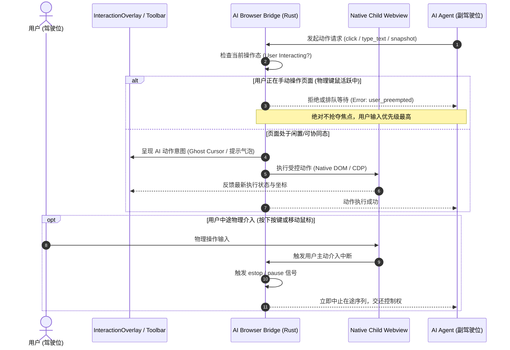
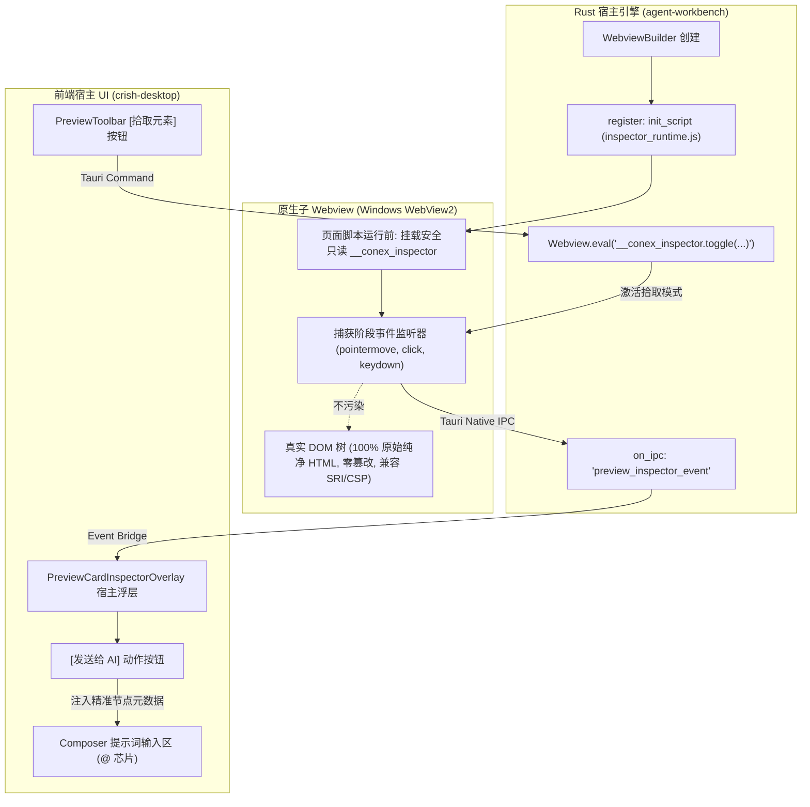
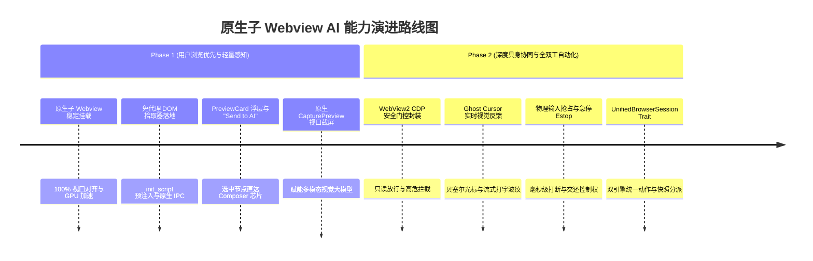

# 原生子 Webview 改造下 AI 自动化能力集成与 CDP 延伸分析报告

> **文档标识**：`docs/native-browser-overhaul/analysis/06-ai-interop-and-cdp-capabilities.md`  
> **责任领域**：AI Agent 协同 / 浏览器自动化 / CDP 协议集成 / DOM 拾取与视觉感知  
> **遵循规范**：`AGENTS.md`（反退避与通用协作纪律）、`ANTI_OVERENGINEERING_GUARDRAILS.md`、UTF-8 编码无 BOM  
> **相关代码基线**：  
> - `apps/agent-workbench/src-tauri/src/browser/`（`mod.rs`, `frame_stream.rs`, `mcp_attach.rs`, `panel_input.rs`）  
> - `crates/conex-browser/`（CDP 会话管理、action 执行器、快照生成与无头/有头配置）  
> - `apps/crish-desktop/src/components/workspace/PreviewCardInspectorOverlay.tsx` 与 `previewHostBridge.ts`  
> - `apps/crish-desktop/dev-server/previewBridgeScript.ts`（历史 dev 代理注入桥）  
> - `reference/pi-desktop/docs/zh-CN/spec/08-meta/decisions-log.md`（D333 代理 CDP 门控与用户主导原则、ADR 0170、ADR 0211）

---

## 目录

- [一、执行摘要与核心设计理念](#一执行摘要与核心设计理念)
  - [1.1 现状与重构动因](#11-现状与重构动因)
  - [1.2 架构跃迁全景概览](#12-架构跃迁全景概览)
- [二、双重角色模型：用户驾驶为主 vs AI 按需协同](#二双重角色模型用户驾驶为主-vs-ai-按需协同)
  - [2.1 吸收 pi-desktop 架构哲学 (D333 / ADR 0170 / ADR 0211)](#21-吸收-pi-desktop-架构哲学-d333--adr-0170--adr-0211)
  - [2.2 用户主权保障机制 (User Sovereignty & No Focus Stealing)](#22-用户主权保障机制-user-sovereignty--no-focus-stealing)
  - [2.3 AI 介入安全边界与权限门控 (Security Boundary & Gate Policies)](#23-ai-介入安全边界与权限门控-security-boundary--gate-policies)
- [三、DOM 检查与拾取 (Inspect Tool) 的原生 Webview 重塑](#三dom-检查与拾取-inspect-tool-的原生-webview-重塑)
  - [3.1 既有 dev 代理 HTML 篡改方案的痛点与局限](#31-既有-dev-代理-html-篡改方案的痛点与局限)
  - [3.2 基于 `init_script` + `eval` 的零侵入式 DOM 拾取架构](#32-基于-init_script--eval-的零侵入式-dom-拾取架构)
  - [3.3 拾取运行时 (Inspector Runtime) 算法与元数据提取](#33-拾取运行时-inspector-runtime-算法与元数据提取)
  - [3.4 宿主 IPC 通道与 UI 浮层 (`PreviewCardInspectorOverlay`) 对接](#34-宿主-ipc-通道与-ui-浮层-previewcardinspectoroverlay-对接)
  - [3.5 语义化节点直通 AI 上下文 ("Send to AI" & Composer 芯片契约)](#35-语义化节点直通-ai-上下文-send-to-ai--composer-芯片契约)
- [四、原生 CDP 与自动化工具链的兼容性与未来分工](#四原生-cdp-与自动化工具链的兼容性与未来分工)
  - [4.1 Windows WebView2 原生 DevToolsProtocol 深度剖析](#41-windows-webview2-原生-devtoolsprotocol-深度剖析)
  - [4.2 三重浏览器自动化形态的定位与边界划分](#42-三重浏览器自动化形态的定位与边界划分)
  - [4.3 统一自动化抽象层：WebView2 对接 `conex-browser` SessionOps Trait](#43-统一自动化抽象层webview2-对接-conex-browser-sessionops-trait)
  - [4.4 Agent 截屏能力与多模态视觉感知 (Multimodal Visual Grounding)](#44-agent-截屏能力与多模态视觉感知-multimodal-visual-grounding)
- [五、分阶段演进路线图 (Phase 1 vs Phase 2)](#五分阶段演进路线图-phase-1-vs-phase-2)
  - [5.1 Phase 1：极致原生浏览与轻量 AI 感知 (User First & Non-invasive Inspection)](#51-phase-1极致原生浏览与轻量-ai-感知-user-first--non-invasive-inspection)
  - [5.2 Phase 2：深度具身协同与全双工自动化 (Deep AI Co-pilot & Dual-Engine Synergy)](#52-phase-2深度具身协同与全双工自动化-deep-ai-co-pilot--dual-engine-synergy)
- [六、风险评估、防御策略与反过度设计守则](#六风险评估防御策略与反过度设计守则)
  - [6.1 反过度设计硬性约束与边界清退](#61-反过度设计硬性约束与边界清退)
  - [6.2 异常与并发安全矩阵](#62-异常与并发安全矩阵)

---

## 一、执行摘要与核心设计理念

### 1.1 现状与重构动因

在 Conex 桌面应用的历史演进中，针对“Web 内容展示与自动化”曾存在两条割裂的支线：
1. **旧式 AI 受管浏览器（Canvas 帧流投屏）**：基于后台独立启动的 Chromium 进程，通过 Tauri Channel 将 JPEG 压缩帧推送至前端 `<FrameCanvas>`，在上面覆盖透明 `<InputLayer>` 进行鼠标坐标反算，并通过动态 1px 移动 `<input>` 伪装 IME 输入法桥接（`apps/agent-workbench/src-tauri/src/browser/frame_stream.rs`, `panel_input.rs`）。该方案不仅带来了 15%~35% 的无谓 CPU 占用与 100~300ms 的交互迟滞，更无法支持原生划词高亮、Selection、原生右键菜单以及现代操作系统级 TSF 输入法。
2. **应用预览卡片（`PreviewCard` iframe 预览）**：基于 React 内嵌 `<iframe>` 呈现本地 Web 应用。为了支持 DOM 拾取（Inspect Tool），在 Vite dev server 层编写了 `crishPreviewProxyPlugin`，在代理转发时强行篡改目标 HTML并在 `<head>` 中注入 `__conex_preview_bridge` 脚本（`dev-server/previewBridgeScript.ts`）。该机制不仅无法访问外部真实网站（受 `X-Frame-Options`、CSP 与跨域 Sandbox 拦截），还存在注入破坏 SRI（Subresource Integrity）及跨源 postMessage 不稳定的严重隐患。

随着本次 **原生子 Webview 改造（Native Child Webview Overhaul）** 的推进，工作区右侧面板将直接嵌入 OS 原生子 Webview（在 Windows 上为由 Tauri / Wry 托管的 `ICoreWebView2Controller` 硬件加速窗口）。这为 Conex 的 AI 自动化能力带来了全新的架构飞跃：
- **物理视口统一**：彻底告别 Canvas 假象与 iframe 限制，全量 Web 网页（本地 localhost 或外部真实 HTTPS 站点）获得 60/120fps 原生流畅度；
- **零侵入 DOM 交互**：告别代理层篡改 HTML，直接依托原生 Webview 的 `init_script`（在 DOM 构建前注入轻量探针）与宿主级 `eval`，实现无视同源限制的毫秒级高精度 DOM 拾取；
- **原生 CDP 原生赋能**：Windows WebView2 内核天然原生支持 Chrome DevTools Protocol（`CallDevToolsProtocolMethod`），AI 具备直接调用底层调试器能力的可能，无需在后台额外维护冗余的无头浏览器进程。

### 1.2 架构跃迁全景概览

```
┌─────────────────────────────────────────────────────────────────────────────┐
│                       Crish Desktop (Native Host Window)                    │
├─────────────────────────────────────────────────────────────────────────────┤
│ ┌─────────────────────────────────────────────────────────────────────────┐ │
│ │  PreviewToolbar (32px 标准工具栏: 导航、地址栏、Inspect 开关、AI 协同指示器) │ │
│ └─────────────────────────────────────────────────────────────────────────┘ │
│ ┌─────────────────────────────────────────────────────────────────────────┐ │
│ │  PreviewCardInspectorOverlay (宿主绝对定位高颜值浮层: 悬停高亮/选中卡片)    │ │
│ └─────────────────────────────────────────────────────────────────────────┘ │
│ ┌─────────────────────────────────────────────────────────────────────────┐ │
│ │  Native Child Webview (Tauri / Wry OS-Level Sub-Webview)                │ │
│ │   ┌───────────────────────────────────────────────────────────────────┐ │ │
│ │   │ Injected Inspector Runtime (via init_script / evaluate_script)     │ │ │
│ │   │   • Pointer/Click 捕获 • Selector & XPath 计算 • Rect 测量          │ │ │
│ │   │   • 真实 ComputedStyle 提取 • 安全阻断与 Esc 快捷取消               │ │ │
│ │   └───────────────────────────────────────────────────────────────────┘ │ │
│ │   ┌───────────────────────────────────────────────────────────────────┐ │ │
│ │   │ Target Web Application (Local Vite/Next Dev Server or Public Web) │ │ │
│ │   │   • 原生 60/120fps 渲染 • 原生 TSF IME • 原生划词与 ContextMenu    │ │ │
│ │   └───────────────────────────────────────────────────────────────────┘ │ │
│ └─────────────────────────────────────────────────────────────────────────┘ │
└──────────────────────────────────────▲──────────────────────────────────────┘
                                       │ Tauri IPC (__TAURI_INTERNALS__.invoke)
                                       │ / CoreWebView2.CallDevToolsProtocolMethod
┌──────────────────────────────────────┴──────────────────────────────────────┐
│                  Rust Backend Engine (apps/agent-workbench)                 │
│ ┌─────────────────────────────────────────────────────────────────────────┐ │
│ │ NativeBrowserManager (子 Webview 几何同步、生命周期、init_script 装配)     │ │
│ └─────────────────────────────────────────────────────────────────────────┘ │
│ ┌─────────────────────────────────────────────────────────────────────────┐ │
│ │ AI Browser Bridge (D333 门控安全代理: 读写权限隔离、急停 Estop 周期管理)   │ │
│ └─────────────────────────────────────────────────────────────────────────┘ │
│ ┌──────────────────────────────────┐   ┌──────────────────────────────────┐ │
│ │ WebView2 Native CDP Facade       │   │ conex-browser Heavy Worker Pool  │ │
│ │ (当前视口: Inspect, 截屏, 高亮)  │   │ (后台批处理: 爬虫, 多页面自动化) │ │
│ └──────────────────────────────────┘   └──────────────────────────────────┘ │
└─────────────────────────────────────────────────────────────────────────────┘
```

---

## 二、双重角色模型：用户驾驶为主 vs AI 按需协同

### 2.1 吸收 pi-desktop 架构哲学 (D333 / ADR 0170 / ADR 0211)

在设计人机协同浏览器时，最容易犯的工程错误是“将浏览器完全交给 Agent 控制”，导致用户丧失掌控感。业界成熟工程实践 `reference/pi-desktop/` 在 D333（`decisions-log.md:3363-3375`）与配套的架构决策记录 ADR 0170、ADR 0211 中确立了关键准则，本方案全面吸收并本土化落地：

1. **宿主拥有 Guest，用户主导驾驶（Host-Owned Guest, User in the Driver's Seat）**：
   - 浏览器视图不是完全暴露给 AI 的游乐场，而是**宿主拥有的工作台组件**。
   - 用户保留绝对优先的操作权：随时可以打断 AI、手动点击链接、滚动页面、输入文本；用户正在交互时，AI 的自动化指令必须主动让道或挂起。
2. **动作分级与只读安全门禁（Plan-Safe Actions vs Mutating Actions，ADR 0211）**：
   - **只读检查动作（Plan-Safe Actions）**：`navigate`（只读跳转）、`snapshot`（页面结构快照）、`screenshot`（全屏/局部截屏）、`console`（读取控制台日志）。在规划阶段（Plan/Goal 模式）即可安全调用，无需反复弹窗打扰用户。
   - **状态变更动作（Agent Mutating Actions）**：`click`、`fill`、`evaluate`、`cdp`（底层注入）。具有副作用，仅在经过用户显式授权或进入特定执行阶段时才允许触发，严禁偷跑。
3. **CDP 白名单与安全默认拒绝（Raw CDP Deny-by-Default，D333 Clause 4）**：
   - 严禁向 AI 或外部扩展盲目暴露无过滤的原始 DevTools WebSocket；
   - 敏感域绝对拦截：拒绝 `Storage.clearDataForOrigin`、拒绝全量凭证窃取 `Network.getAllCookies`、拒绝任意目标注入 `Target.createTarget`。

### 2.2 用户主权保障机制 (User Sovereignty & No Focus Stealing)

为了彻底解决传统自动化中“抢焦点、画面乱跳、黑盒突变”带来的恐惧感，原生子 Webview 确立三项用户主权铁律：



1. **后台静默与焦点保护（No Focus Stealing）**：
   - AI 在后台读取 DOM 树、执行 `snapshot` 或分析控制台日志时，绝不调用 Windows API `SetFocus` 抢夺系统焦点；
   - 用户在主界面输入代码或在 Composer 撰写提示词时，原生子 Webview 保持纯粹的背景执行，打字光标绝不漂移。
2. **物理输入优先抢占（Preemption on Physical Input）**：
   - 通过原生 Webview 钩子监听用户的实际物理鼠标移动与键盘按键；
   - 当检测到用户物理操作时，若当前有正在进行的 AI 流式动作（如打字、多步滚动），底层自动触发暂缓或取消机制，用户操作拥有 0 延迟绝对响应权。
3. **具身化可见反馈（Visually Grounded Feedback）**：
   - AI 执行操作时必须伴随界面视觉提示（通过外层浮层或 Webview 内非侵入高亮）；
   - 用户肉眼能够实时看到“AI 正在查看哪块区域”、“AI 准备点击哪个按钮”，消除黑盒未知感。

### 2.3 AI 介入安全边界与权限门控 (Security Boundary & Gate Policies)

在原生 Webview 体系下，AI 的操作范围被收敛在严格的安全矩阵内：

| 动作类型 | 代表指令 | 权限级别 | 适用模式 | 凭据/敏感信息保护策略 |
|---|---|---|---|---|
| **视觉与结构快照** | `screenshot`, `snapshot`, `get_title`, `get_url` | 低风险 (Auto-Allow) | Plan / Agent / Goal | 自动脱敏密码框（`<input type="password">` 替换为占位块），清除敏感 Token 文本。 |
| **页面元素拾取** | `inspect_element`, `query_selector` | 低风险 (Auto-Allow) | 全模式 | 仅提取 DOM 标签名、类名、选择器与布局矩形，不上传私密用户输入内容。 |
| **安全只读导航** | `navigate` (同源或公共域名) | 中风险 (Policy-Gated) | Plan / Agent | 受到 `DomainGate` 白名单检查；禁止访问 `file:///` 根目录或敏感内网元数据服务（如 `169.254.169.254`）。 |
| **交互表单与输入** | `type_text`, `click`, `select_option` | 高风险 (Agent-Gated) | Agent 专属 | 遇敏感支付确认、密码修改等场景触发显式确认；输入事件严格限制在当前视口内。 |
| **脚本执行与 CDP** | `evaluate_script`, `raw_cdp` | 极高风险 (Strict-Gated) | Agent 专属 (白名单) | 严格禁止 `eval` 读取跨域 Cookie；CDP 层面硬阻断 `Storage` 清除与 `Network` 凭据拦截域。 |

---

## 三、DOM 检查与拾取 (Inspect Tool) 的原生 Webview 重塑

### 3.1 既有 dev 代理 HTML 篡改方案的痛点与局限

当前工作区中的 DOM 拾取工具（PreviewCard Inspector）依赖于代理层动态注入（`apps/crish-desktop/dev-server/previewBridgeScript.ts` 与 `PreviewCardInspectorOverlay.tsx`）。其核心实现机制与问题如下：

```
【既有方案链路】：
Vite Dev Server 代理 ──(篡改 HTML 响应体)──> 注入 <script id="__conex_preview_bridge"> 
  ──> 浏览器 iframe 执行 ──(window.parent.postMessage)──> 宿主 React 监听 message 
  ──> 绘制 PreviewCardInspectorOverlay 浮层
```

**致命局限分析**：
1. **范围受限，无法覆盖外部 URL**：由于必须经过 dev-server 代理才能注入脚本，当用户或 Agent 在预览窗口打开外部服务（如在线文档、生产环境网页、SaaS 控制台）时，代理注入完全失效，Inspect 功能瞬间瘫痪。
2. **破坏前端完整性校验与安全策略**：
   - 动态修改 HTML 响应体直接导致现代构建工具的 **SRI (Subresource Integrity)** 校验崩溃；
   - 注入的内联 `<script>` 会被严格的 **CSP (Content-Security-Policy)** 策略阻断（报 `Refused to execute inline script because it violates CSP directive` 错误）。
3. **跨源通信脆弱与时序赛跑**：
   - iframe 的 `postMessage` 依赖于 `TARGET_ORIGIN` 的推断（`previewBridgeScript.ts:35-41`）；一旦页面重定向或发生复杂多源跳转，postMessage 管道立即断裂；
   - 在页面重载初期，宿主经常在桥接脚本尚未初始化的空档期发出 `INSPECT_TOGGLE`，导致事件丢失，界面卡在无法拾取的假死状态。

### 3.2 基于 `init_script` + `eval` 的零侵入式 DOM 拾取架构

在原生子 Webview 改造下，**彻底废除 dev 代理层对 HTML 的任何篡改**。利用操作系统与内核赋予宿主的底层特权，采用 **`init_script` (预加载脚本) + `evaluate_script` (运行时动态调用)** 的正交优雅方案：



#### (1) `init_script` 的底层保障
- **加载时机绝对在先**：在 WebView2 中对应 `ICoreWebView2.AddScriptToExecuteOnDocumentCreated`。该脚本在任何 HTML DOM 解析前、任何站点自己的 JavaScript 执行前注入运行，彻底杜绝了“页面加载时序赛跑导致桥失效”的问题；
- **CSP 免疫**：宿主注入的 `init_script` 运行在内核特权层，天然不受网页端 CSP `script-src` 规则的约束；
- **全网通用**：无论是本地 `localhost:5173`，还是跨国 HTTPS 真实站点（如 GitHub、MDN），全生命周期稳定常驻。

#### (2) 宿主动态控制 (`eval`)
- 仅当用户点击工具栏的“拾取元素”按钮或 AI 触发拾取工具时，宿主调用 `webview.eval("__conex_inspector.setActive(true)")`；
- 退出拾取时（用户点击目标、按 Escape 键或切页），直接调用 `__conex_inspector.setActive(false)`，捕获器立即卸载，零运行时多余性能损耗。

### 3.3 拾取运行时 (Inspector Runtime) 算法与元数据提取

注入的 `inspector_runtime.js` 必须保持极致轻量（压缩后 `< 4KB`），且绝不引入任何第三方依赖。其核心算法对齐现有契约并进一步加固：

```javascript
// inspector_runtime.js (通过 init_script 注册的轻量单例)
(function() {
  if (window.__CONEX_INSPECTOR_MOUNTED__) return;
  window.__CONEX_INSPECTOR_MOUNTED__ = true;

  let active = false;
  let hoveredElement = null;

  // 1. 精确计算视口绝对矩形 (防浮点抖动)
  function getElementRect(el) {
    const r = el.getBoundingClientRect();
    return {
      x: Math.round(r.x * 10) / 10,
      y: Math.round(r.y * 10) / 10,
      width: Math.round(r.width * 10) / 10,
      height: Math.round(r.height * 10) / 10
    };
  }

  // 2. 稳健语义选择器算法 (ID 优先，语义 Class 降级，避免哈希混淆 Class)
  function computeBestSelector(el) {
    if (!el || el.nodeType !== 1) return '';
    if (el.id && !/^[0-9]/.test(el.id)) {
      return '#' + CSS.escape(el.id);
    }
    const tag = el.tagName.toLowerCase();
    if (el.className && typeof el.className === 'string') {
      const classes = el.className.trim().split(/\s+/)
        .filter(c => Boolean(c) && !c.includes(':') && !/^css-[0-9a-f]+/.test(c)); // 过滤常见 CSS-in-JS 动态哈希
      if (classes.length > 0) {
        return tag + '.' + classes.slice(0, 2).map(c => CSS.escape(c)).join('.');
      }
    }
    return tag;
  }

  // 3. 稳健真实物理 XPath (带同级索引轴)
  function computeXPath(el) {
    if (!el || el.nodeType !== 1) return '';
    const parts = [];
    let curr = el;
    while (curr && curr.nodeType === 1 && curr !== document.documentElement) {
      let index = 1;
      let sib = curr.previousElementSibling;
      while (sib) {
        if (sib.tagName === curr.tagName) index++;
        sib = sib.previousElementSibling;
      }
      parts.unshift(`${curr.tagName.toLowerCase()}[${index}]`);
      curr = curr.parentElement;
    }
    parts.unshift('html');
    return '/' + parts.join('/');
  }

  // 4. 关键排版与几何 ComputedStyles 提取
  function extractComputedStyles(el) {
    const cs = window.getComputedStyle(el);
    return {
      display: cs.display || '',
      position: cs.position || '',
      color: cs.color || '',
      backgroundColor: cs.backgroundColor || '',
      fontSize: cs.fontSize || '',
      margin: cs.margin || '',
      padding: cs.padding || ''
    };
  }

  // 5. 事件上报通道 (原生 Tauri IPC，告别 postMessage)
  function notifyHost(type, payload) {
    if (window.__TAURI_INTERNALS__ && window.__TAURI_INTERNALS__.invoke) {
      window.__TAURI_INTERNALS__.invoke('preview_inspector_event', {
        event: { type, payload }
      }).catch(() => {});
    }
  }

  // 6. 事件捕获监听 (Capture 阶段，优先于业务拦截)
  window.addEventListener('pointermove', function(e) {
    if (!active) return;
    const el = document.elementFromPoint(e.clientX, e.clientY);
    if (!el || el === hoveredElement || el === document.documentElement || el === document.body) return;
    hoveredElement = el;
    notifyHost('INSPECT_HOVER', {
      tagName: el.tagName.toLowerCase(),
      selector: computeBestSelector(el),
      rect: getElementRect(el)
    });
  }, true);

  window.addEventListener('click', function(e) {
    if (!active) return;
    e.preventDefault();
    e.stopPropagation(); // 阻止真实页面跳转或业务提交
    const el = e.target;
    if (!el || el.nodeType !== 1) return;

    const attrs = {};
    for (let i = 0; i < el.attributes.length; i++) {
      const a = el.attributes[i];
      attrs[a.name] = a.value;
    }

    notifyHost('INSPECT_SELECT', {
      tagName: el.tagName.toLowerCase(),
      id: el.id || null,
      classes: el.className && typeof el.className === 'string' ? el.className.trim().split(/\s+/) : [],
      attributes: attrs,
      bestSelector: computeBestSelector(el),
      xpath: computeXPath(el),
      rect: getElementRect(el),
      computedStyles: extractComputedStyles(el),
      outerHtmlSnippet: (el.outerHTML || '').slice(0, 500),
      textContent: (el.textContent || '').trim().slice(0, 200)
    });
  }, true);

  window.addEventListener('keydown', function(e) {
    if (!active) return;
    if (e.key === 'Escape') {
      window.__conex_inspector.setActive(false);
      notifyHost('INSPECT_TOGGLE', { enabled: false });
    }
  }, true);

  // 导出宿主控制句柄
  window.__conex_inspector = {
    setActive: function(val) {
      active = Boolean(val);
      if (!active) hoveredElement = null;
    }
  };
})();
```

### 3.4 宿主 IPC 通道与 UI 浮层 (`PreviewCardInspectorOverlay`) 对接

新架构不仅提升了底层执行效率，更保持了上层 UI 资产的 100% 兼容。在 `apps/crish-desktop/src/components/workspace/PreviewCardInspectorOverlay.tsx` 中，既有的高颜值悬停框与选中 Badge 无需推倒重来：
- **无缝契约适配**：Rust 端收到 `preview_inspector_event` 后，通过 Tauri Event（`preview://inspector`）广播给前端，`previewHostBridge.ts` 监听该事件并原样格式化为 `PreviewInspectorEvent`；
- **坐标系精确映射**：由于子 Webview 在宿主窗口中的物理偏移已知（例如 `top: 70px`, `left: 0px`），浮层的 `hoverElement.rect` 加上子 Webview 容器的相对偏移，悬停框能够毫发不差地贴合在目标 DOM 元素四周，彻底告别 iframe 滚动偏差错位的顽疾；
- **键盘联动 Esc 即刻取消**：Webview 内按 Escape 与宿主快捷键统一拦截，两端状态瞬间同步关闭。

### 3.5 语义化节点直通 AI 上下文 ("Send to AI" & Composer 芯片契约)

用户点击目标元素后，`PreviewCardInspectorOverlay.tsx` 的“发送给 AI”按钮将被激活。在新架构下，该动作与 Composer 的上下文协议深度打通：

```typescript
// 触发 onSendToAi 时的结构化数据注入
const handleSendToAi = () => {
  if (!selectedElement) return;

  // 构建标准 DOM 引用数据块 (对齐 @ 引用芯片规范)
  const domContextPayload = {
    kind: 'dom_element',
    label: `<${selectedElement.tagName}${selectedElement.id ? `#${selectedElement.id}` : ''}>`,
    selector: selectedElement.bestSelector,
    xpath: selectedElement.xpath,
    rect: selectedElement.rect,
    styles: selectedElement.computedStyles,
    snippet: selectedElement.outerHtmlSnippet,
    textContent: selectedElement.textContent
  };

  // 派发至全局 Composer 会话草稿 (非纯文本粗暴拼贴，而是带有可解析元数据的交互芯片)
  composerStore.insertDomChip(domContextPayload);
};
```

**AI Agent 视角收益**：
当用户提问“把这个按钮改成红色并加宽 20px”并附带该 DOM 芯片时，Agent 的 Prompt 中直接携带了明确的 `bestSelector`（如 `button.submit-btn.primary`）与 `xpath`（如 `/html/body/div[1]/main/form/button[2]`），模型再也无需“盲猜页面结构”，也无需额外执行多次昂贵的全页 Snapshot 查询，单轮命中修改目标文件，大幅节约 Token 并提升精准度。

---

## 四、原生 CDP 与自动化工具链的兼容性与未来分工

### 4.1 Windows WebView2 原生 DevToolsProtocol 深度剖析

现代 Windows 桌面环境下，WebView2 不仅是一个渲染容器，更内置了完整的 Chromium 调试通道。微软官方公开支持 DevTools 协议原生集成：
- **异步调用接口**：`ICoreWebView2::CallDevToolsProtocolMethod(method, json_params, handler)`
- **事件接收机制**：`ICoreWebView2::GetDevToolsProtocolEventReceiver(event_name, receiver)`

在 Rust 栈中，通过 `wry` / `tauri` 的 Windows 扩展接口，可以无损解包出底层原始 COM 指针：

```rust
// 概念代码：在 Tauri / Wry 环境下挂接 WebView2 的 DevToolsProtocol
#[cfg(target_os = "windows")]
use webview2_com::Microsoft::Web::WebView2::Win32::ICoreWebView2;

pub fn execute_native_cdp(
    core_webview: &ICoreWebView2,
    domain_method: &str,
    params_json: &str,
) -> Result<String, CdpError> {
    // 通过 COM 接口直接与当前子 Webview 的 Chromium 内核对话
    // 零网络端口暴露，零 WebSocket 握手，直接进程内管道传输
    ...
}
```

**与传统无头 Chrome WebSocket CDP 方案相比的核心技术优势**：
1. **零外部网络暴露（Zero Port Exposure）**：传统 CDP 需要开放 `127.0.0.1:<port>` 甚至产生端口争抢（如 9222 端口冲突事故），而 WebView2 的 COM 接口完全处于进程内部，不受任何网络安全软件或防火墙误杀；
2. **单一真源上下文（Single Source of Truth Context）**：AI 操作的页面**正是用户眼前看到的页面**。共享相同的 LocalStorage、Session Cookie、用户已登录态与正在进行的动画，无需复杂的 Session 导出与跨进程同步；
3. **极低资源开销**：复用已经存在的渲染进程，无须额外拉起 300MB+ 内存的无头浏览器进程。

### 4.2 三重浏览器自动化形态的定位与边界划分

在重构后的全景蓝图中，必须明确界定 **Native Child Webview**、**`conex-browser` 受管后台实例** 与 **`chrome-devtools-mcp` 外部适配器** 三者的职责分工，坚决杜绝功能重叠与架构臃肿：

```
┌──────────────────────────────────────────────────────────────────────────────────┐
│                   Conex 浏览器与自动化能力三大支柱协同矩阵                       │
├────────────────────────┬────────────────────────┬────────────────────────────────┤
│ 1. Native Child Webview│ 2. conex-browser 引擎  │ 3. chrome-devtools-mcp         │
│ (前端工作区子 Webview) │ (后台受管独立进程池)   │ (外部通用 MCP 桥接器)          │
├────────────────────────┼────────────────────────┼────────────────────────────────┤
│ 【定位】：             │ 【定位】：             │ 【定位】：                     │
│ 桌面主窗口内第一方实时 │ 独立于主 UI 的重型后台 │ 标准 MCP 协议开放接口，面向    │
│ 交互与可视化调试面板   │ 批处理与隔离执行引擎   │ 外部客户端 (Cursor/Claude)     │
├────────────────────────┼────────────────────────┼────────────────────────────────┤
│ 【核心职责】：         │ 【核心职责】：         │ 【核心职责】：                 │
│ • 用户主导日常浏览调试 │ • 长时间离线爬虫与批处理│ • 满足外部通用 Agent 接入规范 │
│ • 零代理免篡改 DOM 拾取│ • 多页面并发自动化测试 │ • 桥接受管端点或本地 Chrome   │
│ • AI 实时视觉协同反馈  │ • 高风险/未知脚本隔离沙箱│ • 受 mcp_attach_allowed 保护   │
│ • 视口所见即所得截屏   │ • 跨平台无头 CI 流水线 │ • 零魔改既有 MCP 协议栈        │
├────────────────────────┼────────────────────────┼────────────────────────────────┤
│ 【驱动通道】：         │ 【驱动通道】：         │ 【驱动通道】：                 │
│ init_script + DOM 事件 │ WebSocket CDP 全双工   │ 标准 Stdio / HTTP MCP JSON-RPC │
│ + 受限 WebView2 原生CDP│ + 完备 action::executor│ (经 cmd /c npx 在 Windows 分派)│
└────────────────────────┴────────────────────────┴────────────────────────────────┘
```

### 4.3 统一自动化抽象层：WebView2 对接 `conex-browser` SessionOps Trait

为了防止出现“一套代码操作 WebView2，另一套代码操作 conex-browser”的代码分裂问题，系统通过 Rust Trait 抽象统一会话接口：

```rust
// 统一会话操作 Trait (对接已有的 SessionOps 与 ActionExecutor)
#[async_trait]
pub trait UnifiedBrowserSession: Send + Sync {
    /// 执行页面跳转
    async fn navigate(&self, url: &str) -> Result<(), ToolError>;
    /// 获取精简版无障碍/DOM 结构快照
    async fn capture_snapshot(&self, budget: &BudgetConfig) -> Result<SnapshotView, ToolError>;
    /// 获取当前视口高清截图 (PNG / JPEG)
    async fn capture_screenshot(&self) -> Result<Vec<u8>, ToolError>;
    /// 执行安全评估脚本
    async fn evaluate_safe(&self, script: &str) -> Result<serde_json::Value, ToolError>;
    /// 执行动作请求 (Click, TypeText, Scroll)
    async fn execute_action(&self, req: ActionRequest) -> Result<ActionSuccess, ToolError>;
}
```

- **实现 A (`NativeWebviewSession`)**：基于原生子 Webview 包装。动作执行时优先通过 DOM Bridge 派发原生 W3C 事件（触发 CSS `:hover`、`:active` 并穿透 React `_valueTracker`），辅以 WebView2 原生 CDP 执行只读测量与快照；
- **实现 B (`DedicatedChromiumSession`)**：基于 `conex-browser` 原有逻辑包装，通过 WebSocket CDP 发往后台独立实例；
- **上层工具透明透明消费**：Agent 侧的工具定义（`browser_click`, `browser_snapshot`, `browser_type`）面向 `UnifiedBrowserSession` 编程，根据会话槽当前绑定的目标动态分派，实现资产 100% 共享。

### 4.4 Agent 截屏能力与多模态视觉感知 (Multimodal Visual Grounding)

为赋能现代多模态大模型（Vision LLM）的“视觉对齐与界面理解”，原生子 Webview 提供了纳秒级捕获能力：
1. **原生 `CapturePreview`**：WebView2 内置 `CapturePreview(COREWEBVIEW2_CAPTURE_PREVIEW_IMAGE_FORMAT_PNG, stream)`，直接从 GPU 渲染缓冲区拉取最新像素，无需走 CDP 序列化编码，性能高达 60fps 单帧截取；
2. **元素级局部裁剪截屏**：结合拾取器获取的 `rect`（视口坐标与设备像素比 DPR），在 Rust 端通过 `image` / `miniz_oxide` 对全屏图像进行快速内存裁剪，仅将关注区域（如报错弹窗、渲染异常按钮）打包送入大模型，大幅节约多模态 Token 开销；
3. **视觉标注（Visual Grounding & Marking）**：在截屏传递给模型前，可选择性在图像上标注元素编号（Set-of-Mark 机制），模型直接指代“点击 [3] 号按钮”，与本地拾取器坐标形成完美的双重校验闭环。

---

## 二维矩阵对比：重构前后 AI 自动化与 DOM 交互能力

| 评估维度 | 既有实现 (Canvas帧流 / dev代理iframe) | 原生子 Webview 改造后新架构 | 收益与架构意义 |
|---|---|---|---|
| **页面兼容性** | 仅限代理转发的同源/内网页面，外部网站 CSP/X-Frame-Options 拦截 | 100% 支持全网任意页面 (本地 localhost + 外部 HTTPS 生产站) | 彻底解决真实应用无法调试的痛点 |
| **HTML 侵入性** | 服务端拦截篡改 HTML，硬塞 `<script>`，破坏 SRI 校验 | 0 篡改，通过内核 `init_script` 预挂载，原汁原味 | 杜绝页面破坏与水合异常 |
| **拾取响应延迟** | postMessage 跨源协商，时序赛跑易卡死 (50ms~200ms) | 原生捕获阶段事件监听，Tauri 原生 IPC 直通 (`< 5ms`) | 极致丝滑的悬停与选中体验 |
| **用户主权控制** | 旧式输入层无差别拦截，易抢焦点，IME 频繁丢字 | 物理输入绝对优先抢占，只读与变更严格门控，无焦点偷窃 | 尊重用户驾驶位，消除 AI 突变恐惧 |
| **CDP 通道能力** | 依赖后台拉起无头 Chrome，开额外端口与 WebSocket | Windows WebView2 原生 DevToolsProtocol 内部直通 | 零端口暴露，共享已登录态，极低开销 |
| **系统资源消耗** | 持续 JPEG 截帧与 Canvas 重绘 (CPU 15%~35%) | 原生 GPU 硬件加速合成，闲置时 CPU 0% 占用 | 消除风扇狂转与电池暴降 |

---

## 五、分阶段演进路线图 (Phase 1 vs Phase 2)

为了遵循精益工程与反过度设计守则，AI 自动化能力的接入必须与原生子 Webview 的生命周期稳步推进，分为两阶段落地：



### 5.1 Phase 1：极致原生浏览与轻量 AI 感知 (User First & Non-invasive Inspection)

**核心目标**：实现用户端 100% 原生流畅浏览体验，并落地非侵入式的 DOM 拾取与向 AI 传递精准上下文的能力。

#### 具体任务与边界：
1. **子 Webview 宿主挂载与几何裁剪**：
   - 完成 Tauri 子 Webview 的创建与位置锁定，与工作区 `PreviewCard` 的 Body 区域实现精准像素对齐；
   - 彻底下线 `dev-server/previewBridgeScript.ts` 的代理注入逻辑。
2. **`init_script` 轻量拾取探针挂载**：
   - 在 Rust 端创建 Webview 时注册只读轻量探针代码 `inspector_runtime.js`；
   - 暴露 `preview_inspector_event` Tauri IPC 接收端点。
3. **前端 UI 资产无损对接**：
   - `previewHostBridge.ts` 适配 Tauri 事件总线，桥接 `INSPECT_HOVER` 与 `INSPECT_SELECT`；
   - `PreviewCardInspectorOverlay.tsx` 承接拾取高亮展示，保留“复制选择器”、“复制 HTML 片段”与“发送给 AI”交互；
   - 拾取结果以结构化芯片形式注入 Composer，使模型直接获得高可信选择器与 XPath。
4. **原生快照与视口截屏能力**：
   - 接入 WebView2 原生 `CapturePreview`，向 AI 提供当前视口高清图像；
   - 结合 DOM 探针提供基础的文本与标题提取。

### 5.2 Phase 2：深度具身协同与全双工自动化 (Deep AI Co-pilot & Dual-Engine Synergy)

**核心目标**：实现“用户为主、AI 为辅”的双模具身化协同驱动，解锁原生 CDP 深度能力与统一抽象。

#### 具体任务与边界：
1. **WebView2 CDP 原生门控封装**：
   - 封装 Windows `ICoreWebView2::CallDevToolsProtocolMethod` 安全代理；
   - 严格执行 D333 式白名单门控（允许 DOM/CSS/Page 只读查询，阻断全量 Cookie 窃取与 Storage 擦除）。
2. **具身化视觉反馈体系（Visual Feedback Overlay）**：
   - 外层挂载 `InteractionOverlay`（`pointer-events: none`），当 AI 执行动作时绘制虚拟幽灵光标（三次贝塞尔平滑轨迹）与点击水波纹；
   - 实现拟真流式打字器（Streaming Typing Pacer），用户肉眼清晰可辨 AI 的每一步操作。
3. **用户物理抢占与 Estop 急停总线**：
   - 挂接底层输入钩子，一旦检测到用户主动移动鼠标或敲击键盘，毫秒级发出暂停信号，AI 动作平滑让步；
   - 深度集成 Rust 端 `BrowserSlot::reset_estop` / `cancel_estop` 机制，支持用户随时一键终止。
4. **统一自动化 Trait（`UnifiedBrowserSession`）**：
   - 将 Native Child Webview 的驱动能力抽象为统一 Trait，与 `conex-browser` 独立后台进程池共享上层 Agent 工具定义；
   - 实现“前台轻量协同走 Native Webview，后台大体量并发走 conex-browser 独立池”的双模自适应架构。

---

## 六、风险评估、防御策略与反过度设计守则

### 6.1 反过度设计硬性约束与边界清退

遵循仓库根目录 `ANTI_OVERENGINEERING_GUARDRAILS.md`，严格划定本方案的技术红线：

1. **坚决不再造“伪浏览器”**：
   - 严禁任何试图在前端通过 Canvas 逐帧重绘或透明 DOM 拦截来模拟浏览器的回潮企图；
   - 严禁使用复杂的隐藏 `<input>` 机制来修补输入法问题，全要素交互必须交付给 OS 原生 Webview 处理。
2. **严禁无意义的复杂 RPC 封装**：
   - 拾取器与宿主通信直接使用 Tauri 原生 IPC，严禁在中间多套一层复杂的自研消息队列或状态推断机；
   - 不引入任何外部庞大的前端 DOM 测量库，拾取脚本保持纯原生标准 DOM API 实现。
3. **严格受控的 CDP 暴露面**：
   - 严禁直接向未认证环境开放任意 CDP WebSocket 端口，WebView2 的 CDP 调用完全限制在 Rust 宿主内核并经过安全白名单过滤。

### 6.2 异常与并发安全矩阵

| 潜在风险场景 | 影响面 | 防御与自愈策略 |
|---|---|---|
| **页面发生跨域重定向 / 刷新** | 拾取状态丢失或挂起 | `init_script` 会在每个新文档创建前自动重新执行并初始化；页面刷新时，Rust 宿主捕获 `navigation` 事件并自动向前端推送复位信号，清空既有拾取选择状态。 |
| **目标页面滥用 `event.stopPropagation()`** | 拾取点击或悬停被拦截 | 拾取探针的事件监听器一律在 **捕获阶段 (Capture Phase: `useCapture = true`)** 注册，在任何业务冒泡拦截前先行动作，确保 100% 捕获。 |
| **超大规模 DOM 导致内存爆炸** | 宿主 UI 或 IPC 瘫痪 | 拾取元数据在提取端施加刚性上限：`outerHtmlSnippet` 硬截断为 500 字符，`textContent` 硬截断为 200 字符，杜绝序列化大对象冲垮通道。 |
| **用户与 AI 同时发起操作冲突** | 页面状态错乱或输入串行污染 | 用户主权第一原则：底层输入管道监听物理按键，用户物理输入产生瞬间触发 AI 暂停，AI 在执行前必须校验用户闲置状态锁。 |
| **外部恶意网页尝试攻击 IPC** | 宿主命令注入或特权提升 | 注入的探针代码运行在私有闭包中，不向 `window` 暴露敏感方法；Tauri IPC 端点 `preview_inspector_event` 仅接受受限的几何与选择器结构，拒绝解析任何任意命令字符串。 |

---

## 结论与产出小结

本分析报告系统论证了在原生子 Webview 改造下，Conex AI 自动化能力的集成方向与未来演进路径：
1. **哲学对齐**：吸收 `pi-desktop`（D333 / ADR 0170 / ADR 0211）的核心经验，确立了“用户主驾驶、AI 副驾驶”的协同边界与严格的只读/变更权限分级；
2. **技术破局**：彻底废除了依赖 dev 代理篡改 HTML 的历史旧包袱，转向利用特权 `init_script` 与原生 IPC 的零侵入、全站点通用拾取方案，完美继承并强化了 `PreviewCardInspectorOverlay` 与 Composer 上下文能力；
3. **生态兼容**：清晰界定了 Native Child Webview、`conex-browser` 独立进程池与 `chrome-devtools-mcp` 的三维互补关系，并依托 Windows WebView2 原生 DevToolsProtocol 实现了免网络端口暴露的底层调试通道；
4. **精益演进**：给出了清晰的 Phase 1（用户浏览与轻量感知）与 Phase 2（具身协同与全双工自动化）实施路线图，为战役的稳健落地提供了坚实的技术指导与防退避依据。
