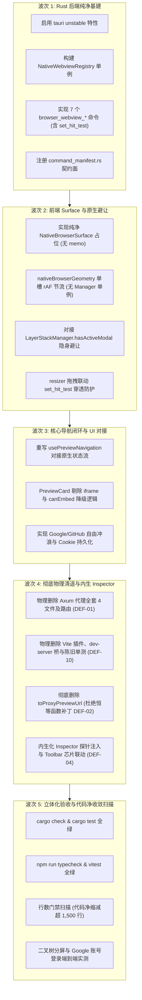

# 原生多 Webview 改造：架构优雅度、反补丁、反过度设计与清退彻底性专项审计报告

> **战役工作区**：`docs/native-browser-overhaul/`  
> **文档定位**：专项架构审计报告（Architecture & Code Elegance Audit）  
> **审计对象**：
> - 战役总方案：`docs/native-browser-overhaul/00-总方案-原生浏览器彻底改造与子Webview架构方案.md`
> - 调研与分析详案：`docs/native-browser-overhaul/analysis/01~06` 全量分析报告
> - 现有仓库代码基线：`apps/agent-workbench/src-tauri/src/server/`、`apps/crish-desktop/`、`ANTI_OVERENGINEERING_GUARDRAILS.md`  
> **审计基准**：用户最高裁决——**“非必要不兼容。不允许打补丁，不允许硬编码，有合理的抽象，适合未来的功能需求，代码尽量简洁，具有优秀的可维护性。需要删除的代码就删除，需要系统性的重构。”**  
> **输出规范**：UTF-8 无 BOM、直面问题、零虚夸、给出代码级彻底重构方案。

---

## 一、审计概述与总体裁定

本次专项审计针对 Conex 正在推进的“原生多 Webview 浏览器彻底改造”方案进行全维度架构审视。经细致逆向比对分析文档（01~06）、战役总方案（00）与当前代码库现状，得出总体审计裁定：

> [!CAUTION]
> **总体审计结论：方案骨架大方向正确，但局部存在严重的“死代码清退盲区、隐性双轨妥协、跨文档 IPC 精神分裂、对 Win32 物理合成规律认知断层及过度设计包装”硬伤。**
> 若直接按当前未经审计的总方案与分析文档施工，代码库将遗留超过 1,300 行未被清退的后端代理死代码，前端将陷入“恒等函数补丁”与“两套竞争性 rAF 防抖队列”的泥潭，且 Inspector 拾取工具在真实运行中将直接被 Win32 HWND 遮挡瘫痪。必须全面执行本报告提出的重构整改。

---

## 二、缺陷与风险清单（Defect & Risk Catalog）

按照严重级别划分为 **【高】（阻断性缺陷/严重违背铁律）**、**【中】（架构断层/过度设计/维护性隐患）**、**【低】（代码卫生/规范性问题）** 三级：

| 缺陷编号 | 严重级别 | 缺陷类型 | 缺陷名称与核心表象 | 违背的规则/红线 |
| :--- | :---: | :--- | :--- | :--- |
| **DEF-01** | **高** | 清退不彻底 | **后端 Axum 代理全套组件在总方案中被完全遗漏**（4 源码文件 + 路由超 1,350 行死代码残留） | “需要删除的代码就删除” |
| **DEF-02** | **高** | 妥协补丁 | **Doc 04 公然主张“第一阶段保持代理供降级兼容”及“将 `toProxyPreviewUrl` 改为恒等函数”** | “非必要不兼容，不允许打补丁” |
| **DEF-03** | **高** | 架构失谐 | **各分析文档 IPC 命令面命名与协议严重精神分裂，缺乏唯一真源（SSOT）** | 禁令 7（单一真相源 SSOT） |
| **DEF-04** | **高** | 物理断层 | **Win32 HWND 空域认知矛盾：方案一边确认子 HWND 置顶，一边企图在宿主 React DOM 绘制选框浮层** | 物理合成层叠冲突 |
| **DEF-05** | **高** | 安全越权 | **前端通过 IPC 越权向 Rust 下发任意 `data_directory` 物理路径** | 安全基线 / 禁令 7 |
| **DEF-06** | **中** | 过度设计 | **前端几何同步出现双重竞争性 rAF 队列与过度封装的单例 Facade（`NativeBrowserManager`）** | 禁令 11（严禁逐级转发虚假 Facade） |
| **DEF-07** | **中** | 方案互斥 | **分栏拖拽防粘手方案前后冲突：Doc 03 原生 API vs Doc 05 无效 React DOM 遮罩** | 逻辑闭环 / 真实有效性 |
| **DEF-08** | **中** | 盲目照搬 | **Doc 01/02 试图将 Electron `BrowserBackingHost` 与“单实例常驻槽位”生搬硬套到 Windows WebView2** | 禁令 1 / 禁令 11 |
| **DEF-09** | **中** | 过度设计 | **Doc 06 在首期设计了重型的“双引擎 Worker 线程池”与“全双工 CDP 多路复用代理”** | 禁令 10 / 禁令 11 |
| **DEF-10** | **中** | 清退遗漏 | **遗漏前端历史测试资产清理清单（导致源码删除后对应 test 报编译/类型断裂）** | 立体验证纪律 §7.1 |
| **DEF-11** | **低** | 滥用包装 | **对纯空占位组件 `NativeBrowserSurface` 盲目包裹 `React.memo`** | 禁令 12（严禁盲目包裹 React.memo） |
| **DEF-12** | **低** | 脏补丁 | **Toolbar 下拉菜单“限制下拉高度不超过 32px”的魔术数字补丁** | “不允许硬编码，不允许打补丁” |

---

## 三、核心缺陷根因深度剖析

### 3.1 根因 1：前后端视角盲区与“伪清退”（针对 DEF-01、DEF-10）
- **现象**：在 `00-总方案` §5 波次 4 中，任务清单只列出了删除前端 `crishPreviewProxyPlugin`、`previewBridgeScript.ts`、`sameOriginRequest.ts` 和 `toProxyPreviewUrl`。
- **事实深挖**：代码库在 `apps/agent-workbench/src-tauri/src/server/` 下还驻留着一整套为了支撑 iframe 预览而写的 **Axum 透明代理服务**：
  - `preview_proxy.rs`（493 行，实现 `/v1/preview/proxy` HTTP 抓取与转发）；
  - `preview_headers.rs`（172 行，暴力清洗 X-Frame-Options、CSP 与 Set-Cookie）；
  - `preview_injector.rs`（160 行，用正则在 HTML `<head>` 强行注入 `<base>` 和 postMessage 脚本）；
  - `preview_proxy_tests.rs`（520 行，配套单元测试）；
  - `router/mod.rs`（第 87 行、214 行、226 行声明和绑定的 `PREVIEW_PROXY_PATH` 路由）；
  - `router/tests/pair_preview.rs`（路由集成测试）。
- **根因分析**：编写总方案时存在前端盲区，仅把 Vite dev-server 当成了代理的全部，完全遗忘了桌面端 Rust 内核中运行的 Axum 代理中间件。如果按此方案交付，Rust 生产二进制包内将永久遗留一套 1,350+ 行的高危、未被清退的中间人代理死代码！同时，前端 `apps/crish-desktop/src/__tests__/sameOriginRequest.test.ts` 和 `previewBridgeScript.contract.test.ts` 依然直接 `import` 待删除的 `dev-server` 脚本，若不将测试一同重构/清退，CI 静态校验将瞬间红屏。

### 3.2 根因 2：“兼容性恋旧癖”与补丁妥协心理（针对 DEF-02）
- **现象**：`docs/native-browser-overhaul/analysis/04-security-partition-and-permissions.md` §5.3 明文写出：
  > *“第一阶段（落地验证）：... 此时保持现有代理仅供降级兼容。”*  
  > *“第二阶段（主链路切换）：... 将 `toProxyPreviewUrl` 改为恒等函数（直接返回原始 URL），阻断对 dev-server 代理的调用。”*
- **根因分析**：这是极其典型的**以安全为借口的“拖泥带水”与“打补丁”思想**。
  1. 既然已经启用原生子 Webview，原生浏览器天然具备直接访问外部 HTTPS 站点的能力，根本不需要任何代理；保留代理所谓“降级兼容”，会导致系统维护两套并行的网络请求链路，引发安全策略漂移；
  2. 把 `toProxyPreviewUrl` 改写为 `(url) => url` 恒等函数，是**拒绝修改调用方、拒绝彻底重构的懒惰补丁行为**！正确的做法是直接删除 `toProxyPreviewUrl`，并清理 `usePreviewNavigation.ts` 和 `PreviewCard.tsx` 中所有的调用点，使 URL 直接流向原生视口。

### 3.3 根因 3：文档间缺乏单一真源，IPC 契约严重分裂（针对 DEF-03、DEF-05）
- **现象**：各文档中提出的 IPC 命令各说各话：
  - Doc 01 提出：`browser_child_mount`, `browser_child_set_bounds`, `browser_child_set_visible`, `browser_child_navigate`, `browser_child_go_back`
  - Doc 03 提出：`workbench_sync_native_browser_bounds`, `workbench_set_browser_hit_test`, `workbench_hide_native_browser`, `workbench_show_browser_at`, `workbench_destroy_browser`
  - Doc 05 提出：`browser_webview_create`, `browser_webview_set_bounds`, `browser_webview_set_visible`, `browser_webview_navigate`, `browser_webview_action`, `browser_webview_close`
- **根因分析**：各个维度的分析文档由不同的思路撰写，缺乏架构总控把关，严重违反了【禁令 7（单一真相源 SSOT）】。更严重的是，Doc 05 的 `BrowserWebviewCreateArgs` 竟然包含 `data_directory: Option<String>`，允许前端通过 IPC 随意传递磁盘绝对路径！这赋予了前端越权指定数据目录的漏洞（如传入系统敏感路径），破坏了后端作为安全分区的唯一裁决者原则。

### 3.4 根因 4：对 Win32 硬件合成层叠规律认知断层（针对 DEF-04、DEF-07、DEF-12）
- **现象**：
  1. Doc 06 §1.2 与总方案中，依然保留了前端宿主组件 `PreviewCardInspectorOverlay` 作为悬停高亮框与选中卡片；
  2. Doc 05 提出用 React DOM `<div className="split-drag-shield" />` 来解决分栏拖拽粘手问题；
  3. Doc 01 提出 Toolbar 下拉菜单“限制下拉高度不得超出 32px 以免遮挡”。
- **物理根因分析**：
  - 在 Windows 操作系统（DWM）与 DirectComposition 渲染架构中，**Win32 子窗口（Child HWND）在物理 Z-Order 上永远硬性覆盖在其父窗口客户区（Parent HWND SwapChain）之上**。
  - **宿主 React DOM 绘制的任何内容（无论是 `PreviewCardInspectorOverlay` 还是 `.split-drag-shield`），只要与子 HWND 区域重叠，都会被子 HWND 硬件级裁切和遮蔽**！
  - 企图在宿主 React DOM 上绘制覆盖在 Webview 上方的悬停选框是**完全不可能实现的视觉幻想**；
  - 企图用前端 DOM 遮罩捕获鼠标来解决子 HWND 拖拽粘手是**完全无效的假实现**，因为鼠标指针移入子 HWND 时，Windows 内核直接把 `WM_MOUSEMOVE` 派发给了子窗口句柄，根本不会进入父窗口 WebView2 的 DOM 事件循环！
  - 限制 Toolbar 下拉菜单高度不超过 32px 更是荒谬的魔术数字补丁。

### 3.5 根因 5：过度设计、逐层套娃与盲目照搬（针对 DEF-06、DEF-08、DEF-09、DEF-11）
- **现象**：
  1. Doc 05 前端设计了 `NativeBrowserManager` 单例，内部维护 `Map<string, Set<Listener>>` 重新造了一套事件发布订阅系统；同时内部在做 `rAF` 和 `boundsQueue`。而 Doc 03 的 `NativeBrowserSurface.tsx` 又自己搞了一套 `rafIdRef`、`settleTimerRef` 与差分检测；
  2. Doc 02 花费大量篇幅推崇 Electron 的 `BrowserBackingHost`（隐藏窗口挂载），并在 Doc 01 中建议搞常驻后台保活槽位；
  3. Doc 06 设计了“双引擎 Worker 线程池”、“CDP 多路复用安全代理”。
- **根因分析**：
  - 违背【禁令 11（严禁同进程微服务套娃与逐级转发虚假 Facade）】：Tauri 原生自带高效的 Event 机制，React Hook（`useNativeBrowserInstance`）可直接对接底层事件或统一收敛进纯函数模块，无需手写一套包含四五个 Map 的庞大管理器单例；
  - 违背【禁令 1（严禁脱离实际平台的盲目照搬）】：Electron 之所以用隐藏窗口暂存 `WebContentsView`，是因为 Electron 销毁再建 Chromium 实例开销巨大且无原生挂起 API；而 Windows WebView2 原生提供了 `ICoreWebView2Controller::SetIsVisible(FALSE)`，调用后 Windows 直接暂停 DirectX 交换链并释放渲染资源，开销瞬间归零，且 Tauri 根本不支持在不同 HWND 间 Reparenting。把 Electron 的折腾搬到 Tauri 纯属画蛇添足；
  - 违背【禁令 12】：`NativeBrowserSurface` 只是一个没有 children 的空占位 `<div />`，包裹 `React.memo` 毫无性能收益，属于无意义的模板套用。

---

## 四、具体修改与重构方案（含代码级方案）

必须贯彻**“系统性重构、代码净收敛、坚决杜绝补丁”**方针，在各波次实施前完成设计订正：

### 4.1 实施【彻底物理清退清单】（净减 ~2,500 行，零妥协）

坚决抛弃任何“暂时保留”、“设为恒等函数”或“降级开关”的拖泥带水行为，在**波次 4** 中执行彻底、不可逆的物理删除：

#### (1) 后端 Rust 代理彻底注销与删除
1. **删除文件**：
   - `apps/agent-workbench/src-tauri/src/server/preview_proxy.rs`
   - `apps/agent-workbench/src-tauri/src/server/preview_headers.rs`
   - `apps/agent-workbench/src-tauri/src/server/preview_injector.rs`
   - `apps/agent-workbench/src-tauri/src/server/preview_proxy_tests.rs`
   - `apps/agent-workbench/src-tauri/src/server/router/tests/pair_preview.rs`
2. **清理路由注册（`apps/agent-workbench/src-tauri/src/server/router/mod.rs`）**：
   - 彻底删除 `PREVIEW_PROXY_PATH` 常量定义（第 87 行）；
   - 彻底删除 Axum 路由树中的代理分发（第 214-215 行、226-227 行）：
   ```rust
   // === 彻底删除以下代码，不再保留任何 /v1/preview/proxy 路由 ===
   // .route(
   //     PREVIEW_PROXY_PATH,
   //     get(crate::server::preview_proxy::handle_preview_proxy),
   // )
   ```
3. **清理模块导出（`apps/agent-workbench/src-tauri/src/server/mod.rs`）**：
   - 移除 `pub mod preview_proxy;`、`pub mod preview_headers;`、`pub mod preview_injector;`。

#### (2) 前端构建与桥接脚本物理删除
1. **删除文件**：
   - `apps/crish-desktop/dev-server/previewBridgeScript.ts`
   - `apps/crish-desktop/dev-server/sameOriginRequest.ts`
   - `apps/crish-desktop/src/__tests__/sameOriginRequest.test.ts`
   - `apps/crish-desktop/src/components/workspace/previewBridgeScript.contract.test.ts`
   - `apps/crish-desktop/src/components/workspace/previewHostBridge.ts`
   - `apps/crish-desktop/src/components/workspace/previewHostBridge.test.ts`
   - `apps/crish-desktop/src/components/workspace/previewProtocol.ts`
2. **清理 Vite 插件（`apps/crish-desktop/vite.config.ts`）**：
   - 彻底删除第 394~580 行的 `crishPreviewProxyPlugin` 插件实现及其配置，禁止设置任何 `VITE_ENABLE_PREVIEW_PROXY` 开关，不留一丝残余。

#### (3) 前端调用方重构与“恒等函数”反补丁治理
1. **重构 `previewCardLib.ts`**：
   - **禁止**将 `toProxyPreviewUrl` 改为恒等函数；**直接删除** `toProxyPreviewUrl` 导出！
   - 删除 `isProxyPreviewUrl`、`safeIframeSrc` 等为代理专门编写的兼容工具函数；
   - 仅保留通用的 URL 校验与规整函数：`validateBrowseUrl`、`normalizeBrowseUrl`。
2. **重构 `usePreviewNavigation.ts` 与 `PreviewCard.tsx`**：
   - 彻底清除 `safeIframeSrc` 调用链路；
   - 彻底清除针对外部 URL 的 `canEmbed` 降级拦截逻辑（因原生浏览器无条件支持全网嵌入，历史所谓的“外部网页只能点‘系统浏览器打开’”这一残废体验彻底作废）；
   - 移除 `<iframe>` 相关的 `iframeRef`、`handleFrameLoad`、`onFrameError` 等全部 DOM 事件代码；
   - 地址栏提交的合法 URL 直接派发给原生子 Webview 导航。

---

### 4.2 统一且唯一的 IPC 命令与状态事件契约（收敛单一真源 SSOT）

废除 `browser_child_*` 与 `workbench_*` 的割裂命名，全系统唯一锁定为 **`browser_webview_*`** 命令族（在 `command_manifest.rs` 中登记，家族为 `workbench`，契约面为 `gui`）。

#### (1) Rust 契约定义（`apps/agent-workbench/src-tauri/src/browser/ipc_types.rs`）

```rust
use serde::{Deserialize, Serialize};

/// 逻辑尺寸（CSS 像素，相对于主窗口客户区）
#[derive(Debug, Clone, Copy, PartialEq, Serialize, Deserialize)]
#[serde(rename_all = "camelCase")]
pub struct LogicalRect {
    pub x: f64,
    pub y: f64,
    pub width: f64,
    pub height: f64,
}

/// 会话存储隔离模式（由前端声明意图，严禁前端下发文件路径）
#[derive(Debug, Clone, Copy, PartialEq, Eq, Serialize, Deserialize, Default)]
#[serde(rename_all = "snake_case")]
pub enum SessionStorageMode {
    /// 持久化会话：独立存储于 %LOCALAPPDATA%/.../browser-storage/
    #[default]
    Persistent,
    /// 临时无痕会话：内存驻留或独立 Ephemeral 目录，销毁即自毁
    Ephemeral,
}

#[derive(Debug, Clone, Serialize, Deserialize)]
#[serde(rename_all = "camelCase")]
pub struct BrowserWebviewCreateArgs {
    pub tab_id: String,
    pub initial_url: Option<String>,
    pub bounds: LogicalRect,
    #[serde(default = "default_true")]
    pub visible: bool,
    #[serde(default)]
    pub storage_mode: SessionStorageMode, // 替换原越权的 data_directory 字符串
}

fn default_true() -> bool { true }

#[derive(Debug, Clone, Serialize, Deserialize)]
#[serde(rename_all = "camelCase")]
pub struct BrowserWebviewSetBoundsArgs {
    pub tab_id: String,
    pub bounds: LogicalRect,
}

#[derive(Debug, Clone, Serialize, Deserialize)]
#[serde(rename_all = "camelCase")]
pub struct BrowserWebviewSetVisibleArgs {
    pub tab_id: String,
    pub visible: bool,
}

/// 命中测试穿透控制（彻底解决分栏拖拽粘手问题）
#[derive(Debug, Clone, Serialize, Deserialize)]
#[serde(rename_all = "camelCase")]
pub struct BrowserWebviewSetHitTestArgs {
    pub tab_id: String,
    pub hit_test_visible: bool,
}

#[derive(Debug, Clone, Serialize, Deserialize)]
#[serde(rename_all = "camelCase")]
pub struct BrowserWebviewNavigateArgs {
    pub tab_id: String,
    pub url: String,
}

#[derive(Debug, Clone, Copy, PartialEq, Eq, Serialize, Deserialize)]
#[serde(rename_all = "snake_case")]
pub enum BrowserWebviewActionKind {
    Back,
    Forward,
    Reload,
    ReloadIgnoringCache,
    Stop,
}

#[derive(Debug, Clone, Serialize, Deserialize)]
#[serde(rename_all = "camelCase")]
pub struct BrowserWebviewActionArgs {
    pub tab_id: String,
    pub action: BrowserWebviewActionKind,
}

#[derive(Debug, Clone, Serialize, Deserialize)]
#[serde(rename_all = "camelCase")]
pub struct BrowserWebviewCloseArgs {
    pub tab_id: String,
}

// ──────────────────────────────────────────
// 下行单一真理事件（Downstream SSOT Events）
// ──────────────────────────────────────────

pub const EVENT_BROWSER_NAV_STATE: &str = "browser://navigation-state";
pub const EVENT_BROWSER_LOAD_ERROR: &str = "browser://load-error";
pub const EVENT_BROWSER_NEW_WINDOW: &str = "browser://new-window";

#[derive(Debug, Clone, Serialize, Deserialize)]
#[serde(rename_all = "camelCase")]
pub struct BrowserNavigationStatePayload {
    pub tab_id: String,
    pub url: String,
    pub title: String,
    pub can_go_back: bool,
    pub can_go_forward: bool,
    pub is_loading: bool,
    pub favicon_url: Option<String>,
}
```

> [!IMPORTANT]
> **安全防线收敛**：
> 彻底移除 `BrowserWebviewCreateArgs` 中的 `data_directory: Option<String>`。
> Rust 后端是文件系统权限的唯一真理裁决者（SSOT）。前端仅能传入枚举 `storage_mode: Persistent | Ephemeral`。路径由 Rust 内部根据操作系统环境变量安全构建，杜绝任何路径穿越。

---

### 4.3 纠偏 Win32 空域（Airspace）与 Inspector 拾取架构

#### (1) 承认 Win32 硬件层叠现实：Inspector 高亮框内生化
- **错误方案**：在宿主 React DOM 层用 `PreviewCardInspectorOverlay` 悬停在 Webview 坐标上画方框（必被子 HWND 遮挡截断）。
- **重构方案**：
  1. **内生化高亮**：通过 `init_script` 注入的轻量探针脚本 `inspector_runtime.js`，在目标网页内部直接操作一个固定 ID 的独立 DOM 遮罩层（如 `<div id="__crish_inspect_box">`），配合 `pointer-events: none` 与 `outline: 2px solid var(--accent)`。
  2. 高亮框完全存在于网页内部渲染树中，**天然处于子 Webview 渲染表面内部，100% 杜绝 Airspace 遮挡与坐标错位**！
  3. **宿主仅负责控制与落地呈现**：
     - 用户在工具栏点击“拾取”按钮 -> 宿主调用 `webview.eval("__crish_inspector.toggle(true)")`；
     - 用户鼠标在页面悬停 -> 内部探针在页面内绘制选框；
     - 用户点击选中 -> 内部探针将元素的结构化信息（TagName, XPath, BestSelector, TextSnippet）打包，通过 Tauri 事件通道传回宿主；
     - 宿主仅在 **Toolbar / 侧边辅助抽屉** 呈现“已选元素卡片”，提供【发送至 AI】与【复制选择器】按钮。

```mermaid
sequenceDiagram
    autonumber
    actor User as 用户鼠标
    participant WV as 原生子 Webview (内部 DOM)
    participant Probe as 内联探针 (inspector_runtime.js)
    participant Rust as Rust NativeWebviewManager
    participant React as Crish Desktop (Toolbar)

    React->>Rust: browser_webview_eval("__crish_inspector.enable()")
    Rust->>WV: ICoreWebView2.ExecuteScript
    Note over WV,Probe: 探针进入捕获模式 (pointermove/click capture)

    User->>WV: 鼠标滑过目标按钮 (<button class="btn-primary">)
    Probe->>WV: 在内部 DOM 直接更新 #__crish_inspect_box 坐标
    Note over WV: 高亮完全在 Webview 内部渲染，零 Airspace 遮蔽！

    User->>WV: 点击该按钮
    Probe->>Probe: event.preventDefault(); 提取 XPath 与 Selector
    Probe->>Rust: 发送 IPC 事件 'browser://inspect-selected'
    Rust-->>React: 广播选中的元素元数据
    React->>React: 在 Toolbar 侧边展示已选芯片，用户点击 [发送到 AI]
    Probe->>WV: 探针自动调用 disable()，移除高亮框
```

#### (2) 分栏拖拽防粘手：唯一合法方案是 Win32 `put_IsHitTestVisible(FALSE)`
- **废弃方案**：Doc 05 提出的 React DOM 全屏遮罩 `<div className="split-drag-shield" />`（对子 HWND 毫无阻拦作用）。
- **标准实现**：
  - 在 `LeafDockResizer.tsx` 或 `useTreeResize.ts` 中开始拖拽时（`onPointerDown`），调用 IPC：
    `browser_webview_set_hit_test({ tabId, hitTestVisible: false })`；
  - Rust 侧通过 `ICoreWebView2Controller::put_IsHitTestVisible(FALSE)` 或为 `WRY_WEBVIEW` 添加 `WS_EX_TRANSPARENT`；
  - 拖拽期间，子窗口完全向操作系统声明“我不接收鼠标命中”，鼠标指针在整个屏幕无缝移动，父窗口 DOM 100% 稳定接收 `pointermove` 与 `pointerup`；
  - 拖拽结束（`onPointerUp`），调用 `browser_webview_set_hit_test({ tabId, hitTestVisible: true })` 恢复交互。

---

### 4.4 精简前端层级，根除双重 rAF 与无谓 Facade 单例

#### (1) 废除前端 `NativeBrowserManager` 伪单例套娃
- 违背禁令 11 的 `NativeBrowserManager` 拥有 4 个 Map 与各种 Listener，实际上在重复实现 EventEmitter。
- **重构治理**：
  - 几何同步与 rAF 节流逻辑收敛至单一无状态纯函数/模块 `apps/crish-desktop/src/components/workspace/nativeBrowserGeometry.ts`；
  - 状态与生命周期直连 React Hook `useNativeBrowserInstance.ts`；
  - 下行事件直接使用 Tauri 官方 `@tauri-apps/api/event` 的 `listen`，在 Hook 内部针对 `tabId` 过滤，并在 Hook 卸载时精准解绑；
  - 整个前端去除单例中介层，调用路径精简为：  
    `PreviewCard` -> `NativeBrowserSurface` (空 div) + `useNativeBrowserInstance` -> `tauri.invoke('browser_webview_*')`。

#### (2) 统一几何同步防抖契约（杜绝双重 rAF 竞争）
- 保证整个前端**只存在一处** rAF 聚合与 $\epsilon=0.5\text{px}$ 亚像素过滤，直接在 `NativeBrowserSurface.tsx` 的布局管线中闭环：

```typescript
// nativeBrowserGeometry.ts 精简无状态实现
export interface LogicalRect {
  x: number;
  y: number;
  width: number;
  height: number;
}

export function isBoundsDirty(prev: LogicalRect | null, next: LogicalRect, epsilon = 0.5): boolean {
  if (!prev) return true;
  return (
    Math.abs(prev.x - next.x) >= epsilon ||
    Math.abs(prev.y - next.y) >= epsilon ||
    Math.abs(prev.width - next.width) >= epsilon ||
    Math.abs(prev.height - next.height) >= epsilon
  );
}
```

- 组件内使用单一单槽 rAF + 50ms 静态收敛定时器，严禁在外部 Facade 中再排第二道队列！

---

### 4.5 摒弃 Electron 异构杂质，确立原生受管实例池（Managed Instance Pool）

- **坚决拒绝** Doc 02 推崇的 Electron `BrowserBackingHost`（无头隐藏窗口挂载），不引入任何平台私有胶水；
- **坚决拒绝** Doc 01 提出的“单实例常驻槽位”，因为 Conex 的核心生产力场景是**二叉树多工作区分屏**，左右两个分屏完全可能同时各自打开一个 Webview；
- **确立受管实例池（Managed Instance Pool）**：
  1. Rust 内核 `NativeWebviewRegistry` 维护 `HashMap<String, WebviewInstance>`（Key 为 `tab_id`，格式推荐为 `leaf-${leafId}-${tabId}`）；
  2. 每个处于活跃视图的 Tab 拥有独立的原生 Webview；
  3. 切换到非活跃 Tab 时，调用 `browser_webview_set_visible({ tabId, visible: false })`，WebView2 自动暂停 DirectComposition 渲染；
  4. 设定全局容量上限（如 4~6 个实例），采用 LRU 策略淘汰后台最久未使用的原生句柄，仅保留前端 URL 状态；切回时原地冷启重建。

---

## 五、整改后波次实施矩阵对照表

根据本审计裁决，对 `00-总方案` 的五大实施波次任务边界进行刚性纠偏：



---

## 六、审计结论与执行指令

1. **总方案（`00-总方案`）与各分维详案在正式施工前，必须严格依照本审计报告的三大重构原则（彻底清退、SSOT 收敛、内生化高亮）完成修正**；
2. **严禁任何人以“向后兼容”为由保留 Axum 代理或写出任何兼容层恒等函数**；
3. 本报告作为原生多 Webview 重构战役的第一审计归档文档，永久留痕。
