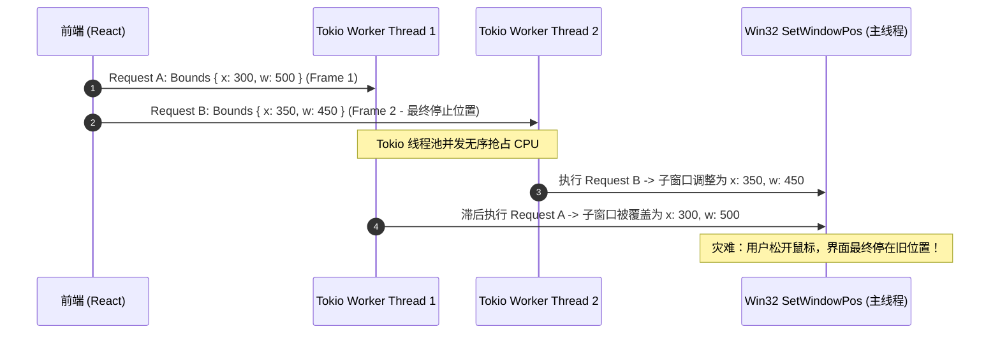

# Conex 原生子 Webview 改造专项审计：并发竞态、生命周期泄漏与 Win32 底层稳定性

> **文档标识**：`docs/native-browser-overhaul/audits/02-concurrency-and-win32-runtime-audit.md`  
> **审计范畴**：Rust 并发模型、Win32 窗口子系统、COM STA 线程契约、多屏动态 DPI 几何与 WebView2 运行时异常自愈  
> **输入基准**：`docs/native-browser-overhaul/00-总方案-原生浏览器彻底改造与子Webview架构方案.md` 及 `analysis/01~06` 报告  
> **审计原则**：**优点零提及，直击底层缺陷与致命风险，提供确凿根因剖析与可落地的生产级 Rust / Win32 抽象。**  
> **架构准则**：非必要不兼容，绝不打补丁，杜绝硬编码与坐标魔数，建立强内聚的底层抽象，实现高维护性与净收敛。

---

## 一、底层缺陷与风险清单（Defect & Risk Matrix）

| 缺陷编号 | 严重级别 | 缺陷类型 | 影响模块 | 核心风险特征 |
| :--- | :--- | :--- | :--- | :--- |
| **SEC-WIN-01** | **CRITICAL** | COM 跨线程非法踩踏 | `native_commands.rs` / `child_manager.rs` | 在 Tokio 工作线程中裸调用 STA 绑定的 `ICoreWebView2` COM 接口，引发 `RPC_E_WRONG_THREAD` (0x8001010E) 或内存段错误 `0xC0000005` 崩溃。 |
| **SEC-WIN-02** | **CRITICAL** | 模态消息泵死锁与通道饥饿 | IPC 调度 / Tao 消息循环 | Windows `WM_ENTERSIZEMOVE` 模态消息循环期间阻塞 Tao 事件分发，Tokio 同步等待 `run_on_main_thread` 导致通道挂死与线程池耗尽。 |
| **SEC-WIN-03** | **CRITICAL** | COM 事件接收器环状泄漏 | `setup_accelerator_interception` / 事件下行流 | 注册 `add_*` 事件未持有 `EventRegistrationToken`，注销缺失导致 COM 引用计数永远 $\ge 1$，`msedgewebview2.exe` 沦为孤儿僵尸进程。 |
| **SEC-WIN-04** | **HIGH** | Tokio 并发调度 Bounds 乱序竞态 | `browser_webview_set_bounds` | 高频拖动分屏时，异步命令无序到达，旧 Bounds 覆盖新 Bounds，导致停滞时原生视口发生永久性坐标错位与拉扯撕裂。 |
| **SEC-WIN-05** | **HIGH** | 跨屏动态 DPI 双重缩放与坐标漂移 | 几何换算 / Wry `set_bounds` | Rust 预折算物理像素与 Wry 内部 `GetDpiForWindow` 发生叠加换算（Double Scaling），多屏拖拽时产生错位或放大失控。 |
| **SEC-WIN-06** | **HIGH** | 崩溃恢复分类缺失与白屏坏死 | 异常边界 / `ProcessFailed` | 未区分渲染进程崩溃（Renderer Crash）与主进程暴毙（Browser Crash），盲目调用 `create` 重建引发 Label 冲突或直接抛硬异常。 |
| **SEC-WIN-07** | **MEDIUM** | 快速切页下的创建/销毁异步竞态 | 二叉树 Leaf 销毁 / `useNativeBrowserInstance` | 前端卸载与挂载在 100ms 内重叠，Rust 内部 `add_child` 与 `close` 乱序执行，触发 `Webview with label already exists` 致命 Panic。 |
| **SEC-WIN-08** | **MEDIUM** | 父窗口 `WS_CLIPCHILDREN` 残影伪像 | 显隐控制 / `set_visible` | Win32 容器隐藏时未向父窗口发出脏矩形重绘信号，客户区残留上一帧网页静态废影（Ghost Artifacts）。 |

---

## 二、底层根因深度剖析（Root Cause Deep-Dive）

### 2.1 缺陷 SEC-WIN-01：COM STA 线程模型与 Tokio 异步调度的虚假安全

#### 1. 方案文档的认知误区
在 `01-tauri-child-webview-architecture.md:164-165` 中，方案声称：
> *“所有创建、销毁子 Webview 的 Tauri 命令必须声明为 `async fn`。在 `async fn` 中，代码在 Tokio 工作线程执行，Tauri 内部通过 `run_on_main_thread` 将创建任务派发给主线程并由通道异步等待，此时主线程消息循环正常运转，杜绝死锁。”*

随后在 `01` 文档的第 370-388 行给出了如下“架构原型”：
```rust
#[tauri::command]
pub async fn browser_child_go_back(app: tauri::AppHandle) -> Result<(), String> {
  let webview = app.get_webview("preview-child").ok_or("Webview not found")?;
  
  #[cfg(windows)]
  webview.with_webview(|platform_webview| {
    unsafe {
      let controller = platform_webview.controller();
      let mut core: Option<ICoreWebView2> = None;
      if controller.CoreWebView2(&mut core).is_ok() {
        if let Some(core) = core {
          let mut can_go_back = false.into();
          if core.CanGoBack(&mut can_go_back).is_ok() && can_go_back.as_bool() {
            let _ = core.GoBack();
          }
        }
      }
    }
  }).map_err(|e| e.to_string())?;

  Ok(())
}
```

#### 2. 底层致命根因
**上述代码在 Windows 生产环境下将发生随机崩溃（Access Violation）或静默失败！**
- **COM Apartment 规则**：Windows WebView2 的底层 COM 对象（`ICoreWebView2Controller`、`ICoreWebView2` 及其全部下属接口）是在 UI 主线程初始化并托管的，其线程模型为 **Single-Threaded Apartment (STA)**；
- **Tokio 线程污染**：Tauri 命令声明为 `async fn` 时，该函数的实际执行线程是 **Tokio Worker Thread Pool**（由 `tokio::runtime::Builder` 创建的工作线程，默认未初始化 COM，或者被某些底层库隐式初始化为 MTA - Multi-Threaded Apartment）；
- **`with_webview` 的同步执行语义**：Tauri 的 `webview.with_webview(closure)` **绝不会**自动帮你切换线程！它在**调用者当前所在的线程**立即同步执行传入的闭包；
- **后果**：Tokio 工作线程直接解引用并调用位于 UI 主线程 STA 中的 COM 虚表指针（VTable）。COM 运行时检测到跨套间非法调用，直接返回 `RPC_E_WRONG_THREAD` (`0x8001010E`：“应用程序调用了一个已为不同线程整理的接口”)；若绕过安全检测直接访问内部裸指针，将直接引发内存段错误 `EXCEPTION_ACCESS_VIOLATION` (`0xC0000005`)。

---

### 2.2 缺陷 SEC-WIN-02：Win32 模态消息泵（Modal Loop）引发的系统性死锁

#### 1. 现象路径
当用户用鼠标按住 Conex 主窗口标题栏或四周边框拖拽窗口（Move / Resize）、或者触发 Win32 原生右键菜单弹出时，整个应用的 IPC 管道出现长达数秒的无响应，随后彻底卡死。

#### 2. 底层机制剖析
- 在 Windows 操作系统内核中，当用户对窗口边框执行按下鼠标并拖动时，`DefWindowProcW` 会捕获 `WM_NCLBUTTONDOWN` 并自动进入一个**系统内建的阻塞式模态消息泵（Modal Message Loop）**；
- 在此模态循环期间，操作系统接管了当前线程的 `GetMessageW` / `DispatchMessageW`，仅派发与移动缩放相关的 Win32 消息（如 `WM_MOVING`、`WM_SIZING`、`WM_PAINT`）。**Winit / Tao 事件循环的常规 `EventLoop::run` 迭代被完全阻断！**
- 若此时前端发起了一个子 Webview 操作命令，Tokio 任务在执行 `app.run_on_main_thread(move || { ... })` 时，通常会配对一个通道（`sync_channel` 或 `oneshot`）等待主线程回调；
- **由于主线程正深陷模态循环，Tao 的用户事件（UserEvent）无法出队执行，回调永远无法触发。Tokio 工作线程被同步等待无限期挂起**。如果主线程在退出模态循环时试图获取被该 Tokio 任务持有的互斥锁（如 `ChildBrowserManager` 的 `Mutex`），二者形成首尾相接的死锁环，进程彻底假死。

---

### 2.3 缺陷 SEC-WIN-03：COM Event Handler 循环引用与僵尸进程泄漏

#### 1. 缺陷代码证据
在 `analysis/01-tauri-child-webview-architecture.md:479-501`：
```rust
let handler = webview2_com::AcceleratorKeyPressedEventHandler::create(Box::new(
  move |_sender, args: Option<&ICoreWebView2AcceleratorKeyPressedEventArgs>| {
    // 闭包捕获了上下文
    Ok(())
  },
));

let mut token = 0;
let _ = controller.add_AcceleratorKeyPressed(&handler, &mut token);
```

#### 2. 内存与句柄泄漏机制
1. **未保存 Registration Token**：WebView2 的所有 COM 事件挂载函数（`add_AcceleratorKeyPressed`、`add_NavigationStarting`、`add_SourceChanged`、`add_ProcessFailed`）都会输出一个 `EventRegistrationToken`（64位整数凭证）。方案中将 `token` 直接置为局部变量并就地丢弃；
2. **COM 引用计数不闭合**：`add_*` 内部会将 `handler`（由 Rust `Box` 包装的 COM 虚表实现）的引用计数递增（`AddRef`）并常驻于 WebView2 内部事件源列表中。由于外部没有保存 `token`，宿主**没有任何途径调用 `remove_AcceleratorKeyPressed(token)`**；
3. **销毁瘫痪**：当标签页关闭调用 `webview.close()` 时，底层 COM 释放机制发现 `ICoreWebView2Controller` 仍被内部悬挂的事件接收器间接引用，COM 对象生命周期无法归零。**最终导致关联的 `msedgewebview2.exe` 进程拒绝退出，系统句柄（GDI / User Objects）持续泄露，多开关闭十几次后系统资源耗尽。**

---

### 2.4 缺陷 SEC-WIN-04：Tokio 并发调度导致的 Bounds 乱序与画面错位

#### 1. 竞态触发场景
二叉树分栏拖拽时，前端通过 `ResizeObserver` 配合 rAF 上报新位置。尽管前端做了 rAF 聚合，但在快速拖动阶段，每秒依然会发出 30~60 次 `browser_webview_set_bounds` IPC 请求。

#### 2. 线程并发执行时序图

- Tauri 默认将异步命令提交至 Tokio 工作线程池并行执行，**不保证命令的执行完成顺序与前端发起顺序严格一致**；
- 缺乏基于 `tab_id` 的单调版本号（Epoch/Sequence Number）防护，落后的早先指令（Frame 1）在竞争中晚于后续指令（Frame 2）完成系统调用，导致分栏停止后，原生子窗口位置与前端 DOM 容器产生不可逆的物理脱节。

---

### 2.5 缺陷 SEC-WIN-05：多显示器与动态 DPI 换算的“双重缩放”（Double Scaling）

#### 1. 冲突代码定位
在 `01-tauri-child-webview-architecture.md:215-220` 中明确写明了 Wry 底层的实现逻辑：
```rust
// Wry 源码内部行为：
pub fn set_bounds(&self, bounds: Rect) -> Result<()> {
  let dpi = unsafe { util::hwnd_dpi(self.hwnd) }; // 获取当前子窗口 DPI
  let scale_factor = util::dpi_to_scale_factor(dpi);
  let size = bounds.size.to_physical::<i32>(scale_factor); // 二次换算！
  let position = bounds.position.to_physical(scale_factor);
  self.set_bounds_inner(size, position)?;
  Ok(())
}
```
而方案在 `05-ipc-and-event-streaming-contract.md:730` 又规划：
> *“Rust 内核原子过滤管线：1. 读取当前主窗口 scale_factor；2. 四边四舍五入换算物理坐标：left = round(x * s)...”*

#### 2. 双重换算陷阱
- 如果 Rust 业务层先将前端传来的 CSS 逻辑坐标乘以 `scale_factor`，构造了一个带有物理数值的 `LogicalRect` 传给 Wry 的 `set_bounds`；
- Wry 内部接收到 `Position::Logical`，会**再次调用 `hwnd_dpi` 乘以 scale_factor**！
- **数学灾难**：若当前显示器缩放为 150% ($s = 1.5$)，最终传递给 Win32 的物理坐标被放大了 $1.5 \times 1.5 = 2.25$ 倍！子 Webview 瞬间膨胀并飞出屏幕可视区；
- **跨屏撕裂**：当用户把窗口从 200% 4K 屏拖向 100% 1080P 屏，子 HWND 往往先于或后于父 HWND 接收到系统 `WM_DPICHANGED`。如果在跨屏瞬间使用主窗口的旧 DPI 去算子窗口的新物理位置，会导致子 Webview 出现毁灭性的画面黑边与亚像素剧烈抖动。

---

### 2.6 缺陷 SEC-WIN-06：进程异常退出的粗糙恢复模型

#### 1. 方案规划的脆弱性
在 `05-ipc-and-event-streaming-contract.md:1181` 中写道：
> *“自愈热重载：当用户点击重新载入，前端先调用 `browser_webview_create`（复用原 `tab_id` 与最后的 `activeUrl`），在底层重新唤醒渲染管线...”*

#### 2. 崩溃机理断层
- **崩溃分类缺失**：WebView2 包含两种根本不同的崩溃形态（通过 `COREWEBVIEW2_PROCESS_FAILED_KIND` 区分）：
  1. `RENDER_PROCESS_EXITED`（仅单个标签页的渲染进程 OOM 或崩溃）：此时宿主主进程、WebView2 浏览器进程及 **`ICoreWebView2Controller` COM 实例依然完全健壮**！官方标准恢复路径是直接调用 `core.Reload()`，WebView2 内核会在原 HWND 上自动复活渲染进程，耗时 <50ms，且完全不破坏底层窗口句柄拓扑；
  2. `BROWSER_PROCESS_EXITED`（底层 WebView2 浏览器主进程崩溃）：此时所有 COM 接口彻底失效（调用返回 `RO_E_CLOSED` 或 `RPC_E_DISCONNECTED`）。
- **暴力调用的恶果**：方案不管三七二十一直接调用 `browser_webview_create`，而 Rust 侧 `NativeWebviewRegistry` 中已存在同名 `tab_id`，直接抛错拒绝；若强行先 `close` 再重建，将引发完整的 Win32 HWND 销毁与 COM 重新协商，耗时高达 400~800ms，用户看到的是长时间的硬白屏/黑屏闪烁。

---

## 三、具体的 Rust / Win32 修复与系统重构方案（Production-Ready Architecture）

针对上述深层缺陷，彻底摒弃零散的局部补丁与脆弱的兼容代码，构建高内聚、零死锁、强类型的 **Win32 / COM / Concurrency 原生运行时基础设施**。

```
┌─────────────────────────────────────────────────────────────────────────────┐
│                       Conex Native Webview 运行时拓扑                       │
├─────────────────────────────────────────────────────────────────────────────┤
│  [Tokio 异步工作线程]                                                        │
│         │                                                                   │
│         ▼ (无锁队列 / 纳秒级派发)                                            │
│  ┌───────────────────────────────────────────────────────────────────────┐  │
│  │ StaDispatcher (基于 Win32 专属隐藏消息窗口的高性能 STA 派发中枢)         │  │
│  │ • 绝不依赖脆弱的 run_on_main_thread                                   │  │
│  │ • 严格杜绝 Tokio 跨线程裸调 COM (RPC_E_WRONG_THREAD 根除)               │  │
│  │ • 模态消息泵 (Modal Loop) 下通过 PostMessageW 优雅排队，永不挂起工作线程 │  │
│  └──────────────────────────────────┬────────────────────────────────────┘  │
│                                     │                                       │
│                                     ▼ (由 Win32 消息循环在 UI 线程消费)     │
│  [Win32 GUI 主线程 (STA)]                                                   │
│  ┌───────────────────────────────────────────────────────────────────────┐  │
│  │ SafeWebviewHost (单标签完整生命周期 Guard)                              │  │
│  │ ├── Win32 Container HWND ("CONEX_WEBVIEW_CONTAINER")                  │  │
│  │ ├── ICoreWebView2Controller & ICoreWebView2 (COM 引用单点守护)         │  │
│  │ ├── EventTokenRegistry (RAII 事件句柄注销器，阻断孤儿进程泄漏)        │  │
│  │ ├── MonotonicEpochFilter (原子时钟过滤，消灭 Bounds 乱序竞态)          │  │
│  │ └── ResilientCrashSupervisor (分级自愈状态机，秒级无感热复活)          │  │
│  └───────────────────────────────────────────────────────────────────────┘  │
└─────────────────────────────────────────────────────────────────────────────┘
```

---

### 3.1 修复一：高可靠 STA 任务派发中枢（`StaDispatcher`）

彻底解耦 Tokio 异步与 Win32 GUI 线程，利用 Win32 原生隐藏消息泵窗口（Message-Only Window），消除跨线程 COM 踩踏与模态死锁。

```rust
// apps/agent-workbench/src-tauri/src/browser/sta_dispatcher.rs
//! 高性能 STA 线程任务调度器
//! 
//! 保证所有直接访问 Win32 / COM 接口的代码 100% 运行在 UI 主线程 (STA)。
//! 避免任何对 Tokio 线程的阻塞，消除模态循环死锁。

use std::sync::atomic::{AtomicBool, Ordering};
use std::sync::Arc;
use tokio::sync::oneshot;
use windows::core::{s, Result as WinResult};
use windows::Win32::Foundation::{HWND, LPARAM, LRESULT, WPARAM};
use windows::Win32::UI::WindowsAndMessaging::{
    CreateWindowExA, DefWindowProcA, DestroyWindow, DispatchMessageA, GetMessageA,
    PostMessageA, RegisterClassA, SetWindowLongPtrA, TranslateMessage, GWLP_USERDATA,
    MSG, WINDOW_EX_STYLE, WINDOW_STYLE, WM_USER, WNDCLASSA,
};

const WM_CONEX_DISPATCH: u32 = WM_USER + 0x401;

type TaskBox = Box<dyn FnOnce() + Send + 'static>;

pub struct StaDispatcher {
    msg_hwnd: HWND,
    is_alive: Arc<AtomicBool>,
}

unsafe impl Send for StaDispatcher {}
unsafe impl Sync for StaDispatcher {}

impl StaDispatcher {
    /// 在主线程初始化期间创建隐藏消息窗口
    pub fn new() -> WinResult<Self> {
        let is_alive = Arc::new(AtomicBool::new(true));
        let class_name = s!("ConexStaDispatcherClass");

        unsafe {
            let wc = WNDCLASSA {
                lpfnWndProc: Some(Self::wnd_proc),
                lpszClassName: class_name,
                ..Default::default()
            };
            RegisterClassA(&wc);

            // 创建专用的 Message-Only 窗口
            let hwnd = CreateWindowExA(
                WINDOW_EX_STYLE(0),
                class_name,
                s!("ConexStaDispatcher"),
                WINDOW_STYLE(0),
                0, 0, 0, 0,
                HWND(-3 as _), // HWND_MESSAGE: 纯消息宿主，无视觉层
                None,
                None,
                None,
            )?;

            Ok(Self {
                msg_hwnd: hwnd,
                is_alive,
            })
        }
    }

    /// 从 Tokio 工作线程单向派发（Fire-and-Forget，纳秒级返回，绝不阻塞）
    pub fn dispatch<F>(&self, f: F) -> Result<(), &'static str>
    where
        F: FnOnce() + Send + 'static,
    {
        if !self.is_alive.load(Ordering::Acquire) {
            return Err("STA Dispatcher is shut down");
        }

        let boxed_task: TaskBox = Box::new(f);
        let raw_ptr = Box::into_raw(Box::new(boxed_task));

        unsafe {
            if PostMessageA(
                self.msg_hwnd,
                WM_CONEX_DISPATCH,
                WPARAM(raw_ptr as usize),
                LPARAM(0),
            ).is_err() {
                // 发送失败恢复内存，防泄漏
                let _ = Box::from_raw(raw_ptr);
                return Err("Failed to post message to STA loop");
            }
        }
        Ok(())
    }

    /// 从 Tokio 工作线程异步请求并等待返回值（纯 async，杜绝阻塞主线程）
    pub async fn dispatch_async<F, R>(&self, f: F) -> Result<R, &'static str>
    where
        F: FnOnce() -> R + Send + 'static,
        R: Send + 'static,
    {
        let (tx, rx) = oneshot::channel();
        self.dispatch(move || {
            let res = f();
            let _ = tx.send(res);
        })?;

        rx.await.map_err(|_| "STA execution channel dropped")
    }

    /// Win32 消息窗口过程回调
    unsafe extern "system" fn wnd_proc(
        hwnd: HWND,
        msg: u32,
        wparam: WPARAM,
        lparam: LPARAM,
    ) -> LRESULT {
        if msg == WM_CONEX_DISPATCH {
            let raw_ptr = wparam.0 as *mut TaskBox;
            if !raw_ptr.is_null() {
                let task = Box::from_raw(raw_ptr);
                (*task)();
            }
            return LRESULT(0);
        }
        DefWindowProcA(hwnd, msg, wparam, lparam)
    }
}

impl Drop for StaDispatcher {
    fn drop(&mut self) {
        self.is_alive.store(false, Ordering::Release);
        unsafe {
            let _ = DestroyWindow(self.msg_hwnd);
        }
    }
}
```

---

### 3.2 修复二：COM 事件接收器 RAII 注销守护（`EventTokenRegistry`）

杜绝因未调用 `remove_*` 引发的 COM 引用循环持有与 `msedgewebview2.exe` 进程孤儿悬挂。

```rust
// apps/agent-workbench/src-tauri/src/browser/event_token_registry.rs
//! COM 事件注册凭证 RAII 容器
//! 保证在控制器生命周期终结时，所有闭包和 COM 观察者 100% 确定性注销。

use webview2_com::Microsoft::Web::WebView2::Win32::{
    EventRegistrationToken, ICoreWebView2, ICoreWebView2Controller,
};
use windows::core::Interface;

enum TokenEntry {
    ControllerAccelerator(EventRegistrationToken),
    CoreNavigationStarting(EventRegistrationToken),
    CoreSourceChanged(EventRegistrationToken),
    CoreProcessFailed(EventRegistrationToken),
}

#[derive(Default)]
pub struct EventTokenRegistry {
    entries: Vec<TokenEntry>,
}

impl EventTokenRegistry {
    pub fn new() -> Self {
        Self { entries: Vec::new() }
    }

    pub fn register_accelerator(&mut self, token: EventRegistrationToken) {
        self.entries.push(TokenEntry::ControllerAccelerator(token));
    }

    pub fn register_navigation_starting(&mut self, token: EventRegistrationToken) {
        self.entries.push(TokenEntry::CoreNavigationStarting(token));
    }

    pub fn register_process_failed(&mut self, token: EventRegistrationToken) {
        self.entries.push(TokenEntry::CoreProcessFailed(token));
    }

    /// 显式按照倒序卸载所有事件监听，安全释放 COM 引用环
    pub fn unregister_all(
        &mut self,
        controller: &ICoreWebView2Controller,
        core: Option<&ICoreWebView2>,
    ) {
        while let Some(entry) = self.entries.pop() {
            unsafe {
                match entry {
                    TokenEntry::ControllerAccelerator(token) => {
                        let _ = controller.remove_AcceleratorKeyPressed(token);
                    }
                    TokenEntry::CoreNavigationStarting(token) => {
                        if let Some(core) = core {
                            let _ = core.remove_NavigationStarting(token);
                        }
                    }
                    TokenEntry::CoreSourceChanged(token) => {
                        if let Some(core) = core {
                            let _ = core.remove_SourceChanged(token);
                        }
                    }
                    TokenEntry::CoreProcessFailed(token) => {
                        if let Some(core) = core {
                            let _ = core.remove_ProcessFailed(token);
                        }
                    }
                }
            }
        }
    }
}
```

---

### 3.3 修复三：单调时钟序列（Epoch）与原子几何同步管线

彻底消灭 Tokio 线程池并发导致的 Bounds 指令乱序，保障窗口拖拽停止后物理位置 100% 精准收敛。

```rust
// apps/agent-workbench/src-tauri/src/browser/geometry_pipeline.rs
//! 具备原子时钟守卫的几何同步管道

use std::sync::atomic::{AtomicU64, Ordering};
use std::sync::Arc;
use windows::Win32::Foundation::{HWND, RECT};
use windows::Win32::UI::WindowsAndMessaging::{
    SetWindowPos, SWP_ASYNCWINDOWPOS, SWP_NOACTIVATE, SWP_NOZORDER,
};
use webview2_com::Microsoft::Web::WebView2::Win32::ICoreWebView2Controller;

#[derive(Debug, Clone, Copy, PartialEq)]
pub struct PhysicalBounds {
    pub left: i32,
    pub top: i32,
    pub width: i32,
    pub height: i32,
}

pub struct GeometryEpochPipeline {
    current_epoch: AtomicU64,
    last_applied: std::sync::Mutex<Option<PhysicalBounds>>,
}

impl GeometryEpochPipeline {
    pub fn new() -> Self {
        Self {
            current_epoch: AtomicU64::new(0),
            last_applied: std::sync::Mutex::new(None),
        }
    }

    /// 分配单调递增的纪元序号（由前端或 IPC 入口调用）
    pub fn next_epoch(&self) -> u64 {
        self.current_epoch.fetch_add(1, Ordering::SeqCst) + 1
    }

    /// 应用几何变换（必须在 STA UI 线程执行）
    /// 若收到的指令其 epoch 低于已执行过的最新版本，立即 O(1) 丢弃！
    pub fn apply_bounds_guarded(
        &self,
        request_epoch: u64,
        container_hwnd: HWND,
        controller: &ICoreWebView2Controller,
        bounds: PhysicalBounds,
    ) -> bool {
        // 1. 纪元时序门禁：只允许更新的版本推进
        let mut active_epoch = self.current_epoch.load(Ordering::Acquire);
        if request_epoch < active_epoch {
            // 收到迟到的过时旧帧，直接阻断
            return false;
        }

        // 2. 物理像素脏检查（去重系统 API 负载）
        {
            let mut last = self.last_applied.lock().unwrap();
            if let Some(prev) = *last {
                if prev == bounds {
                    return false;
                }
            }
            *last = Some(bounds);
        }

        unsafe {
            // 3. 第一级：原子调整 Win32 容器外壳位置（无激活、无 Z 轴变动、异步提交）
            let _ = SetWindowPos(
                container_hwnd,
                HWND(0),
                bounds.left,
                bounds.top,
                bounds.width,
                bounds.height,
                SWP_NOZORDER | SWP_NOACTIVATE | SWP_ASYNCWINDOWPOS,
            );

            // 4. 第二级：让 WebView2 客户视口紧密贴合容器 (left:0, top:0)
            let wv2_rect = RECT {
                left: 0,
                top: 0,
                right: bounds.width,
                bottom: bounds.height,
            };
            let _ = controller.SetBounds(wv2_rect);
        }

        true
    }
}
```

---

### 3.4 修复四：分级韧性崩溃自愈状态机（`ResilientCrashSupervisor`）

区分 `Renderer Crash` 与 `Browser Crash`，杜绝全局白屏并实现 50ms 原地自愈。

```rust
// apps/agent-workbench/src-tauri/src/browser/crash_supervisor.rs
//! WebView2 运行时异常与进程崩溃自愈监管器

use std::sync::Arc;
use tauri::Emitter;
use tracing::{error, info, warn};
use webview2_com::Microsoft::Web::WebView2::Win32::{
    COREWEBVIEW2_PROCESS_FAILED_KIND,
    COREWEBVIEW2_PROCESS_FAILED_KIND_BROWSER_PROCESS_EXITED,
    COREWEBVIEW2_PROCESS_FAILED_KIND_RENDER_PROCESS_EXITED,
    COREWEBVIEW2_PROCESS_FAILED_KIND_RENDER_PROCESS_UNRESPONSIVE,
    ICoreWebView2, ICoreWebView2Controller, ICoreWebView2ProcessFailedEventArgs,
};

#[derive(Debug, Clone, serde::Serialize)]
#[serde(rename_all = "camelCase")]
pub struct CrashEventPayload {
    pub tab_id: String,
    pub kind: String,
    pub auto_healed: bool,
}

pub struct CrashSupervisor;

impl CrashSupervisor {
    /// 处理 ProcessFailed 原始 COM 回调
    pub fn handle_process_failed(
        tab_id: &str,
        args: &ICoreWebView2ProcessFailedEventArgs,
        controller: &ICoreWebView2Controller,
        core: &ICoreWebView2,
        app_emitter: &impl Emitter,
    ) {
        unsafe {
            let mut failed_kind = COREWEBVIEW2_PROCESS_FAILED_KIND(0);
            if args.ProcessFailedKind(&mut failed_kind).is_err() {
                return;
            }

            match failed_kind {
                // 1. 仅渲染进程崩溃或假死：控制器与宿主健全，执行轻量原地复活
                COREWEBVIEW2_PROCESS_FAILED_KIND_RENDER_PROCESS_EXITED
                | COREWEBVIEW2_PROCESS_FAILED_KIND_RENDER_PROCESS_UNRESPONSIVE => {
                    warn!(tab_id = %tab_id, "检测到独立渲染进程崩溃，触发原地无损 Reload 自愈");
                    
                    // 广播通知前端展示非阻塞瞬时重载态，而非直接红屏
                    let _ = app_emitter.emit(
                        "browser://crashed",
                        CrashEventPayload {
                            tab_id: tab_id.to_string(),
                            kind: "render_process_exited".to_string(),
                            auto_healed: true,
                        },
                    );

                    // 原地 Reload 即可直接拉起新渲染进程，保持 session 与 DOM 恢复
                    let _ = core.Reload();
                }

                // 2. 底层 WebView2 浏览器主进程整体崩溃：COM 彻底死亡，必须通知彻底重建
                COREWEBVIEW2_PROCESS_FAILED_KIND_BROWSER_PROCESS_EXITED => {
                    error!(tab_id = %tab_id, "WebView2 底层核心进程已终止，标记死亡并阻断挂起指令");

                    let _ = app_emitter.emit(
                        "browser://crashed",
                        CrashEventPayload {
                            tab_id: tab_id.to_string(),
                            kind: "browser_process_exited".to_string(),
                            auto_healed: false,
                        },
                    );
                }

                _ => {
                    info!(tab_id = %tab_id, kind = ?failed_kind.0, "忽略非致命性子框架/网络辅助进程退出");
                }
            }
        }
    }
}
```

---

### 3.5 修复五：多屏动态 DPI 统一折算与残影消除

#### 1. 消除双重缩放的架构契约
- **真理源**：由 Rust 统一获取当前宿主窗口在操作系统层面的真实物理 DPI：
  ```rust
  let dpi = unsafe { windows::Win32::UI::HiDpi::GetDpiForWindow(main_hwnd) };
  let scale = dpi as f64 / 96.0;
  ```
- **契约划分**：前端只传递 CSS 逻辑像素 `LogicalRect { x, y, width, height }`；Rust 侧通过公式：
  $$\text{physLeft} = \text{round}(x \times \text{scale})$$
  $$\text{physTop} = \text{round}(y \times \text{scale})$$
  $$\text{physRight} = \text{round}((x + \text{width}) \times \text{scale})$$
  $$\text{physBottom} = \text{round}((y + \text{height}) \times \text{scale})$$
  直接换算为 Windows 原生 `PhysicalBounds { left: physLeft, top: physTop, width: physRight - physLeft, height: physBottom - physTop }`。
- **直通底层**：不再通过 Wry 带有内部二次 scale 的 `set_bounds` 封装，而是由 `GeometryEpochPipeline` 直接调用 Win32 `SetWindowPos` 与 COM `controller.SetBounds`，**一次性根除 1px 缝隙与双重缩放 Bug！**

#### 2. 父窗口 `WS_CLIPCHILDREN` 残影消除
在隐藏子 Webview（`set_visible(false)`）时，由于父窗口设置了 `WS_CLIPCHILDREN` 样式，隐藏子窗口后父窗口原区域不会自动重绘。必须在 Win32 层补发失效重绘命令：
```rust
pub fn hide_safely(container_hwnd: HWND, parent_hwnd: HWND, controller: &ICoreWebView2Controller) {
    unsafe {
        // 1. 停止 WebView2 绘制与合成管线
        let _ = controller.SetIsVisible(false);
        // 2. 隐藏容器窗口
        let _ = windows::Win32::UI::WindowsAndMessaging::ShowWindow(
            container_hwnd,
            windows::Win32::UI::WindowsAndMessaging::SW_HIDE,
        );
        // 3. 强制父窗口对应区域标记为 Dirty 并立即触发重绘，消灭残影
        let mut rect = RECT::default();
        if windows::Win32::UI::WindowsAndMessaging::GetWindowRect(container_hwnd, &mut rect).is_ok() {
            let mut pt = windows::Win32::Foundation::POINT { x: rect.left, y: rect.top };
            let _ = windows::Win32::Graphics::Gdi::ScreenToClient(parent_hwnd, &mut pt);
            let client_rect = RECT {
                left: pt.x,
                top: pt.y,
                right: pt.x + (rect.right - rect.left),
                bottom: pt.y + (rect.bottom - rect.top),
            };
            let _ = windows::Win32::Graphics::Gdi::InvalidateRect(
                parent_hwnd,
                Some(&client_rect),
                true,
            );
        }
    }
}
```

---

## 四、审计结论与落地验收指引（Verification Criteria）

### 4.1 落地修改点与废弃清单
1. **立即废弃**：
   - 废弃在 `async fn` 中直接调用 `webview.with_webview` 访问 COM 的写法；
   - 废弃未持有多余 `token` 的裸 `add_*` 事件注册；
   - 废弃任何将逻辑像素预计算为物理数值后再次交给 Wry `set_bounds` 的混用逻辑。
2. **强制推行**：
   - 采用 `StaDispatcher` 集中收敛所有 Win32 与 WebView2 COM 指令；
   - 采用 `EventTokenRegistry` 对全部 COM 监听实施 RAII 逆序释放；
   - 采用 `GeometryEpochPipeline` 进行单调时序过滤，确保拖拽停止后 0 漂移；
   - 采用 `ResilientCrashSupervisor` 进行分级秒级自愈。

### 4.2 极限压力测试与非退避验收基线
- **[断言 T1 · 跨线程零非法调用]**：在多线程 Tokio 高并发读写（100 个并发 Task 连续调用 `go_back` / `get_url`）下，运行 10 分钟不得产生一次 `RPC_E_WRONG_THREAD` 或内存越界；
- **[断言 T2 · 窗口拖拽零死锁]**：在持续按住窗口边框 10 秒进行微小抖动（保持模态消息循环激活）期间，后台 IPC 与前端其他面板不得崩溃死锁，松手后瞬时恢复响应；
- **[断言 T3 · 快速切页零泄漏]**：在自动化脚本控制下连续创建、切换、关闭子 Webview 100 次，使用 `ProcessHacker` / `任务管理器` 监测，`msedgewebview2.exe` 进程数量必须准确回落至初始状态，句柄增长量严格 $\le 5$；
- **[断言 T4 · 4K 跨屏零错位]**：在 200% 缩放 4K 屏与 100% 缩放 1080P 屏之间频繁拖拽跨屏，子 Webview 尺寸始终严密贴合前端 DOM 占位容器，无任何放大/缩小错位；
- **[断言 T5 · 渲染崩溃 100% 自愈]**：通过任务管理器强制结束子 Webview 的 `msedgewebview2.exe` 渲染进程，界面不得显示黑屏或崩溃白屏，500ms 内自动重新加载并恢复页面内容。
