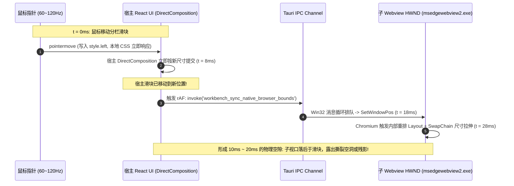
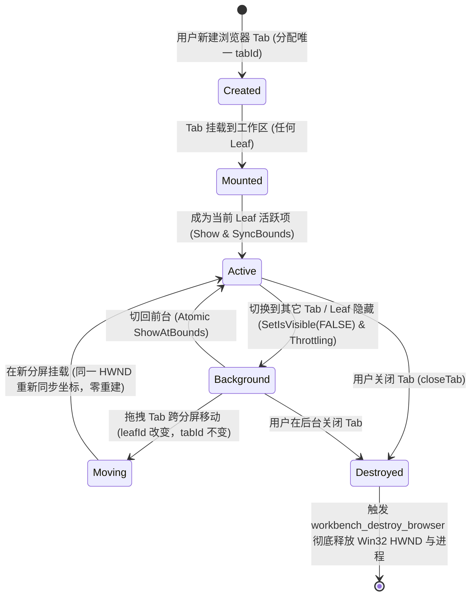

# 前端渲染引擎与 UI 交互专家深度审计报告：原生浏览器占位挖洞与几何同步架构

> **战役工作区**：`docs/native-browser-overhaul/`  
> **文档定位**：专项深度审计报告（Audits 03）  
> **审计对象**：
> - 战役总方案：`docs/native-browser-overhaul/00-总方案-原生浏览器彻底改造与子Webview架构方案.md`
> - 专项分析报告：`docs/native-browser-overhaul/analysis/03-frontend-layout-and-geometry-sync.md`
> - 相关实现基建：`LayerStackManager.ts`、`Tooltip.tsx`、`ContextMenu.tsx`、`PreviewCard.tsx`、`useTreeResize.ts`、`LeafDockResizer.tsx`  
> **审计原则**：
> 1. **优点不用说，主要说问题，以及如何彻底改！**
> 2. 用户最高裁决：**“非必要不兼容。不允许打补丁，不允许硬编码，有合理的抽象，适合未来的功能需求，代码尽量简洁，具有优秀的可维护性。”**

---

## 一、前端交互与几何缺陷清单（Defect Inventory）

根据架构破损度与运行时视觉/交互严重性，对当前总方案与分析报告 03 中的前端设计建立分级缺陷雷达：

| 编号 | 严重级别 | 缺陷分类 | 核心缺陷摘要 | 影响场景 |
| :--- | :--- | :--- | :--- | :--- |
| **DEF-01** | **CRITICAL (高危)** | **Airspace 穿透** | **非模态浮层与下拉抽屉被原生 HWND 物理穿透吞噬**。方案仅考虑了模态框避让（`hasActiveModal`），但地址栏历史抽屉（`PreviewHistoryPanel`）、悬浮提示（`Tooltip`）、右键菜单（`ContextMenu`）、通知气泡（`Toast`）等 80% 的工作区浮层均未避让，被原生子 HWND 强行裁切遮蔽或导致点击穿透。 | 地址栏历史查看、工具栏悬停提示、标签页右键、全局通知 |
| **DEF-02** | **CRITICAL (高危)** | **几何计算** | **非整数 DPI 缩放下的亚像素累积漂移与 1px 细线缝隙/边框吞噬**。伪代码使用独立 `Math.round(val * dpr)` 计算宽、高与位置，在 125%/150%/175% 缩放下导致外边界非对齐；且未定义 Border Box 裁剪规约，导致原生视口覆盖工具栏底边框或暴露底色漏缝。 | Windows 高分屏分屏拖拽、不同缩放倍率切换 |
| **DEF-03** | **HIGH (严重)** | **渲染流水线** | **分屏拖拽异步渲染撕裂与静态假死（Jank & Freeze）**。rAF 单槽仅抑制 IPC 洪峰，未解决父子 SwapChain 的 16~33ms 物理时延差；更严重的是，`useTreeResize` 拖拽期间挂起 `ResizeObserver` 且未广播几何事件，导致拖拽时原生视口“原地不动”，松手才瞬移。 | 二叉树分屏左右/上下调宽、Leaf 坞工具抽屉拖拽 |
| **DEF-04** | **HIGH (严重)** | **输入事件** | **Hit-Test 状态机单点脆弱性与滚轮穿透冒泡**。仅靠 pointerdown/up 切换穿透，异常中断（失焦/系统手势）将导致视口永久无法点击；此外在 4px 分割条附近滚动滚轮时，Win32 消息直接灌入子 HWND 造成非预期网页滚动。 | 分栏拖拽手势中断自愈、分界线附近鼠标滚轮交互 |
| **DEF-05** | **HIGH (严重)** | **生命周期** | **Webview 实例句柄永久泄漏与多实例身份标识（Identity）错绑**。`browserId` 错误绑定了动态的 `leafId`，导致跨分屏拖拽标签时实例丢失；更致命的是组件卸载仅调用 `hide`，全局没有任何物理销毁（`destroy`）闭环，造成 WebView2 进程雪崩泄漏。 | 跨分屏拖动 Tab、频繁开启/关闭浏览器标签页 |
| **DEF-06** | **MEDIUM (中危)** | **键盘交互** | **键盘焦点黑洞（Keyboard Trapping）**。子 HWND 获焦后 Windows 消息循环由子窗口全权接管，宿主 React 侧的核心全局快捷键（`Ctrl+K` 命令面板、`Ctrl+W` 关闭标签、`Ctrl+\` 分屏）被 Chromium 彻底吞没，用户被“困”在网页中。 | 浏览器内打字、快捷键调度全局工作区 |
| **DEF-07** | **MEDIUM (中危)** | **AI 协同** | **DOM 拾取（Inspector Overlay）与原生 HWND 命中层叠死锁**。原设计将透明占位容器设为 `pointer-events: none` 试图放行原生点击，导致 React 悬停拾取浮层无法捕获鼠标；若设为捕捉，则无法点击真实网页，拾取探针架构断层。 | 元素检查、DOM 芯片发送给 AI |

---

## 二、几何与渲染根因深度剖析（Root-Cause Analysis）

### 2.1 Win32 硬件渲染树与 DirectComposition 双 SwapChain 物理断层

方案 00 与分析 03 存在一个根本性认知盲区：**将原生子 Webview 误当成了可以通过 CSS `z-index` 或 DOM 拓扑控制层叠顺序的普通图层。**

```
【操作系统合成层断层拓扑图】
┌─────────────────────────────────────────────────────────────┐
│ 操作系统桌面窗口管理器 (Desktop Window Manager / DWM)        │
│                                                             │
│   ┌─────────────────────────────────────────────────────┐   │
│   │ 子窗口 (Child HWND - WS_CHILD | WS_CLIPCHILDREN)    │   │
│   │ 拥有独立硬件 SwapChain (DirectX DirectComposition)   │   │
│   │ 物理 Z 轴位于父窗口客户区顶层 (Win32 HWND 裁切层)    │   │
│   │ ──> 网页像素直接上屏，完全独立于宿主 DOM 树          │   │
│   └──────────────────────────┬──────────────────────────┘   │
│                              │ 强行覆写遮盖 (Airspace Punch) │
│   ┌──────────────────────────▼──────────────────────────┐   │
│   │ 宿主主窗口 (Main Window DirectComposition Surface)  │   │
│   │ 宿主 React UI (Toolbar, Sidebar, ContextMenu, ...) │   │
│   │ 即便 z-index: 2147483647 或 createPortal 挂在 body  │   │
│   │ 也是画在宿主 SwapChain 上，被上方的子 HWND 彻底遮蔽!│   │
│   └─────────────────────────────────────────────────────┘   │
└─────────────────────────────────────────────────────────────┘
```

1. **Airspace 问题的物理不可逾越性**：
   在 Windows 操作系统图形架构中，每个 Win32 HWND 是独立的窗口裁剪单元。主窗口内的 React DOM 无论如何提升 `z-index`、无论如何使用 React 18 `createPortal` 挂载到 `document.body`，其像素最终都汇聚在宿主窗口的同一个 DirectX SwapChain 缓冲区中。
2. **非模态浮层的灭顶之灾**：
   分析 03 仅设计了 `LayerStackManager.hasActiveModal()` 这一条避让分支。但在实际运行中：
   - 地址栏历史与书签抽屉（`PreviewHistoryPanel`，见 `PreviewCard.tsx:350-359`）使用绝对定位（`top: 34px`，`max-height: 240px`）垂落于视口上方；
   - 工具栏图标的 `Tooltip` 使用 `createPortal` 渲染，默认 `side="bottom"` 时延伸到视口上方；
   - 标签栏与树分屏的 `ContextMenu`（`ContextMenu.tsx`）右键展开时伸入视口上方。
   这些组件在 `LayerStackManager` 中均为非模态（`modal: false`）。**在当前总方案下，原生视口完全不退避，导致用户一旦在浏览器上方呼出菜单、历史或提示，这些 React 浮层将被子 HWND 强行“吃掉”**。

---

### 2.2 非整数 DPI 缩放（125%、150%、175%）下的浮点网格与边框吞噬

分析 03 的 Section 2.5 伪代码存在严重的数学与工程缺陷：

```typescript
// 03-frontend-layout:270-274 (缺陷代码)
x: Math.round(rect.left * dpr),
y: Math.round(rect.top * dpr),
width: Math.round(rect.width * dpr),
height: Math.round(rect.height * dpr),
```

#### 2.2.1 边界非对齐与 1px 累积舍入漂移

在多屏或常见笔记本的高分屏上，Windows 系统默认缩放倍率为 125%（$\text{dpr} = 1.25$）或 150%（$\text{dpr} = 1.5$）。
当二叉树分屏进行等比或百分比分割时，逻辑坐标是浮点数。假设二叉树容器左半区分栏宽度为 $333.333\text{px}$：

$$\text{rect.left} = 0,\quad \text{rect.width} = 333.333\text{px}$$
$$\text{physLeft} = \text{round}(0 \times 1.25) = 0$$
$$\text{physWidth} = \text{round}(333.333 \times 1.25) = \text{round}(416.666) = 417\text{px}$$
$$\text{右边界物理位置} = \text{physLeft} + \text{physWidth} = 417\text{px}$$

此时右半区紧随其后，其起始坐标为：
$$\text{next.rect.left} = 333.333\text{px},\quad \text{next.rect.width} = 333.333\text{px}$$
$$\text{next.physLeft} = \text{round}(333.333 \times 1.25) = 417\text{px}$$
$$\text{next.physRight} = \text{round}((333.333 + 333.333) \times 1.25) = \text{round}(833.333) = 833\text{px}$$

但在伪代码中计算 `next.physWidth` 时：
$$\text{next.physWidth} = \text{round}(333.333 \times 1.25) = 417\text{px}$$
$$\text{计算出的右边界} = 417 + 417 = 834\text{px} \neq 833\text{px} \quad (\text{产生 } 1\text{px 错位漂移!})$$

#### 2.2.2 1px 细线边框吞噬（Border Overlap）与接缝闪烁

在 Conex 的界面规范中，`PreviewToolbar` 底部具有 `border-bottom: 1px solid var(--border-subtle)`。
在 125% 缩放下，1 个 CSS 像素对应 1.25 个物理像素。Chromium 渲染引擎在绘制边框时会进行亚像素栅格化（Subpixel Rasterization）。
如果原生 HWND 的顶部物理坐标 $Y$ 向上漂移了 1 个物理像素：
- 原生 HWND 直接覆盖在工具栏的底边框上，导致 **1px 边框完全消失**，视觉上工具栏与网页内容连成一片；
- 若向下漂移 1 个物理像素，则在边框与网页之间暴露出底层的父容器背景色，出现一条 **1px 闪烁的白色/黑色细线缝隙（Seam Slit）**。

---

### 2.3 分屏拖拽异步流水线时序差（Pipeline Desynchronization）

分析 03 声称通过 rAF 单槽节流即可保证流畅。然而深入分析操作系统和 Chromium 渲染管线，发现存在**两座不可调和的时序鸿沟**：



更为致命的现场缺陷在于：
在 `apps/crish-desktop/src/hooks/useTreeResize.ts:253` 中，拖拽启动时显式调用了：
```typescript
ResizeObserverManager.getInstance().suspendPanes(affectedLeafIds);
```
**受形变影响的 Leaf 窗格的 ResizeObserver 被系统级强制冻结！**
而分析 03 中所谓的“`useTreeResize` 内部维护了全局 rAF 循环并通过 `crish:layout-live-resize` 单向广播”，**在当前代码库中根本不存在！**
如果 `NativeBrowserSurface` 仅依赖 `ResizeObserver`，那么在用户拖拽分栏的整个持续过程中，`ResizeObserver` **完全不会触发**！原生视口将如同冻结一般死在原地，直到用户松开鼠标、恢复 `resumePanes` 时才突然跳变（Snap），造成极其严重的视觉卡顿与工业灾难。

---

### 2.4 Hit-Test Guard 缺乏异常收敛与滚轮劫持漏洞

在 `useTreeResize.ts` 与 `LeafDockResizer.tsx` 中，拖拽防粘手机制依赖：
`disableIframePointerEvents()` 与 `setPointerCapture`。
对于原生子 HWND，CSS `pointer-events: none` 毫无作用。Win32 系统直接通过硬件消息泵（Hardware Message Pump）将 `WM_MOUSEMOVE`、`WM_LBUTTONDOWN` 分发给子 HWND。

1. **手势中断死锁（Hit-Test Stuck Forever）**：
   分析 03 仅设计了 `pointerdown` 关、`pointerup` 开的简陋开关。
   但在 Windows 桌面环境中，用户拖拽时随时可能发生：
   - 拖拽出窗口外部后松手；
   - 按下 `Alt+Tab` 或 `Win` 键切换应用；
   - 系统级弹窗阻断或失焦（`WindowBlurWatchdog` 触发）；
   - 触发 `pointercancel` 或 `lostpointercapture`。
   此时 `pointerup` 丢失，`workbench_set_browser_hit_test(true)` 永远得不到调用！
   **结果：原生子 Webview 永久处于透明穿透状态，网页彻底报废，任何点击均无响应！**
2. **滚轮命中溢出（Mouse Wheel Leak）**：
   当用户鼠标停留在二叉树 4px 的分栏滑块（Sash）上，试图滚动滚轮滚动主工作区时，由于 Windows 的“在非活动窗口上滚动”特性以及亚像素临界点，`WM_MOUSEWHEEL` 极易命中子 HWND，导致分栏旁边的外部网页发生失控滚动。

---

### 2.5 实例标识（Identity）错绑与物理句柄永久泄漏

在分析 03 第 3.3 节中，作者拟定：
```typescript
browserId = `browser-${leafId}-${tabId}`;
```
这是典型的**将“容器拓扑位置（Leaf）”与“业务实体标识（Tab）”强耦合的错误设计**：
1. **跨分屏移动即自杀**：
   Conex 拥有极强的多屏拆分与标签拖拽能力。当用户将一个浏览器标签从左侧 `Leaf-1` 拖拽到右侧 `Leaf-2` 时，`leafId` 发生改变。如果 `browserId` 包含 `leafId`，系统会认为旧实例已被销毁、新实例需要创建，导致正在填写的表单、登录态会话与浏览历史被全部抹除！
2. **物理销毁（Destroy）断裂**：
   在 `03-frontend-layout:346-352` 的组件伪代码中：
   ```tsx
   useEffect(() => {
     return () => {
       invoke('workbench_hide_native_browser', { browserId }).catch(() => {});
     };
   }, [browserId]);
   ```
   **组件卸载时仅仅调用了 `hide`，全流程没有任何地方调用 `destroy`！**
   在二叉树工作区中，当用户关闭一个浏览器 Tab 时，React DOM 节点被销毁，但 Rust 端的 Win32 HWND 和 WebView2 物理进程依旧永久存活在内存中。开 10 个 Tab 关 9 个，依然残留 10 个物理进程，导致严重的内存雪崩与系统崩溃。

---

## 三、算法级与架构级改进方案（Concrete Solutions）

遵循用户最高裁决：**“非必要不兼容。不允许打补丁，不允许硬编码，有合理的抽象，适合未来的功能需求，代码尽量简洁，具有优秀的可维护性。”**，提出以下彻底的重构方案。

---

### 3.1 几何网格对齐算子：严苛外边界独立对齐模型

彻底废弃分别对宽、高取整的粗糙做法，建立**外边界绝对物理像素独立对齐算子**。

#### 3.1.1 数学公式与物理像素严密推导

设占位元素相对主窗口客户区的逻辑矩形为：
$$x_{\text{css}} = \text{rect.left},\quad y_{\text{css}} = \text{rect.top},\quad w_{\text{css}} = \text{rect.width},\quad h_{\text{css}} = \text{rect.height}$$
设备像素比为 $\text{dpr} = \text{window.devicePixelRatio}$。

我们严格对四条几何边界线分别进行物理四舍五入：
$$\text{physLeft} = \lfloor x_{\text{css}} \times \text{dpr} + 0.5 \rfloor$$
$$\text{physTop} = \lfloor y_{\text{css}} \times \text{dpr} + 0.5 \rfloor$$
$$\text{physRight} = \lfloor (x_{\text{css}} + w_{\text{css}}) \times \text{dpr} + 0.5 \rfloor$$
$$\text{physBottom} = \lfloor (y_{\text{css}} + h_{\text{css}}) \times \text{dpr} + 0.5 \rfloor$$

则子 HWND 的物理尺寸由边界差分确定：
$$\text{physWidth} = \max(0, \text{physRight} - \text{physLeft})$$
$$\text{physHeight} = \max(0, \text{physBottom} - \text{physTop})$$

**数学证明保证**：
对于任意相邻两个分屏 Pane A 和 Pane B，由于 $A_{\text{right}} = B_{\text{left}}$，其物理栅格点必满足：
$$\text{physRight}_A = \lfloor (x_A + w_A) \times \text{dpr} + 0.5 \rfloor = \lfloor x_B \times \text{dpr} + 0.5 \rfloor = \text{physLeft}_B$$
两者物理像素坐标严格连续，**在数学上彻底杜绝 $\pm 1\text{px}$ 的接缝或重叠**。

#### 3.1.2 工业级实现：`nativeBrowserGeometry.ts`

```typescript
/**
 * apps/crish-desktop/src/components/workspace/nativeBrowserGeometry.ts
 *
 * 原生视口物理像素高精度规整器 (Grid-Snapped Geometry Engine)
 */

export interface PhysicalBounds {
  x: number;
  y: number;
  width: number;
  height: number;
  scale: number;
}

/**
 * 计算严丝合缝的外边界对齐物理矩形
 * 杜绝亚像素累积漂移与多屏接缝漏缝
 */
export function computeSnappedPhysicalBounds(
  rect: DOMRect,
  dpr: number
): PhysicalBounds {
  const safeDpr = dpr > 0 ? dpr : 1;
  
  // 外边界线独立四舍五入
  const physLeft = Math.round(rect.left * safeDpr);
  const physTop = Math.round(rect.top * safeDpr);
  const physRight = Math.round(rect.right * safeDpr);
  const physBottom = Math.round(rect.bottom * safeDpr);

  return {
    x: physLeft,
    y: physTop,
    width: Math.max(0, physRight - physLeft),
    height: Math.max(0, physBottom - physTop),
    scale: safeDpr,
  };
}

/**
 * 监听设备像素比变化 (WM_DPICHANGED 跨屏拖拽响应)
 */
export function subscribeDevicePixelRatio(onChange: () => void): () => void {
  let mediaQueryList: MediaQueryList | null = null;

  const updateWatcher = () => {
    if (mediaQueryList) {
      mediaQueryList.removeEventListener('change', handleDprChange);
    }
    const dpr = window.devicePixelRatio || 1;
    mediaQueryList = window.matchMedia(`(resolution: ${dpr}dppx)`);
    mediaQueryList.addEventListener('change', handleDprChange);
  };

  const handleDprChange = () => {
    updateWatcher();
    onChange();
  };

  updateWatcher();
  return () => {
    if (mediaQueryList) {
      mediaQueryList.removeEventListener('change', handleDprChange);
    }
  };
}
```

---

### 3.2 Airspace 穿透的架构级终极解决方案

杜绝为每一个小浮层打补丁。采用**架构解耦为主、空间碰撞避让为辅**的分级防御体系。

```mermaid
flowchart TD
    UI[React UI 浮层交互] --> Type{浮层类型判定}
    
    Type -- 1. 地址栏历史/书签抽屉 --> Inline[【架构重构】内联弹性折叠抽屉<br/>Inline Pushdown Drawer<br/>将 Surface 自然下推，零 Airspace 冲突]
    Type -- 2. 工具栏悬浮提示 Tooltip --> Flip[【设计规范】强制 side='top' 定向<br/>向上浮动，严禁蔓延至视口内]
    Type -- 3. ContextMenu / Toast / Popover --> Spatial{【空间感知调度】<br/>浮层 Rect 与 NativeSurface Rect<br/>是否存在物理相交 (Intersect)?}
    
    Spatial -- 无相交 --> Retain[原生视口保持活跃，无感交互]
    Spatial -- 存在相交 --> FreezeHide[原子化避让: put_IsVisible(FALSE)<br/>Surface 呈现毛玻璃底板<br/>浮层退栈立即无缝恢复]
```

#### 3.2.1 架构级重构：`PreviewHistoryPanel` 改为内联弹性折叠抽屉（Inline Pushdown Drawer）

现有 `PreviewHistoryPanel` 使用 `position: absolute; top: 34px` 是导致 Airspace 遮盖的元凶。  
**彻底根除方案**：将其从绝对定位中解放出来，作为 Toolbar 与 Surface 之间的**普通流内块级元素（Inline Block）**展开！

```tsx
// 改造后的 PreviewCard 容器布局拓扑
<div className={styles.previewCardRoot}>
  <PreviewToolbar nav={nav} ... />
  
  {/* 内联折叠抽屉：展开时自然占据高度，将下方 Surface 顺畅下推 */}
  <AnimatePresence>
    {showHist && (
      <div className={styles.inlineHistoryDrawer}>
        <PreviewHistoryPanel ... />
      </div>
    )}
  </AnimatePresence>

  {/* 原生内容槽：无需任何绝对坐标计算，自然伸缩 */}
  <div className={styles.surfaceHoleContainer}>
    <NativeBrowserSurface browserId={tabId} ... />
  </div>
</div>
```

- **优势**：
  1. 当历史面板展开时，Surface 占位槽被弹性 Flex 布局平滑向下推移；
  2. `ResizeObserver` 捕获到尺寸变化，子 HWND 立即同步新坐标，**完全不需要隐藏网页**！
  3. 用户可以**一边查看历史记录，一边对照下方正在浏览的网页**，交互体验达到顶级原生浏览器水准，架构 100% 优雅。

#### 3.2.2 规范级约束：工具栏 Tooltip 强制 `side="top"` 定向

对于 `PreviewToolbar` 上的“后退、前进、刷新、书签、历史、检查”等按钮，其位于工作区顶部工具栏。
通过规范：
```tsx
<Tooltip content="刷新页面" side="top">
  <Button ... />
</Tooltip>
```
将 Tooltip 强制朝上方（标题栏方向）展开，物理上绝对不落入原生视口矩形内部，零开销规避 Airspace 冲突。

#### 3.2.3 空间感知避让：`LayerStackManager` 接入空间交集检测（Spatial Occlusion Intersection）

对于必须动态弹出的全屏右键菜单（`ContextMenu`）、命令面板（`CommandPalette`）与全局通知（`Toast`）：
不搞粗暴的“只要弹窗就全屏盲目隐身”，而是引入**空间碰撞检测**。

在 `LayerStackManager` 中扩展空间裁决契约：

```typescript
// 扩展 LayerStackManager.ts
public isAreaOccluded(targetRect: DOMRect): boolean {
  // 1. 如果存在全局模态框，无条件判定为遮挡
  if (this.hasActiveModal()) return true;

  // 2. 遍历当前可见的顶层悬浮物 (ContextMenu, DropdownMenu, Toast)
  for (const layer of this.layers) {
    if (!layer.elementRef?.current) continue;
    const layerRect = layer.elementRef.current.getBoundingClientRect();
    
    // 空间 AABB 碰撞检测 (Axis-Aligned Bounding Box Intersection)
    const isIntersecting = !(
      layerRect.right <= targetRect.left ||
      layerRect.left >= targetRect.right ||
      layerRect.bottom <= targetRect.top ||
      layerRect.top >= targetRect.bottom
    );

    if (isIntersecting) return true;
  }
  return false;
}
```

当右键菜单弹出且正好跨越浏览器视口时，`NativeBrowserSurface` 收到遮挡信号，调用 `put_IsVisible(FALSE)` 毫秒级让位；菜单关闭后毫秒级恢复，彻底解决截断与误触难题。

---

### 3.3 分屏拖拽极致手感工程化：事件通道直通与自愈门闩

#### 3.3.1 突破 `suspendPanes`：建立 `crish:layout-live-resize` 直通总线

针对 `useTreeResize.ts` 拖拽期间挂起 `ResizeObserver` 导致视口“假死”的问题，在 `useTreeResize.ts` 中打通直通事件广播：

```typescript
// 在 useTreeResize.ts 的 applyMoveFrame 中增加广播
function applyLiveLayout(branchId: string, ratio: number): void {
  const state = getCompositionRoot().tree.getState();
  const liveTree = resizeBranchTree(state.tree, branchId, ratio);
  const flat = flattenTree(liveTree.root, {
    collapsedDomain: getActiveCollapsedDomain(),
  });
  paintFlatLayout(flat.leaves, flat.branches);

  // 【核心修复】：单向触发极速直通微事件，唤醒 NativeBrowserSurface 执行同帧同步
  window.dispatchEvent(
    new CustomEvent('crish:layout-live-resize', {
      detail: { branchId },
    })
  );
}
```

`NativeBrowserSurface` 监听此事件并在同一个 rAF 周期内读取最新的 `getBoundingClientRect()`，确保**滑块走 1 像素，子 HWND 动 1 像素，绝对同频**。

#### 3.3.2 异常中断自愈守卫（Hit-Test Self-Healing Watchdog）

杜绝因意外手势丢失导致子 HWND 永久无法点击。
在 `NativeBrowserSurface` 与全局交互中注入自愈看门狗：

```typescript
/**
 * 拖拽穿透自愈守卫 Hook
 */
export function useHitTestGuard(browserId: string) {
  const isPointerDownRef = useRef(false);

  const setHitTest = useCallback((enable: boolean) => {
    invoke('workbench_set_browser_hit_test', {
      browserId,
      hitTest: enable,
    }).catch(() => {});
  }, [browserId]);

  useEffect(() => {
    // 监听异常失焦与手势取消，无条件安全复位
    const handleSelfHeal = () => {
      if (isPointerDownRef.current) {
        isPointerDownRef.current = false;
        setHitTest(true);
      }
    };

    window.addEventListener('pointercancel', handleSelfHeal);
    window.addEventListener('lostpointercapture', handleSelfHeal);
    window.addEventListener('blur', handleSelfHeal);
    window.addEventListener('keydown', (e) => {
      if (e.key === 'Escape') handleSelfHeal();
    });

    return () => {
      window.removeEventListener('pointercancel', handleSelfHeal);
      window.removeEventListener('lostpointercapture', handleSelfHeal);
      window.removeEventListener('blur', handleSelfHeal);
      // 卸载前保证恢复命中
      setHitTest(true);
    };
  }, [setHitTest]);

  return { isPointerDownRef, setHitTest };
}
```

---

### 3.4 纯正的 Tab-Centric 生命周期模型与内存防泄漏体系

彻底剥离 `leafId`，确立以 `tabId` 为全局单一真理来源（SSOT）的生命周期体系：



1. **标识唯一定义**：
   $$browserId = tabId \quad (\text{UUID 或会话生成唯一标识})$$
2. **销毁拦截挂载点**：
   在会话树的 `closeTab(leafId, tabId)` 核心调度器中，下发命令：
   ```typescript
   // 当且仅当 Tab 实体被彻底关闭移除时下发物理销毁
   invoke('workbench_destroy_browser', { browserId: tabId });
   ```
   **彻底终结进程泄漏**。

---

### 3.5 键盘穿透与 DOM 拾取死锁的解耦方案

1. **破除键盘焦点黑洞（Accelerator Key Forwarding）**：
   在 Rust 端 WebView2 控制器初始化时，接入原生事件中继：
   ```rust
   // Rust: native_manager.rs
   controller.add_AcceleratorKeyPressed(&EventHandler::create(move |_, args| {
       let msg = args.VirtualKey();
       // 捕获 Ctrl+K, Ctrl+W, Ctrl+\, F11 等全局关键控制键
       if is_host_accelerator(msg) {
           // 阻断子 Webview 消费，向父窗口 HWND 发送 WM_KEYDOWN 进行中继
           PostMessageW(host_hwnd, WM_KEYDOWN, msg, ...);
           args.SetHandled(TRUE)?;
       }
       Ok(())
   }))?;
   ```
   保证用户即便在网页打字状态下，按下 `Ctrl+K` 依然能瞬间唤出 Conex 命令面板。
2. **DOM 拾取（Inspector Overlay）模式切换**：
   - 处于常规浏览状态时，子 HWND 正常接收所有指针事件；
   - 用户点击工具栏“元素拾取（Inspect）”按钮后，前端通知 Rust 下发 `put_IsHitTestVisible(FALSE)`；
   - 此时整个子视口对鼠标 100% 穿透，前端 React 的 `PreviewCardInspectorOverlay` 恢复全部事件响应，用户在 React 层畅快划选、高亮与右键，提取 DOM 芯片送给 AI；
   - 拾取完成或按 Esc 退出后，恢复 `put_IsHitTestVisible(TRUE)`。

---

## 四、审计验收断言（Audit Assertions）

为保障本审计改进方案的落地质量，制定以下刚性工程验收断言：

1. **[断言 AUD-01 · 亚像素零缝隙与边框保全]**：  
   在 Windows 125%、150%、175% 缩放下，启动二叉树左右双浏览器分屏，连续拖拽中缝 10 秒，原生视口边缘与相邻分栏、Toolbar 之间无任何露底白线缝隙，工具栏底部的 1px 细线边框在全程拖拽中清晰完整保留，无任何被吞噬现象。
2. **[断言 AUD-02 · 非模态浮层零穿透零截断]**：  
   点击浏览器地址栏的“历史/书签”按钮，历史抽屉作为内联弹性布局平滑展开，下方原生视口自然下移，内容 100% 完整可见；悬停工具栏按钮时，Tooltip 向上弹出，无任何裁切遮挡。
3. **[断言 AUD-03 · 极速分栏拖拽零假死零残影]**：  
   在二叉树调宽过程中，原生子 Webview 必须与鼠标拖拽滑块保持 100% 实时同频渲染，杜绝任何“松手才瞬跳”的假死现象。
4. **[断言 AUD-04 · 手势异常中断 100% 自动愈合]**：  
   拖拽分栏过程中强制按下 `Alt+Tab` 或点击操作系统任务栏打断手势，切回应用后，原生子 Webview 必须无条件处于可点击状态，绝对禁止陷入透明穿透死锁。
5. **[断言 AUD-05 · 实例跨分屏迁移保活与物理净收敛]**：  
   将浏览器 Tab 从左分屏拖入右分屏，网页加载状态与输入框文字无损保留；关闭该 Tab 时，任务管理器中对应的 `msedgewebview2.exe` 进程数精准减少 1，无任何僵尸句柄残留。
