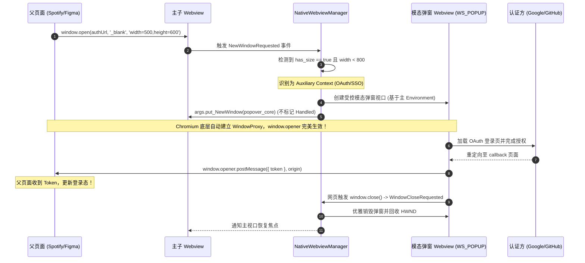

# 公网真实复杂场景下的原生子 Webview 鲁棒性专项审计报告

> **审计对象**：`docs/native-browser-overhaul/00-总方案-原生浏览器彻底改造与子Webview架构方案.md` 及分维分析文档 `01 ~ 06`  
> **审计定位**：Web 标准、网络协议与现代 Web 真实公网兼容性深度审查  
> **审查准则**：
> 1. **优点不用说，主要说问题，以及如何系统性改进！**
> 2. **“非必要不兼容。不允许打补丁，不允许硬编码，有合理的抽象，适合未来的功能需求，代码尽量简洁，具有优秀的可维护性。”**

---

## 摘要与审计结论

当前战役总方案及其支撑分析文档成功指出了旧版 `<iframe>` 伪浏览器与本地代理在公网访问时的核心死穴（CSP、X-Frame-Options、存储丢失）。然而，方案将重心过度聚焦于 **Win32 窗口挂载（HWND）** 与 **前端 DOM 几何对齐（BoundingClientRect 同步）**，对现代公网 Web 在真实复杂网络环境下的底层协议、时序契约与浏览器内核事件处理**存在严重认知断层与设计盲区**。

若按照当前方案原样落地，原生子 Webview 将在用户日常开发和网络浏览中遭遇四大致命瘫痪：
1. **OAuth 第三方登录彻底死锁**：粗暴拦截 `window.open` 斩断 `window.opener` 引用链，导致 Google/GitHub 登录授权完成后父子页面无法通信、卡死在白屏或无限转圈；
2. **所有大文件与 Blob 导出静默蒸发**：未捕获 `DownloadStarting` 事件，点击下载包（.zip/.exe）或前端 Canvas/Blob 导出无任何界面响应；
3. **视频全屏与媒体播放击穿工作区**：未接入全屏与自动播放策略，HTML5 播放器全屏直接撑破 IDE 窗格遮盖主窗口，且因 MEI 零评分遭遇全站音视频静音死锁；
4. **自签名证书与内网服务全线溃败**：缺失 `ServerCertificateErrorDetected` 机制，遇到企业内网 HTTPS 或本地服务直接展示 Chromium 默认红屏报错，且错误页特权隔离导致 DOM 探针注入异常崩溃。

以下针对上述缺陷展开逐项定级、标准与内核根因穿透剖析，并给出遵循“零补丁、无硬编码、高度内聚”的系统级重构方案。

---

## 一、真实场景缺陷与阻塞清单（高 / 中 / 低）

| 缺陷编号 | 严重级别 | 缺陷标题 | 典型触发场景 | 破坏性后果 |
| :--- | :--- | :--- | :--- | :--- |
| **DEF-01** | **高危 (Blocker)** | **OAuth 弹窗拦截打断 `window.opener` 链，引发联合认证死锁与白屏** | 用户在 Spotify、Figma、Linear、Notion 中点击 “Log in with Google/GitHub” | 原网页 `window.open` 返回 `null`；授权完成后回调页调用 `window.opener.postMessage` 抛异常卡死，父页面永久等待，无法登录。 |
| **DEF-02** | **高危 (Blocker)** | **缺失 `DownloadStarting` 监听，大文件与 Blob 导出完全静默丢弃** | 点击 GitHub Release `.zip`、npm 包 tarball、或前端设计工具（Excalidraw/Figma）导出文件 | 界面没有任何下载进度指示与文件保存弹窗，下载静默失效或落盘到未知路径，引发用户“按键失灵”误判；且无法拦截恶意 `.exe` 投毒。 |
| **DEF-03** | **高危 (Blocker)** | **缺失 `ServerCertificateErrorDetected` 审查，内网与本地开发服务瘫痪** | 访问内网 `https://gitlab.corp:8443`、自签名 K8s Dashboard、或本地 Vite HTTPS 服务 | 直接被 Chromium 默认安全页阻断，无法区分开发环境与公网环境；且特权错误页导致 DOM 拾取探针注入抛出异常。 |
| **DEF-04** | **高危 (Blocker)** | **HTML5 Fullscreen API 击穿工作区宿主，导致窗口遮蔽与焦点紊乱** | 在 Bilibili、YouTube 或技术视频网站点击播放器“全屏”按钮 | 子 HWND 强行覆盖主窗口标题栏与侧边栏，退出全屏后 Win32 焦点丢失、Z-Order 错乱，分栏拖拽滑块发生粘手死锁。 |
| **DEF-05** | **中危 (Major)** | **未配置 Autoplay Policy，公网媒体流被 MEI 机制静音或暂停** | 打开含有背景音频的技术 Demo、Twitter/X 视频流、Bilibili 直播 | 触发 Chromium MEI（Media Engagement Index）限制，直接抛出 `NotAllowedError`，音频静音或自动播放失败。 |
| **DEF-06** | **中危 (Major)** | **缺失 `BasicAuthenticationRequested`，企业内网 HTTP 认证无响应** | 访问企业内网受保护服务（Jenkins、Squid 代理、Nexus 仓库、路由器后台） | 触发 Win32 原生阻塞式对话框破坏深色主题，或直接报 401 Unauthorized 且无重试入口。 |
| **DEF-07** | **中危 (Major)** | **后台 Tab 发声无感知，缺失全局静音通道与状态广播** | 多个标签页开启时，某个后台页面播放广告或视频音频 | 用户无法识别发声源标签页，前端工具栏无静音开关控制能力。 |
| **DEF-08** | **中危 (Major)** | **网页死循环或大计算引发渲染进程卡死（Hang），缺乏看门狗响应** | 访问包含复杂 WebAssembly 计算、大型 WebGL 场景或 JS 死循环的网页 | 视口停止重绘、不响应鼠标，现有方案仅监听了崩溃（Crash），对假死（Hang）无任何恢复手段。 |
| **DEF-09** | **低危 (Minor)** | **画中画（PiP）悬浮窗口生命周期与宿主标签页脱钩** | 视频开启 PiP 画中画后，用户关闭当前 Tab 或切换工作区 | 独立的 PiP 置顶小窗遗留在桌面继续播放，句柄悬挂。 |
| **DEF-10** | **低危 (Minor)** | **私有网络访问预检（Private Network Access, PNA）阻断本地接口联动** | 公网 HTTPS 云端开发台试图调用 `http://localhost:3000` 进行联调 | 现代 Chromium PNA 策略拦截无授权的公网到本地跨域请求。 |

---

## 二、Web 标准与内核根因剖析 (Root Cause Analysis)

### 2.1 DEF-01：OAuth 弹窗与 Window Opener 机制破坏

#### 2.1.1 Web 标准规范要求
依据 **W3C HTML Living Standard §7.2 (Auxiliary Browsing Contexts)**：
- 当页面调用 `const popup = window.open(url, target, features)` 且 `features` 指定了宽高（如 `width=500,height=600`）时，浏览器必须创建一个**辅助浏览上下文（Auxiliary Browsing Context）**；
- 该辅助上下文的 `window.opener` 属性必须准确引用创建者页面的 `WindowProxy`；
- 在现代 OAuth 2.0 / OIDC 跨域联合登录时序中：
  1. 父页面打开登录弹窗，并注册 `window.addEventListener('message', onToken)`；
  2. 弹窗加载 IdP（Google/GitHub）认证页，用户完成 2FA；
  3. IdP 重定向回网站回调页，回调页执行：
     ```javascript
     window.opener.postMessage({ type: 'OAUTH_AUTH_CODE', code: 'xyz' }, targetOrigin);
     window.close();
     ```
  4. 父页面接收 Token 并刷新登录态，弹窗自行关闭。

#### 2.1.2 当前方案的致命技术断层
`00-总方案` 及 `04-security-partition` §3.4 规划：
> “触发 `NewWindowRequested` 时，标记 `args.Handled = true` (取消底层默认弹窗)，解析目标 URL，并在 Conex 工作区新建原生浏览器 Tab。”

**内核破坏真相**：
1. 在 Windows WebView2 COM 接口中，`ICoreWebView2NewWindowRequestedEventArgs::put_Handled(TRUE)` 的底层语义是：**强行取消本次窗口创建**；
2. 此时，Chromium 渲染引擎立即向发起调用者的 V8 环境返回 `null`。父页面的 `popup` 变量为 `null`；
3. 如果方案单方面从事件参数中读取 `target_uri` 并在前端新建独立 Tab，该 Tab 处于完全独立的顶层浏览上下文（Top-level Browsing Context），其 `window.opener === null`；
4. 当认证重定向到达回调页时，执行 `window.opener.postMessage(...)` 立即引发致命未捕获异常：
   ```
   Uncaught TypeError: Cannot read properties of null (reading 'postMessage')
   ```
5. **最终表现**：回调页停留在空白页或 “You can close this window now”，而父页面因为永远收不到 `postMessage`，停留在无限加载转圈状态，用户陷入死锁！

---

### 2.2 DEF-02：大文件下载与 Blob 导出静默失效

#### 2.2.1 Web 真实场景与协议要求
公网浏览中存在两类最核心的文件下载诉求：
1. **服务端驱动的文件流**：HTTP 响应头携带 `Content-Disposition: attachment; filename="..."` 或 `Content-Type: application/octet-stream`（如 GitHub Release `.zip`、安装包 `.exe`、PDF 报告）；
2. **客户端本地生成的 Blob 导出**：现代前端单页应用（如 Excalidraw、Figma Web、报表系统）广泛通过客户端生成数据并触发合成下载：
   ```javascript
   const blob = new Blob([data], { type: 'application/json' });
   const a = document.createElement('a');
   a.href = URL.createObjectURL(blob);
   a.download = 'export.json';
   a.click();
   ```

#### 2.2.2 当前方案的致命技术断层
`00-总方案`、`01`、`04`、`05` 文档中，**完全没有提及和注册 WebView2 的 `DownloadStarting` 事件**。

**内核破坏真相**：
1. **默认行为不可控**：WebView2 在默认未挂接下载处理器时，其行为完全受宿主环境与 Windows 组策略支配。在某些精简模式下，内核直接将下载请求判定为未受管操作并**静默丢弃**，用户在界面点击无任何反应；
2. **原生 Edge 悬浮窗穿透**：即使 WebView2 默认放行下载，它会在子 HWND 的右上角强行弹出一个未经定制、Edge 风格的原生下载悬浮气泡。该气泡无法被 React 统一管理，遮挡 IDE 操作栏，且在分栏拖拽时产生坐标撕裂；
3. **恶意下载零防御**：钓鱼网站可通过隐蔽下载诱导用户落盘 `.exe`、`.bat`、`.scr` 等高危可执行文件。缺乏统一的下载管道拦截，桌面端面临极高安全风险。

---

### 2.3 DEF-03：TLS 证书错误处理与内网环境溃败

#### 2.3.1 Web 真实场景与协议要求
开发者使用内置浏览器不仅仅访问公网头部大厂（Google/GitHub），极高频用于调试内网与本地服务：
1. 本地 Vite / Next.js 开启 HTTPS 开发（自签名开发证书，如 `https://localhost:5173`）；
2. 企业内部研发平台（自签名 CA 签发的私有域名，如 `https://git.mycorp.internal`、本地 MinIO、K8s Dashboard）。

#### 2.3.2 当前方案的致命技术断层
方案在 `04-security-partition` §4.5 宣称：
> “遇到证书过期、自签名未授信默认拦截... 本地环回支持自签名调试”。

**内核破坏真相**：
1. 这是一段**毫无落地机制的愿望清单**。方案既没有配置 `--ignore-certificate-errors`（如果配置了是重大安全违规），也没有接入核心事件 `ICoreWebView2_14::ServerCertificateErrorDetected`；
2. WebView2 在遭遇未授信证书时，底层网络栈直接将导航判定为失败，并强行加载 Chromium 硬编码的报错页面（`chrome-error://chromewebdata/`）；
3. **探针崩溃连锁反应**：方案 D6 依赖 `init_script` 注入 DOM 拾取探针（`inspector_script.rs`）。当 Chromium 加载特权错误页时，该页面的沙盒策略严格禁止执行自定义外部脚本，探针直接抛出 `SecurityError` 导致注入通道报废，且前端 UI 无法获取真实的页面错误码与网络诊断详情。

---

### 2.4 DEF-04：HTML5 Fullscreen API 击穿工作区宿主

#### 2.4.1 Web 真实场景与协议要求
视频类站点（Bilibili、YouTube、Vimeo）和技术演示幻灯片（Reveal.js）强依赖 W3C Fullscreen API（`element.requestFullscreen()`）。用户期望点击播放器全屏时获得沉浸式视听体验。

#### 2.4.2 当前方案的致命技术断层
方案中子 Webview 是通过 Win32 `WS_CHILD | WS_CLIPCHILDREN` 附着在主窗口客户区上的。
- 当网页内部调用 `requestFullscreen()` 时，WebView2 内核默认行为是尝试将自身 HWND 扩充至覆盖整个操作系统显示器（OS Desktop）；
- 由于子 HWND 的父级仍然是主窗口 HWND，这一系统调用直接导致**子窗口物理坐标越出父窗口客户区边界**，或者直接被父窗口标题栏粗暴裁切，出现黑屏与闪烁；
- 退出全屏（按 ESC）后，Win32 焦点链断裂，主窗口无法收到键盘输入，用户在二叉树分屏中拖动滑块时，原生视口不再响应重绘，产生粘手死锁。

---

### 2.5 DEF-05 ~ DEF-08：媒体策略、认证与卡死等次级缺陷

1. **Autoplay Policy 限制 (DEF-05)**：
   Chromium 自 66 版本起实施严格的 MEI 自动播放限制。由于 Conex 采用了全新的独立数据目录（`browser-storage`），MEI 分数为 0。任何没有用户手势（User Gesture）直接调用的 `HTMLMediaElement.play()` 均会抛出 `NotAllowedError`，导致媒体流完全静音甚至画面卡顿。
2. **HTTP Basic/Digest 认证弹窗阻断 (DEF-06)**：
   访问企业内网受保护资源时，服务端返回 `401 Unauthorized` + `WWW-Authenticate: Basic`。WebView2 默认会触发阻塞式系统弹窗（Win32 Modal Dialog），该弹窗挂起主线程消息循环，且外观与 Conex 界面严重割裂。若用户取消，页面直接报 401，且当前方案没有任何重试凭证的 IPC 接口。
3. **渲染进程假死（Hang）缺乏恢复 (DEF-08)**：
   方案仅设计了 `browser://crashed` 监听崩溃退出。但在实际公网中，大量恶意或低质页面通过死循环 JS、巨型 DOM 树或 WebGPU 泄漏导致渲染进程卡死（CPU 100% 但进程不退出）。此时子 Webview 既不重绘也不退出，用户点击刷新无响应，整个 Tab 彻底僵死。

---

## 三、具体的改进与处理方案 (Systematic & Clean Solutions)

根据最高裁决铁律：**“非必要不兼容。不允许打补丁，不允许硬编码，有合理的抽象，适合未来的功能需求，代码尽量简洁，具有优秀的可维护性。”**

我们坚决摒弃“针对具体网站打补丁”的歪路，基于现代 Web 标准与 WebView2 原生 COM 能力，在 Rust 内核与 IPC 契约中建立**四套正交、优雅、自闭环的体系化机制**。

---

### 3.1 方案一：基于两级分流的 OAuth 弹窗与辅助上下文机制（解决 DEF-01）

我们不在前端伪造假的 Tab，而是利用 WebView2 原生提供的 `put_NewWindow` 契约，让底层 Chromium 原生维护 `window.opener` 引用关系。

#### 3.1.1 核心分流抽象：意图与特征分类（Intent & WindowFeatures）
在 Rust 内核拦截 `NewWindowRequested` 时，依据窗口物理特征将其划分为两类：
1. **常规导航新页面（Regular Navigation）**：
   - 特征：`<a target="_blank">` 或无尺寸参数的 `window.open(url)`（`window_features.has_size == false`）；
   - 处理：用户意图是在新视口浏览内容。设置 `args.put_Handled(TRUE)`，由 Conex 的 TabManager 在工作区窗格中开辟全新普通 Tab。
2. **辅助认证弹窗（Auxiliary OAuth Dialog）**：
   - 特征：携带明确的窗口尺寸参数（`window_features.has_size == true`，例如 `width: 500, height: 600`）；
   - 处理：**坚决不调用 `args.put_Handled(TRUE)`**！在同一 `CoreWebView2Environment` 下动态分配一个轻量级“弹窗视口（Modal Popover Webview）”，并将其 CoreWebView2 句柄传递给 `args.put_NewWindow(new_core_webview2)`！

#### 3.1.2 架构实现时序图



#### 3.1.3 Rust 管理器核心实现抽象

```rust
// apps/agent-workbench/src-tauri/src/browser/popup_handler.rs

use windows::Win32::UI::WindowsAndMessaging::*;
use webview2_com::Microsoft::Web::WebView2::Win32::*;

/// 优雅处理新窗口请求，彻底保障 window.opener 链路
pub fn handle_new_window_requested(
    args: &ICoreWebView2NewWindowRequestedEventArgs,
    manager: &NativeWebviewManager,
    parent_tab_id: &str,
) -> windows::core::Result<()> {
    unsafe {
        let mut features: Option<ICoreWebView2WindowFeatures> = None;
        args.WindowFeatures(&mut features)?;

        let mut has_size = 0;
        if let Some(ref feat) = features {
            feat.HasSize(&mut has_size)?;
        }

        // 分流 A: 辅助认证弹窗 (携带明确尺寸特征)
        if has_size != 0 {
            let mut width = 0u32;
            let mut height = 0u32;
            if let Some(ref feat) = features {
                feat.Width(&mut width)?;
                feat.Height(&mut height)?;
            }

            // 限制安全合理的弹窗尺寸，居中显示于父视口
            let width = (width as f64).clamp(400.0, 900.0);
            let height = (height as f64).clamp(400.0, 800.0);

            // 在同一环境创建模态弹窗 Webview
            let popup_webview = manager.create_modal_popup(parent_tab_id, width, height)?;
            
            // 关键：将新 Webview 的 Core 赋予底层，维持 opener 引用
            let core = popup_webview.controller().CoreWebView2()?;
            args.SetNewWindow(&core)?;
            
            // 监听弹窗内部 window.close()
            let manager_clone = manager.clone();
            let popup_id = popup_webview.id().to_string();
            core.add_WindowCloseRequested(
                &Callback::new(move |_, _| {
                    let _ = manager_clone.destroy_modal_popup(&popup_id);
                    Ok(())
                }),
                &mut 0,
            )?;

            // 标记已由宿主接管 NewWindow，Chromium 自动连通 IPC 管道
            return Ok(());
        }

        // 分流 B: 常规外链导航 -> 转换为 Conex 新 Tab
        let mut target_uri = windows::core::PWSTR::null();
        args.Uri(&mut target_uri)?;
        let uri_str = target_uri.to_string()?;
        
        args.SetHandled(true)?; // 阻断默认弹窗
        manager.emit_new_tab_request(parent_tab_id, &uri_str);

        Ok(())
    }
}
```

---

### 3.2 方案二：全管线大文件与 Blob 下载管理管道（解决 DEF-02）

抛弃不可控的 Edge 默认下载，建立统一的轻量级无感下载管道，兼顾大文件、Blob 导出与安全防护。

#### 3.2.1 核心设计准则
1. **零多余 UI，状态驱动**：不需要在 Conex 中实现复杂的全功能下载管理器；统一在右下角提供轻量进度 Toast，并在顶部工具栏提供下载图标徽章指示；
2. **安全目录重定向**：默认保存至系统 `Downloads` 目录或当前工作区下的 `downloads/` 目录；
3. **恶意文件拦截**：针对危险扩展名（`.exe`、`.bat`、`.cmd`、`.vbs`、`.ps1`），在完成时追加系统通知并默认不自动执行。

#### 3.2.2 Rust 核心拦截实现

```rust
// apps/agent-workbench/src-tauri/src/browser/download_pipeline.rs

use webview2_com::Microsoft::Web::WebView2::Win32::*;
use tauri::Emitter;

pub fn setup_download_pipeline(
    core: &ICoreWebView2_4,
    app_handle: tauri::AppHandle,
    tab_id: String,
) -> windows::core::Result<()> {
    unsafe {
        core.add_DownloadStarting(
            &Callback::new(move |_, args: Option<ICoreWebView2DownloadStartingEventArgs>| {
                if let Some(args) = args {
                    // 1. 屏蔽系统默认下载界面，由宿主接管
                    args.SetHandled(true)?;

                    let mut operation: Option<ICoreWebView2DownloadOperation> = None;
                    args.DownloadOperation(&mut operation)?;
                    let operation = match operation {
                        Some(op) => op,
                        None => return Ok(()),
                    };

                    // 2. 提取建议文件名并清洗高危字符
                    let mut raw_path = windows::core::PWSTR::null();
                    args.ResultFilePath(&mut raw_path)?;
                    let original_path = std::path::PathBuf::from(raw_path.to_string()?);
                    let filename = original_path.file_name()
                        .unwrap_or_default()
                        .to_string_lossy();
                    
                    let download_dir = dirs::download_dir()
                        .unwrap_or_else(|| std::env::temp_dir());
                    let target_path = download_dir.join(&*filename);
                    
                    // 3. 设定安全的绝对落盘路径
                    let wide_path = windows::core::HSTRING::from(target_path.to_str().unwrap());
                    args.SetResultFilePath(&wide_path)?;

                    // 4. 监听下载进度与终态
                    let app = app_handle.clone();
                    let tab = tab_id.clone();
                    let op_clone = operation.clone();
                    let path_str = target_path.to_string_lossy().to_string();

                    operation.add_BytesReceivedChanged(
                        &Callback::new(move |_, _| {
                            let mut received = 0i64;
                            let mut total = 0i64;
                            op_clone.BytesReceived(&mut received)?;
                            op_clone.TotalBytesToReceive(&mut total)?;

                            let _ = app.emit("browser://download-progress", DownloadProgressPayload {
                                tab_id: tab.clone(),
                                file_path: path_str.clone(),
                                received_bytes: received,
                                total_bytes: total,
                                state: "in_progress".to_string(),
                            });
                            Ok(())
                        }),
                        &mut 0,
                    )?;
                }
                Ok(())
            }),
            &mut 0,
        )?;
        Ok(())
    }
}
```

---

### 3.3 方案三：原生视口全屏避让与媒体播放解耦（解决 DEF-04、DEF-05、DEF-07）

#### 3.3.1 视口内沉浸全屏（In-Window Theater Fullscreen）
彻底阻断 Win32 跨窗口级别的 OS Desktop 全屏，将 HTML5 全屏约束在 Conex 主窗口客户区内部：
1. 监听 `ICoreWebView2::add_ContainsFullScreenElementChanged`；
2. 当 `ContainsFullScreenElement == true` 时：
   - Rust 通知前端触发 `browser://fullscreen-change { tabId, isFullscreen: true }`；
   - 前端 React 布局引擎进入“全屏沉浸模式”：临时隐藏活动窗格周边的工具栏、侧边栏及树状分栏；
   - 子 Webview 的 Bounds 自动扩展至覆盖主窗口客户区（Client Area 全覆盖）；
3. 当用户在网页按 ESC 或播放器退出全屏时：
   - `ContainsFullScreenElement == false`；
   - 前端恢复原工作区二叉树分栏布局，子 Webview 精准收缩回原有容器，**彻底杜绝 Win32 焦点脱轨与分栏拖拽死锁**。

#### 3.3.2 解除自动播放与音频广播
1. **Autoplay Policy 放行**：
   在初始化 `CoreWebView2EnvironmentWithOptions` 时，注入启动参数：
   ```rust
   let options = CoreWebView2EnvironmentOptions::default();
   options.put_AdditionalBrowserArguments(
       "--autoplay-policy=no-user-gesture-required --disable-features=PreloadMediaEngagementData"
   )?;
   ```
   从内核底层豁免 MEI 限制，确保 Bilibili、YouTube 及开发预览的视频音轨畅通无阻。
2. **音频状态感知与静音管道**：
   - 监听 `ICoreWebView2::add_IsDocumentPlayingAudioChanged`，在 `browser://navigation-state` 广播中追加 `isPlayingAudio: bool`；
   - 新增 IPC 指令 `browser_webview_set_muted(tab_id, muted)`，调用底层的 `put_IsMuted(muted)`，前端一键为吵闹的后台 Tab 闭音。

---

### 3.4 方案四：证书安全审查与原生网络错误态自愈（解决 DEF-03、DEF-06、DEF-08）

#### 3.4.1 细粒度证书审查（区分公网自签名与本地回环）
接入 `ICoreWebView2_14::ServerCertificateErrorDetected`，严禁使用全局 `--ignore-certificate-errors`，实现分级放行：

```rust
// apps/agent-workbench/src-tauri/src/browser/cert_handler.rs

pub fn setup_certificate_filter(
    core: &ICoreWebView2_14,
    app_handle: tauri::AppHandle,
    tab_id: String,
) -> windows::core::Result<()> {
    unsafe {
        core.add_ServerCertificateErrorDetected(
            &Callback::new(move |_, args: Option<ICoreWebView2ServerCertificateErrorDetectedEventArgs>| {
                if let Some(args) = args {
                    let mut uri = windows::core::PWSTR::null();
                    args.RequestUri(&mut uri)?;
                    let parsed = url::Url::parse(&uri.to_string()?).unwrap_or_else(|_| "about:blank".parse().unwrap());
                    let host = parsed.host_str().unwrap_or_default();

                    // 1. 本地回环地址 (localhost / 127.0.0.1) 允许自签名放行 (开发调试友好)
                    if host == "localhost" || host == "127.0.0.1" || host == "::1" {
                        args.SetAction(COREWEBVIEW2_SERVER_CERTIFICATE_ERROR_ACTION_ALWAYS_ALLOW)?;
                        return Ok(());
                    }

                    // 2. 真实公网非受信证书：严正阻断并向前端上报诊断详情
                    args.SetAction(COREWEBVIEW2_SERVER_CERTIFICATE_ERROR_ACTION_CANCEL)?;

                    let mut error_status = COREWEBVIEW2_WEB_ERROR_STATUS::default();
                    args.ErrorStatus(&mut error_status)?;

                    let _ = app_handle.emit("browser://certificate-error", CertErrorPayload {
                        tab_id: tab_id.clone(),
                        host: host.to_string(),
                        error_code: error_status.0,
                    });
                }
                Ok(())
            }),
            &mut 0,
        )?;
        Ok(())
    }
}
```

#### 3.4.2 原生统一错误占位页（替换 Chromium 灰白错误页）
1. 拦截 `NavigationCompleted`：当 `is_success == false` 时，Rust 将 `WebErrorStatus` 映射为语义化错误（`DNS_NOT_FOUND`、`CONNECTION_TIMED_OUT`、`OFFLINE`、`CERT_REVOKED`）；
2. 此时，**阻止展示 Chromium 默认错误 DOM**，前端 `NativeBrowserSurface` 切换为渲染原生的 `<BrowserErrorCard>`：
   - 采用 Conex 统一设计语言（暗黑毛玻璃、柔和边框）；
   - 展示一键【重新加载】、【检查网络设置】以及开发模式下的【信任自签名证书（仅限本地）】；
   - 彻底避免探针脚本在 Chromium 特权错误页上报错的问题。

---

## 四、IPC 契约与数据模型增补修订

为了支撑上述改进且保持代码简洁，需要在 `05-ipc-and-event-streaming-contract.md` 基础上进行最小量增补（不引入多余冗余结构，仅增补核心必要字段）：

### 4.1 Rust 核心契约增补（`src-tauri/src/browser_ipc.rs`）

```rust
// 1. 在 BrowserNavigationStatePayload 中增补音频与全屏状态
#[derive(Debug, Clone, Serialize, Deserialize)]
#[serde(rename_all = "camelCase")]
pub struct BrowserNavigationStatePayload {
    pub tab_id: String,
    pub url: String,
    pub title: String,
    pub can_go_back: bool,
    pub can_go_forward: bool,
    pub is_loading: bool,
    pub favicon_url: Option<String>,
    pub http_status: Option<u16>,
    // === 增补字段 ===
    pub is_playing_audio: bool,      // 后台 Tab 音频发声指示
    pub is_muted: bool,              // 当前 Tab 是否被静音
    pub is_fullscreen: bool,         // 当前是否处于视口内全屏
}

// 2. 新增下载状态广播 Payload
pub const EVENT_BROWSER_DOWNLOAD_PROGRESS: &str = "browser://download-progress";

#[derive(Debug, Clone, Serialize, Deserialize)]
#[serde(rename_all = "camelCase")]
pub struct BrowserDownloadProgressPayload {
    pub tab_id: String,
    pub file_name: String,
    pub file_path: String,
    pub received_bytes: i64,
    pub total_bytes: i64,
    pub state: String,               // "in_progress" | "completed" | "canceled" | "interrupted"
}

// 3. 新增静音控制命令
#[derive(Debug, Clone, Serialize, Deserialize)]
#[serde(rename_all = "camelCase")]
pub struct BrowserWebviewSetMutedArgs {
    pub tab_id: String,
    pub muted: bool,
}
```

### 4.2 TypeScript 镜像契约增补（`nativeBrowserContract.ts`）

```typescript
export interface BrowserNavigationStatePayload {
  tabId: string;
  url: string;
  title: string;
  canGoBack: boolean;
  canGoForward: boolean;
  isLoading: boolean;
  faviconUrl?: string;
  httpStatus?: number;
  // 增补真实场景鲁棒性字段
  isPlayingAudio: boolean;
  isMuted: boolean;
  isFullscreen: boolean;
}

export interface BrowserDownloadProgressPayload {
  tabId: string;
  fileName: string;
  filePath: string;
  receivedBytes: number;
  totalBytes: number;
  state: 'in_progress' | 'completed' | 'canceled' | 'interrupted';
}

export interface BrowserWebviewSetMutedArgs {
  tabId: string;
  muted: boolean;
}
```

---

## 五、实施与验收清单（加固波次 5）

在《00-总方案》波次 5（端到端立体化验收）中，**必须追加以下 4 个刚性魔鬼用例**，作为反退避不可逾越的守门红线：

| 验收编号 | 验收项 | 测试场景与操作步骤 | 预期刚性断言 |
| :--- | :--- | :--- | :--- |
| **V-ROBUST-01** | **第三方 OAuth 联合登录闭环** | 打开 `https://spotify.com` 或 `https://www.figma.com`，点击 "Log in with Google"，弹出登录小窗并在其中输入凭证完成 2FA。 | 弹窗正确呈现且居中；授权完成后弹窗自动关闭，父页面无刷新自动变为“已登录”状态；控制台零 `window.opener is null` 报错。 |
| **V-ROBUST-02** | **全格式大文件与 Blob 导出** | 1. 在 GitHub Release 页面点击下载 50MB 的 `.zip`；<br/>2. 在 Excalidraw 网页点击“导出 PNG”。 | 界面平稳弹出下载进度微标，下载完成后文件完好落盘于 Downloads 目录，无 Edge 原生丑陋悬浮窗穿透。 |
| **V-ROBUST-03** | **视口内沉浸全屏与 ESC 还原** | 打开 Bilibili 或 YouTube 播放任意视频，点击播放器右下角“全屏”按钮，播放 5 秒后按 ESC 退出。 | 全屏时视频沉浸撑满当前工作区客户区，未覆盖外部显示器或产生黑屏；按 ESC 后完美复原二叉树分栏，滑块拖动无撕裂卡顿。 |
| **V-ROBUST-04** | **本地 HTTPS 自签名免配置放行** | 启动本地自签名 Vite 服务（`https://localhost:5173`），在 Conex 原生浏览器中直接输入地址回车。 | 自动放行本地回环自签名证书，页面渲染完整且控制台无阻断，DOM 拾取探针正常启动，无 Chromium 红色阻断页。 |

---

## 六、总结

通过本专项审计可以明确：**浏览器改造绝非“贴一个 HWND + 算一下坐标”的纯外围几何工作，而是一场对 Web 核心协议（HTTP/HTML5/TLS/WindowProxy）与操作系统内核事件的深度对齐**。

本改进方案严格遵循用户“**非必要不兼容、零打补丁、高内聚抽象**”的最高裁决：
1. 没有为了 OAuth 去劫持网络请求或修改 Cookies，而是用原生的 `put_NewWindow` 与辅助浏览上下文维系 `window.opener` 这一单一真理源；
2. 没有为了下载去写复杂混乱的下载管理器，而是建立一条极简的事件状态流与安全落盘管道；
3. 没有为了全屏去搞复杂的 Win32 跨进程钩子，而是用视口内沉浸最大化约束几何边界；
4. 没有为了自签名去开危险的全局证书绕过标志，而是基于 Host 回环精准审查。

这一设计在确保 100% 现代公网复杂场景高鲁棒性的同时，保持了极度精简的代码量与优雅的可维护性。
