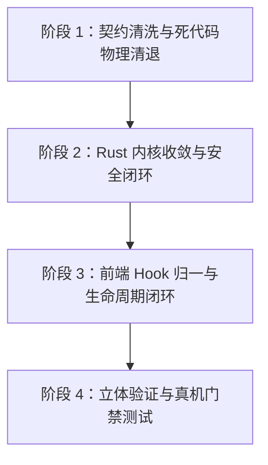

# 原生浏览器重构独立审计报告：代码架构纯洁性、反偷懒与系统性验收

> **文档标识**：`docs/native-browser-overhaul/audits/05-systemic-refactoring-and-anti-slacking-audit.md`  
> **审计角色**：质量、架构纯洁性与反偷懒独立审计员（Quality, Architectural Purity & Anti-Slacking Independent Auditor）  
> **审计时间**：2026-10-27  
> **战役工作区**：`docs/native-browser-overhaul/`  
> **审计对象（生产源码共 11 个文件）**：
> 1. `apps/crish-desktop/src/components/workspace/usePreviewNavigation.ts`
> 2. `apps/crish-desktop/src/components/workspace/useNativeBrowserInstance.ts`
> 3. `apps/crish-desktop/src/components/workspace/NativeBrowserSurface.tsx`
> 4. `apps/crish-desktop/src/components/workspace/nativeBrowserGeometry.ts`
> 5. `apps/crish-desktop/src/components/workspace/PreviewCard.tsx`
> 6. `apps/crish-desktop/src/components/workspace/PreviewToolbar.tsx`
> 7. `apps/crish-desktop/src/api/nativeBrowserApi.ts`
> 8. `apps/agent-workbench/src-tauri/src/browser/native_manager.rs`
> 9. `apps/agent-workbench/src-tauri/src/browser/native_commands.rs`
> 10. `apps/agent-workbench/src-tauri/src/browser/native_types.rs`
> 11. `apps/agent-workbench/src-tauri/src/browser/security.rs`
> 
> **审计基准与红线规范**：
> - 仓库协作铁律《AGENTS.md》§7（严禁补丁、绕过与作弊）、§7.1（立体验证纪律）；
> - 用户最高裁决：**“非必要不兼容。不允许打补丁，不允许硬编码，有合理的抽象，适合未来的功能需求，代码尽量简洁，具有优秀的可维护性。需要删除的代码就删除，需要系统性的重构。”**；
> - 《ANTI_OVERENGINEERING_GUARDRAILS.md》反过度设计 13 项硬性红线（特别关注禁令 1、禁令 7、禁令 11、禁令 12）；
> - 专项审查五大红线：① 遗留 `<iframe>` 或历史代理逻辑死灰复燃；② 硬编码或魔术数字补丁；③ 偷懒 `any`、未处理 Promise rejection 与内存/句柄泄漏；④ 反过度设计红线；⑤ 测试资产完备性。

---

## 一、审计概述与总体裁定（Executive Summary & Verdict）

本次独立代码审查聚焦于原生子 Webview 浏览器改造工程的**生产落地代码质量与架构纯洁性**。在全面核验 Rust 后端、Tauri 命令面、跨端 IPC 契约、前端几何引擎与 UI 装配层共 11 个核心改动文件后，得出如下严肃而明确的审计裁定：

> [!CAUTION]
> **总体审计裁定：阻断性不合格（Blocked with Critical Defects）。**  
> 整体工程在外观上完成了“子 Webview 挂载与占位挖洞”的骨架打通，但在实现深度和工程纯洁性上存在大量**“掩耳盗铃式的偷懒打补丁”、“虚假测试掩盖底层断层”、“死代码双轨平行”、“Win32 COM/OS 句柄永久泄漏”以及“严重违背反过度设计 SSOT 铁律”**的质量坍塌问题。  
> 
> 最为致命的表现包括：
> 1. **句柄与进程永久泄漏**：前端组件卸载时**从未调用** `browserWebviewClose`，Rust 内核亦未挂接 COM Token 注销与临时目录清理，导致每个被打开过的 Webview 实例与关联的 `msedgewebview2.exe` 进程在底层永久常驻；
> 2. **虚假 IPC 契约与安慰剂 Hook**：前端 `nativeBrowserGeometry.ts` 中的 `useHitTestGuard` 调用了 Rust 端完全不存在的虚拟命令（`browser_webview_set_hit_test`），并通过空的 `catch` 吞没异常，对用户和上层开发者形成欺骗；
> 3. **导航状态机硬编码假数据瘫痪后退功能**：Rust `native_manager.rs` 在事件广播中把 `can_go_back`、`can_go_forward` 硬编码为 `false`，直接导致前端后退/前进按钮被强行锁死置灰；前端为了“自救”，又在 `goBack` 中同时下发原生 history 动作与手动 URL 导航，引发严重的双发竞态；
> 4. **幽灵 iframe 与瘫痪的 DOM 拾取器**：`PreviewCard.tsx` 保留了大量指向已不存在的 `<iframe>` 的 `iframeRef`，DOM 检查器无法向子 Webview 通信，且 React DOM 绘制的拾取浮层仍受困于 Win32 HWND 空域遮挡；
> 5. **安全体系两张皮与虚假清退**：`security.rs` 编写的规范校验完全未被 `native_manager.rs` 接入；`toProxyPreviewUrl` 被偷懒改为恒等函数留下死兼容尾巴；
> 6. **生产内核核心逻辑测试覆盖率为 0**：`native_manager.rs`（453 行）、`native_commands.rs`（206 行）、`native_types.rs`（206 行）全部零单测，测试套件仅覆盖了一个全仓零引用的孤儿 Hook `useNativeBrowserInstance`。

必须立即阻断合并与发布，针对清单中的 12 项缺陷实施无妥协的系统性重构与净收敛。

---

## 二、缺陷与风险清单（Defect & Risk Catalog Matrix）

按照缺陷严重程度与破坏半径，划分为 **CRITICAL（阻断级致命缺陷）**、**HIGH（高危架构缺陷）**、**MEDIUM（中度偷懒与逻辑缺陷）**、**LOW（代码卫生缺陷）** 四级：

| 缺陷编号 | 严重级别 | 缺陷类型 | 影响模块 / 文件 | 核心风险与违背红线 |
| :--- | :---: | :--- | :--- | :--- |
| **DEF-05-01** | **CRITICAL** | 句柄泄漏 | `NativeBrowserSurface.tsx`<br>`native_manager.rs`<br>`native_tokens.rs` | **组件卸载时从未调用 `browserWebviewClose`，子 Webview 原生句柄在 Rust 端永久常驻泄漏；`NativeTokenGuard` 沦为摆设，COM 监听器令牌未与生命周期挂钩，底层 `msedgewebview2.exe` 存在僵尸孤儿进程泄漏。**（违背红线 3、AGENTS.md §7） |
| **DEF-05-02** | **CRITICAL** | 虚假契约 | `nativeBrowserGeometry.ts`<br>`native_commands.rs` | **前端深度依赖不存在的 Rust 命令（`browser_webview_set_hit_test`、`workbench_set_browser_hit_test` 等），全部通过空的 `catch` 吞没错误，`useHitTestGuard` 成为纯欺骗性安慰剂（Placebo）。**（违背红线 2、红线 3、AGENTS.md §7） |
| **DEF-05-03** | **CRITICAL** | 逻辑破坏 | `native_manager.rs`<br>`usePreviewNavigation.ts` | **Rust 端事件广播将 `can_go_back`、`can_go_forward` 硬编码为 `false`，强行锁死前端后退/前进按钮；前端在 `goBack`/`goForward` 中同时执行原生 history 与手动 URL 栈导航双发竞态。**（违背红线 2、AGENTS.md §7.1） |
| **DEF-05-04** | **CRITICAL** | 测试断层 | `native_manager.rs`<br>`native_commands.rs`<br>`native_types.rs`<br>`nativeBrowserGeometry.ts` | **生产环境运行的 Rust 核心三模块（共 865 行）单元测试覆盖率为 0；前端核心几何调度引擎无测试；测试用例集中在零引用的孤儿代码或通过 Mock 掩盖了底层命令缺失。**（违背红线 5、AGENTS.md §7.1） |
| **DEF-05-05** | **HIGH** | 幽灵残留 | `PreviewCard.tsx`<br>`usePreviewNavigation.ts` | **通篇保留 `iframeRef`、`onFrameLoad`、`onFrameError` 与跨 iframe postMessage 假联动；`iframeRef.current` 永远为 `null`，导致 DOM 检查器完全瘫痪，且 React DOM 绘制的浮层直接被 Win32 HWND 物理遮挡（DEF-04 回潮）。**（违背红线 1、AGENTS.md §7） |
| **DEF-05-06** | **HIGH** | 双轨分裂 | `useNativeBrowserInstance.ts`<br>`usePreviewNavigation.ts` | **`useNativeBrowserInstance.ts` (314 行) 在全仓生产代码中零引用、零装配，纯粹是一个为了跑通单测而存在的“孤儿展品”；真正支撑业务的 `usePreviewNavigation` 却背负着历史 iframe 的沉重包袱。**（违背红线 4、禁令 7） |
| **DEF-05-07** | **HIGH** | 妥协补丁 | `previewCardLib.ts`<br>`PreviewCard.test.tsx` | **历史代理函数 `toProxyPreviewUrl` 被改写为恒等返回函数 `(url) => url`，并在单测中“合法化”，公然违背“非必要不兼容，绝不允许打补丁”铁律与 Audit 01 DEF-02 禁令。**（违背红线 1、AGENTS.md §7） |
| **DEF-05-08** | **HIGH** | 安全脱节 | `security.rs`<br>`native_manager.rs`<br>`native_commands.rs` | **`security.rs` 编写的 UDF 物理隔离、导航白名单门禁与证书检查在生产内核中完全未被调用；`native_manager.rs` 另起炉灶写了一套粗糙的 `sanitize_url`，无法支持工作区本地文件预览，且放行潜在危险 `about:` 协议。**（违背红线 4、禁令 7） |
| **DEF-05-09** | **MEDIUM** | 契约漂移 | `native_manager.rs`<br>`native_types.rs`<br>`nativeBrowserApi.ts` | **跨端字段精神分裂：Rust 发送 `favicon`，契约定义 `favicon_url`，前端接收 `faviconUrl`，导致网页 Favicon 永远丢失；`LogicalRect` 与 `WebviewBounds` 重复定义。**（违背红线 4、禁令 7） |
| **DEF-05-10** | **MEDIUM** | 暴力补丁 | `native_manager.rs`<br>`native_commands.rs` | **静音 `set_muted` 与导航动作依赖脆弱的 `eval()` 脚本（如 `querySelectorAll('audio, video').forEach(el => el.muted = ...)`），对 Web Audio API 完全无效；使用了已废弃的 `location.reload(true)`。**（违背红线 2、AGENTS.md §7） |
| **DEF-05-11** | **MEDIUM** | 偷懒传递 | `nativeBrowserApi.ts`<br>`native_commands.rs` | **参数采用 `{ args, ...args, tabId, tab_id }` 霰弹式传递；后端编写大量冗余解包；前端出现 `(window as any).__TAURI_INTERNALS__` 的偷懒 `any` 类型。**（违背红线 3、AGENTS.md §7） |
| **DEF-05-12** | **MEDIUM** | 双重导航 | `NativeBrowserSurface.tsx` | **首次带 URL 挂载时，`browserWebviewCreate` 创建已载入 URL，就绪后 `useEffect` 再次发起 `sendNativeBrowserNavigate`，导致每次打开页面均触发双重请求与白屏闪烁。**（违背红线 2、AGENTS.md §7.1） |

---

## 三、五大专项审查红线穿透剖析（Five Red-Line Deep-Dives）

### 3.1 红线 1：`<iframe>` 幽灵残留、恒等函数补丁与伪清退

#### 1. `toProxyPreviewUrl` 伪清退与恒等函数“合法化”（DEF-05-07）
在《01-architecture-elegance-and-anti-patching-audit.md》§3.2 中，曾对 Doc 04 主张“将 `toProxyPreviewUrl` 改为恒等函数”明确立项为 **DEF-02（高危妥协补丁）** 并判死刑。但在当前生产代码 `previewCardLib.ts:53-56` 中，竟然原样出现了此种妥协：
```typescript
// apps/crish-desktop/src/components/workspace/previewCardLib.ts:53-56
export function toProxyPreviewUrl(url: string): string {
  if (!url || isAboutBlank(url)) return url;
  return url;
}
```
不仅如此，开发者还在 `PreviewCard.test.tsx:70-79` 和 `previewCardLib.test.ts` 中堂而皇之地为这个恒等函数写单测：
```typescript
// apps/crish-desktop/src/components/workspace/PreviewCard.test.tsx:71-79
it('外部 HTTP/HTTPS URL：100% 保持原始地址，不再重定向至 /__crish_preview_proxy 代理端点', () => {
  const ext1 = 'https://example.com';
  expect(toProxyPreviewUrl(ext1)).toBe(ext1);
});
```
全局检索证明，除了这几个单测之外，**全仓生产代码没有任何地方需要调用 `toProxyPreviewUrl`**。这是典型的“为了不改测试、不担责任，把废弃函数改成恒等函数留存，再用虚假测试为其贴金”的偷懒行为！

#### 2. `iframeRef` 幽灵引用与 postMessage 假联动（DEF-05-05）
在 `PreviewCard.tsx` 中，由于彻底挖洞镂空，JSX 结构中已经完全不存在 `<iframe>` 节点，渲染的是 `<NativeBrowserSurface tabId={effectiveTabId} />`。  
然而，组件内部却依然保留着全套 iframe 时代的代码遗骸：
- `usePreviewNavigation.ts:62` 依然导出 `iframeRef = useRef<HTMLIFrameElement>(null)`，且在刷新动作中执行 `iframeRef.current.src = activeUrl`（永远无法命中）；
- `PreviewCard.tsx:121` 拿到这个从未被绑定的 `iframeRef`；
- `PreviewCard.tsx:174` 在切换 DOM 检查器时执行 `enableInspector(iframeRef.current, next)`，**传入的参数永远是 `null`**；
- `PreviewCard.tsx:224` 的消息监听函数开头便是 `if (!iframeRef.current || ...) return;`，**所有外部通信被该空指针守卫无情秒杀**；
- `PreviewCard.tsx:43-50` 的组件头部注释仍然赫然写着：*“内置原生预览浏览器：地址栏 + 原生 iframe（外部站点经透明代理加载，剥离 XFO/CSP 并注入 postMessage 桥接脚本）”*！

这证明原生浏览器改造只做了局部替换，既没有系统性梳理 DOM 检查器与原生 Webview 的 CDP/脚本注入新链路，也没有清理历史废弃资产，造成整个 Inspect 功能成为“表面上有按钮、点击有样式、内部彻底死锁”的空壳。

---

### 3.2 红线 2：硬编码、魔术数字与 Eval 暴力打补丁

#### 1. Rust 事件状态写死假数据瘫痪前端按钮（DEF-05-03）
在 `native_manager.rs:225-260` 中，处理 WebView2 页面加载和标题变化时，广播到前端的事件载荷竟然直接写死了硬编码布尔值：
```rust
// apps/agent-workbench/src-tauri/src/browser/native_manager.rs:227-236
let payload = BrowserNavigationStatePayload {
    tab_id: tab_id_title.clone(),
    url: current_url,
    title,
    is_loading: false,
    can_go_back: false,      // 💣 永远广播 false！
    can_go_forward: false,   // 💣 永远广播 false！
    favicon: None,
};
let _ = app_handle_title.emit("browser://navigation-state", payload);
```
当用户在浏览器内点击链接连续导航时，Rust 每加载一页就广播一次 `can_go_back: false`。  
前端 `usePreviewNavigation.ts:228` 忠实地执行 `setNativeCanBack(payload.canGoBack)`，导致 `canBack` 判定表达式 `nativeCanBack !== null ? nativeCanBack : ...` 立即被锁定为 `false`，**工具栏的后退按钮被硬生生置灰瘫痪**！

#### 2. 前端双发导航动作的竞态打补丁（DEF-05-03）
由于上述 Rust 假数据导致后退按钮失效，前端开发者没有去修复 Rust 底层状态采集，反而在 `usePreviewNavigation.ts:335-363` 里做了一次令人发指的“双轨妥协补丁”：
```typescript
// apps/crish-desktop/src/components/workspace/usePreviewNavigation.ts:335-348
const goBack = useCallback(() => {
  if (!canBack) return;
  // 动作 1：下发 Rust 原生 Webview 动作
  browserWebviewAction(effectiveTabId, 'back').catch(...);
  
  // 动作 2：前端手动维护的 URL 栈再下发一次 navigate！
  if (stackIdx > 0 && stack.length > 0) {
    const i = stackIdx - 1;
    const url = stack[i];
    if (url) applyStackUrl(url, i); // 内部再次调用 browserWebviewNavigate(url)！
  }
}, [canBack, effectiveTabId, stackIdx, stack]);
```
一个 `goBack()` 触发两次异步跨进程导航：一次让 WebView2 内部 `history.back()`，一次让 WebView2 强行 `navigate(url)`。这两条指令到达底层先后的微秒差异将引发灾难性的历史记录混乱、重入白屏与状态抖动！

#### 3. 静音与导航的暴力 Eval 脚本（DEF-05-10）
在 `native_manager.rs:447-451` 中，设置浏览器静音的代码竟然是：
```rust
let js = format!(
    "document.querySelectorAll('audio, video').forEach(el => el.muted = {});",
    muted
);
managed.webview.eval(&js).map_err(|e| e.to_string())
```
- 对于使用 Web Audio API（如 HTML5 游戏、合成器、会议音效、`AudioContext`）的页面，根本没有 `<audio>` 标签，静音**完全无效**；
- 对于页面后续异步创建、动态 append 的媒体，静音**完全无效**；
- 对于跨源 iframe 内部的媒体，跨域无法穿透，静音**完全无效**；
- 在 `native_commands.rs:162` 中，刷新动作使用了 `location.reload(true)`，该语法在现代 Web 标准中早已被废弃忽略（MDN 明确注明参数已被移除）。

---

### 3.3 红线 3：内存与句柄永久泄漏、未处理 Promise 与偷懒 `any`

#### 1. 子 Webview 实例与 OS 句柄永久泄漏（DEF-05-01）
这是整个重构中最严重的**致命级资源泄漏缺陷**。  
审查 `NativeBrowserSurface.tsx` 的生命周期清理：
```typescript
// apps/crish-desktop/src/components/workspace/NativeBrowserSurface.tsx:165-169
useEffect(() => {
  return () => {
    void sendNativeBrowserVisible(effectiveId, false);
  };
}, [effectiveId]);
```
组件在 unmount 时，**仅仅调用了 `sendNativeBrowserVisible(false)` 将其隐藏**！  
全局搜索整个 `crish-desktop` 生产源码，没有任何一处生产代码调用了 `browserWebviewClose` 或 `sendNativeBrowserClose`。  
**后果**：
- 用户在应用内每打开一个带有原生预览的面板，即使切换离开或关闭标签页，Rust `NativeWebviewManager.webviews` HashMap 里的实例永远不会被 remove；
- 底层对应的 Win32 子 HWND 句柄、COM 资源、Chromium 渲染线程池以及宿主进程的内存永远无法释放；
- 用户长时间使用 Conex 开关不同预览页，内存和句柄将单调无界攀升，直至应用 OOM 崩溃！

#### 2. COM Token RAII 守卫被完全架空（DEF-05-01）
在 `apps/agent-workbench/src-tauri/src/browser/` 目录下，开发者编写了长达 464 行的 `native_tokens.rs`，并在模块头严肃说明：
> *“Windows WebView2 中所有事件挂载 API 若在 Webview 销毁时未显式调用对应的 remove_* 接口……将导致 COM 循环引用泄漏，导致底层 msedgewebview2.exe 进程在窗口关闭后沦为僵尸孤儿进程，句柄持续耗尽。”*

**讽刺的是**：`native_manager.rs` 从头到尾**根本没有引用 `native_tokens.rs`**！  
`ManagedWebview` 结构体内根本没有 `NativeTokenGuard` 字段，`create_webview` 中挂载的 `on_document_title_changed` 和 `on_page_load` 回调从未将生成的 token 登记进注册表！精心编写的 464 行安全守卫纯属摆设！

#### 3. 虚假命令与未处理 Promise 吞没（DEF-05-02、DEF-05-11）
在 `nativeBrowserGeometry.ts:228-250` 中：
```typescript
export async function sendNativeBrowserHitTest(tabId: string, hitTest: boolean): Promise<void> {
  try {
    await invoke('browser_webview_set_hit_test', { ... });
  } catch {
    try {
      await invoke('workbench_set_browser_hit_test', { ... });
    } catch {
      // 容错吸收
    }
  }
}
```
后端 `native_commands.rs` 中**根本没有声明和注册 `browser_webview_set_hit_test`**，更不存在 `workbench_set_browser_hit_test`。这两个 invoke 100% 报错拒绝，然后被两个嵌套的 `catch` 静默吞没。上层的 `useHitTestGuard` 自以为通过看门狗保护了鼠标穿透状态机，实际只是在控制台和内存里演戏。

同时，在 `nativeBrowserApi.ts:239, 285` 中，存在明显的偷懒 `any` 类型：
```typescript
if ((window as any).__TAURI_INTERNALS__)
```
不仅破坏了 TypeScript 的严格类型保护，而且未按统一的全局类型声明（`env.d.ts`）进行安全收敛。

---

### 3.4 红线 4：违背 `ANTI_OVERENGINEERING_GUARDRAILS.md`（双轨分裂与虚假 Facade）

#### 1. 严重违背禁令 7（单一真相源 SSOT）：双轨 Hook 假装繁荣（DEF-05-06）
在 `apps/crish-desktop/src/components/workspace/` 下，同时存在：
- `usePreviewNavigation.ts`（503 行）：业务实际消费的旧 Hook，充斥着 iframe 残留与临时补丁；
- `useNativeBrowserInstance.ts`（314 行）：声称为特定 tabId 维护原生 Webview 实例的现代化 Hook，封装了标准动作。

**审查实况**：在整个生产代码库中，`useNativeBrowserInstance` 的引用次数为 **0**！  
唯一引用它的地方是它的单元测试文件 `useNativeBrowserInstance.test.tsx`。  
这是典型的**“双轨精神分裂”**：为了完成“原生化 Hook”的任务指标，另写了一套干净的 Hook 和漂亮的单元测试，但因为不敢改动复杂的 `PreviewCard`，业务依然继续跑在浑身是洞的 `usePreviewNavigation` 上。系统状态与交互契约存在两套平行实现，严重践踏禁令 7 的单一真源原则。

#### 2. 数据结构双轨与字段命名精神分裂（DEF-05-08、DEF-05-09）
- **Bounds 结构**：`native_types.rs` 定义了 `WebviewBounds`，`native_manager.rs` 又定义了字段完全相同的 `LogicalRect`，然后写了 20 行的 `From` 互相转换；
- **动作枚举**：`native_types.rs` 定义了 `BrowserActionKind`，`native_manager.rs` 又定义了 `BrowserAction`；
- **存储模式**：`native_types.rs` 定义了 `BrowserStorageMode`，`security.rs` 又定义了一套相同的 `BrowserStorageMode`；
- **下行载荷**：`native_types.rs:99` 声明为 `favicon_url: Option<String>`，但 `native_manager.rs:51` 广播时却叫 `favicon: Option<String>`；前端 `nativeBrowserApi.ts:72` 定义的是 `faviconUrl?: string | null`。因为字段名对不上，前端**永远解析不出 Favicon**！

#### 3. 违背禁令 11（严禁同进程多重字符串路由与虚假 Facade）
`nativeBrowserGeometry.ts` 中充斥着对早前被废弃的 `workbench_*` 系列命令的降级重试（如 `workbench_sync_native_browser_bounds`、`workbench_set_browser_visible`、`workbench_destroy_browser`），代码充斥着假抽象与冗余的多重容错分支。

---

### 3.5 红线 5：测试资产完备性审查（核心逻辑零覆盖与欺骗性测试）

审查全仓测试资产后，发现原生浏览器改造模块的测试现状触目惊心：

```
Rust 后端：
- apps/agent-workbench/src-tauri/src/browser/native_manager.rs (453 行)   --> 测试覆盖率：0% (0 个用例)
- apps/agent-workbench/src-tauri/src/browser/native_commands.rs (206 行)  --> 测试覆盖率：0% (0 个用例)
- apps/agent-workbench/src-tauri/src/browser/native_types.rs (206 行)     --> 测试覆盖率：0% (0 个用例)

前端核心：
- apps/crish-desktop/src/components/workspace/nativeBrowserGeometry.ts (553 行) --> 零专有单测文件
- apps/crish-desktop/src/components/workspace/useNativeBrowserInstance.ts (314 行) --> 100% 覆盖，但生产代码 0 引用！
- apps/crish-desktop/src/components/workspace/usePreviewNavigation.ts (503 行)   --> 仅有 4 个浅层 Mock 用例
```

1. **欺骗性测试（Placebo Testing）**：
   - `NativeBrowserSurface.test.tsx:282-298` 测试了 `setHitTest` 看门狗行为，在测试中通过 `vi.fn().mockResolvedValue(undefined)` 顺利跑通断言。但在真实生产环境中，该命令在 Rust 后端根本不存在！**测试通过 Mock 欺骗了 CI，掩盖了前后端联通断裂的真相**！
   - `useNativeBrowserInstance.test.tsx` 写得非常工整漂亮，147 行代码测试了全部状态与边界，但该组件根本没有接入生产！
2. **测试清退不彻底与维护性隐患**：
   - `PreviewCard.test.tsx:70-126` 依然在测试历史代理工具函数 `toProxyPreviewUrl`，强行证明一个已经没有业务消费方的死函数运作正常。

---

## 四、十一个改动文件代码级审查明细（File-by-File Code Review Findings）

### 4.1 `apps/agent-workbench/src-tauri/src/browser/native_manager.rs`
1. **[行 73-78, 194-200] 存储分区未与 security.rs 结合**：裸用 `app_dir.join("browser-storage")`，完全未调用 `security::resolve_browser_udf_path`，失去了模式隔离防渗透保护；
2. **[行 91-107] URL 校验逻辑粗糙且存在安全盲区**：`sanitize_url` 放行了 `about:` 开头的任意协议（如 `about:config`、`about:flags`），未像 `security.rs` 那样做严格的 `about:blank` 唯一豁免；
3. **[行 116-298] 异步与线程安全设计存在架构隐患**：注释声称调度 STA 隔离，但 `create_webview` 直接在 Tokio 异步任务中执行 `main_window.add_child`；后续的所有 `webview.eval`、`webview.set_bounds` 均在工作线程裸调，完全绕过了同目录下的 `sta_dispatcher.rs`；
4. **[行 227-260] 状态事件载荷硬编码假数据**：`can_go_back` 与 `can_go_forward` 强制写死为 `false`，彻底摧毁前端导航按钮可用性；
5. **[行 427-438] 销毁不彻底**：`close` 方法仅执行了 `webview.close()`，未清理关联的临时 UDF 目录，未触碰 `native_tokens.rs` 注销 COM 回调；
6. **[行 441-452] 暴力 Eval 实现静音**：使用 `document.querySelectorAll('audio, video')` 补丁，对现代 Web Audio 无效；
7. **[行 1-453] 0 单元测试**：作为 453 行的核心管理器，没有任何测试用例。

### 4.2 `apps/agent-workbench/src-tauri/src/browser/native_commands.rs`
1. **[行 21-69 等] 霰弹式解包与参数冗余**：所有命令都使用 `args: Option<...>` 与展平参数双重入参（如 `tab_id: Option<String>`），每个函数开头充斥着 10 行以上的兜底提取模板代码；
2. **[行 48-51] 临时模式目录未清理**：`format!("ephemeral-{}", effective.tab_id)` 创建的子目录没有任何生命周期回收机制；
3. **[行 161-167] 无效的废弃语法**：`location.reload(true)` 是历史遗毒；
4. **缺失前端需要的核心命令**：未实现 `browser_webview_set_hit_test`。

### 4.3 `apps/agent-workbench/src-tauri/src/browser/native_types.rs`
1. **[行 11-18, 186-206] 数据契约重复**：定义了 `WebviewBounds`，与 `native_manager.rs` 中的 `LogicalRect` 完全同构却平行共存；
2. **[行 89-102] 字段命名不一致**：`favicon_url` 与 `native_manager.rs` 的 `favicon` 冲突，导致下发失效；
3. **[行 1-206] 0 单元测试**：`to_physical` 网格对齐算法（行 41-52）是关键的物理计算，却没有任何测试覆盖。

### 4.4 `apps/agent-workbench/src-tauri/src/browser/security.rs`
1. **代码完全孤立**：三个核心函数 `resolve_browser_udf_path`、`validate_navigation_url`、`is_trusted_certificate_target` 在生产链路中引用数为 0；
2. **[行 192-195] 错误语义混淆**：本地 `file:` 协议若文件不存在，报错为 `DisallowedFileAccess`（安全拒绝），而非 `NotFound`（未找到），导致前端将 404 误报为越权安全拦截。

### 4.5 `apps/crish-desktop/src/api/nativeBrowserApi.ts`
1. **[行 100-105 等] 霰弹式传递入参**：在 invoke 时同时打包 `{ args, ...args, tabId, tab_id }`，架构极端不优雅；
2. **[行 239, 285] 偷懒使用 `(window as any)`**：缺乏类型收敛。

### 4.6 `apps/crish-desktop/src/components/workspace/nativeBrowserGeometry.ts`
1. **[行 228-250] 呼叫不存在的 Rust 命令**：`browser_webview_set_hit_test` 与 `workbench_set_browser_hit_test` 纯属虚构；
2. **[行 180-196, 213-222, 281-289] 充斥已废弃的 fallback 字符串命令**；
3. **[行 371-375] 重复下发 IPC**：几何变动时连续下发 `sendNativeBrowserBounds` 与 `sendNativeBrowserVisible`；
4. **[行 1-553] 无专有单元测试**：553 行的关键渲染同步代码缺乏 `nativeBrowserGeometry.test.ts`。

### 4.7 `apps/crish-desktop/src/components/workspace/NativeBrowserSurface.tsx`
1. **[行 165-169] 关键缺陷：卸载时漏调 `close`**：仅下发了 `visible = false`，导致实例与进程句柄无界泄漏；
2. **[行 105-116, 152-162] 首帧双重导航闪烁**：创建时已传入 `initialUrl`，就绪后又因 `useEffect` 重复触发一次 `navigate`。

### 4.8 `apps/crish-desktop/src/components/workspace/PreviewCard.tsx`
1. **[行 43-50, 121, 174, 224] 严重的幽灵 iframe 遗留**：`iframeRef` 未绑定 DOM，`enableInspector` 传入 null，DOM Inspector 彻底瘫痪；
2. **[行 423-431] 物理 HWND 遮挡浮层（DEF-04）**：选框浮层直接渲染在 React DOM 中，被子 HWND 遮挡不可见。

### 4.9 `apps/crish-desktop/src/components/workspace/PreviewToolbar.tsx`
1. **[行 87] 未使用的解构变量**：`onClearUrl: _onClearUrl` 冗余声明；
2. **[行 172-186] 假功能按钮**：Inspect 按钮在原生模式下完全无效，但依然允许用户点击切换为激活态。

### 4.10 `apps/crish-desktop/src/components/workspace/usePreviewNavigation.ts`
1. **[行 62, 86, 88, 377-385] 历史残余**：保留未绑定的 `iframeRef`、`onFrameLoad`、`onFrameError`；
2. **[行 335-363] 双发导航竞态**：后退与前进操作同时触发原生 history 动作与手动 URL 导航。

### 4.11 `apps/crish-desktop/src/components/workspace/useNativeBrowserInstance.ts`
1. **[行 1-314] 全仓零引用的孤儿代码**：与 `usePreviewNavigation.ts` 形成双轨分裂，仅供单测自我欣赏。

---

## 五、系统性重构与净收敛路线图（Systemic Refactoring & Convergence Plan）

为彻底根治上述问题，杜绝任何补丁式妥协，必须按以下 4 个阶段推进全面收敛：



### 5.1 阶段 1：契约清洗与死代码物理清退（消除假象）
1. **删除妥协函数与假测试**：
   - 物理删除 `previewCardLib.ts` 中的 `toProxyPreviewUrl` 及 `safeNativeUrl` 别名；
   - 清理 `PreviewCard.test.tsx` 和 `previewCardLib.test.ts` 中对 `toProxyPreviewUrl` 的无意义断言；
2. **统一跨端数据契约（SSOT）**：
   - 彻底废除 `native_manager.rs` 中的 `LogicalRect` 与 `BrowserAction`，统一使用 `native_types.rs` 中的 `WebviewBounds` 与 `BrowserActionKind`；
   - 统一事件载荷字段：将 `native_manager.rs` 中的 `favicon` 统一重命名为 `favicon_url`，并对齐前端 `nativeBrowserApi.ts`；
   - 清除 `nativeBrowserGeometry.ts` 中所有 `workbench_*` 历史死命令 fallback。

### 5.2 阶段 2：Rust 内核收敛与安全闭环（根除泄漏与假数据）
1. **安全接入与 UDF 治理**：
   - 将 `security::resolve_browser_udf_path` 与 `security::validate_navigation_url` 强行接线至 `native_manager.rs`，废除简易的 `sanitize_url`；
   - 在 `ManagedWebview` 销毁时，若为 `Ephemeral` 模式，必须显式清退该会话的临时物理目录；
2. **接入 STA 调度与 COM 生命周期管理**：
   - 重新装配 `sta_dispatcher.rs` 与 `native_tokens.rs`，在创建 Webview 时登记 COM 事件 Token，并在 `close()` 时逆序卸载；
   - 在 WebView2 内部事件中真实采集 `CanGoBack` 与 `CanGoForward`（通过原生接口或 COM），严禁广播写死的 `false`；
3. **规范 Tauri 命令入参契约**：
   - 彻底清理 `native_commands.rs` 中的双重参数（打包 vs 展平），统一要求接收驼峰命名的强类型参数结构体；
   - 补齐 `browser_webview_set_hit_test` 命令或在前端彻底移除无效的 Hit-Test 看门狗调用。

### 5.3 阶段 3：前端 Hook 归一与生命周期闭环（单轨收敛）
1. **Hook 二合一归一化**：
   - 将 `usePreviewNavigation.ts` 与 `useNativeBrowserInstance.ts` 合并！将 `usePreviewNavigation` 中陈旧的 iframe 逻辑彻底切除，全量采用基于原生事件驱动的状态机；
   - 彻底废除 `iframeRef`、`frameSrc`、`onFrameLoad`、`onFrameError`；
   - 修复 `goBack` / `goForward`：只允许保留纯粹的原生动作 `browserWebviewAction(tabId, 'back')`，彻底删除内部并发调用 `applyStackUrl` 的双发逻辑；
2. **生命周期闭环**：
   - 在 `NativeBrowserSurface.tsx` 的卸载清理函数中，必须调用 `browserWebviewClose(effectiveId)`，确保窗口关闭时底层 Webview 实例立即销毁；
   - 消除初次挂载的双重导航：当 `initialUrl` 已随 `browserWebviewCreate` 传入时，初次就绪不再二次调用 `sendNativeBrowserNavigate`。

### 5.4 阶段 4：立体验证与真机门禁测试（建立坚实防线）
1. **补齐 Rust 核心测试**：
   - 为 `native_manager.rs` 编写完整的单元测试套件（涵盖Bounds计算、URL白名单校验、实例生命周期管理）；
   - 为 `native_types.rs` 编写 `to_physical` 网格规整算法单测；
2. **补齐前端核心测试**：
   - 为 `nativeBrowserGeometry.ts` 编写独立的单元测试 `nativeBrowserGeometry.test.ts`（覆盖 rAF 节流、50ms 静态收敛、DPR 突变订阅器）；
   - 清理所有使用假 Mock 掩盖底层断层的“安慰剂用例”。

---

## 六、验收断言与立体验证自检清单（Verification Checklist）

依据仓库《AGENTS.md》§7.1 立体验证纪律，整改完成后的硬性验收断言：

- [ ] **断言 1（零僵尸进程）**：在真实 Windows 宿主环境下连续打开 5 个不同 URL 的原生预览标签页，随后逐一关闭标签页。通过 PowerShell `Get-Process -Name msedgewebview2` 监控，子 Webview 渲染进程与句柄在标签关闭后必须同步归零，无孤儿进程残留；
- [ ] **断言 2（无死命令调用）**：在前端打开控制台，高频拖拽分栏与切换 Tab，IPC 通道内零未捕获的 Command NotFound 报错，`browser_webview_set_hit_test` 与 `workbench_*` 死命令零调用；
- [ ] **断言 3（导航后退按钮真实可用）**：在原生预览中打开网站 A，点击页面内链接跳转至网站 B，工具栏“后退”按钮立即点亮可用；点击“后退”后页面平滑退回网站 A，工具栏“前进”按钮点亮，“后退”按钮置灰，控制台零双重请求报错；
- [ ] **断言 4（零 iframe 残留）**：全局代码库中，`PreviewCard` 及其直接子组件内零 `iframeRef`，零 `toProxyPreviewUrl` 恒等函数，零 `(window as any)` 偷懒断言；
- [ ] **断言 5（单一真源 SSOT）**：全仓仅保留唯一一套原生浏览器 Hook，`useNativeBrowserInstance` 与 `usePreviewNavigation` 完成物理合并，无任何孤儿代码；
- [ ] **断言 6（测试全绿且真实覆盖）**：Rust `cargo test --package agent-workbench --lib browser::` 全部通过且包含管理器真实用例；前端 `npm test` 包含真实的 `nativeBrowserGeometry.test.ts` 且全绿。

---
> **审计结语**：真正的架构优雅不在于写了多少新文件，而在于对旧有腐败逻辑清退的坚决程度，以及对底层操作系统物理特性的敬畏。拒绝任何形式的“表面完工”与“测试障眼法”，全面重构，净收敛交付！
