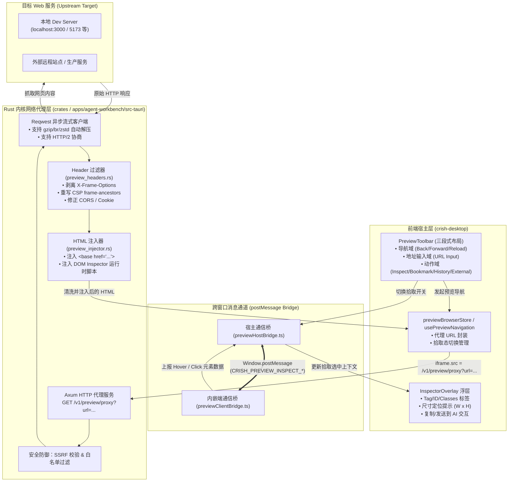

# 00-总方案：应用预览透明代理与 DOM 拾取器架构

> **战役定位**：为 Conex / Crish 原生预览浏览器（PreviewCard）构建高可靠的「Axum 本地透明反向代理」与「双向 DOM 拾取器（Inspector）」，彻底根除现代 Web 应用内嵌时的 `X-Frame-Options` 与 `CSP frame-ancestors` 阻断痛点，赋予 Agent 与用户原生 DevTools 级别的精准 DOM 定位、元素提取与视觉交互能力。
> **战役代号**：`native-preview-proxy-and-dom-picker`
> **权威遵循**：`AGENTS.md`（§4 战役工作区结构规范、§7 零容忍作弊与反退避、§11-14 UI 设计与解耦断言）。

---

## 一、 架构愿景与痛点分析

在现代桌面 AI 工作台（Crish Agent Workbench）中，应用内嵌预览（PreviewCard）是用户实时查看开发成果、AI 协同感知 UI 的核心视窗。然而既有方案面临两大核心技术断层：

1. **安全 Header 阻断（Frame Blocking）**：主流前端开发服务（Next.js、Vite、Nuxt、Remix）及外部生产站点默认注入 `X-Frame-Options: SAMEORIGIN/DENY` 和 `Content-Security-Policy: frame-ancestors 'self'`。导致前端 `<iframe>` 尝试加载时被浏览器内核（WebView2/Chromium）强行拦截抛出 `net::ERR_BLOCKED_BY_RESPONSE`，预览直接灰屏退化为错误态。
2. **DOM 上下文黑盒与拾取断层（DOM Visibility Gap）**：用户在预览区看到 UI 问题时，无法像 Chrome DevTools 一样一键「拾取元素（Inspect Element）」，无法精准捕获目标节点的 `data-*` 属性、CSS 选择器、Computed Styles、尺寸及 DOM 片段；AI 缺乏确定性的视觉-源码映射上下文，只能靠全局模糊猜测。

```
【现有阻断断层】
用户输入地址 ──> 前端 iframe 直连 Target URL ──> Upstream 返回 X-Frame-Options: DENY ──> 浏览器内核拦截（灰屏 ❌）
用户想拾取元素 ──> 受到跨域同源策略（SOP）限制 ──> 宿主脚本无法探测 iframe 内部 DOM（黑盒 ❌）

【透明代理与拾取器全链路闭环】
用户输入地址 ──> 经过 Rust 本地 Axum 代理 (/v1/preview/proxy) ──> 剥离阻断头 + 注入 <base> + 注入 Inspector 脚本
           ──> iframe 顺畅内嵌渲染 ──> postMessage 双向桥 ──> 悬停高亮/点击抓取精准选择器与 DOM 片段（✅ 原生级体验）
```

---

## 二、 系统全景架构图

系统由 **Rust 内核网络代理层**、**iframe 注入运行时**、**postMessage 双向通信通道** 以及 **前端 PreviewCard / PreviewToolbar 交互层** 四大部分构成：



---

## 三、 核心子系统架构方案

### 1. Axum 代理服务与网络管道 (`/v1/preview/proxy`)
- **端点契约**：在 Workbench 内核本地 HTTP 服务（`127.0.0.1:端口`）上挂载 `/v1/preview/proxy` 路由。
- **请求转发机制**：通过查询参数 `?url=<percent-encoded-url>` 接收前端请求，利用 `reqwest` 异步客户端向目标上游发起请求。
- **流式透传与内存优化**：对于静态资产（JS/CSS/图片/字体/视频），采用零拷贝 `Body::from_stream` 流式传输；仅对 `Content-Type: text/html` 启用流汇聚解压与字符串注入管道。

### 2. Header 清洗与重写策略 (Header Filter Engine)
为了确保目标页面在宿主 `<iframe>` 中合法渲染，同时不破坏页面自身功能，代理层执行严格的响应头清洗矩阵：

| 原始 Header 键名 | 处置动作 | 处置规则与技术 rationale |
| :--- | :--- | :--- |
| `X-Frame-Options` | **彻底剔除** | 移除 `DENY`、`SAMEORIGIN`、`ALLOW-FROM`，允许内嵌渲染。 |
| `Content-Security-Policy` | **智能重写** | 移除 `frame-ancestors` 指令；放宽 `default-src`/`script-src` 允许注入脚本安全执行。 |
| `Content-Security-Policy-Report-Only` | **彻底剔除** | 避免控制台产生虚假的策略违规上报警告。 |
| `Cross-Origin-Embedder-Policy` | **彻底剔除 / 降级** | 避免 `require-corp` 导致子资源在跨源内嵌中被阻断。 |
| `Cross-Origin-Opener-Policy` | **彻底剔除** | 允许 iframe 与父容器进行必要的基础状态感知。 |
| `Access-Control-Allow-Origin` | **规范注入** | 注入 `*` 或动态对齐宿主 Origin，避免静态资产 CORS 错误。 |
| `Set-Cookie` | **属性修正** | 移除 `SameSite=Strict`，调整为 `SameSite=Lax` 或 `None; Secure`，保障代理上下文会话维持。 |

### 3. `<base href>` 智能注入与资源相对寻址修复
当代理页面内存在大量相对路径资产（如 `<link href="/assets/index.css">` 或 ``）时，若直接在代理端点渲染，浏览器会将相对路径解析至代理服务器根目录导致 404。
- **解决方案**：在 HTML `<head>` 的首个子节点前强制注入 `<base href="TARGET_BASE_ORIGIN_AND_PATH" />`。
- **优势**：纯原生 O(1) 解决全量相对资源寻址，零正则替换成本，避免修改复杂的 JS/CSS 内部内联 URL。

### 4. DOM Inspector 注入机制与高亮引擎
- **无侵入注入**：在 `</body>` 闭合标签前注入轻量级 DOM 拾取客户端脚手架（压缩后 < 8KB）。
- **坐标定位与 Overlay 渲染**：
  - 拾取器激活时在 iframe 内部创建独立的 `#__crish_inspector_overlay__` 容器，使用 `getBoundingClientRect` 实时计算悬停元素盒模型（Content/Padding/Border/Margin）；
  - 采用 GPU 加速的 `translate3d` 定位，避免引起宿主重排（Reflow）；
  - **原生事件拦截**：在捕获阶段（Capture Phase）拦截 `pointermove` 与 `click` 事件，调用 `preventDefault()` 和 `stopPropagation()`，防止点击被拾取元素触发页面跳转或表单提交。
- **选择器确定性生成算法（O(1) 优先）**：
  1. **第一优先级**：`data-testid`、`data-cy`、`data-id` 等原生测试/业务锚点；
  2. **第二优先级**：唯一 `id` 属性；
  3. **第三优先级**：语义化 Class 组合 + Tag 过滤（过滤 Tailwind/Utility 动态哈希类）；
  4. **第四优先级**：精确 CSS Path 层级树；
  5. **保底机制**：标准化 XPath。

### 5. UI 三段式布局对齐与设计契约（Conex UI 规范）
遵循 `AGENTS.md` §11-§14 与 Conex 设计系统规范：
- **PreviewToolbar 三段式布局**：
  1. **导航域**：后退（ChevronLeft）、前进（ChevronRight）、主页（Home）、刷新（RotateCw）；
  2. **地址输入域**：Globe 图标、URL Input、清空（X）；
  3. **动作域**：**DOM 拾取器开关（Inspect / MousePointerClick）**、书签（Star）、历史（History）、外部打开（ExternalLink）。
- **色彩与焦点契约**：
  - Tooltip 100% 采用项目自定义 `<Tooltip>` 组件，杜绝原生 HTML `title` 气泡；
  - 拾取激活态采用柔软的 `var(--accent-primary)` 边界高亮，禁止厚重深黑边框（焦点加深混入量严格 ≤ 10%）；
  - 采用现代 CSS HSLA / OKLCH 语法。

---

## 四、 跨窗口消息契约设计 (IPC & postMessage)

### 1. 消息契约 Schema 定义
宿主（Host）与 iframe 内部（Client）通过强类型结构化消息通信：

```typescript
export type CrishPreviewMessage =
  | { type: 'CRISH_INSPECT_TOGGLE'; payload: { active: boolean } }
  | { type: 'CRISH_INSPECT_HOVER'; payload: ElementHoverPayload }
  | { type: 'CRISH_INSPECT_SELECT'; payload: ElementSelectedPayload }
  | { type: 'CRISH_INSPECT_SCROLL_SYNC'; payload: { scrollX: number; scrollY: number } };

export interface ElementSelectedPayload {
  tagName: string;
  id: string | null;
  classes: string[];
  attributes: Record<string, string>;
  bestSelector: string;
  xpath: string;
  rect: { x: number; y: number; width: number; height: number };
  computedStylesSummary: {
    display: string;
    position: string;
    color: string;
    backgroundColor: string;
    fontSize: string;
  };
  outerHtmlSnippet: string;
  textContent: string;
}
```

---

## 五、 安全防护与边界隔离 (Security Guardrails)

1. **SSRF 防御（Server-Side Request Forgery）**：
   - 严格拦截请求向 `169.254.169.254`（云厂商元数据端点）以及系统内部保留广播地址的代理请求；
   - 限制代理协议仅限 `http://` 与 `https://`，严禁通过代理访问 `file://`、`smb://` 等本地协议。
2. **凭据与鉴权隔离**：
   - 默认禁止向跨源目标自动透传 Workbench 自身的桌面 API Token / IPC 握手密钥；
   - 目标站点 Cookie 在独立的 WebView 代理上下文中隔离存储。
3. **注入脚手架沙箱隔离**：
   - 注入的 DOM Inspector 脚本运行于独立 IIFE 闭包中，不污染目标页面的 `window` 全局变量；
   - 所有事件监听使用内部 Symbol 键绑定，页面自身脚本无法随意篡改或监听拾取私有通信。

---

## 六、 交付物矩阵与战役工作区结构

本战役严格遵循 `AGENTS.md` §4 战役工作区规范：

```
docs/native-preview-proxy-and-dom-picker/
├── 00-总方案-应用预览透明代理与DOM拾取器架构.md  (本文件：总览与总架构契约)
├── 01-分维详案-Rust代理与网络层实现.md            (分维一：Rust Axum 代理、Reqwest、Header过滤与注入)
├── 02-分维详案-前端Inspector与工具栏交互.md      (分维二：PreviewToolbar、postMessage桥、DOM拾取与Overlay)
├── analysis/
│   └── 01-xframe-options-and-csp-root-cause-analysis.md (深度根因、Chromium机制与技术选型论证)
└── audits/
    └── 01-preview-standardization-and-dom-verification-audit.md (测试矩阵、回归保护与门禁审计记录)
```
