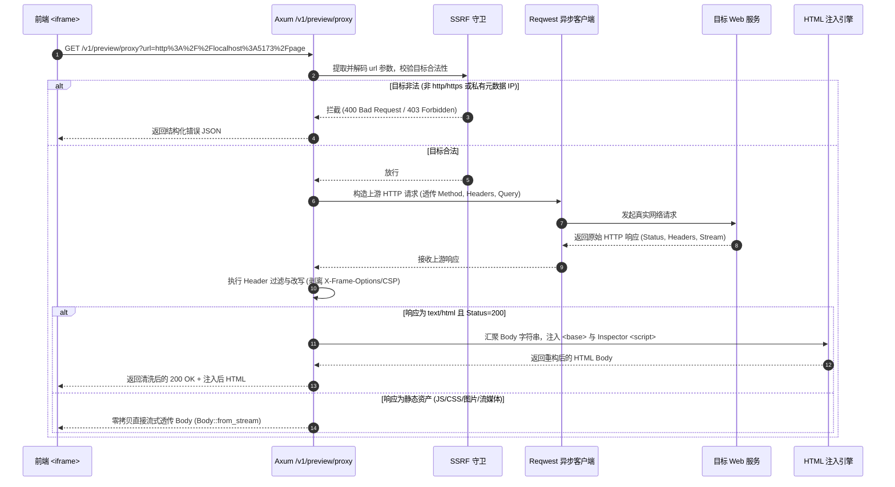

# 01-分维详案：Rust 代理与网络层实现

> **维度定位**：Rust 内核透明反向代理管道与 HTTP 流式处理引擎。
> **核心目标**：实现 `/v1/preview/proxy` 高性能路由，完成 reqwest 异步请求转发、安全 Header 清洗、`<base href>` 智能注入与 DOM Inspector 运行时脚手架注入，为前端 iframe 提供无阻断的内嵌渲染基座。
> **关联总方案**：`00-总方案-应用预览透明代理与DOM拾取器架构.md` §3.1-§3.3。

---

## 一、 路由设计与请求生命周期

### 1. 路由定义与端点契约
在 Axum HTTP 路由树中新增 `/v1/preview/proxy` 路由（支持 `GET`、`POST`、`OPTIONS` 等全部 HTTP 方法）：

```rust
// apps/agent-workbench/src-tauri/src/server/router.rs
pub fn build_router(state: AppState) -> Router {
    Router::new()
        // 既有路由 ...
        .route("/v1/preview/proxy", get(preview_proxy_handler).post(preview_proxy_handler))
        .with_state(state)
}
```

### 2. 请求处理管道生命周期



---

## 二、 目标 URL 提取与 SSRF 防护

### 1. 请求参数解析与解码
```rust
#[derive(Debug, serde::Deserialize)]
pub struct PreviewProxyQuery {
    pub url: String,
}

pub async fn preview_proxy_handler(
    Query(query): Query<PreviewProxyQuery>,
    method: Method,
    headers: HeaderMap,
    body: axum::body::Bytes,
) -> Result<Response, PreviewProxyError> {
    let target_url = url::Url::parse(&query.url)
        .map_err(|e| PreviewProxyError::InvalidUrl(e.to_string()))?;

    // SSRF 安全校验
    validate_target_url(&target_url)?;

    // 执行代理转发 ...
}
```

### 2. SSRF 拦截规则
- **协议白名单**：仅放行 `http://` 与 `https://`；拒绝 `file://`、`data:`、`javascript:`、`ftp://`、`ws://`；
- **主机拦截**：拒绝 `169.254.169.254`（云厂商元数据）、`0.0.0.0`、多播与保留广播地址；
- **端口策略**：放行本地常规开发端口（3000、5173、8080、8000、4173 等）与标准 Web 端口（80、443）。

---

## 三、 Reqwest 客户端配置

为保障高吞吐与多页面内嵌并发性能，`PreviewProxyClient` 采用共享连接池单例：

```rust
pub struct PreviewProxyClient {
    client: reqwest::Client,
}

impl PreviewProxyClient {
    pub fn new() -> Self {
        let client = reqwest::Client::builder()
            // 自动处理 gzip / brotli / zstd 解压缩，方便 HTML 注入引擎处理明文字符串
            .auto_gzip()
            .auto_brotli()
            .auto_zstd()
            // 30 秒超时，连接超时 5 秒
            .timeout(std::time::Duration::from_secs(30))
            .connect_timeout(std::time::Duration::from_secs(5))
            // 允许 HTTP/2 多路复用协商
            .http2_prior_knowledge(false)
            // 默认允许最多 5 次重定向
            .redirect(reqwest::redirect::Policy::limited(5))
            .build()
            .expect("Failed to build preview proxy reqwest client");

        Self { client }
    }
}
```

---

## 四、 Header 过滤与重写引擎 (`preview_headers.rs`)

### 1. 响应头清洗与重写规则
清洗引擎必须确保两点：
1. 剥离一切阻止 `iframe` 内嵌的安全指令；
2. 剥离可能导致代理端注入脚本无法执行的过严 CSP 策略；
3. 保留并修正 `Content-Type`、`Cache-Control` 及 `Set-Cookie`。

```rust
// apps/agent-workbench/src-tauri/src/server/preview_headers.rs

use axum::http::{HeaderMap, HeaderName, HeaderValue};

pub struct HeaderCleanRule;

impl HeaderCleanRule {
    /// 清洗上游返回的响应头，生成适合 iframe 渲染的安全 HeaderMap
    pub fn sanitize_response_headers(upstream_headers: &HeaderMap, target_origin: &str) -> HeaderMap {
        let mut clean_headers = HeaderMap::new();

        for (name, value) in upstream_headers.iter() {
            let key = name.as_str().to_lowercase();
            match key.as_str() {
                // 1. 彻底剔除阻断内嵌的头部
                "x-frame-options"
                | "content-security-policy-report-only"
                | "cross-origin-embedder-policy"
                | "cross-origin-opener-policy"
                | "cross-origin-resource-policy" => {
                    // 忽略，不复制
                }

                // 2. 智能重写 CSP
                "content-security-policy" => {
                    if let Ok(csp_str) = value.to_str() {
                        let rewritten_csp = Self::rewrite_csp(csp_str);
                        if !rewritten_csp.is_empty() {
                            if let Ok(val) = HeaderValue::from_str(&rewritten_csp) {
                                clean_headers.insert(name.clone(), val);
                            }
                        }
                    }
                }

                // 3. 修正 Set-Cookie，去除 SameSite=Strict 以支持跨源内嵌会话
                "set-cookie" => {
                    if let Ok(cookie_str) = value.to_str() {
                        let rewritten_cookie = Self::rewrite_cookie(cookie_str);
                        if let Ok(val) = HeaderValue::from_str(&rewritten_cookie) {
                            clean_headers.append(name.clone(), val);
                        }
                    }
                }

                // 4. 其余标准头正常保留
                _ => {
                    clean_headers.insert(name.clone(), value.clone());
                }
            }
        }

        // 5. 注入 CORS 宽容头，允许前端读取代理资产
        clean_headers.insert(
            HeaderName::from_static("access-control-allow-origin"),
            HeaderValue::from_static("*"),
        );
        clean_headers.insert(
            HeaderName::from_static("access-control-allow-methods"),
            HeaderValue::from_static("GET, POST, PUT, DELETE, OPTIONS, PATCH"),
        );

        clean_headers
    }

    /// 移除 CSP 中的 frame-ancestors 指令
    fn rewrite_csp(csp: &str) -> String {
        csp.split(';')
            .map(|directive| directive.trim())
            .filter(|directive| {
                let lower = directive.to_lowercase();
                !lower.starts_with("frame-ancestors")
            })
            .collect::<Vec<&str>>()
            .join("; ")
    }

    /// 调整 Cookie SameSite 属性
    fn rewrite_cookie(cookie: &str) -> String {
        if cookie.to_lowercase().contains("samesite=strict") {
            cookie.replace("SameSite=Strict", "SameSite=Lax").replace("samesite=strict", "samesite=lax")
        } else {
            cookie.to_string()
        }
    }
}
```

---

## 五、 HTML 注入引擎 (`preview_injector.rs`)

### 1. `<base href="...">` 注入算法
由于代理请求的 Origin 为 `http://127.0.0.1:4000`，页面中所有的绝对根路径（如 `/style.css`）与相对路径（如 `./app.js`）会被浏览器默认解析到代理服务本身。
注入 `<base href="...">` 可以无损恢复页面内部所有资源的解析基准：

```rust
pub fn inject_base_and_inspector(
    html_content: &str,
    target_base_url: &str,
    inspector_script: &str,
) -> String {
    let mut result = String::with_capacity(html_content.len() + 4096);

    // 1. 注入 <base href="..."> 至 <head> 顶部
    let base_tag = format!("<base href=\"{}\" />\n", target_base_url);
    let head_pos = html_content.find("<head>")
        .or_else(|| html_content.find("<HEAD>"));

    let with_base = if let Some(pos) = head_pos {
        let insert_idx = pos + 6;
        let mut s = String::new();
        s.push_str(&html_content[..insert_idx]);
        s.push_str("\n");
        s.push_str(&base_tag);
        s.push_str(&html_content[insert_idx..]);
        s
    } else {
        // 若无 <head> 标签，直接在最前面注入
        format!("{}{}", base_tag, html_content)
    };

    // 2. 注入 DOM Inspector 脚本至 </body> 闭合前
    let script_tag = format!(
        "\n<!-- [Crish Preview Inspector] -->\n<script id=\"__crish_preview_inspector__\">{}</script>\n",
        inspector_script
    );

    let body_close_pos = with_base.rfind("</body>")
        .or_else(|| with_base.rfind("</BODY>"));

    if let Some(pos) = body_close_pos {
        result.push_str(&with_base[..pos]);
        result.push_str(&script_tag);
        result.push_str(&with_base[pos..]);
    } else {
        result.push_str(&with_base);
        result.push_str(&script_tag);
    }

    result
}
```

---

## 六、 模块划分与文件清单

Rust 网络代理层组织结构如下：

```
apps/agent-workbench/src-tauri/src/server/
├── mod.rs                   # 模块聚合
├── router.rs                # 路由挂载 (/v1/preview/proxy)
├── preview_proxy.rs         # 核心代理 Handler 与请求流转控制
├── preview_headers.rs       # Header 清洗与重写引擎
├── preview_injector.rs      # HTML base 与 Inspector 脚本注入器
└── preview_proxy_tests.rs   # 单元测试与集成测试
```

---

## 七、 测试与断言设计

在 `preview_proxy_tests.rs` 中配置 WireMock 模拟各种上游 HTTP 响应：

1. **X-Frame-Options 剥离断言**：
   - 上游返回 `X-Frame-Options: DENY`；
   - 断言代理响应头中 `x-frame-options` 为 `None`。
2. **CSP frame-ancestors 剔除断言**：
   - 上游返回 `Content-Security-Policy: default-src 'self'; frame-ancestors 'none';`；
   - 断言代理响应头重写为 `Content-Security-Policy: default-src 'self'`。
3. **`<base href>` 注入断言**：
   - 上游返回 `<html><head><title>Test</title></head><body><h1>Hello</h1></body></html>`；
   - 断言代理返回内容包含 `<base href="http://localhost:5173/" />` 且位置在 `<head>` 后。
4. **DOM Inspector 脚本注入断言**：
   - 断言返回内容包含 `<script id="__crish_preview_inspector__">` 且位于 `</body>` 前。
5. **静态二进制资源流式透传断言**：
   - 上游返回 `Content-Type: image/png`；
   - 断言字节流完全一致，零字符串编码篡改。
