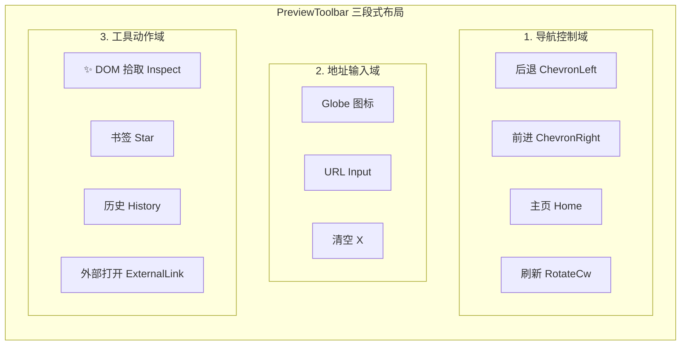
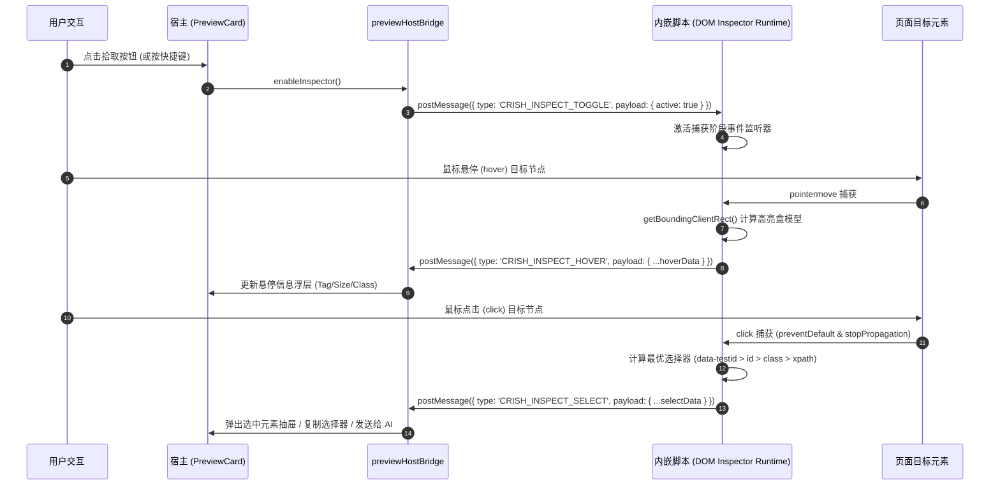

# 02-分维详案：前端 Inspector 与工具栏交互

> **维度定位**：前端 UI 交互、PreviewToolbar 三段式对齐、postMessage 双向通信通道与 DOM 拾取高亮系统。
> **核心目标**：在 `crish-desktop` 中构建极致流畅、零延迟的 DOM 元素拾取与审查体系，让用户与 Agent 能够无缝直观地捕获网页元素属性、精确选择器与 DOM 片段。
> **关联总方案**：`00-总方案-应用预览透明代理与DOM拾取器架构.md` §3.4-§3.5。

---

## 一、 PreviewToolbar 三段式布局与 Inspector 开关

遵循 `AGENTS.md` §11-§14 与 Conex UI 铁律，`PreviewToolbar` 严格维持**三段式结构**（导航域、地址域、动作域），新增 DOM 拾取器开关按钮：



### 1. Props 契约扩展
```typescript
// apps/crish-desktop/src/components/workspace/PreviewToolbar.tsx

export interface PreviewToolbarActionsProps {
  /** 是否处于 DOM 拾取中 */
  inspecting: boolean;
  /** 切换 DOM 拾取态 */
  onToggleInspect: () => void;
  onBookmark: () => void;
  onToggleHist: () => void;
  onOpenExternal: () => void;
}
```

### 2. 拾取按钮 UI 实现与视觉规范
```tsx
<Tooltip content={inspecting ? '退出元素拾取 (Esc)' : '拾取页面元素 (Inspect)'}>
  <Button
    type="button"
    variant="ghost"
    size="sm"
    className={`${styles.navBtn} ${inspecting ? styles.inspectActive : ''}`}
    onClick={onToggleInspect}
    aria-label="拾取页面元素"
    aria-pressed={inspecting}
    icon={<Lucide.MousePointerClick size={14} strokeWidth={1.75} />}
  />
</Tooltip>
```

- **视觉细节要求**：
  - 激活态 `.inspectActive` 采用 `color-mix(in srgb, var(--accent-primary) 15%, transparent)` 柔和背景；
  - 边框采用 `color-mix(in srgb, var(--border-color) 90%, var(--text-primary) 10%)`，严禁使用生硬的厚重黑色边框；
  - 提示统一使用 `<Tooltip>` 组件，杜绝原生 HTML `title` 气泡。

---

## 二、 postMessage 跨窗口双向通信桥

由于预览页面在 `<iframe>` 中运行，宿主与内嵌页面之间通过标准化强类型事件通信：



### 1. 通信协议 Envelope 定义
```typescript
// packages/preview-protocol/src/index.ts

export const CRISH_PREVIEW_MSG_SOURCE = 'crish-preview-inspector' as const;

export type InspectMessage =
  | {
      source: typeof CRISH_PREVIEW_MSG_SOURCE;
      type: 'INSPECT_READY';
    }
  | {
      source: typeof CRISH_PREVIEW_MSG_SOURCE;
      type: 'INSPECT_TOGGLE';
      payload: { enabled: boolean };
    }
  | {
      source: typeof CRISH_PREVIEW_MSG_SOURCE;
      type: 'INSPECT_HOVER';
      payload: {
        tagName: string;
        selector: string;
        rect: { x: number; y: number; width: number; height: number };
      };
    }
  | {
      source: typeof CRISH_PREVIEW_MSG_SOURCE;
      type: 'INSPECT_SELECT';
      payload: SelectedElementDetail;
    };

export interface SelectedElementDetail {
  tagName: string;
  id: string | null;
  classes: string[];
  attributes: Record<string, string>;
  bestSelector: string;
  xpath: string;
  rect: { x: number; y: number; width: number; height: number };
  computedStyles: {
    display: string;
    position: string;
    color: string;
    backgroundColor: string;
    fontSize: string;
    margin: string;
    padding: string;
  };
  outerHtmlSnippet: string;
  textContent: string;
}
```

---

## 三、 DOM Inspector 注入运行时实现

DOM Inspector 运行时脚本必须遵循**极简、零依赖、无污染、高性能**四大铁律：

### 1. 高性能 Overlay 渲染（不污染页面布局）
```javascript
(function initCrishInspector() {
  if (window.__CRISH_INSPECTOR_INITIALIZED__) return;
  window.__CRISH_INSPECTOR_INITIALIZED__ = true;

  let active = false;
  let hoveredEl = null;

  // 创建独立绝对定位遮罩容器
  const overlay = document.createElement('div');
  overlay.id = '__crish_inspector_overlay__';
  Object.assign(overlay.style, {
    position: 'fixed',
    pointerEvents: 'none',
    zIndex: '2147483647',
    border: '2px solid hsl(210 100% 50% / 0.85)',
    backgroundColor: 'hsl(210 100% 50% / 0.12)',
    transition: 'all 0.05s ease-out',
    display: 'none',
  });
  document.documentElement.appendChild(overlay);

  // 坐标更新
  function updateOverlay(el) {
    if (!el) {
      overlay.style.display = 'none';
      return;
    }
    const r = el.getBoundingClientRect();
    Object.assign(overlay.style, {
      display: 'block',
      transform: `translate3d(${r.left}px, ${r.top}px, 0)`,
      width: `${r.width}px`,
      height: `${r.height}px`,
    });
  }

  // 捕获阶段事件监听
  window.addEventListener('pointermove', (e) => {
    if (!active) return;
    const target = document.elementFromPoint(e.clientX, e.clientY);
    if (target && target !== overlay && target !== hoveredEl) {
      hoveredEl = target;
      updateOverlay(hoveredEl);
      sendToHost({
        type: 'INSPECT_HOVER',
        payload: {
          tagName: hoveredEl.tagName.toLowerCase(),
          selector: computeBestSelector(hoveredEl),
          rect: hoveredEl.getBoundingClientRect(),
        },
      });
    }
  }, true);

  window.addEventListener('click', (e) => {
    if (!active) return;
    e.preventDefault();
    e.stopPropagation();
    if (hoveredEl) {
      const detail = extractElementDetail(hoveredEl);
      sendToHost({ type: 'INSPECT_SELECT', payload: detail });
    }
  }, true);

  // 监听来自宿主的消息
  window.addEventListener('message', (e) => {
    if (e.data?.source !== 'crish-preview-host') return;
    if (e.data.type === 'INSPECT_TOGGLE') {
      active = Boolean(e.data.payload?.enabled);
      if (!active) updateOverlay(null);
    }
  });

  function sendToHost(msg) {
    window.parent.postMessage({ ...msg, source: 'crish-preview-inspector' }, '*');
  }
})();
```

---

## 四、 确定性精准选择器生成算法 (O(1) 优先)

为了杜绝盲目遍历与脆弱的长路径选择器，提取算法严格执行多级确定性降级规则：

```javascript
function computeBestSelector(el) {
  if (!(el instanceof Element)) return '';

  // 1. 最高优先级：原生测试锚点属性 (O(1))
  const testAttrs = ['data-testid', 'data-test', 'data-cy', 'data-qa', 'data-id'];
  for (const attr of testAttrs) {
    const val = el.getAttribute(attr);
    if (val) return `[${attr}="${CSS.escape(val)}"]`;
  }

  // 2. 第二优先级：页面唯一 ID (O(1))
  if (el.id && document.querySelectorAll(`#${CSS.escape(el.id)}`).length === 1) {
    return `#${CSS.escape(el.id)}`;
  }

  // 3. 第三优先级：有语义的 ClassName 组合
  const validClasses = Array.from(el.classList).filter((c) => {
    // 过滤 Tailwind 动态哈希或原子工具类，保留具象类名
    return !c.includes(':') && !c.includes('[') && !/^[a-z0-9]{6,}$/i.test(c);
  });

  if (validClasses.length > 0) {
    const classSelector = `${el.tagName.toLowerCase()}.${validClasses.map(CSS.escape).join('.')}`;
    if (document.querySelectorAll(classSelector).length === 1) {
      return classSelector;
    }
  }

  // 4. 第四优先级：父子层级定位 (最大深度 3 层)
  let curr = el;
  const path = [];
  while (curr && curr.nodeType === Node.ELEMENT_NODE && curr !== document.body && path.length < 3) {
    let selector = curr.tagName.toLowerCase();
    if (curr.id) {
      selector += `#${CSS.escape(curr.id)}`;
      path.unshift(selector);
      break;
    } else {
      let siblingIndex = 1;
      let sibling = curr.previousElementSibling;
      while (sibling) {
        if (sibling.tagName === curr.tagName) siblingIndex++;
        sibling = sibling.previousElementSibling;
      }
      if (siblingIndex > 1) {
        selector += `:nth-of-type(${siblingIndex})`;
      }
    }
    path.unshift(selector);
    curr = curr.parentElement;
  }

  return path.join(' > ');
}
```

---

## 五、 元素选中反馈与上下文流转

当用户在拾取态点击元素后，前端触发以下全链路流转：

1. **瞬时视觉锁定**：高亮边框变为常驻绿色选中态；
2. **底部详情卡片浮现**：展示 Tag 标签、最佳 Selector、盒模型尺寸（`W x H`）、文本摘要；
3. **一键复制与快捷操作**：
   - **复制选择器**：一键复制 `bestSelector` 至剪贴板，显示 Toast；
   - **复制 HTML 片段**：复制格式化后的 `outerHtmlSnippet`；
   - **发送给 AI（@DOM）**：直接将该元素的属性与选择器填入主会话输入框（Composer），生成类似 `请优化这个按钮 [@DOM: button.submit-btn (48x32)] 的悬停动画` 的结构化 Prompt。
4. **快捷键支持**：按 `Esc` 键无缝退出拾取模式，恢复页面常规交互。
