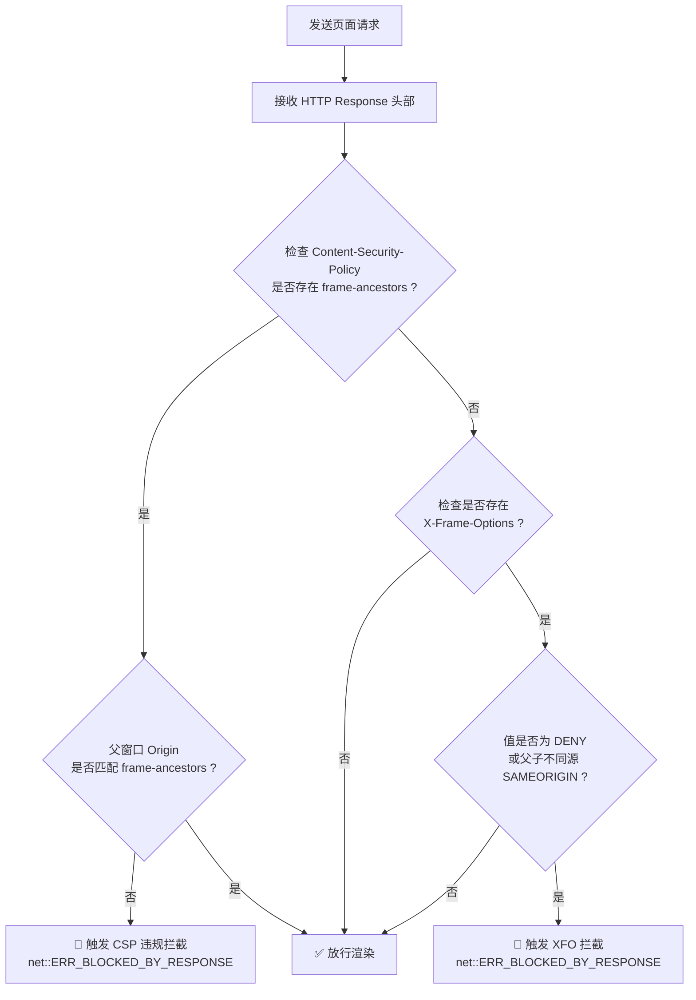

# 01-深度分析：X-Frame-Options 与 CSP frame-ancestors 根因剖析与多方案对比

> **分析定位**：深入探究现代 Web 预览内嵌受阻的底层规范、浏览器内核执行机制，以及多技术路线的对比与终选裁决。
> **关联总方案**：`00-总方案-应用预览透明代理与DOM拾取器架构.md` §1。

---

## 一、 阻断机制与规范根因剖析

现代 Web 应用在浏览器或内嵌容器（如 WebView2、Chromium、WebKit）中作为 `<iframe>` 加载时，常遭遇无法渲染、报错灰屏的现象。其底层源于两大浏览器安全标准：

### 1. `X-Frame-Options` 规范 (RFC 7034)
`X-Frame-Options` 是 HTTP 响应头中用于防范点击劫持（Clickjacking）的经典安全机制：
- **`DENY`**：页面严禁被任何容器内嵌（即便宿主与被内嵌页面同源）。
- **`SAMEORIGIN`**：仅允许相同 Origin（协议 + 域名 + 端口）的父容器内嵌。
- **`ALLOW-FROM uri`**（已废弃）：仅允许指定 URI 内嵌，现代浏览器大多已停止支持。

### 2. W3C CSP Level 2/3 `frame-ancestors` 指令
作为 `X-Frame-Options` 的现代替代者，CSP 的 `frame-ancestors` 指令具有更高的判定优先级（若同时存在，现代浏览器以 `frame-ancestors` 为准）：
- `Content-Security-Policy: frame-ancestors 'none';`（等价于 `DENY`）；
- `Content-Security-Policy: frame-ancestors 'self';`（等价于 `SAMEORIGIN`）；
- `Content-Security-Policy: frame-ancestors https://example.com;`。

### 3. 主流开发框架的默认安全配置现状
现代前端工程框架在其开发服务器（Dev Server）或默认中间件中普遍强化了安全防护：
- **Next.js**：默认启用严苛的安全标头或推荐配置；
- **Vite**：部分安全插件或后端模板默认注入 `X-Frame-Options`；
- **Nuxt / Remix**：安全预设模版在响应时拦截非授权 Origin 的 frame 引用。

### 4. 浏览器内核（WebView2 / Chromium）处理流转
当 WebView2 的渲染引擎（Blink）接收到网络响应时，其安全检查管线如下：

由于 Crish 桌面客户端前端 Origin 为 `http://localhost:5174` 或 `tauri://localhost`，当内嵌用户正在调试的本地服务（如 `http://localhost:3000`）或外部网站时，均属于跨源（Cross-Origin）内嵌，必定触发 `SAMEORIGIN` 或 `frame-ancestors 'self'` 拦截。

---

## 二、 多技术路线对比与权衡决策

为了在桌面客户端内嵌任意目标页面并支持 DOM 拾取，业界通常有三条可选路径：

| 评估维度 | 方案 A：原生 WebView WebRequest 拦截改头 | 方案 B：纯前端 fetch + srcdoc 模式 | 方案 C：Rust Axum 本地透明反向代理 (**终选**) |
| :--- | :--- | :--- | :--- |
| **实现机制** | 利用平台特定 API（如 Windows `ICoreWebView2_WebResourceRequested`）拦截请求并篡改 Header | 前端通过 `fetch(url)` 获取 HTML 字符串，清洗后塞入 `<iframe srcdoc="...">` | 本地启动轻量 Axum 代理服务（`/v1/preview/proxy`），集中清洗 Header 并注入运行时脚本 |
| **跨平台一致性** | ❌ 极差。Windows（WebView2）、macOS（WKWebView）、Linux（WebKitGTK）API 碎片化严重 | ⚠️ 较差。跨域站点会直接被前端 CORS 拦截报错 | ✅ 极佳。100% 运行于 Rust 内核层，跨平台表现完全统一 |
| **静态资源相对寻址** | ⚠️ 复杂。需拦截全量网络子资源请求 | ❌ 严重断裂。`srcdoc` 下相对路径全部相对于当前宿主，CSS/JS/图片大量 404 | ✅ 完美。通过注入 `<base href="...">` 原生解决全量相对资源寻址 |
| **DOM 脚本注入能力** | ⚠️ 需依赖 `AddScriptToExecuteOnDocumentCreated`，可能因注入时机过早/过晚导致事件监听失效 | ⚠️ 手动拼接脚本，存在转义与 CSP 冲突风险 | ✅ 精确控制。在 HTML 流解析阶段精准插入 `<head>` 和 `</body>` 锚点 |
| **流式传输与性能** | ⚠️ 原生回调序列化开销大 | ❌ 全量内存缓冲，大页面严重卡顿 | ✅ 异步流式零拷贝传输，极高吞吐 |
| **维护成本与可测性** | ❌ 依赖 C++ / OS 原生绑定，单元测试极其困难 | ⚠️ 涉及大量前端黑魔法绕过 | ✅ 纯 Rust 模块化实现，易于编写 Mock 单元与集成测试 |

### 裁决结论
**全面采用【方案 C：Rust Axum 本地透明反向代理】**。该方案具备极致的架构优雅度与跨平台确定性，完全符合 Conex 架构铁律（杜绝平台碎片补丁，追求 Native 级优雅）。

---

## 三、 边缘场景剖析与应对防御策略

### 1. 相对路径与绝对根路径资源解析 (`<base href>`)
- **问题**：页面内部常见 `` 或 `import('/src/main.ts')`。
- **应对**：在 HTML `<head>` 顶端注入 `<base href="TARGET_URL">`，由浏览器原生管线直接将基础 URI 映射回目标源站，无需代理层进行昂贵且容易误伤的代码级正则替换。

### 2. WebSocket 与 HMR（热更新）穿透
- **问题**：Vite / Webpack 等 dev server 依赖 WebSocket 连接进行热更新推送。
- **应对**：开发服务中的 WebSocket 客户端通常直连指定端口（如 `ws://localhost:5173`），不依赖页面的 frame-ancestors 检查。由于 `<base href>` 恢复了源站上下文，HMR 连接直连目标服务端口，实现真正的热更新实时反映。

### 3. Cookie 与 Session 会话保持
- **问题**：部分目标页面携带 `Set-Cookie: token=xxx; SameSite=Strict`，跨源内嵌时浏览器拒绝携带 Cookie。
- **应对**：代理层在转发响应头时，智能将 `SameSite=Strict` 重写为 `SameSite=Lax` 或 `SameSite=None; Secure`，保障需要登录态的本地或测试服务正常工作。

### 4. CSP `script-src` 阻断 DOM Inspector 脚本
- **问题**：严格的 CSP 策略可能禁止执行内联 `<script>` 注入。
- **应对**：代理层在重写 CSP 时，智能放宽 `script-src`，注入 `'unsafe-inline'` 或移除阻断策略，确保 DOM Inspector 运行时脚手架能够无缝初始化。
