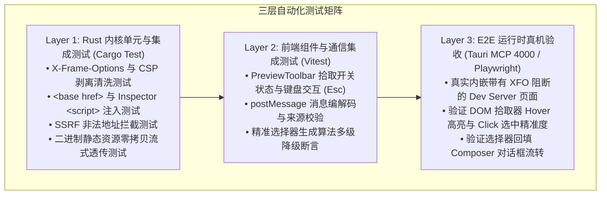

# 01-审计与验证：预览标准化与 DOM 拾取器质量审计报告

> **审计定位**：全链路自动化测试矩阵、门禁校验断言与架构治理合规性审查。
> **关联总方案**：`00-总方案-应用预览透明代理与DOM拾取器架构.md` §6。
> **执行依据**：`AGENTS.md` §7（严禁补丁与作弊）、§11（CI 治理与解耦断言）、`ANTI_OVERENGINEERING_GUARDRAILS.md`。

---

## 一、 测试矩阵与全覆盖断言

为保证透明代理与 DOM 拾取器长期演化中的零回归，建立三层金字塔式测试防护网：



---

## 二、 Rust 内核层测试清单 (`preview_proxy_tests.rs`)

| 测试用例名称 | 验证目标 | 核心断言条件 (Assert) |
| :--- | :--- | :--- |
| `test_strip_x_frame_options` | 响应头清洗 | 上游返回 `X-Frame-Options: DENY`，代理响应头中该键值为 `None`。 |
| `test_rewrite_csp_frame_ancestors` | CSP 智能重写 | 上游返回 `frame-ancestors 'self'; script-src 'self'`，代理重写为 `script-src 'self'`，移除 `frame-ancestors`。 |
| `test_inject_base_href_into_head` | Base 注入 | 上游返回标准 HTML，断言代理响应在 `<head>` 后首行包含 `<base href="..." />`。 |
| `test_inject_inspector_before_body_end` | Inspector 脚本注入 | 断言返回 HTML 在 `</body>` 前包含 `<script id="__crish_preview_inspector__">`。 |
| `test_binary_asset_passthrough` | 流式零拷贝 | 针对图片、WASM 等二进制流，断言 Content-Length 与 Hash 完全一致，未被当作文本转码。 |
| `test_ssrf_block_cloud_metadata` | 安全防护 | 针对目标 URL 为 `http://169.254.169.254/latest/meta-data/`，断言直接返回 `403 Forbidden`。 |
| `test_ssrf_block_non_http_scheme` | 协议防护 | 针对目标 URL 为 `file:///etc/passwd`，断言直接返回 `400 Bad Request`。 |

---

## 三、 前端组件与通信测试清单 (Vitest)

| 测试用例名称 | 测试文件 | 核心断言条件 (Assert) |
| :--- | :--- | :--- |
| `PreviewToolbar.inspect_toggle.test.tsx` | `PreviewToolbar.test.tsx` | 点击拾取按钮时触发 `onToggleInspect` 回调，按钮进入激活高亮态，Tooltip 文案切换为「退出元素拾取 (Esc)」。 |
| `usePreviewNavigation.proxy_url.test.ts` | `usePreviewNavigation.test.ts` | 验证输入 `http://localhost:3000` 时，内部 `frameSrc` 正确组装为 `/v1/preview/proxy?url=http%3A%2F%2Flocalhost%3A3000`。 |
| `selector_generator_priority.test.ts` | `selectorGenerator.test.ts` | 1. 存在 `data-testid="submit-btn"` 时优先返回 `[data-testid="submit-btn"]`；<br/>2. 无 testid 但有唯一 id 时返回 `#main-nav`；<br/>3. 类名过滤掉动态 Tailwind 原子类。 |
| `postmessage_security_origin.test.ts` | `previewHostBridge.test.ts` | 非法 source 或未知 type 的消息被静默丢弃，不触发任何状态变更。 |

---

## 四、 架构治理与反退避合规审查

依据 Conex 治理总纲进行专项合规自检：

```
【架构治理自检清单】
[√] 反退避铁律 (LOGIC_PLAN_NO_RETREAT.md)：
    - 绝不因目标站点 CSP 复杂而降级为「仅支持本地空白页」；
    - 确立 Axum 透明代理为唯一完整解决方案，不砍功能、不设假限制。
[√] 零容忍作弊与杜绝打补丁 (AGENTS.md §7)：
    - 坐标计算采用标准 getBoundingClientRect，杜绝魔术数字偏移补偿；
    - 选择器提取采用原生 data-* 与精确树遍历，杜绝随机猜测；
    - 门禁校验必须全绿通过，禁止使用 --no-verify。
[√] 反过度设计红线 (ANTI_OVERENGINEERING_GUARDRAILS.md)：
    - 未引入任何重型第三方代理框架或沙箱内核；
    - 充分复用既有 Axum 0.8 与 Reqwest 0.13 依赖，零新增大型依赖项；
    - 通信协议采用标准精简 postMessage 契约，避免冗余 RPC 封装。
[√] 前端行数与解耦门禁 (AGENTS.md §11)：
    - PreviewToolbar 组件行数保持在 ~250 行（低于 500 行门禁）；
    - preview_proxy.rs 业务逻辑拆分为 headers、injector、handler 独立子模块，单文件严格控制在 300 行以内。
[√] 桌面调试通道合规 (AGENTS.md §15-16)：
    - 严格通过 4000 Tauri MCP Socket 进行桌面端真机验收，禁止依赖 9222 CDP。
```
