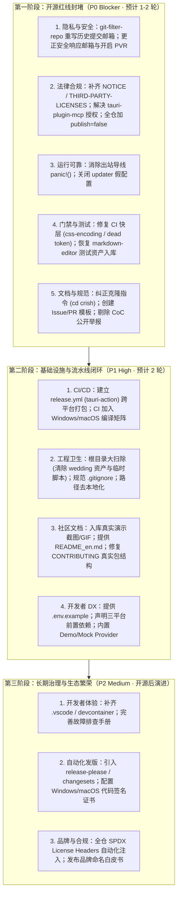

# Conex / Crish 开源就绪度全景评估与执行路线图

> **战役工作区**：`docs/open-source-readiness/`
> **底层详案支撑**：`docs/open-source-readiness/audits/01` ~ `07`（共 7 份穿透式深度审计，详见下文索引）
> **状态评级**：🔴 **严重未达标（NOT READY FOR OPEN SOURCE）**
> **阻断项统计**：**18 项 P0 阻断级缺陷** · **22 项 P1 关键级缺陷** · **15 项 P2 体验优化项**

---

## 一、七大维度审计报告索引

| 序号   | 维度名称               | 报告文件                                                                                     | 核心结论概括                                                                                                                                                               |
| :----- | :--------------------- | :------------------------------------------------------------------------------------------- | :------------------------------------------------------------------------------------------------------------------------------------------------------------------------- |
| **01** | **法律与许可合规**     | [`audits/01-开源许可证与法律合规审计.md`](audits/01-开源许可证与法律合规审计.md)             | 缺 NOTICE/归属声明；Git 依赖 `tauri-plugin-mcp` 无 License 侵权隐患；OFL 字体与商标合理使用未履约；SPDX 覆盖率 0%；CI 缺 `deny.toml`。                                     |
| **02** | **安全与隐私保护**     | [`audits/02-敏感信息泄露与安全隐私审计.md`](audits/02-敏感信息泄露与安全隐私审计.md)         | 2,038 次 Git 历史 100% 泄露开发者 QQ 实名邮箱；官方安全邮箱域名 `conex-community.org` 为未注册空壳（NXDOMAIN）；Updater 空公钥与外网域名；全仓 1.2 万处本地路径。          |
| **03** | **社区治理与文档**     | [`audits/03-社区治理规范与开源文档审计.md`](audits/03-社区治理规范与开源文档审计.md)         | 快速开始 `cd conex` 致命报错；CoC 引导公开 Issue 举报破坏保密底线；缺失 Issue/PR 模板；CONTRIBUTING 包含已删除幽灵包；无英文文档与真实截图；品牌命名四重混淆。             |
| **04** | **CI/CD 与发布流水线** | [`audits/04-跨平台构建与发布流水线审计.md`](audits/04-跨平台构建与发布流水线审计.md)         | CI 100% 跑在 Linux，Win/macOS 原生代码零验证；完全缺失 Tauri 打包与 GitHub Release 工作流；Updater 假配置；清理脚本硬编码 Windows 绝对路径与 pwsh。                        |
| **05** | **代码整洁与技术债务** | [`audits/05-代码库整洁度与技术债务审计.md`](audits/05-代码库整洁度与技术债务审计.md)         | 25 个 Crate 漏配 `publish = false` 防误发；出站导线层 `panic!()` 导致进程自毁；硬编码用户名 `orange` 与根目录散落个人结婚卡资产；6,548 处 unwrap 与门禁失效。              |
| **06** | **测试矩阵与门禁健康** | [`audits/06-自动化测试矩阵与门禁健康度审计.md`](audits/06-自动化测试矩阵与门禁健康度审计.md) | `.gitignore` 误忽略测试资产违背铁律；Playwright >50% 测试被忽略且全为 Mock；CI 快层在 main 分支已被死 token 和编码检查打红；Husky 检查全工作区空白致使外部提交摩擦过载。   |
| **07** | **开发者上手与 DX**    | [`audits/07-开发者上手体验与环境准备度审计.md`](audits/07-开发者上手体验与环境准备度审计.md) | 缺少 `.env.example` 与 Node/Rust 版本声明；Linux/Windows 系统编译依赖未声明；默认 Profile 为空且禁用了 Demo 导致初启“植物人”界面；缺 VSCode 配置；存量 Provider 指南失效。 |

---

## 二、P0 阻断级缺陷清单（必须在开源前 100% 解决）

### 1. 法律合规与开源安全底线

1. **P0-LEG-01：Git 提交历史 100% 泄露开发者个人实名信息**
   - **事实证据**：全仓 2,038 次提交作者均为 `orange <2543883774@qq.com>`。直接推送到 GitHub 公网将造成不可逆的个人实名、QQ 邮箱全球建索引。
   - **整改断言**：开源前必须使用 `git-filter-repo` 将提交者统一改写为 `Conex Community <maintainers@conex-community.org>` 或创建全新干净的开源初始分支。
2. **P0-LEG-02：官方安全响应通道为未注册空壳域名（NXDOMAIN）**
   - **事实证据**：`SECURITY.md:16`、`CODE_OF_CONDUCT.md:61` 声明的 `security@conex-community.org` 域名根本不存在。外部研究员提交 0-day 漏洞将退信，且任何人可抢注该域名拦截全部私密漏洞报告！
   - **整改断言**：立即完成该域名注册与邮件路由，或在开源一期改为维护团队实际接听邮箱，并开启 GitHub Private Vulnerability Reporting (PVR)。
3. **P0-LEG-03：第三方 Git 依赖 `tauri-plugin-mcp` 处于无开源协议（License: null）状态**
   - **事实证据**：`apps/agent-workbench/src-tauri/Cargo.toml:36`、`Cargo.lock:7231` 引入的 Git 依赖上游仓库根目录无任何 LICENSE，属于未获授权代码使用与法律分发风险。
   - **整改断言**：向上游提 PR 明确 MIT/Apache 协议，或 Fork 后本地化并声明许可，或合并至自研模块。
4. **P0-LEG-04：缺少法定版权声明文件（NOTICE 与 THIRD-PARTY-LICENSES.md）**
   - **事实证据**：全仓打包分发 4 款 OFL-1.1 开源字体、14+ 大模型厂商商业 Logo 及 2,400+ 第三方包，未遵守字体许可证第 2 条与第三方版权归属声明义务。
   - **整改断言**：在根目录新增 `NOTICE` 与 `THIRD-PARTY-LICENSES.md`，补全 OFL 字体版权文本与商标合理使用声明。
5. **P0-LEG-05：Rust Crate 与 npm 包防误发布守门全面失守**
   - **事实证据**：全仓 25 个 Rust Crate 与 `Cargo.toml` 均未配置 `publish = false`；`packages/plugin-import-claude-codex/package.json` 缺少 `"private": true`。
   - **整改断言**：为所有非公开发布包一律强制加上 `publish = false` 与 `"private": true`，防止 CI 或开发者本地误执行 `cargo publish` 导致私有代码流向公网注册表。

### 2. 软件运行可靠性与打包发布

6. **P0-OPS-01：出站导线层 `panic!()` 导致客户端进程随时崩溃自毁**
   - **事实证据**：`crates/agent-provider/src/request/` 中的 `build_anthropic.rs:303`、`build_chat.rs:144`、`build_gemini.rs:267`、`messages.rs:697` 处理孤儿工具调用时直接调用 `panic!()`，任何模型异常输出都会导致 Tauri 主进程闪退。
   - **整改断言**：重构函数签名返回 `Result<Value, ProviderError>`，严禁在生产数据处理流中使用 `panic!()`。
7. **P0-OPS-02：Tauri 自动更新配置违规（空公钥与不可靠外网端点）**
   - **事实证据**：`tauri.conf.json:37-43` 中 `"active": true` 但 `"pubkey": ""` 为空字符串，更新端点指向非项目所有域名 `releases.crish.me`，且 Rust 端未引入该插件。
   - **整改断言**：开源初期将 `plugins.updater.active` 置为 `false`，彻底清空空公钥阻断与外网不可控域名。
8. **P0-OPS-03：完全缺失跨平台打包流水线与 GitHub Release CD**
   - **事实证据**：打 tag `v*` 仅触发慢层测试 `ci-slow.yml`，无任何产出各平台客户端安装包（`.exe`/`.msi`, `.dmg`, `.AppImage`/`.deb`）的工作流。
   - **整改断言**：建立 `.github/workflows/release.yml`，使用 `tauri-apps/tauri-action` 矩阵化构建三端安装包并自动生成 Release 与校验和。

### 3. 测试与持续集成基础设施

9. **P0-CI-01：GitHub Actions 现行 CI 快层在 `main` 分支已被直接阻断**
   - **事实证据**：`ci.yml` 中 `npm run check:css-encoding` 存在误报、`npm run check:token-consistency` 命中 `tokens.css:563` 死 token，直接报 exit 1，任何外部贡献者提交 PR 均无法通过。
   - **整改断言**：修复编码白名单与死 token，确保主干 CI 快层 100% 绿灯。
10. **P0-CI-02：CI 100% 运行于 Linux，Windows / macOS 原生能力零验证**
    - **事实证据**：所有 4 个 workflow 仅声明 `runs-on: ubuntu-latest`，包含 Windows UIA、Win32 FFI、macOS 原生能力的代码在 CI 没有任何编译与测试覆盖。
    - **整改断言**：在 `ci.yml` 与 `ci-mid.yml` 的核心编译/测试任务中引入 `matrix: os: [ubuntu-latest, windows-latest, macos-latest]`。
11. **P0-CI-03：测试资产保护铁律遭到穿透（核心 Markdown 编辑器测试未跟踪）**
    - **事实证据**：`.gitignore:308` 重新忽略了 `reference/markdown-editor/`，导致 100+ 核心测试文件未跟踪；`playwright.config.ts:36` 的正则将 5 个专项测试全部屏蔽。
    - **整改断言**：从 `.gitignore` 移除忽略规则并完整入库测试资产；移除 Playwright 中的恶意屏蔽正则。
12. **P0-CI-04：提交与推送钩子（Husky）对外部贡献者造成极端摩擦**
    - **事实证据**：`.husky/pre-commit` 裸跑 `git diff --check` 扫描全工作区（未暂存文件的多余空格直接拦截提交），且串行跑 10 个脚本；`pre-push` 强行跑 4,400+ 个全量测试。
    - **整改断言**：重构 `pre-commit` 接入 `lint-staged` 仅检查暂存文件；`pre-push` 降级为快速类型检查与核心单元测试冒烟。

### 4. 社区文档与上手体验（DX）

13. **P0-DOC-01：快速开始第一步指令致命断裂（`cd conex` 报错）**
    - **事实证据**：`README.md:32-35` 与 `CONTRIBUTING.md:37-38` 引导 `git clone .../crish.git` 后执行 `cd conex`，克隆出来的实际目录名是 `crish`，第一步立即报 `No such file or directory`。
    - **整改断言**：统一修正为 `git clone https://github.com/conex-community/crish.git && cd crish`。
14. **P0-DOC-02：行为准则引导通过公开 Issue 举报不当行为**
    - **事实证据**：`CODE_OF_CONDUCT.md:60-61` 允许在 GitHub public issues 举报骚扰行为，直接违反保密底线。
    - **整改断言**：删除公开举报入口，仅保留保密邮件与独立私密通道。
15. **P0-DOC-03：GitHub 社区模板（Issue/PR Templates）完全缺失**
    - **事实证据**：`.github/` 目录下没有任何 issue 或 pull request 模板，无法引导外部贡献者提供复现步骤与勾选安全基线。
    - **整改断言**：在 `.github/ISSUE_TEMPLATE/` 建立 `bug_report.md`、`feature_request.md`、`config.yml`，并建立根 `PULL_REQUEST_TEMPLATE.md`。
16. **P0-DOC-04：CONTRIBUTING.md 包含大量不存在的幽灵包与失效路径**
    - **事实证据**：正文声称存在 `packages/logger`、`packages/plugin-sdk`、`packages/telemetry`，引用的 `docs/opensource/CONTRIBUTING-PROVIDERS.md` 指导修改已删除的 `packages/agent-runtime`。
    - **整改断言**：全面重写 `CONTRIBUTING.md` 仓库结构节，并重构/隔离 Provider 贡献文档。
17. **P0-DX-01：全仓缺失环境配置文件模板与开箱即用默认体验**
    - **事实证据**：根目录无 `.env.example`；默认 Profile 列表为空（`DEFAULT_PROFILES = []`）且 Demo 模式被硬编码禁用（`isDemoMode() { return false; }`）。新开发者初次启动后没有任何可用模型，界面完全处于不可交互的死锁状态。
    - **整改断言**：新增根目录 `.env.example`；内置离线 Mock Provider 或至少提供一个开箱即用的本地 Ollama/Demo 示例。
18. **P0-DX-02：缺失三平台构建前置系统依赖说明**
    - **事实证据**：Linux 缺少 `libwebkit2gtk-4.1-dev` 等 9 项必要包；Windows 缺少 Visual Studio C++ Build Tools 说明（缺少会导致 `rusqlite` 与 `ring` 编译报 `link.exe not found`）。
    - **整改断言**：在 `README.md` 与 `CONTRIBUTING.md` 明确列出三端一键安装前置命令。

---

## 三、P1 / P2 关键与中级缺陷治理清单

1. **【P1】全仓 1.2 万处本地物理绝对路径清理**：
   - `C:\Users\orange`（69 处）与 `C:\Software\conex`（12,254 处），特别是在构建脚本（`clean-cargo-cache.ps1`、`generate-manifest.mjs`）中硬编码的绝对路径必须改为相对路径；
   - `UserProfileCard.tsx:15` 硬编码的默认用户名 `username = 'orange'` 必须改为系统调用或通用默认值。
2. **【P1】根目录严重脏乱大扫除**：
   - 彻底清理根目录下散落的 16 个 Python 脚本、超大测试报告（`eslint_report.json` 等）、私人资产（`exports/wedding-card/`）及临时文件（`_build_out.txt`, `ping.txt`）；
   - 清理 `.gitignore` 中粗暴的 `/*.mjs`, `/*.txt`, `/*.json` 裸通配符与 45 行重复规则。
3. **【P1】中英文双语与真实 UI 视觉资产**：
   - 录制并入库 2~3 张高分辨率真实客户端界面截图与动图，替换 `README.md` 中的“（发布时补充）”；
   - 产出 `README_en.md` 英文主文档，并在页头设置中英文语言切换锚点；引入 Shields.io 构建与版本徽标。
4. **【P1】全仓 6,548 处 unwrap 治理与检查脚本修复**：
   - 修复 `scripts/check-unwrap-baseline.mjs:60` 正则，避免将测试文件误判为生产代码；
   - 治理 `conex-doc-collab`、`agent-tools` 等生产高危链路中的裸调 unwrap。
5. **【P1】品牌 SSOT 统一**：
   - 明确阐述产品品牌关系：产品名 **Crish**（二进制发布与 UI），底层框架与引擎 **Conex**，维护组织 **Conex Community**，消除文档与代码中的混淆。
6. **【P2】开发者 DX 增益配置**：
   - 增加 `.vscode/extensions.json`（rust-analyzer, eslint, prettier, tauri）与 `settings.json`（统一换行符 LF、格式化行为）；
   - 新增 `docs/TROUBLESHOOTING.md` 汇编开发者常见环境问题排查手册。

---

## 四、三阶段落地整改路线图（开源冲刺计划）

---

## 五、验收与放行标准（Release Gate Checklist）

在正式将仓库推送到公开 GitHub 仓库或点击“Public”之前，主控 Agent 必须逐项核对并强制跑通以下放行断言：

- [ ] **断言 1（隐私零泄漏）**：执行 `git log --format='%an <%ae>' | sort -u`，输出中**严禁包含** `2543883774@qq.com` 或个人实名信息；
- [ ] **断言 2（法律文件就绪）**：根目录物理存在 `LICENSE`、`NOTICE`、`THIRD-PARTY-LICENSES.md`，且 `cargo-deny` 在本地与 CI 均通过；
- [ ] **断言 3（CI 快层与中层全绿）**：在干净的 Linux、Windows、macOS 环境上均可通过 `cargo check --locked` 与前端 `typecheck`；
- [ ] **断言 4（零崩溃守护）**：`agent-provider` 核心构建逻辑零裸 `panic!()`；
- [ ] **断言 5（一键 Clone-to-Run 跑通）**：全新开发机执行 `git clone ... && cd crish && npm install && npm run dev:desktop` 零报错拉起可用界面。
