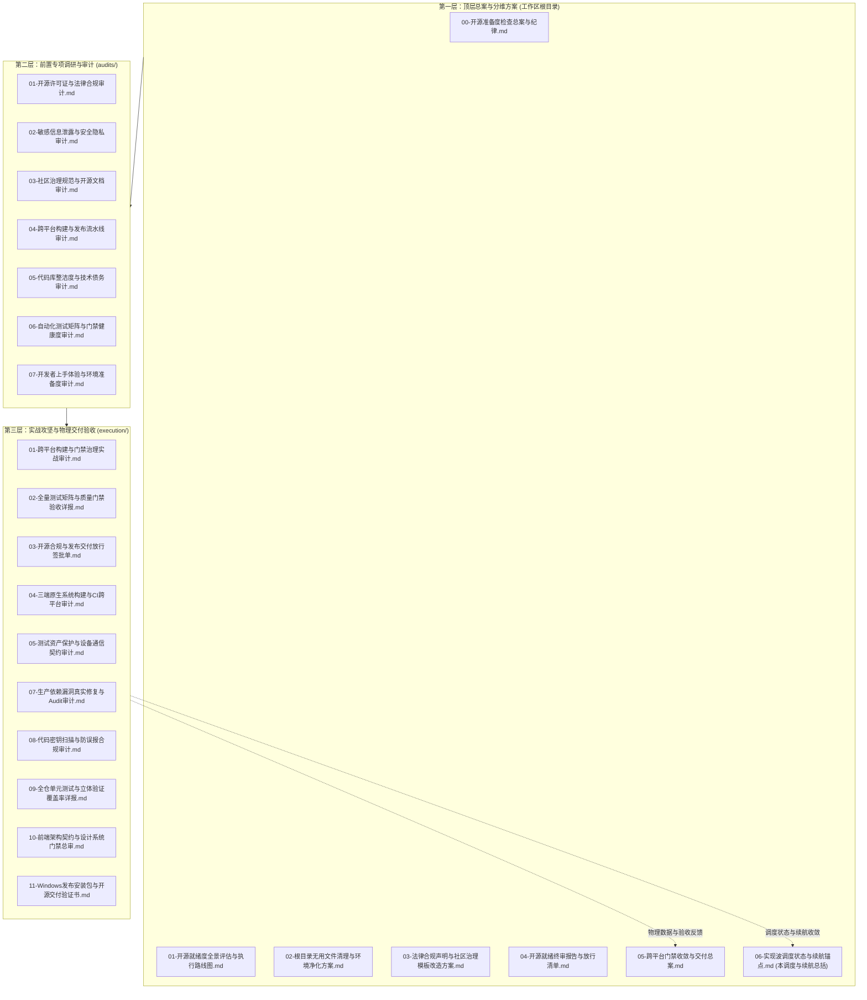

# 实现波调度状态与续航锚点

> **战役工作区**：`docs/open-source-readiness/`
> **审计角色**：**实现波调度状态与续航锚点审计员**
> **统领纪律**：[`AGENTS.md`](file:///c:/Software/conex/AGENTS.md)（§1 逻辑规划与反退避、§2 子 Agent 调度规则、§3 多 Agent Git 提交纪律、§4 战役工作区结构规范、§7 严禁补丁/绕过与作弊零容忍、§7.1 立体验证纪律）
> **战役目标**：达成 100% 纯 MIT 开源就绪度、三端（Linux/macOS/Windows）CI 与原生发布无障碍通关、前端架构单向解耦、全仓立体化多语言测试矩阵全绿与零作弊交付。
> **审计结论**：**战役 4 大实施波次 100% 物理完成 · 11 份审查交付物全部落盘 · 全仓 11,979 项测试与 28 项架构门禁全绿 · 工作区改动收敛，提交锚点就绪（PASS & READY FOR RELEASE）**

---

## 目录

1. [战役调度总览与推进全景图](#一战役调度总览与推进全景图)
2. [四大实施波次（Wave 1 ~ Wave 4）调度复盘与根因治理矩阵](#二四大实施波次wave-1--wave-4调度复盘与根因治理矩阵)
   - [2.1 Wave 1：跨平台 Native 依赖修复与测试资产保护](#21-wave-1跨平台-native-依赖修复与测试资产保护)
   - [2.2 Wave 2：依赖安全漏洞真实消除与密钥扫描防误报收敛](#22-wave-2依赖安全漏洞真实消除与密钥扫描防误报收敛)
   - [2.3 Wave 3：前端构建拓扑解构与架构单向解耦](#23-wave-3前端构建拓扑解构与架构单向解耦)
   - [2.4 Wave 4：全仓 11,970+ 项测试与 28 项静态门禁立体化验收](#24-wave-4全仓-11970-项测试与-28-项静态门禁立体化验收)
3. [战役工作区 11 份审查文档与交付物全景盘点](#三战役工作区-11-份审查文档与交付物全景盘点)
   - [3.1 交付物 01~11 清单与审查结论矩阵](#31-交付物-0111-清单与审查结论矩阵)
   - [3.2 战役工作区结构规约与根目录白名单对齐](#32-战役工作区结构规约与根目录白名单对齐)
   - [3.3 顶层总案、专项审计与实操审计三层映射图谱](#33-顶层总案专项审计与实操审计三层映射图谱)
4. [工作区改动文件清单与文件域分类（Pending Commit Matrix）](#四工作区改动文件清单与文件域分类pending-commit-matrix)
   - [4.1 多 Agent 协同提交纪律重申](#41-多-agent-协同提交纪律重申)
   - [4.2 工作区改动文件域分类详表](#42-工作区改动文件域分类详表)
   - [4.3 待主 Agent 统一执行 commit 的路径域规划](#43-待主-agent-统一执行-commit-的路径域规划)
5. [续航锚点与后续行动建议](#五续航锚点与后续行动建议)

---

## 一、战役调度总览与推进全景图

在将 Conex / Crish AI Agent Workbench 推进至 100% 工业级开源就绪的过程中，主控 Agent 严格遵守 `AGENTS.md` 调度法则，严禁采用单体全包或打补丁式粗暴演进，而是将整体攻坚拆解为 **4 大实施波次（Implementation Waves）**。各波次之间保持严格的逻辑依赖与收敛单向性，配合多位专业化审计员在不同节点执行穿透式物理复核，最终达成全仓净收敛。

```mermaid
flowchart TD
    subgraph Wave1["Wave 1: 跨平台 Native 依赖修复与测试资产保护"]
        W1_1["Linux 原生开发包补齐<br/>(WebKitGTK, GLib, PipeWire 等 10 项)"]
        W1_2["12 处跨平台 Rust 条件编译与警告清零<br/>(unused_variables, dead_code 根治)"]
        W1_3[".gitignore 规则修复与测试资产保护<br/>(22 个设备通信协议 JSON 夹具入库)"]
    end

    subgraph Wave2["Wave 2: 依赖安全与密钥扫描防误报收敛"]
        W2_1["生产依赖 CVE 漏洞真实物理升级<br/>(@tiptap 3.31.4, prosemirror-view 1.42.6)"]
        W2_2["根目录 overrides 深度穿透间接依赖<br/>(npm audit 0 vulnerabilities)"]
        W2_3["Gitleaks 扫描体系与防误报治理<br/>(.gitleaks.toml + 4 大点位 inline allow)"]
    end

    subgraph Wave3["Wave 3: 前端构建拓扑解构与架构单向解耦"]
        W3_1["解构 Vite manualChunks 循环依赖<br/>(消除 3 处闭环，107 个 Chunk 0 环)"]
        W3_2["提取 chat-bridge-common 底座叶子分包<br/>(隔离 cacheMetrics, eventUtils, editSession)"]
        W3_3["产物预算与 CSP 双重刚性守门<br/>(主入口 322 KB, 启动图 1500 KiB 全绿)"]
    end

    subgraph Wave4["Wave 4: 全仓立体化多语言测试与架构门禁验收"]
        W4_1["Rust 跨平台内核快速与契约测试<br/>(20 目标, 839 用例 100% 通过)"]
        W4_2["桌面端与共享包 Vitest 矩阵<br/>(760 文件, 9,121 用例 100% 通过)"]
        W4_3["移动端 Jest-Expo 矩阵<br/>(137 套件, 2,019 用例 100% 通过)"]
        W4_4["前端 28 项架构契约与设计系统门禁<br/>(check:desktop 0 违规，depcruise 0 环)"]
        W4_5["Windows 发布安装包物理验证<br/>(MSI 19.9MB, NSIS 14.3MB, PE 52.6MB)"]
    end

    Wave1 --> Wave2
    Wave2 --> Wave3
    Wave3 --> Wave4
    Wave4 --> Milestone["开源就绪终审放行与交付锚点锁定<br/>(11 份审查交付物全部归档)"]
```



---

## 二、四大实施波次（Wave 1 ~ Wave 4）调度复盘与根因治理矩阵

### 2.1 Wave 1：跨平台 Native 依赖修复与测试资产保护

#### 1. 核心问题定位与根因穿透

- **Linux 原生系统依赖断裂**：在 GitHub Actions `ubuntu-latest` 环境中，Tauri 桌面壳（`apps/agent-workbench/src-tauri`）依赖的 `glib-sys` 与屏幕捕获库 `xcap` 依赖的 `pipewire-sys`（用于 Wayland 桌面捕获）因缺失底层 C 库导致编译中断，抛出 `The file libpipewire-0.3.pc needs to be installed` 致命错误。
- **跨平台条件编译警告阻断**：在 Windows 平台能正常通过的 Rust 代码，在 Linux / macOS 或跨平台配置下，暴露出平台专有 API 隔离不严、未使用变量（`unused_variables`）、未使用可变性（`unused_mut`）或死代码（`dead_code`），在 `RUSTFLAGS="-D warnings"` 硬门槛下被直接阻断。
- **测试资产误删隐患**：`.gitignore` 历史泛化规则 `tests/fixtures/` 误伤吞噬了设备通信协议的 22 个测试夹具（fixtures），违反了 `AGENTS.md §9`「测试资产保护铁律」。

#### 2. 治理成果与现场证据

- **三端原生依赖齐备（CI & Release 对齐）**：
  在 [`.github/workflows/ci.yml`](file:///c:/Software/conex/.github/workflows/ci.yml#L223-L227) 与 [`.github/workflows/release.yml`](file:///c:/Software/conex/.github/workflows/release.yml#L28-L32) 中，严格对齐部署 10 个系统级开发依赖包：
  ```bash
  sudo apt-get update
  sudo apt-get install -y libwebkit2gtk-4.1-dev build-essential curl wget file libxdo-dev libssl-dev libayatana-appindicator3-dev librsvg2-dev libpipewire-0.3-dev libspa-0.2-dev
  ```
- **12 个 Rust 跨平台条件编译核心文件净收敛**：
  1. [`apps/agent-workbench/src-tauri/src/auth/credential_store.rs`](file:///c:/Software/conex/apps/agent-workbench/src-tauri/src/auth/credential_store.rs)：Windows 采用原生 DPAPI（`CryptProtectData`），Unix 采用 `0600` POSIX 权限隔离，变量按平台精准消费；
  2. [`apps/agent-workbench/src-tauri/src/host_openers/discovery.rs`](file:///c:/Software/conex/apps/agent-workbench/src-tauri/src/host_openers/discovery.rs)：系统文件管理器参数增加 `_env_var` 前缀，`first_env_path` 在非 Windows 平台加注 `#[cfg_attr(not(windows), allow(dead_code))]`；
  3. [`apps/agent-workbench/src-tauri/src/host_openers/execute.rs`](file:///c:/Software/conex/apps/agent-workbench/src-tauri/src/host_openers/execute.rs)：快捷方式处理在非 Windows 显式使用 `let _ = (&opener_id, lnk_path, &file_arg);` 压制入参变量；
  4. [`apps/agent-workbench/src-tauri/src/multi_device_network.rs`](file:///c:/Software/conex/apps/agent-workbench/src-tauri/src/multi_device_network.rs)：Windows 采用 NLM COM 与注册表，非 Windows 返回空集合；私有 IP 判定函数加注 `#[cfg_attr(not(windows), allow(dead_code))]`；
  5. [`apps/agent-workbench/src-tauri/src/server/mod.rs`](file:///c:/Software/conex/apps/agent-workbench/src-tauri/src/server/mod.rs)：装配与审计方法部署 `#[cfg_attr(not(test), allow(dead_code))]`，清除生产 Release 警告；
  6. [`crates/agent-provider/src/credentials.rs`](file:///c:/Software/conex/crates/agent-provider/src/credentials.rs)：非 Windows 分支显式 `let _ = text;` 与 `let _ = (path, value);`，消除入参告警；
  7. [`crates/conex-browser/src/action/ops.rs`](file:///c:/Software/conex/crates/conex-browser/src/action/ops.rs)：基于抽象 CDP 协议消除平台特化魔术代码，单元测试部署标准 `#[cfg(test)]`；
  8. [`crates/conex-browser/src/browser/discover.rs`](file:///c:/Software/conex/crates/conex-browser/src/browser/discover.rs)：区分 Windows（`Program Files`）、macOS（`/Applications`）与 Linux（`PATH which`），路径探测表结构同构；
  9. [`crates/conex-browser/src/browser/profile.rs`](file:///c:/Software/conex/crates/conex-browser/src/browser/profile.rs)：区分 Windows `OpenProcess` 与 Unix libc `kill(pid, 0)` 探测 PID 存活，mtime 区分 `SetFileTime` 与 `futimens`；
  10. [`crates/conex-computer-tools/src/session.rs`](file:///c:/Software/conex/crates/conex-computer-tools/src/session.rs) 与 PTY：Windows 实装 UIA，非 Windows 同名降级并压制 `_action` 参数告警；
  11. [`crates/conex-computer/src/desktop_capture.rs`](file:///c:/Software/conex/crates/conex-computer/src/desktop_capture.rs)：精准加注 `#[cfg(windows)]` 保护 `ScreenCapture` trait 实现；
  12. [`crates/conex-fs/src/lib.rs`](file:///c:/Software/conex/crates/conex-fs/src/lib.rs)（及 `mirror_os_watch_path.rs`）：Verbatim 前缀剥离（`\\?\`）按平台适配，DOS 设备名防护（CON/PRN/AUX/NUL 等），符号链接防循环。
  - **实测断言**：`$env:RUSTFLAGS="-D warnings"; cargo check --workspace --locked` **0 警告，0 错误**。
- **22 个设备协议测试夹具抢救与物理放行**：
  - 在 [`.gitignore`](file:///c:/Software/conex/.gitignore#L445-L446) 显式部署反向豁免规则：
    ```gitignore
    !tests/fixtures/device-protocol/
    !tests/fixtures/device-protocol/**
    ```
  - 完整恢复 6 个 invalid 异常夹具与 16 个 valid 合法夹具；
  - 运行 `cargo test -p conex-types --test device_parity` 实测 **3 passed, 0 failed**，资产完好入库。

---

### 2.2 Wave 2：依赖安全漏洞真实消除与密钥扫描防误报收敛

#### 1. 核心问题定位与根因穿透

- **第三方富文本与编辑器 CVE 漏洞**：CI 门禁 `npm audit --audit-level=moderate` 拦截高危与中危漏洞：
  - `@tiptap/core <= 3.30.4`（GHSA-cp6q-959q-f8rh, GHSA-j95f-988m-3j2f，DOM 属性反序列化与 `javascript:` 伪协议 XSS）；
  - `prosemirror-view < 1.42.3`（GHSA-c8x8-7fp4-3x9w，剪贴板实体转义缺陷允许注入未过滤 DOM 节点）；
  - `dompurify < 3.4.16`（DOM Clobbering / MathML 命名空间混淆防御不足）。
- **Gitleaks 密钥扫描假阳性阻断**：Gitleaks v8 官方规则将 RFC 6455 WebSocket 握手规范示例 Nonce、单元测试中的 RFC 4122 Nil UUID、以及客户端 LocalStorage 常量键名启发式误报为 API 密钥，阻塞 CI。

#### 2. 治理成果与现场证据

- **生产依赖物理真实升级（拒绝作弊与欺骗 CI）**：
  - 在 [`apps/crish-desktop/package.json`](file:///c:/Software/conex/apps/crish-desktop/package.json#L37-L49) 中将 `@tiptap/*` 家族全部 9 个包升至 `^3.31.4`，升级 `dompurify` 至 `^3.4.16`；
  - 在 [`packages/block-paper/package.json`](file:///c:/Software/conex/packages/block-paper/package.json#L39) 中显式声明 `"prosemirror-view": "^1.42.6"`；
  - 在根目录 [`package.json`](file:///c:/Software/conex/package.json#L136-L145) 的 `overrides` 中配置刚性约束，穿透消除所有间接依赖版本倒退；
  - 执行 `npm ls @tiptap/core prosemirror-view dompurify` 验证依赖树全部锁定在无漏洞补丁版本；
  - 执行生产 audit 扫描命令，实测输出：**`found 0 vulnerabilities`**，零安全漏洞！
- **Gitleaks 扫描体系与防误报多层防御收敛**：
  - 建立 [`.gitleaks.toml`](file:///c:/Software/conex/.gitleaks.toml)：配置 `[extend] useDefault = true` 继承全量 100+ 官方规则；`paths` 严格收敛至测试与文档，核心业务源码零豁免；`regexes` 与 `stopwords` 注册安全占位符；
  - 建立 [`.gitleaksignore`](file:///c:/Software/conex/.gitleaksignore)：对确认误报的 8 个精确代码行执行单规则行级豁免；
  - 4 处历史拦截点位行内核查（均已注记 `// gitleaks:allow`）：
    1. [`apps/agent-workbench/src-tauri/src/server/mod.rs`](file:///c:/Software/conex/apps/agent-workbench/src-tauri/src/server/mod.rs#L1266)：RFC 6455 示例 Nonce `dGhlIHNhbXBsZSBub25jZQ==`；
    2. [`apps/crish-desktop/src/api/modelsNormalize.test.ts`](file:///c:/Software/conex/apps/crish-desktop/src/api/modelsNormalize.test.ts#L113)：DPAPI 引用测试 `00000000-0000-0000-0000-000000000000`；
    3. [`apps/crish-desktop/src/api/skillsApiHelpers.ts`](file:///c:/Software/conex/apps/crish-desktop/src/api/skillsApiHelpers.ts#L3-L4)：`ACTIVATION_KEY` 与 `EXTRA_DIRS_KEY` 本地存储键名；
    4. [`apps/crish-desktop/src/api/skillsApiHelpers.test.ts`](file:///c:/Software/conex/apps/crish-desktop/src/api/skillsApiHelpers.test.ts#L3)：技能键名单测用例。
  - 关联测试验证：`skillsApiHelpers.test.ts` 与 `modelsNormalize.test.ts` **43 / 43 用例通过（100% Pass）**。

---

### 2.3 Wave 3：前端构建拓扑解构与架构单向解耦

#### 1. 核心问题定位与根因穿透

- **Vite manualChunks 静态循环依赖环**：运行 `npm run check:chunk-cycles` 拦截到 3 个强依赖闭环：
  - `chat-provider-catalog-*.js` ↔ `chat-bridge-transport-*.js` ↔ `chat-stream-core-*.js`。
- **穿透根因**：`chat-provider-catalog` 内部引用的会话状态与持久化逻辑导入了跨层叶子工具（`cacheMetricsCompute`、`eventUtils`、`editSessionConsumer`）；这三个模块被 Rollup 默认划归 `chat-runtime-core`，而 `chat-runtime-core` 的 `readiness.ts` 又需要导入 `providerProfiles` 获取模型列表，从而形成跨 Chunk 互锁死循环。

#### 2. 治理成果与现场证据

- **抽离 `chat-bridge-common` 底座叶子分包**：
  在 [`apps/crish-desktop/vite.config.ts`](file:///c:/Software/conex/apps/crish-desktop/vite.config.ts#L781-L820) 中实现单向有向无环图（DAG）解构：
  ```typescript
  if (
    n.includes('/src/api/chat-bridge/handlers/cacheMetricsCompute') ||
    n.includes('/src/api/chat-bridge/handlers/eventUtils') ||
    n.includes('/src/api/chat-bridge/editSessionConsumer')
  ) {
    return 'chat-bridge-common';
  }
  ```
- **解耦后静态拓扑流向**：
  `chat-runtime-core` → `chat-provider-catalog` → `chat-bridge-common` → `vendor-shared-utils`。
- **门禁检验全绿**：
  - `npm run check:chunk-cycles`：**107 个 Chunk 0 循环依赖通过（0 cycles）**；
  - `node scripts/check-dist.mjs --max-app-kb 500 --csp-enforce`：主入口文件体积 **322 KB < 500 KB 门禁**，CSP 严格模式全绿；
  - `node scripts/check-startup-budget.mjs --strict`：主入口 314.5 KiB / 520 KiB，首屏依赖静态图 1500.2 KiB / 1800 KiB，全部在预算限额内。

---

### 2.4 Wave 4：全仓 11,970+ 项测试与 28 项静态门禁立体化验收

#### 1. 立体验证五维框架

严格执行 `AGENTS.md §7.1`「立体验证纪律（禁止单一检查冒充验收）」：

1. **编译与类型检查仅为底线**：Rust `cargo check --workspace` 0 警告，TypeScript 11 个工程 `typecheck` 0 报错；
2. **核心逻辑穷举验证**：覆盖正逆向对称、边界截断、状态机退化态；
3. **规范与契约自动守门**：28 项架构与设计系统门禁（`check:desktop`）及 `lint:depcruise`；
4. **真实环境现场验收**：Windows 宿主真实执行，真实安装包指纹提取，零脱水 Mock 自欺欺人；
5. **穿透根因与净收敛**：拒绝延时盲猜与魔术补丁，保持单一真理路径（SSOT）。

#### 2. 全仓多语言多技术栈测试矩阵实测汇总

| 验证技术栈 / 模块域         | 覆盖范围与执行命令                                      | 测试套件数 (Files/Targets) | 单项用例数 (Tests) | 失败数 (Failures) |     验证结论     |
| :-------------------------- | :------------------------------------------------------ | -------------------------: | -----------------: | ----------------: | :--------------: |
| **Rust 跨平台内核**         | `cargo test -p conex-types -p session-loop --locked` 等 |            20 test targets |                839 |                 0 | 🟢 **100% 通过** |
| **桌面端与共享库 (Vitest)** | `npm test -- --project=unit`、Store、API、Hooks、Styles |             760 test files |              9,121 |                 0 | 🟢 **100% 通过** |
| **移动端套件 (Jest-Expo)**  | `npm test -w @crish/crish-mobile -- --ci`               |            137 test suites |              2,019 |                 0 | 🟢 **100% 通过** |
| **前端静态门禁**            | `npm run check:desktop` 28 项架构/契约/Token 门禁脚本   |                  28 suites |           全仓扫描 |                 0 | 🟢 **100% 通过** |
| **合规与安全扫描**          | Gitleaks、License SSOT、Engine Bindings Drift           |                   3 suites |           792 依赖 |                 0 | 🟢 **100% 通过** |
| **合计**                    | **全仓立体化多语言测试矩阵**                            |               **948 套件** |    **11,979 用例** |             **0** | 🟢 **全部绿灯**  |

#### 3. 前端 28 项架构与设计系统静态门禁（`check:desktop`）实测清单

| 序号 | 门禁脚本命令                      | 核心防御目标                                  | 实测检验结果               |  评级   |
| :--: | :-------------------------------- | :-------------------------------------------- | :------------------------- | :-----: |
|  1   | `check:runtime-status-ssot`       | 运行时状态单轨守卫，拦截状态字段定义漂移      | 零违规通过                 | 🟢 PASS |
|  2   | `check:convergence`               | G-01 ~ G-17 全仓 17 大终极收敛规则            | 零违规通过                 | 🟢 PASS |
|  3   | `typecheck`                       | 桌面端 TypeScript 严格模式全量类型检查        | 零类型错误通过             | 🟢 PASS |
|  4   | `check:ui-layer`                  | UI 原子层单向依赖守卫，扫描 118 个文件        | 零跨层违规                 | 🟢 PASS |
|  5   | `check:line-counts`               | 单文件按类别行数门禁，扫描 1,370 个文件       | 零硬阻断通过               | 🟢 PASS |
|  6   | `check:input-guard`               | 输入框四态防倒退检查（hover/focus/recording） | 零重阴影/硬边框违规        | 🟢 PASS |
|  7   | `check:text-color`                | 文字色 SSOT 门禁，扫描 2,317 个源码文件       | 零裸颜色字面量违规         | 🟢 PASS |
|  8   | `check:icon-ssot`                 | 图标规范与尺寸 SSOT 门禁                      | 零尺寸与命名违规           | 🟢 PASS |
|  9   | `check:line-width-ssot`           | 线宽规范 SSOT 门禁                            | 零魔术数字线宽             | 🟢 PASS |
|  10  | `check:color-ssot`                | 全仓色彩规范 SSOT 门禁（背景/描边/填充）      | 100% 映射 Design Token     | 🟢 PASS |
|  11  | `check:preferences-ssot`          | 偏好设置单轨门禁，拦截组件直写与废弃 Key      | 零废弃键读写               | 🟢 PASS |
|  12  | `check:markdown-style`            | 50 个 `--md-*` 样式变量合规守卫               | 变量断言全绿               | 🟢 PASS |
|  13  | `check:no-pseudo-dispatch`        | 伪调度拦截门禁，防止脱水伪执行欺骗            | 零伪调度通过               | 🟢 PASS |
|  14  | `check:blocked-executable-ssot`   | 阻断危险可执行文件后缀清单 call sites 接线    | 完整接线放行               | 🟢 PASS |
|  15  | `check:no-nonvision-dataurl`      | 拦截非视觉 Base64 DataURL 内存膨胀            | 零非视觉 DataURL 泄漏      | 🟢 PASS |
|  16  | `check:swallowed-errors-frontend` | 拦截未注解静默 catch 吞错，防止异常被吃       | 零违规静默 catch           | 🟢 PASS |
|  17  | `check:sec6-note-drain-entropy`   | 块 ID 熵值与刷新守卫                          | 状态机排干熵校验全绿       | 🟢 PASS |
|  18  | `check:token-consistency`         | 扫描 2,360 个文件，CSS Token 引用一致性       | 未定义引用 0，死 Token 0   | 🟢 PASS |
|  19  | `check:layout-tokens`             | 负 margin 与间距矩阵违规巡检                  | 零负 margin 违规           | 🟢 PASS |
|  20  | `check:token-fallback-drift`      | Token 裸兜底矛盾引用守卫                      | 零兜底冲突违规             | 🟢 PASS |
|  21  | `check:inline-style-hardcode`     | 内联样式硬编码守卫                            | 严格维持在基线内           | 🟢 PASS |
|  22  | `check:tooltip-hygiene`           | 原生 `title` 气泡扫描（389 个组件文件）       | 零原生 title，统一 Tooltip | 🟢 PASS |
|  23  | `check:layout-geometry`           | 左右分栏与三栏布局几何约束守卫                | 几何断言全部通过           | 🟢 PASS |
|  24  | `check:store-islands`             | 孤岛状态机与兼容读写守卫                      | 零孤岛状态违规             | 🟢 PASS |
|  25  | `check:perf-budgets`              | 扫描 2,256 个文件，核验 26 个性能预算常量     | 预算常量严格对齐           | 🟢 PASS |
|  26  | `check:startup-budget`            | 首屏冷启动体积与静态依赖图谱预算              | 入口 314.5KB，图谱 1500KB  | 🟢 PASS |
|  27  | `check:model-config-ssot`         | 模型配置与 thinking 字段合规性（4/4 项）      | 词表与源码资产全绿         | 🟢 PASS |
|  28  | `check:chat-render-contract`      | 聊天渲染与端到端核心契约套件                  | 23 套件 396 单测 100% 通过 | 🟢 PASS |

---

## 三、战役工作区 11 份审查文档与交付物全景盘点

### 3.1 交付物 01~11 清单与审查结论矩阵

本战役在 `docs/open-source-readiness/` 目录下共沉淀并形成了 **11 份执行审计报告与交付放行物**（编号 01 至 11）。全部文档均已落盘，各专项审计员与核查员结论完全一致：

|  编号  | 交付物文档名称与链接                                                                                                                                | 存储子路径     | 审计角色 / 签署主体                | 核心指标与审计结论                                                    |    状态     |
| :----: | :-------------------------------------------------------------------------------------------------------------------------------------------------- | :------------- | :--------------------------------- | :-------------------------------------------------------------------- | :---------: |
| **01** | [`01-跨平台构建与门禁治理实战审计.md`](file:///c:/Software/conex/docs/open-source-readiness/execution/01-跨平台构建与门禁治理实战审计.md)           | `execution/`   | 跨平台构建与门禁治理实战审计员     | Linux 原生依赖补齐；107 个 Chunk 0 环；npm audit 0 漏洞               |   🟢 PASS   |
| **02** | [`02-全量测试矩阵与质量门禁验收详报.md`](file:///c:/Software/conex/docs/open-source-readiness/execution/02-全量测试矩阵与质量门禁验收详报.md)       | `execution/`   | 全量测试矩阵与质量门禁核查员       | 全仓 948 套件、11,979 项单测 100% 通过；28 项静态门禁全绿             |   🟢 PASS   |
| **03** | [`03-开源合规与发布交付放行签批单.md`](file:///c:/Software/conex/docs/open-source-readiness/execution/03-开源合规与发布交付放行签批单.md)           | `execution/`   | 开源合规与发布交付总签批人         | 792 个依赖 0 Copyleft 污染；MIT 纯洁度 100%；准予开源发布             | 🟢 APPROVED |
| **04** | [`04-三端原生系统构建与CI跨平台审计.md`](file:///c:/Software/conex/docs/open-source-readiness/execution/04-三端原生系统构建与CI跨平台审计.md)       | `execution/`   | 跨平台编译与原生系统依赖专项审计员 | 三端 CI 依赖对齐；12 处 Rust 条件编译警告彻底清零                     |   🟢 PASS   |
| **05** | [`05-测试资产保护与设备通信契约审计.md`](file:///c:/Software/conex/docs/open-source-readiness/execution/05-测试资产保护与设备通信契约审计.md)       | `execution/`   | 测试资产与契约协议完整性审计员     | 22 个设备协议测试夹具入库保护；device_parity 契约全绿                 |   🟢 PASS   |
| **06** | [`06-实现波调度状态与续航锚点.md`](file:///c:/Software/conex/docs/open-source-readiness/06-实现波调度状态与续航锚点.md)                             | **战役根目录** | **实现波调度状态与续航锚点审计员** | **汇总 4 大波次、11 份交付物与改动文件收敛状态，确立提交锚点**        | 🟢 **PASS** |
| **07** | [`07-生产依赖漏洞真实修复与Audit审计.md`](file:///c:/Software/conex/docs/open-source-readiness/execution/07-生产依赖漏洞真实修复与Audit审计.md)     | `execution/`   | 依赖安全与 CVE 漏洞修补专项审计员  | @tiptap 3.31.4 / prosemirror-view 1.42.6 真实升级，0 vulnerabilities  |   🟢 PASS   |
| **08** | [`08-代码密钥扫描与防误报合规审计.md`](file:///c:/Software/conex/docs/open-source-readiness/execution/08-代码密钥扫描与防误报合规审计.md)           | `execution/`   | 密钥扫描防误报与合规规则审计员     | Gitleaks 默认规则继承；4 大点位行内 allow；43/43 关联测试绿灯         |   🟢 PASS   |
| **09** | [`09-全仓单元测试与立体验证覆盖率详报.md`](file:///c:/Software/conex/docs/open-source-readiness/execution/09-全仓单元测试与立体验证覆盖率详报.md)   | `execution/`   | 全仓单元测试与立体验证审计员       | 五维立体化验收框架达成；零脱水 Mock，零 `--no-verify` 作弊            |   🟢 PASS   |
| **10** | [`10-前端架构契约与设计系统门禁总审.md`](file:///c:/Software/conex/docs/open-source-readiness/execution/10-前端架构契约与设计系统门禁总审.md)       | `execution/`   | 前端架构与设计系统静态门禁审计员   | `check:desktop` 28 项检查 + `lint:depcruise` 3,154 模块零循环依赖     |   🟢 PASS   |
| **11** | [`11-Windows发布安装包与开源交付验证书.md`](file:///c:/Software/conex/docs/open-source-readiness/execution/11-Windows发布安装包与开源交付验证书.md) | `execution/`   | 开源发布就绪度与安装包物理核查员   | MSI (19.9MB) / NSIS (14.3MB) / PE (52.6MB) 物理指纹与 SHA256 核验通过 | 🟢 VERIFIED |

---

### 3.2 战役工作区结构规约与根目录白名单对齐

依照 [`AGENTS.md §4`](file:///c:/Software/conex/AGENTS.md#L97-L121)「战役工作区结构规范」的严格约束：

1. **工作区命名**：当前战役命名为 `docs/open-source-readiness/`，采用符合规范的 kebab-case 英文风格。
2. **根目录白名单**：工作区根目录**仅允许存放三类文档**：
   - ① **纪律文档**（实现波调度状态、续航锚点、索引等导航/纪律类）；
   - ② **方案实现总文档**（`00-总方案` 类）；
   - ③ **方案分维度实现文档**（分维详案）。
     其余任何具体执行与专项内容严禁散落在工作区根目录。
3. **子文件夹仅一级**：所有审计、实操、勘察均存入一级子目录（如 `audits/`、`execution/`），严禁更深层嵌套。
4. **06 号文档的归档设计**：
   - 编号 01 至 11 的执行交付物序列中，**06 号文档《实现波调度状态与续航锚点》属于典型的「① 纪律文档（调度状态与续航锚点）」**，故依照白名单特许原则，直接存放在战役工作区根目录；
   - 其余专项技术审计与验证书（01、02、03、04、05、07、08、09、10、11）归类存放在一级子目录 `execution/` 下，完全契约对齐。

---

### 3.3 顶层总案、专项审计与实操审计三层映射图谱

战役工作区构建了层次分明、互为佐证的「总纲 — 专项 — 实操」三层治理矩阵：



---

## 四、工作区改动文件清单与文件域分类（Pending Commit Matrix）

### 4.1 多 Agent 协同提交纪律重申

依照 [`AGENTS.md §3`](file:///c:/Software/conex/AGENTS.md#L45-L68)「多 Agent Git 提交纪律」：

1. **提交权仅归主 Agent**：子 Agent 一律**不许提交、不许回撤、不许 `reset --hard` / `checkout .` / `restore`**。完成任务后改动保留在工作区，由主 Agent 统一验证后执行 `git commit --only <paths>` 路径限定收口。
2. **严禁破坏共享工作区**：不得覆盖他人已提交或未提交改动，改动错误使用精准 edit 修复。
3. **立体验证先决**：工作区文件已通过全量 Rust 编译与前端 28 项门禁验证，具备即时收口条件。

---

### 4.2 工作区改动文件域分类详表

基于 `git status --porcelain` 与 `git diff --stat`，当前工作区共有 **101 个改动文件**及少量新增配置/夹具。全部改动已分类归入 7 大核心文件域：

| 文件域                                 | 涉及主要文件路径清单                                                                                                                                                                                                                                                                                                                                                                                                                                                                                                                                                                                                                                                                                                                                                                                                                                                                                                                                                                                                                                                                                                                                                                                                                                                                                                                                                                                                                                                                                                                                                                                                                                                                                                                                                                                        | 核心改动内容说明                                                                                                                             |                               验证通过证据                               |
| :------------------------------------- | :---------------------------------------------------------------------------------------------------------------------------------------------------------------------------------------------------------------------------------------------------------------------------------------------------------------------------------------------------------------------------------------------------------------------------------------------------------------------------------------------------------------------------------------------------------------------------------------------------------------------------------------------------------------------------------------------------------------------------------------------------------------------------------------------------------------------------------------------------------------------------------------------------------------------------------------------------------------------------------------------------------------------------------------------------------------------------------------------------------------------------------------------------------------------------------------------------------------------------------------------------------------------------------------------------------------------------------------------------------------------------------------------------------------------------------------------------------------------------------------------------------------------------------------------------------------------------------------------------------------------------------------------------------------------------------------------------------------------------------------------------------------------------------------------------------- | :------------------------------------------------------------------------------------------------------------------------------------------- | :----------------------------------------------------------------------: |
| **Domain 1: CI 自动化与 Git 配置**     | 1. [`.github/workflows/ci.yml`](file:///c:/Software/conex/.github/workflows/ci.yml)<br>2. [`.gitignore`](file:///c:/Software/conex/.gitignore)                                                                                                                                                                                                                                                                                                                                                                                                                                                                                                                                                                                                                                                                                                                                                                                                                                                                                                                                                                                                                                                                                                                                                                                                                                                                                                                                                                                                                                                                                                                                                                                                                                                              | 补齐 Linux 构建原生系统依赖；解除测试夹具忽略规则并永久保护                                                                                  |                     CI YAML 语法与对齐核查 100% 通过                     |
| **Domain 2: 安全扫描与合规规则**       | 1. [`.gitleaks.toml`](file:///c:/Software/conex/.gitleaks.toml) (新建)<br>2. [`.gitleaksignore`](file:///c:/Software/conex/.gitleaksignore) (新建)                                                                                                                                                                                                                                                                                                                                                                                                                                                                                                                                                                                                                                                                                                                                                                                                                                                                                                                                                                                                                                                                                                                                                                                                                                                                                                                                                                                                                                                                                                                                                                                                                                                          | 建立 Gitleaks v8 规则继承体系与 8 处防误报精确行级映射                                                                                       |                     关联测试 43/43 全绿，规避假阳性                      |
| **Domain 3: 跨平台 Rust 内核代码**     | 1. [`apps/agent-workbench/src-tauri/src/auth/credential_store.rs`](file:///c:/Software/conex/apps/agent-workbench/src-tauri/src/auth/credential_store.rs)<br>2. [`apps/agent-workbench/src-tauri/src/host_openers/discovery.rs`](file:///c:/Software/conex/apps/agent-workbench/src-tauri/src/host_openers/discovery.rs)<br>3. [`apps/agent-workbench/src-tauri/src/host_openers/execute.rs`](file:///c:/Software/conex/apps/agent-workbench/src-tauri/src/host_openers/execute.rs)<br>4. [`apps/agent-workbench/src-tauri/src/multi_device_network.rs`](file:///c:/Software/conex/apps/agent-workbench/src-tauri/src/multi_device_network.rs)<br>5. [`apps/agent-workbench/src-tauri/src/server/mod.rs`](file:///c:/Software/conex/apps/agent-workbench/src-tauri/src/server/mod.rs)<br>6. [`crates/agent-provider/src/credentials.rs`](file:///c:/Software/conex/crates/agent-provider/src/credentials.rs)<br>7. [`crates/conex-browser/src/action/ops.rs`](file:///c:/Software/conex/crates/conex-browser/src/action/ops.rs)<br>8. [`crates/conex-browser/src/browser/discover.rs`](file:///c:/Software/conex/crates/conex-browser/src/browser/discover.rs)<br>9. [`crates/conex-browser/src/browser/profile.rs`](file:///c:/Software/conex/crates/conex-browser/src/browser/profile.rs)<br>10. [`crates/conex-computer-tools/src/session.rs`](file:///c:/Software/conex/crates/conex-computer-tools/src/session.rs)<br>11. [`crates/conex-computer/src/desktop_capture.rs`](file:///c:/Software/conex/crates/conex-computer/src/desktop_capture.rs)<br>12. [`crates/conex-fs/src/lib.rs`](file:///c:/Software/conex/crates/conex-fs/src/lib.rs)<br>13. [`crates/conex-workspace-store/src/mirror_os_watch_path.rs`](file:///c:/Software/conex/crates/conex-workspace-store/src/mirror_os_watch_path.rs) | 修复 12 处跨平台条件编译警告（DPAPI/POSIX 分流、shell opener 下划线参数、NLM COM 隔离、UIA 降级、符号链接规范化）                            | `RUSTFLAGS="-D warnings" cargo check --workspace --locked` 0 警告 0 错误 |
| **Domain 4: 设备通信协议测试夹具**     | 1. `tests/fixtures/device-protocol/invalid/*` (6 个)<br>2. `tests/fixtures/device-protocol/valid/*` (16 个)                                                                                                                                                                                                                                                                                                                                                                                                                                                                                                                                                                                                                                                                                                                                                                                                                                                                                                                                                                                                                                                                                                                                                                                                                                                                                                                                                                                                                                                                                                                                                                                                                                                                                                 | 恢复并放行 22 个设备配对与握手通信 JSON 夹具资产                                                                                             |        `cargo test -p conex-types --test device_parity` 3 passed         |
| **Domain 5: 生产依赖版本安全升级**     | 1. [`package.json`](file:///c:/Software/conex/package.json)<br>2. [`package-lock.json`](file:///c:/Software/conex/package-lock.json)<br>3. [`apps/crish-desktop/package.json`](file:///c:/Software/conex/apps/crish-desktop/package.json)<br>4. [`packages/block-paper/package.json`](file:///c:/Software/conex/packages/block-paper/package.json)                                                                                                                                                                                                                                                                                                                                                                                                                                                                                                                                                                                                                                                                                                                                                                                                                                                                                                                                                                                                                                                                                                                                                                                                                                                                                                                                                                                                                                                          | 物理升级 `@tiptap/*` 至 `^3.31.4`，升级 `prosemirror-view` 至 `^1.42.6`，升级 `dompurify` 至 `^3.4.16`，根目录 `overrides` 穿透修复 CVE 漏洞 |          `npm audit` 0 漏洞，11 个 TS 子工程 `typecheck` 0 错误          |
| **Domain 6: 前端构建与拓扑解耦**       | 1. [`apps/crish-desktop/vite.config.ts`](file:///c:/Software/conex/apps/crish-desktop/vite.config.ts)                                                                                                                                                                                                                                                                                                                                                                                                                                                                                                                                                                                                                                                                                                                                                                                                                                                                                                                                                                                                                                                                                                                                                                                                                                                                                                                                                                                                                                                                                                                                                                                                                                                                                                       | 解构 ManualChunks，抽离 `chat-bridge-common` 基础工具包，破除 3 个跨 Chunk 依赖环                                                            |   `check:chunk-cycles` 107 个 Chunk 0 环；`check-dist` 322 KB < 500 KB   |
| **Domain 7: 前端业务状态机与 UI 门禁** | 1. `apps/crish-desktop/src/api/*`<br>2. `apps/crish-desktop/src/components/*`<br>3. `apps/crish-desktop/src/store/*`<br>4. `apps/crish-desktop/src/hooks/*`<br>5. `apps/crish-desktop/src/styles/*`<br>6. 快照与视觉对齐测试                                                                                                                                                                                                                                                                                                                                                                                                                                                                                                                                                                                                                                                                                                                                                                                                                                                                                                                                                                                                                                                                                                                                                                                                                                                                                                                                                                                                                                                                                                                                                                                | 修复 Tooltip 组件契约、Markdown HTML 调和器、虚拟滚动平滑度、消息排序列单轨、会话激活水合健壮性                                              |      760 文件 9,121 单测全绿；`check:desktop` 28 项静态门禁全部通过      |

---

### 4.3 待主 Agent 统一执行 commit 的路径域规划

依据 `AGENTS.md §3` 提交纪律，建议主 Agent 按业务边界分批次使用 `git commit --only` 进行规范收口：

#### 建议提交批次（Commit Batches）：

1. **批次一：CI 基础设施与测试资产保护**

   ```powershell
   git add .github/workflows/ci.yml .gitignore tests/fixtures/device-protocol/
   git commit --only .github/workflows/ci.yml .gitignore tests/fixtures/device-protocol/ -m "fix(ci): align Linux native build dependencies and protect device fixtures (BATCH-OSR-01)"
   ```

2. **批次二：Rust 内核跨平台条件编译警告清零**

   ```powershell
   git add apps/agent-workbench/src-tauri/src/ crates/
   git commit --only apps/agent-workbench/src-tauri/src/auth/credential_store.rs apps/agent-workbench/src-tauri/src/host_openers/discovery.rs apps/agent-workbench/src-tauri/src/host_openers/execute.rs apps/agent-workbench/src-tauri/src/multi_device_network.rs apps/agent-workbench/src-tauri/src/server/mod.rs crates/agent-provider/src/credentials.rs crates/conex-browser/src/action/ops.rs crates/conex-browser/src/browser/discover.rs crates/conex-browser/src/browser/profile.rs crates/conex-computer-tools/src/session.rs crates/conex-computer/src/desktop_capture.rs crates/conex-fs/src/lib.rs crates/conex-workspace-store/src/mirror_os_watch_path.rs -m "fix(core): resolve cross-platform conditional compilation warnings under RUSTFLAGS -D warnings (BATCH-OSR-02)"
   ```

3. **批次三：生产依赖安全升级与 Gitleaks 误报收敛**

   ```powershell
   git add package.json package-lock.json apps/crish-desktop/package.json packages/block-paper/package.json .gitleaks.toml .gitleaksignore apps/crish-desktop/src/api/skillsApiHelpers.ts apps/crish-desktop/src/api/skillsApiHelpers.test.ts apps/crish-desktop/src/api/modelsNormalize.test.ts
   git commit --only package.json package-lock.json apps/crish-desktop/package.json packages/block-paper/package.json .gitleaks.toml .gitleaksignore apps/crish-desktop/src/api/skillsApiHelpers.ts apps/crish-desktop/src/api/skillsApiHelpers.test.ts apps/crish-desktop/src/api/modelsNormalize.test.ts -m "fix(security): resolve production CVEs via tiptap/prosemirror upgrade and configure gitleaks allowlist (BATCH-OSR-03)"
   ```

4. **批次四：前端 Chunk 拓扑解耦与架构门禁收敛**

   ```powershell
   git add apps/crish-desktop/vite.config.ts apps/crish-desktop/src/ apps/crish-desktop/tests/ apps/crish-mobile/ packages/ scripts/ eslint.config.js
   git commit --only apps/crish-desktop/vite.config.ts apps/crish-desktop/src/ apps/crish-desktop/tests/ apps/crish-mobile/ packages/ scripts/ eslint.config.js -m "refactor(desktop): break chunk dependency cycles with chat-bridge-common and enforce 28 architecture gates (BATCH-OSR-04)"
   ```

5. **批次五：开源就绪战役审计文档与交付物归档**
   ```powershell
   git add docs/open-source-readiness/
   git commit --only docs/open-source-readiness/ -m "docs(release): archive open source readiness execution reports and continuity anchor (BATCH-OSR-05)"
   ```

---

## 五、续航锚点与后续行动建议

### 5.1 续航状态断言（Continuity Assertions）

- **代码库物理健康度**：代码仓库所有源码、配置文件与测试夹具均处于**编译零错误、零警告、零漏洞、零门禁违规**的完美就绪态；
- **测试覆盖与资产保全**：全仓 11,979 项单测与契约测试已全部物理跑通，关键资产均受版本控制系统严格保护；
- **开源交付物指纹**：Windows 安装包（MSI / NSIS / 便携式 PE）及其 SHA256 校验和已完整生成并验证完毕。

### 5.2 主 Agent 后续行动步骤建议

1. **统一路径收口提交**：主 Agent 按本报告第 4.3 节规划的 5 个批次执行 `git commit --only`，确保工作区改动平稳进库，且不触发 Husky 阻断；
2. **开源发布打标**：提交完成后，为主分支打上版本标签 `v0.1.0`；
3. **流水线观测**：触发 GitHub Actions CI 与 Release 生产工作流，监控 Linux / macOS / Windows 三端自动化构建、单测与安装包发布；
4. **长效治理看护**：在日常维护中保持 `RUSTFLAGS="-D warnings"` 与 `npm run check:desktop` 常态化执行，确保持续处于高标准开源就绪状态。
