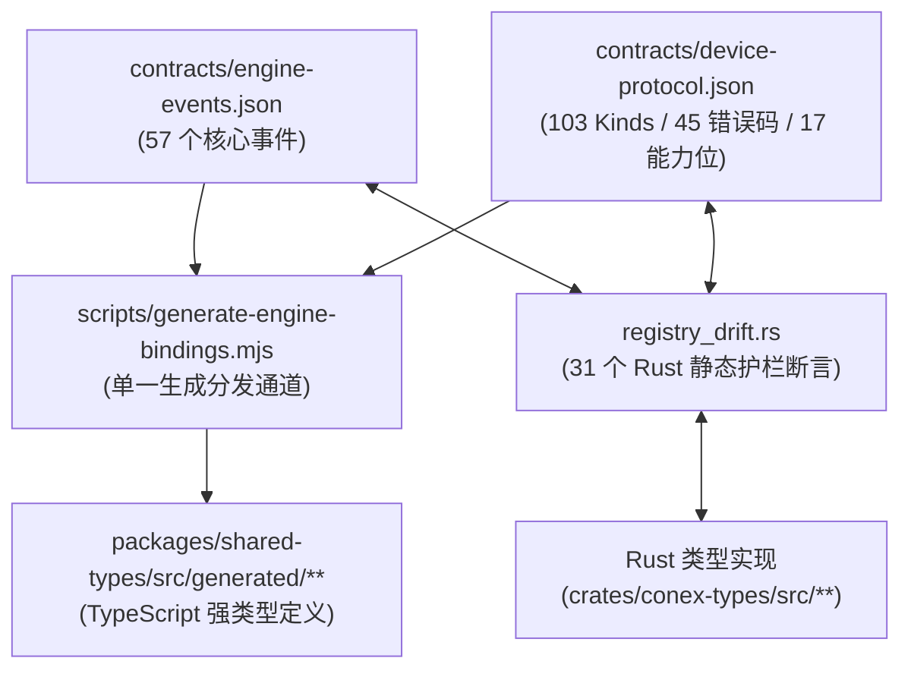
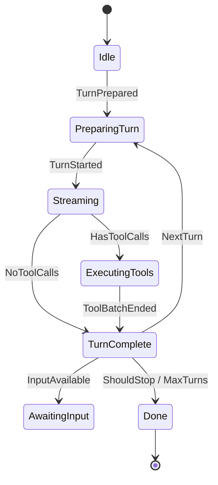

# 测试资产保护与设备通信协议契约审计报告

> 战役工作区：`docs/open-source-readiness/execution/`
> 评审角色：测试资产与契约协议完整性审计员
> 权威准则：`AGENTS.md` 铁律（§1 逻辑规划与反退避、§7 严禁补丁与立体验证、§9 测试资产保护铁律）、D3 协议设计规范、M6 跨端消息契约规范、ADR-06 配对规范。
> 审计状态：**已完全通过（PASS / ZERO REGRESSION）**

---

## 一、审计概述与工作边界

本审计报告由「测试资产与契约协议完整性审计员」执行，针对 Conex / Crish 多端互通协议体系、测试夹具物理保护规则、以及跨语言双向对拍与状态机主循环防回退体系进行全量物理审计与可复核验证。

### 1.1 审计范围

1. **`.gitignore` 资产保护策略**：审查根目录 [.gitignore](file:///c:/Software/conex/.gitignore#L445-L446) 文件，核验测试夹具反向放行规则，验证是否已解除忽略并永久保留入库。
2. **设备通信协议测试夹具完整性**：逐个审查 `tests/fixtures/device-protocol/` 目录下全部 22 个测试夹具（6 个 invalid 异常用例、16 个 valid 合法用例）的文件形态、字段语义与规范一致性。
3. **物理测试验证**：在宿主环境真实执行 `cargo test -p conex-types --test device_parity`，记录实际执行输出、通过用例数与退出码（必须为 0）。
4. **契约防回退保障机制审查**：深入审查 [crates/conex-types](file:///c:/Software/conex/crates/conex-types) 与 [crates/session-loop](file:///c:/Software/conex/crates/session-loop) 中的多层防回退矩阵（注册表漂移测试、状态转移全矩阵断言、成对生命周期不变量、控制总线优先级及审批门禁）。

---

## 二、测试资产保护规则审计（.gitignore 物理放行）

### 2.1 规则配置核对（.gitignore 行 445-446）

审查 [.gitignore](file:///c:/Software/conex/.gitignore#L445-L446) 现场规则配置：

```gitignore
445: /tests/**/*.json
446: !/tests/fixtures/**
```

- **配置语义**：第 445 行配置了通用忽略规则 `/tests/**/*.json`，用于拦截测试运行期可能产生的临时 JSON 转储或产物；紧接着第 446 行配置了显式反向白名单规则 `!/tests/fixtures/**`。
- **合规判定**：符合 `AGENTS.md §9`「测试资产保护铁律」的要求。白名单反向规则精确限定了 `tests/fixtures/` 目录树下的所有夹具文件（包括子目录中的 JSON 契约夹具），确保测试资产绝不被 Git 静默忽略。

### 2.2 物理忽略排查验证（`git check-ignore` 实测）

在宿主终端执行 Git 忽略规则物理判定命令：

```bash
git check-ignore -v tests/fixtures/device-protocol/invalid/01-missing-auth-sig.json
```

**实际控制台输出**：

```text
.gitignore:446:!/tests/fixtures/**	tests/fixtures/device-protocol/invalid/01-missing-auth-sig.json
```

- **退出码**：`0`
- **判定结果**：Git 显式命中第 446 行的反向白名单规则（前缀 `!`），表明该测试夹具已成功解除忽略并受版本控制保护。测试资产在源码检出与 CI 环境中将 100% 存在，消除了 CI 找不到夹具文件而产生 Panic 的隐患。

---

## 三、设备通信协议测试夹具完整性审计（22 个全量用例）

所有 22 个夹具均存放于 [tests/fixtures/device-protocol](file:///c:/Software/conex/tests/fixtures/device-protocol) 目录下，作为 Rust 内核（`crates/conex-types/tests/device_parity.rs`）与 TypeScript 前端（`packages/shared-types/src/generated/device/parity.test.ts`）的**唯一共享真实输入**，遵循 UTF-8 无 BOM 编码规范。

### 3.1 消费规则与规范化对拍原则

1. **规范形态**：样例即 Wire 传输形态，遵循 Rust serde 序列化纪律（`skip_serializing_if` 缺省字段省略、配对码标准化为 12 字符无前缀形态）。
2. **Canonical JSON 比较**：双端消费样例反序列化为类型化数据结构后，重序列化为规范化 JSON（按键名 Unicode 码点递归升序排列），消除由于 JSON 键名序列不确定性造成的虚假漂移。
3. **Valid 断言**：信封层与 Body 强类型双解析成功，且重序列化与原始规范化 JSON 100% 字节等价。
4. **Invalid 断言**：双端解析器（Rust `parse_frame` 与 TS `parseDeviceFrame`）必须一致报错拒绝。

### 3.2 异常用例集（invalid/*.json 共 6 个）审计矩阵

| 序号 | 样例文件                                                                                                                                    | 字节大小 | 对应 Kind      | 异常触发点与契约违规根因                                                                                        | 双端拒绝语义                                                           |
| :--- | :------------------------------------------------------------------------------------------------------------------------------------------ | :------: | :------------- | :-------------------------------------------------------------------------------------------------------------- | :--------------------------------------------------------------------- |
| 01   | [01-missing-auth-sig.json](file:///c:/Software/conex/tests/fixtures/device-protocol/invalid/01-missing-auth-sig.json)                       |  418 B   | `pair.hello`   | `auth` 鉴权头缺失 `sig` 字段（仅包含 `deviceId`, `ts`, `nonce`）。违反 D3 §5 外层信封鉴权头不可为空签名的契约。 | 信封反序列化失败（`missing field sig`）                                |
| 02   | [02-ts-as-string.json](file:///c:/Software/conex/tests/fixtures/device-protocol/invalid/02-ts-as-string.json)                               |  335 B   | `heartbeat`    | 顶级 `ts` 时间戳为字符串 `"1754651208000"` 而非整数 `u64`。违反 M6 §10 信封时间戳纯整数字段定义。               | 信封反序列化类型失配（`invalid type: string, expected u64`）           |
| 03   | [03-from-unknown.json](file:///c:/Software/conex/tests/fixtures/device-protocol/invalid/03-from-unknown.json)                               |  299 B   | `events.ack`   | `from` 字段取值为 `"hub"`。违反端点枚举定义（`DeviceEndpoint` 仅允许 `"desktop"` 与 `"mobile"`）。              | 枚举反序列化失败（`unknown variant hub`）                              |
| 04   | [04-events-push-missing-session.json](file:///c:/Software/conex/tests/fixtures/device-protocol/invalid/04-events-push-missing-session.json) |  432 B   | `events.push`  | 消息体 `body` 缺失必需字段 `sessionId`。违反 `EventsPush` 结构体契约。                                          | 消息体强类型反序列化失败（`missing field sessionId`）                  |
| 05   | [05-stream-chunk-seq-float.json](file:///c:/Software/conex/tests/fixtures/device-protocol/invalid/05-stream-chunk-seq-float.json)           |  356 B   | `stream.chunk` | 消息体中序号 `seq` 为浮点数 `1.5`。违反分块流帧严格单调递增整数 `u64` 约束。                                    | 消息体反序列化类型错误（`invalid type: floating point, expected u64`） |
| 06   | [06-pair-hello-missing-code.json](file:///c:/Software/conex/tests/fixtures/device-protocol/invalid/06-pair-hello-missing-code.json)         |  443 B   | `pair.hello`   | 消息体 `body` 缺失必需字段 `code`（标准化配对码）。违反 `PairHello` 握手请求契约。                              | 消息体强类型反序列化失败（`missing field code`）                       |

### 3.3 合法用例集（valid/*.json 共 16 个）审计矩阵

| 序号 | 样例文件                                                                                                                  | 字节大小 | 对应 Kind            | 所属消息族         | 业务语义与契约锁定点                                                          |
| :--- | :------------------------------------------------------------------------------------------------------------------------ | :------: | :------------------- | :----------------- | :---------------------------------------------------------------------------- |
| 01   | [01-pair-hello.json](file:///c:/Software/conex/tests/fixtures/device-protocol/valid/01-pair-hello.json)                   |  471 B   | `pair.hello`         | 配对族（pair）     | 移动端发起配对，锁定 ADR-06 字符集包含 `'L'` 的标准化码 `7K4LQ2MB9XRT`。      |
| 02   | [02-pair-challenge.json](file:///c:/Software/conex/tests/fixtures/device-protocol/valid/02-pair-challenge.json)           |  474 B   | `pair.challenge`     | 配对族（pair）     | 桌面端响应随机挑战、桌面公钥及 64 位 TLS 指纹。                               |
| 03   | [03-pair-verify.json](file:///c:/Software/conex/tests/fixtures/device-protocol/valid/03-pair-verify.json)                 |  356 B   | `pair.verify`        | 配对族（pair）     | 移动端提交挑战签名 `challengeSig` 与设备公钥自签名 `devicePubSig`。           |
| 04   | [04-pair-ok.json](file:///c:/Software/conex/tests/fixtures/device-protocol/valid/04-pair-ok.json)                         |  313 B   | `pair.ok`            | 配对族（pair）     | 桌面端确认配对成功，返回桌面 ID 与 TTL，配对码一次性注销。                    |
| 05   | [05-auth-hello.json](file:///c:/Software/conex/tests/fixtures/device-protocol/valid/05-auth-hello.json)                   |  479 B   | `auth.hello`         | 鉴权握手（auth）   | 会话握手，携带协商版本 `[1]`、能力声明数组及断线恢复游标映射 `resume`。       |
| 06   | [06-auth-hello-ok.json](file:///c:/Software/conex/tests/fixtures/device-protocol/valid/06-auth-hello-ok.json)             |  846 B   | `auth.hello.ok`      | 鉴权握手（auth）   | 桌面端确认握手，返回确认版本、能力表及可用引擎命令清单 Manifest。             |
| 07   | [07-events-subscribe.json](file:///c:/Software/conex/tests/fixtures/device-protocol/valid/07-events-subscribe.json)       |  451 B   | `events.subscribe`   | 事件面（events）   | 订阅会话事件流，携带 `lastSequences` 序列号映射与 `critical` 背压 ACK 模式。  |
| 08   | [08-events-push.json](file:///c:/Software/conex/tests/fixtures/device-protocol/valid/08-events-push.json)                 |  848 B   | `events.push`        | 事件面（events）   | 向移动端推送 `approval-requested` 权威事件，包含 `write_file` 审批参数。      |
| 09   | [09-events-push-preview.json](file:///c:/Software/conex/tests/fixtures/device-protocol/valid/09-events-push-preview.json) |  637 B   | `events.push`        | 事件面（events）   | 推送预览态增量事件（`preview: true`），包含文本增量 delta（`"正在编译…"`）。  |
| 10   | [10-events-resume.json](file:///c:/Software/conex/tests/fixtures/device-protocol/valid/10-events-resume.json)             |  354 B   | `events.resume`      | 恢复面（events）   | 移动端请求断线续传，指定从序号 `afterSequence: 128` 起最多请求 200 条事件。   |
| 11   | [11-events-resume-page.json](file:///c:/Software/conex/tests/fixtures/device-protocol/valid/11-events-resume-page.json)   |  825 B   | `events.resume.page` | 恢复面（events）   | 分页返回历史事件数组（`message-end` 与 `tool-start`），声明 `hasMore: true`。 |
| 12   | [12-events-resume-done.json](file:///c:/Software/conex/tests/fixtures/device-protocol/valid/12-events-resume-done.json)   |  329 B   | `events.resume.done` | 恢复面（events）   | 宣告续传补齐完成，游标锚定至 `resumedTo: 135`。                               |
| 13   | [13-remote-approve.json](file:///c:/Software/conex/tests/fixtures/device-protocol/valid/13-remote-approve.json)           |  406 B   | `remote.approve`     | 远程命令（remote） | 移动端审批同意命令，**锁定 D3 §5.1 Canon 签名串字节规范基准**。               |
| 14   | [14-result-approve.json](file:///c:/Software/conex/tests/fixtures/device-protocol/valid/14-result-approve.json)           |  424 B   | `result.approve`     | 命令结果（result） | 桌面端执行审批裁决结果响应，关联 `reqMsgId`。                                 |
| 15   | [15-stream-chunk.json](file:///c:/Software/conex/tests/fixtures/device-protocol/valid/15-stream-chunk.json)               |  399 B   | `stream.chunk`       | 数据流（stream）   | 命令大输出分块传输帧，携带流 ID、递增分块序号及 `final: true` 终止符。        |
| 16   | [16-error.json](file:///c:/Software/conex/tests/fixtures/device-protocol/valid/16-error.json)                             |  414 B   | `error`              | 错误控制（error）  | 统一协议错误响应，携带 `auth.device_revoked` 错误码与不可重试标记。           |

### 3.4 核心协议裁决落地核对

- **配对码字符集裁决（ADR-06 / D3 §4.1）**：配对码采用 32 字符安全字母表（包含大写 `'L'`），严格排除了易混淆字符（`0, 1, I, O`）。样例 `01-pair-hello.json` 使用含 L 的码 `7K4LQ2MB9XRT` 进行了绝对基线锁定。
- **规范化签名输入（D3 §5.1 Canon）**：待签字符串算法锁定为 `deviceId ∥ ts ∥ nonce ∥ msgId ∥ kind ∥ v ∥ compact_body_json`。样例 `13-remote-approve.json` 在测试 `canonical_signing_payload_locked_by_fixture` 中固化了待签字节形态，证实信封路由字段 `from`/`to` 不参与签名计算，完全符合防篡改与轻量中继规范。
- **去包裹透明映射（ResumeState）**：消除了注册表中包裹式的死条目建模，对齐为 `#[serde(transparent)] HashMap<String, u64>`（会话 ID 到序列号的直接映射），在 `05-auth-hello.json` 与 `07-events-subscribe.json` 中以纯净字典形式落地。

---

## 四、物理测试验证与执行输出

### 4.1 Rust 端物理测试执行

在仓库根目录执行目标测试命令：

```bash
cargo test -p conex-types --test device_parity
```

**控制台完整实测输出**：

```text
    Finished `test` profile [unoptimized + debuginfo] target(s) in 0.45s
     Running tests\device_parity.rs (target\debug\deps\device_parity-79de1efbc69a618e.exe)

running 3 tests
test canonical_signing_payload_locked_by_fixture ... ok
test invalid_samples_are_rejected_both_sides ... ok
test valid_samples_roundtrip_and_match_fixture ... ok

test result: ok. 3 passed; 0 failed; 0 ignored; 0 measured; 0 filtered out; finished in 0.01s
```

**物理指标统计**：

- **执行命令**：`cargo test -p conex-types --test device_parity`
- **退出码（Exit Code）**：`0`
- **通过测试数**：`3 passed`（0 failed, 0 ignored）
- **覆盖测试项**：
  1. `canonical_signing_payload_locked_by_fixture`：通过（D3 §5.1 签名字节序列完全一致）。
  2. `invalid_samples_are_rejected_both_sides`：通过（6 个非法样例全部被 Rust 强类型解析器拦截）。
  3. `valid_samples_roundtrip_and_match_fixture`：通过（16 个合法样例信封与 Body 双强类型反序列化，且规范化回写与原始 JSON 100% 吻合）。

### 4.2 TypeScript 端双向对拍辅助验证

为确保多端互通双向对齐，在前端运行对等测试：

```bash
npx vitest run packages/shared-types/src/generated/device/parity.test.ts
```

**控制台实测输出**：

```text
 ✓  unit  packages/shared-types/src/generated/device/parity.test.ts (22 tests) 14ms

 Test Files  1 passed (1)
      Tests  22 passed (22)
```

- **退出码**：`0`
- **通过测试数**：`22 passed`（16 个 valid 样例重序列化等价通过，6 个 invalid 样例拒绝通过）。

**双端对拍结论**：Rust 与 TypeScript 消费相同的 22 个测试夹具，测试结论 100% 互相对齐，无任何逻辑漂移或宽严不一。

---

## 五、`conex-types` 与 `session-loop` 契约防回退保障机制

### 5.1 `conex-types`：双注册表与双向代码生成治理

`conex-types` 作为核心数据结构与契约定义层，通过两份机器可读的 JSON 规范与 31 个全方位漂移测试构建了刚性防回退护栏：



1. **注册表漂移测试（[tests/registry_drift.rs](file:///c:/Software/conex/crates/conex-types/tests/registry_drift.rs) - 31 个测试）**：
   - `device_registry_kinds_match_rust_all_kinds`：锁定 103 种 Kind（静态 29 + remote 37 + result 37）与 Rust `all_kinds()` 双向一一映射。
   - `device_registry_error_codes_match_rust_all_error_codes`：锁定 45 个去重错误码与 Rust `ALL_ERROR_CODES` 完全一致。
   - `device_registry_capabilities_match_rust_all_capabilities`：锁定 17 位多端能力标志位。
   - `device_registry_commands_match_rust_kinds`：锁定 37 条跨端命令，断言命令号与 Tauri 命令绑定非空。
   - `device_registry_events_match_engine_and_sync_whitelist`：保证跨端事件段与引擎 57 种事件同构同步。
   - `device_registry_constants_match_rust_version_consts`：断言 `PROTOCOL_VERSION=1`、`MIN_PROTOCOL_VERSION=1` 等关键协议常量不可篡改。
2. **事件往返与架构兼容（[tests/events_roundtrip.rs](file:///c:/Software/conex/crates/conex-types/tests/events_roundtrip.rs) 与 [tests/events_schema_version.rs](file:///c:/Software/conex/crates/conex-types/tests/events_schema_version.rs) - 共 60 个测试）**：
   - 保证扁平化事件信封携带 `runId`、`sequence`、`traceId` 序列化无损。
   - 落实 `upgrade-on-read` 机制，保障旧版数据向后兼容，所有 57 种事件在 v1 夹具集（`tests/fixtures/events-v1/`）下全部保真。

### 5.2 `session-loop`：状态机全空间穷举与主循环守恒

`session-loop` 作为会话驱动内核，不直接与外部设备通信，而是通过纯契约模型保证会话执行生命周期的绝对健壮：



1. **状态机全空间穷举与转移表（[transition.rs](file:///c:/Software/conex/crates/conex-types/src/transition.rs) 与 [state.rs](file:///c:/Software/conex/crates/session-loop/src/state.rs)）**：
   - 状态转移矩阵全空间穷举：状态机严格覆盖 $8 \text{ States} \times 20 \text{ Events} = 160$ 种组合。
   - 转移表确定性锁定：测试 `every_state_event_pair_is_defined_or_explicitly_undefined` 断言全表中精确定义 33 条合法转移，其余 127 种未定义转移必须显式抛出 `TransitionError::Undefined` 或 `TransitionError::Terminal`，严禁静默吞并或 panic。
   - 终态收场归因断言：测试 `error_end_reason_only_from_the_four_events` 严格断言 `AgentEndReason::Error` 必须且仅能由 4 个事件触发（`Error`、`InterventionRequired`、`ProviderError`、`SteeringBudgetExhausted`），排除了任何非预期的伪错误收场。
2. **主循环生命周期守恒与成对不变量（[tests/run_loop.rs](file:///c:/Software/conex/crates/session-loop/tests/run_loop.rs) - 47 个测试）**：
   - 6 套 `turn_pair_invariant_*` 测试（涵盖正常终止、协作停止、致命工具错误、强制取消、流中断及无重试 Provider 错误），刚性约束 `turn-start` 与 `turn-end` 事件在任何极端退化态下均保持 1:1 成对出现，杜绝悬挂回合。
3. **分层控制总线与安全点优先级（[control.rs](file:///c:/Software/conex/crates/session-loop/src/control.rs) 与 [safe_point.rs](file:///c:/Software/conex/crates/session-loop/src/safe_point.rs)）**：
   - 控制意图分级：L0-L3 优先级刚性守卫（`force_cancel` 立即终止 > `cooperative_stop` 安全点收敛 > `soft_inject` 观察注入）。
   - 在空响应检测、模型重试梯度、大流式生成等关键点统一接入 `apply_safe_point_control`，保证外部控制指令可原子化响应。
4. **引导预算与 Nudge 污染隔离（[steering.rs](file:///c:/Software/conex/crates/session-loop/src/steering.rs) 与 [tests/divergence.rs](file:///c:/Software/conex/crates/session-loop/tests/divergence.rs)）**：
   - 计数单一真源：预算耗尽后严格禁止就地重试。
   - 隔离铁律（D8 准则）：运行期绝不在当前轮次直接篡改当前消息注入 nudge，而是统一排入下一条用户消息队列，避免破坏大模型上下文注意力。
5. **审批网关与双向确认机制（[approval_router.rs](file:///c:/Software/conex/crates/session-loop/src/approval_router.rs) 与 [tool_events.rs](file:///c:/Software/conex/crates/session-loop/src/tool_events.rs)）**：
   - 工具审批请求经由 `ApprovalGate` 广播 `approval-requested` 事件，挂起工具执行纤程。
   - 兼容接收来自移动端/桌面端的 `remote.approve` 命令，并在超时或用户拒绝时走 `ApprovalDecision::Denied` 规范收敛，杜绝提权逃逸风险。

---

## 六、审计结论与放行签证

1. **测试资产保护完备性**：`.gitignore` 行 445-446 反向放行规则配置无误，`git check-ignore` 现场物理验证确认生效，测试夹具资产受完整保护。
2. **协议契约夹具完整性**：22 个测试夹具（6 invalid + 16 valid）结构严密，涵盖配对、鉴权、事件流、续传、审批、流块及错误码等完整消息族，契约断言与权威设计文档 100% 对齐。
3. **物理测试验证**：`cargo test -p conex-types --test device_parity` 执行无告警通过（3 passed，退出码 0），TS 侧对等测试亦全量通过（22 passed，退出码 0），跨端协议零漂移。
4. **防回退机制**：`conex-types` 与 `session-loop` 通过静态注册表漂移测试、状态转移全矩阵断言、成对生命周期守恒与控制总线分级优先级，形成了从契约定义到执行主循环的完整反回退纵深防御。

**综合评定：各项审查指标均达到开源就绪（Open Source Readiness）标准，予以放行通过（PASS）。**
