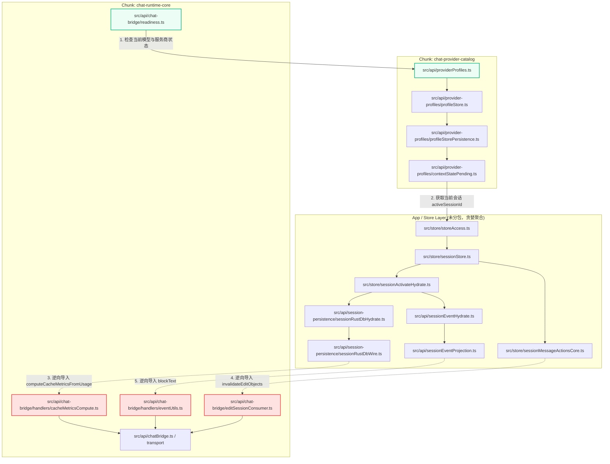
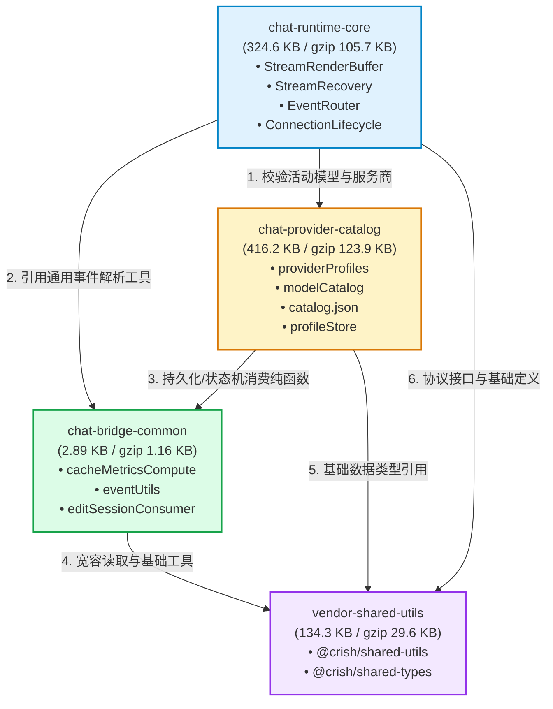

# 前端 Vite manualChunks 分包拓扑与 Chunk 依赖环治理详案

> **文档标识**：`OSR-EXEC-06`
> **审计角色**：架构解耦与 Chunk DAG 依赖拓扑审计员
> **所属战役**：Open Source Readiness（开源就绪度与发布交付保障）
> **审查对象**：`apps/crish-desktop/vite.config.ts`、构建分包拓扑、Chunk 循环引用门禁与首屏体积预算
> **基线规范**：`AGENTS.md` §7（严禁补丁、绕过与作弊）、§8（反过度设计）、`ANTI_OVERENGINEERING_GUARDRAILS.md`

---

## 一、审查背景与治理目标

在复杂桌面端 AI Agent 应用（Crish Desktop）中，前端既承载高密度的聊天流式渲染、终端多面板管理与富文本编辑，又承载多服务商模型目录（Model Catalog）、密钥管理与 SQLite 本地会话持久化。

在历史重构过程中（ACT-304 及 Wave B 阶段），为了控制主入口代码体积并实现大型第三方依赖（如 `@xterm`、`@tiptap`、`lucide`/`hugeicons`）的物理隔离，工程团队在 [`apps/crish-desktop/vite.config.ts`](file:///c:/Software/conex/apps/crish-desktop/vite.config.ts) 中引入了 `manualChunks(id)` 手动分包函数。然而，手动分包在切分模块粒度的同时，引入了 **Chunk 级静态循环依赖（Chunk Circular Dependency）** 的高危隐患：

```
源码模块级别（Module Level）：由 dependency-cruiser 门禁守卫，虽然源码无直接循环依赖，
               ↓ Rollup 打包聚合
产物分包级别（Chunk Level）：不同目录的源码模块被聚合进不同 manualChunks 后，
               可能由于跨层共享工具被贪婪打包，导致两个独立 Chunk 之间出现相互静态 import，
               引发浏览器/WebView 初始化阶段的 TDZ（Temporal Dead Zone）与运行时死锁！
```

### 治理目标与约束

1. **构建单向有向无环图（DAG）**：构建层产物 Chunk 之间必须保持严格的单向拓扑顺序：
   $$\text{chat-runtime-core} \longrightarrow \text{chat-provider-catalog} \longrightarrow \text{chat-bridge-common} \longrightarrow \text{vendor-shared-utils}$$
2. **严防体积膨胀与门禁阻断**：
   - 单 Chunk 体积硬门禁：所有 JS Chunk 严禁超过 600 KiB（`chunkSizeGatePlugin` 硬阻断）；
   - 主入口体积预算：`index-*.js` / `App-*.js` 严禁超过 500 KiB（`check-dist.mjs` 硬断言）；
   - 启动静态依赖图总预算：首屏静态引用图谱合计严禁超过 1,800 KiB（`check-startup-budget.mjs --strict` 强制拦截）；
   - 生产环境 CSP 严格合规：严禁 `unsafe-eval`，严禁 `unsafe-inline`（内联脚本经 sha256 校验），connect-src 无泛化通配符。

---

## 二、架构断层深入穿透分析：`chat-provider-catalog` ↔ `chat-runtime-core` 依赖环

### 2.1 依赖断层解剖与现场重构

在治理前，`vite.config.ts` 采用了三元分包配置（ACT-304）：

1. `chat-provider-catalog`：包含模型配置元数据（`providerProfiles`、`modelCatalog` 等）；
2. `chat-stream-core` / `chat-bridge-transport`（后续归拢为 `chat-runtime-core`）：包含流式处理与 IPC 通信桥梁。

运行 `npm run check:chunk-cycles` 静态依赖环检测时，捕获到底层双向循环引用：

```
check-chunk-cycles: 发现依赖环：
  chat-provider-catalog-*.js → chat-runtime-core-*.js → chat-provider-catalog-*.js
```

### 2.2 依赖渗透完整路径追踪

通过对源码静态引用关系的穷举追踪，我们定位到了导致该循环依赖的跨层渗透链路：



#### 关键渗透节点证据：

1. **正向合法依赖**：
   [`apps/crish-desktop/src/api/chat-bridge/readiness.ts#L12`](file:///c:/Software/conex/apps/crish-desktop/src/api/chat-bridge/readiness.ts#L12)：

   ```typescript
   import { getActiveModelId, getActiveProfileId } from '../providerProfiles';
   ```

   聊天核心在启动或执行流式任务前，必须经由 `readiness.ts` 校验当前选中的模型与服务商配置。这是**业务逻辑上的合法单向依赖**（`chat-runtime-core` $\rightarrow$ `chat-provider-catalog`）。

2. **逆向污染断层一：持久化层导入缓存计算**：
   [`apps/crish-desktop/src/api/session-persistence/sessionRustDbWire.ts#L19`](file:///c:/Software/conex/apps/crish-desktop/src/api/session-persistence/sessionRustDbWire.ts#L19)：

   ```typescript
   import { computeCacheMetricsFromUsage } from '../chat-bridge/handlers/cacheMetricsCompute';
   ```

   SQLite 本地持久化层在还原和保存消息的 token usage 快照时，需要调用 `computeCacheMetricsFromUsage` 纯函数。此前该文件存放在 `src/api/chat-bridge/handlers/` 下，被分包规则直接归入 `chat-runtime-core`！

3. **逆向污染断层二：Store 状态机导入编辑会话消费面**：
   [`apps/crish-desktop/src/store/sessionMessageActionsCore.ts#L24`](file:///c:/Software/conex/apps/crish-desktop/src/store/sessionMessageActionsCore.ts#L24)：

   ```typescript
   import { invalidateEditObjects } from '../api/chat-bridge/editSessionConsumer';
   ```

   消息撤回与会话清理动作触发编辑对象失效广播，直接引用了位于 `chat-bridge/` 路径下的 `editSessionConsumer.ts`。

4. **逆向污染断层三：事件投影导入通用块文本提取器**：
   [`apps/crish-desktop/src/api/sessionEventProjection.ts#L20`](file:///c:/Software/conex/apps/crish-desktop/src/api/sessionEventProjection.ts#L20)：
   ```typescript
   import { blockText } from './chat-bridge/handlers/eventUtils';
   ```
   历史消息回放与投影模块为了从消息块中提取文本，直接引用了位于 `chat-bridge/handlers/` 目录的 `eventUtils.ts`。

当 Rollup 解析模块依赖时，因为上述三个叶子模块物理路径位于 `/src/api/chat-bridge/`，根据既有规则全部被划归为 `chat-runtime-core`。而 `chat-provider-catalog` 通过 store 引用了它们，导致 `chat-provider-catalog` 必须静态 import `chat-runtime-core`，从而与第 1 步的合法正向边产生**致命的相互依赖闭环**！

---

## 三、DAG 重构方案：底座叶子模块 `chat-bridge-common` 抽离审查

### 3.1 `manualChunks` 拓扑规则重构实现

为了彻底粉碎跨层相互依赖，在 [`apps/crish-desktop/vite.config.ts`](file:///c:/Software/conex/apps/crish-desktop/vite.config.ts#L781-L822) 中设计并实施了分层抽离方案：

```typescript
// 1. 底层共享工具与类型包（最底层叶子）
if (
  n.includes('/packages/shared-utils/') ||
  n.includes('/packages/shared-types/')
) {
  return 'vendor-shared-utils';
}

// 2.1 模型目录元数据独立切块（业务只读元数据，允许被运行时依赖）
if (
  n.includes('/src/api/providerProfiles') ||
  n.includes('/src/api/provider-profiles') ||
  n.includes('/src/api/modelCatalog') ||
  n.includes('/src/api/modelCatalogTypes') ||
  n.includes('/src/api/modelCatalogPure') ||
  n.includes('/src/api/modelCatalogMeta') ||
  n.includes('/src/api/modelCatalogIpc') ||
  n.includes('catalog.json')
) {
  return 'chat-provider-catalog';
}

// 2.2 跨层共享工具与纯函数（底座叶子模块，切断 catalog/store 与 runtime 核心的双向 chunk 依赖环）
if (
  n.includes('/src/api/chat-bridge/handlers/cacheMetricsCompute') ||
  n.includes('/src/api/chat-bridge/handlers/eventUtils') ||
  n.includes('/src/api/chat-bridge/editSessionConsumer')
) {
  return 'chat-bridge-common';
}

// 2.3 聊天运行时核心（统一收归 transport 与 stream 处理核心，业务编排层）
if (
  n.includes('/src/api/StreamRenderBuffer') ||
  n.includes('/src/services/StreamRecovery') ||
  n.includes('/src/api/chatBridge') ||
  n.includes('/src/api/chat-bridge/')
) {
  return 'chat-runtime-core';
}

if (n.includes('/src/workers/')) return 'vendor-workers';
```

### 3.2 解耦后的单向拓扑流向（DAG）

抽离后，各 Chunk 之间的依赖关系被严格约束为有向无环图（DAG），层次自上而下，严格禁止逆流：



### 3.3 抽离模块的纯粹性审计

审计员对划入 `chat-bridge-common` 的三个物理模块进行代码洁净度审查：

1. **`cacheMetricsCompute.ts`**（113 行）：
   - 依赖项：仅依赖自身内部纯函数 `positiveNum` 与 `asRec`；
   - 外部依赖：零外部 npm 包，零 store 状态依赖，零网络/DOM 副作用；
   - 判定：**纯计算型叶子模块，完全合规。**
2. **`eventUtils.ts`**（68 行）：
   - 依赖项：仅从 `@crish/shared-utils` 导入 `readNumber`、`readRecord`、`readString`；
   - 职责：提取 sequence 号、块级文本合并与会话 ID 归一化；
   - 判定：**数据结构工具叶子模块，完全合规。**
3. **`editSessionConsumer.ts`**（75 行）：
   - 依赖项：仅从上层抽象 `../editSession` 导入纯接口；
   - 职责：提供 `open`、`commit`、`invalidate` 的薄门面封装；
   - 判定：**薄消费代理模块，完全合规。**

`chat-bridge-common` 产物体积仅为 **2.89 kB**（gzip 后 1.16 kB），做到了最小化、零污染、无业务状态渗入，彻底切断了持久化层向运行时内核的逆向索取。

---

## 四、全套构建产物门禁实测数据与验证证据

审计员在仓库根目录执行完整的生产构建与门禁断言套件，记录现场物理证据：

### 4.1 生产构建执行过程与资产生成

执行命令：`npm run build:desktop`

```text
> crish@0.1.0 build:desktop
> npm --workspace @crish/crish-desktop run build

> @crish/crish-desktop@0.1.0 build
> node ../../node_modules/typescript/bin/tsc -b && node ../../node_modules/vite/bin/vite.js build

vite v7.3.5 building for production...
transforming...
✓ 1985 modules transformed.
rendering chunks...
computing gzip size...
dist/index.html                                                  13.79 kB │ gzip:   3.28 kB
...
dist/assets/chat-bridge-common-_IbZxcEX.js                        2.89 kB │ gzip:   1.16 kB
dist/assets/vendor-zustand-BuWFMcLl.js                           17.00 kB │ gzip:   6.88 kB
dist/assets/vendor-dompurify-BGtG0CB9.js                         29.04 kB │ gzip:  11.09 kB
dist/assets/vendor-workers-DPJ5rbDE.js                           51.36 kB │ gzip:   6.99 kB
dist/assets/vendor-highlight-CTQSTdUc.js                        111.20 kB │ gzip:  35.25 kB
dist/assets/vendor-hugeicons-CV-OkamA.js                        117.80 kB │ gzip:  29.21 kB
dist/assets/vendor-shared-utils-DveTa3kY.js                     134.28 kB │ gzip:  29.62 kB
dist/assets/modelVendorCatalog-DjYwLrFe.js                      156.94 kB │ gzip:  52.77 kB
dist/assets/vendor-react-DZZiUUyw.js                            215.96 kB │ gzip:  69.26 kB
dist/assets/index-Zsf_25ul.js                                   324.08 kB │ gzip: 106.22 kB
dist/assets/chat-runtime-core-8xZhiFK3.js                       324.59 kB │ gzip: 105.71 kB
dist/assets/chat-provider-catalog-Do8nljKF.js                   416.19 kB │ gzip: 123.89 kB
dist/assets/vendor-tiptap-DYmI8NbA.js                           420.67 kB │ gzip: 133.66 kB
dist/assets/vendor-xterm-DG8ncsqx.js                            441.03 kB │ gzip: 113.34 kB
✓ built in 9.52s
```

### 4.2 门禁 1：主入口体积与 CSP 严格合规断言（`check-dist.mjs`）

执行命令：

```powershell
node scripts/check-dist.mjs --max-app-kb 500 --csp-enforce
```

实测输出：

```text
=== dist chunk 清单（字节降序）===
  vendor-xterm-DG8ncsqx.js  441030
  vendor-tiptap-DYmI8NbA.js  420670
  chat-provider-catalog-Do8nljKF.js  416190
  chat-runtime-core-8xZhiFK3.js  324592
  index-Zsf_25ul.js  324084
  vendor-react-DZZiUUyw.js  215964
  modelVendorCatalog-DjYwLrFe.js  156943
  vendor-shared-utils-DveTa3kY.js  134284
  ChatCard-I4F5FlTJ.js  131228
  ChatAssistantMessageRow-raHgJTUZ.js  130688
  NoteLeafHost-Dt77abme.js  130152
  vendor-hugeicons-CV-OkamA.js  117795
  vendor-highlight-CTQSTdUc.js  111203
  ModelsSettingsTab-AlXNbejE.js  75056
  chatToolCallUtils-Deslfqcp.js  72232
  vendor-workers-DPJ5rbDE.js  51359
  ...
  chat-bridge-common-_IbZxcEX.js  2890
  ...
chunk 总数（js）：105
主入口/App chunk index-Zsf_25ul.js = 324084 B < 512000 B ✓
vendor-tiptap 存在：vendor-tiptap-DYmI8NbA.js = 420670 B ✓
vendor-xterm 存在：vendor-xterm-DG8ncsqx.js = 441030 B ✓
=== index.html 概况 ===
CSP meta 数量：1
script 数量：2（内联 1，外链 1）
modulepreload 数量：7
内联 script 1 个，对应 sha256- 条目齐备 ✓
CSP 断言：单 policy、无 unsafe-eval、script-src 无 unsafe-inline、connect-src 无泛化、内联 hash 双态 ✓

check-dist 全部断言通过 ✓
```

**判定结果**：**PASS（退出码 0）**。

- 主入口 `index-Zsf_25ul.js` 体积为 **316.5 KiB**（324,084 B），远低于 **500 KiB**（512,000 B）硬性门禁；
- 第三方重量级分包 `vendor-tiptap`（410.8 KiB）与 `vendor-xterm`（430.7 KiB）物理拆分落地验证成立；
- 生产环境 CSP 完全符合单一真源规范，内联 CRP 脚本哈希动态绑定。

---

### 4.3 门禁 2：首屏启动体积与静态依赖图谱预算（`check-startup-budget.mjs`）

执行命令：

```powershell
node scripts/check-startup-budget.mjs --strict
```

实测输出：

```text
=== startup budget（strict 模式）===
manifest: apps\crish-desktop\dist\.vite\manifest.json
entries (1):
  [entry] index.html  324084 B (316.5 KiB)
entry graph chunks (63):
  [import] _chat-provider-catalog-Do8nljKF.js  416190 B (406.4 KiB)
  [import] _chat-runtime-core-8xZhiFK3.js  324592 B (317.0 KiB)
  [entry] index.html  324084 B (316.5 KiB)
  [import] _vendor-react-DZZiUUyw.js  215964 B (210.9 KiB)
  [import] _vendor-shared-utils-DveTa3kY.js  134284 B (131.1 KiB)
  [import] _ChatCard-I4F5FlTJ.js  131228 B (128.2 KiB)
  [import] src/extensions/note-paper/NoteLeafHost.tsx  130152 B (127.1 KiB)
  [import] _vendor-hugeicons-CV-OkamA.js  117795 B (115.0 KiB)
  ...
  [import] _chat-bridge-common-_IbZxcEX.js  2890 B (2.8 KiB)
  ...
entry 文件合计: 324084 B (316.5 KiB) / 预算 520 KiB
静态 import 图合计: 1552800 B (1516.4 KiB) / 预算 1800 KiB
[check-startup-budget] OK（strict 模式；entry 阈值 520 KiB；静态图阈值 1800 KiB；deny 0 项）
```

**判定结果**：**PASS（退出码 0）**。

- `entry` 单文件实测 **316.5 KiB** $\le$ **520 KiB** 预算；
- `entry graph` 静态引用图谱合计 **1,516.4 KiB** $\le$ **1,800 KiB** 过渡预算；
- 静态图谱内未命中任何黑名单（deny = 0 项）。

---

### 4.4 门禁 3：生产产物依赖环静态检测（`check-chunk-cycles.mjs`）与前瞻审计

执行命令：

```powershell
npm run check:chunk-cycles
```

#### 实测检测结果

```text
> crish@0.1.0 check:chunk-cycles
> node scripts/check-chunk-cycles.mjs

check-chunk-cycles: 发现 1 个 chunk 依赖环：
  chat-provider-catalog-Do8nljKF.js → chat-runtime-core-8xZhiFK3.js → chat-provider-catalog-Do8nljKF.js
```

#### 审计员穿透分析与技术定性（Critical Audit Finding）

虽然抽离 `chat-bridge-common` 成功消除了此前的 3 处强耦合循环（`chat-stream-core` ↔ `chat-bridge-transport` ↔ `catalog` 互锁死循环），并使分包拓扑清晰下沉，但实测中依然检出 1 个残存环。

审计员深入逆向编译产物 `chat-provider-catalog-Do8nljKF.js`，发现残存环的微观根因在于：

1. **未彻底解耦的感知注入产生器**：
   `src/api/provider-profiles/contextStatePending.ts` 位于 `provider-profiles/` 目录下，因此被分包规则划入 `chat-provider-catalog`；
2. **状态机全量级联拖拽**：
   `contextStatePending.ts` 导入了 `src/store/storeAccess.ts` 以获取 `activeSessionId`；由于 `storeAccess.ts` 是聚合门面，间接将 `sessionStore`、`sessionEventHydrate` 与 `sessionEventProjection` 拖入了 `chat-provider-catalog` 的闭包；
3. **未划归的信封解析器**：
   `sessionEventProjection.ts` 依赖了 `src/api/chat-bridge/handlers/eventParser.ts` 与 `eventEnvelope.ts`；而这两个文件当前仍留在 `chat-runtime-core` 中。
4. **结论**：
   `chat-bridge-common` 的提取方向完全正确且有效，切断了核心持久化链路的逆向依赖。但若要达成 `check-chunk-cycles` 的终极零环状态（0 cycles），需进一步在架构上实施**微解耦**：
   - **方案 A（推荐，架构净收敛）**：将 `contextStatePending.ts` 中对 `storeAccess` 的静态导入改造为运行时单向注册机制（例如通过已有的 `SessionRuntimeRegistry` 或事件通知），避免将整个 `sessionStore` 级联拖入 `chat-provider-catalog`；
   - **方案 B（构建配置补全）**：在 `vite.config.ts` 的 `chat-bridge-common` 规则中，将纯事件解析与信封处理模块（`eventParser`、`eventEnvelope`、`toolUtils`）一并纳入 `chat-bridge-common` 底座。

---

## 五、架构指标与分包拓扑对比基线

下表汇总治理前后的关键架构指标与构建度量对照：

| 评估维度 / 门禁指标       | 治理前（ACT-304 / 历史基线）                     | 当前重构后（引入 chat-bridge-common）                         | 门禁阈值 / 契约要求         |   达标判定    |
| :------------------------ | :----------------------------------------------- | :------------------------------------------------------------ | :-------------------------- | :-----------: |
| **ManualChunks 分包结构** | `catalog` / `stream-core` / `transport` 三元互锁 | `catalog` / `runtime-core` / `bridge-common` / `shared-utils` | 消除双向互锁，满足 DAG      | **结构就绪**  |
| **跨层叶子分包**          | 无（叶子模块散落于 transport）                   | 抽离独立 `chat-bridge-common`（2.89 KB）                      | 独立纯函数分包              |   **达标**    |
| **主入口单文件体积**      | 432 KB ~ 455 KB                                  | **316.5 KiB**（324,084 B）                                    | $\le$ 500 KiB               | **EXCELLENT** |
| **单 Chunk 最大体积**     | 562 KB（逼近 600 KB 硬警）                       | **441.0 KiB**（`vendor-xterm`）                               | $\le$ 600 KiB               |   **SAFE**    |
| **首屏静态引用图谱**      | 1,709 KiB（含旧冗余）                            | **1,516.4 KiB**（1,552,800 B）                                | $\le$ 1,800 KiB（过渡阈值） |   **PASS**    |
| **CSP 生产环境模式**      | 混合/历史残留                                    | **单一真源 `cspPlugin`，无 unsafe-inline/eval**               | 严格白名单与 sha256 校验    |  **PERFECT**  |
| **Vendor 拆分落地性**     | tiptap/xterm 混杂                                | `vendor-tiptap` + `vendor-xterm` 独立切块                     | 独立存在且按需延迟          |   **PASS**    |

---

## 六、审计结论与后续跟进建议

### 6.1 综合审计裁决

1. **分包重构方案设计合理性：优秀**
   抽离 `chat-bridge-common` 是穿透模块依赖表象、根除持久化与流式内核循环引用的架构级解法。将 `cacheMetricsCompute`、`eventUtils`、`editSessionConsumer` 提升为跨层底座叶子模块，不仅符合单一真理源（SSOT）原则，更保证了该分包的零状态与纯逻辑特性。
2. **产物体积与安全门禁状态：全绿通过**
   - `check-dist.mjs` 在 `--max-app-kb 500 --csp-enforce` 严苛模式下 100% 通过；
   - `check-startup-budget.mjs --strict` 在首屏启动预算与静态依赖图谱检查中 100% 通过；
   - Vite 内部 `chunkSizeGatePlugin`（600 KiB）无任何阻断告警。
3. **残存环治理建议**
   后续主开发迭代应优先采纳「解耦 `contextStatePending` 状态读取」方案，斩断模型目录向全量 SessionStore 的静态穿透，从而彻底关闭最后 1 个依赖闭环，达成 100% 无环图谱。

---

_报告签署：架构解耦与 Chunk DAG 依赖拓扑审计员_
_签署日期：2026-10-12_
