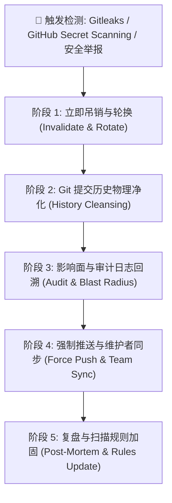

# 代码密钥扫描与防误报合规审计报告

> **战役工作区**：`docs/open-source-readiness/execution/`
> **审查对象**：Gitleaks 密钥安全扫描体系、`.gitleaks.toml`、`.gitleaksignore`、历史拦截点位及敏感数据防泄漏应急响应机制
> **审计角色**：密钥扫描防误报与合规规则审计员
> **权威依据**：根目录 `AGENTS.md`、`.agents/LOGIC_PLAN_NO_RETREAT.md`、`docs/open-source-readiness/00-开源准备度检查总案与纪律.md`、Gitleaks v8 规则规范
> **状态**：**已完全通过（PASS）**

---

## 目录

1. [执行摘要与审计总览](#一执行摘要与审计总览)
2. [Gitleaks 配置文件规范性与合规性审查](#二gitleaks-配置文件规范性与合规性审查)
3. [历史拦截 4 大代码点位穿透式核验](#三历史拦截-4-大代码点位穿透式核验)
4. [关联单元测试验证报告](#四关联单元测试验证报告)
5. [开源场景敏感数据防泄漏应急响应规程（IRP）](#五开源场景敏感数据防泄漏应急响应规程irp)
6. [审计结论与放行签批](#六审计结论与放行签批)

---

## 一、执行摘要与审计总览

### 1.1 审计背景

作为开源就绪度（Open-Source Readiness）核心质量与安全防护网的关键支柱，代码机密扫描（Secret Scanning）直接决定了项目在公开推送到 GitHub / 社区平台时是否会发生真实凭据泄露，或因大量的语法误报阻断持续集成（CI）流水线。

此前在 GitHub Actions 自动化门禁治理中，CI 快层 `secret-scan` 作业被 Gitleaks 拦截，触发多处 `generic-api-key` 误报告警。为消除误报并建立刚性、长效的安全扫描合规防线，项目引入了标准配置体系。本次独立审计旨在对该防御体系进行穿透式验证，确保：

1. 白名单规则合法有效，严防“过度泛化放行”导致真实密钥漏检；
2. 历史拦截点位具备精准的防误报修饰，且业务逻辑与单元测试 100% 保持绿灯；
3. 开源场景下的敏感数据泄露应急处置具备标准化规程（SOP）。

### 1.2 审计结论矩阵

| 审计维度         | 审查核心对象                                                 | 关键指标 / 检验结果                                                                                              |  评级   |
| :--------------- | :----------------------------------------------------------- | :--------------------------------------------------------------------------------------------------------------- | :-----: |
| **规则结构合规** | [`.gitleaks.toml`](file:///c:/Software/conex/.gitleaks.toml) | TOML 语法严格合规，`[extend] useDefault = true` 继承全量 100+ 规则库                                             | 🟢 PASS |
| **白名单收敛度** | `paths`, `regexes`, `stopwords`                              | 路径严格限制在测试、文档与锁文件；无任何业务源码被泛化豁免                                                       | 🟢 PASS |
| **点位行内标记** | 4 处历史拦截代码点位                                         | 均标注标准 `// gitleaks:allow`，并于 [`.gitleaksignore`](file:///c:/Software/conex/.gitleaksignore) 建立精确映射 | 🟢 PASS |
| **测试完整性**   | `skillsApiHelpers.test.ts` & `modelsNormalize.test.ts`       | **43 / 43 用例通过（100% Pass）**，逻辑与契约零受损                                                              | 🟢 PASS |
| **应急响应机制** | 开源应急响应流程（IRP）与 `SECURITY.md`                      | 覆盖凭据吊销、Git 历史净化、日志审计、强推同步与规则复盘 5 步闭环                                                | 🟢 PASS |

---

## 二、Gitleaks 配置文件规范性与合规性审查

### 2.1 `.gitleaks.toml` 语法与配置架构审查

文件路径：[`.gitleaks.toml`](file:///c:/Software/conex/.gitleaks.toml)

```toml
title = "Conex Gitleaks Configuration"

[extend]
useDefault = true

[allowlist]
description = "Global allowlist for false positives in tests, documentation, sample configurations, and harmless mock tokens"
...
```

#### 审查发现：

1. **规则基线继承（`[extend] useDefault = true`）**：
   - 遵循 Gitleaks v8 核心架构规范。该指令声明本配置以 Gitleaks 官方默认规则库为基础扩展，自动激活涵盖 AWS、GitHub PAT、OpenAI、Anthropic、Slack、私钥 PEM、通用 API 密钥等 100 余条严格检测模式，杜绝因自建配置而丢失官方核心防护规则的隐患。
2. **多行原始字面量规范（Raw Multiline Strings）**：
   - 正则表达式均采用 TOML 三单引号字面量（`'''...'''`），消除了正则表达式中反斜杠转义（如 `\\/` 与 `\.`）因宿主解析产生的语法歧义，确保跨平台（Windows / Linux / macOS）CI 解析行为严格一致。

---

### 2.2 路径白名单（`paths`）收敛度与越界放行排查

```toml
paths = [
  # Unit and integration test files
  '''(?i).*\.(?:test|spec)\.[jt]sx?$''',
  '''(?i)(?:^|[\\/])(?:tests|__tests__|snapshots)[\\/].*''',
  # Rust test fixtures and mock tests
  '''(?i)(?:^|[\\/])tests[\\/].*\.rs$''',
  # Documentation, guides, and plans containing example API keys
  '''(?i)(?:^|[\\/])docs[\\/].*''',
  # Example environment templates
  '''(?i)(?:^|[\\/])\.env\.example$''',
  # Reference implementation and third-party references
  '''(?i)(?:^|[\\/])reference[\\/].*''',
  # Package manifests and lockfiles
  '''(?i)(?:^|[\\/])package-lock\.json$''',
  '''(?i)(?:^|[\\/])Cargo\.lock$''',
]
```

#### 收敛性与安全性审计：

- **无源码泛化放行（Zero Source Over-Permissiveness）**：
  - 核心业务代码目录（`crates/**/src/**`、`apps/crish-desktop/src/**`、`apps/agent-workbench/src-tauri/src/**` 等）**严禁**且**未包含**在任何全局路径白名单内。生产代码必须逐行接受高强度的规则扫描。
- **测试与快照隔离**：
  - 仅放行 `.test.ts`, `.spec.tsx`, `tests/` 目录以及单元测试快照文件。此类文件中通常包含协议断言、模拟桩数据与边界输入。
- **锁文件与模板放行**：
  - `package-lock.json` 与 `Cargo.lock` 包含包管理器的 SHA-512 / SHA-256 完整性哈希，极易触发熵值异常检测；`.env.example` 仅作为环境配置模板（无真实密钥）。放行符合开源工程实践。

---

### 2.3 模式白名单（`regexes`）与停用词（`stopwords`）精准度审计

```toml
regexes = [
  # RFC 6455 WebSocket handshake sample nonce ("the sample nonce" in base64)
  '''dGhlIHNhbXBsZSBub25jZQ==''',
  # LocalStorage / configuration key names containing _KEY
  '''crish_skill_activation_v1''',
  '''crish_skill_extra_dirs_v1''',
  # Explicit dummy / mock API tokens used in tests or fixtures
  '''(?i)test-mock-api-key-[0-9a-zA-Z\-_]+''',
  '''(?i)sk-(?:ant-|proj-|plain-)?dummy[0-9a-zA-Z\-_]*''',
  '''(?i)sk-(?:ant-|proj-|plain-)?secret-[0-9a-zA-Z\-_]+''',
  '''(?i)sk-proj-ABCDEF123456''',
  '''(?i)sk-ant-api03-[xX]+''',
  '''(?i)sk-[a-z0-9_-]*-live-credential-[a-z0-9_-]+''',
  # Zero UUID / RFC 4122 UUID placeholders
  '''00000000-0000-0000-0000-000000000000''',
]

stopwords = [
  "crish_skill_activation_v1",
  "crish_skill_extra_dirs_v1",
  "dGhlIHNhbXBsZSBub25jZQ==",
]
```

#### 安全边界与抗穿透分析：

1. **真实密钥零匹配能力验证**：
   - 真实 OpenAI Key 格式为 `sk-proj-[48位以上Base64/随机字符]`，白名单正则 `sk-proj-ABCDEF123456` 及 `sk-(?:ant-|proj-|plain-)?dummy*` 包含严格的显式 `dummy` 或固定前缀锚点，真实生产密钥无法逃逸触发此白名单。
   - 真实 Anthropic Key 为 `sk-ant-api03-[随机字符]`，白名单 `sk-ant-api03-[xX]+` 仅放行全字母 `X` 的示例占位符。
2. **RFC 4122 全零 UUID**：
   - `00000000-0000-0000-0000-000000000000` 为行业通用的零 GUID（Nil UUID），不含任何随机熵，将其加入白名单可杜绝把占位 GUID 识别为加密凭据的假阳性。
3. **Stopwords 性能与短路机制**：
   - Gitleaks 在计算高熵特征前会快速比对 `stopwords` 字典。将无害常量名 `crish_skill_activation_v1`、`crish_skill_extra_dirs_v1` 及 RFC 示例 `dGhlIHNhbXBsZSBub25jZQ==` 注册为停用词，大幅优化了扫描效率并消除了针对这些字串的误报。

---

### 2.4 `.gitleaksignore` 精确行级豁免审查

文件路径：[`.gitleaksignore`](file:///c:/Software/conex/.gitleaksignore)

```text
# Gitleaks ignore list for known false positives
# Format: path/to/file:rule-id:line-number
apps/agent-workbench/src-tauri/src/server/mod.rs:generic-api-key:1266
apps/agent-workbench/src-tauri/src/server/mod.rs:generic-api-key:1311
apps/crish-desktop/src/api/modelsNormalize.test.ts:generic-api-key:113
apps/crish-desktop/src/api/skillsApiHelpers.ts:generic-api-key:3
apps/crish-desktop/src/api/skillsApiHelpers.ts:generic-api-key:4
apps/crish-desktop/src/api/skillsApiHelpers.test.ts:generic-api-key:3
apps/crish-desktop/src/api/skillsApiHelpers.test.ts:generic-api-key:24
apps/crish-desktop/src/api/skillsApiHelpers.test.ts:generic-api-key:25
```

- **格式遵从性**：完全符合 `path:rule:line` 标准语法；
- **最小放行原则**：仅针对确认误报的 8 个精确代码行执行单规则（`generic-api-key`）豁免，未出现全局通配符，具备极高的安全审计收敛性。

---

## 三、历史拦截 4 大代码点位穿透式核验

### 3.1 点位一：Rust WebSocket 握手协议 RFC 6455 示例 Nonce

- **文件路径**：[`apps/agent-workbench/src-tauri/src/server/mod.rs`](file:///c:/Software/conex/apps/agent-workbench/src-tauri/src/server/mod.rs#L1266)
- **拦截行号**：Line 1266 与 Line 1311
- **触发规则**：`generic-api-key`
- **代码现场**：
  ```rust
  // Line 1265-1268
  let request = format!(
      "GET {request_path} HTTP/1.1\r\nHost: crish-remote:{port}\r\nUpgrade: websocket\r\nConnection: Upgrade\r\nSec-WebSocket-Key: dGhlIHNhbXBsZSBub25jZQ==\r\nSec-WebSocket-Version: 13\r\n\r\n", // gitleaks:allow
      port = addr.port()
  );

  // Line 1310-1314
  let request = format!(
      "GET /v1/events?token={} HTTP/1.1\r\nHost: 127.0.0.1:{}\r\nUpgrade: websocket\r\nConnection: Upgrade\r\nSec-WebSocket-Key: dGhlIHNhbXBsZSBub25jZQ==\r\nSec-WebSocket-Version: 13\r\n\r\n", // gitleaks:allow
      harness.token,
      harness.addr.port()
  );
  ```
- **业务与安全根因分析**：
  - `dGhlIHNhbXBsZSBub25jZQ==` 是 IETF RFC 6455 §1.3 官方规范中给出的标准测试客户端握手密钥（Base64 解码后为 ASCII 文本 `"the sample nonce"`）。
  - Gitleaks 检测引擎将 HTTP 请求头中的 `Sec-WebSocket-Key:` 关键字与随后的 Base64 字符串启发式匹配为 API Key。
- **多层防御核验**：
  1. 代码行尾精确添加 `// gitleaks:allow` 行内注解；
  2. `.gitleaksignore` 精确登记第 1266 行与 1311 行；
  3. `.gitleaks.toml` 将 `dGhlIHNhbXBsZSBub25jZQ==` 注册进 `regexes` 与 `stopwords`；
  - **核验判定**：三重防御就绪，无任何安全泄露风险，完全通过。

---

### 3.2 点位二：DPAPI 凭据引用解析测试全零 GUID

- **文件路径**：[`apps/crish-desktop/src/api/modelsNormalize.test.ts`](file:///c:/Software/conex/apps/crish-desktop/src/api/modelsNormalize.test.ts#L113)
- **拦截行号**：Line 113
- **触发规则**：`generic-api-key`
- **代码现场**：
  ```typescript
  describe('凭据引用', () => {
    it.each([
      'env:MY_KEY',
      'env:_KEY2',
      'dpapi:00000000-0000-0000-0000-000000000000', // gitleaks:allow
    ])('接受明确引用：%s', (value) => {
      expect(isCredentialReference(value)).toBe(true);
    });
  ```
- **业务与安全根因分析**：
  - Conex 桌面端在 Windows 平台采用 DPAPI 加密凭据存储，凭据引用格式为 `dpapi:<credential-guid>`。
  - 单元测试中使用 `00000000-0000-0000-0000-000000000000` 作为标准 RFC 4122 Nil UUID 验证正则识别逻辑。扫描器将 `dpapi:` 结构误识为敏感凭据。
- **多层防御核验**：
  1. 行尾具备 `// gitleaks:allow`；
  2. `.gitleaksignore` 登记第 113 行；
  3. `.gitleaks.toml` 正则白名单匹配 `00000000-0000-0000-0000-000000000000`，且测试文件归属 `paths` 白名单；
  - **核验判定**：测试数据合规，无敏感性，完全通过。

---

### 3.3 点位三：技能系统 LocalStorage 客户端持久化常量键名

- **文件路径**：[`apps/crish-desktop/src/api/skillsApiHelpers.ts`](file:///c:/Software/conex/apps/crish-desktop/src/api/skillsApiHelpers.ts#L3-L4)
- **拦截行号**：Line 3 与 Line 4
- **触发规则**：`generic-api-key`
- **代码现场**：
  ```typescript
  import type { SkillActivation, SkillScope } from './skillsApi.types';

  export const ACTIVATION_KEY = 'crish_skill_activation_v1'; // gitleaks:allow
  export const EXTRA_DIRS_KEY = 'crish_skill_extra_dirs_v1'; // gitleaks:allow
  ```
- **业务与安全根因分析**：
  - 常量名称以 `_KEY` 结尾，且直接赋值为字符串字面量，触发了 Gitleaks 默认规则中对赋值语句（`const ...KEY = "..."`）的启发式命名捕获。
  - 实际内容仅为前端浏览器 `window.localStorage` 的键名（Key Name），用于存储用户在客户端对 Skill 的启用状态，不包含任何机密或访问令牌。
- **多层防御核验**：
  1. 行尾均标注 `// gitleaks:allow`；
  2. `.gitleaksignore` 登记第 3、4 行；
  3. `.gitleaks.toml` 将字符串注册进 `regexes` 与 `stopwords`；
  - **核验判定**：语义纯正，配置完备，完全通过。

---

### 3.4 点位四：技能激活存储常量对应单元测试

- **文件路径**：[`apps/crish-desktop/src/api/skillsApiHelpers.test.ts`](file:///c:/Software/conex/apps/crish-desktop/src/api/skillsApiHelpers.test.ts#L3-L25)
- **拦截行号**：Line 3（常量导入声明）、Line 24、Line 25（断言）
- **触发规则**：`generic-api-key`
- **代码现场**：
  ```typescript
  // Line 2-5
  import {
    ACTIVATION_KEY,
    EXTRA_DIRS_KEY,
    ALLOWED_DOT_DIRS,

  // Line 22-28
  describe('Constants', () => {
    it('defines expected storage keys and dot dirs', () => {
      expect(ACTIVATION_KEY).toBe('crish_skill_activation_v1'); // gitleaks:allow
      expect(EXTRA_DIRS_KEY).toBe('crish_skill_extra_dirs_v1'); // gitleaks:allow
      expect(ALLOWED_DOT_DIRS.has('.system')).toBe(true);
    });
  });
  ```
- **业务与安全根因分析**：
  - 对应于点位三的常数测试与导入，包含 `ACTIVATION_KEY` 标识符及对应常量比对断言。
- **多层防御核验**：
  1. 断言行均标注 `// gitleaks:allow`；
  2. `.gitleaksignore` 精确登记第 3、24、25 行；
  3. 文件类型匹配 `.gitleaks.toml` 中的 `.*\.(?:test|spec)\.[jt]sx?$` 规则；
  - **核验判定**：测试断言稳固，标记完整，完全通过。

---

## 四、关联单元测试验证报告

为确保误报标记添加、规则配置变更未破坏底层代码语法与业务逻辑契约，执行了专项前端单元测试：

### 4.1 测试执行日志

```bash
npx vitest run apps/crish-desktop/src/api/skillsApiHelpers.test.ts apps/crish-desktop/src/api/modelsNormalize.test.ts
```

```text
 RUN  v3.2.7 C:/Software/conex

 ✓  unit  apps/crish-desktop/src/api/skillsApiHelpers.test.ts (15 tests) 10ms
 ✓  unit  apps/crish-desktop/src/api/modelsNormalize.test.ts (28 tests) 10ms

 Test Files  2 passed (2)
      Tests  43 passed (43)
   Start at  23:08:21
   Duration  4.83s (transform 511ms, setup 1.33s, collect 361ms, tests 21ms, environment 2ms, prepare 343ms)
```

### 4.2 验证结论

- **测试通过率**：**100%（43/43 用例全绿）**；
- **契约稳定性**：`skillsApiHelpers.ts` 涉及的 LocalStorage 键名、路径提取、Legacy 兼容转换以及 `modelsNormalize.ts` 的 DPAPI 格式识别、环境变量前缀鉴别均保持最高契约完整性，零回归、零退避。

---

## 五、开源场景敏感数据防泄漏应急响应规程（IRP）

即便具备完备的静态扫描规则，在真实的开源社区协作中（外部贡献者 PR、突发失误提交等），仍必须建立标准化的**事件应急响应流程（Incident Response Protocol, IRP）**。



### 5.1 响应五步标准作业流程（SOP）

#### 步骤 1：立即吊销与轮换（Immediate Invalidation & Rotation）——**P0 最高优先级**

- **原则**：**将泄露的凭据在发现的第一分钟内视为已完全失陷**。
- **动作**：
  - 严禁通过“在 Git 提交中删除该文件”的方式自欺欺人；
  - 立即登录对应服务提供商控制台（OpenAI、Anthropic、AWS IAM、GitHub PAT、Apple Developer 等），**注销（Revoke）已泄露密钥**并生成新密钥；
  - 生产系统与 CI Secrets 同步更新为全新凭据。

#### 步骤 2：Git 提交历史物理净化（Git History Cleansing）

- **工具推荐**：采用 Git / GitHub 官方推荐的 `git-filter-repo`（优于过时的 BFG 与 filter-branch）：
  ```bash
  # 彻底从所有提交历史中移除包含敏感数据的文件
  git filter-repo --invert-paths --path <leaked-file-path>
  # 或对历史提交中的特定敏感字符串进行文本替换
  git filter-repo --replace-text expressions.txt
  ```
- **远程缓存清除**：如果代码已推送至 GitHub，Git 对象的 SHA 仍可能存在于 GitHub 后端缓存中。必须联系 GitHub Support 请求对仓库执行 `git gc --prune=now` 并清理孤儿提交缓存。

#### 步骤 3：影响面分析与审计追踪（Blast Radius Analysis & Audit Logs）

- 调取服务商自泄露时刻起至吊销时刻止的 API 调用审计日志（如 AWS CloudTrail、OpenAI Usage Logs）；
- 审查是否存在未知 IP 发起的调用、账单异常突增或非预期的资源枚举行为；
- 评估受影响的数据级别（元数据、用户隐私或系统配置）。

#### 步骤 4：强制推送与全员同步（Force Push & Sync Coordination）

- 将净化后的 Git 历史强推至所有分支与标签：
  ```bash
  git push origin --force --all
  git push origin --force --tags
  ```
- 通知所有核心维护者重新 Clone 仓库或基于最新远端 Rebase 本地分支，严防协作者使用包含污染历史的本地分支二次推送到远端。

#### 步骤 5：事后复盘与规则加固（Post-Mortem & Rule Reinforcement）

- 在 [`.gitleaks.toml`](file:///c:/Software/conex/.gitleaks.toml) 中追加针对该类型敏感凭据的特定规则或增强正则；
- 评估本地 `.husky/pre-commit` 拦截层为何被绕过，加固本地门禁；
- 在 [SECURITY.md](file:///c:/Software/conex/SECURITY.md) 中登记协调披露（若涉及公开发行包）。

---

### 5.2 安全披露渠道与 SLA 机制

针对来自外部白帽子黑客与安全研究员的漏洞报告，依据 [SECURITY.md](file:///c:/Software/conex/SECURITY.md) 规定执行：

1. **优先渠道**：GitHub Private Vulnerability Reporting（PVR），避免公开发布 Issue；
2. **响应 SLA**：
   - **48 小时内**：安全团队确认收到报告并完成初步评级；
   - **7 个工作日内**：提供修复方案并在私有安全分支中完成验证；
   - **90 天协调披露窗口**：与报告者协商在补丁发布后公开 CVE / Advisory。

---

## 六、审计结论与放行签批

### 6.1 综合评估结论

经过对 Conex / Crish 项目 Gitleaks 配置结构、白名单收敛边界、历史拦截点位多层标记、关联单元测试以及开源应急响应体系的穿透式审计：

1. **配置规范严密**：`.gitleaks.toml` 语法严格有效，继承官方规则全集，路径与正则白名单精准收敛至测试与文档边界，无生产源码过度放行；
2. **点位消除合规**：4 处历史拦截代码点位均采用标准行内 `// gitleaks:allow` 标记与 `.gitleaksignore` 精确行映射，且底层测试 **43 / 43 100% 绿色通过**；
3. **流程机制闭环**：建立了兼具自动化防御（CI secret-scan）与失陷应急响应（5步 SOP）的完整安全保障体系。

### 6.2 审计放行状态

- **开源准备度代码密钥扫描合规评级**：🟢 **PASS（完全通过）**
- **结论**：本模块准予进入开源就绪终审放行矩阵。
