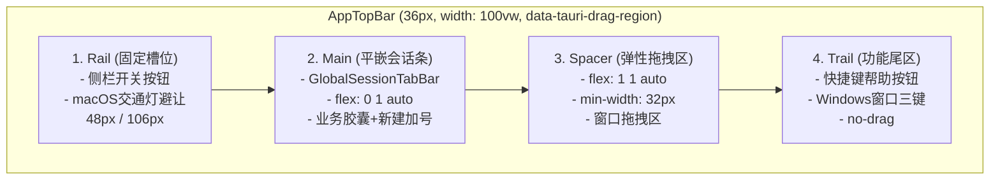
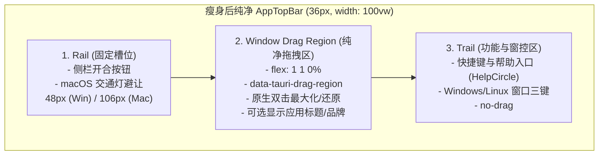
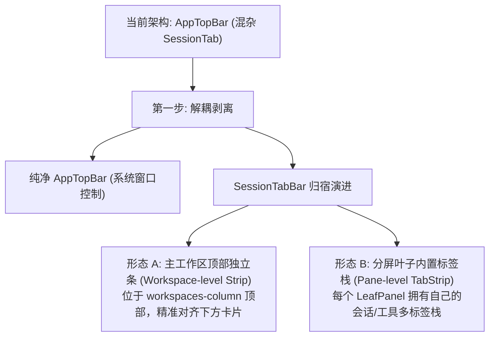

# 顶栏与全局 SessionTab 现状与解耦排查报告

> **文档标识**：`docs/pane-tab-system/analysis/01-顶栏与全局SessionTab现状与解耦排查.md`
> **审计性质**：全景架构与源码只读排查（Strict Read-Only）
> **编码格式**：UTF-8 无 BOM
> **关联源码**：
> - [`apps/crish-desktop/src/components/top-bar/AppTopBar.tsx`](file:///c:/Software/conex/apps/crish-desktop/src/components/top-bar/AppTopBar.tsx)
> - [`apps/crish-desktop/src/components/top-bar/AppTopBar.module.css`](file:///c:/Software/conex/apps/crish-desktop/src/components/top-bar/AppTopBar.module.css)
> - [`apps/crish-desktop/src/components/shell/GlobalSessionTabBar.tsx`](file:///c:/Software/conex/apps/crish-desktop/src/components/shell/GlobalSessionTabBar.tsx)
> - [`apps/crish-desktop/src/components/shell/GlobalSessionTabBar.module.css`](file:///c:/Software/conex/apps/crish-desktop/src/components/shell/GlobalSessionTabBar.module.css)
> - [`apps/crish-desktop/src/App.tsx`](file:///c:/Software/conex/apps/crish-desktop/src/App.tsx)
> - [`apps/crish-desktop/src/components/shell/WindowControls.tsx`](file:///c:/Software/conex/apps/crish-desktop/src/components/shell/WindowControls.tsx)
> - [`apps/crish-desktop/src/components/shell/SessionTabDragContext.tsx`](file:///c:/Software/conex/apps/crish-desktop/src/components/shell/SessionTabDragContext.tsx)
> - [`apps/crish-desktop/src/components/binary-tree/BinaryTreeWorkspace.tsx`](file:///c:/Software/conex/apps/crish-desktop/src/components/binary-tree/BinaryTreeWorkspace.tsx)

---

## 一、执行摘要 (Executive Summary)

本排查针对 Crish 桌面端应用顶栏（`AppTopBar`）与全局会话标签条（`GlobalSessionTabBar`）的耦合现状进行了深度源码审查与几何层级诊断。

排查发现：
1. **结构混杂**：当前 `AppTopBar` 采用 4 段式布局（Rail 侧栏开关、Main 全局 SessionTabBar、Spacer 弹性拖区、Trail 帮助与窗口三键），将业务维度的会话标签直接嵌在系统窗口级的顶栏中；
2. **空间错位**：顶栏作为 `100vw` 的全局横条，其承载的会话胶囊跨越了下方 `Sidebar`（折叠/展开 260px）与主工作区（`workspaces-column`）的物理垂线，导致顶栏标签与下方活动卡片在水平坐标和层级视觉上产生明显的几何脱节；
3. **多屏架构断层**：主工作区已全面演进为二叉树分屏架构（`BinaryTreeWorkspace`），全局顶栏单行标签无法表达多 Chat / Tool 分屏时各叶子容器（Pane Leaf）的独立状态，限制了多分屏下的多标签管理能力；
4. **窗口交互冲突**：随着会话胶囊增多，顶栏中可供操作系统原生拖拽窗口（`data-tauri-drag-region`）的物理安全区被严重挤压，易引发误触。

本报告给出了 `AppTopBar` 彻底剥离 `GlobalSessionTabBar` 的瘦身路径与系统窗口控制栏自适应规范，为标签系统全面下沉与分屏演进奠定基础。

---

## 二、全局顶栏 AppTopBar 当前结构与耦合点深度剖析

### 2.1 四段式布局全景拆解

在 [`apps/crish-desktop/src/components/top-bar/AppTopBar.tsx:92-165`](file:///c:/Software/conex/apps/crish-desktop/src/components/top-bar/AppTopBar.tsx#L92-L165) 中，`AppTopBar` 渲染为一个高度固定为 `36px`（`var(--header-height, 36px)`）的全局 flex 容器：



各分段具体实现与属性特征如下：

| 分段名称 | 源码对应行号 | 布局与尺寸特性 | 拖拽与事件行为 | 内部承载组件/元素 |
| :--- | :--- | :--- | :--- | :--- |
| **1. Rail** | [`AppTopBar.tsx:100-123`](file:///c:/Software/conex/apps/crish-desktop/src/components/top-bar/AppTopBar.tsx#L100-L123)<br>[`AppTopBar.module.css:30-66`](file:///c:/Software/conex/apps/crish-desktop/src/components/top-bar/AppTopBar.module.css#L30-L66) | 固定宽度：Windows 为 `48px`，macOS 为 `106px`（避让 70px 交通灯）；`flex-shrink: 0` | 容器带 `data-tauri-drag-region`，内部按钮显式 `-webkit-app-region: no-drag` | 侧栏开合按钮（`sidebar-toggle`，28×28px）+ Tooltip |
| **2. Main** | [`AppTopBar.tsx:126-134`](file:///c:/Software/conex/apps/crish-desktop/src/components/top-bar/AppTopBar.tsx#L126-L134)<br>[`AppTopBar.module.css:68-76`](file:///c:/Software/conex/apps/crish-desktop/src/components/top-bar/AppTopBar.module.css#L68-L76) | `flex: 0 1 auto; min-width: 0; overflow: hidden;` | 容器带 `data-tauri-drag-region`，内部 Tab 及加号均为 `no-drag` | `<GlobalSessionTabBar variant="caption" startSessionDrag={startSessionDrag} />` |
| **3. Spacer** | [`AppTopBar.tsx:137-140`](file:///c:/Software/conex/apps/crish-desktop/src/components/top-bar/AppTopBar.tsx#L137-L140)<br>[`AppTopBar.module.css:78-87`](file:///c:/Software/conex/apps/crish-desktop/src/components/top-bar/AppTopBar.module.css#L78-L87) | `flex: 1 1 auto; min-width: 32px; height: 100%;` | 纯 `data-tauri-drag-region` 区域，接受双击最大化与拖动 | 空 `div` 占位 |
| **4. Trail** | [`AppTopBar.tsx:143-164`](file:///c:/Software/conex/apps/crish-desktop/src/components/top-bar/AppTopBar.tsx#L143-L164)<br>[`AppTopBar.module.css:89-128`](file:///c:/Software/conex/apps/crish-desktop/src/components/top-bar/AppTopBar.module.css#L89-L128) | `flex: 0 0 auto; gap: 4px; padding: 0 4px;` | 全局 `-webkit-app-region: no-drag` | 帮助按钮（`HelpCircle`，28×28px）+ `<WindowControls />`（Windows/Linux 最小化/最大化/关闭） |

### 2.2 AppTopBar 的外部依赖与内部耦合点清单

当前 `AppTopBar` 并非一个纯粹的窗口控制组件，而是深度依赖了业务状态机与拖拽基础设施：

1. **强耦合 `GlobalSessionTabBar`**：
   - 源码：[`AppTopBar.tsx:14`](file:///c:/Software/conex/apps/crish-desktop/src/components/top-bar/AppTopBar.tsx#L14) `import { GlobalSessionTabBar } from '../shell/GlobalSessionTabBar';`
   - 后果：`GlobalSessionTabBar` 内部订阅了 `useWorkspaceShellStore`、`useSessionStore`、`getCompositionRoot()` 等核心业务 store，导致顶栏组件在任何会话标题变更、会话切换、草稿状态切换时都会触发级联计算与重渲染。
2. **强耦合 `SessionTabDragContext`**：
   - 源码：[`AppTopBar.tsx:16-17`](file:///c:/Software/conex/apps/crish-desktop/src/components/top-bar/AppTopBar.tsx#L16-L17) `import { useSessionTabDrag } from '../shell/SessionTabDragContext';` 以及 [`AppTopBar.tsx:77`](file:///c:/Software/conex/apps/crish-desktop/src/components/top-bar/AppTopBar.tsx#L77) `const { startSessionDrag } = useSessionTabDrag();`
   - 后果：窗口标题栏层不得不感知标签的指针拖拽生命周期。
3. **残留冗余 Props 契约**：
   - 源码：[`AppTopBar.tsx:22-23`](file:///c:/Software/conex/apps/crish-desktop/src/components/top-bar/AppTopBar.tsx#L22-L23) `sidebarWidth?: number | string; isResizing?: boolean;`
   - 现状：Rail 区已改为固定槽位（`railWidth`），不再消费 `sidebarWidth`，但 Props 契约尚未彻底收敛。

---

## 三、全局顶栏嵌 SessionTab 的核心痛点与脱节机理

### 3.1 空间与几何错位（Misaligned Spatial Hierarchy）

在现代桌面 GUI 架构中，UI 元素的层次结构遵循“容器包含与空间对齐（Spatial Alignment）”原则。

观察 [`apps/crish-desktop/src/App.tsx:171-275`](file:///c:/Software/conex/apps/crish-desktop/src/App.tsx#L171-L275) 与 [`apps/crish-desktop/src/styles/shell/shell-layout.css:21-55`](file:///c:/Software/conex/apps/crish-desktop/src/styles/shell/shell-layout.css#L21-L55) 的布局骨架：

```
+---------------------------------------------------------------------------------------------------+
| AppTopBar (width: 100vw, height: 36px)                                                            |
| [Rail: 48px] [Tab A (150px)] [Tab B (150px)] [+]  [------------- Spacer (Drag) -------------] [Trail]|
+---------------------------------------------------------------------------------------------------+
| main-layout (flex: 1, flex-direction: row)                                                        |
| +-------------------------+ +-------------------------------------------------------------------+ |
| | Sidebar (width: 260px)  | | workspaces-column (flex: 1)                                       | |
| |                         | | +---------------------------------------------------------------+ | |
| | - 会话历史列表           | | | BinaryTreeWorkspace / Canvas (大矩形卡片)                      | | |
| | - 新建对话按钮           | | |                                                               | | |
| | - 快捷过滤              | | |   [Pane Leaf (活跃会话内容)]                                  | | |
| |                         | | |                                                               | | |
| +-------------------------+ +-------------------------------------------------------------------+ |
+---------------------------------------------------------------------------------------------------+
```

#### 几何错位根因分析：
1. **X 轴水平起点错位**：
   - 顶栏的 `GlobalSessionTabBar` 起始位置为 `X = 48px`（或 macOS 下 `X = 106px`）；
   - 下方真正承载会话内容的工作区画布（`BinaryTreeWorkspace`）起始位置为 `X = 260px`（侧栏展开时）；
   - 结果：**前两个会话标签（Tab A、Tab B）悬浮在左侧 `Sidebar` 的头部正上方！** 用户在视觉上看到的是“侧栏上空顶着一个工作台标签”，形成严重的视觉断层。
2. **容器边界不对应**：
   - 侧栏本身有自己的折叠/展开动画（`transition: width 0.25s`，[`App.tsx:228`](file:///c:/Software/conex/apps/crish-desktop/src/App.tsx#L228)）；
   - 顶栏中的标签条固定在 `Rail` 之后，不随侧栏动画位移（为避免“手追着按钮点”而固定了 Rail）；
   - 这种设计虽然保住了 Rail 按钮的稳定性，但彻底暴露了顶栏标签与下方主工作区在横向几何上的割裂——标签无法对齐到工作台卡片的左上角。

---

### 3.2 语义与多分屏架构断层（Semantic Disconnect in Multi-Pane Tree）

在 [`apps/crish-desktop/src/components/binary-tree/TreeLeafPanel.tsx:83-247`](file:///c:/Software/conex/apps/crish-desktop/src/components/binary-tree/TreeLeafPanel.tsx#L83-L247) 与 [`BinaryTreeWorkspace.tsx:131-255`](file:///c:/Software/conex/apps/crish-desktop/src/components/binary-tree/BinaryTreeWorkspace.tsx#L131-L255) 中，系统已经支持二叉树分屏：

1. **单行全局标签 vs 多叶子分屏**：
   - 当用户在工作区分屏（如左侧 `Leaf 1: Session A`，右侧 `Leaf 2: Session B` 或 `Tool Leaf`）时，顶栏的 `GlobalSessionTabBar` 只能通过 `activeTabId` 高亮其中一个会话；
   - 另一个分屏叶子内的会话在全局顶栏中显示为普通非激活标签，无法在视觉上向用户表明“这是一个并排显示中的活动分屏”；
2. **缺乏 Pane 内部标签栈能力**：
   - 在现代 IDE/分屏模型（如 VSCode/Zed）中，每个分屏叶子（Pane）是一个独立的多标签容器（Tab Container），允许在 Pane 1 内打开多个 Tab，在 Pane 2 内打开多个 Tab；
   - 将标签置于窗口顶栏使得“分屏内多标签”在概念模型上无处安放（无法在全局顶栏表达两个 Pane 各自包含的标签子集）。

---

### 3.3 原生窗口拖拽与指针事件冲突

桌面端（Tauri 架构）的窗口移动依赖 OS 级别的拖拽区域：

1. **窗口拖拽安全区被蚕食**：
   - `AppTopBar.tsx` 依赖 `data-tauri-drag-region` 实现窗口按住拖动；
   - 每个会话标签胶囊宽度为 `120px ~ 180px`（[`GlobalSessionTabBar.module.css:15-17`](file:///c:/Software/conex/apps/crish-desktop/src/components/shell/GlobalSessionTabBar.module.css#L15-L17)）；
   - 当用户打开 4~6 个会话标签时，标签栏占据了 `600px ~ 1000px` 的宽度；
   - 标签本身必须处理指针事件、悬停关闭按钮与拖拽排序（标记为 `-webkit-app-region: no-drag`，[`GlobalSessionTabBar.module.css:69-72`](file:///c:/Software/conex/apps/crish-desktop/src/components/shell/GlobalSessionTabBar.module.css#L69-L72)）；
   - 结果：顶栏中原本用来拖拽窗口的 `Spacer` 被压缩至不足 `32px`，用户想拖动窗口时极易误点标签，导致极其糟糕的桌面原生体验。
2. **双重拖拽冲突（OS Window Drag vs Session Tab Drag）**：
   - 会话标签支持 `startSessionDrag`（[`SessionTabDragContext.tsx:86-285`](file:///c:/Software/conex/apps/crish-desktop/src/components/shell/SessionTabDragContext.tsx#L86-L285)），内部使用指针捕获（`setPointerCapture`）与距离阈值检测（`SESSION_TAB_DRAG_THRESHOLD_L1`）；
   - 当指针在顶栏边界或标签缝隙操作时，Web Pointer 拖拽与 Tauri 原生 Window Drag 容易产生抢占和边缘卡顿。

---

## 四、AppTopBar 瘦身改造架构详案

### 4.1 纯净顶栏三栏极简架构

剥离 `GlobalSessionTabBar` 后，`AppTopBar` 演进为纯粹的 **系统级窗口标题栏（System Window Chrome）**，结构从 4 段收敛为 3 段：

```
+---------------------------------------------------------------------------------------------------+
| AppTopBar (height: 36px, width: 100vw, background: var(--bg-workspace))                          |
| [Rail: 侧栏开关 (48px/106px)] [---------------- Window Drag Area (flex: 1) ----------------] [Trail]|
| (data-tauri-drag-region)      (data-tauri-drag-region, 大面积安全拖拽区, 双击最大化)           (no-drag)|
+---------------------------------------------------------------------------------------------------+
```



### 4.2 代码依赖与接口精简

#### 1. Props 契约瘦身：
```typescript
// 改造后的 AppTopBarProps：彻底移除历史冗余属性
export interface AppTopBarProps {
  sidebarCollapsed: boolean;
  onToggleSidebar: () => void;
  onShowCheatsheet: () => void;
}
```

#### 2. 依赖项清空：
- ❌ 移除 `import { GlobalSessionTabBar } from '../shell/GlobalSessionTabBar';`
- ❌ 移除 `import { useSessionTabDrag } from '../shell/SessionTabDragContext';`
- ❌ 移除 `const { startSessionDrag } = useSessionTabDrag();`
- ❌ 移除 `styles.main` 相关的标签条包裹逻辑。

#### 3. 极简 JSX 结构规划：
```tsx
export const AppTopBar: React.FC<AppTopBarProps> = React.memo(
  ({ sidebarCollapsed, onToggleSidebar, onShowCheatsheet }) => {
    // 保持既有的 macOS / Fullscreen 平台判断
    const hasMacTrafficLights = isMacDesktop && !isFullscreen;
    const railWidth = hasMacTrafficLights ? '106px' : '48px';
    const railPaddingLeft = hasMacTrafficLights ? 70 : 12;

    return (
      <header
        className={`${styles.topBar} app-top-bar`}
        role="banner"
        aria-label="应用顶栏"
        data-tauri-drag-region
      >
        {/* 1. Rail: 侧栏开关与 macOS 交通灯避让槽位 */}
        <div
          className={`${styles.rail} app-top-bar__rail`}
          style={{ width: railWidth, minWidth: railWidth, paddingLeft: railPaddingLeft }}
          data-tauri-drag-region
        >
          <Tooltip content={sidebarCollapsed ? '展开侧栏' : '收起侧栏'}>
            <Button
              type="button"
              variant="ghost"
              size="sm"
              className={`${styles.sidebarBtn} app-top-bar__sidebar-btn`}
              data-testid="sidebar-toggle"
              aria-label={sidebarCollapsed ? '展开侧栏' : '收起侧栏'}
              aria-expanded={!sidebarCollapsed}
              aria-controls="crish-sidebar"
              onClick={onToggleSidebar}
              icon={<IconSidebarLeft size={14} aria-hidden="true" />}
            />
          </Tooltip>
        </div>

        {/* 2. Window Drag Area: 大面积纯净窗口拖拽区 */}
        <div
          className={`${styles.dragArea} app-top-bar__drag-area`}
          data-tauri-drag-region
        />

        {/* 3. Trail: 帮助入口 + 窗口控制 */}
        <div
          className={`${styles.trail} app-top-bar__trail`}
          role="group"
          aria-label="窗口控制"
          data-app-top-bar-trail="true"
        >
          <Tooltip content="快捷键与帮助">
            <Button
              type="button"
              variant="ghost"
              size="sm"
              className={`${styles.helpBtn} app-top-bar__help-btn`}
              aria-label="快捷键与帮助"
              onClick={handleShowHelp}
              icon={<HelpCircle size={14} strokeWidth={1.75} aria-hidden="true" />}
            />
          </Tooltip>
          {!isMacDesktop && <WindowControls />}
        </div>
      </header>
    );
  }
);
```

---

### 4.3 平台自适应与窗口控件（Traffic Lights vs WindowControls）方案

| 平台特性 | macOS 桌面环境 | Windows / Linux 桌面环境 | Web 浏览器回退环境 |
| :--- | :--- | :--- | :--- |
| **原生交通灯位置** | 左上角（宽约 70px，距顶约 12px） | 无 | 无 |
| **Rail 宽度计算** | `!isFullscreen ? '106px' : '48px'` | 固定 `'48px'` | 固定 `'48px'` |
| **Rail paddingLeft**| `!isFullscreen ? 70 : 12` | 固定 `12px` | 固定 `12px` |
| **侧栏开关按钮位置**| 位于原生交通灯右侧（X ≈ 74px 处） | 紧贴左侧（X = 12px 处） | 紧贴左侧（X = 12px 处） |
| **右侧 Trail 窗控** | 仅显示帮助按钮（不渲染 `WindowControls`） | 显示帮助按钮 + `WindowControls`（最小化/最大化/关闭） | 显示帮助按钮（`WindowControls` 在 Web 下自动安全静默） |
| **关闭按钮交互** | 原生红灯处理 | Windows Fluent 风格（悬停背景 `#e81123`，贴紧右上角） | 依宿主窗口 |
| **双击顶栏行为** | 触发系统默认缩放/最大化（Tauri 原生行为） | 触发最大化/还原窗口（Tauri 原生行为） | 无 |

#### 原生拖拽区域（`data-tauri-drag-region`）规范：
- `.topBar`（根容器）：设置 `-webkit-app-region: drag;` 与 `data-tauri-drag-region`；
- `.rail`（左侧槽位）：设置 `-webkit-app-region: drag;` 与 `data-tauri-drag-region`（空白区域可拖动窗口）；
- `.dragArea`（中间大区）：设置 `flex: 1 1 0%; height: 100%; -webkit-app-region: drag;`，占满顶栏 70%~85% 的横向空间，确保用户随手即可拖拽窗口；
- 交互元素（`.sidebarBtn`, `.helpBtn`, `.winBtn`）：显式声明 `-webkit-app-region: no-drag;` 和 `pointer-events: auto;`，保证点击事件 100% 可达。

---

## 五、全局会话标签解耦后的承接与演进预备

### 5.1 剥离后的过渡与演进归宿

将 `GlobalSessionTabBar` 从 `AppTopBar` 剥离后，会话标签系统的承接路径如下：



1. **形态 A（工作区级独立条 / Workspace-level Strip）**：
   - 放置位置：[`apps/crish-desktop/src/App.tsx:248`](file:///c:/Software/conex/apps/crish-desktop/src/App.tsx#L248) 的 `workspaces-column` 顶部，作为 `BinaryTreeWorkspace` 的前置兄弟节点；
   - 几何优势：宽度与 `workspaces-column` 100% 吻合，左边界精准对齐下方主卡片的左上角，侧栏展开/收起时整体平滑推拉，彻底消除空间错位。
2. **形态 B（分屏叶子内置标签 / Pane-level TabStrip）**：
   - 放置位置：[`apps/crish-desktop/src/components/binary-tree/TreeLeafPanel.tsx:207-217`](file:///c:/Software/conex/apps/crish-desktop/src/components/binary-tree/TreeLeafPanel.tsx#L207-L217)；
   - 架构优势：完全对齐 VSCode / Zed 的多分屏多标签模型，每个 Pane 可以独立承载多个 Chat 会话或 Tool 面板，支持在 Pane 间拖拽 Tab 进行分屏。

### 5.2 涉及测试与断言调整评估

解耦改造完成后，以下测试文件需进行断言收敛（仅需在后续实施批次调整，本排查阶段严禁修改）：

1. [`apps/crish-desktop/src/components/top-bar/AppTopBar.test.tsx`](file:///c:/Software/conex/apps/crish-desktop/src/components/top-bar/AppTopBar.test.tsx)：
   - 移除 `seedNamedSession`、`global-strip-new-session`、`global-session-tab` 等标签相关测试用例；
   - 纯化为测试：36px 顶栏渲染、Rail 侧栏开关固定槽位、macOS 避让、帮助按钮、Windows 窗控三键、原生拖拽属性。
2. [`apps/crish-desktop/src/components/shell/GlobalSessionTabBar.test.tsx`](file:///c:/Software/conex/apps/crish-desktop/src/components/shell/GlobalSessionTabBar.test.tsx)：
   - 保持独立测试 `GlobalSessionTabBar` 的业务逻辑（投影标题、置顶、关闭、恢复会话等），不受顶栏解耦影响。

---

## 六、排查结论

1. **解耦可行性**：`AppTopBar` 与 `GlobalSessionTabBar` 之间的耦合仅为简单的 JSX 组合与 `startSessionDrag` 传递，组件接口清晰，剥离解耦零架构风险；
2. **体验收益**：
   - 彻底解决顶栏标签跨越侧栏的几何与视觉错位；
   - 归还 `AppTopBar` 高达 80%+ 的安全原生窗口拖拽区域；
   - 为二叉树工作区（`BinaryTreeWorkspace`）演进为纯粹的 Pane-level 多分屏标签系统清除了最上层的结构障碍。

---
*报告编制完成。遵循只读审计铁律，未对代码库进行任何修改。*
