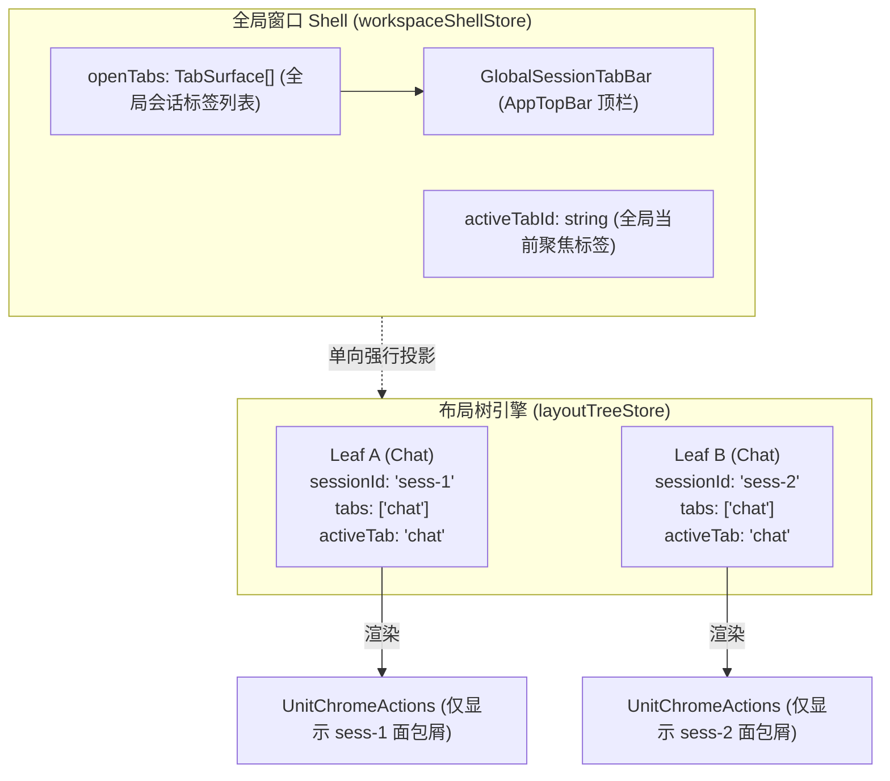
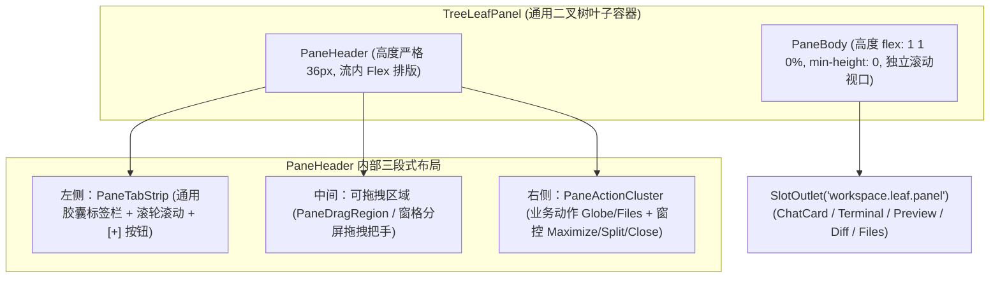
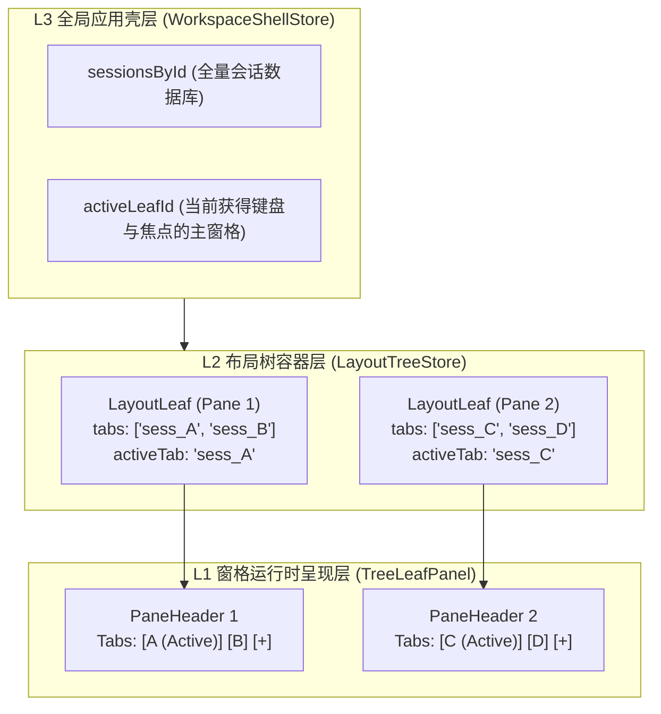

# 全景深度排查 02 —— 二叉树叶子窗格独立标签体系排查报告

> **排查定位**：系统性审计 `TreeLeafPanel`、`LeafToolTabStrip`、`UnitChromeActions` 及 `layoutTreeStore` 的头部渲染机制与标签状态机，定位 Chat 窗格与工具窗格头部异构根因，剖析多分屏下独立会话标签缺失机制，提出统一 `PaneHeader` 架构与视觉对齐方案。
> **审计原则**：纯只读分析，严禁修改源代码，精准引用具体文件与行号。

---

## 目录

1. [执行摘要与架构现状概览](#一执行摘要与架构现状概览)
2. [当前叶子窗格头部渲染现状与异构根因分析](#二当前叶子窗格头部渲染现状与异构根因分析)
   - 2.1 Chat 叶头部（`UnitChromeActions`）深度剖析
   - 2.2 工具叶头部（`LeafToolTabStrip`）深度剖析
   - 2.3 异构现象对比与深层根因溯源
   - 2.4 多分屏下独立 Session Tab 缺失根因剖析
3. [统一窗格头部（PaneHeader）架构设计](#三统一窗格头部paneheader架构设计)
   - 3.1 统一 36px 盒模型与流内排版契约
   - 3.2 通用窗格标签模型（Universal Pane Tab Model）
   - 3.3 左右功能区标准化分工与槽位扩展
4. [多分屏独立会话标签体系演进路径](#四多分屏独立会话标签体系演进路径)
   - 4.1 窗格级（Pane-Local）与全局（Shell-Global）状态所有权协同
   - 4.2 跨窗格拖拽、分屏与标签迁移状态机
5. [窗格激活态（`isActive`）、边框阴影与视觉统一规范](#五窗格激活态isactive边框阴影与视觉统一规范)
   - 5.1 激活态状态流与焦点派生机制
   - 5.2 边框、阴影与背景分层视觉规范
   - 5.3 标签与窗控按钮微交互规范
6. [精准代码引用清单与重构风险矩阵](#六精准代码引用清单与重构风险矩阵)
7. [排查结论与演进建议](#七排查结论与演进建议)

---

## 一、执行摘要与架构现状概览

当前 Conex 桌面端采用二叉树布局树引擎（[`layoutTreeStore`](file:///c:/Software/conex/apps/crish-desktop/src/store/layout-tree/layoutTreeStoreTypes.ts#L1-L110)），支持通过水平与垂直二叉分支（`LayoutBranch`）容纳任意数量的叶子面板（`LayoutLeaf`）。

在叶子容器渲染层（[`TreeLeafPanel.tsx:207-217`](file:///c:/Software/conex/apps/crish-desktop/src/components/binary-tree/TreeLeafPanel.tsx#L207-L217)），当前实现存在**显著的架构分裂**：
1. **头部渲染两套体系硬分叉**：
   - **Chat 叶**：通过 `isChat ? <UnitChromeActions /> : ...` 渲染浮动在消息列表上方的吸顶覆盖层（38px 高度、负外边距 `-38px`、渐变遮罩），左侧为三级面包屑路径（`Project / Session / Agents`），右侧为固定的 3 个快捷按钮，**完全不渲染任何标签栏**；
   - **Tool 叶**：渲染流内占位的标准标签栏组件 [`LeafToolTabStrip`](file:///c:/Software/conex/apps/crish-desktop/src/components/binary-tree/LeafToolTabStrip.tsx#L330-L469)（38px 流内高度、实色卡片背景），包含横向滚动的 Tab 列表、添加工具下拉菜单、最大化及折叠控制。
2. **会话标签体系全局单点绑定**：
   - 会话标签（Session Tabs）的所有权与状态完全被顶层 [`workspaceShellStore.openTabs`](file:///c:/Software/conex/apps/crish-desktop/src/store/workspace-shell/workspaceShellStore.ts#L172-L180) 独占，并在顶栏 [`GlobalSessionTabBar`](file:///c:/Software/conex/apps/crish-desktop/src/components/shell/GlobalSessionTabBar.tsx#L250-L364) 呈现；
   - 二叉树叶子节点 [`LayoutLeaf`](file:///c:/Software/conex/apps/crish-desktop/src/store/layout-tree/types.ts#L9-L24) 虽然具备 `tabs: string[]` 和 `activeTab: string`，但在设计上被硬编码为仅供工具面板 ID 使用；多 Chat 分屏时每个 Chat 叶仅能绑定单个静态标量 `sessionId?: string`，**无法在叶子窗格内部容纳多会话标签页**，无法达到类似 VS Code Editor Group 的多窗格多标签自洽能力。

---

## 二、当前叶子窗格头部渲染现状与异构根因分析

### 2.1 Chat 叶头部（`UnitChromeActions`）深度剖析

#### 代码路径与实现机制
- 核心组件：[`UnitChromeActions.tsx`](file:///c:/Software/conex/apps/crish-desktop/src/components/chat-card/UnitChromeActions.tsx#L56-L398)
- 样式定义：[`UnitChromeActions.module.css`](file:///c:/Software/conex/apps/crish-desktop/src/components/chat-card/UnitChromeActions.module.css#L1-L242)

#### 结构与布局特征
1. **负外边距浮动定位（Negative Margin Sticky Overlay）**：
   ```css
   /* UnitChromeActions.module.css:3-20 */
   .chatTopHeader {
     position: sticky;
     top: 0;
     left: 0;
     width: 100%;
     height: 38px;
     min-height: 38px;
     margin-bottom: -38px; /* 负外边距：不占流内高度，叠在消息流上 */
     z-index: var(--z-chrome, 10);
     pointer-events: none;
     background: linear-gradient(
       to bottom,
       var(--bg-card, #ffffff) 0%,
       var(--bg-card, #ffffff) 65%,
       color-mix(in srgb, var(--bg-card, #ffffff) 94%, transparent) 82%,
       color-mix(in srgb, var(--bg-card, #ffffff) 45%, transparent) 94%,
       transparent 100%
     );
   }
   ```
2. **左侧三级面包屑结构（Three-Level Breadcrumbs）**：
   - **Level 1（Project）**：[`UnitChromeActions.tsx:289-302`](file:///c:/Software/conex/apps/crish-desktop/src/components/chat-card/UnitChromeActions.tsx#L289-L302) 展示当前工作区/项目名，点击可新建该项目草稿；
   - **Level 2（Session）**：[`UnitChromeActions.tsx:309-318`](file:///c:/Software/conex/apps/crish-desktop/src/components/chat-card/UnitChromeActions.tsx#L309-L318) 嵌入 [`SessionInlineRename`](file:///c:/Software/conex/apps/crish-desktop/src/components/chat-card/UnitChromeActions.tsx#L313-L317) 组件，支持就地编辑会话标题；
   - **Level 3（Subagent Status）**：[`UnitChromeActions.tsx:321-336`](file:///c:/Software/conex/apps/crish-desktop/src/components/chat-card/UnitChromeActions.tsx#L321-L336) 渲染子代理状态面板。
3. **右侧动作组与绝对定位避让**：
   - 动作按钮：`预览(Globe)`、`文件(FolderTree)`、`更多(ChatHeaderMore)`；
   - 避让槽位：当右侧工具坞折叠时，通过 `.withDockMargin` 给顶层画布常驻的绝对定位固定坞按钮留出 `36px` 槽位（[`UnitChromeActions.module.css:156-158`](file:///c:/Software/conex/apps/crish-desktop/src/components/chat-card/UnitChromeActions.module.css#L156-L158)）。

---

### 2.2 工具叶头部（`LeafToolTabStrip`）深度剖析

#### 代码路径与实现机制
- 核心组件：[`LeafToolTabStrip.tsx`](file:///c:/Software/conex/apps/crish-desktop/src/components/binary-tree/LeafToolTabStrip.tsx#L56-L471)
- 样式定义：[`LeafToolTabStrip.module.css`](file:///c:/Software/conex/apps/crish-desktop/src/components/binary-tree/LeafToolTabStrip.module.css#L7-L342)

#### 结构与布局特征
1. **流内实盒占位（In-flow Solid Container）**：
   ```css
   /* LeafToolTabStrip.module.css:7-22 */
   .container {
     display: flex;
     flex-direction: column;
     width: 100%;
     height: 38px;
     min-height: 38px;
     max-height: 38px;
     flex: 0 0 38px; /* 严格占用 38px 流内高度 */
     background: var(--bg-card, #ffffff);
     position: relative;
     z-index: var(--z-sticky, 2);
     box-sizing: border-box;
     border-bottom: none;
   }
   ```
2. **完整的标签交互状态机**：
   - **横向滑动与滚动溢出**：[`LeafToolTabStrip.tsx:125-155`](file:///c:/Software/conex/apps/crish-desktop/src/components/binary-tree/LeafToolTabStrip.tsx#L125-L155) 支持滚轮横向滚转与 `ResizeObserver` 动态计算 `hasOverflow`；
   - **Tab 进入/离开动画**：[`LeafToolTabStrip.tsx:109-122`](file:///c:/Software/conex/apps/crish-desktop/src/components/binary-tree/LeafToolTabStrip.tsx#L109-L122) 配合 CSS 关键帧 `sideTabSlideIn` 实现平滑过渡；
   - **动态添加面板**：[`LeafToolTabStrip.tsx:282-327`](file:///c:/Software/conex/apps/crish-desktop/src/components/binary-tree/LeafToolTabStrip.tsx#L282-L327) 通过 `SmartExpandablePanel` 展示可用的 `viewRegistry.getToolViews()` 列表；
   - **标签拖拽支持**：[`LeafToolTabStrip.tsx:390-392`](file:///c:/Software/conex/apps/crish-desktop/src/components/binary-tree/LeafToolTabStrip.tsx#L390-L392) 触发 `startToolDrag` 拖拽事件；
3. **空态 Launcher Hub 覆盖**：
   - 当工具叶的 `tabs` 被关闭至 0 个时，渲染 [`SidePanelLauncherHub`](file:///c:/Software/conex/apps/crish-desktop/src/components/binary-tree/LeafToolTabStrip.tsx#L467) 居中快速启动卡片。

---

### 2.3 异构现象对比与深层根因溯源

| 维度 | Chat 叶头部 (`UnitChromeActions`) | 工具叶头部 (`LeafToolTabStrip`) | 架构冲突后果 |
| :--- | :--- | :--- | :--- |
| **盒模型性质** | `position: sticky` + `margin-bottom: -38px`（虚占位/负边距） | `display: flex` + `flex: 0 0 38px`（实占位） | 几何高度计算不一致，两类窗格内容可视区起始 Y 轴错位 |
| **背景渲染** | `linear-gradient` 渐隐遮罩（`pointer-events: none`） | 实色底 `var(--bg-card)`（`pointer-events: auto`） | 视觉重量与分界感完全割裂，滚动内容穿透表现不一 |
| **核心表达语义** | 面包屑路径导航（`Project / Session / Agents`） | 标签页栏（`[总览] [终端] [+]`） | 窗格语义不自洽：工具窗格能切 Tab，Chat 窗格无法切 Tab |
| **状态源绑定** | `workspaceShellStore` & `sessionStore` (Session ID) | `layoutTreeStore` (`leaf.tabs`, `leaf.activeTab`) | 状态机分立：分屏下的 Chat 窗格受全局会话切换牵引，工具窗格受本地树控制 |
| **右侧控制簇** | 业务动作（预览、文件、更多） + 36px 绝对定位避让 | 窗格动作（添加、最大化、折叠） | 工具窗格支持最大化/折叠，Chat 窗格却缺失最大化/分屏窗控 |

#### 异构形成的深层历史根因
1. **单对话主窗口历史遗留假设**：系统初期被构想为「一个中心主聊天视口 + 一个可折叠右侧辅助工具栏」。在此假设下，主聊天视口被设计为沉浸式无边框界面，顶部使用负边距浮动面包屑；而右侧工具栏则被设计为 VS Code 风格的多 Tab 容器。
2. **二叉树改造未彻底收敛 UI 契约**：在引入 `layoutTreeStore` 进行真二叉树重构时，数据层将所有窗格抽象为统一的 `LayoutLeaf`，但在呈现层（`TreeLeafPanel.tsx:208-217`）简单采用 `isChat` 分支，保留了历史的两种完全不同的头部组件，未将 Chat 窗格的头部统一提升为规范的窗格 Header。
3. **定位层叠冲突的妥协**：为了让右侧固定收起按钮（`#topQuickDockBtn`）在顶层常驻，`UnitChromeActions` 引入了复杂的 `.withDockMargin` 36px 边距切换（[`UnitChromeActions.module.css:156-158`](file:///c:/Software/conex/apps/crish-desktop/src/components/chat-card/UnitChromeActions.module.css#L156-L158)），进一步加剧了布局复杂性。

---

### 2.4 多分屏下独立 Session Tab 缺失根因剖析

在多 Chat 分屏模式下（如左右两个 Chat 窗格），用户无法在每个窗格内拥有独立的 Session Tab 栏，其核心根因在于**状态所有权与数据结构的割裂**：



1. **会话标签所有权在全局而非窗格**：
   - 所有的打开会话保存在 [`workspaceShellStore.openTabs`](file:///c:/Software/conex/apps/crish-desktop/src/store/workspace-shell/workspaceShellStore.ts#L172) 中；
   - [`GlobalSessionTabBar.tsx`](file:///c:/Software/conex/apps/crish-desktop/src/components/shell/GlobalSessionTabBar.tsx#L123-L205) 消费 `openTabs` 并直接渲染在最顶层的 `AppTopBar`；
2. **`LayoutLeaf` 缺乏会话集合建模**：
   - [`LayoutLeaf`](file:///c:/Software/conex/apps/crish-desktop/src/store/layout-tree/types.ts#L9-L24) 仅包含单一可选字段 `sessionId?: string`，而非 `sessionIds: string[]` 或 `tabs: Array<{ kind: 'session' | 'tool', id: string }>`；
   - 当叶子节点是 Chat 时，`leaf.tabs` 恒为 `['chat']`，`activeTab` 恒为 `'chat'`，其真实的会话标识只能依赖 `leaf.sessionId`；
3. **切换冲突与聚焦漂移**：
   - 当用户在顶栏 `GlobalSessionTabBar` 点击某个 Tab 时，`workspaceShellStore.activateTab`（[`workspaceShellStore.ts:247-260`](file:///c:/Software/conex/apps/crish-desktop/src/store/workspace-shell/workspaceShellStore.ts#L247-L260)）会触发 `bindActiveChatLeafSession`，强制将当前聚焦的 Chat 叶或唯一 Chat 叶重定向到该会话；
   - 这种设计导致窗格无法像独立 Editor Group 那样「窗格 1 保持会话 [A, B]，窗格 2 保持会话 [C, D]」。

---

## 三、统一窗格头部（PaneHeader）架构设计

为彻底消除 Chat 与 Tool 窗格的异构性，并在未来支持分屏独立标签页体系，必须在 `TreeLeafPanel` 顶部抽象并统一引入标准化的 **`PaneHeader`** 容器。



### 3.1 统一 36px 盒模型与流内排版契约

1. **废弃负外边距与渐隐覆盖层**：
   - 彻底移除 `UnitChromeActions.module.css` 中的 `margin-bottom: -38px` 与 `linear-gradient` 遮罩；
   - 无论叶子承载何种视图类型（Chat、Terminal、Preview、Diff、Files 等），顶部一律渲染 36px 流内实盒 `PaneHeader`；
2. **清晰的垂直弹性分割**：
   ```css
   /* 标准 Pane 几何盒模型 */
   .leafContainer {
     display: flex;
     flex-direction: column;
     width: 100%;
     height: 100%;
     overflow: hidden;
     background: var(--bg-card);
     border-radius: var(--radius-lg, 8px);
     box-sizing: border-box;
   }

   .paneHeader {
     display: flex;
     flex-direction: row;
     align-items: center;
     justify-content: space-between;
     height: 36px;
     min-height: 36px;
     max-height: 36px;
     flex: 0 0 36px;
     padding: 0 8px;
     box-sizing: border-box;
     background: var(--bg-card);
     border-bottom: 1px solid var(--border-subtle);
     user-select: none;
   }

   .paneBody {
     flex: 1 1 0%;
     min-height: 0;
     width: 100%;
     height: 100%;
     position: relative;
     overflow: hidden;
   }
   ```
3. **正文区域零样式侵入**：
   - `ChatCard` 内的 `ChatMessageList`（[`ChatCard.tsx:178-216`](file:///c:/Software/conex/apps/crish-desktop/src/components/chat-card/ChatCard.tsx#L178-L216)）直接在 `paneBody` 内部以 `100%` 高度滚动，无需再计算 38px 的顶部内边距避让，彻底解决滚动内容穿透与遮罩抖动问题。

---

### 3.2 通用窗格标签模型（Universal Pane Tab Model）

在统一的 `PaneHeader` 下，将原本割裂的「会话」与「工具」抽象为统一的泛化标签数据接口 `PaneTabItem`：

```typescript
export interface PaneTabItem {
  /** 唯一标识：如 'session:sess_123' 或 'tool:terminal' */
  id: string;
  /** 标签类型：会话或工具 */
  kind: 'session' | 'tool';
  /** 显示标题 */
  title: string;
  /** 图标组件（Lucide Icon） */
  icon?: React.ComponentType<{ size?: number; className?: string }>;
  /** 是否可关闭（单 Tab 时或固定状态不可关闭） */
  closable: boolean;
  /** 是否固定（Pinned） */
  pinned?: boolean;
  /** 关联的会话 ID（仅 kind === 'session'） */
  sessionId?: string;
  /** 关联的面板视图 ID（仅 kind === 'tool'） */
  panelId?: string;
  /** 运行态指示器（如 Agent 思考中、终端运行中等） */
  badge?: 'busy' | 'unread' | 'error';
}
```

#### 标签渲染行为归一化
- **Chat 窗格**：Tab 项显示当前会话标题（如 `[💬 重构计划 x]`），支持在同一个 Chat 窗格内打开多个会话 Tab；
- **Tool 窗格**：Tab 项显示工具名称（如 `[💻 终端 x] [🌐 应用预览 x]`）；
- **混合分屏窗格**：支持在同一叶子窗格内混合容纳 Chat 与 Tool（如将终端与对话置于同一窗格的两个 Tab 中）。

---

### 3.3 左右功能区标准化分工与槽位扩展

`PaneHeader` 划分为三个标准物理区域：

```
+--------------------------------------------------------------------------------------------------+
| [Tab1] [Tab2] [+] | ~~~ [Pane Drag Region] ~~~ | [Context Actions] | [Split] [Maximize] [Close]  |
+--------------------------------------------------------------------------------------------------+
|<----- 左侧：标签条带 ----->|<------- 中间：拖拽/状态 ------>|<----------- 右侧：动作与窗控 ------------>|
```

1. **左侧：`PaneTabStrip`**：
   - 标签胶囊（26px 高度、4px 圆角、平滑关闭动效）；
   - `+` 添加按钮：
     - 若当前窗格为主对话窗格，`+` 默认新建对话草稿，长按或下拉可选择添加工具；
     - 若当前窗格为工具窗格，`+` 弹出 `SmartExpandablePanel` 添加新工具卡片；
2. **中间：`PaneDragRegion`**：
   - 空白区域可作为窗格的拖拽把手（Drag Handle），用户按住空白区拖动即可将整个窗格迁移至其他分屏位置；
3. **右侧：`PaneActionCluster`**：
   - **上下文业务操作（Contextual Actions）**：
     - 对话视图：渲染 `预览(Globe)`、`文件(FolderTree)`、`会话设置(...)`；
     - 终端视图：渲染 `清屏`、`新建终端实例`；
     - 预览视图：渲染 `刷新`、`外开浏览器`、`URL 地址栏`；
   - **通用窗控动作（Window Chrome Controls）**：
     - **分屏按钮（Split Pane）**：快速将当前 Tab 拆分至右侧/下方；
     - **最大化按钮（Maximize/Restore）**：将当前叶子全屏展开（占满 Canvas）或还原；
     - **关闭窗格按钮（Close Pane）**：当总分屏数 > 1 时显示，关闭当前叶子及其所有 Tab。

---

## 四、多分屏独立会话标签体系演进路径

### 4.1 窗格级（Pane-Local）与全局（Shell-Global）状态所有权协同

为实现每个分屏窗格拥有独立的 Session Tab 栏，建议确立分层状态机模型：



#### 数据模型升级
在 `LayoutLeaf`（[`layout-tree/types.ts:9-24`](file:///c:/Software/conex/apps/crish-desktop/src/store/layout-tree/types.ts#L9-L24)）中，将 `tabs` 的语义泛化为**通用视图/会话实体标识符**：
- `tabs: string[]`：可包含会话 ID（`session:*`）或工具面板 ID（`tool:*`）；
- `activeTab: string`：当前窗格激活的 Tab；
- 移除不再需要的单标量 `leaf.sessionId`，统一通过 `leaf.activeTab` 派生当前渲染的上下文。

---

### 4.2 跨窗格拖拽、分屏与标签迁移状态机

依托已有的 [`SessionTabDragContext.tsx`](file:///c:/Software/conex/apps/crish-desktop/src/components/shell/SessionTabDragContext.tsx#L86-L329) 与 [`sessionTabDropCommit.ts`](file:///c:/Software/conex/apps/crish-desktop/src/components/shell/sessionTabDropCommit.ts#L44-L107)，将拖拽落点判定升级为统一矩阵：

| 拖拽源 | 拖拽落点目标 | 触发行为 |
| :--- | :--- | :--- |
| **窗格 A 的 Tab** | **窗格 A 的标签栏** | 条内重排（Reorder Tabs in Pane A） |
| **窗格 A 的 Tab** | **窗格 B 的标签栏** | 跨窗格转移（Move Tab from Pane A to Pane B） |
| **窗格 A 的 Tab** | **窗格 B 的中心区域 (`center`)** | 移入窗格 B 并置为激活（Move to Pane B & Activate） |
| **窗格 A 的 Tab** | **窗格 B 的边缘区域 (`left/right/top/bottom`)** | 触发二叉树二分（Split Leaf Beside Node & Mint New Pane） |
| **窗格 A 的 Drag Handle** | **窗格 B 的边缘区域** | 整个窗格树形迁移（Move Entire Leaf/Unit in Binary Tree） |

---

## 五、窗格激活态（`isActive`）、边框阴影与视觉统一规范

### 5.1 激活态状态流与焦点派生机制

当前激活判定由 `layoutTreeStore.activeLeafId`（[`layoutTreeStoreTypes.ts:20`](file:///c:/Software/conex/apps/crish-desktop/src/store/layout-tree/layoutTreeStoreTypes.ts#L20)）驱动，并透传给 `TreeLeafPanelProps.isActive`。

#### 交互规范
1. **点击即聚焦（Click to Focus）**：
   - 点击窗格内任何交互元素或空白区（[`TreeLeafPanel.tsx:103-128`](file:///c:/Software/conex/apps/crish-desktop/src/components/binary-tree/TreeLeafPanel.tsx#L103-L128)），立即将 `activeLeafId` 切到当前叶子；
2. **焦点态视觉表达**：
   - **非激活窗格（Inactive Pane）**：
     - 头部背景色：`var(--bg-elevated)` 或微透浅灰；
     - 标签文字：`var(--text-tertiary)`；
     - 窗格卡片边框：`1px solid var(--border-subtle)`；
     - 阴影：无额外高亮阴影。
   - **激活窗格（Active Pane）**：
     - 头部背景色：`var(--bg-card)`；
     - 激活标签：`var(--text-primary)`，带细微的高亮底色或 `1.5px` 品牌绿激活下划线指示；
     - 窗格卡片边框：`1px solid var(--border-color)` 或 `var(--accent-green-alpha)`；
     - 阴影：叠加微发光阴影 `0 2px 8px rgba(0, 0, 0, 0.04)`。

---

### 5.2 边框、阴影与背景分层视觉规范

当前二叉树画布（[`BinaryTreeWorkspace.module.css:42-59`](file:///c:/Software/conex/apps/crish-desktop/src/components/binary-tree/BinaryTreeWorkspace.module.css#L42-L59)）与叶子卡片在分屏时存在「双重边框」与「阴影割裂」隐患：

```
+-----------------------------------------------------------------------+
| Canvas 外壳大矩形: background: var(--bg-workspace), padding: 0 8px 8px 0 |
|  +-----------------------------------------------------------------+  |
|  | Canvas 主画板: background: var(--bg-card), border: 1px hairline   |  |
|  |  +--------------------------+  |  +--------------------------+  |  |
|  |  | Leaf Pane A (Active)     |  |  | Leaf Pane B              |  |  |
|  |  | [Header 36px]            |  |  | [Header 36px]            |  |  |
|  |  | border: 1px var(--border)|  |  | border: 1px subtle       |  |  |
|  |  | shadow: 0 2px 8px ...    |  |  | shadow: none             |  |  |
|  |  +--------------------------+  |  +--------------------------+  |  |
|  +-----------------------------------------------------------------+  |
+-----------------------------------------------------------------------+
```

1. **分界线归一化**：
   - 相邻叶子窗格之间由 `TreeResizeSash`（[`BinaryTreeWorkspace.module.css:187-256`](file:///c:/Software/conex/apps/crish-desktop/src/components/binary-tree/BinaryTreeWorkspace.module.css#L187-L256)）提供 `6px` 命中区与 `1px` 视觉分隔线；
   - 叶子窗格本体使用无内嵌边框或仅有 `1px` 统一发丝边框，严禁在 `PaneHeader` 和 `PaneBody` 之间叠加大边框；
2. **Sash 分隔条高亮协调**：
   - 常态下 Sash 维持透明，仅依赖两边卡片边框呈现分割；
   - Hover 或拖拽调整大小（Resize）时，Sash 伪元素亮起 `var(--accent-green, #10b981)` 品牌色条。

---

### 5.3 标签与窗控按钮微交互规范

1. **Tab 尺寸与密度**：
   - 标签高度：`26px`（垂直居中于 `36px` 的 Header）；
   - 圆角：`var(--radius-sm, 4px)`；
   - 间距：标签之间 `gap: 4px`；
   - 最小宽度 `80px`，最大宽度 `180px`，超出自动省略文字；
2. **关闭按钮（Tab Close Button）**：
   - 尺寸 `16px * 16px`，内嵌 `10px` 图标；
   - 默认透明，Tab Hover 时淡入（`opacity: 0.7`），Close 按钮自身 Hover 时高亮（`opacity: 1, background: var(--tint-hover)`）；
3. **窗控与快捷动作按钮**：
   - 尺寸 `26px * 26px`，圆角 `4px`；
   - 图标尺寸统一采用 `14px`，线宽 `1.8`；
   - 点击时提供微妙的缩放反馈（`active: transform: scale(0.94)`）。

---

## 六、精准代码引用清单与重构风险矩阵

### 6.1 核心涉及文件与行号对照表

| 模块文件 | 关键行号范围 | 现存机制与问题 | 重构演进目标 |
| :--- | :--- | :--- | :--- |
| [`TreeLeafPanel.tsx`](file:///c:/Software/conex/apps/crish-desktop/src/components/binary-tree/TreeLeafPanel.tsx) | `L207-L217` | `isChat ? <UnitChromeActions/> : <LeafToolTabStrip/>` 硬分叉 | 替换为统一 `<PaneHeader leaf={leaf} />` 容器 |
| [`TreeLeafPanel.tsx`](file:///c:/Software/conex/apps/crish-desktop/src/components/binary-tree/TreeLeafPanel.tsx) | `L98-L102` | 会话降级计算 `sessionForPanel` | 通过 `leaf.activeTab` 派生窗格上下文 |
| [`BinaryTreeWorkspace.tsx`](file:///c:/Software/conex/apps/crish-desktop/src/components/binary-tree/BinaryTreeWorkspace.tsx) | `L268-L294` | 绝对定位顶层按钮 `#topQuickDockBtn` | 移入统一 `PaneHeader` 的窗控区域，消除全局覆盖层 |
| [`UnitChromeActions.tsx`](file:///c:/Software/conex/apps/crish-desktop/src/components/chat-card/UnitChromeActions.tsx) | `L279-L395` | 面包屑 + 动作组混合渲染 | 动作组抽为 `ChatPaneActions` 插件槽位，面包屑降级至 Tab 标题 |
| [`UnitChromeActions.module.css`](file:///c:/Software/conex/apps/crish-desktop/src/components/chat-card/UnitChromeActions.module.css) | `L3-L20` | `sticky` + `margin-bottom: -38px` 负外边距 | 彻底废除负外边距与渐变层，改为 36px 实盒流内排版 |
| [`LeafToolTabStrip.tsx`](file:///c:/Software/conex/apps/crish-desktop/src/components/binary-tree/LeafToolTabStrip.tsx) | `L330-L469` | 工具专用标签栏与 LauncherHub | 核心能力（Track/Tab/Overflow）提炼为通用 `PaneTabStrip` |
| [`LeafToolTabStrip.module.css`](file:///c:/Software/conex/apps/crish-desktop/src/components/binary-tree/LeafToolTabStrip.module.css) | `L7-L46` | 工具标签栏专用 38px 容器样式 | 沉淀为通用 36px `PaneHeader.module.css` |
| [`layout-tree/types.ts`](file:///c:/Software/conex/apps/crish-desktop/src/store/layout-tree/types.ts) | `L9-L24` | `LayoutLeaf` 仅支持单 `sessionId` | 支持泛化 `tabs: string[]`（会话与工具统一） |
| [`workspaceShellStore.ts`](file:///c:/Software/conex/apps/crish-desktop/src/store/workspace-shell/workspaceShellStore.ts) | `L171-L260` | `openTabs` 全局独占所有会话标签 | 建立 Shell 顶栏标签与窗格本地标签的联动映射 |

---

### 6.2 迁移风险矩阵与防退化策略

| 风险项 | 严重等级 | 潜在影响 | 防退化策略与缓解措施 |
| :--- | :---: | :--- | :--- |
| **消息滚动视口高度变化** | **高** | 移除 `-38px` 负边距可能导致 Chat 列表可视高度减少 36px | `ChatMessageList` 内部本身具备动态滚动容器适配；清除内部 `padding-top: 38px` 后可实现像素级等高还原 |
| **面包屑会话就地重命名功能丢失** | **中** | `UnitChromeActions` 内嵌了 `SessionInlineRename` | 将就地重命名能力集成至 Tab 双击/右键交互，或作为 Pane Header 右侧辅助菜单 |
| **多分屏模式下焦点同步漂移** | **高** | 点击 Tab 错误触发全局 Session 切换导致其他窗格重绘 | 严格执行「先 `setActiveLeaf(leaf.id)` 再激活本地 Tab」，隔离全局 Shell 副作用 |
| **固定坞开关按钮（Dock Btn）定位错位** | **中** | 移除 Canvas 常驻按钮可能导致用户失去一键开合入口 | 在全局顶栏 `AppTopBar` 或主窗格 Header 右上角固定保留窗控快捷键与触发钮 |

---

## 七、排查结论与演进建议

1. **核心排查结论**：
   - 当前 `TreeLeafPanel` 中 Chat 叶与工具叶的头部异构现象，源于历史「单聊主窗 + 右侧工具栏」到「二叉树多窗格」演进过程中的未决技术债务；
   - 负外边距浮动遮罩（`UnitChromeActions`）带来了盒模型不确定性、DOM 结构冗余及样式冲突；
   - 会话状态被全局 Shell 独占是多分屏下无法拥有独立 Session Tab 栏的根本阻碍。

2. **推荐演进步骤**：
   - **第一阶段（呈现层统一）**：开发统一的 `PaneHeader` 容器，统一 36px 流内高度与盒模型，收敛 `UnitChromeActions` 与 `LeafToolTabStrip` 的视觉与排版结构；
   - **第二阶段（窗控与动作解耦）**：将最大化、拆分、关闭等窗格级操作提取为通用组件，将 Chat 快捷操作（预览/文件/更多）与工具操作分别注册为 Header 右侧动作槽位；
   - **第三阶段（数据模型与标签泛化）**：升级 `LayoutLeaf` 与 `layoutTreeStore`，使每个窗格均可承载独立的会话 Tab 集合，实现真正的多窗格多会话独立操作体系。
