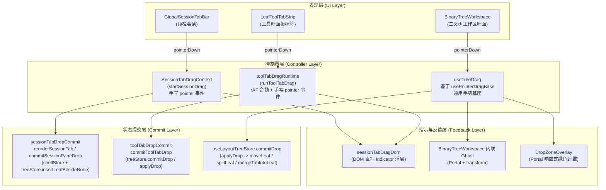
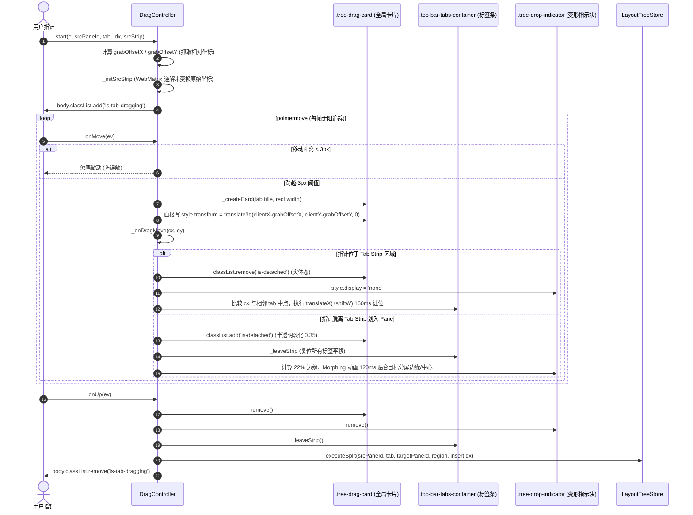
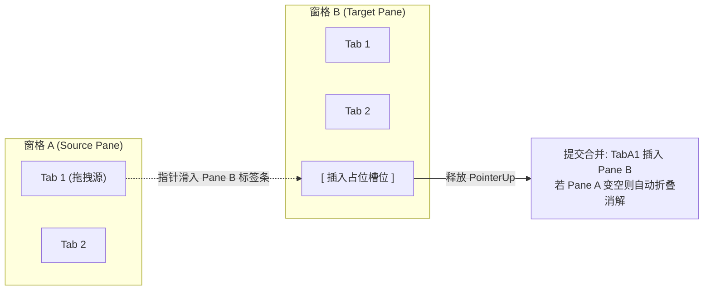
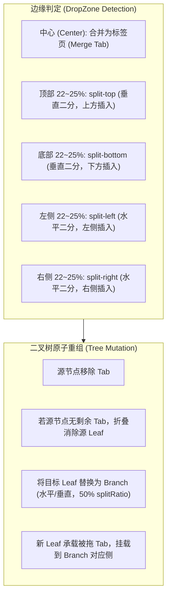
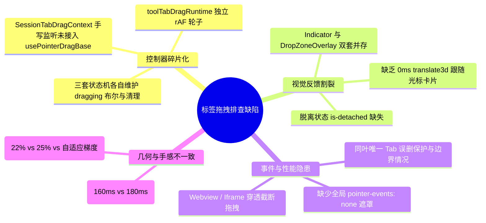
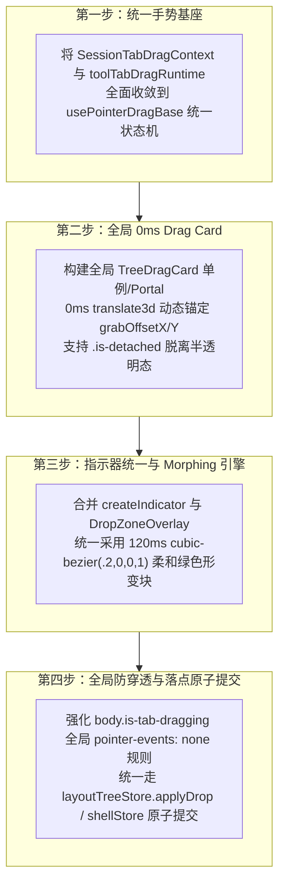

# 全景深度排查 06 —— 标签跨窗格拖拽与拆分漫游排查

> **文档状态**：只读排查报告（UTF-8 无 BOM）  
> **排查对象**：标签拖拽生命周期、全局 Drag Card 跟随、条内动态排开、跨窗格标签迁移、二叉树边缘切分（DropZone）  
> **涉及核心源码**：
> - [`apps/crish-desktop/src/components/shell/SessionTabDragContext.tsx`](file:///c:/Software/conex/apps/crish-desktop/src/components/shell/SessionTabDragContext.tsx#L1-L336)
> - [`apps/crish-desktop/src/components/shell/toolTabDragRuntime.ts`](file:///c:/Software/conex/apps/crish-desktop/src/components/shell/toolTabDragRuntime.ts#L1-L314)
> - [`apps/crish-desktop/src/components/shell/sessionTabDropCommit.ts`](file:///c:/Software/conex/apps/crish-desktop/src/components/shell/sessionTabDropCommit.ts#L1-L108)
> - [`apps/crish-desktop/src/components/shell/sessionTabDragDom.ts`](file:///c:/Software/conex/apps/crish-desktop/src/components/shell/sessionTabDragDom.ts#L1-L131)
> - [`apps/crish-desktop/src/components/shell/sessionTabDragFeel.ts`](file:///c:/Software/conex/apps/crish-desktop/src/components/shell/sessionTabDragFeel.ts#L1-L167)
> - [`apps/crish-desktop/src/hooks/useTreeDrag.ts`](file:///c:/Software/conex/apps/crish-desktop/src/hooks/useTreeDrag.ts#L1-L314)
> - [`apps/crish-desktop/src/hooks/usePointerDragBase.ts`](file:///c:/Software/conex/apps/crish-desktop/src/hooks/usePointerDragBase.ts#L1-L261)
> - [`apps/crish-desktop/src/components/binary-tree/DropZoneOverlay.tsx`](file:///c:/Software/conex/apps/crish-desktop/src/components/binary-tree/DropZoneOverlay.tsx#L1-L145)
> - [`apps/crish-desktop/src/store/layout-tree/dropDetection.ts`](file:///c:/Software/conex/apps/crish-desktop/src/store/layout-tree/dropDetection.ts#L1-L294)
> - [`apps/crish-desktop/src/store/layout-tree/layoutTreeTransform.ts`](file:///c:/Software/conex/apps/crish-desktop/src/store/layout-tree/layoutTreeTransform.ts#L1-L478)
> - [`reference/chat-composer-component/js/popovers.js`](file:///c:/Software/conex/reference/chat-composer-component/js/popovers.js#L1275-L1620)
> - [`reference/chat-composer-component/css/composer.css`](file:///c:/Software/conex/reference/chat-composer-component/css/composer.css#L268-L341)

---

## 1. 排查概述与全景架构现状

桌面端交互系统的核心体验标杆之一是**Chrome 级别的高灵敏度、零延迟标签拖拽与二叉树空间拆分**。用户在拖拽一个标签时，期望获得：
1. **0ms 硬件追踪的全局浮动卡片（Global Drag Card）**：无论指针在顶栏还是工作区，卡片始终贴紧光标抓取点；
2. **条内物理挤开与占位动画（Physical In-strip Displacement）**：在同窗格或跨窗格标签栏滑动时，周围标签平滑让位；
3. **脱离漫游与变形指示器（Detached Morphing DropZone）**：当指针脱离标签栏划入工作区时，浮动卡片半透明淡化，窗格边缘或中心浮现丝滑形变的放置预测区（DropZone Indicator）；
4. **落点精准提交与树重组（Atomic Tree Split & Merge）**：松手瞬间，原子化提交为同栏重排、跨栏转移或水平/垂直二叉树切分。

### 1.1 现状架构分轨图

当前仓库经过历史多轮演进，形成了 **会话顶栏拖拽**、**工具叶标签拖拽** 与 **二叉树画布拖拽** 三轨并存但体验各异的格局：



---

## 2. 标签拖拽生命周期与全局 Drag Card 机制深度对比

### 2.1 Demo 标杆机制（`popovers.js:1275-1620`）

在参考实现 [`reference/chat-composer-component/js/popovers.js:1275-1620`](file:///c:/Software/conex/reference/chat-composer-component/js/popovers.js#L1275-L1620) 中，标签拖拽由统一的 `DragController` 统领，具备极高的一致性与硬件级流畅度：



#### Demo 核心精妙设计拆解：
1. **0ms 硬件追踪全局浮动卡片（`.tree-drag-card`）**：
   - 源码见 [`reference/chat-composer-component/js/popovers.js:1358-1361`](file:///c:/Software/conex/reference/chat-composer-component/js/popovers.js#L1358-L1361)：
     ```javascript
     if (this._card) {
       this._card.style.transform = `translate3d(${ev.clientX - grabOffsetX}px, ${ev.clientY - grabOffsetY}px, 0)`;
     }
     ```
   - 样式见 [`reference/chat-composer-component/css/composer.css:269-291`](file:///c:/Software/conex/reference/chat-composer-component/css/composer.css#L269-L291)：
     固定在 `z-index: 100000`，`position: fixed`，`will-change: transform, opacity`。
   - 抓取点动态锚定：`grabOffsetX = Math.max(10, Math.min(e.clientX - rect.left, rect.width - 10))`，保证卡片跟随手指时绝不瞬跳。
2. **两阶段状态切换（Strip 实体态 vs Workspace 脱离态 `is-detached`）**：
   - 在条内拖动时，浮动卡片处于实体态（`opacity: 1`, 阴影饱满），同时条内其余标签实时计算 `midX` 并执行 `translateX` 让位；
   - 一旦光标移出标签栏进入窗格区域，卡片立即附加 `.is-detached`（`opacity: 0.35`, `box-shadow: none`），同时绿色放置指示块（`.tree-drop-indicator`）立即显示并执行 120ms 弹性过渡贴合窗格边缘。
3. **全局性能穿透防护（`body.is-tab-dragging`）**：
   - 样式见 [`reference/chat-composer-component/css/composer.css:300-309`](file:///c:/Software/conex/reference/chat-composer-component/css/composer.css#L300-L309)：
     在拖拽激活时给 body 添加 `is-tab-dragging`，强制对所有 `.chat-main-pane`、`.chat-side-panel`、`iframe` 应用 `pointer-events: none !important` 和 `user-select: none !important`，杜绝一切拖拽过程中的重排、hover 闪烁与 webview 捕获丢失。

---

### 2.2 当前项目实现机制剖析

#### 2.2.1 会话标签拖拽（`SessionTabDragContext.tsx`）
- 源码位置：[`apps/crish-desktop/src/components/shell/SessionTabDragContext.tsx:86-283`](file:///c:/Software/conex/apps/crish-desktop/src/components/shell/SessionTabDragContext.tsx#L86-L283)
- **手势捕获**：在 `startSessionDrag` 中，通过 `e.currentTarget?.setPointerCapture(pointerId)` 并向 window 挂载 `pointermove / pointerup / pointercancel / keydown`。
- **阈值检测**：使用 L1 距离 `Math.abs(dx) + Math.abs(dy) >= 4`（[`sessionTabDragFeel.ts:40-50`](file:///c:/Software/conex/apps/crish-desktop/src/components/shell/sessionTabDragFeel.ts#L40-L50)）。
- **反馈呈现差异**：
  - 当前项目**没有实现**跟随光标的 `.tree-drag-card` 0ms 硬件平移卡片！
  - 源码在越过阈值后仅调用 `createIndicator(title)`（[`SessionTabDragContext.tsx:127`](file:///c:/Software/conex/apps/crish-desktop/src/components/shell/SessionTabDragContext.tsx#L127)），由 DOM 指示器（`indicator`）同时充当条内落点预测块和叶面落点预测块；
  - 虽然 Provider 中声明了 `ghostLabel` 和 `setGhostRef`（[`SessionTabDragContext.tsx:78-84`](file:///c:/Software/conex/apps/crish-desktop/src/components/shell/SessionTabDragContext.tsx#L78-L84)），但在 `startSessionDrag` 的 `pointermove` 中**并没有更新 ghost 坐标**，导致顶栏会话拖拽时，光标下方没有实体浮动卡片跟随，仅有绿色半透明的落点预测块在条内或叶面上闪现。

#### 2.2.2 工具叶标签拖拽（`toolTabDragRuntime.ts`）
- 源码位置：[`apps/crish-desktop/src/components/shell/toolTabDragRuntime.ts:84-313`](file:///c:/Software/conex/apps/crish-desktop/src/components/shell/toolTabDragRuntime.ts#L84-L313)
- **合帧与自动滚动**：
  - 引入了 `requestAnimationFrame` 合帧（[`toolTabDragRuntime.ts:253`](file:///c:/Software/conex/apps/crish-desktop/src/components/shell/toolTabDragRuntime.ts#L253)），防止高回报率鼠标频繁触发 DOM 查询；
  - 增加了标签条两端自动滚动 `autoScrollStrip`（[`toolTabDragRuntime.ts:58-66`](file:///c:/Software/conex/apps/crish-desktop/src/components/shell/toolTabDragRuntime.ts#L58-L66)）；
  - 在拖拽结束后调用 `swallowNextClick()` 吞掉原生 click 事件（[`toolTabDragRuntime.ts:72-82`](file:///c:/Software/conex/apps/crish-desktop/src/components/shell/toolTabDragRuntime.ts#L72-L82)）。
- **反馈呈现差异**：
  - 与会话拖拽类似，主要依赖 `createIndicator` 的绿色预测块，缺乏随光标抓取点精准贴合的 `.tree-drag-card`。

#### 2.2.3 二叉树内部拖拽（`useTreeDrag.ts`）
- 源码位置：[`apps/crish-desktop/src/hooks/useTreeDrag.ts:76-313`](file:///c:/Software/conex/apps/crish-desktop/src/hooks/useTreeDrag.ts#L76-L313)
- **手势基座**：基于 `usePointerDragBase`（[`apps/crish-desktop/src/hooks/usePointerDragBase.ts:124-260`](file:///c:/Software/conex/apps/crish-desktop/src/hooks/usePointerDragBase.ts#L124-L260)），具备严格的状态机（`idle -> pending -> active -> committed/cancelled`）、指针捕获保护（`lostpointercapture / blur`）和 Ghost DOM 跟手更新。
- **指示器分离**：
  - 内部由 `layoutTreeStore.activeDropZone` 驱动 [`DropZoneOverlay.tsx`](file:///c:/Software/conex/apps/crish-desktop/src/components/binary-tree/DropZoneOverlay.tsx#L87-L143) 渲染 Portal 绿色遮罩；
  - Ghost 通过 [`BinaryTreeWorkspace.tsx:301-318`](file:///c:/Software/conex/apps/crish-desktop/src/components/binary-tree/BinaryTreeWorkspace.tsx#L301-L318) 的 Portal `<div className={styles.ghost}>` 呈现，使用了固定偏移 `GHOST_OFFSET_X = 16`，而非光标相对抓取点 `grabOffset`。

---

### 2.3 核心机制对比矩阵

| 维度 | Demo 标杆 (`popovers.js`) | 当前项目 (`crish-desktop`) | 差距与问题剖析 |
| :--- | :--- | :--- | :--- |
| **全局浮动卡片 (Drag Card)** | `.tree-drag-card` 随光标 0ms `translate3d`，动态 `grabOffsetX/Y` 贴合抓取点 | `SessionTabDragContext` / `toolTabDragRuntime` 缺少光标浮动卡片；`useTreeDrag` 采用固定的 +16px 偏移胶囊 | 顶栏拖拽时光标下空无一物，缺乏物理抓取感；二叉树拖拽胶囊偏离抓取点 |
| **脱离状态与透明度 (`is-detached`)** | 条内 `opacity: 1` 实体；划入工作区 `opacity: 0.35` 半透明，阴影去除 | 无 `is-detached` 动态样式分阶，仅靠 indicator 的 `strip` / `pane` 样式类切换 | 视觉层级割裂，无法给用户明确的“已抽出标签栏、进入分屏投射”心智模型 |
| **条内挤开动画 (Displacement)** | `160ms cubic-bezier(0.2, 0, 0, 1)`，WebMatrix 逆解未平移原始坐标，+154px 平移 | `180ms cubic-bezier(.2,0,0,1)`（`sessionTabDragFeel.ts:13`），`readTranslateX` DOMMatrix 解析，+154px 平移 | 两套平移时间常数略有差异（160ms vs 180ms），计算逻辑基本同构 |
| **边缘自动滚动 (Auto-scroll)** | 基础滑动 | `toolTabDragRuntime` 支持 36px 边缘每帧 12px 自动横滚；`SessionTabDragContext` 未集成 | 顶栏会话标签超长溢出时，无法通过拖拽向两侧扩展可视区域 |
| **指示块变形动画 (Morphing)** | 纯色绿色柔和填充（`18%` 混合色），无边框，`120ms` 几何形变过渡 | CSS Module 样式 `sessionTabDrag.module.css`，`120ms` 过渡；`DropZoneOverlay` 静态 Portal 遮罩 | 会话/工具走 `indicator`（带文本），二叉树走 `DropZoneOverlay`（纯 CSS 遮罩），双轨视觉不统一 |
| **事件拦截与穿透保护** | `body.is-tab-dragging` 强制所有 pane、iframe `pointer-events: none !important` | 仅添加 `body.tab-dragging` / `body.tree-dragging`，未对 Webview / Monaco / Iframe 进行全局 pointer-events 隔离 | 拖经富文本编辑器或 Webview 容器时，可能发生鼠标事件被子节点吞没 |

---

## 3. 跨窗格迁移与分屏放置（DropZone）集成机制排查

### 3.1 场景 A：从 Pane A 标签栏到 Pane B 标签栏（同窗格调序 vs 跨窗格合并）



#### 1. Demo 实现分析（[`popovers.js:1465-1560`](file:///c:/Software/conex/reference/chat-composer-component/js/popovers.js#L1465-L1560)）：
- `_handleStripMove` 自动判断 `isSameStrip = (paneId === this._srcPaneId)`：
  - **同条调序**：跳过自身，周围兄弟元素按移动方向执行 `translateX(-shiftW)` 或 `translateX(+shiftW)`，目标状态记录为 `{ paneId, region: 'strip', insertIdx }`；
  - **跨条合并**：调用 `_leaveStrip()` 清空前一条的让位，在新条上将 `>= targetIdx` 的所有 tab 以及新建按钮 `.top-bar-new-tab-btn.in-flow` 统一右移 `+154px`，目标记录为 `{ paneId: targetPaneId, region: 'strip', insertIdx }`；
  - **提交阶段**（[`popovers.js:1377-1384`](file:///c:/Software/conex/reference/chat-composer-component/js/popovers.js#L1377-L1384)）：`executeSplit` 将 tab 从源 pane 移除，插入到目标 pane 的 tabs 数组中；若源 pane 无剩余 tab，递归调用 `_collapseEmptyLeaves` 用兄弟节点平替消解分支。

#### 2. 当前项目实现分析：
- **顶栏会话标签（`GlobalSessionTabBar`）**：
  - 顶栏是全局唯一的单一条带，不存在跨条合并，仅有条内调序（`commitSessionTabStripReorder`，[`sessionTabDropCommit.ts:28-41`](file:///c:/Software/conex/apps/crish-desktop/src/components/shell/sessionTabDropCommit.ts#L28-L41)），直接更新 `workspaceShellStore.reorderSessionTab`。
- **工具叶标签（`LeafToolTabStrip`）**：
  - 工具叶分布在二叉树各叶子中。在 [`toolTabDragRuntime.ts:109-158`](file:///c:/Software/conex/apps/crish-desktop/src/components/shell/toolTabDragRuntime.ts#L109-L158) 的 `applyStrip` 中：
    1. 通过 `strip.closest('[data-leaf-tool-tab-strip]')` 识别目标叶 `leafId`；
    2. 计算插入位置 `computeSessionTabInsertIndex` 并执行 `shiftStripTabs` 让位；
    3. 目标设定为 `{ kind: 'strip', targetLeafId: leafId, targetTabId: beforeTab }`；
    4. 提交给 `commitToolTabDrop`（[`toolTabDropCommit.ts:54-89`](file:///c:/Software/conex/apps/crish-desktop/src/components/shell/toolTabDropCommit.ts#L54-L89)），转为 `setActiveDropZone({ type: 'merge-tab', targetLeafId, targetTabId })`；
    5. 由 `applyDrop`（[`layoutTreeTransform.ts:399-401`](file:///c:/Software/conex/apps/crish-desktop/src/store/layout-tree/layoutTreeTransform.ts#L399-L401)）调用 `mergeTabIntoLeaf`：从源叶移除 tab，按 `targetTabId` 插入目标叶 tabs。若源叶变空，`removeTabFromLeaf` 内部通过 `removeBranch` 自动消解空叶分支。

---

### 3.2 场景 B：从 Pane A 标签栏到 Pane B 四周边缘（触发二叉树水平/垂直切分创建新窗格）



#### 1. Demo 边缘检测与树切分（[`popovers.js:1581-1613`, `1248-1272`](file:///c:/Software/conex/reference/chat-composer-component/js/popovers.js#L1581-L1613)）：
- 归一化判定比例：`SESSION_PANE_EDGE = 0.22`（22% 边缘）；
- 指针进入 22% 边缘时立即切换预测区：
  - `left`: `[r.left+2, r.top+2, r.width*0.5-4, r.height-4]`
  - `right`: `[r.left+r.width*0.5+2, r.top+2, r.width*0.5-4, r.height-4]`
  - `top`: `[r.left+2, r.top+2, r.width-4, r.height*0.5-4]`
  - `bottom`: `[r.left+2, r.top+r.height*0.5+2, r.width-4, r.height*0.5-4]`
  - `center`: 全尺寸高亮（`[r.left+2, r.top+2, r.width-4, r.height-4]`）
- 树变换 `_split(node, targetId, tab, region)`：
  将目标 leaf 转换为 branch（`direction = horizontal/vertical`, `ratio = 0.5`），根据 `left/top` 决定 `newFirst` 将新建的 `fresh` leaf 放在左/上还是右/下。

#### 2. 当前项目边缘检测与树切分：
- **检测函数**：
  - `SessionTabDragContext` & `toolTabDragRuntime` 使用 [`sessionTabDragFeel.ts:77-99`](file:///c:/Software/conex/apps/crish-desktop/src/components/shell/sessionTabDragFeel.ts#L77-L99) 的 `detectPaneDropRegion`（`SESSION_PANE_EDGE = 0.25`，25% 边缘）；
  - `useTreeDrag` 使用 [`dropDetection.ts:97-196`](file:///c:/Software/conex/apps/crish-desktop/src/store/layout-tree/dropDetection.ts#L97-L196) 的自适应距离梯度加权算法（`edgeThreshold: 0.15`, `centerBias: 0.35`, 包含窄面板自适应缩放）。
- **提交与切分执行**：
  - **会话落点**（[`sessionTabDropCommit.ts:44-107`](file:///c:/Software/conex/apps/crish-desktop/src/components/shell/sessionTabDropCommit.ts#L44-L107)）：
    - `commitSessionPaneDrop`：`center` 仅执行 `shell.openOrFocusSession(sid)`；
    - 边缘区域：如果会话已有 chat leaf，执行 `moveNode`；如果尚无，调用 `insertLeafBesideNode(tree, targetAnchor, direction, 'chat', sid, 0.5)` 创建新 chat 叶。
  - **工具落点**（[`toolTabDropCommit.ts:54-89`](file:///c:/Software/conex/apps/crish-desktop/src/components/shell/toolTabDropCommit.ts#L54-L89) & [`layoutTreeTransform.ts:363-391`](file:///c:/Software/conex/apps/crish-desktop/src/store/layout-tree/layoutTreeTransform.ts#L363-L391)）：
    - `commitToolTabDrop` 转译为 `split-left / right / top / bottom`；
    - `applyDrop` 执行 `removeTabFromLeaf(srcLeafId, srcTabId)`，然后调用 `splitLeaf(afterRemove, targetLeafId, splitDir, srcPanelId, position, 0.5, ownerForNewLeaf)`，完美继承了所属 Conversation Unit 的 `ownerSessionId`。

---

## 4. 底层架构缺陷、隐患与分叉点诊断



### 4.1 缺陷 1：控制器碎片化与“三重分轨”架构债务

当前项目中存在三套相互独立的拖拽事件监听与生命周期实现：
1. `SessionTabDragContext.tsx:86-283`：顶栏会话标签专用，内部手动绑定 `pointermove / pointerup / pointercancel / keydown`，手动维护 `dragging` 状态；
2. `toolTabDragRuntime.ts:84-313`：工具叶标签专用，引入了 rAF 合帧和 `swallowNextClick`，同样手动绑定 window 级 pointer 监听；
3. `useTreeDrag.ts:76-313`：基于通用手势基座 `usePointerDragBase.ts`，维护严格的 `PointerDragPhase` 状态机。

**架构风险**：
- 当顶栏会话拖拽发生异常中断（如 lostpointercapture、window blur、Alt+Tab 切换窗口）时，`SessionTabDragContext` 缺乏 `usePointerDragBase` 中完善的 `lostpointercapture` 与 `blur` 兜底机制，容易造成 `tab-dragging` body 类残留或手势悬挂；
- 三套控制器各自计算 DOM 命中，代码重复度高，维护成本倍增。

### 4.2 缺陷 2：缺少 0ms 硬件追踪的全局 Drag Card 与 `is-detached` 视觉分阶

- **现象**：用户从顶栏拖出会话或从工具条拖出标签时，光标下没有实体卡片紧随手指移动，只有远处的放置指示框在变动，给用户“光标空载”、“不知抓了什么”的迟钝脱节感；
- **成因**：
  - `SessionTabDragContext.tsx:123` 仅设置了 `setGhostLabel(title)`，但既未在 DOM 中创建随光标平移的 `.tree-drag-card`，也未更新任何 transform；
  - `BinaryTreeWorkspace.tsx:301-318` 中的 ghost 采用固定 `left: 16, top: 16` 偏移，且仅在二叉树内部生效，顶栏标签拖拽完全无法使用该 ghost；
  - 缺乏 Demo 中通过 `.tree-drag-card.is-detached` 实现的“条内 100% 实体 -> 脱离条带 35% 半透明”的明确视觉模式切换。

### 4.3 缺陷 3：DropZone 视觉指示器的双重冗余与展现冲突

- 当前系统中存在两套放置指示器渲染逻辑：
  1. [`sessionTabDragDom.ts:88-98`](file:///c:/Software/conex/apps/crish-desktop/src/components/shell/sessionTabDragDom.ts#L88-L98) 的 `createIndicator`：动态向 `document.body` 插入带文字的 `.indicator`（会话与工具拖拽使用）；
  2. [`DropZoneOverlay.tsx:87-143`](file:///c:/Software/conex/apps/crish-desktop/src/components/binary-tree/DropZoneOverlay.tsx#L87-L143)：React Portal 渲染的纯 CSS 绿色遮罩层（二叉树 `useTreeDrag` 专用）。
- **问题**：两套指示器背景色、圆角、过渡动画和文字呈现各不相同，用户在不同区域拖拽时体验不统一。

### 4.4 缺陷 4：全局事件穿透防护与 Webview 隔离缺失

- 在 Demo 中，`body.is-tab-dragging` 会将所有 pane、scrubber、iframe 的 `pointer-events` 强制置为 `none !important`；
- 在当前项目中，拖拽激活时仅在 body 上打上了 `tab-dragging` 或 `tree-dragging`，但未在全局 CSS 中对内嵌的 Monaco Editor、Webview 容器、终端 xterm 等高频捕获指针的元素做强力 `pointer-events: none` 覆盖。当指针划过内嵌 Webview 或 Monaco 编辑器时，可能导致原生拖拽手势丢失或产生光标卡顿。

---

## 5. 对齐 Demo 的收敛统一演进方案与技术契约

为实现彻底对齐 Demo 标杆的极致体验，建议制定以下四步收敛方案：



### 5.1 契约 1：统一 Drag Card 几何与跟随规范

```typescript
/** 全局统一浮动卡片契约 */
export interface GlobalDragCardContract {
  /** 抓取相对点偏移 */
  grabOffset: { x: number; y: number };
  /** 0ms 硬件加速直写 DOM */
  updatePosition: (clientX: number, clientY: number) => void;
  /** 设置脱离状态（进入工作区半透明） */
  setDetached: (detached: boolean) => void;
  /** 挂载与销毁 */
  mount: (title: string, width: number, clientX: number, clientY: number) => void;
  destroy: () => void;
}
```
- **样式契约**（完全对齐 Demo）：
  - `.tree-drag-card`: `position: fixed`, `z-index: 100000`, `pointer-events: none`, `will-change: transform, opacity`, `height: 26px`, `border-radius: 6px`, `box-shadow: 0 8px 24px rgba(0,0,0,0.16)`.
  - `.tree-drag-card.is-detached`: `opacity: 0.35`, `box-shadow: none`, `border-color: transparent`.

### 5.2 契约 2：统一 DropZone 检测与指示器形变规范

- **检测阈值单源化**：统一采用 22% 边缘切分判定（`SESSION_PANE_EDGE = 0.22`），过渡平滑且不易误触；
- **Morphing 指示块规范**：
  - 颜色：`background: color-mix(in srgb, var(--brand-primary, #10b981) 18%, transparent)`；
  - 边框：`border: none !important`；
  - 过渡：`transition: left 120ms cubic-bezier(.2,0,0,1), top 120ms cubic-bezier(.2,0,0,1), width 120ms cubic-bezier(.2,0,0,1), height 120ms cubic-bezier(.2,0,0,1), border-radius 100ms ease, opacity 80ms ease`。

### 5.3 契约 3：防穿透与失焦安全防护

- 在全局 CSS（如 `global.css` 或 `App.css`）中加入防穿透规则：
  ```css
  body.tab-dragging *,
  body.tree-dragging *,
  body.is-tab-dragging * {
    user-select: none !important;
  }

  body.tab-dragging iframe,
  body.tab-dragging webview,
  body.tab-dragging [data-monaco-editor],
  body.tab-dragging [data-terminal-container],
  body.tree-dragging iframe,
  body.tree-dragging webview {
    pointer-events: none !important;
  }
  ```

---

## 6. 排查结论与后续演进路线

1. **核心发现**：
   - 当前项目已完整具备二叉树切分与合并的底层数学模型（`applyDrop`、`splitLeaf`、`mergeTabIntoLeaf`、`moveLeaf`、`moveNode`），且支持 Conversation Unit 跨域防护；
   - 核心体验差距集中在**手势层与视觉层**：缺失 0ms 硬件追踪的全局浮动卡片（`.tree-drag-card`）、缺少脱离条带时的半透明模式切换（`.is-detached`）、三套拖拽控制器与两套指示器逻辑割裂；
2. **演进收益**：
   - 收敛后将彻底消除顶栏拖拽时的“空载迟钝感”，达成与 Chrome / Demo 原型 100% 像素级对齐的丝滑拖拽手感；
   - 统一手势状态机与指示器渲染管线，消除潜在的手势悬挂与内存泄漏隐患。
