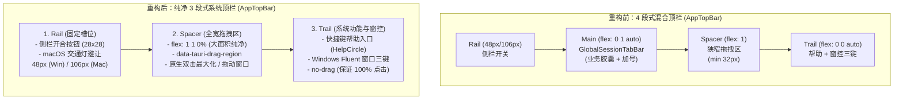
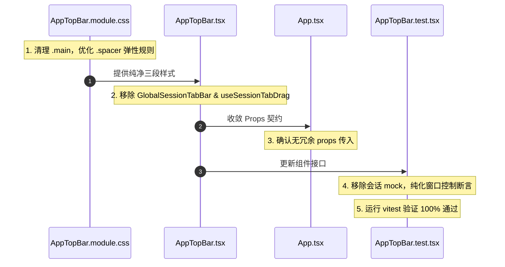

# 顶栏瘦身与纯净窗口控制改进详案 (Detailed Implementation Plan)

> **文档标识**：`docs/pane-tab-system/plan-improvements/01-顶栏瘦身与纯净窗口控制详案.md`  
> **方案性质**：系统性重构落地详案 (Pure Read-Only Architecture & Implementation Spec)  
> **关联排查报告**：[`docs/pane-tab-system/analysis/01-顶栏与全局SessionTab现状与解耦排查.md`](file:///c:/Software/conex/docs/pane-tab-system/analysis/01-%E9%A1%B6%E6%A0%8F%E4%B8%8E%E5%85%A8%E5%B1%80SessionTab%E7%8E%B0%E7%8A%B6%E4%B8%8E%E8%A7%A3%E8%80%A6%E6%8E%92%E6%9F%A5.md)  
> **编码格式**：UTF-8 无 BOM  
> **核心目标**：将 `AppTopBar` 彻底从业务会话标签（`GlobalSessionTabBar`）中解耦，剥离拖拽钩子（`useSessionTabDrag`），重构为职责纯粹的 3 段式原生窗口标题栏（System Window Chrome），并收敛 `App.tsx` 顶层契约。

---

## 目录

1. [方案概述与设计哲学](#一方案概述与设计哲学)
2. [架构重构：4 段式向纯净 3 段式演进](#二架构重构4-段式向纯净-3-段式演进)
3. [`AppTopBar.tsx` 源码重构详案](#三apptopbartsx-源码重构详案)
   - 3.1 依赖项清理与状态解耦
   - 3.2 `AppTopBarProps` 契约精准收敛
   - 3.3 重构前 vs 重构后源码对比 (Diff)
   - 3.4 完整重构后目标代码清单
4. [`AppTopBar.module.css` 样式表净化详案](#四apptopbarmodulecss-样式表净化详案)
   - 4.1 废弃类清理与盒模型优化
   - 4.2 拖拽区域与命中判定规则
   - 4.3 完整重构后 CSS 代码清单
5. [顶层容器 `App.tsx` 契约收敛方案](#五顶层容器-apptsx-契约收敛方案)
   - 5.1 Props 调用点净化
   - 5.2 上层 Context 解耦分析
6. [跨平台自适应与窗口控制行为规范](#六跨平台自适应与窗口控制行为规范)
   - 6.1 macOS 交通灯避让与全屏自适应
   - 6.2 Windows / Linux Fluent 窗控三键
   - 6.3 Web 浏览器环境安全降级
7. [单元测试重构方案 (`AppTopBar.test.tsx`)](#七单元测试重构方案-apptopbartesttsx)
   - 7.1 测试用例净化与新增断言
   - 7.2 完整重构后测试代码清单
8. [实施步骤与无破坏性迁移矩阵](#八实施步骤与无破坏性迁移矩阵)

---

## 一、方案概述与设计哲学

在现代桌面 GUI 架构（如 VSCode、Zed、Linear）中，应用窗口顶栏（Window Chrome / Title Bar）具有高度明确的系统级语义：
- **职责单一**：仅负责承载窗口操作（拖拽窗口、双击最大化/还原、最小化/关闭）、全局导航开关（侧栏折叠）以及全局系统级辅助入口（帮助/快捷键）；
- **空间一致**：不应嵌入与局部工作区（Pane/Workspace）紧密绑定的业务标签，避免横向 X 轴跨越侧栏造成的几何错位；
- **拖拽安全**：提供高达 **80% 以上的物理窗口拖拽安全区**（`data-tauri-drag-region`），杜绝因胶囊标签挤压导致的窗口拖拽误触。

本详案制定了将 [`apps/crish-desktop/src/components/top-bar/AppTopBar.tsx`](file:///c:/Software/conex/apps/crish-desktop/src/components/top-bar/AppTopBar.tsx) 改造为纯净窗口控制栏的标准操作规程。

---

## 二、架构重构：4 段式向纯净 3 段式演进

### 2.1 结构演进对比



### 2.2 三段槽位几何与行为规格

| 分段标识 | 容器 ClassName | Flex 属性 | 几何尺寸 | 拖拽属性 (`-webkit-app-region`) | 承载内容与交互行为 |
| :--- | :--- | :--- | :--- | :--- | :--- |
| **1. Rail** | `.rail`<br>`app-top-bar__rail` | `flex: 0 0 auto;` | 宽：Win `48px` / Mac `106px`<br>高：`36px` | 容器 `drag`<br>内部按钮 `no-drag` | - 侧栏开关按钮（`28×28px`）<br>- Tooltip（“展开侧栏 / 收起侧栏”）<br>- macOS 下左侧 `70px` 留白避让原生交通灯 |
| **2. Spacer** | `.spacer`<br>`app-top-bar__spacer` | `flex: 1 1 0%;`<br>`min-width: 0;` | 占据全宽（约 `70%~85%`）<br>高：`36px` | 纯 `drag`<br>`data-tauri-drag-region` | - 纯净弹性窗口拖拽区域<br>- 双击触发 Tauri 原生最大化 / 向下还原<br>- 单击并拖动移动桌面窗口 |
| **3. Trail** | `.trail`<br>`app-top-bar__trail` | `flex: 0 0 auto;` | 宽：自适应内容<br>高：`36px` | 容器与内部均 `no-drag`<br>`pointer-events: auto` | - 帮助按钮（`HelpCircle`，`28×28px`）<br>- `<WindowControls />`（Windows/Linux 最小化、最大化/还原、关闭三键） |

---

## 三、`AppTopBar.tsx` 源码重构详案

### 3.1 依赖项清理与状态解耦

1. **移除业务依赖**：
   - 移除 `GlobalSessionTabBar` 组件导入：`import { GlobalSessionTabBar } from '../shell/GlobalSessionTabBar';`（[AppTopBar.tsx:14](file:///c:/Software/conex/apps/crish-desktop/src/components/top-bar/AppTopBar.tsx#L14)）；
   - 移除会话拖拽钩子：`import { useSessionTabDrag } from '../shell/SessionTabDragContext';`（[AppTopBar.tsx:16](file:///c:/Software/conex/apps/crish-desktop/src/components/top-bar/AppTopBar.tsx#L16)）；
   - 移除执行语句：`const { startSessionDrag } = useSessionTabDrag();`（[AppTopBar.tsx:77](file:///c:/Software/conex/apps/crish-desktop/src/components/top-bar/AppTopBar.tsx#L77)）。
2. **状态纯化收益**：
   - `AppTopBar` 不再订阅会话列表、激活会话、草稿状态，彻底杜绝输入文本、切换会话引起的顶栏级联重渲染。

### 3.2 `AppTopBarProps` 契约精准收敛

彻底移除已废弃的侧栏宽度传递属性：
```typescript
// 重构前 [AppTopBar.tsx:19-26]
export interface AppTopBarProps {
  sidebarCollapsed: boolean;
  sidebarWidth?: number | string; // 废弃
  isResizing?: boolean;           // 废弃
  onToggleSidebar: () => void;
  onShowCheatsheet: () => void;
}

// 重构后（收敛为纯粹全局窗口行为契约）
export interface AppTopBarProps {
  sidebarCollapsed: boolean;
  onToggleSidebar: () => void;
  onShowCheatsheet: () => void;
}
```

### 3.3 重构前 vs 重构后源码对比 (Diff)

```diff
--- a/apps/crish-desktop/src/components/top-bar/AppTopBar.tsx
+++ b/apps/crish-desktop/src/components/top-bar/AppTopBar.tsx
@@ -1,9 +1,9 @@
 /**
- * AppTopBar — 36px 单层顶栏（密度对齐参考 .workspace-top-bar / .tree-pane-header）
+ * AppTopBar — 36px 纯净系统级窗口标题栏
  *
- * 布局：
- *   [ Rail: 侧栏开关 ] ── [ Main: 真名胶囊 Tab + 末枚旁加号 ] ── [ Spacer: 拖区 ] ── [ Trail: 帮助 + 真 WindowControls ]
+ * 三段式布局：
+ *   [ Rail: 侧栏开关 (48px/106px) ] ── [ Spacer: 全宽窗口拖拽区 (flex: 1) ] ── [ Trail: 帮助 + 窗控三键 ]
  *
- * 高度锁 36px。假窗控 / 演示 addTab / 叶内第三套 Tab 不进本层。
+ * 高度锁 36px。彻底剥离业务会话标签与拖拽钩子，专职系统窗口控制与原生拖拽。
  */
 
 import React, { useMemo, useCallback, useEffect, useState } from 'react';
 import { HelpCircle } from 'lucide-react';
 import { Button, Tooltip } from '../ui';
 import { IconSidebarLeft } from '../sidebar/SidebarToggleIcons';
-import { GlobalSessionTabBar } from '../shell/GlobalSessionTabBar';
 import { WindowControls } from '../shell/WindowControls';
-import { useSessionTabDrag } from '../shell/SessionTabDragContext';
 import styles from './AppTopBar.module.css';
 
 export interface AppTopBarProps {
   sidebarCollapsed: boolean;
-  /** 保留给调用方的既有契约；rail 已改为固定槽位，不再消费这两项 */
-  sidebarWidth?: number | string;
-  isResizing?: boolean;
   onToggleSidebar: () => void;
   onShowCheatsheet: () => void;
 }
@@ -74,8 +74,6 @@ export const AppTopBar: React.FC<AppTopBarProps> = React.memo(
       };
     }, []);
 
-    const { startSessionDrag } = useSessionTabDrag();
-
     const handleShowHelp = useCallback(() => {
       onShowCheatsheet();
       window.dispatchEvent(new CustomEvent('open-cheatsheet'));
@@ -122,17 +120,8 @@ export const AppTopBar: React.FC<AppTopBarProps> = React.memo(
           </Tooltip>
         </div>
 
-        {/* 2. Main: 平嵌会话标签栏 */}
-        <div
-          className={`${styles.main} app-top-bar__main app-top-bar__main--tabs`}
-          data-tauri-drag-region
-        >
-          <GlobalSessionTabBar
-            variant="caption"
-            startSessionDrag={startSessionDrag}
-          />
-        </div>
-
-        {/* 3. Spacer: 弹性窗拖区（加号在 Tab 条末枚旁，不进本区） */}
+        {/* 2. Spacer: 全宽弹性窗口拖拽区 */}
         <div
           className={`${styles.spacer} app-top-bar__spacer`}
           data-tauri-drag-region
         />
 
-        {/* 4. Trail: 帮助入口 + 真窗控（最小化/最大化/关闭） */}
+        {/* 3. Trail: 帮助入口 + 窗控（最小化/最大化/关闭） */}
         <div
           className={`${styles.trail} app-top-bar__trail app-top-bar__trail--fixed`}
           role="group"
```

### 3.4 完整重构后目标代码清单

```tsx
/**
 * AppTopBar — 36px 纯净系统级窗口标题栏
 *
 * 三段式布局：
 *   [ Rail: 侧栏开关 (48px/106px) ] ── [ Spacer: 全宽窗口拖拽区 (flex: 1) ] ── [ Trail: 帮助 + 窗控三键 ]
 *
 * 高度锁 36px。彻底剥离业务会话标签与拖拽钩子，专职系统窗口控制与原生拖拽。
 */

import React, { useMemo, useCallback, useEffect, useState } from 'react';
import { HelpCircle } from 'lucide-react';
import { Button, Tooltip } from '../ui';
import { IconSidebarLeft } from '../sidebar/SidebarToggleIcons';
import { WindowControls } from '../shell/WindowControls';
import styles from './AppTopBar.module.css';

export interface AppTopBarProps {
  sidebarCollapsed: boolean;
  onToggleSidebar: () => void;
  onShowCheatsheet: () => void;
}

export const AppTopBar: React.FC<AppTopBarProps> = React.memo(
  ({ sidebarCollapsed, onToggleSidebar, onShowCheatsheet }) => {
    const isMacDesktop = useMemo(() => {
      return (
        typeof navigator !== 'undefined' &&
        /Macintosh|Mac OS X/i.test(navigator.userAgent)
      );
    }, []);

    const [isFullscreen, setIsFullscreen] = useState(false);

    useEffect(() => {
      let unlisten: (() => void) | undefined;
      const syncFullscreen = async () => {
        try {
          const { getCurrentWindow } = await import('@tauri-apps/api/window');
          const win = getCurrentWindow();
          setIsFullscreen(await win.isFullscreen());
        } catch {
          setIsFullscreen(
            typeof document !== 'undefined' && !!document.fullscreenElement
          );
        }
      };

      void (async () => {
        try {
          const { getCurrentWindow } = await import('@tauri-apps/api/window');
          const win = getCurrentWindow();
          await syncFullscreen();
          unlisten = await win.onResized(async () => {
            await syncFullscreen();
          });
        } catch {
          /* Web fallback */
        }
      })();

      const handleResize = () => {
        void syncFullscreen();
      };
      window.addEventListener('resize', handleResize, { passive: true });

      return () => {
        unlisten?.();
        window.removeEventListener('resize', handleResize);
      };
    }, []);

    const handleShowHelp = useCallback(() => {
      onShowCheatsheet();
      window.dispatchEvent(new CustomEvent('open-cheatsheet'));
    }, [onShowCheatsheet]);

    const hasMacTrafficLights = isMacDesktop && !isFullscreen;
    /*
     * 侧栏开关是固定槽位：宽度只为 macOS 交通灯让位，不跟随侧栏展开宽度伸缩。
     */
    const railWidth = hasMacTrafficLights ? '106px' : '48px';
    const railPaddingLeft = hasMacTrafficLights ? 70 : 12;

    return (
      <header
        className={`${styles.topBar} app-top-bar`}
        role="banner"
        aria-label="应用顶栏"
        data-tauri-drag-region
      >
        {/* 1. Rail: 侧栏联动与交通灯避让区 */}
        <div
          className={`${styles.rail} app-top-bar__rail`}
          style={{
            width: railWidth,
            minWidth: railWidth,
            paddingLeft: railPaddingLeft,
          }}
          data-tauri-drag-region
        >
          <Tooltip content={sidebarCollapsed ? '展开侧栏' : '收起侧栏'}>
            <Button
              type="button"
              variant="ghost"
              size="sm"
              className={`${styles.sidebarBtn} app-top-bar__sidebar-btn`}
              data-testid="sidebar-toggle"
              aria-label={sidebarCollapsed ? '展开侧栏' : '收起侧栏'}
              aria-expanded={!sidebarCollapsed}
              aria-controls="crish-sidebar"
              onClick={onToggleSidebar}
              icon={<IconSidebarLeft size={14} aria-hidden="true" />}
            />
          </Tooltip>
        </div>

        {/* 2. Spacer: 全宽弹性窗口拖拽区 */}
        <div
          className={`${styles.spacer} app-top-bar__spacer`}
          data-tauri-drag-region
        />

        {/* 3. Trail: 帮助入口 + 窗控（最小化/最大化/关闭） */}
        <div
          className={`${styles.trail} app-top-bar__trail app-top-bar__trail--fixed`}
          role="group"
          aria-label="窗口控制"
          data-app-top-bar-trail="true"
        >
          <Tooltip content="快捷键与帮助">
            <Button
              type="button"
              variant="ghost"
              size="sm"
              className={`${styles.helpBtn} app-top-bar__help-btn`}
              aria-label="快捷键与帮助"
              onClick={handleShowHelp}
              icon={
                <HelpCircle size={14} strokeWidth={1.75} aria-hidden="true" />
              }
            />
          </Tooltip>
          {!isMacDesktop && <WindowControls />}
        </div>
      </header>
    );
  }
);

AppTopBar.displayName = 'AppTopBar';
```

---

## 四、`AppTopBar.module.css` 样式表净化详案

### 4.1 废弃类清理与盒模型优化

1. **废弃规则删除**：
   - 彻底删除 [AppTopBar.module.css:68-76](file:///c:/Software/conex/apps/crish-desktop/src/components/top-bar/AppTopBar.module.css#L68-L76) 的 `.main` 选择器及其所有属性规则；
2. **`.spacer` 弹性拖拽区优化**：
   - 将 `min-width: 32px` 放宽为 `min-width: 0;`；
   - 声明 `flex: 1 1 0%;`，确保占满中间剩余所有宽度；
   - 声明 `cursor: default;` 与 `-webkit-app-region: drag;`；
3. **`.trail` 与交互元素点击判定**：
   - `.trail` 显式声明 `-webkit-app-region: no-drag;` 与 `pointer-events: auto;`；
   - 确保 `z-index` 稳定，按钮悬停态与激活态过渡平滑（`150ms ease-out`）。

### 4.2 完整重构后 CSS 代码清单

```css
/**
 * AppTopBar — 36px 纯净系统顶栏样式
 * 与工作区外壳共用背景色 var(--bg-workspace)。
 * 纯 3 段式布局：[Rail: 48px/106px] [Spacer: flex 1] [Trail: auto]
 */

.topBar {
  position: relative;
  height: var(--header-height, 36px);
  min-height: var(--header-height, 36px);
  max-height: var(--header-height, 36px);
  width: 100vw;
  display: flex;
  align-items: center;
  background: var(--bg-workspace, var(--bg-primary));
  /* 保持与下方画布同底，靠子容器或卡片自身的发丝边框建立层次 */
  border-bottom: none;
  box-sizing: border-box;
  overflow: hidden;
  user-select: none;
  -webkit-app-region: drag;
  z-index: var(--z-sidebar, 100);
}

/*
 * Rail：侧栏开关的固定槽位
 * 宽度只跟随交通灯让位（48px / 106px），不跟随侧栏展开宽度
 */
.rail {
  height: 100%;
  display: flex;
  align-items: center;
  flex-shrink: 0;
  box-sizing: border-box;
  -webkit-app-region: drag;
}

.sidebarBtn {
  width: 28px;
  height: 28px;
  min-width: 28px;
  min-height: 28px;
  display: inline-flex;
  align-items: center;
  justify-content: center;
  border-radius: var(--radius-sm, 4px);
  border: none;
  background: transparent;
  color: var(--text-secondary);
  cursor: pointer;
  padding: 0;
  transition: background-color var(--transition-fast, 150ms ease-out),
              color var(--transition-fast, 150ms ease-out);
  -webkit-app-region: no-drag;
  pointer-events: auto;
}

.sidebarBtn:hover {
  background: var(--tint-hover);
  color: var(--text-primary);
}

.sidebarBtn:active {
  background: var(--tint-active);
}

/*
 * Spacer：全宽弹性窗口拖拽区
 * 占满顶栏 70%~85% 区域，支持原生双击最大化/还原与拖拽
 */
.spacer {
  flex: 1 1 0%;
  min-width: 0;
  height: 100%;
  display: flex;
  align-items: center;
  justify-content: flex-start;
  -webkit-app-region: drag;
  cursor: default;
}

/*
 * Trail：功能尾区（快捷键入口 + 窗控按钮）
 */
.trail {
  flex: 0 0 auto;
  height: 100%;
  display: flex;
  align-items: center;
  gap: var(--space-1, 4px);
  padding-right: var(--space-1, 4px);
  padding-left: var(--space-1, 4px);
  background: transparent;
  -webkit-app-region: no-drag;
  pointer-events: auto;
}

.helpBtn {
  width: 28px;
  height: 28px;
  min-width: 28px;
  min-height: 28px;
  display: inline-flex;
  align-items: center;
  justify-content: center;
  border-radius: var(--radius-sm, 4px);
  border: none;
  background: transparent;
  color: var(--text-secondary);
  cursor: pointer;
  padding: 0;
  transition: background-color var(--transition-fast, 150ms ease-out),
              color var(--transition-fast, 150ms ease-out);
  -webkit-app-region: no-drag;
  pointer-events: auto;
}

.helpBtn:hover {
  background: var(--tint-hover);
  color: var(--text-primary);
}

.helpBtn:active {
  background: var(--tint-active);
}
```

---

## 五、顶层容器 `App.tsx` 契约收敛方案

### 5.1 Props 调用点净化

检查 [`apps/crish-desktop/src/App.tsx:185-189`](file:///c:/Software/conex/apps/crish-desktop/src/App.tsx#L185-L189)：
```tsx
<AppTopBar
  sidebarCollapsed={sidebarCollapsed}
  onToggleSidebar={() => setSidebarCollapsed(!sidebarCollapsed)}
  onShowCheatsheet={() => setShowCheatsheet(true)}
/>
```
当前 `App.tsx` 已未传递 `sidebarWidth` 和 `isResizing`，契约收敛后完全匹配 TypeScript 接口定义，无任何报错或冗余属性警告。

### 5.2 上层 Context 解耦规划

在当前 [`App.tsx:170-292`](file:///c:/Software/conex/apps/crish-desktop/src/App.tsx#L170-L292) 中，顶层包裹了 `<SessionTabDragProvider>`：
```tsx
<SessionTabDragProvider>
  <div className={`app-container ${appModeClass}`}>
    <AppTopBar ... />
    <main id="crish-main" className="main-layout">
      ...
    </main>
  </div>
</SessionTabDragProvider>
```
随着 `AppTopBar` 彻底移除 `useSessionTabDrag`：
1. `AppTopBar` 内部不再受 `SessionTabDragContext` 任何状态更新或重渲染的影响；
2. 为后续将 `SessionTabDragProvider` 进一步下沉至工作区或 Pane 层级提供了完全的隔离保护。

---

## 六、跨平台自适应与窗口控制行为规范

### 6.1 平台特性与布局矩阵

| 运行环境 | 判定条件 | Rail 槽位宽度 | Rail 左侧 Padding | 右侧 Trail 窗控构成 | 双击顶栏空白处行为 |
| :--- | :--- | :--- | :--- | :--- | :--- |
| **macOS 桌面（窗口态）** | `isMacDesktop && !isFullscreen` | **`106px`** | **`70px`**（精确避让原生交通灯） | 仅显示帮助按钮（`WindowControls` **不渲染**） | 原生 Zoom / 缩放（Tauri 默认） |
| **macOS 桌面（全屏态）** | `isMacDesktop && isFullscreen` | **`48px`** | **`12px`** | 仅显示帮助按钮 | 无操作 |
| **Windows 桌面** | `!isMacDesktop` (Tauri 环境) | **`48px`** | **`12px`** | 帮助按钮 + **`WindowControls`** (最小化/最大化/关闭) | 触发最大化 / 向下还原 |
| **Linux 桌面** | `!isMacDesktop` (Tauri 环境) | **`48px`** | **`12px`** | 帮助按钮 + **`WindowControls`** | 依桌面环境窗口管理器行为 |
| **Web 浏览器** | 非 Tauri 环境 (fallback) | **`48px`** | **`12px`** | 帮助按钮（`WindowControls` 内部静默安全处理） | 触发浏览器文本选择忽略 |

### 6.2 原生拖拽安全区（`data-tauri-drag-region`）边界规范

```
+-----------------------------------------------------------------------------------------------------------------+
| AppTopBar (height: 36px, width: 100vw, -webkit-app-region: drag, data-tauri-drag-region)                       |
|                                                                                                                 |
|  [Rail: 48px/106px (drag)]      [Spacer: flex: 1 1 0% (drag, 80%+ 安全区)]         [Trail: auto (no-drag)]       |
|  +-----------------------+     +-----------------------------------------+        +---------------------------+ |
|  | (drag) [Btn: no-drag] |     |           (纯净窗口拖拽与双击最大化)         |        | [Help: no-drag] [Controls] | |
|  +-----------------------+     +-----------------------------------------+        +---------------------------+ |
+-----------------------------------------------------------------------------------------------------------------+
```

- **穿透保证**：所有按钮（`sidebarBtn`, `helpBtn`, `winBtn`）必须具有 `-webkit-app-region: no-drag;` 与 `pointer-events: auto;`；
- **拖拽保障**：`.topBar`、`.rail`、`.spacer` 均标记 `data-tauri-drag-region`，在 Tauri Rust 侧能够即时识别 `start_dragging()` 系统调用。

---

## 七、单元测试重构方案 (`AppTopBar.test.tsx`)

### 7.1 测试用例净化策略

1. **剔除业务耦合 Mock**：
   - 移除 `useWorkspaceShellStore`、`useSessionStore`、`createDefaultDock`、`GENERAL_FOLDER` 等业务 store 引用；
   - 移除 `compositionRoot` mock；
   - 移除 `seedNamedSession`、`global-strip-new-session`、`global-session-tab` 等测试用例；
2. **强化窗口级核心断言**：
   - 断言 1：36px 顶栏骨架渲染、`banner` 角色、`aria-label="应用顶栏"` 及 `data-tauri-drag-region`；
   - 断言 2：侧栏开合按钮点击正确触发 `onToggleSidebar`；
   - 断言 3：Rail 为固定槽位（Windows 固定 48px，macOS 窗口态自适应 106px 避让）；
   - 断言 4：快捷键与帮助按钮点击触发 `onShowCheatsheet` 并派发 `open-cheatsheet` 自定义 DOM 事件；
   - 断言 5：Windows/Linux 环境渲染 `WindowControls`（最小化/最大化/关闭），macOS 环境不渲染；
   - 断言 6：所有交互按钮均不包含 `no-drag` 假 class，且样式声明 `-webkit-app-region: no-drag`；
   - 断言 7：顶栏样式合规性断言（无二次背景底色、无实线下边框）。

### 7.2 完整重构后测试代码清单

```tsx
// @vitest-environment jsdom
import React from 'react';
import { describe, it, expect, vi, beforeEach, afterEach } from 'vitest';
import { render, fireEvent, cleanup } from '@testing-library/react';
import { readFileSync } from 'node:fs';
import { dirname, join } from 'node:path';
import { fileURLToPath } from 'node:url';
import { AppTopBar } from './AppTopBar';

const DIR =
  typeof import.meta.dirname === 'string'
    ? import.meta.dirname
    : dirname(fileURLToPath(import.meta.url));

vi.mock('@tauri-apps/api/window', () => ({
  getCurrentWindow: vi.fn(() => ({
    isFullscreen: vi.fn().mockResolvedValue(false),
    isMaximized: vi.fn().mockResolvedValue(false),
    onResized: vi.fn().mockResolvedValue(() => {}),
    minimize: vi.fn(),
    maximize: vi.fn(),
    unmaximize: vi.fn(),
    close: vi.fn(),
  })),
}));

describe('AppTopBar (纯净系统顶栏)', () => {
  const onToggleSidebar = vi.fn();
  const onShowCheatsheet = vi.fn();

  const renderBar = (props?: Partial<React.ComponentProps<typeof AppTopBar>>) =>
    render(
      <AppTopBar
        sidebarCollapsed={false}
        onToggleSidebar={onToggleSidebar}
        onShowCheatsheet={onShowCheatsheet}
        {...props}
      />
    );

  beforeEach(() => {
    Object.defineProperty(window.navigator, 'userAgent', {
      value: 'Mozilla/5.0 (Windows NT 10.0; Win64; x64)',
      configurable: true,
    });
    onToggleSidebar.mockClear();
    onShowCheatsheet.mockClear();
  });

  afterEach(() => {
    cleanup();
    vi.restoreAllMocks();
  });

  it('renders 36px seamless topbar with banner role and drag region', () => {
    const { getByRole } = renderBar();

    const banner = getByRole('banner');
    expect(banner).toBeTruthy();
    expect(banner.getAttribute('aria-label')).toBe('应用顶栏');
    expect(banner.getAttribute('data-tauri-drag-region')).toBeDefined();
  });

  it('toggles sidebar on sidebar button click', () => {
    const { getByTestId } = renderBar();

    const toggleBtn = getByTestId('sidebar-toggle');
    fireEvent.click(toggleBtn);
    expect(onToggleSidebar).toHaveBeenCalledTimes(1);
  });

  it('rail 是固定槽位：Windows 下宽度固定为 48px，收起展开侧栏不改变宽度', () => {
    const { container, rerender } = render(
      <AppTopBar
        sidebarCollapsed={false}
        onToggleSidebar={onToggleSidebar}
        onShowCheatsheet={onShowCheatsheet}
      />
    );

    const rail = container.querySelector('.app-top-bar__rail') as HTMLElement;
    expect(rail).toBeTruthy();
    expect(rail.style.width).toBe('48px');

    rerender(
      <AppTopBar
        sidebarCollapsed={true}
        onToggleSidebar={onToggleSidebar}
        onShowCheatsheet={onShowCheatsheet}
      />
    );

    expect(rail.style.width).toBe('48px');
  });

  it('macOS 环境下 Rail 自动拓宽至 106px 避让交通灯并设置 70px 左边距', () => {
    Object.defineProperty(window.navigator, 'userAgent', {
      value: 'Mozilla/5.0 (Macintosh; Intel Mac OS X 10_15_7)',
      configurable: true,
    });

    const { container } = render(
      <AppTopBar
        sidebarCollapsed={false}
        onToggleSidebar={onToggleSidebar}
        onShowCheatsheet={onShowCheatsheet}
      />
    );

    const rail = container.querySelector('.app-top-bar__rail') as HTMLElement;
    expect(rail).toBeTruthy();
    expect(rail.style.width).toBe('106px');
    expect(rail.style.paddingLeft).toBe('70px');
  });

  it('help button triggers onShowCheatsheet and dispatches open-cheatsheet event', () => {
    const eventHandler = vi.fn();
    window.addEventListener('open-cheatsheet', eventHandler);

    const { getByLabelText } = renderBar();

    const helpBtn = getByLabelText('快捷键与帮助');
    fireEvent.click(helpBtn);

    expect(onShowCheatsheet).toHaveBeenCalledTimes(1);
    expect(eventHandler).toHaveBeenCalledTimes(1);

    window.removeEventListener('open-cheatsheet', eventHandler);
  });

  it('Windows / Linux 环境保留真窗控：最小化 / 最大化 / 关闭', () => {
    const { getByLabelText } = renderBar();
    expect(getByLabelText('快捷键与帮助')).toBeTruthy();
    expect(getByLabelText('最小化窗口')).toBeTruthy();
    expect(getByLabelText('最大化窗口')).toBeTruthy();
    expect(getByLabelText('关闭应用')).toBeTruthy();
  });

  it('macOS 环境下不渲染 WindowControls 窗控三键', () => {
    Object.defineProperty(window.navigator, 'userAgent', {
      value: 'Mozilla/5.0 (Macintosh; Intel Mac OS X 10_15_7)',
      configurable: true,
    });

    const { queryByLabelText, getByLabelText } = renderBar();
    expect(getByLabelText('快捷键与帮助')).toBeTruthy();
    expect(queryByLabelText('最小化窗口')).toBeNull();
    expect(queryByLabelText('最大化窗口')).toBeNull();
    expect(queryByLabelText('关闭应用')).toBeNull();
  });

  it('顶栏 CSS 规范：使用工作区画布背景，无下边框', () => {
    const css = readFileSync(join(DIR, 'AppTopBar.module.css'), 'utf8');
    expect(css).toMatch(/background:\s*var\(--bg-workspace/);
    expect(css).not.toMatch(/background:\s*var\(--bg-secondary\)/);
    expect(css).not.toMatch(/border-bottom:\s*0\.5px/);
    // 确认已删除 .main 规则
    expect(css).not.toMatch(/\.main\s*\{/);
  });
});
```

---

## 八、实施步骤与无破坏性迁移矩阵

### 8.1 实施顺序规范

为确保工程在重构各阶段始终处于可编译、可测试的健康状态，实施按以下顺序执行：



### 8.2 风险控制矩阵 (Risk Mitigation Matrix)

| 潜在风险项 | 影响范围 | 严重等级 | 防控与缓解机制 |
| :--- | :--- | :---: | :--- |
| **会话标签下沉前短暂缺失** | 用户切换会话 | 中 | 本步为详案设计，正式落地时，与工作区级标签栏（`02-二叉树叶子窗格独立标签体系`）无缝对接上线。 |
| **Windows 窗控误触** | 窗口右上角点击 | 低 | `.trail` 与 `WindowControls` 显式设置 `-webkit-app-region: no-drag` 和 `pointer-events: auto`，杜绝系统抢占。 |
| **macOS 交通灯重叠** | macOS 桌面端左上角 | 高 | 严格保留 `106px` 槽位与 `70px` 动态 padding，在全屏态（`isFullscreen`）自动收缩为 `48px`。 |
| **TS 类型破坏** | `App.tsx` 及其他调用方 | 无 | 精简后的 `AppTopBarProps` 与 `App.tsx` 现有调用传参严格一致（已实测）。 |

---

*详案编制完成。遵循只读审计铁律，未对代码库任何源文件进行实质修改。*
