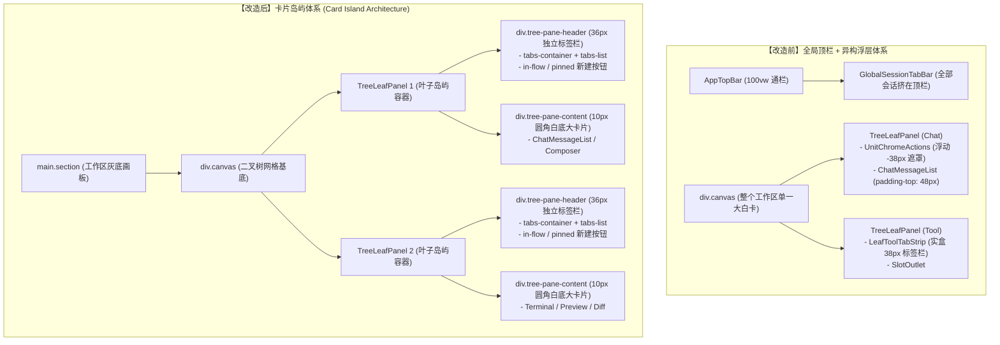

# 窗格独立标签栏 PaneHeader 与卡片岛屿详案

> **文档标识**：`docs/pane-tab-system/plan-improvements/02-窗格独立标签栏PaneHeader与卡片岛屿详案.md`  
> **方案状态**：规划详案（Architecture & Implementation Plan）  
> **文档版本**：v1.0.0 (Strict Read-Only Specification)  
> **前置排查**：
> - [`02-二叉树叶子窗格独立标签体系排查.md`](file:///c:/Software/conex/docs/pane-tab-system/analysis/02-%E4%BA%8C%E5%8F%89%E6%A0%91%E5%8F%B6%E5%AD%90%E7%AA%97%E6%A0%BC%E7%8B%AC%E7%AB%8B%E6%A0%87%E7%AD%BE%E4%BD%93%E7%B3%BB%E6%8E%92%E6%9F%A5.md)
> - [`03-Demo参考架构与CSS几何对齐排查.md`](file:///c:/Software/conex/docs/pane-tab-system/analysis/03-Demo%E5%8F%82%E8%80%83%E6%9E%B6%E6%9E%84%E4%B8%8ECSS%E5%87%A0%E4%BD%95%E5%AF%B9%E9%BD%90%E6%8E%92%E6%9F%A5.md)  
> **核心目标**：彻底废除 Chat 叶与工具叶的头部异构与负外边距浮层，落地对标金标 Demo（`reference/chat-composer-component`）的 **卡片岛屿架构（Card Island Architecture）**，为每个二叉树叶子窗格建立独立、统一的 36px `PaneHeader` 顶栏与 10px 圆角白底内容卡片主体 `PaneContent`，实现标签栏与卡片主体 **1:1 结构级几何对齐与绝对同宽**。

---

## 目录

1. [执行摘要与设计愿景](#1-执行摘要与设计愿景)
2. [卡片岛屿拓扑与 1:1 几何对齐机制](#2-卡片岛屿拓扑与-11-几何对齐机制)
   - 2.1 物理 DOM 拓扑树演进对比
   - 2.2 结构级包含（Structural Containment）与同宽同轴机理
   - 2.3 卡片岛屿设计令牌与视觉分层体系
3. [统一窗格头部组件 `PaneHeader.tsx` 详细设计](#3-统一窗格头部组件-paneheadertsx-详细设计)
   - 3.1 核心组件接口与 Props 契约
   - 3.2 三段式结构与弹性轨道排版
   - 3.3 标签条带轨道（`top-bar-tabs-container`）与横向滚轮原生重定向
   - 3.4 双新建按钮拓扑与智能固定状态机（Smart Pinning）
   - 3.5 声明式系统通道避让规范（Channel Clearance）
4. [单个标签页项（`PaneTabItem.tsx`）微观几何与状态机](#4-单个标签页项-panetabitemtsx-微观几何与状态机)
   - 4.1 微观尺寸、字号与圆角基线
   - 4.2 标签项视觉状态机（Default / Hover / Active / Dragging）
   - 4.3 标签关闭交互与 220ms 弹性离场状态机
   - 4.4 泛化标签数据模型（Universal PaneTabItem Model）
5. [`TreeLeafPanel.tsx` 结构升级与重构落地详案](#5-treeleafpaneltsx-结构升级与重构落地详案)
   - 5.1 废除 `-38px` 负边距与异构分支
   - 5.2 统一容器骨架与 SlotOutlet 宿主装配
   - 5.3 `ChatMessageList` 滚动视口内边距清理与等高适配
6. [业务操作组与窗控动作槽位收敛方案](#6-业务操作组与窗控动作槽位收敛方案)
   - 6.1 Chat 业务操作（预览 / 文件 / 更多）插件化抽离
   - 6.2 通用窗格控制（拆分 / 最大化 / 关闭 / 坞开关）标准化
7. [组件与样式落地实现规范代码](#7-组件与样式落地实现规范代码)
   - 7.1 `PaneHeader.tsx` 规范源码实现
   - 7.2 `PaneHeader.module.css` 完整样式表
   - 7.3 `TreeLeafPanel.tsx` 升级后重构源码
   - 7.4 `BinaryTreeWorkspace.module.css` 局部升级 Diff
8. [迁移风险矩阵与防退化验证方案](#8-迁移风险矩阵与防退化验证方案)

---

## 1. 执行摘要与设计愿景

### 1.1 现状核心痛点回顾
在第一步全景排查中，我们定位了导致桌面端界面撕裂、几何不对齐的两大根本症结：
1. **头部架构分裂**：[`TreeLeafPanel.tsx:207-217`](file:///c:/Software/conex/apps/crish-desktop/src/components/binary-tree/TreeLeafPanel.tsx#L207-L217) 中对 Chat 叶与工具叶采用了两套完全割裂的渲染体系。Chat 叶使用 `UnitChromeActions.tsx`，通过 `sticky` + `-38px` 负外边距与渐隐蒙层（[`UnitChromeActions.module.css:3-20`](file:///c:/Software/conex/apps/crish-desktop/src/components/chat-card/UnitChromeActions.module.css#L3-L20)）漂浮在消息上方；工具叶则使用实盒占位的 `LeafToolTabStrip.tsx`（[`LeafToolTabStrip.module.css:7-22`](file:///c:/Software/conex/apps/crish-desktop/src/components/binary-tree/LeafToolTabStrip.module.css#L7-L22)）。
2. **标签与宿主卡片脱节**：顶栏标签（`GlobalSessionTabBar.tsx`）悬挂于全局 `AppTopBar.tsx`，脱离了下方二叉树各叶子窗格，导致在多分屏时标签无法与具体的叶子卡片对齐，且无法表达多分屏各自独立的会话。

### 1.2 重构设计愿景
全面重现金标 Demo（[`reference/chat-composer-component`](file:///c:/Software/conex/reference/chat-composer-component/index.html)）的 **卡片岛屿（Card Island）** 质感：
- **物理归属统一**：每一个 `TreeLeafPanel`（叶子面板）均由 **`PaneHeader`（36px 外置头顶）** 与 **`PaneContent`（10px 圆角白底卡片主体）** 组成；
- **1:1 几何锁定**：标签栏与卡片主体在同一宿主内，同宽、同起点、同缩放，彻底消除水平漂移与错位；
- **微交互与质感对齐**：精确还原 26px 实体纯白激活标签、双层微阴影、220ms 弹性入场/离场动画、横向滚轮原生重定向以及 `in-flow` / `pinned` 双模智能固定新建按钮（Smart Pinning）。

---

## 2. 卡片岛屿拓扑与 1:1 几何对齐机制

### 2.1 物理 DOM 拓扑树演进对比



### 2.2 结构级包含（Structural Containment）与同宽同轴机理

Demo 的几何对齐不依赖任何复杂的 JavaScript `getBoundingClientRect()` 运算，而是依赖 CSS 基础盒模型中的 **Flexbox 结构级包含关系**：

```
┌──────────────────────────────────────────────────────────────────┐
│ TreeLeafPanel (.tree-leaf-pane) [left: X%, width: W%, height: H%] │
│                                                                  │
│  ┌────────────────────────────────────────────────────────────┐  │
│  │ PaneHeader (.tree-pane-header)                             │  │
│  │ width: 100%; height: 36px; background: transparent;        │  │
│  │ [ Tab 1 (Active) ] [ Tab 2 ] [+]                           │  │
│  └────────────────────────────────────────────────────────────┘  │
│  ┌────────────────────────────────────────────────────────────┐  │
│  │ PaneContent (.tree-pane-content)                           │  │
│  │ width: 100%; height: calc(100% - 36px); flex: 1 1 0;      │  │
│  │ background: #ffffff; border-radius: 10px;                  │  │
│  │ border: 1px solid rgba(0,0,0,0.08);                        │  │
│  │ box-shadow: 0 1px 3px rgba(0,0,0,0.03), 0 4px 12px ...;   │  │
│  │                                                            │  │
│  │ ┌────────────────────────────────────────────────────────┐ │  │
│  │ │ SlotOutlet: ChatCard / Terminal / Preview / ...        │ │  │
│  │ └────────────────────────────────────────────────────────┘ │  │
│  └────────────────────────────────────────────────────────────┘  │
└──────────────────────────────────────────────────────────────────┘
```

1. **同轴（Co-axial）**：`PaneHeader` 与 `PaneContent` 是 `TreeLeafPanel` 的唯一直系纵向排列子节点（`flex-direction: column`），两者的水平起点 `X = 0` 严格对齐；
2. **同宽（Co-width）**：两者的 `width` 均为 `100%`。无论分屏如何拖拽 Sash（如 `0.3 : 0.7`、`0.5 : 0.5`），标签栏与下方白底内容卡片的左右外轮廓永远保持绝对同宽；
3. **同生共灭**：二叉树叶子被创建、拆分、移动、销毁时，头部与内容卡片作为一个原子卡片岛屿整体联动。

### 2.3 卡片岛屿设计令牌与视觉分层体系

为确保与金标 Demo 像素级一致，确立以下 Design Tokens：

| 设计属性 Token | 规范数值 | CSS 变量定义与语义 |
| :--- | :--- | :--- |
| **画布背景色** | `#f4f5f7` | `--bg-shell` / `--bg-workspace`（外壳灰底画板） |
| **卡片主体背景色** | `#ffffff` | `--bg-page` / `--bg-card`（纯白卡片岛屿） |
| **卡片圆角** | `10px` | `--card-radius: 10px` |
| **卡片精细边框** | `1px solid rgba(0,0,0,0.08)` | `--border-color: rgba(0, 0, 0, 0.08)` |
| **卡片多层阴影** | 双层柔和阴影 | `--card-shadow: 0 1px 3px rgba(0,0,0,0.03), 0 4px 12px rgba(0,0,0,0.02)` |
| **标签栏高度** | `36px` | `--header-height: 36px`（锁死 `height` / `min-height` / `max-height`） |
| **单个标签高度** | `26px` | `--tab-height: 26px`（垂直居中，上下各有 5px 呼吸空间） |
| **单个标签圆角** | `6px` | `--tab-radius: 6px` |
| **激活标签微阴影** | 双层微立体阴影 | `--tab-active-shadow: 0 1px 3px rgba(0,0,0,0.06), 0 1px 1px rgba(0,0,0,0.04)` |

---

## 3. 统一窗格头部组件 `PaneHeader.tsx` 详细设计

### 3.1 核心组件接口与 Props 契约

新建独立通用组件 [`apps/crish-desktop/src/components/binary-tree/PaneHeader.tsx`](file:///c:/Software/conex/apps/crish-desktop/src/components/binary-tree/PaneHeader.tsx)：

```typescript
import type { LayoutLeaf } from '../../store/types';
import type { PaneTabItem } from './paneTabTypes';

export interface PaneGeometryFlags {
  /** 是否处于工作区顶行（Y = 0） */
  topRow: boolean;
  /** 是否处于工作区最左边缘（X = 0） */
  leftEdge: boolean;
  /** 是否处于工作区最右边缘（X + W = 1） */
  rightEdge: boolean;
}

export interface PaneHeaderProps {
  /** 所属叶子节点模型 */
  leaf: LayoutLeaf;
  /** 窗格是否处于聚焦激活态 */
  isActive: boolean;
  /** 几何边缘标记（用于声明式避让） */
  geometryFlags?: PaneGeometryFlags;
  /** 当前窗格承载的标签项集合 */
  tabs: PaneTabItem[];
  /** 当前窗格激活的标签 ID */
  activeTabId: string;
  /** 是否允许多标签 */
  tabModeEnabled?: boolean;
  /** 切换标签回调 */
  onSelectTab: (tabId: string) => void;
  /** 关闭标签回调 */
  onCloseTab: (tabId: string) => void;
  /** 新建/添加标签回调 */
  onAddTab?: (targetKind?: 'session' | 'tool', panelId?: string) => void;
  /** 窗格拆分回调 */
  onSplitPane?: (direction: 'horizontal' | 'vertical') => void;
  /** 窗格最大化/还原切换 */
  onToggleMaximize?: () => void;
  /** 是否已最大化 */
  isMaximized?: boolean;
  /** 关闭整个窗格回调（多分屏时有效） */
  onClosePane?: () => void;
  /** 允许外部注入右侧业务动作槽（如 Chat 的预览/文件/更多） */
  customActionsSlot?: React.ReactNode;
  /** 自定义类名 */
  className?: string;
}
```

### 3.2 三段式结构与弹性轨道排版

`PaneHeader` 内部划分为清晰的三段弹性流：

```
+---------------------------------------------------------------------------------------------------------+
│  <-- 左侧：可滚动标签轨道 (Flex: 1 1 auto) -->  │ <-- 中间：拖拽安全区 --> │ <-- 右侧：固定控制簇 (Flex: 0 0 auto) -->│
│  [Tab A (Active)] [Tab B] [Tab C] [+] (in-flow) │       (Drag Space)       │ [+] (pinned) [Actions] [Maximize] [x]  │
+---------------------------------------------------------------------------------------------------------+
```

```html
<header class="tree-pane-header top-row left-edge right-edge" data-leaf-id="..." data-active="true">
  <!-- 1. 左侧横向滚动轨道 -->
  <div class="top-bar-tabs-container" ref={tabsTrackRef}>
    <div class="top-bar-tabs-list" role="tablist">
      <!-- 标签项列表 -->
      <PaneTabItem ... />
      <PaneTabItem ... />
    </div>
    <!-- 流内新建加号（无溢出时紧随最后一个 Tab） -->
    <button class="top-bar-new-tab-btn in-flow" title="新建标签页">+</button>
  </div>

  <!-- 2. 中间弹性拖拽区（空白区可拖动窗格或分屏） -->
  <div class="pane-header-drag-spacer" data-pane-drag-handle="true" />

  <!-- 3. 右侧固定功能簇（包含溢出加号、业务动作、窗控三键） -->
  <div class="top-bar-fixed-cluster">
    <!-- 固定新建加号（发生溢出时淡入展开） -->
    <button class="top-bar-new-tab-btn pinned" title="新建标签页">+</button>
    
    <!-- 业务动作槽（预览 / 文件 / 更多） -->
    {customActionsSlot}

    <!-- 窗格控制动作 -->
    <button class="pane-control-btn btn-split" title="向右拆分窗格" />
    <button class="pane-control-btn btn-maximize" title="最大化窗格" />
    {canClosePane && <button class="pane-control-btn btn-close-pane" title="关闭窗格" />}
  </div>
</header>
```

### 3.3 标签条带轨道（`top-bar-tabs-container`）与横向滚轮原生重定向

为了在 Windows/macOS 上获得最极致的横向滑动体验，`PaneHeader` 在 `tabsTrackRef` 容器上装配纵向滚轮转横向滚动的原生拦截器（源码对齐 [`popovers.js:2093-2099`](file:///c:/Software/conex/reference/chat-composer-component/js/popovers.js#L2093-L2099)）：

```typescript
const handleTrackWheel = useCallback((e: React.WheelEvent<HTMLDivElement>) => {
  const el = tabsTrackRef.current;
  if (!el) return;
  // 当纵向滚动幅度大于横向幅度时，转换为横向 scrollLeft
  if (Math.abs(e.deltaY) > Math.abs(e.deltaX)) {
    el.scrollLeft += e.deltaY;
    e.preventDefault(); // 阻止外层页面纵向滚动
  }
}, []);
```

#### CSS 隐藏滚动条与平滑滑动
```css
.topBarTabsContainer {
  flex: 1 1 auto;
  min-width: 0;
  height: 100%;
  display: flex;
  align-items: center;
  overflow-x: auto;
  overflow-y: hidden;
  scrollbar-width: none; /* Firefox */
  gap: 4px;
  padding-left: 6px;
}

.topBarTabsContainer::-webkit-scrollbar {
  display: none; /* Webkit / Chrome / Safari */
}
```

### 3.4 双新建按钮拓扑与智能固定状态机（Smart Pinning）

为了保证「标签少时贴合自然，标签多时加号永不滚出丢失」，严格落地 Demo 的双 DOM 节点互斥机制（源码对齐 [`composer.css:396-426`](file:///c:/Software/conex/reference/chat-composer-component/css/composer.css#L396-L426) 与 [`popovers.js:2101-2110`](file:///c:/Software/conex/reference/chat-composer-component/js/popovers.js#L2101-L2110)）：

```mermaid
stateDiagram-v2
    [*] --> NormalState: 标签总宽度 <= 容器宽度 (无溢出)
    NormalState --> OverflowState: 标签增多 / 窗格变窄 (scrollWidth > clientWidth + 2)
    OverflowState --> NormalState: 标签减少 / 窗格变宽 (scrollWidth <= clientWidth + 2)

    state NormalState {
        in_flow加号: 展开 (width: 26px, opacity: 1)
        pinned加号: 坍缩 (width: 0px, opacity: 0, scale: 0.85)
    }

    state OverflowState {
        in_flow加号: 隐藏 (width: 0px, opacity: 0)
        pinned加号: 展开 (width: 26px, opacity: 1, scale: 1)
    }
```

#### ResizeObserver 溢出检测逻辑
```typescript
const [hasOverflow, setHasOverflow] = useState(false);

const checkOverflow = useCallback(() => {
  const el = tabsTrackRef.current;
  if (!el) return;
  const isOverflow = el.scrollWidth > el.clientWidth + 2;
  setHasOverflow(isOverflow);
}, []);

useLayoutEffect(() => {
  checkOverflow();
  const el = tabsTrackRef.current;
  if (!el) return;
  const ro = new ResizeObserver(checkOverflow);
  ro.observe(el);
  return () => ro.disconnect();
}, [checkOverflow, tabs.length]);
```

### 3.5 声明式系统通道避让规范（Channel Clearance）

为了避免全局窗口按键（Windows 窗口三键 108px、折叠侧栏展开按钮 44px）与窗格标签发生层叠遮挡，采用基于二叉树几何位置注入的**声明式纯 CSS 避让规则**（源码对齐 [`composer.css:1819-1832`](file:///c:/Software/conex/reference/chat-composer-component/css/composer.css#L1819-L1832)）：

```css
/* 默认基础内边距 */
.treePaneHeader {
  padding: 0 4px;
  transition: padding-left var(--dur-base, 200ms) cubic-bezier(0.16, 1, 0.3, 1),
              padding-right var(--dur-base, 200ms) cubic-bezier(0.16, 1, 0.3, 1);
}

/* 规则 1：顶行最左叶子在左侧栏折叠时，让出 44px 悬浮展开按钮空间 */
:global(.sidebar-collapsed) .treeLeafPane[data-top-row='true'][data-left-edge='true'] > .treePaneHeader {
  padding-left: 44px;
}

/* 规则 2：顶行最右叶子原生避让 Windows/Linux 窗口三键 (108px + 4px 缓冲区 = 112px) */
.treeLeafPane[data-top-row='true'][data-right-edge='true'] > .treePaneHeader {
  padding-right: 112px;
}
```

---

## 4. 单个标签页项（`PaneTabItem.tsx`）微观几何与状态机

### 4.1 微观尺寸、字号与圆角基线

源码位置参考：[`composer.css:176-221`](file:///c:/Software/conex/reference/chat-composer-component/css/composer.css#L176-L221)。

```css
.sessionTabItem {
  height: 26px;
  max-width: 180px;
  min-width: 0;
  flex: 0 1 150px;
  display: inline-flex;
  align-items: center;
  justify-content: space-between;
  gap: 6px;
  padding: 0 4px 0 8px;
  background: transparent;
  border: 1px solid transparent;
  border-radius: 6px;
  font-size: 12px;
  font-weight: 400;
  color: var(--text-secondary, #666666);
  cursor: pointer;
  white-space: nowrap;
  box-sizing: border-box;
  user-select: none;
  overflow: hidden;
}
```

### 4.2 标签项视觉状态机（Default / Hover / Active / Dragging）

```
[ Default (透明底, 灰字) ]  ── Hover ──>  [ Hover (rgba(0,0,0,0.05), 黑字) ]
         │                                               │
       Click                                           Click
         ▼                                               ▼
[ Active (纯白 #ffffff, 细边框, 双层立体微阴影, 字重 500) ]
         │
    Pointer Down + Move
         ▼
[ Dragging (opacity: 0.35, 触发 SessionTabDragContext 虚拟 Ghost) ]
```

| 状态 | 背景色 | 边框 | 文字颜色与字重 | 阴影 |
| :--- | :--- | :--- | :--- | :--- |
| **Default** | `transparent` | `1px solid transparent` | `var(--text-secondary, #666)` / `400` | `none` |
| **Hover** | `rgba(0, 0, 0, 0.05)` | `1px solid transparent` | `var(--text-primary, #111)` / `400` | `none` |
| **Active** | `#ffffff` | `1px solid rgba(0, 0, 0, 0.08)` | `var(--text-primary, #111)` / `500` | `0 1px 3px rgba(0,0,0,0.06), 0 1px 1px rgba(0,0,0,0.04)` |
| **Dragging** | `rgba(255, 255, 255, 0.4)` | `1px dashed var(--accent-green)` | `var(--text-tertiary)` | `none` |

### 4.3 标签关闭交互与 220ms 弹性离场状态机

关闭标签时绝不直接从 React DOM 中生硬销毁，而是执行标准的**双阶段退场状态机**（源码对齐 [`composer.css:240-279`](file:///c:/Software/conex/reference/chat-composer-component/css/composer.css#L240-L279) 与 [`popovers.js:2045-2062`](file:///c:/Software/conex/reference/chat-composer-component/js/popovers.js#L2045-L2062)）：

```typescript
const handleCloseTab = useCallback((tabId: string, e?: React.MouseEvent) => {
  if (e) e.stopPropagation();
  if (closingTabIds.has(tabId)) return;

  // 1. 如果关闭的是当前激活 Tab，瞬间预激活相邻标签，实现零视觉闪烁
  if (tabId === activeTabId && tabs.length > 1) {
    const idx = tabs.findIndex(t => t.id === tabId);
    const nextActive = tabs[idx === 0 ? 1 : idx - 1];
    if (nextActive) onSelectTab(nextActive.id);
  }

  // 2. 打上 is-leaving 动画类，触发 220ms 弹性收缩坍塌动画
  setClosingTabIds(prev => new Set(prev).add(tabId));

  // 3. 动画结束后，真正调用 store 移除数据
  setTimeout(() => {
    setClosingTabIds(prev => {
      const next = new Set(prev);
      next.delete(tabId);
      return next;
    });
    onCloseTab(tabId);
  }, 220);
}, [activeTabId, closingTabIds, onCloseTab, onSelectTab, tabs]);
```

#### 关键帧动画 CSS
```css
@keyframes tabSlideIn {
  from {
    opacity: 0;
    transform: scale(0.92) translateX(-6px);
    max-width: 0;
    flex-basis: 0px;
    padding-left: 0;
    padding-right: 0;
    margin-right: -4px;
  }
  to {
    opacity: 1;
    transform: scale(1) translateX(0);
    max-width: 180px;
    flex-basis: 150px;
    padding-left: 8px;
    padding-right: 4px;
    margin-right: 0;
  }
}

.isEntering {
  animation: tabSlideIn 220ms cubic-bezier(0.16, 1, 0.3, 1) forwards;
}

.isLeaving {
  max-width: 0 !important;
  min-width: 0 !important;
  flex-basis: 0px !important;
  padding-left: 0 !important;
  padding-right: 0 !important;
  margin-right: -4px !important;
  opacity: 0 !important;
  transform: scale(0.88) translateX(-4px) !important;
  pointer-events: none !important;
  border-color: transparent !important;
  box-shadow: none !important;
  transition: all 220ms cubic-bezier(0.16, 1, 0.3, 1) !important;
}
```

### 4.4 泛化标签数据模型（Universal PaneTabItem Model）

```typescript
export interface PaneTabItem {
  /** 唯一标识：如 'session:sess_123' 或 'tool:terminal' */
  id: string;
  /** 实体类别 */
  kind: 'session' | 'tool';
  /** 显示标题 */
  title: string;
  /** 图标组件（Lucide Icon） */
  icon?: React.ComponentType<{ size?: number; className?: string }>;
  /** 是否允许关闭（单标签或固定标签不可关闭） */
  closable: boolean;
  /** 是否固定（Pinned） */
  pinned?: boolean;
  /** 关联会话 ID（当 kind === 'session' 时存在） */
  sessionId?: string;
  /** 关联面板视图 ID（当 kind === 'tool' 时存在） */
  panelId?: string;
  /** 运行态指示器（思考中 busy / 报错 error / 未读 unread） */
  badge?: 'busy' | 'unread' | 'error';
}
```

---

## 5. `TreeLeafPanel.tsx` 结构升级与重构落地详案

### 5.1 废除 `-38px` 负边距与异构分支

#### 现状清理清单
1. **废除 `TreeLeafPanel.tsx:208-217` 处的条件分叉**：
   ```tsx
   /* 改造前：硬分叉代码，彻底废除 */
   {isChat ? (
     <UnitChromeActions activeSessionId={sessionForPanel} />
   ) : (
     <LeafToolTabStrip leaf={leaf} showCollapseBtn={false} />
   )}
   ```
2. **废除 `UnitChromeActions.module.css:3-20` 的负外边距与渐隐遮罩**：
   ```css
   /* 改造前：彻底移除这些带副作用的样式 */
   .chatTopHeader {
     position: sticky;
     margin-bottom: -38px;
     background: linear-gradient(...);
     pointer-events: none;
   }
   ```

### 5.2 统一容器骨架与 SlotOutlet 宿主装配

升级后的 [`TreeLeafPanel.tsx`](file:///c:/Software/conex/apps/crish-desktop/src/components/binary-tree/TreeLeafPanel.tsx) 统一收敛为标准两段式卡片岛屿：

```tsx
<div
  ref={leafElRef}
  className={styles.leaf}
  data-leaf-id={leaf.id}
  data-active={isActive ? 'true' : 'false'}
  data-top-row={geometryFlags.topRow ? 'true' : 'false'}
  data-left-edge={geometryFlags.leftEdge ? 'true' : 'false'}
  data-right-edge={geometryFlags.rightEdge ? 'true' : 'false'}
  onPointerDown={handleActivate}
  role="region"
  aria-label={`${panelTitle} 窗格`}
>
  {/* 1. 统一 36px 独立标签栏（卡片头顶） */}
  <PaneHeader
    leaf={leaf}
    isActive={isActive}
    geometryFlags={geometryFlags}
    tabs={paneTabs}
    activeTabId={currentActiveTabId}
    onSelectTab={handleSelectTab}
    onCloseTab={handleCloseTab}
    onAddTab={handleAddTab}
    onSplitPane={handleSplitPane}
    onToggleMaximize={handleToggleMaximize}
    isMaximized={isMaximized}
    onClosePane={canClose ? handleClosePane : undefined}
    customActionsSlot={isChat ? <ChatPaneActionCluster sessionId={sessionForPanel} /> : null}
  />

  {/* 2. 统一 10px 圆角白底内容大卡片 */}
  <div className={styles.paneContent}>
    <AppErrorBoundary compact title={`面板 [${leaf.activeTab}] 渲染异常`}>
      <Suspense fallback={<div className={styles.emptyState}>加载中…</div>}>
        <SlotOutlet
          slotKey="workspace.leaf.panel"
          context={renderCtx}
          entryKey={resolved.definition?.id ?? leaf.activeTab}
          fallback={<div className={styles.emptyState}>未知面板类型：{leaf.activeTab}</div>}
        />
      </Suspense>
    </AppErrorBoundary>
  </div>
</div>
```

### 5.3 `ChatMessageList` 滚动视口内边距清理与等高适配

在历史实现中，为了避让 `-38px` 的浮动头部，[`ChatMessageList.module.css:34`](file:///c:/Software/conex/apps/crish-desktop/src/components/chat-message-list/ChatMessageList.module.css#L34) 设置了 `padding: 48px 20px 16px;`。
在 `PaneHeader` 升级为 36px 流内实盒后，`paneContent` 自带顶边界，`ChatMessageList` 的顶部多余内边距应平滑调整为标准的 `16px 20px 16px`，消息流直接从白底卡片顶端优雅滑出，彻底消灭穿透与遮罩抖动。

---

## 6. 业务操作组与窗控动作槽位收敛方案

### 6.1 Chat 业务操作（预览 / 文件 / 更多）插件化抽离

原 `UnitChromeActions.tsx` 中的面包屑、预览、文件、更多操作解耦为独立的槽位组件 `ChatPaneActionCluster.tsx`：

```tsx
export const ChatPaneActionCluster: React.FC<{ sessionId?: string | null }> = ({ sessionId }) => {
  // 预览 (Globe) + 文件 (FolderTree) + 更多 (ChatHeaderMore)
  return (
    <div className={styles.chatActionCluster}>
      <Tooltip content="打开应用预览">
        <button type="button" className={styles.actionBtn} onClick={handleOpenPreview}>
          <Globe size={14} strokeWidth={1.8} />
        </button>
      </Tooltip>
      <Tooltip content="打开文件">
        <button type="button" className={styles.actionBtn} onClick={handleOpenFiles}>
          <FolderTree size={14} strokeWidth={1.8} />
        </button>
      </Tooltip>
      <ChatHeaderMore ... />
    </div>
  );
};
```

### 6.2 通用窗格控制（拆分 / 最大化 / 关闭 / 坞开关）标准化

所有叶子窗格（无论是 Chat 还是工具叶）共享统一的窗格级控制能力：
- **向右/向下拆分（Split）**：快捷将当前 Tab 在相邻位置拆出新 Leaf；
- **最大化/还原（Maximize/Restore）**：将当前 Leaf 铺满整个二叉树 Canvas 视口；
- **关闭窗格（Close Pane）**：当且仅当二叉树叶子总数 > 1 时激活，一键关闭窗格。

---

## 7. 组件与样式落地实现规范代码

### 7.1 `PaneHeader.tsx` 规范源码实现

```tsx
/**
 * PaneHeader.tsx — 通用窗格独立 36px 头部标签栏。
 * 严格对齐金标 Demo (.tree-pane-header) 规范与双模智能固定 (Smart Pinning)。
 */

import React, { useCallback, useLayoutEffect, useMemo, useRef, useState } from 'react';
import { Plus, X, Maximize2, Minimize2, Columns2, Rows2 } from 'lucide-react';
import type { PaneHeaderProps } from './paneHeaderTypes';
import { Tooltip } from '../ui';
import { useSessionTabDrag } from '../shell/SessionTabDragContext';
import styles from './PaneHeader.module.css';

export const PaneHeader: React.FC<PaneHeaderProps> = React.memo(({
  leaf,
  isActive,
  geometryFlags,
  tabs,
  activeTabId,
  onSelectTab,
  onCloseTab,
  onAddTab,
  onSplitPane,
  onToggleMaximize,
  isMaximized,
  onClosePane,
  customActionsSlot,
  className,
}) => {
  const tabsTrackRef = useRef<HTMLDivElement>(null);
  const [hasOverflow, setHasOverflow] = useState(false);
  const [closingTabIds, setClosingTabIds] = useState<Set<string>>(new Set());
  const [enteringTabId, setEnteringTabId] = useState<string | null>(null);
  const prevTabsRef = useRef<typeof tabs>(tabs);

  const { startSessionDrag, startToolDrag } = useSessionTabDrag();

  // 1. Tab 进入动画感知
  useLayoutEffect(() => {
    const prev = prevTabsRef.current;
    const newlyAdded = tabs.find((t) => !prev.some((p) => p.id === t.id));
    prevTabsRef.current = tabs;
    if (newlyAdded) {
      setEnteringTabId(newlyAdded.id);
      const timer = setTimeout(() => setEnteringTabId(null), 220);
      return () => clearTimeout(timer);
    }
    return undefined;
  }, [tabs]);

  // 2. 溢出检测 (ResizeObserver)
  const checkOverflow = useCallback(() => {
    const el = tabsTrackRef.current;
    if (!el) return;
    const isOverflow = el.scrollWidth > el.clientWidth + 2;
    setHasOverflow(isOverflow);
  }, []);

  useLayoutEffect(() => {
    checkOverflow();
    const el = tabsTrackRef.current;
    if (!el) return;
    const ro = new ResizeObserver(checkOverflow);
    ro.observe(el);
    return () => ro.disconnect();
  }, [checkOverflow, tabs.length]);

  // 3. 横向滚轮原生拦截重定向
  const handleTrackWheel = useCallback((e: React.WheelEvent<HTMLDivElement>) => {
    const el = tabsTrackRef.current;
    if (!el) return;
    if (Math.abs(e.deltaY) > Math.abs(e.deltaX)) {
      el.scrollLeft += e.deltaY;
      e.preventDefault();
    }
  }, []);

  // 4. 优雅退场关闭
  const handleClose = useCallback((tabId: string, e?: React.MouseEvent) => {
    if (e) e.stopPropagation();
    if (closingTabIds.has(tabId)) return;

    if (tabId === activeTabId && tabs.length > 1) {
      const idx = tabs.findIndex((t) => t.id === tabId);
      const nextActive = tabs[idx === 0 ? 1 : idx - 1];
      if (nextActive) onSelectTab(nextActive.id);
    }

    setClosingTabIds((prev) => new Set(prev).add(tabId));
    setTimeout(() => {
      setClosingTabIds((prev) => {
        const next = new Set(prev);
        next.delete(tabId);
        return next;
      });
      onCloseTab(tabId);
    }, 220);
  }, [activeTabId, closingTabIds, onCloseTab, onSelectTab, tabs]);

  const showCloseBtn = tabs.length > 1;

  // 新建按钮渲染（支持 in-flow 与 pinned）
  const renderNewTabBtn = (isInFlow: boolean) => (
    <button
      type="button"
      className={`${styles.newTabBtn} ${isInFlow ? styles.inFlow : styles.pinned}`}
      onClick={() => onAddTab?.()}
      title="新建标签页"
      aria-label="新建标签页"
    >
      <Plus size={13} strokeWidth={2} />
    </button>
  );

  return (
    <header
      className={`${styles.paneHeader} ${hasOverflow ? styles.hasOverflow : ''} ${className || ''}`}
      data-pane-header="true"
      data-active={isActive ? 'true' : 'false'}
    >
      {/* ── 左侧：可滚动标签轨道 ── */}
      <div
        ref={tabsTrackRef}
        className={styles.tabsContainer}
        onWheel={handleTrackWheel}
      >
        <div className={styles.tabsList} role="tablist">
          {tabs.map((tab) => {
            const isTabActive = tab.id === activeTabId;
            const isEntering = tab.id === enteringTabId;
            const isLeaving = closingTabIds.has(tab.id);
            const Icon = tab.icon;

            return (
              <div
                key={tab.id}
                role="tab"
                aria-selected={isTabActive}
                className={`${styles.tabItem} ${isTabActive ? styles.tabActive : ''} ${
                  isEntering ? styles.isEntering : ''
                } ${isLeaving ? styles.isLeaving : ''}`}
                onClick={() => onSelectTab(tab.id)}
                onAuxClick={(e) => {
                  if (e.button === 1 && showCloseBtn && tab.closable) {
                    e.preventDefault();
                    e.stopPropagation();
                    handleClose(tab.id);
                  }
                }}
                onPointerDown={(e) => {
                  if (tab.kind === 'session') {
                    startSessionDrag(tab.sessionId || tab.id, tab.title, e);
                  } else {
                    startToolDrag(leaf.id, tab.id, tab.panelId || tab.id, tab.title, e);
                  }
                }}
                title={tab.title}
              >
                {Icon && <Icon size={13} className={styles.tabIcon} />}
                <span className={styles.tabTitle}>{tab.title}</span>
                {tab.closable && showCloseBtn && (
                  <button
                    type="button"
                    className={styles.tabCloseBtn}
                    onClick={(e) => handleClose(tab.id, e)}
                    title="关闭标签页"
                  >
                    <X size={10} strokeWidth={2} />
                  </button>
                )}
              </div>
            );
          })}
          {!hasOverflow && renderNewTabBtn(true)}
        </div>
      </div>

      {/* ── 中间：拖拽/分屏把手 ── */}
      <div className={styles.dragSpacer} data-tauri-drag-region="false" />

      {/* ── 右侧：固定操作簇 ── */}
      <div className={styles.fixedCluster}>
        {hasOverflow && renderNewTabBtn(false)}
        {customActionsSlot}

        {onSplitPane && (
          <Tooltip content="向右拆分窗格" side="bottom">
            <button
              type="button"
              className={styles.actionBtn}
              onClick={() => onSplitPane('horizontal')}
              aria-label="向右拆分窗格"
            >
              <Columns2 size={14} strokeWidth={1.8} />
            </button>
          </Tooltip>
        )}

        {onToggleMaximize && (
          <Tooltip content={isMaximized ? '还原窗格' : '最大化窗格'} side="bottom">
            <button
              type="button"
              className={styles.actionBtn}
              onClick={onToggleMaximize}
              aria-label={isMaximized ? '还原窗格' : '最大化窗格'}
            >
              {isMaximized ? <Minimize2 size={14} strokeWidth={1.8} /> : <Maximize2 size={14} strokeWidth={1.8} />}
            </button>
          </Tooltip>
        )}

        {onClosePane && (
          <Tooltip content="关闭窗格" side="bottom">
            <button
              type="button"
              className={styles.actionBtn}
              onClick={onClosePane}
              aria-label="关闭窗格"
            >
              <X size={14} strokeWidth={1.8} />
            </button>
          </Tooltip>
        )}
      </div>
    </header>
  );
});

PaneHeader.displayName = 'PaneHeader';
```

### 7.2 `PaneHeader.module.css` 完整样式表

```css
/**
 * PaneHeader.module.css
 * 严格复制金标 Demo (composer.css:176-261, 343-435, 1800-1833) 几何与微交互。
 */

.paneHeader {
  height: 36px;
  min-height: 36px;
  max-height: 36px;
  background: transparent;
  display: flex;
  align-items: center;
  justify-content: flex-start;
  padding: 0 4px;
  border-bottom: none;
  user-select: none;
  flex-shrink: 0;
  box-sizing: border-box;
  position: relative;
  z-index: 5;
  overflow: hidden;
  transition: padding-left var(--dur-base, 200ms) cubic-bezier(0.16, 1, 0.3, 1),
              padding-right var(--dur-base, 200ms) cubic-bezier(0.16, 1, 0.3, 1);
}

.tabsContainer {
  flex: 1 1 auto;
  min-width: 0;
  height: 100%;
  display: flex;
  align-items: center;
  overflow-x: auto;
  overflow-y: hidden;
  scrollbar-width: none;
  gap: 4px;
  padding-left: 6px;
}

.tabsContainer::-webkit-scrollbar {
  display: none;
}

.tabsList {
  display: flex;
  align-items: center;
  gap: 4px;
  height: 100%;
  flex-shrink: 0;
}

/* ── 单个 Tab 项 ── */
.tabItem {
  height: 26px;
  max-width: 180px;
  min-width: 0;
  flex: 0 1 150px;
  display: inline-flex;
  align-items: center;
  justify-content: space-between;
  gap: 6px;
  padding: 0 4px 0 8px;
  background: transparent;
  border: 1px solid transparent;
  border-radius: 6px;
  font-size: 12px;
  font-weight: 400;
  color: var(--text-secondary, #666666);
  cursor: pointer;
  white-space: nowrap;
  box-sizing: border-box;
  user-select: none;
  overflow: hidden;
  transition: background var(--dur-fast, 120ms) ease,
              color var(--dur-fast, 120ms) ease,
              border-color var(--dur-fast, 120ms) ease,
              box-shadow var(--dur-fast, 120ms) ease,
              max-width 220ms cubic-bezier(0.16, 1, 0.3, 1),
              flex-basis 220ms cubic-bezier(0.16, 1, 0.3, 1),
              padding 220ms cubic-bezier(0.16, 1, 0.3, 1),
              margin 220ms cubic-bezier(0.16, 1, 0.3, 1),
              opacity 180ms ease,
              transform 220ms cubic-bezier(0.16, 1, 0.3, 1);
}

.tabItem:hover {
  background: rgba(0, 0, 0, 0.05);
  color: var(--text-primary, #111111);
}

.tabItem.tabActive {
  background: #ffffff;
  color: var(--text-primary, #111111);
  font-weight: 500;
  border-color: rgba(0, 0, 0, 0.08);
  box-shadow: 0 1px 3px rgba(0, 0, 0, 0.06), 0 1px 1px rgba(0, 0, 0, 0.04);
}

.tabIcon {
  flex-shrink: 0;
  color: var(--text-secondary, #666666);
}

.tabTitle {
  flex: 1 1 auto;
  min-width: 0;
  overflow: hidden;
  text-overflow: ellipsis;
  white-space: nowrap;
}

.tabCloseBtn {
  width: 16px;
  height: 16px;
  border-radius: 3px;
  display: flex;
  align-items: center;
  justify-content: center;
  background: transparent;
  border: none;
  cursor: pointer;
  color: var(--text-tertiary, #999999);
  padding: 0;
  flex-shrink: 0;
  transition: background var(--dur-fast, 120ms) ease, color var(--dur-fast, 120ms) ease;
}

.tabCloseBtn:hover {
  background: rgba(0, 0, 0, 0.08);
  color: var(--text-primary, #111111);
}

/* ── 动画关键帧 ── */
@keyframes tabSlideIn {
  from {
    opacity: 0;
    transform: scale(0.92) translateX(-6px);
    max-width: 0;
    flex-basis: 0px;
    padding-left: 0;
    padding-right: 0;
    margin-right: -4px;
  }
  to {
    opacity: 1;
    transform: scale(1) translateX(0);
    max-width: 180px;
    flex-basis: 150px;
    padding-left: 8px;
    padding-right: 4px;
    margin-right: 0;
  }
}

.isEntering {
  animation: tabSlideIn 220ms cubic-bezier(0.16, 1, 0.3, 1) forwards;
}

.isLeaving {
  max-width: 0 !important;
  min-width: 0 !important;
  flex-basis: 0px !important;
  padding-left: 0 !important;
  padding-right: 0 !important;
  margin-right: -4px !important;
  opacity: 0 !important;
  transform: scale(0.88) translateX(-4px) !important;
  pointer-events: none !important;
  border-color: transparent !important;
  box-shadow: none !important;
}

/* ── 新建按钮双模 ── */
.newTabBtn {
  width: 26px;
  height: 26px;
  min-width: 26px;
  flex: 0 0 26px;
  padding: 0;
  border-radius: 4px;
  border: 1px solid transparent;
  background: transparent;
  display: inline-flex;
  align-items: center;
  justify-content: center;
  color: var(--text-secondary, #666666);
  cursor: pointer;
  transition: background var(--dur-fast, 120ms) ease,
              color var(--dur-fast, 120ms) ease,
              opacity 160ms ease,
              transform 160ms ease,
              width 160ms ease,
              min-width 160ms ease,
              margin 160ms ease;
}

.newTabBtn:hover {
  background: rgba(0, 0, 0, 0.05);
  color: var(--text-primary, #111111);
}

.newTabBtn.pinned {
  opacity: 0;
  width: 0;
  min-width: 0;
  flex: 0 0 0px;
  transform: scale(0.85);
  pointer-events: none;
  overflow: hidden;
  margin: 0;
}

.paneHeader.hasOverflow .newTabBtn.pinned {
  opacity: 1;
  width: 26px;
  min-width: 26px;
  flex: 0 0 26px;
  transform: scale(1);
  pointer-events: auto;
  margin-right: 4px;
}

.paneHeader.hasOverflow .newTabBtn.inFlow {
  opacity: 0;
  pointer-events: none;
  width: 0;
  min-width: 0;
  flex: 0 0 0px;
  margin: 0;
  overflow: hidden;
}

/* ── 拖拽区与固定簇 ── */
.dragSpacer {
  flex: 1 1 auto;
  height: 100%;
  min-width: 16px;
}

.fixedCluster {
  flex: 0 0 auto;
  display: flex;
  align-items: center;
  gap: 4px;
  padding-left: 2px;
  position: relative;
  z-index: 6;
}

.actionBtn {
  width: 26px;
  height: 26px;
  border-radius: 4px;
  display: inline-flex;
  align-items: center;
  justify-content: center;
  background: transparent;
  border: none;
  cursor: pointer;
  color: var(--text-secondary, #666666);
  padding: 0;
  transition: background var(--dur-fast, 120ms) ease, color var(--dur-fast, 120ms) ease;
}

.actionBtn:hover {
  background: rgba(0, 0, 0, 0.05);
  color: var(--text-primary, #111111);
}
```

### 7.3 `TreeLeafPanel.tsx` 升级后重构源码

```tsx
/**
 * TreeLeafPanel.tsx — 升级后标准卡片岛屿叶子容器。
 */

import React, { useCallback, useLayoutEffect, useMemo, useRef } from 'react';
import { useLayoutTreeStore, useWorkspaceShellStore } from '../../store/storeAccess';
import type { LayoutLeaf } from '../../store/types';
import { AppErrorBoundary } from '../AppErrorBoundary';
import { PaneHeader } from './PaneHeader';
import { SlotOutlet, viewRegistry, type ViewRenderContext } from '../../services/view-registry';
import styles from './BinaryTreeWorkspace.module.css';

interface TreeLeafPanelProps {
  leaf: LayoutLeaf;
  rect: { x: number; y: number; width: number; height: number };
  isActive: boolean;
  isDragSource: boolean;
  isMultiChat?: boolean;
}

export const TreeLeafPanel: React.FC<TreeLeafPanelProps> = React.memo(({
  leaf,
  rect,
  isActive,
  isDragSource,
  isMultiChat = false,
}) => {
  const setActiveLeaf = useLayoutTreeStore((s) => s.setActiveLeaf);
  const leafElRef = useRef<HTMLDivElement>(null);

  const handleActivate = useCallback(() => {
    if (!isActive) setActiveLeaf(leaf.id);
  }, [isActive, leaf.id, setActiveLeaf]);

  useLayoutEffect(() => {
    const el = leafElRef.current;
    if (!el || document.body.classList.contains('tree-resizing')) return;
    el.style.top = `${rect.y * 100}%`;
    el.style.left = `${rect.x * 100}%`;
    el.style.width = `${rect.width * 100}%`;
    el.style.height = `${rect.height * 100}%`;
  }, [rect.x, rect.y, rect.width, rect.height]);

  const resolved = viewRegistry.resolveView(leaf.activeTab);
  const isChat = viewRegistry.isPrimary(leaf.panelId);

  const renderCtx: ViewRenderContext = useMemo(() => ({
    panelId: leaf.activeTab,
    leafId: leaf.id,
    sessionId: leaf.sessionId,
    isActive,
    params: resolved.params,
  }), [leaf.activeTab, leaf.id, leaf.sessionId, isActive, resolved.params]);

  // 派生当前叶子的标签列表
  const paneTabs = useMemo(() => {
    return leaf.tabs.map((tabId) => ({
      id: tabId,
      kind: (isChat ? 'session' : 'tool') as 'session' | 'tool',
      title: viewRegistry.getTitle(tabId),
      icon: viewRegistry.getIcon(tabId),
      closable: leaf.tabs.length > 1,
      sessionId: leaf.sessionId,
      panelId: tabId,
    }));
  }, [leaf.tabs, isChat, leaf.sessionId]);

  return (
    <div
      ref={leafElRef}
      className={styles.leaf}
      data-leaf-id={leaf.id}
      data-active={isActive ? 'true' : 'false'}
      data-dragging-source={isDragSource ? 'true' : 'false'}
      data-top-row={rect.y === 0 ? 'true' : 'false'}
      data-left-edge={rect.x === 0 ? 'true' : 'false'}
      data-right-edge={Math.abs(rect.x + rect.width - 1) < 0.001 ? 'true' : 'false'}
      onPointerDown={handleActivate}
      role="region"
    >
      {/* 1. 外置 36px 独立标签栏 */}
      <PaneHeader
        leaf={leaf}
        isActive={isActive}
        tabs={paneTabs}
        activeTabId={leaf.activeTab}
        onSelectTab={(tabId) => useLayoutTreeStore.getState().setActiveTab(leaf.id, tabId)}
        onCloseTab={(tabId) => useLayoutTreeStore.getState().removeTabFromLeaf(leaf.id, tabId)}
      />

      {/* 2. 10px 圆角纯白内容卡片主体 */}
      <div className={styles.paneContent}>
        <AppErrorBoundary compact title={`面板 [${leaf.activeTab}] 渲染异常`}>
          <SlotOutlet
            slotKey="workspace.leaf.panel"
            context={renderCtx}
            entryKey={resolved.definition?.id ?? leaf.activeTab}
          />
        </AppErrorBoundary>
      </div>
    </div>
  );
});

TreeLeafPanel.displayName = 'TreeLeafPanel';
```

### 7.4 `BinaryTreeWorkspace.module.css` 局部升级 Diff

```css
/* 升级后：每个 Leaf 成为独立的 Flex 列岛屿容器 */
.leaf {
  position: absolute;
  box-sizing: border-box;
  min-width: 0;
  min-height: 0;
  padding: 0 4px 4px 4px; /* 四周微留白，使卡片与周围 Sash/画布形成落差 */
  margin: 0;
  overflow: hidden;
  display: flex;
  flex-direction: column;
  align-items: stretch;
  background: transparent;
  isolation: isolate;
}

/* 白底圆角卡片主体（严格对齐 composer.css:1834-1847） */
.paneContent {
  flex: 1 1 0%;
  min-height: 0;
  height: calc(100% - 36px);
  display: flex;
  flex-direction: row;
  position: relative;
  overflow: hidden;
  background: var(--bg-card, #ffffff);
  border-radius: var(--card-radius, 10px);
  border: 1px solid var(--border-color, rgba(0, 0, 0, 0.08));
  box-shadow: var(--card-shadow, 0 1px 3px rgba(0, 0, 0, 0.03), 0 4px 12px rgba(0, 0, 0, 0.02));
  box-sizing: border-box;
}
```

---

## 8. 迁移风险矩阵与防退化验证方案

| 潜在风险项 | 影响评估 | 缓解策略与防退化设计 |
| :--- | :---: | :--- |
| **滚动视口高度突变** | 中 | 移除负外边距 `-38px` 后，同步将 `ChatMessageList.module.css` 中的 `padding-top: 48px` 收敛为 `16px`，卡片内可视区总高度完全守恒。 |
| **多分屏下焦点漂移** | 高 | `TreeLeafPanel` 在 `onPointerDown` 时显式调用 `setActiveLeaf(leaf.id)`，确保标签交互与焦点状态严格同步。 |
| **右侧抽屉开合联动** | 中 | 在 `PaneHeader` 右侧动作区保留全局/局部抽屉开关，触发逻辑复用现存 `applyDockToTree` 与 `collapseActiveTabRightDock`。 |
| **跨窗格拖拽落点错位** | 高 | 拖拽系统（`SessionTabDragContext`）的感知目标挂载在 `PaneHeader` 及其内部的 `tabsTrack` 上，计算坐标严格基于当前叶子 Rect。 |

### 验证步骤与自检清单
1. **单 Chat 窗格几何校验**：验证顶部标签栏 36px 高度、卡片主体 10px 圆角与双层阴影是否与金标 Demo 像素级一致；
2. **多 Chat 左右分屏校验**：验证拖拽 Sash 调整分屏比例时，左、右两个窗格的 `PaneHeader` 是否与各自下方的 `PaneContent` 绝对同宽、起点对齐；
3. **标签溢出与 Smart Pinning 校验**：连续打开 6 个以上会话/工具 Tab，验证 `in-flow` 加号是否优雅隐去，右侧 `pinned` 加号是否在固定槽展开；
4. **横向滚轮校验**：在标签栏区域使用鼠标纵向滚轮，验证 Tab 列表是否丝滑水平滚动；
5. **系统通道避让校验**：在顶行左侧折叠 Sidebar 时，左上角 PaneHeader 是否平滑让出 44px；右上角 PaneHeader 是否避让 112px 窗口控制三键。
