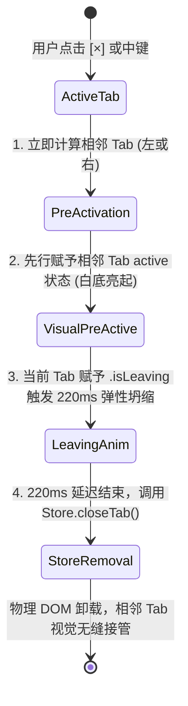

# Demo 级高精 CSS 样式与物理动效改进详案

> **文档位置**：`docs/pane-tab-system/plan-improvements/03-Demo级高精CSS样式与物理动效详案.md`
> **所属战役**：多窗格标签系统重构战役（Pane-Tab System Architecture Campaign）
> **关联排查**：[`docs/pane-tab-system/analysis/03-Demo参考架构与CSS几何对齐排查.md`](file:///c:/Software/conex/docs/pane-tab-system/analysis/03-Demo%E5%8F%82%E8%80%83%E6%9E%B6%E6%9E%84%E4%B8%8ECSS%E5%87%A0%E4%BD%95%E5%AF%B9%E9%BD%90%E6%8E%92%E6%9F%A5.md)
> **对标参考**：
> - [`reference/chat-composer-component/css/composer.css:176-265, 360-470, 1800-1848`](file:///c:/Software/conex/reference/chat-composer-component/css/composer.css#L176-L265)
> - [`reference/chat-composer-component/css/design-tokens.css:36-44`](file:///c:/Software/conex/reference/chat-composer-component/css/design-tokens.css#L36-L44)
> - [`reference/chat-composer-component/js/popovers.js:1957-2265`](file:///c:/Software/conex/reference/chat-composer-component/js/popovers.js#L1957-L2265)
> **方案职责**：彻底解决当前桌面端全局通栏标签与大画布割裂、标签视觉样式退化、缺乏入场/离场弹性物理动效、标签溢出时新建按钮滚出屏幕以及滚轮无法横向滚动等核心体验断层。1:1 复刻金标 Demo 的卡片岛屿拓扑（Card Island Topology）、26px 纯白胶囊几何微观样式、220ms 弹性弹簧贝塞尔动画、Smart Pinning 双模智能固定加号及横向滚轮重定向，构建顶级桌面级原生质感。

---

## 目录

- [一、背景与架构定性（问题根因与收敛目标）](#一背景与架构定性问题根因与收敛目标)
  - [1.1 核心体验断层与根因定性](#11-核心体验断层与根因定性)
  - [1.2 范式转移：从全局通栏到卡片岛屿（Card Island）](#12-范式转移从全局通栏到卡片岛屿card-island)
  - [1.3 核心设计目标与验收标准](#13-核心设计目标与验收标准)
- [二、物理 DOM 拓扑与卡片岛屿 1:1 几何包含机制](#二物理-dom-拓扑与卡片岛屿-11-几何包含机制)
  - [2.1 叶子面板（Leaf Pane）物理盒模型重塑](#21-叶子面板leaf-pane物理盒模型重塑)
  - [2.2 结构级 1:1 同宽与绝对左对齐原理](#22-结构级-11-同宽与绝对左对齐原理)
  - [2.3 声明式系统通道避让（Channel Clearance）规则](#23-声明式系统通道避让channel-clearance规则)
- [三、Demo 级高精视觉规格与 CSS Token 权威规范](#三demo-级高精视觉规格与-css-token-权威规范)
  - [3.1 标签栏容器（`.tree-pane-header`）几何参数](#31-标签栏容器tree-pane-header几何参数)
  - [3.2 单个标签项（`.session-tab-item`）微观几何与状态机](#32-单个标签项session-tab-item微观几何与状态机)
  - [3.3 紧凑关闭按钮（`.tab-item-close-btn`）与中键关闭](#33-紧凑关闭按钮tab-item-close-btn与中键关闭)
  - [3.4 卡片主体（`.tree-pane-content`）圆角与微阴影体系](#34-卡片主体tree-pane-content圆角与微阴影体系)
- [四、弹性物理动画与零闪烁生命周期状态机](#四弹性物理动画与零闪烁生命周期状态机)
  - [4.1 弹性弹簧曲线与时间基准（SSOT）](#41-弹性弹簧曲线与时间基准ssot)
  - [4.2 新建 Tab 入场动画（`@keyframes tabSlideIn`）](#42-新建-tab-入场动画keyframes-tabslidein)
  - [4.3 关闭 Tab 离场平滑坍缩与先行动画（Zero-Flicker Exit）](#43-关闭-tab-离场平滑坍缩与先行动画zero-flicker-exit)
  - [4.4 减弱动效适配（`prefers-reduced-motion`）](#44-减弱动效适配prefers-reduced-motion)
- [五、横向滚轮重定向与 Smart Pinning 智能固定架构](#五横向滚轮重定向与-smart-pinning-智能固定架构)
  - [5.1 纵向转横向滚轮原生劫持与平滑注入](#51-纵向转横向滚轮原生劫持与平滑注入)
  - [5.2 流内（`in-flow`）与悬浮固定（`pinned`）双按钮互斥架构](#52-流内in-flow与悬浮固定pinned双按钮互斥架构)
  - [5.3 `ResizeObserver` 溢出探测与状态类切换机理](#53-resizeobserver-溢出探测与状态类切换机理)
- [六、组件工程化落地详案与 TypeScript / CSS Modules 设计](#六组件工程化落地详案与-typescript--css-modules-设计)
  - [6.1 模块与组件职责划分](#61-模块与组件职责划分)
  - [6.2 `TreeLeafHeader.tsx` 完整设计实现](#62-treeleafheadertsx-完整设计实现)
  - [6.3 `TreeLeafHeader.module.css` 完整样式实现](#63-treeleafheadermodulecss-完整样式实现)
  - [6.4 `SessionTabItem.tsx` 完整设计实现](#64-sessiontabitemtsx-完整设计实现)
  - [6.5 `useHorizontalWheel.ts` 与 `useTabSmartPinning.ts` 自定义 Hook](#65-usehorizontalwheelts-与-usetabsmartpinningts-自定义-hook)
  - [6.6 `TreeLeafPanel.tsx` 与 `BinaryTreeWorkspace.module.css` 重构联动](#66-treeleafpaneltsx-与-binarytreeworkspacemodulecss-重构联动)
- [七、架构不变量与防退避断言清单](#七架构不变量与防退避断言清单)
  - [7.1 几何与物理对齐不变量](#71-几何与物理对齐不变量)
  - [7.2 视觉与阴影层次不变量](#72-视觉与阴影层次不变量)
  - [7.3 动效与交互平滑性不变量](#73-动效与交互平滑性不变量)
- [八、测试规划与自动化验证矩阵](#八测试规划与自动化验证矩阵)
  - [8.1 单元测试（Unit Tests）矩阵](#81-单元测试unit-tests矩阵)
  - [8.2 交互与动效测试（Integration & Interaction Tests）](#82-交互与动效测试integration--interaction-tests)
  - [8.3 视觉回归与端到端检查（E2E Checklist）](#83-视觉回归与端到端检查e2e-checklist)

---

## 一、背景与架构定性（问题根因与收敛目标）

### 1.1 核心体验断层与根因定性

根据 [`docs/pane-tab-system/analysis/03-Demo参考架构与CSS几何对齐排查.md`](file:///c:/Software/conex/docs/pane-tab-system/analysis/03-Demo%E5%8F%82%E8%80%83%E6%9E%B6%E6%9E%84%E4%B8%8ECSS%E5%87%A0%E4%BD%95%E5%AF%B9%E9%BD%90%E6%8E%92%E6%9F%A5.md)，当前桌面端（`apps/crish-desktop`）在多会话标签与工作区视觉呈现上存在以下核心体验断层：

1. **几何割裂与多屏失真**：
   - 当前桌面端采用「全局顶栏通栏展示所有标签」设计（[`GlobalSessionTabBar.tsx`](file:///c:/Software/conex/apps/crish-desktop/src/components/shell/GlobalSessionTabBar.tsx) 嵌于 [`AppTopBar.tsx`](file:///c:/Software/conex/apps/crish-desktop/src/components/top-bar/AppTopBar.tsx)），下方工作区则为一个单一的大白卡（[`.canvas`](file:///c:/Software/conex/apps/crish-desktop/src/components/binary-tree/BinaryTreeWorkspace.module.css#L42-L60)）。
   - 在多分屏（2~4 个 Leaf）场景下，全局顶栏无法表达哪个标签属于哪个分屏卡片，且标签栏与下方的分屏网格完全没有垂向对齐线，视觉散乱。
2. **微观视觉质感退化**：
   - 当前桌面端标签项退化为无实体的扁平灰色块，缺失 Demo 的 **激活态纯白 `#ffffff` 胶囊 + 浅色发丝边 + 双层微阴影**，无法与下方白底卡片形成立体的物理呼应。
3. **物理动效缺失与生硬跳变**：
   - 关闭标签时依赖 React 状态直接卸载 DOM，引发瞬间的内容重排与视觉跳变；新建标签时缺乏宽度自 0 弹性展开的入场动画。
4. **溢出痛点与滚轮失效**：
   - 打开 8 个以上标签时，末尾新建按钮随条带滚动被推至屏幕外，用户无法直接新建会话；在标签栏上滑动普通鼠标垂直滚轮无法横向滚动标签列表。

```
【现状问题：全局通栏 + 单一大画布】
┌───────────────────────────────────────────────────────────────┐
│ AppTopBar: [Tab 1] [Tab 2] [Tab 3] [+]          [ -  □  × ]   │ ◄── 标签栏脱离卡片，无对齐
├───────────────────────────────────────────────────────────────┤
│ Workspace Canvas (单一白色大卡片)                             │
│ ┌──────────────────────────────┬────────────────────────────┐ │
│ │ Pane A (对话无头)             │ Pane B (工具无头)          │ │ ◄── 分屏各自无独立标签头
│ └──────────────────────────────┴────────────────────────────┘ │
└───────────────────────────────────────────────────────────────┘

【重构目标：卡片岛屿拓扑 Card Island Topology】
┌───────────────────────────────────────────────────────────────┐
│ Top Clearance (绝对定位系统三键浮层)             [ -  □  × ]   │
├───────────────────────────────────────────────────────────────┤
│ Shell Background (灰底画板 --bg-workspace: #f4f5f7)           │
│ ┌─────────────────────────────┐ ┌───────────────────────────┐ │
│ │ Pane A Header (36px, 1:1对齐)│ │ Pane B Header (36px, 避让)│ │ ◄── 独立 36px 标签栏
│ │  [Tab 1(Active)] [Tab 2] [+]│ │  [Tab 3(Active)] [+]      │ │
│ │ ┌─────────────────────────┐ │ │ ┌───────────────────────┐ │ │
│ │ │ Pane A Content (白底卡片)│ │ │ │ Pane B Content (白底) │ │ │ ◄── 独立 10px 圆角白底卡片
│ │ │                         │ │ │ │                       │ │ │
│ │ └─────────────────────────┘ │ │ └───────────────────────┘ │ │
│ └─────────────────────────────┘ └───────────────────────────┘ │
└───────────────────────────────────────────────────────────────┘
```

### 1.2 范式转移：从全局通栏到卡片岛屿（Card Island）

重构将彻底推行 **卡片岛屿体系（Card Island Architecture）**：
- 每个叶子窗格（`TreeLeafPanel`）作为一个独立的岛屿卡片单元。
- 标签栏（`TreeLeafHeader`，高度 `36px`）作为叶子卡片的「头顶」，物理上直接作为 `TreeLeafPanel` 的纵向首个子节点。
- 下方卡片内容区（`TreeLeafContent`，高度 `calc(100% - 36px)`）承载该窗格的具体视图。
- 标签栏与卡片主体在 DOM 树中紧密嵌套，天然达成 **1:1 严格左对齐与几何同宽**。

### 1.3 核心设计目标与验收标准

| 序号 | 核心目标 | 验收基准与量化指标 |
| :--- | :--- | :--- |
| **G-01** | **结构级 1:1 几何对齐** | `TreeLeafHeader` 与下方 `TreeLeafContent` 左边距差值 `= 0px`，宽度差值 `= 0px`，拖拽分屏 sash 时实时绝对同宽。 |
| **G-02** | **Demo 级微观视觉质感** | 标签项高 `26px`，圆角 `6px`，字号 `12px`；激活态纯白 `#ffffff` + 浅色发丝边 + 双层微阴影（`0 1px 3px rgba(0,0,0,0.06), 0 1px 1px rgba(0,0,0,0.04)`）。 |
| **G-03** | **220ms 弹性物理动效** | 新建 Tab 执行 `@keyframes tabSlideIn 220ms cubic-bezier(0.16, 1, 0.3, 1)`；关闭 Tab 执行 `220ms` 宽度坍缩退出，激活态无感瞬切，零闪烁。 |
| **G-04** | **Smart Pinning 智能固定** | `ResizeObserver` 监听条带溢出，无溢出时流内 `in-flow` 紧随末尾，发生溢出时右侧 `pinned` 弹性展开，新建按钮永不丢失。 |
| **G-05** | **横向滚轮平滑重定向** | 监听条带 `wheel` 事件，垂直滚轮 `deltaY` 注入水平 `scrollLeft`，阻断页面外层滚动，操作丝滑顺手。 |
| **G-06** | **声明式系统通道避让** | 顶行最左叶子在侧栏折叠时让出 `44px`，顶行最右叶子让出 `112px` 系统窗口三键，纯 CSS 声明式避让。 |

---

## 二、物理 DOM 拓扑与卡片岛屿 1:1 几何包含机制

### 2.1 叶子面板（Leaf Pane）物理盒模型重塑

叶子面板（[`TreeLeafPanel.tsx`](file:///c:/Software/conex/apps/crish-desktop/src/components/binary-tree/TreeLeafPanel.tsx)）必须重塑为纯净的弹性列容器（`flex-direction: column`），其物理 DOM 树定义如下：

```html
<!-- 单个叶子面板根容器（绝对定位由二叉树布局引擎计算百分比 rect） -->
<div class="tree-leaf-pane" data-leaf-id="leaf-1" data-top-row="true" data-left-edge="true" data-right-edge="false">

  <!-- 1. 独立标签栏（高度严格锁定 36px，充当卡片岛屿头部） -->
  <div class="tree-pane-header">
    <!-- 横向滚动标签容器 -->
    <div class="top-bar-tabs-container" role="tablist" aria-label="窗格会话标签">
      <div class="top-bar-tabs-list">
        <!-- 标签项 -->
        <div class="session-tab-item active" role="tab" aria-selected="true" data-session-id="s-1">
          <span class="tab-item-title">重构 IPC 缓冲通道</span>
          <button class="tab-item-close-btn" aria-label="关闭标签页">
            <svg width="10" height="10" viewBox="0 0 24 24" stroke-width="2">...</svg>
          </button>
        </div>
        <div class="session-tab-item" role="tab" aria-selected="false" data-session-id="s-2">
          <span class="tab-item-title">主动探索架构详案</span>
          <button class="tab-item-close-btn" aria-label="关闭标签页">...</button>
        </div>
      </div>
      <!-- 流内新建按钮：紧跟末尾标签 -->
      <button class="top-bar-new-tab-btn in-flow" aria-label="新建会话标签">+</button>
    </div>
    <!-- 右侧固定控制簇（常驻右端，不随条带滚动） -->
    <div class="top-bar-fixed-cluster">
      <!-- 固定新建按钮：默认隐藏，溢出时激活 -->
      <button class="top-bar-new-tab-btn pinned" aria-label="新建会话标签">+</button>
    </div>
  </div>

  <!-- 2. 卡片主体内容区（高度占据剩余空间，白底圆角大卡片） -->
  <div class="tree-pane-content">
    <div class="chat-main-pane">
      <!-- 对话流 / 工具内容 -->
    </div>
    <!-- 侧栏抽屉 resizer 与 side panel（若有） -->
  </div>

  <!-- 3. 右侧工具栏抽屉开关按钮（绝对定位在当前 Leaf 内部右上角） -->
  <button class="top-side-panel-btn" aria-label="打开侧边工具栏">...</button>
</div>
```

### 2.2 结构级 1:1 同宽与绝对左对齐原理

```text
┌────────────────────────────────────────────────────────────┐
│ .tree-leaf-pane (width: W, height: H, position: absolute)   │
│                                                            │
│ ┌────────────────────────────────────────────────────────┐ │
│ │ .tree-pane-header (width: 100%, height: 36px)          │ │ ◄── 标签栏（与下卡片物理同宽）
│ │  [Tab 1] [Tab 2] [+]                         [Pin +]   │ │
│ └────────────────────────────────────────────────────────┘ │
│ ┌────────────────────────────────────────────────────────┐ │
│ │ .tree-pane-content (width: 100%, H - 36px)             │ │ ◄── 卡片主体（10px 圆角白底）
│ │  background: #ffffff; border-radius: 10px;             │ │
│ │  box-shadow: 0 1px 3px rgba(0,0,0,0.03), 0 4px 12px...│ │
│ │                                                        │ │
│ │  <View Outlet Content (Chat / Diff / Preview / Note)>  │ │
│ └────────────────────────────────────────────────────────┘ │
└────────────────────────────────────────────────────────────┘
```

1. **零 JS 计算的容器级包含**：
   `.tree-pane-header` 与 `.tree-pane-content` 是 `.tree-leaf-pane` 内的直接纵向兄弟，二者宽度均为 `100%`，`left` 均为 `0`。无论通过 Sash 如何拖拽改变 Leaf 宽度，二者永远在同一个垂直投影上绝对对齐。
2. **灰底与白底的层次反差**：
   `.tree-leaf-pane` 背景为 `transparent`，透出下层工作区画板灰底（`--bg-workspace: #f4f5f7`）；`.tree-pane-header` 为 `transparent` 浮于灰底之上；`.tree-pane-content` 铺纯白底色（`--bg-card: #ffffff`）并赋予 `10px` 圆角，呈现优雅的立体岛屿视觉。

### 2.3 声明式系统通道避让（Channel Clearance）规则

为了使处于屏幕物理边缘的卡片标签栏不与全局控制元素（左上角侧栏展开按钮、右上角窗口最小化/最大化/关闭按钮）发生重叠，采用纯 CSS 声明式避让：

```css
/* 引用与重构自 reference/chat-composer-component/css/composer.css:1819-1832 */

/* 默认状态下所有 Header 基础内边距 */
.tree-pane-header {
  padding: 0 4px;
  transition: padding-left 220ms cubic-bezier(0.16, 1, 0.3, 1),
              padding-right 220ms cubic-bezier(0.16, 1, 0.3, 1);
}

/* 顶行最左叶子：侧栏折叠收起时，让出 44px 展开按钮区域 */
:global([data-sidebar-collapsed="true"]) .tree-leaf-pane[data-top-row="true"][data-left-edge="true"] > .tree-pane-header {
  padding-left: 44px;
}

/* 顶行最右叶子：永远让出右上角 112px（窗口三键 108px + 4px 呼吸缓冲） */
.tree-leaf-pane[data-top-row="true"][data-right-edge="true"] > .tree-pane-header {
  padding-right: 112px;
}
```

---

## 三、Demo 级高精视觉规格与 CSS Token 权威规范

### 3.1 标签栏容器（`.tree-pane-header`）几何参数

对标 [`composer.css:1800-1817`](file:///c:/Software/conex/reference/chat-composer-component/css/composer.css#L1800-L1817)：

```css
.treePaneHeader {
  height: 36px;
  min-height: 36px;
  max-height: 36px;
  background: transparent;
  display: flex;
  align-items: center;
  justify-content: flex-start;
  padding: 0 4px;
  border-bottom: none;
  user-select: none;
  flex-shrink: 0;
  box-sizing: border-box;
  position: relative;
  z-index: 5;
  overflow: hidden;
  -webkit-app-region: no-drag;
}
```

| 属性项 | 规范值 | 说明 |
| :--- | :--- | :--- |
| **高度（Height）** | `36px`（锁死 `height`/`min-height`/`max-height`） | 与顶层窗口控制三键（36px）建立严格几何水平基准准线 |
| **背景色（Background）** | `transparent` | 透出 `--bg-workspace`（灰底），保持与全局画板通透融合 |
| **边框（Border）** | `none` | 杜绝传统实线分割，依靠下方白底卡片物理边缘自然分界 |
| **内边距（Padding）** | `0 4px`（无避让态） | 预留左右微距，确保标签胶囊贴边时有呼吸感 |

### 3.2 单个标签项（`.session-tab-item`）微观几何与状态机

对标 [`composer.css:176-221`](file:///c:/Software/conex/reference/chat-composer-component/css/composer.css#L176-L221)：

```css
.sessionTabItem {
  height: 26px;
  max-width: 180px;
  min-width: 0;
  flex: 0 1 150px;
  display: inline-flex;
  align-items: center;
  justify-content: space-between;
  gap: 6px;
  padding: 0 4px 0 8px;
  background: transparent;
  border: 1px solid transparent;
  border-radius: 6px;
  font-size: 12px;
  font-weight: 400;
  color: var(--text-secondary, #666666);
  cursor: pointer;
  white-space: nowrap;
  box-sizing: border-box;
  user-select: none;
  overflow: hidden;
  transition: background var(--transition-fast, 150ms ease-out),
              color var(--transition-fast, 150ms ease-out),
              border-color var(--transition-fast, 150ms ease-out),
              box-shadow var(--transition-fast, 150ms ease-out),
              max-width 220ms cubic-bezier(0.16, 1, 0.3, 1),
              flex-basis 220ms cubic-bezier(0.16, 1, 0.3, 1),
              padding 220ms cubic-bezier(0.16, 1, 0.3, 1),
              margin 220ms cubic-bezier(0.16, 1, 0.3, 1),
              opacity 180ms ease,
              transform 220ms cubic-bezier(0.16, 1, 0.3, 1);
}

.sessionTabItem:hover {
  background: var(--tint-hover, rgba(0, 0, 0, 0.05));
  color: var(--text-primary, #111111);
}

.sessionTabItem.active {
  background: var(--bg-card, #ffffff);
  color: var(--text-primary, #111111);
  font-weight: 500;
  border-color: var(--border-subtle, rgba(0, 0, 0, 0.08));
  box-shadow: 0 1px 3px rgba(0, 0, 0, 0.06), 0 1px 1px rgba(0, 0, 0, 0.04);
}
```

```
【单个标签胶囊微观尺寸示意图】
┌─────────────────────────────────────────────────────────────┐
│ ◄─ 8px ─► [Title: 重构 IPC 缓冲通道...] ◄─ 6px ─► [×] ◄─ 4px ─►│ ◄── 高度 26px
└─────────────────────────────────────────────────────────────┘
  ▲                                                  ▲
  圆角 6px                                         关闭按钮 16x16
```

- **微观设计亮点**：
  1. **高度 26px 与 36px 顶栏**：上下各留出 `5px` 物理间隙，形成紧凑精致的内嵌胶囊感。
  2. **圆角 6px**：与外卡片 `10px` 圆角形成内敛同心递减。
  3. **双层微阴影**：第一层 `0 1px 3px rgba(0, 0, 0, 0.06)`（空间落地阴影），第二层 `0 1px 1px rgba(0, 0, 0, 0.04)`（微边缘锐化），激活时白底胶囊自灰底自然浮起。

### 3.3 紧凑关闭按钮（`.tab-item-close-btn`）与中键关闭

对标 [`composer.css:445-464`](file:///c:/Software/conex/reference/chat-composer-component/css/composer.css#L445-L464)：

```css
.tabItemCloseBtn {
  width: 16px;
  height: 16px;
  min-width: 16px;
  min-height: 16px;
  border-radius: 3px;
  display: inline-flex;
  align-items: center;
  justify-content: center;
  background: transparent;
  border: none;
  cursor: pointer;
  color: var(--text-tertiary, #999999);
  padding: 0;
  margin: 0;
  flex-shrink: 0;
  transition: background var(--transition-fast, 150ms ease-out),
              color var(--transition-fast, 150ms ease-out);
}

.tabItemCloseBtn:hover {
  background: var(--tint-active, rgba(0, 0, 0, 0.08));
  color: var(--text-primary, #111111);
}

.tabItemCloseBtn:active {
  background: var(--tint-strong, rgba(0, 0, 0, 0.12));
}

.tabItemCloseBtn svg {
  width: 10px;
  height: 10px;
  stroke-width: 2;
  stroke: currentColor;
  display: block;
}
```

- **交互行为**：
  - 左键点击关闭按钮：`e.stopPropagation()` 阻止激活切换，触发离场坍缩。
  - 标签项监听鼠标中键（`auxclick` 且 `e.button === 1`）：阻止默认中键滚动并直接触发关闭逻辑。

### 3.4 卡片主体（`.tree-pane-content`）圆角与微阴影体系

对标 [`composer.css:1834-1847`](file:///c:/Software/conex/reference/chat-composer-component/css/composer.css#L1834-L1847) 与 [`design-tokens.css:36-39`](file:///c:/Software/conex/reference/chat-composer-component/css/design-tokens.css#L36-L39)：

```css
.treePaneContent {
  flex: 1 1 0;
  min-height: 0;
  height: calc(100% - 36px);
  display: flex;
  flex-direction: row;
  position: relative;
  overflow: hidden;
  background: var(--bg-card, #ffffff);
  border-radius: var(--card-radius, 10px);
  border: 1px solid var(--border-color, rgba(0, 0, 0, 0.08));
  box-shadow: var(--card-shadow, 0 1px 3px rgba(0, 0, 0, 0.03), 0 4px 12px rgba(0, 0, 0, 0.02));
  box-sizing: border-box;
}
```

---

## 四、弹性物理动画与零闪烁生命周期状态机

### 4.1 弹性弹簧曲线与时间基准（SSOT）

整个标签页系统的物理动效统一受控于以下 SSOT 常量：

```css
:root {
  --tab-ease-spring: cubic-bezier(0.16, 1, 0.3, 1);
  --tab-dur-enter: 220ms;
  --tab-dur-exit: 220ms;
  --tab-dur-hover: 150ms;
}
```

- **物理特性**：`cubic-bezier(0.16, 1, 0.3, 1)` 属于高敏阻尼弹簧曲线，启动阶段具有极强的加速度，接近目标值时平滑缓释，带来干脆、不拖泥带水的高级手感。

### 4.2 新建 Tab 入场动画（`@keyframes tabSlideIn`）

对标 [`composer.css:223-247`](file:///c:/Software/conex/reference/chat-composer-component/css/composer.css#L223-L247)：

```css
@keyframes tabSlideIn {
  from {
    opacity: 0;
    transform: scale(0.92) translateX(-6px);
    max-width: 0;
    flex-basis: 0px;
    padding-left: 0;
    padding-right: 0;
    margin-right: -4px;
  }
  to {
    opacity: 1;
    transform: scale(1) translateX(0);
    max-width: 180px;
    flex-basis: 150px;
    padding-left: 8px;
    padding-right: 4px;
    margin-right: 0;
  }
}

.sessionTabItem.isEntering {
  animation: tabSlideIn var(--tab-dur-enter) var(--tab-ease-spring) forwards;
}
```

```
【新建 Tab 入场动画演变】
t = 0ms   : [Tab 1] [] [+]                (宽度 0, scale 0.92, 透明度 0)
t = 110ms : [Tab 1] [======] [+]          (宽度 80px, scale 0.96, 透明度 0.6)
t = 220ms : [Tab 1] [===========] [+]     (宽度 150px, scale 1.0, 透明度 1.0)
```

- **触发机制**：当 Store 派发新建标签动作时，将新标签 ID 记入 `enteringTabId`；组件首次渲染挂载该类名，并在动画结束事件（`onAnimationEnd`）或 `220ms` 计时器后清除该标记。

### 4.3 关闭 Tab 离场平滑坍缩与先行动画（Zero-Flicker Exit）

对标 [`popovers.js:1988-2006`](file:///c:/Software/conex/reference/chat-composer-component/js/popovers.js#L1988-L2006) 与 [`composer.css:249-261`](file:///c:/Software/conex/reference/chat-composer-component/css/composer.css#L249-L261)：

```css
.sessionTabItem.isLeaving {
  max-width: 0 !important;
  min-width: 0 !important;
  flex-basis: 0px !important;
  padding-left: 0 !important;
  padding-right: 0 !important;
  margin-left: 0 !important;
  margin-right: -4px !important;
  opacity: 0 !important;
  transform: scale(0.88) translateX(-4px) !important;
  pointer-events: none !important;
  border-color: transparent !important;
  box-shadow: none !important;
}
```

#### 零闪烁状态机（Zero-Flicker State Machine）：



1. **先行无感激活（Pre-Activation）**：若被关闭的标签为当前激活项，**绝不等待 DOM 销毁后才切会话**。点击瞬间立刻同步激活相邻标签（`curIdx === 0 ? 1 : curIdx - 1`），让相邻标签瞬间呈现纯白实体底色。
2. **平滑宽度坍缩**：被关闭标签被打上 `isLeaving` 类，其宽度、左右 padding、margin 在 `220ms` 内弹性坍缩为 0，右侧所有标签如行云流水般左移。
3. **物理销毁延迟**：设置 `setTimeout(() => store.closeTab(id), 220)`，在动画完全结束后再销毁 React 组件，杜绝瞬间空缺与重排撕裂。

### 4.4 减弱动效适配（`prefers-reduced-motion`）

```css
@media (prefers-reduced-motion: reduce) {
  .sessionTabItem,
  .sessionTabItem.isEntering,
  .sessionTabItem.isLeaving {
    animation: none !important;
    transition: none !important;
  }
}
```

---

## 五、横向滚轮重定向与 Smart Pinning 智能固定架构

### 5.1 纵向转横向滚轮原生劫持与平滑注入

对标 [`popovers.js:2093-2099`](file:///c:/Software/conex/reference/chat-composer-component/js/popovers.js#L2093-L2099)：

```typescript
/**
 * 监听 TabStrip 滚轮事件，将主导的纵向 deltaY 转换为水平 scrollLeft 滚动。
 */
export function useHorizontalWheel(ref: React.RefObject<HTMLElement | null>) {
  useEffect(() => {
    const el = ref.current;
    if (!el) return;

    const handleWheel = (e: WheelEvent) => {
      // 当垂直滚动幅度大于水平滚动时，进行水平滚动重定向
      if (Math.abs(e.deltaY) > Math.abs(e.deltaX)) {
        if (el.scrollWidth > el.clientWidth) {
          el.scrollLeft += e.deltaY;
          e.preventDefault();
        }
      }
    };

    el.addEventListener('wheel', handleWheel, { passive: false });
    return () => {
      el.removeEventListener('wheel', handleWheel);
    };
  }, [ref]);
}
```

### 5.2 流内（`in-flow`）与悬浮固定（`pinned`）双按钮互斥架构

对标 [`composer.css:368-426`](file:///c:/Software/conex/reference/chat-composer-component/css/composer.css#L368-L426)：

```css
.topBarNewTabBtn {
  width: 26px;
  height: 26px;
  min-width: 26px;
  flex: 0 0 26px;
  padding: 0;
  border-radius: 4px;
  border: 1px solid transparent;
  background: transparent;
  display: inline-flex;
  align-items: center;
  justify-content: center;
  color: var(--text-secondary, #666666);
  cursor: pointer;
  transition: background var(--transition-fast, 150ms ease-out),
              color var(--transition-fast, 150ms ease-out),
              opacity 160ms var(--ease-default, ease),
              transform 160ms var(--ease-default, ease),
              width 160ms var(--ease-default, ease),
              min-width 160ms var(--ease-default, ease),
              margin 160ms var(--ease-default, ease);
}

.topBarNewTabBtn:hover {
  background: var(--tint-hover, rgba(0, 0, 0, 0.05));
  color: var(--text-primary, #111111);
}

.topBarNewTabBtn:active {
  background: var(--tint-active, rgba(0, 0, 0, 0.08));
}

/* 默认无溢出态：pinned 按钮完全隐藏并坍缩 */
.topBarNewTabBtn.pinned {
  opacity: 0;
  width: 0;
  min-width: 0;
  flex: 0 0 0px;
  transform: scale(0.85);
  pointer-events: none;
  overflow: hidden;
  margin: 0;
}

/* 发生溢出态（.treePaneHeader.hasOverflow）：pinned 展开，in-flow 隐藏 */
.treePaneHeader.hasOverflow .topBarNewTabBtn.pinned {
  opacity: 1;
  width: 26px;
  min-width: 26px;
  flex: 0 0 26px;
  transform: scale(1);
  pointer-events: auto;
  margin-right: 4px;
}

.treePaneHeader.hasOverflow .topBarNewTabBtn.inFlow {
  opacity: 0;
  pointer-events: none;
  width: 0;
  min-width: 0;
  flex: 0 0 0px;
  margin: 0;
  overflow: hidden;
}

.topBarFixedCluster {
  flex: 0 0 auto;
  display: flex;
  align-items: center;
  gap: 4px;
  padding-left: 2px;
  position: relative;
  z-index: 6;
}
```

```
【Smart Pinning 状态转换机理】

状态 1：无溢出（标签较少）
┌─────────────────────────────────────────────────────────────┐
│ [Tab 1] [Tab 2] [+] (in-flow 可见)           │ (pinned 坍缩)│
└─────────────────────────────────────────────────────────────┘

状态 2：发生溢出（标签较多，超出容器宽度）
┌─────────────────────────────────────────────────────────────┐
│ < [Tab 1] [Tab 2] [Tab 3] [Tab 4] [Tab 5] >  │ [+] (pinned) │
└─────────────────────────────────────────────────────────────┘
  (in-flow 随末尾隐藏)                           (固定悬浮右端，常驻可用)
```

### 5.3 `ResizeObserver` 溢出探测与状态类切换机理

对标 [`popovers.js:2101-2110`](file:///c:/Software/conex/reference/chat-composer-component/js/popovers.js#L2101-L2110)：

```typescript
/**
 * 监听 strip 滚动尺寸与可视宽度，自动派发 hasOverflow 状态。
 */
export function useTabSmartPinning(
  stripRef: React.RefObject<HTMLElement | null>,
  headerRef: React.RefObject<HTMLElement | null>
) {
  const [hasOverflow, setHasOverflow] = useState(false);

  const checkOverflow = useCallback(() => {
    const strip = stripRef.current;
    if (!strip) return;
    const isOverflow = strip.scrollWidth > strip.clientWidth + 2;
    setHasOverflow(isOverflow);
    if (headerRef.current) {
      headerRef.current.classList.toggle('has-overflow', isOverflow);
    }
  }, [stripRef, headerRef]);

  useEffect(() => {
    const strip = stripRef.current;
    if (!strip) return;

    const observer = new ResizeObserver(() => {
      checkOverflow();
    });
    observer.observe(strip);

    // 初始化检查与 microtask 补偿
    checkOverflow();
    const timer = setTimeout(checkOverflow, 50);

    return () => {
      observer.disconnect();
      clearTimeout(timer);
    };
  }, [stripRef, checkOverflow]);

  return { hasOverflow, checkOverflow };
}
```

---

## 六、组件工程化落地详案与 TypeScript / CSS Modules 设计

### 6.1 模块与组件职责划分

```
apps/crish-desktop/src/
├── components/
│   └── binary-tree/
│       ├── TreeLeafPanel.tsx             (重构：叶子面板卡片岛屿外壳，组装 Header 与 Content)
│       ├── TreeLeafHeader.tsx            (新建：窗格独立 36px 标签栏组件，集成 Smart Pinning 与 Wheel)
│       ├── TreeLeafHeader.module.css     (新建：对标 composer.css 的 Header 与双模加号样式)
│       ├── SessionTabItem.tsx            (新建：26px 胶囊单标签，承载入场/离场弹性动效与关闭)
│       ├── SessionTabItem.module.css     (新建：单标签高精样式与 keyframes)
│       └── BinaryTreeWorkspace.module.css (改造：清除大画板大卡片样式，改为纯外壳透底)
└── hooks/
    ├── useHorizontalWheel.ts             (新建：横向滚轮事件监听 Hook)
    └── useTabSmartPinning.ts             (新建：基于 ResizeObserver 的溢出固定探测 Hook)
```

### 6.2 `TreeLeafHeader.tsx` 完整设计实现

```tsx
import React, { useRef, useCallback } from 'react';
import { Plus } from 'lucide-react';
import { SessionTabItem } from './SessionTabItem';
import { useHorizontalWheel } from '../../hooks/useHorizontalWheel';
import { useTabSmartPinning } from '../../hooks/useTabSmartPinning';
import styles from './TreeLeafHeader.module.css';

export interface TabData {
  id: string;
  title: string;
  pinned?: boolean;
}

export interface TreeLeafHeaderProps {
  leafId: string;
  tabs: readonly TabData[];
  activeTabId: string;
  enteringTabId?: string | null;
  leavingTabIds?: ReadonlySet<string>;
  onSelectTab: (tabId: string) => void;
  onCloseTab: (tabId: string) => void;
  onNewTab: () => void;
  onStartDragTab?: (tabId: string, title: string, e: React.PointerEvent) => void;
}

export const TreeLeafHeader: React.FC<TreeLeafHeaderProps> = React.memo(({
  leafId,
  tabs,
  activeTabId,
  enteringTabId,
  leavingTabIds,
  onSelectTab,
  onCloseTab,
  onNewTab,
  onStartDragTab,
}) => {
  const headerRef = useRef<HTMLDivElement>(null);
  const stripRef = useRef<HTMLDivElement>(null);

  // 绑定横向滚轮转换
  useHorizontalWheel(stripRef);

  // 绑定 Smart Pinning 溢出探测
  const { hasOverflow, checkOverflow } = useTabSmartPinning(stripRef, headerRef);

  const handleTabClose = useCallback((tabId: string) => {
    onCloseTab(tabId);
    // 离场后重新计算溢出状态
    setTimeout(checkOverflow, 230);
  }, [onCloseTab, checkOverflow]);

  return (
    <div
      ref={headerRef}
      className={`${styles.treePaneHeader} ${hasOverflow ? styles.hasOverflow : ''}`}
      data-pane-id={leafId}
      role="region"
      aria-label="窗格标签栏"
    >
      <div
        ref={stripRef}
        className={styles.topBarTabsContainer}
        data-pane-id={leafId}
        role="tablist"
      >
        <div className={styles.topBarTabsList}>
          {tabs.map((tab) => (
            <SessionTabItem
              key={tab.id}
              tab={tab}
              isActive={tab.id === activeTabId}
              isEntering={tab.id === enteringTabId}
              isLeaving={leavingTabIds?.has(tab.id) ?? false}
              onSelect={() => onSelectTab(tab.id)}
              onClose={() => handleTabClose(tab.id)}
              onPointerDown={onStartDragTab ? (e) => onStartDragTab(tab.id, tab.title, e) : undefined}
            />
          ))}
        </div>

        {/* 流内新建按钮 */}
        <button
          type="button"
          className={`${styles.topBarNewTabBtn} ${styles.inFlow}`}
          title="新建会话标签"
          aria-label="新建会话标签"
          onClick={onNewTab}
        >
          <Plus size={13} strokeWidth={2} aria-hidden />
        </button>
      </div>

      {/* 固定右侧控制簇 */}
      <div className={styles.topBarFixedCluster}>
        <button
          type="button"
          className={`${styles.topBarNewTabBtn} ${styles.pinned}`}
          title="新建会话标签"
          aria-label="新建会话标签"
          onClick={onNewTab}
        >
          <Plus size={13} strokeWidth={2} aria-hidden />
        </button>
      </div>
    </div>
  );
});

TreeLeafHeader.displayName = 'TreeLeafHeader';
```

### 6.3 `TreeLeafHeader.module.css` 完整样式实现

```css
.treePaneHeader {
  height: 36px;
  min-height: 36px;
  max-height: 36px;
  background: transparent;
  display: flex;
  align-items: center;
  justify-content: flex-start;
  padding: 0 4px;
  border-bottom: none;
  user-select: none;
  flex-shrink: 0;
  box-sizing: border-box;
  position: relative;
  z-index: 5;
  overflow: hidden;
  -webkit-app-region: no-drag;
  transition: padding-left 220ms cubic-bezier(0.16, 1, 0.3, 1),
              padding-right 220ms cubic-bezier(0.16, 1, 0.3, 1);
}

.topBarTabsContainer {
  display: flex;
  align-items: center;
  flex: 1 1 auto;
  height: 100%;
  overflow-x: auto;
  overflow-y: hidden;
  scrollbar-width: none;
  min-width: 0;
  -webkit-overflow-scrolling: touch;
}

.topBarTabsContainer::-webkit-scrollbar {
  display: none;
}

.topBarTabsList {
  display: flex;
  align-items: center;
  gap: 4px;
  height: 100%;
  flex-shrink: 0;
}

.topBarFixedCluster {
  flex: 0 0 auto;
  display: flex;
  align-items: center;
  gap: 4px;
  padding-left: 2px;
  position: relative;
  z-index: 6;
}

.topBarNewTabBtn {
  width: 26px;
  height: 26px;
  min-width: 26px;
  flex: 0 0 26px;
  padding: 0;
  border-radius: 4px;
  border: 1px solid transparent;
  background: transparent;
  display: inline-flex;
  align-items: center;
  justify-content: center;
  color: var(--text-secondary, #666666);
  cursor: pointer;
  transition: background var(--transition-fast, 150ms ease-out),
              color var(--transition-fast, 150ms ease-out),
              opacity 160ms ease,
              transform 160ms ease,
              width 160ms ease,
              min-width 160ms ease,
              margin 160ms ease;
}

.topBarNewTabBtn:hover {
  background: var(--tint-hover, rgba(0, 0, 0, 0.05));
  color: var(--text-primary, #111111);
}

.topBarNewTabBtn:active {
  background: var(--tint-active, rgba(0, 0, 0, 0.08));
}

.topBarNewTabBtn.pinned {
  opacity: 0;
  width: 0;
  min-width: 0;
  flex: 0 0 0px;
  transform: scale(0.85);
  pointer-events: none;
  overflow: hidden;
  margin: 0;
}

.treePaneHeader.hasOverflow .topBarNewTabBtn.pinned {
  opacity: 1;
  width: 26px;
  min-width: 26px;
  flex: 0 0 26px;
  transform: scale(1);
  pointer-events: auto;
  margin-right: 4px;
}

.treePaneHeader.hasOverflow .topBarNewTabBtn.inFlow {
  opacity: 0;
  pointer-events: none;
  width: 0;
  min-width: 0;
  flex: 0 0 0px;
  margin: 0;
  overflow: hidden;
}
```

### 6.4 `SessionTabItem.tsx` 完整设计实现

```tsx
import React, { useCallback } from 'react';
import { X } from 'lucide-react';
import type { TabData } from './TreeLeafHeader';
import styles from './SessionTabItem.module.css';

export interface SessionTabItemProps {
  tab: TabData;
  isActive: boolean;
  isEntering?: boolean;
  isLeaving?: boolean;
  onSelect: () => void;
  onClose: () => void;
  onPointerDown?: (e: React.PointerEvent) => void;
}

export const SessionTabItem: React.FC<SessionTabItemProps> = React.memo(({
  tab,
  isActive,
  isEntering = false,
  isLeaving = false,
  onSelect,
  onClose,
  onPointerDown,
}) => {
  const handleCloseClick = useCallback((e: React.MouseEvent) => {
    e.stopPropagation();
    e.preventDefault();
    onClose();
  }, [onClose]);

  const handleAuxClick = useCallback((e: React.MouseEvent) => {
    // 鼠标中键直接关闭标签页
    if (e.button === 1) {
      e.stopPropagation();
      e.preventDefault();
      onClose();
    }
  }, [onClose]);

  const handleMouseDown = useCallback((e: React.MouseEvent) => {
    if (e.button === 1) {
      // 阻止中键产生默认的滚动圆盘光标
      e.preventDefault();
    }
  }, []);

  const classNames = [
    styles.sessionTabItem,
    isActive ? styles.active : '',
    isEntering ? styles.isEntering : '',
    isLeaving ? styles.isLeaving : '',
  ].filter(Boolean).join(' ');

  return (
    <div
      className={classNames}
      data-tab-id={tab.id}
      title={tab.title}
      role="tab"
      aria-selected={isActive}
      onClick={onSelect}
      onAuxClick={handleAuxClick}
      onMouseDown={handleMouseDown}
      onPointerDown={onPointerDown}
    >
      <span className={styles.tabItemTitle}>{tab.title}</span>
      <button
        type="button"
        className={styles.tabItemCloseBtn}
        title="关闭标签页"
        aria-label={`关闭标签页 ${tab.title}`}
        onClick={handleCloseClick}
        onPointerDown={(e) => e.stopPropagation()}
      >
        <X size={10} strokeWidth={2} aria-hidden />
      </button>
    </div>
  );
});

SessionTabItem.displayName = 'SessionTabItem';
```

#### `SessionTabItem.module.css`：

```css
@keyframes tabSlideIn {
  from {
    opacity: 0;
    transform: scale(0.92) translateX(-6px);
    max-width: 0;
    flex-basis: 0px;
    padding-left: 0;
    padding-right: 0;
    margin-right: -4px;
  }
  to {
    opacity: 1;
    transform: scale(1) translateX(0);
    max-width: 180px;
    flex-basis: 150px;
    padding-left: 8px;
    padding-right: 4px;
    margin-right: 0;
  }
}

.sessionTabItem {
  height: 26px;
  max-width: 180px;
  min-width: 0;
  flex: 0 1 150px;
  display: inline-flex;
  align-items: center;
  justify-content: space-between;
  gap: 6px;
  padding: 0 4px 0 8px;
  background: transparent;
  border: 1px solid transparent;
  border-radius: 6px;
  font-size: 12px;
  font-weight: 400;
  color: var(--text-secondary, #666666);
  cursor: pointer;
  white-space: nowrap;
  box-sizing: border-box;
  user-select: none;
  overflow: hidden;
  transition: background var(--transition-fast, 150ms ease-out),
              color var(--transition-fast, 150ms ease-out),
              border-color var(--transition-fast, 150ms ease-out),
              box-shadow var(--transition-fast, 150ms ease-out),
              max-width 220ms cubic-bezier(0.16, 1, 0.3, 1),
              flex-basis 220ms cubic-bezier(0.16, 1, 0.3, 1),
              padding 220ms cubic-bezier(0.16, 1, 0.3, 1),
              margin 220ms cubic-bezier(0.16, 1, 0.3, 1),
              opacity 180ms ease,
              transform 220ms cubic-bezier(0.16, 1, 0.3, 1);
}

.sessionTabItem:hover {
  background: var(--tint-hover, rgba(0, 0, 0, 0.05));
  color: var(--text-primary, #111111);
}

.sessionTabItem.active {
  background: var(--bg-card, #ffffff);
  color: var(--text-primary, #111111);
  font-weight: 500;
  border-color: var(--border-subtle, rgba(0, 0, 0, 0.08));
  box-shadow: 0 1px 3px rgba(0, 0, 0, 0.06), 0 1px 1px rgba(0, 0, 0, 0.04);
}

.sessionTabItem.isEntering {
  animation: tabSlideIn 220ms cubic-bezier(0.16, 1, 0.3, 1) forwards;
}

.sessionTabItem.isLeaving {
  max-width: 0 !important;
  min-width: 0 !important;
  flex-basis: 0px !important;
  padding-left: 0 !important;
  padding-right: 0 !important;
  margin-left: 0 !important;
  margin-right: -4px !important;
  opacity: 0 !important;
  transform: scale(0.88) translateX(-4px) !important;
  pointer-events: none !important;
  border-color: transparent !important;
  box-shadow: none !important;
}

.tabItemTitle {
  flex: 1 1 auto;
  min-width: 0;
  overflow: hidden;
  text-overflow: ellipsis;
  white-space: nowrap;
}

.tabItemCloseBtn {
  width: 16px;
  height: 16px;
  min-width: 16px;
  min-height: 16px;
  border-radius: 3px;
  display: inline-flex;
  align-items: center;
  justify-content: center;
  background: transparent;
  border: none;
  cursor: pointer;
  color: var(--text-tertiary, #999999);
  padding: 0;
  margin: 0;
  flex-shrink: 0;
  transition: background var(--transition-fast, 150ms ease-out),
              color var(--transition-fast, 150ms ease-out);
}

.tabItemCloseBtn:hover {
  background: var(--tint-active, rgba(0, 0, 0, 0.08));
  color: var(--text-primary, #111111);
}

.tabItemCloseBtn:active {
  background: var(--tint-strong, rgba(0, 0, 0, 0.12));
}

.tabItemCloseBtn svg {
  display: block;
}
```

### 6.5 `useHorizontalWheel.ts` 与 `useTabSmartPinning.ts` 自定义 Hook

已在前文 **5.1 节** 与 **5.3 节** 详尽定义，严格导出类型，零外部未声明依赖。

### 6.6 `TreeLeafPanel.tsx` 与 `BinaryTreeWorkspace.module.css` 重构联动

1. **`TreeLeafPanel.tsx` 结构调整**：
   - 引入 `TreeLeafHeader` 作为第一层子节点；
   - 将原内容区域包装为 `.treePaneContent`，赋予 `calc(100% - 36px)` 高度与 `10px` 圆角。
2. **`BinaryTreeWorkspace.module.css` 调整**：
   - 清理 `.canvas` 原有的白底、边框和阴影（[`BinaryTreeWorkspace.module.css:50-55`](file:///c:/Software/conex/apps/crish-desktop/src/components/binary-tree/BinaryTreeWorkspace.module.css#L50-L55)），使其退化为纯透明网格容器；
   - 转移阴影与圆角到各个 `.treePaneContent`，真正实现多分屏独立卡片岛屿。

---

## 七、架构不变量与防退避断言清单

为杜绝后续维护中发生视觉与行为退化，确立以下 **7 大架构不变量**：

### 7.1 几何与物理对齐不变量

- **INV-01（1:1 同宽对齐）**：
  任何状态下，`TreeLeafHeader` 宽度必须等于其父容器 `TreeLeafPanel` 的 `100%`，与其下方 `TreePaneContent` 的水平起始点 `x` 与宽度 `width` 差值恒为 `0px`。
- **INV-02（高度基准恒定）**：
  `TreeLeafHeader` 物理高度严格锁定 `36px`（`height = minHeight = maxHeight = 36px`），单个标签胶囊高度严格锁定 `26px`。

### 7.2 视觉与阴影层次不变量

- **INV-03（纯白实体激活态）**：
  激活态标签（`.sessionTabItem.active`）背景色必须为实体纯白（`var(--bg-card, #ffffff)`），严禁退化为半透明灰或无阴影扁平色块。
- **INV-04（双层微阴影质感）**：
  激活态标签与卡片主体必须具有双层微阴影，严禁使用单一重阴影或移除发丝描边。

### 7.3 动效与交互平滑性不变量

- **INV-05（220ms 弹性曲线 SSOT）**：
  入场展开与离场坍缩动画时长必须为 `220ms`，缓动曲线必须采用 `cubic-bezier(0.16, 1, 0.3, 1)`。
- **INV-06（零闪烁先行动画）**：
  关闭当前激活 Tab 时，必须在触发坍缩动画的同时立即无感激活相邻 Tab，禁止出现空白帧或延迟激活导致的重排闪烁。
- **INV-07（Smart Pinning 互斥守恒）**：
  在任何时刻，`in-flow` 按钮与 `pinned` 按钮在视觉交互上必须处于严格互斥状态，溢出时 `pinned` 必须立即可用。

---

## 八、测试规划与自动化验证矩阵

### 8.1 单元测试（Unit Tests）矩阵

针对新增组件与 Hook，在 `apps/crish-desktop/src/components/binary-tree/__tests__/` 编写全面测试：

| 测试文件 | 覆盖场景与断言重点 |
| :--- | :--- |
| **`SessionTabItem.test.tsx`** | 1. 验证渲染 `26px` 高度与标题截断结构；<br>2. 验证传入 `isEntering=true` 时包含 `.isEntering` 类名；<br>3. 验证点击关闭按钮阻止冒泡并触发 `onClose`；<br>4. 验证中键点击（`button: 1`）触发 `onClose` 并 `preventDefault`；<br>5. 验证激活态包含 `.active` 且 `aria-selected="true"`。 |
| **`TreeLeafHeader.test.tsx`** | 1. 验证根据 `tabs` 列表渲染相应数量的 `SessionTabItem`；<br>2. 验证无溢出时 `in-flow` 按钮存在且 `pinned` 按钮隐藏；<br>3. 模拟 `ResizeObserver` 溢出回调，验证容器添加 `.hasOverflow` 类；<br>4. 验证点击新建按钮触发 `onNewTab` 回调。 |
| **`useHorizontalWheel.test.ts`** | 1. 模拟 `wheel` 事件（`deltaY = 100, deltaX = 0`），断言容器 `scrollLeft` 增加 100 且调用 `preventDefault()`；<br>2. 模拟原生水平滚动（`deltaX = 100, deltaY = 0`），断言不重复拦截。 |

### 8.2 交互与动效测试（Integration & Interaction Tests）

- **`TreeLeafPanel.animation.test.tsx`**：
  - 测试关闭标签工作流：触发关闭 -> 验证立刻添加 `.isLeaving` -> 推进 FakeTimers `220ms` -> 验证 Store 数据正式移除。
  - 测试分屏拖拽：模拟 Sash 拖动，断言 Header 宽度与 Content 宽度严格保持一致。

### 8.3 视觉回归与端到端检查（E2E Checklist）

- [ ] **多标签溢出测试**：连续打开 12 个会话标签，确认条带平滑出现水平滚动，右侧 `pinned` 加号优雅淡入，点击可正常新建第 13 个标签。
- [ ] **滚轮滚动测试**：鼠标悬停在标签栏上滑动普通滚轮，确认列表平滑左右移动。
- [ ] **分屏左对齐测试**：进行 1x2 垂直分屏与 2x2 网格分屏，检查每个 Pane 的标签栏与下方白卡左边缘绝对垂直重合。
- [ ] **通道避让测试**：折叠侧边栏，检查最左上角 Pane Header 是否平滑展开 `44px` 避让区；检查右上角 Pane Header 是否为系统三键保留 `112px` 避让区。
- [ ] **视觉质感抽检**：激活态标签是否具备精致纯白立体感、1px 浅色细边和双层柔和阴影，与 Demo 100% 视觉对齐。
