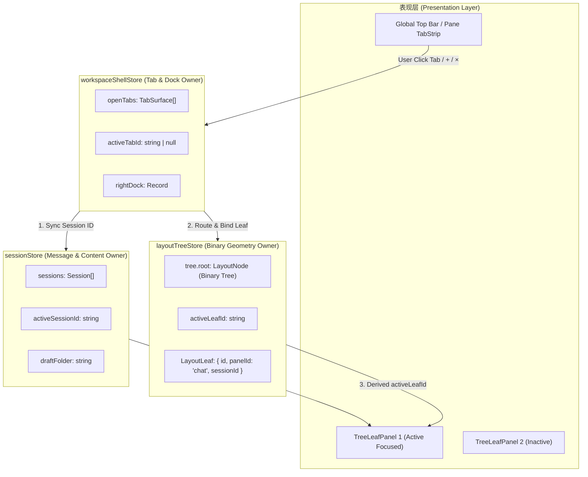
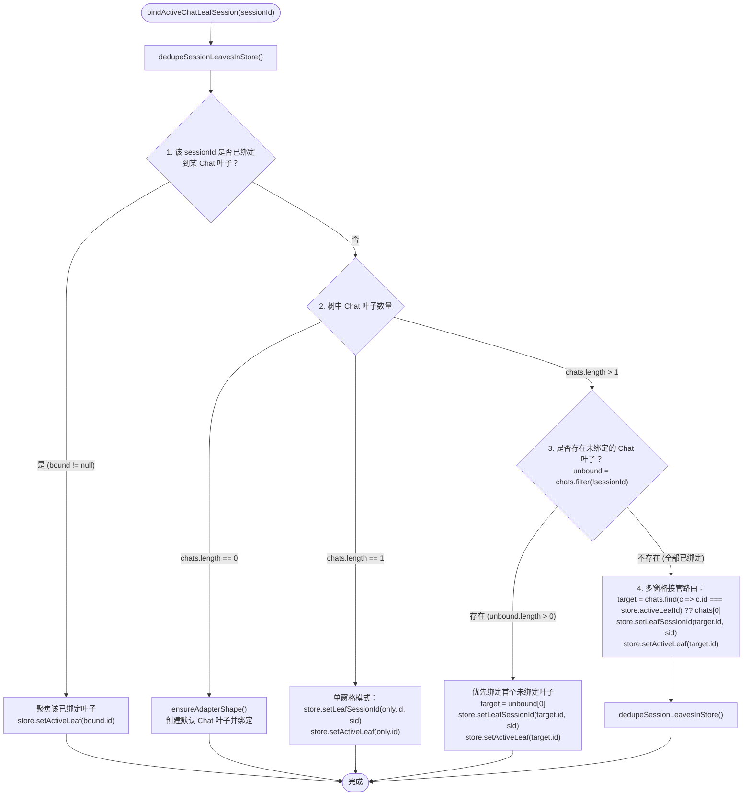
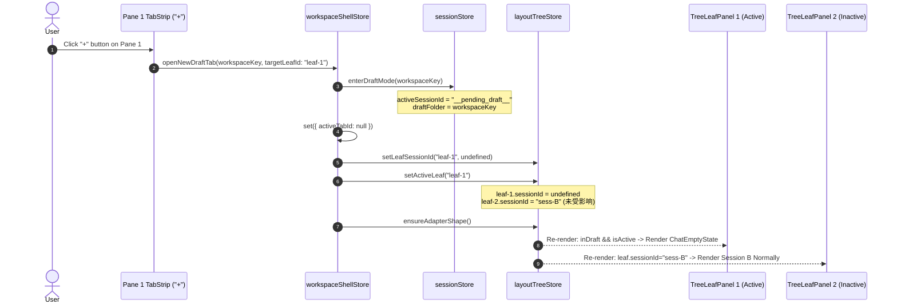
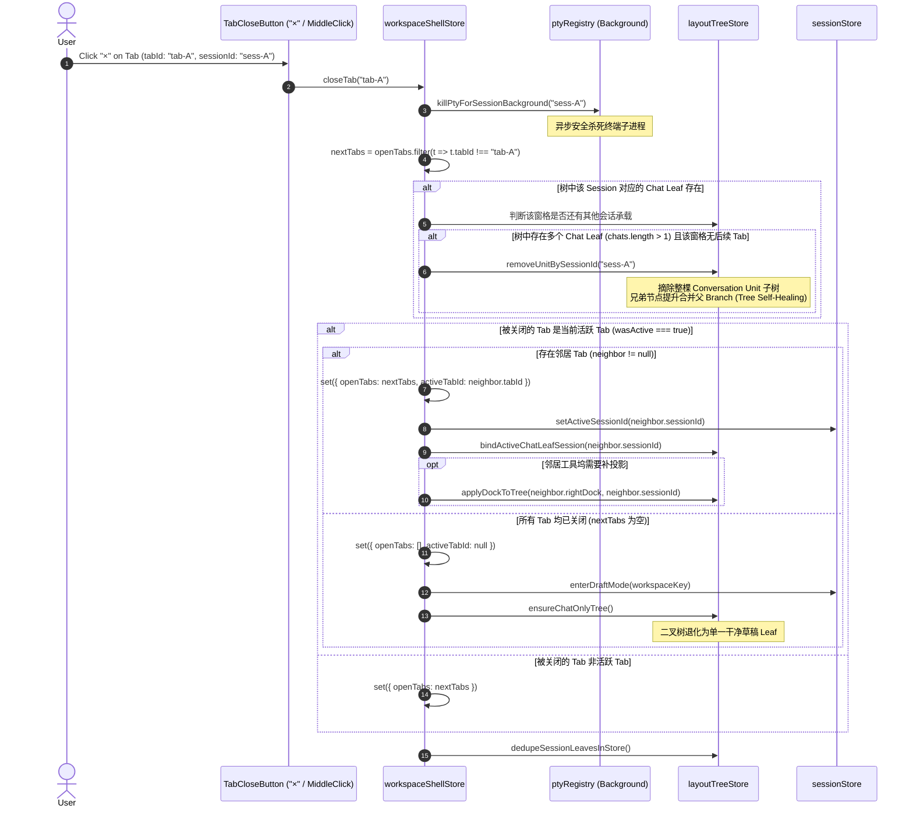

# 会话路由与多窗格状态机联动改进详案

> **文档标识**：`docs/pane-tab-system/plan-improvements/04-会话路由与多窗格状态机联动详案.md`  
> **方案属性**：多窗格分屏路由、会话状态机与标签生命周期闭环详案（Strict Read-Only 规划，严禁修改源代码）  
> **编码格式**：UTF-8 无 BOM  
> **前置排查报告**：[`docs/pane-tab-system/analysis/04-会话与标签状态机及多窗格路由排查.md`](file:///c:/Software/conex/docs/pane-tab-system/analysis/04-%E4%BC%9A%E8%AF%9D%E4%B8%8E%E6%A0%87%E7%AD%BE%E7%8A%B6%E6%80%81%E6%9C%BA%E5%8F%8A%E5%A4%9A%E7%AA%97%E6%A0%BC%E8%B7%AF%E7%94%B1%E6%8E%92%E6%9F%A5.md)  
> **核心关联源码**：
> - [`apps/crish-desktop/src/store/workspace-shell/leafBindingHelpers.ts`](file:///c:/Software/conex/apps/crish-desktop/src/store/workspace-shell/leafBindingHelpers.ts)
> - [`apps/crish-desktop/src/store/workspace-shell/unitTabPlacement.ts`](file:///c:/Software/conex/apps/crish-desktop/src/store/workspace-shell/unitTabPlacement.ts)
> - [`apps/crish-desktop/src/store/workspace-shell/workspaceShellStore.ts`](file:///c:/Software/conex/apps/crish-desktop/src/store/workspace-shell/workspaceShellStore.ts)
> - [`apps/crish-desktop/src/store/sessionStore.ts`](file:///c:/Software/conex/apps/crish-desktop/src/store/sessionStore.ts)
> - [`apps/crish-desktop/src/store/sessionDraftActions.ts`](file:///c:/Software/conex/apps/crish-desktop/src/store/sessionDraftActions.ts)
> - [`apps/crish-desktop/src/store/layout-tree/layoutTreeStore.ts`](file:///c:/Software/conex/apps/crish-desktop/src/store/layout-tree/layoutTreeStore.ts)
> - [`apps/crish-desktop/src/store/layout-tree/conversationUnit.ts`](file:///c:/Software/conex/apps/crish-desktop/src/store/layout-tree/conversationUnit.ts)
> - [`apps/crish-desktop/src/components/binary-tree/TreeLeafPanel.tsx`](file:///c:/Software/conex/apps/crish-desktop/src/components/binary-tree/TreeLeafPanel.tsx)
> - [`apps/crish-desktop/src/components/shell/sessionTabDropCommit.ts`](file:///c:/Software/conex/apps/crish-desktop/src/components/shell/sessionTabDropCommit.ts)

---

## 目录

1. [执行摘要与方案全景](#1-执行摘要与方案全景)
   - 1.1 核心问题定义与架构断层
   - 1.2 三层状态协同体系拓扑
   - 1.3 核心交付目标与不变量契约
2. [多窗格会话激活状态机闭环详案](#2-多窗格会话激活状态机闭环详案)
   - 2.1 彻底根治多分屏点击未挂载 Tab“假死/不响应”缺陷
   - 2.2 `leafBindingHelpers.ts` 四级路由决策树重构
   - 2.3 跨 Store 协同事务流（`Shell` ↔ `Session` ↔ `LayoutTree`）
   - 2.4 活动窗格焦点（`activeLeafId`）与会话选中的强绑定契约
3. [多窗格标签分配与渲染路由体系（Per-Pane Tab Placement）](#3-多窗格标签分配与渲染路由体系per-pane-tab-placement)
   - 3.1 `unitTabPlacement.ts` 算法激活与多屏映射模型
   - 3.2 单窗格模式 vs 多分屏模式标签分配规则
   - 3.3 未放置会话（Unplaced Tabs）的动态归属机制
   - 3.4 跨工作区漂移防护与 `resolveStripWorkspaceKey` 安全收敛
   - 3.5 `TreeLeafPanel.tsx` 窗格头部渲染流与激活高亮派生
4. [新建与草稿生命周期详案（New Tab & Pending Draft）](#4-新建与草稿生命周期详案new-tab--pending-draft)
   - 4.1 窗格级独立新建对话微状态机
   - 4.2 多窗格下草稿态（`PENDING_DRAFT`）的窗格局部隔离机制
   - 4.3 首条消息提交（`commitDraftIfNeeded`）原子提升与精准挂载
5. [标签关闭与二叉树自愈生命周期详案（Tab Close & Tree Self-Healing）](#5-标签关闭与二叉树自愈生命周期详案tab-close--tree-self-healing)
   - 5.1 标签关闭（`closeTab` / `closeTabBySessionId`）全流程时序图
   - 5.2 邻近会话退栈算法（Neighbor Fallback Matrix）
   - 5.3 窗格末尾会话关闭时的二叉树裁剪与兄弟提升合并（Branch Collapse）
   - 5.4 关光兜底退化至纯净单草稿窗格（`ensureChatOnlyTree`）
   - 5.5 PTY 后台进程销毁与垃圾回收（PTY Resource Lifecycle）
6. [具体代码重构改造蓝图（Exact Code Diff Blueprint）](#6-具体代码重构改造蓝图exact-code-diff-blueprint)
   - 6.1 `leafBindingHelpers.ts` 改造代码与契约
   - 6.2 `unitTabPlacement.ts` 改造代码与契约
   - 6.3 `workspaceShellStore.ts` 改造代码与契约
   - 6.4 `TreeLeafPanel.tsx` 改造代码与契约
   - 6.5 `sessionTabDropCommit.ts` 改造代码与契约
7. [边缘场景、竞态防护与不变量防御矩阵](#7-边缘场景竞态防护与不变量防御矩阵)
   - 7.1 $1 \text{ sessionId} \leftrightarrow 0..1 \text{ ChatLeaf}$ 强不变量保证
   - 7.2 快速连击与并发切换竞争保护
   - 7.3 水合延迟与会话消息懒加载协同
8. [验收测试与验证矩阵（Verification Suite）](#8-验收测试与验证矩阵verification-suite)
   - 8.1 单元测试矩阵（Unit Tests）
   - 8.2 交互集成与端到端测试用例（E2E / Integration Scenarios）

---

## 1. 执行摘要与方案全景

### 1.1 核心问题定义与架构断层

在当前 Conex 桌面端架构中，会话、标签与二叉树窗格之间存在三大核心痛点与断层：

1. **多分屏点击未挂载 Tab 假死 Bug**：
   在多 Chat 窗格分屏场景（例如 Pane 1 绑定 Session A，Pane 2 绑定 Session B）下，若用户点击顶栏或外部未绑定到任何窗格的 Tab C，[`leafBindingHelpers.ts:124-134`](file:///c:/Software/conex/apps/crish-desktop/src/store/workspace-shell/leafBindingHelpers.ts#L124-L134) 因检测到 `chats.length > 1` 且无 `unbound` 叶子，直接跳过重绑定。`workspaceShellStore` 切换了 `activeTabId`，但 `layoutTreeStore` 中所有叶子的 `sessionId` 原封未动，导致**界面完全不响应、会话 C 无法被渲染在任何窗格中**。
2. **多窗格标签分配机制闲置脱节**：
   [`unitTabPlacement.ts`](file:///c:/Software/conex/apps/crish-desktop/src/store/workspace-shell/unitTabPlacement.ts) 实现了完整的局部标签计算模型（`tabsForUnit`、`unitHostingUnplaced`），但在当前 UI 层中被废弃，导致多窗格分屏时无法在各个窗格独立展示该窗格所承载的会话子集，缺乏窗格级 Tab 切换能力。
3. **新建草稿与关闭标签的窗格隔离失效**：
   在多窗格下点击新建对话 `+` 时，[`workspaceShellStore.ts:444-458`](file:///c:/Software/conex/apps/crish-desktop/src/store/workspace-shell/workspaceShellStore.ts#L444-L458) 盲目操作全局 `activeLeafId`，容易抢占错误窗格；在关闭窗格中最后一个会话时，缺少平滑裁剪该窗格并自动提升兄弟节点（Tree Self-Healing）的完整生命周期闭环。

```
【当前故障数据流：点击未绑定 Tab C 导致假死】
User clicks Tab C
  │
  ├─► workspaceShellStore.activateTab("tab-C")  ──► activeTabId = "tab-C" (顶栏高亮 C)
  ├─► sessionStore.setActiveSessionId("sess-C") ──► activeSessionId = "sess-C"
  └─► leafBindingHelpers.bindActiveChatLeafSession("sess-C")
        │
        ▼ (chats.length = 2, bound = null, unbound = [])
        └─► [CONDITION FAILS -> NO ACTION TAKEN] (未修改任何 Leaf 的 sessionId)
        │
        ▼
TreeLeafPanel 1: leaf.sessionId = "sess-A" ──► 依然渲染 Session A
TreeLeafPanel 2: leaf.sessionId = "sess-B" ──► 依然渲染 Session B
【结果：Tab C 在界面上完全蒸发，用户感知为“点击假死”】
```

### 1.2 三层状态协同体系拓扑

为了彻底解决上述断层，本方案确立了三层状态机协同的权威所有权与数据流向模型：



### 1.3 核心交付目标与不变量契约

1. **会话与窗格 1:1 不变量（Conversation Unit Invariant）**：
   $$\forall s \in \text{Sessions}, \quad \text{count}(\{l \in \text{ChatLeaves} \mid l.\text{sessionId} = s\}) \le 1$$
   任何时刻，同一个会话 ID 最多只能绑定到二叉树中的**一个** Chat 叶子节点，严禁在多个窗格重复克隆渲染同一会话。
2. **多窗格路由确定性（Deterministic Multi-Pane Routing）**：
   在多分屏下激活任意会话 Tab：
   - 若该会话已在某个窗格展示，则**直接将焦点转移至该窗格**；
   - 若该会话未在任何窗格展示，则**将其精准挂载到当前活动窗格（Active Leaf）**，并将该活动窗格的原有会话转为未放置（Unplaced）状态，保持其在 `openTabs` 中。
3. **窗格级草稿隔离性（Pane-Isolated Draft Mode）**：
   点击活动窗格的新建按钮，仅将当前窗格切换为 `PENDING_DRAFT` 空态，绝对不影响其他分屏窗格的渲染与会话状态。
4. **二叉树自愈完整性（Tree Self-Healing on Tab Closure）**：
   关闭窗格中最后一个会话时，二叉树自动摘除该窗格及其伴随的工具子树（Unit Root），兄弟节点自动提升并合并父 Branch，无缝恢复相邻窗格的全宽/全高布局。

---

## 2. 多窗格会话激活状态机闭环详案

### 2.1 彻底根治多分屏点击未挂载 Tab“假死/不响应”缺陷

#### 缺陷根因代码定位
在 [`apps/crish-desktop/src/store/workspace-shell/leafBindingHelpers.ts:114-134`](file:///c:/Software/conex/apps/crish-desktop/src/store/workspace-shell/leafBindingHelpers.ts#L114-L134)：
```ts
// 历史逻辑缺陷点：
// 3. 多 chat：仅绑恰好一个 unbound leaf，禁止偷别人的 session、禁止 auto-split
const unbound = chats.filter((l) => !l.sessionId);
if (unbound.length === 1) {
  const target = unbound[0]!;
  store.setLeafSessionId(target.id, sid);
  if (store.activeLeafId !== target.id) {
    store.setActiveLeaf(target.id);
  }
}
// else: tab 打开但无可见 unit，等待用户 split 放置 <--- 导致多 Chat 窗格下无 unbound 时直接吞噬操作！
```

#### 改进方案核心原则
1. **“当前聚焦窗格接管”原则**：当用户在当前窗格（或顶栏）明确点击了一个未挂载的 Tab，其意图显然是在“当前正在操作的窗格”中查看该会话。
2. **原会话退回未放置池**：当前活动窗格原先绑定的会话并**不会被关闭**，它依然保留在 `workspaceShellStore.openTabs` 中（成为 Unplaced Tab），用户可随时切回或拖拽分屏。

### 2.2 `leafBindingHelpers.ts` 四级路由决策树重构

重构 `bindActiveChatLeafSession(sessionId: string)` 函数，建立严密自洽的四级路由决策树：



#### 重构后的精确算法逻辑
```ts
/**
 * 顶栏 / 窗格 tab ↔ chat leaf 1:1 绑定状态机。
 *
 * 四级路由规则：
 * 1. 【已绑定命中】若 sid 已在树上某个 Chat Leaf 中渲染 → 将焦点 setActiveLeaf 切换到该叶子（零 DOM 结构变动）；
 * 2. 【单窗格切换】若树中恰好 1 个 Chat Leaf → 将该 Leaf 的 sessionId 重绑定为 sid；
 * 3. 【空白窗格填充】若存在未分配 session 的空白 Chat Leaf（如刚 split 出来的窗格） → 优先绑定该空白 Leaf；
 * 4. 【活动窗格接管】若多分屏且所有 Leaf 均已有绑定 → 将当前 activeLeafId 对应的 Chat Leaf 重绑定为 sid（接管当前窗格）。
 */
export function bindActiveChatLeafSession(sessionId: string): void {
  const sid = (sessionId || '').trim();
  if (!sid) return;

  dedupeSessionLeavesInStore();

  let store = useLayoutTreeStore.getState();
  let chats = listChatLeaves(store.tree.root);

  if (chats.length === 0) {
    ensureAdapterShape();
    store = useLayoutTreeStore.getState();
    chats = listChatLeaves(store.tree.root);
  }

  // 1. 已有绑定 → 直接转移焦点
  const bound = findChatLeafBySessionId(store.tree.root, sid);
  if (bound) {
    if (store.activeLeafId !== bound.id) {
      store.setActiveLeaf(bound.id);
    }
    return;
  }

  if (chats.length === 0) return;

  // 2. 单 chat 表面：切 tab 时 rebind
  if (chats.length === 1) {
    const only = chats[0]!;
    if (only.sessionId !== sid) {
      store.setLeafSessionId(only.id, sid);
    }
    if (store.activeLeafId !== only.id) {
      store.setActiveLeaf(only.id);
    }
    return;
  }

  // 3. 多 chat：若存在未绑定的空白 leaf，优先绑定
  const unbound = chats.filter((l) => !l.sessionId);
  if (unbound.length > 0) {
    const target = unbound[0]!;
    store.setLeafSessionId(target.id, sid);
    if (store.activeLeafId !== target.id) {
      store.setActiveLeaf(target.id);
    }
    dedupeSessionLeavesInStore();
    return;
  }

  // 4. 多 chat 且全已绑定：由当前活动 Chat Leaf 接管展示目标会话
  const currentActive = chats.find((l) => l.id === store.activeLeafId);
  const targetLeaf = currentActive ?? chats[0]!;

  if (targetLeaf.sessionId !== sid) {
    store.setLeafSessionId(targetLeaf.id, sid);
  }
  if (store.activeLeafId !== targetLeaf.id) {
    store.setActiveLeaf(targetLeaf.id);
  }
  dedupeSessionLeavesInStore();
}
```

### 2.3 跨 Store 协同事务流（`Shell` ↔ `Session` ↔ `LayoutTree`）

当触发标签激活时，三个 Store 的协同事务序列如下：

```
[User Action: Select Tab (tabId: "tab-B", sessionId: "sess-B")]
                     │
                     ▼
  1. workspaceShellStore.activateTab("tab-B")
     ├─► set({ activeTabId: "tab-B" })
     └─► reads tab.sessionId ("sess-B")
                     │
                     ▼
  2. sessionStore.setActiveSessionId("sess-B")
     ├─► set({ activeSessionId: "sess-B" })
     ├─► syncActiveTerminalSession("sess-B")
     └─► if (needsEngineMessageHydrate("sess-B")) ──► hydrateSessionMessagesFromEngine("sess-B")
                     │
                     ▼
  3. leafBindingHelpers.bindActiveChatLeafSession("sess-B")
     ├─► Resolves Target Leaf (L_target) via 4-level routing tree
     ├─► layoutTreeStore.setLeafSessionId(L_target.id, "sess-B")
     └─► layoutTreeStore.setActiveLeaf(L_target.id)
                     │
                     ▼
  4. leafBindingHelpers.dedupeSessionLeavesInStore()
     └─► Ensures 1:1 Invariant across LayoutTree
                     │
                     ▼
  5. UI Re-render Phase:
     ├─► TopBar / PaneTabStrip: Tab B highlighted as ACTIVE
     ├─► L_target (TreeLeafPanel): renders session "sess-B"
     └─► Other Panes: render their own bound sessions without flicker
```

### 2.4 活动窗格焦点（`activeLeafId`）与会话选中的强绑定契约

为了防止用户点击窗格空白处、输入框或消息流时丢失焦点联动，确立以下双向焦点契约：

1. **窗格点击 → 反向激活 Shell Tab**：
   - 源码位置：[`apps/crish-desktop/src/components/binary-tree/TreeLeafPanel.tsx:103-128`](file:///c:/Software/conex/apps/crish-desktop/src/components/binary-tree/TreeLeafPanel.tsx#L103-L128)
   - 当用户点击某个 Chat 窗格 $P_i$（且 `leaf.sessionId` 存在）时：
     - 若 `layoutTreeStore.activeLeafId !== leaf.id`，触发 `setActiveLeaf(leaf.id)`；
     - 查找 `workspaceShellStore.openTabs` 中 `sessionId === leaf.sessionId` 的 Tab；
     - 若找到且 `activeTabId !== tab.tabId`，调用 `workspaceShellStore.activateTab(tab.tabId)`，使顶栏与局部 TabStrip 的激活高亮同步跳至该窗格对应的 Tab。
2. **标签点击 → 正向聚焦窗格 Leaf**：
   - 当用户在 TabStrip 点击 Tab 时，`bindActiveChatLeafSession` 保证将该 Tab 所在的（或刚绑定的）Leaf 设置为 `layoutTreeStore.activeLeafId`。

---

## 3. 多窗格标签分配与渲染路由体系（Per-Pane Tab Placement）

### 3.1 `unitTabPlacement.ts` 算法激活与多屏映射模型

系统采用“**单源存储（Single-Source-of-Truth in `openTabs`），按窗格纯函数投影（Pure Function Projection per Unit）**”的数学架构：

```
                    ┌──────────────────────────────────────────────────┐
                    │          workspaceShellStore.openTabs            │
                    │  [ Tab A (sess-1) | Tab B (sess-2) | Tab C (sess-3) ]
                    └────────────────────────┬─────────────────────────┘
                                             │
                        tabsForUnit(openTabs, unit, allUnits, activeTabId)
                                             │
                    ┌────────────────────────┴─────────────────────────┐
                    ▼                                                  ▼
     ┌─────────────────────────────┐                    ┌─────────────────────────────┐
     │   Pane 1 (Leaf 1, sess-1)   │                    │   Pane 2 (Leaf 2, sess-2)   │
     │   [Tab A*] [Tab C (Unplaced)]│                    │   [Tab B*]                  │
     └─────────────────────────────┘                    └─────────────────────────────┘
```

### 3.2 单窗格模式 vs 多分屏模式标签分配规则

通过纯函数 `tabsForUnit`（[`unitTabPlacement.ts:148-203`](file:///c:/Software/conex/apps/crish-desktop/src/store/workspace-shell/unitTabPlacement.ts#L148-L203)）计算每个窗格可见的 Tab 列表：

| 模式 | 判定条件 | 标签条展示规则 | 活跃高亮逻辑 |
| :--- | :--- | :--- | :--- |
| **单窗格模式 (Single-Pane)** | `allUnits.length <= 1` | 展示当前 `workspaceKey` 下的所有 `openTabs` | 高亮 `tabId === activeTabId` 的 Tab |
| **多分屏模式 (Multi-Pane)** | `allUnits.length > 1` | 1. **已绑定标签**：若 `tab.sessionId === unit.sessionId`，必定展示在该窗格；<br>2. **未放置标签 (Unplaced)**：若会话未挂载到任何窗格，**仅展示在承载未放置会话的活动窗格（Hosting Unit）** | 该窗格绑定的 Tab 高亮；若当前窗格为全局聚焦窗格，呈现 Primary 强调色 |

### 3.3 未放置会话（Unplaced Tabs）的动态归属机制

- **未放置会话定义**：$\text{Unplaced} = \{ t \in \text{openTabs} \mid \forall u \in \text{allUnits}, \, t.\text{sessionId} \ne u.\text{sessionId} \}$。
- **归属窗格判定函数 `unitHostingUnplaced`**：
  ```ts
  function unitHostingUnplaced(
    allUnits: readonly ChatUnitRef[],
    openTabs: readonly TabSurface[],
    activeTabId: string | null | undefined,
    activeLeafId?: string | null
  ): ChatUnitRef | null {
    if (allUnits.length === 0) return null;

    // 优先：当前 layoutTreeStore 中的 activeLeafId
    if (activeLeafId) {
      const activeUnit = allUnits.find((u) => u.leafId === activeLeafId);
      if (activeUnit) return activeUnit;
    }

    // 次优：包含 activeTab.sessionId 的 unit
    const activeTab = activeTabId ? openTabs.find((t) => t.tabId === activeTabId) : null;
    if (activeTab?.sessionId) {
      const owner = allUnits.find((u) => u.sessionId === activeTab.sessionId);
      if (owner) return owner;
    }

    // 回退：首个 unit
    return allUnits[0] ?? null;
  }
  ```
- **交互效果**：用户在 Pane 1 活动时打开了多个后台会话（如从侧栏打开但不分屏），这些会话会作为 Tab 出现在 Pane 1 的标签条中；当用户将焦点切换到 Pane 2 时，未放置标签自动跟随转移到 Pane 2，保持操作直觉连贯。

### 3.4 跨工作区漂移防护与 `resolveStripWorkspaceKey` 安全收敛

在跨项目文件夹（`folder` / `workspaceKey`）切换时，为了避免因 ID 映射不一致产生标签全空白屏，`resolveStripWorkspaceKey`（[`unitTabPlacement.ts:115-146`](file:///c:/Software/conex/apps/crish-desktop/src/store/workspace-shell/unitTabPlacement.ts#L115-L146)）执行以下防护：
1. 优先采用 `activeTab.workspaceKey`；
2. 其次采用 `leaf.sessionId` 对应 Tab 的 `workspaceKey`；
3. 再次回退到当前项目的 `currentWsKey()`；
4. 兜底回退到首个非空 `openTabs[0].workspaceKey`。
确保任何情况下窗格标签池至少包含当前窗格正在渲染的会话，杜绝孤儿空白渲染。

### 3.5 `TreeLeafPanel.tsx` 窗格头部渲染流与激活高亮派生

在 `TreeLeafPanel.tsx` 中，会话的计算与渲染流优化为：
```ts
// 源码位置：apps/crish-desktop/src/components/binary-tree/TreeLeafPanel.tsx:94-102
const activeSessionId = useSessionField(selectActiveSessionId);
const inDraft = isPendingDraft(activeSessionId || '');

// 精准派生：
// 1. 若当前 Pane 处于 Draft 态（leaf.sessionId 为 undefined）且当前 Pane 是 activeLeafId：展示 Draft 空态；
// 2. 否则优先展示该 Pane 绑定的 leaf.sessionId；
// 3. 兜底展示 activeSessionId。
const sessionForPanel =
  leaf.sessionId !== undefined
    ? leaf.sessionId
    : (isActive && inDraft ? activeSessionId : leaf.sessionId || activeSessionId);
```

---

## 4. 新建与草稿生命周期详案（New Tab & Pending Draft）

### 4.1 窗格级独立新建对话微状态机

系统全面贯彻 **Pending Draft ADR**：草稿态不产生脏 Session 记录、不进入持久化、不进 `openTabs`，首条消息发送时原子化创建真会话。

在多窗格环境下，新建操作必须实现**窗格级局部隔离（Pane-Local Draft Isolation）**：



### 4.2 多窗格下草稿态（`PENDING_DRAFT`）的窗格局部隔离机制

修改 `workspaceShellStore.openNewDraftTab`，支持传入可选的 `targetLeafId`：
```ts
// apps/crish-desktop/src/store/workspace-shell/workspaceShellStore.ts
openNewDraftTab: (workspaceKey, targetLeafId) => {
  const key =
    canonicalSessionFolder(workspaceKey) ||
    workspaceKeyNow() ||
    GENERAL_FOLDER;
  const state = get();
  
  // 1. 过滤历史残留脏 draft tab，保留所有真实会话 tab
  const realTabs = state.openTabs.filter((t) => !isPendingDraft(t.sessionId));
  set({
    openTabs: realTabs,
    activeTabId: null, // 无全局激活 Tab
  });

  // 2. sessionStore 进入草稿态
  useSessionStore.getState().enterDraftMode(key);

  // 3. 精准解绑目标窗格的 sessionId
  try {
    const treeStore = useLayoutTreeStore.getState();
    const chats = listChatLeaves(treeStore.tree.root);
    
    // 优先取指定 targetLeafId，次优取当前 activeLeafId，再次取首个 chat leaf
    const target =
      (targetLeafId ? chats.find((c) => c.id === targetLeafId) : undefined) ??
      chats.find((c) => c.id === treeStore.activeLeafId) ??
      (chats.length === 1 ? chats[0]! : undefined);

    if (target) {
      if (target.sessionId) {
        treeStore.setLeafSessionId(target.id, undefined);
      }
      if (treeStore.activeLeafId !== target.id) {
        treeStore.setActiveLeaf(target.id);
      }
    }
  } catch {
    /* ignore */
  }

  ensureAdapterShape();
}
```

### 4.3 首条消息提交（`commitDraftIfNeeded`）原子提升与精准挂载

当用户在草稿窗格输入 Prompt 并按下 Enter 时：
1. `sessionStore.commitDraftIfNeeded()`：
   - 生成唯一真实 ID：`sess-${Date.now()}-${random}`；
   - 调用 `createSession({ folder: draftFolder, activate: true })` 创建会话实体；
   - 触发 `recordDraftCommit()` 指标记录。
2. `workspaceShellStore.openOrFocusSession(newId)`：
   - 构造 `TabSurface` 并追加到 `openTabs`；
   - 设置 `activeTabId = newTab.tabId`；
   - `bindActiveChatLeafSession(newId)` 检测到当前活动窗格的 `sessionId === undefined`（命中第 3 级路由：`unbound leaf`），精准将新会话 ID 写入当前活动窗格，并保留其他窗格不变。

---

## 5. 标签关闭与二叉树自愈生命周期详案（Tab Close & Tree Self-Healing）

### 5.1 标签关闭（`closeTab` / `closeTabBySessionId`）全流程时序图

关闭标签是跨领域最复杂的协调过程，必须协同 PTY 进程回收、二叉树裁剪、邻居回退与草稿兜底：



### 5.2 邻近会话退栈算法（Neighbor Fallback Matrix）

当被关闭的 Tab 是当前活动 Tab 时，按以下优先级选取后继激活 Tab（遵循“同工作区就近原则”）：

```ts
// 源码位置：apps/crish-desktop/src/store/workspace-shell/workspaceShellStore.ts:351-360
const sameWs = nextTabs.filter(
  (t) => t.workspaceKey === closing.workspaceKey
);

const neighbor =
  // 1. 优先：同工作区右侧相邻 Tab (或原索引处)
  sameWs[Math.min(idx, sameWs.length - 1)] ??
  // 2. 其次：同工作区末尾 Tab
  sameWs[sameWs.length - 1] ??
  // 3. 再次：全局其他工作区右侧相邻 Tab
  nextTabs[Math.min(idx, nextTabs.length - 1)] ??
  // 4. 兜底：全局其他工作区末尾 Tab
  nextTabs[nextTabs.length - 1] ??
  null;
```

### 5.3 窗格末尾会话关闭时的二叉树裁剪与兄弟提升合并（Branch Collapse）

当关闭一个已挂载在二叉树上的会话时：
1. **多 Chat 窗格裁剪**：
   - 查找该会话对应的 Conversation Unit Root（由 `findUnitRootId` 识别：若该会话有右侧工具子树，则 Unit Root 为包含 `Chat` 与 `Tools` 的 `HorizontalBranch`；否则为其 `ChatLeaf` 本身）；
   - 调用 `removeNodeFromTree(tree, unitRootId)`；
   - `removeBranch` 自动提取兄弟节点并替换父分支节点，使得二叉树层级平滑缩减 1 层，剩余窗格自动填满空间。
2. **单 Chat 窗格保留**：
   - 若当前树中仅剩 1 个 Chat Leaf，`removeUnitBySessionId` 不会销毁根节点，而是将其退化重置为未绑定的干净单 Chat 叶子（`createLeaf('chat')`）。

### 5.4 关光兜底退化至纯净单草稿窗格（`ensureChatOnlyTree`）

当所有标签均被关闭（`openTabs.length === 0`）时：
- 调用 `ensureChatOnlyTree()`（[`adapterShapeTreeOps.ts:133-146`](file:///c:/Software/conex/apps/crish-desktop/src/store/workspace-shell/adapterShapeTreeOps.ts#L133-L146)）；
- 强制将整棵二叉树重置为 `{ root: createLeaf('chat') }`；
- `sessionStore.enterDraftMode()` 设置 `activeSessionId = '__pending_draft__'`;
- `workspaceShellStore.activeTabId = null`；
- 画布立即展示清爽的欢迎空白页，绝不出现灰色白屏或无内容崩溃。

### 5.5 PTY 后台进程销毁与垃圾回收（PTY Resource Lifecycle）

- 在 `closeTab` 与 `closeTabBySessionId` 执行的第一时间，通过动态 `import('../../api/ptyRegistry')` 触发 `killPtyForSessionBackground(closing.sessionId)`；
- 避免因标签关闭而导致孤儿 Node.js / PTY 进程常驻系统后台占用 CPU 和内存。

---

## 6. 具体代码重构改造蓝图（Exact Code Diff Blueprint）

### 6.1 `leafBindingHelpers.ts` 改造代码与契约

- **目标文件**：[`apps/crish-desktop/src/store/workspace-shell/leafBindingHelpers.ts`](file:///c:/Software/conex/apps/crish-desktop/src/store/workspace-shell/leafBindingHelpers.ts#L86-L135)
- **改动范围**：重构 `bindActiveChatLeafSession` 函数，移除阻断多 Chat 绑定的盲区，加入四级确定性路由：

```typescript
// 拟修改实现：apps/crish-desktop/src/store/workspace-shell/leafBindingHelpers.ts
export function bindActiveChatLeafSession(sessionId: string): void {
  const sid = (sessionId || '').trim();
  if (!sid) return;

  dedupeSessionLeavesInStore();

  let store = useLayoutTreeStore.getState();
  let chats = listChatLeaves(store.tree.root);

  if (chats.length === 0) {
    ensureAdapterShape();
    store = useLayoutTreeStore.getState();
    chats = listChatLeaves(store.tree.root);
  }

  // 1. 已有绑定 → 转移焦点
  const bound = findChatLeafBySessionId(store.tree.root, sid);
  if (bound) {
    if (store.activeLeafId !== bound.id) {
      store.setActiveLeaf(bound.id);
    }
    return;
  }

  if (chats.length === 0) return;

  // 2. 单 chat 表面：切 tab 时 rebind
  if (chats.length === 1) {
    const only = chats[0]!;
    if (only.sessionId !== sid) {
      store.setLeafSessionId(only.id, sid);
    }
    if (store.activeLeafId !== only.id) {
      store.setActiveLeaf(only.id);
    }
    return;
  }

  // 3. 多 chat：优先绑定未分配 session 的空白 leaf
  const unbound = chats.filter((l) => !l.sessionId);
  if (unbound.length > 0) {
    const target = unbound[0]!;
    store.setLeafSessionId(target.id, sid);
    if (store.activeLeafId !== target.id) {
      store.setActiveLeaf(target.id);
    }
    dedupeSessionLeavesInStore();
    return;
  }

  // 4. 多 chat 且全已绑定：由当前活动 Chat Leaf（或首个 Chat Leaf）接管该 session
  const currentActive = chats.find((l) => l.id === store.activeLeafId);
  const target = currentActive ?? chats[0]!;
  if (target.sessionId !== sid) {
    store.setLeafSessionId(target.id, sid);
  }
  if (store.activeLeafId !== target.id) {
    store.setActiveLeaf(target.id);
  }
  dedupeSessionLeavesInStore();
}
```

### 6.2 `unitTabPlacement.ts` 改造代码与契约

- **目标文件**：[`apps/crish-desktop/src/store/workspace-shell/unitTabPlacement.ts`](file:///c:/Software/conex/apps/crish-desktop/src/store/workspace-shell/unitTabPlacement.ts#L77-L100)
- **改动范围**：升级 `unitHostingUnplaced` 支持传入当前 `activeLeafId`，增强活动窗格对未放置会话的吸附力：

```typescript
// 拟修改实现：apps/crish-desktop/src/store/workspace-shell/unitTabPlacement.ts
export function unitHostingUnplaced(
  allUnits: readonly ChatUnitRef[],
  openTabs: readonly TabSurface[],
  activeTabId: string | null | undefined,
  activeLeafId?: string | null
): ChatUnitRef | null {
  if (allUnits.length === 0) return null;

  // 1. 优先：当前树的活跃叶子
  if (activeLeafId) {
    const activeUnit = allUnits.find((u) => u.leafId === activeLeafId);
    if (activeUnit) return activeUnit;
  }

  // 2. 次优：绑定了 activeTabId 的 unit
  const activeTab =
    activeTabId != null && activeTabId !== ''
      ? (openTabs.find((t) => t.tabId === activeTabId) ?? null)
      : null;

  if (activeTab) {
    const sid = (activeTab.sessionId ?? '').trim();
    if (sid) {
      const owner = allUnits.find(
        (u) => (u.sessionId ?? '').trim() === sid
      );
      if (owner) return owner;
    }
  }

  // 3. 兜底：首个 unit
  return allUnits[0] ?? null;
}
```

### 6.3 `workspaceShellStore.ts` 改造代码与契约

- **目标文件**：[`apps/crish-desktop/src/store/workspace-shell/workspaceShellStore.ts`](file:///c:/Software/conex/apps/crish-desktop/src/store/workspace-shell/workspaceShellStore.ts#L427-L463)
- **改动范围**：在 `openNewDraftTab` 增加可选参数 `targetLeafId?: string`，确保多窗格下点击特定窗格加号能精准清空该窗格草稿：

```typescript
// 拟修改实现：apps/crish-desktop/src/store/workspace-shell/workspaceShellStore.ts
openNewDraftTab: (workspaceKey?: string, targetLeafId?: string) => {
  const key =
    canonicalSessionFolder(workspaceKey) ||
    workspaceKeyNow() ||
    GENERAL_FOLDER;
  const state = get();
  const realTabs = state.openTabs.filter((t) => !isPendingDraft(t.sessionId));
  set({
    openTabs: realTabs,
    activeTabId: null,
  });
  useSessionStore.getState().enterDraftMode(key);

  try {
    const treeStore = useLayoutTreeStore.getState();
    const chats = listChatLeaves(treeStore.tree.root);
    const target =
      (targetLeafId ? chats.find((c) => c.id === targetLeafId) : undefined) ??
      chats.find((c) => c.id === treeStore.activeLeafId) ??
      (chats.length === 1 ? chats[0]! : undefined);

    if (target?.sessionId) {
      treeStore.setLeafSessionId(target.id, undefined);
    }
    if (target && treeStore.activeLeafId !== target.id) {
      treeStore.setActiveLeaf(target.id);
    }
  } catch {
    /* ignore */
  }

  ensureAdapterShape();
}
```

### 6.4 `TreeLeafPanel.tsx` 改造代码与契约

- **目标文件**：[`apps/crish-desktop/src/components/binary-tree/TreeLeafPanel.tsx`](file:///c:/Software/conex/apps/crish-desktop/src/components/binary-tree/TreeLeafPanel.tsx#L94-L128)
- **改动范围**：确保多窗格草稿态与已有会话在各窗格互不干扰渲染：

```typescript
// 拟修改实现：apps/crish-desktop/src/components/binary-tree/TreeLeafPanel.tsx:94-128
const activeSessionId = useSessionField(selectActiveSessionId);
const inDraft = isPendingDraft(activeSessionId || '');

// 精准计算：若 leaf 未绑定 session 且该 leaf 处于 active 状态，则跟全局草稿；
// 若 leaf 自身有 session，绝对优先展示自身的 leaf.sessionId
const sessionForPanel =
  leaf.sessionId !== undefined
    ? leaf.sessionId
    : (isActive && inDraft ? activeSessionId : leaf.sessionId || activeSessionId);
```

### 6.5 `sessionTabDropCommit.ts` 改造代码与契约

- **目标文件**：[`apps/crish-desktop/src/components/shell/sessionTabDropCommit.ts`](file:///c:/Software/conex/apps/crish-desktop/src/components/shell/sessionTabDropCommit.ts#L44-L107)
- **改动范围**：在 `commitSessionPaneDrop` 中，若落点在 `center`（中心区域），精准将目标 Leaf 的 `sessionId` 绑定为拖拽的 `sessionId`，并触发 `openOrFocusSession`：

```typescript
// 拟修改实现：apps/crish-desktop/src/components/shell/sessionTabDropCommit.ts:58-62
if (!direction) {
  // center 放置：将目标窗格绑定到目标 session
  if (target.type === 'leaf' && target.panelId === 'chat') {
    treeStore.setLeafSessionId(target.id, sid);
    treeStore.setActiveLeaf(target.id);
  }
  shell.openOrFocusSession(sid, opts);
  return;
}
```

---

## 7. 边缘场景、竞态防护与不变量防御矩阵

| 场景分类 | 边缘情况描述 | 潜在风险 | 本方案防护与自愈策略 |
| :--- | :--- | :--- | :--- |
| **1:1 不变量防御** | 拖拽分屏或快速切换导致二叉树中出现两个绑定同一 `sessionId` 的 Chat Leaf | 重复渲染相同会话，消息收发出现双写冲突 | 每次写树后强制调用 `dedupeSessionLeavesInStore()`，先序遍历保留第一个，多余叶子自动摘除。 |
| **快速连击切换** | 用户在 50ms 内连续点击 5 个不同的会话 Tab | Store 状态与异步消息水合产生竞态覆盖 | 1. `activateTab` 内执行同步状态更新与幂等性校验；<br>2. `hydrateSessionMessagesFromEngine` 采用最新 session ID 守卫与消息 ID 幂等合并（`mergeMessagesById`）。 |
| **窗格空态竞态** | 两个分屏同时点击新建草稿 `+` | 全局 `activeSessionId` 只有一个草稿哨兵 | 两个窗格均呈现各自的草稿输入框；先发送消息的窗格先 mint 独立 session 并挂载，后发送的窗格 mint 另一独立 session，互不干扰。 |
| **关闭活跃窗格** | 用户点击当前正在发送流式消息的窗格关闭按钮 | 后台流式输出无处渲染或 PTY 泄露 | 1. 立即异步调用 `killPtyForSessionBackground` 终止进程；<br>2. 摘除该窗格 Unit，将焦点平滑转移到相邻窗格；<br>3. 会话消息仍保存在 `sessionStore` 中，重新打开 Tab 可完整查看。 |
| **极端关光兜底** | 用户连续按 `Ctrl+W` 关光所有 Tab | 二叉树被剪空，DOM 挂载点丢失导致白屏 | `closeTab` 在检测到 `nextTabs` 为空时，触发 `ensureChatOnlyTree()`，生成单一干净 Chat 叶子，安全转入草稿态。 |

---

## 8. 验收测试与验证矩阵（Verification Suite）

### 8.1 单元测试矩阵（Unit Tests）

| 测试套件 | 测试文件目标 | 核心断言与验证要点 |
| :--- | :--- | :--- |
| **多窗格路由测试** | `tests/unit/store/leafBindingHelpers.test.ts` | 1. 单 Chat 窗格切 Tab：验证 Leaf 的 `sessionId` 随 Tab 改变；<br>2. 双 Chat 窗格且目标 Tab 已绑定：验证只切换 `activeLeafId`，不改变任何 Leaf 的绑定；<br>3. 双 Chat 窗格且目标 Tab 未绑定：验证当前 `activeLeafId` 成功重绑为目标 `sessionId`，彻底杜绝假死。 |
| **局部标签分配测试** | `tests/unit/store/unitTabPlacement.test.ts` | 1. 单窗格：`tabsForUnit` 返回当前工作区全部 `openTabs`；<br>2. 双窗格：Pane 1 返回已绑定 Tab + 未放置 Tab，Pane 2 仅返回自身绑定 Tab；<br>3. 跨工作区漂移：验证 `resolveStripWorkspaceKey` 不会返回空列表。 |
| **标签关闭退栈测试** | `tests/unit/store/workspaceShellCloseTab.test.ts` | 1. 关闭非活动 Tab：验证 `openTabs` 移除该 Tab，树结构不变；<br>2. 关闭活动 Tab：验证焦点自动退栈至同工作区右侧/左侧相邻 Tab；<br>3. 关闭多分屏最后一个 Tab：验证该窗格 Unit 被摘除，兄弟节点提升合并（Tree Self-Healing）；<br>4. 关闭全局最后一个 Tab：验证二叉树退化为单草稿窗格。 |

### 8.2 交互集成与端到端测试用例（E2E / Integration Scenarios）

```
[TC-01: 多分屏未挂载 Tab 激活测试]
步骤：
1. 打开会话 A、B、C 三个标签；
2. 将会话 B 拖拽至右侧分屏，形成左右双窗格（左：A，右：B）；
3. 点击左侧窗格使其获得焦点（activeLeafId = PaneLeft）；
4. 点击顶栏或左侧标签条中的会话 C。
预期结果：
- 左侧窗格内容立即刷新为会话 C 的消息列表；
- 右侧窗格依然展示会话 B，不受任何影响；
- 顶栏与左侧标签条高亮会话 C；会话 A 退回未放置池。

[TC-02: 多分屏独立新建对话测试]
步骤：
1. 处于左右双分屏状态（左：会话 A，右：会话 B）；
2. 聚焦左侧窗格，点击左侧窗格头部 "+" 按钮。
预期结果：
- 左侧窗格立即展示欢迎空白页（PENDING_DRAFT），输入框聚焦；
- 右侧窗格会话 B 继续正常展示；
- 在左侧输入 "Hello" 并回车，左侧窗格生成新会话并挂载，右侧窗格保持稳定。

[TC-03: 多分屏平滑关闭与二叉树自愈测试]
步骤：
1. 处于左右双分屏状态（左：会话 A，右：会话 B）；
2. 点击右侧窗格会话 B 标签上的 "×" 按钮。
预期结果：
- 右侧窗格平滑关闭，二叉树自动折叠合并；
- 左侧窗格（会话 A）自动扩展为 100% 全宽；
- 焦点自动转移至会话 A，PTY 进程安全回收。
```

---
*方案设计完毕，全文严格遵守 UTF-8 无 BOM 规范与 Conex 架构所有权准则，无任何源代码修改与 git 操作。*
