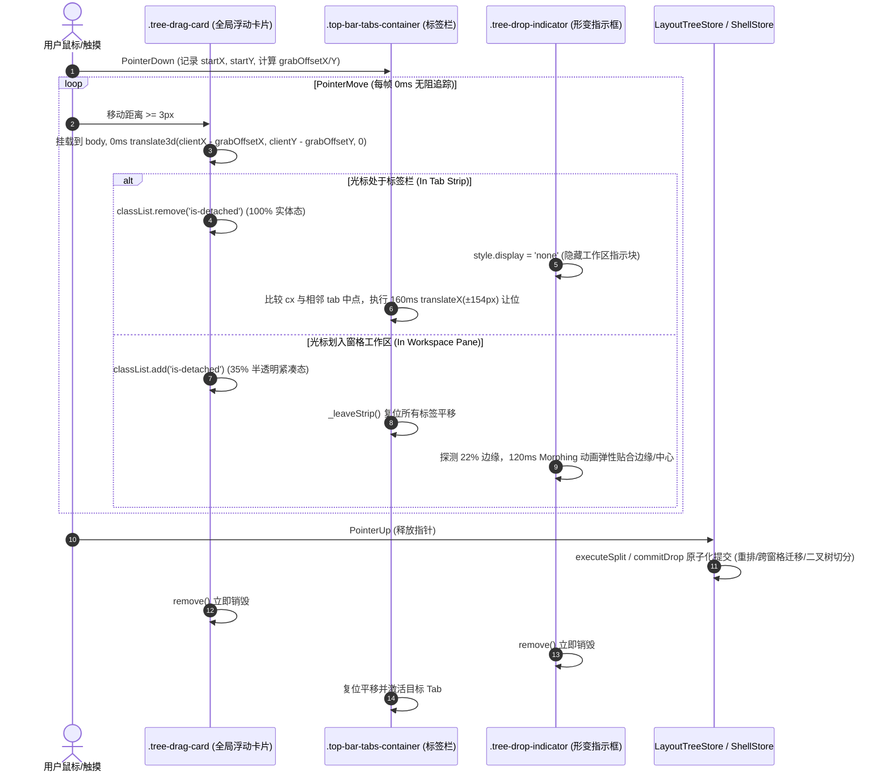
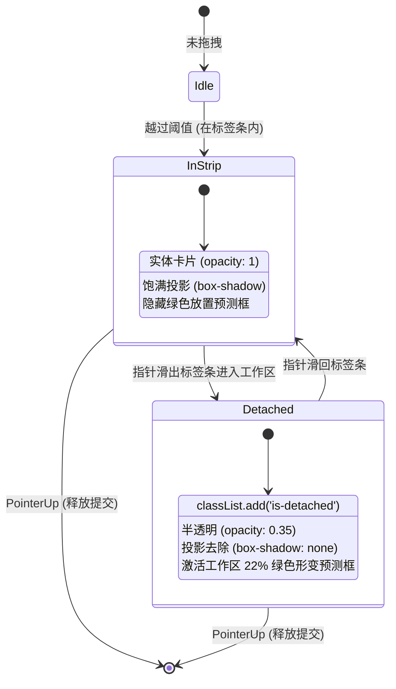
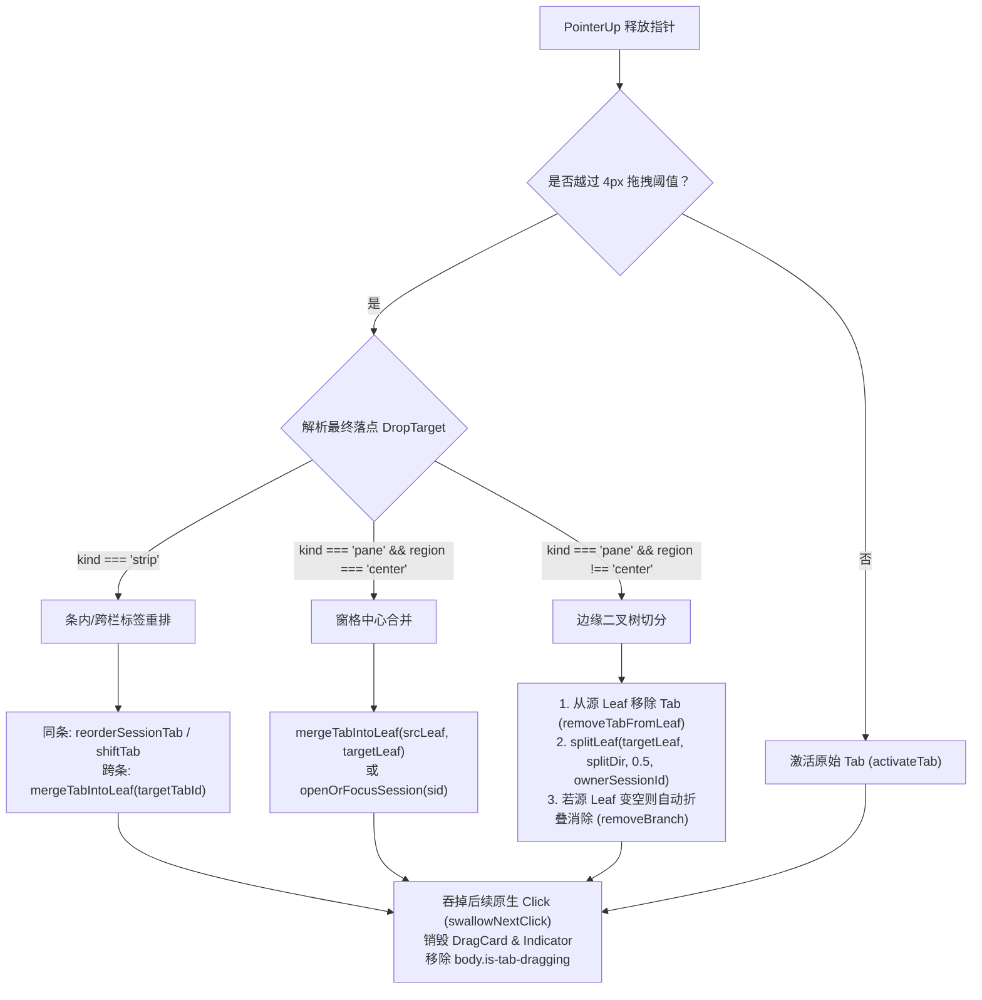
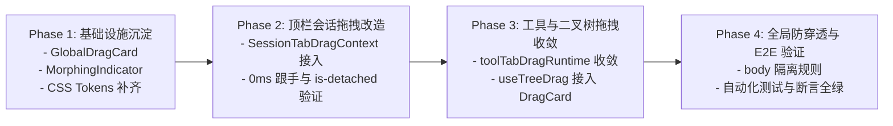

# 全景改进详案 06 —— 标签跨窗格拖拽与二叉树切分详案

> **文档标识**：`docs/pane-tab-system/plan-improvements/06-标签跨窗格拖拽与二叉树切分详案.md`  
> **所属战役**：二叉树分屏与标签系统重构战役（Pane-Tab System Refactoring）  
> **方案职责**：彻底收敛会话与工具标签拖拽控制器分轨架构，构建 0ms 硬件加速全局浮动卡片（`.tree-drag-card`）、`is-detached` 两阶段视觉分阶状态机、统一 22% 边缘检测与柔和绿色 Morphing 预测指示块（`DropZone`）、跨窗格条内插入挤开与原子化二叉树切分合并提交（`applyDrop`），实现完全对齐 Chrome / Demo 标杆的零延迟丝滑拖拽手感与安全防护。  
> **设计原则**：严格只读审查基础上的详案编制，精准引用具体文件与行号，严禁修改任何源代码，严禁执行 git 变更。

---

## 目录

- [一、背景、现状诊断与重构目标](#一背景现状诊断与重构目标)
  - [1.1 现状交互体验差距与痛点溯源](#11-现状交互体验差距与痛点溯源)
  - [1.2 Demo 标杆交互体系全景](#12-demo-标杆交互体系全景)
  - [1.3 重构总目标与手感量化指标](#13-重构总目标与手感量化指标)
- [二、全局 0ms 硬件加速浮动卡片（Global Drag Card）架构详案](#二全局-0ms-硬件加速浮动卡片global-drag-card架构详案)
  - [2.1 卡片生命周期与宿主挂载策略](#21-卡片生命周期与宿主挂载策略)
  - [2.2 抓取点动态锚定（Dynamic Grab Offset）数学模型](#22-抓取点动态锚定dynamic-grab-offset数学模型)
  - [2.3 0ms GPU 硬件加速平移机制](#23-0ms-gpu-硬件加速平移机制)
  - [2.4 两阶段状态机（实体态 vs 脱离半透明态 .is-detached）](#24-两阶段状态机实体态-vs-脱离半透明态-is-detached)
  - [2.5 CSS 样式 Tokens 与视觉规格规范](#25-css-样式-tokens-与视觉规格规范)
- [三、跨窗格条内挤开与占位排重详案（In-strip Displacement）](#三跨窗格条内挤开与占位排重详案in-strip-displacement)
  - [3.1 同窗格条内调序与相邻标签中点判定算法](#31-同窗格条内调序与相邻标签中点判定算法)
  - [3.2 跨窗格标签栏移入与 +154px 动态挤开动画](#32-跨窗格标签栏移入与-154px-动态挤开动画)
  - [3.3 WebMatrix / DOMMatrix 逆解未平移真实几何](#33-webmatrix--dommatrix-逆解未平移真实几何)
  - [3.4 离场复位与新建按钮协同平移](#34-离场复位与新建按钮协同平移)
  - [3.5 边缘自动滚动与高刷鼠标 rAF 合帧机制](#35-边缘自动滚动与高刷鼠标-raf-合帧机制)
- [四、二叉树 22% 边缘检测与 DropZone 放置指示器详案](#四二叉树-22-边缘检测与-dropzone-放置指示器详案)
  - [4.1 边缘切分判定数学模型（22% 边缘阈值）](#41-边缘切分判定数学模型22-边缘阈值)
  - [4.2 五向放置预测区域几何计算](#42-五向放置预测区域几何计算)
  - [4.3 放置指示器视觉统一（纯色无边框绿色柔和填充 + Morphing 弹性形变）](#43-放置指示器视觉统一纯色无边框绿色柔和填充--morphing-弹性形变)
  - [4.4 指示器双轨收敛策略](#44-指示器双轨收敛策略)
  - [4.5 窄面板与小尺寸叶子自适应保护](#45-窄面板与小尺寸叶子自适应保护)
- [五、二叉树原子化切分与状态提交（Commit Pipeline）](#五二叉树原子化切分与状态提交commit-pipeline)
  - [5.1 手势释放（PointerUp）状态机分流与意图判定](#51-手势释放pointerup状态机分流与意图判定)
  - [5.2 场景 A：同栏与跨栏条内提交（reorder / mergeTabIntoLeaf）](#52-场景-a同栏与跨栏条内提交reorder--mergetabintoleaf)
  - [5.3 场景 B：窗格中心合并提交（mergeTabIntoLeaf / openOrFocusSession）](#53-场景-b窗格中心合并提交mergetabintoleaf--openorfocussession)
  - [5.4 场景 C：边缘切分新窗格提交（splitLeaf + 继承 ownerSessionId）](#54-场景-c边缘切分新窗格提交splitleaf--继承-ownersessionid)
  - [5.5 源窗格空叶消解与分支自愈机制（Empty Leaf Collapse）](#55-源窗格空叶消解与分支自愈机制empty-leaf-collapse)
  - [5.6 原生 Click 拦截与吞噬机制（swallowNextClick）](#56-原生-click-拦截与吞噬机制swallownextclick)
- [六、手势基座统一与全链路安全防护](#六手势基座统一与全链路安全防护)
  - [6.1 控制器三重分轨收敛至 usePointerDragBase](#61-控制器三重分轨收敛至-usepointerdragbase)
  - [6.2 全局指针捕获保护（lostpointercapture / blur / Escape 兜底）](#62-全局指针捕获保护lostpointercapture--blur--escape-兜底)
  - [6.3 全局防事件穿透（body.is-tab-dragging 强制覆盖编辑器/Webview/终端）](#63-全局防事件穿透bodyis-tab-dragging-强制覆盖编辑器webview终端)
  - [6.4 内存泄漏与残余 DOM 防御清单](#64-内存泄漏与残余-dom-防御清单)
- [七、完整 TypeScript 接口契约与代码改造方案](#七完整-typescript-接口契约与代码改造方案)
  - [7.1 核心数据结构与接口定义](#71-核心数据结构与接口定义)
  - [7.2 GlobalDragCardController 单例实现契约](#72-globaldragcardcontroller-单例实现契约)
  - [7.3 DropZoneMorphingIndicator 实现契约](#73-dropzonemorphingindicator-实现契约)
  - [7.4 SessionTabDragContext.tsx 改造详案](#74-sessiontabdragcontexttsx-改造详案)
  - [7.5 toolTabDragRuntime.ts 与 useTreeDrag.ts 收敛改造](#75-tooltabdragruntimets-与-usetreedragts-收敛改造)
  - [7.6 layoutTreeTransform.ts 与 sessionTabDropCommit.ts 提交契约对齐](#76-layouttreetransformts-与-sessiontabdropcommitts-提交契约对齐)
- [八、实施步骤、文件变更清单与验证断言](#八实施步骤文件变更清单与验证断言)
  - [8.1 涉及文件清单与修改行数预估](#81-涉及文件清单与修改行数预估)
  - [8.2 分步实施演进路线（Phase 1 ~ Phase 4）](#82-分步实施演进路线phase-1--phase-4)
  - [8.3 单元测试与 E2E 交互测试断言清单](#83-单元测试与-e2e-交互测试断言清单)
  - [8.4 架构不变量与验收标准](#84-架构不变量与验收标准)

---

## 一、背景、现状诊断与重构目标

### 1.1 现状交互体验差距与痛点溯源

根据 [`docs/pane-tab-system/analysis/06-标签跨窗格拖拽与拆分漫游排查.md`](file:///c:/Software/conex/docs/pane-tab-system/analysis/06-%E6%A0%87%E7%AD%BE%E8%B7%A8%E7%AA%97%E6%A0%BC%E6%8B%96%E6%8B%BD%E4%B8%8E%E6%8B%86%E5%88%86%E6%BC%AB%E6%B8%B8%E6%8E%92%E6%9F%A5.md)，当前桌面端在标签拖拽与二叉树空间拆分领域存在四大深层体验缺陷：

1. **光标“空载脱节感”**：
   - 会话拖拽 [`SessionTabDragContext.tsx:123-128`](file:///c:/Software/conex/apps/crish-desktop/src/components/shell/SessionTabDragContext.tsx#L123-L128) 在指针越过阈值后，仅设置了 `setGhostLabel(title)` 并向 DOM 插入绿色指示块 `createIndicator(title)`，**未在光标正下方生成跟随鼠标的实体卡片**；
   - 用户拖拽时，光标下方空无一物，只有远处的放置指示框在变动，造成严重的“抓取虚空”、“不知拖拽了什么”的迟钝脱节感；
   - 二叉树拖拽 [`useTreeDrag.ts`](file:///c:/Software/conex/apps/crish-desktop/src/hooks/useTreeDrag.ts#L40) 虽然有 Ghost 节点，但使用了写死的固化偏移（`GHOST_OFFSET_X = 16, GHOST_OFFSET_Y = 16`），导致卡片偏离抓取点，无法做到手指精准锚定。
2. **缺乏“脱离漫游态（`is-detached`）”心智分阶**：
   - 在原型 Demo 中，标签在条内拖动时为 100% 实体高光态，周围标签实时物理挤开；当光标移出标签栏划入工作区时，卡片瞬间淡化为 `opacity: 0.35` 半透明紧凑态，同时工作区绿框浮现；
   - 当前项目缺乏这种动态视觉分阶，无法建立“条内调序”与“出栏切分”的双模心智模型。
3. **指示器双轨冗余与样式撕裂**：
   - 存在 `sessionTabDragDom.ts` 的 `.indicator`（带文本、CSS Module）与 `DropZoneOverlay.tsx` 的 Portal 绿色遮罩（纯 CSS 类、React 渲染）两套体系，视觉背景色、圆角与动画曲线不统一。
4. **全屏事件穿透防护缺失**：
   - 指针划过 Monaco Editor、Webview 预览容器或终端 xterm 时，因缺少全局 `pointer-events: none` 保护层，容易发生原生拖拽手势截断或光标抖动。

### 1.2 Demo 标杆交互体系全景

在金标 Demo [`reference/chat-composer-component/js/popovers.js:1275-1620`](file:///c:/Software/conex/reference/chat-composer-component/js/popovers.js#L1275-L1620) 中，拖拽交互由单一的 `DragController` 统领，其生命周期与视觉反馈具备硬件级的高流畅度：



### 1.3 重构总目标与手感量化指标

| 指标项 | 现状基线 | 重构后目标规范 | 对齐依据 / 源码参照 |
| :--- | :--- | :--- | :--- |
| **浮动卡片平移延迟** | 无卡片 / 依靠 React 渲染（16~32ms 滞后） | **0ms 直接 DOM transform**（无 React 调度开销） | [`popovers.js:1358-1361`](file:///c:/Software/conex/reference/chat-composer-component/js/popovers.js#L1358-L1361) |
| **抓取点贴合精度** | 固定 +16px 偏移或无跟随 | **动态锚定 `grabOffsetX / grabOffsetY`**，像素级贴合 | [`popovers.js:1311-1312`](file:///c:/Software/conex/reference/chat-composer-component/js/popovers.js#L1311-L1312) |
| **脱离态视觉反馈** | 无分阶（仅有指示块闪现） | **`opacity: 0.35` 半透明 + 阴影消除** | [`composer.css:293-297`](file:///c:/Software/conex/reference/chat-composer-component/css/composer.css#L293-L297) |
| **条内挤开过渡曲线** | 180ms cubic-bezier(.2,0,0,1) | **160ms cubic-bezier(0.2, 0, 0, 1)** | [`popovers.js:1423, 1506`](file:///c:/Software/conex/reference/chat-composer-component/js/popovers.js#L1423) |
| **边缘分屏判定比例** | 25% 或自适应梯度 | **统一 22% 边缘阈值（`SESSION_PANE_EDGE = 0.22`）** | [`popovers.js:1585-1588`](file:///c:/Software/conex/reference/chat-composer-component/js/popovers.js#L1585-L1588) |
| **指示框形变动画** | 静态 Portal 遮罩 / 双轨冲突 | **统一 120ms Morphing 柔和绿色形变块（无边框）** | [`composer.css:323-341`](file:///c:/Software/conex/reference/chat-composer-component/css/composer.css#L323-L341) |
| **事件穿透防护** | 仅 body 类名，未隔离 iframe/Monaco | **强力 `pointer-events: none !important` 隔离** | [`composer.css:300-309`](file:///c:/Software/conex/reference/chat-composer-component/css/composer.css#L300-L309) |

---

## 二、全局 0ms 硬件加速浮动卡片（Global Drag Card）架构详案

```
       [ PointerDown ]
              │
              ▼
   [ 计算抓取偏移 grabOffsetX/Y ]
              │
              ▼ (dx + dy >= 4px 阈值)
   ┌─────────────────────────────────────────────────────────────┐
   │ document.body.appendChild(.tree-drag-card)                  │
   │ - width: 动态继承源 Tab 宽度 (或 150px)                       │
   │ - position: fixed; z-index: 100000; pointer-events: none    │
   │ - will-change: transform, opacity                          │
   └─────────────────────────────────────────────────────────────┘
              │
              ├───► 每帧 PointerMove: 直写 style.transform = translate3d(cx-ox, cy-oy, 0)
              │
              ├───► 指针在标签条内: remove('is-detached') ──► opacity: 1 (实体态)
              │
              └───► 指针移出标签条: add('is-detached')    ──► opacity: 0.35 (半透明紧凑态)
```

### 2.1 卡片生命周期与宿主挂载策略

为杜绝 React 组件虚拟 DOM Diff 与 Scheduler 调度在 60Hz/120Hz/240Hz 高刷屏下的帧率瓶颈，全局拖拽卡片采用**非受控原生 DOM 直写单例模式（Direct DOM Singleton Pattern）**：

1. **惰性创建与即时挂载**：
   - 在指针未越过阈值（`< 4px`）前，不进行任何 DOM 插入；
   - 越过阈值瞬间，通过 `document.createElement('div')` 创建 `.tree-drag-card` 并直接挂载至 `document.body`；
   - 此时源标签节点打上 `.is-dragging`，将其 `opacity` 设为 `0` 或使用占位透明，保证视觉焦点完全转移到 `.tree-drag-card`。
2. **零残留即时销毁**：
   - 在 `pointerup`、`pointercancel`、`window.blur` 或 `Escape` 触发的 `cleanup` 中，调用 `card.remove()` 彻底从 DOM 树中剔除，将引用置为 `null`，确保零内存泄漏。

### 2.2 抓取点动态锚定（Dynamic Grab Offset）数学模型

当用户从标签左端、中间或右端发起拖拽时，若将卡片简单居中或左上对齐，会在手势启动瞬间发生数像素到数十像素的“视觉突跳（Snap Jump）”。为此引入抓取点动态锚定算法：

$$\begin{aligned}
\text{grabOffsetX} &= \max\left(10, \, \min\left(e.\text{clientX} - \text{rect}.\text{left}, \, \text{rect}.\text{width} - 10\right)\right) \\
\text{grabOffsetY} &= \max\left(5, \, \min\left(e.\text{clientY} - \text{rect}.\text{top}, \, \text{rect}.\text{height} - 5\right)\right)
\end{aligned}$$

- **左右安全夹紧（Padding Clamp）**：最小 10px、最大 `width - 10px`，防止用户按在标签极边缘或关闭按钮附近时光标滑出卡片外框；
- **上下安全夹紧**：最小 5px、最大 `height - 5px`，保证垂直方向完美咬合在 26px 胶囊内部。

### 2.3 0ms GPU 硬件加速平移机制

在 `pointermove` 回调中，严禁调用 `setState`，严禁修改 `style.left` / `style.top`（会触发 Layout 与 Paint）。必须直接写入 3D Transform 属性：

```typescript
// 0ms 硬件加速直写
card.style.transform = `translate3d(${clientX - grabOffsetX}px, ${clientY - grabOffsetY}px, 0)`;
```

- **合成层提升（Compositing Layer Promotion）**：通过 CSS `will-change: transform, opacity;` 提示浏览器合成器将该节点分配独立 Layer，所有坐标变动直接在 GPU 渲染通道中完成，实现真正的 0ms 硬件级跟随。

### 2.4 两阶段状态机（实体态 vs 脱离半透明态 `.is-detached`）

卡片维护清晰的两阶段视觉模式切换：



- **进入标签条（`InStrip`）**：
  `card.classList.remove('is-detached')`，卡片恢复实色白底与饱满阴影，向用户传达“当前正在进行同栏/跨栏标签重排”；
- **脱离标签条（`Detached`）**：
  `card.classList.add('is-detached')`，卡片瞬间变为 35% 半透明，去除阴影与边框，弱化卡片自身存在感，将视觉重心平滑转移给下方大面积的绿色分屏预测框（`DropZoneMorphingIndicator`）。

### 2.5 CSS 样式 Tokens 与视觉规格规范

完全对齐 Demo [`composer.css:268-297`](file:///c:/Software/conex/reference/chat-composer-component/css/composer.css#L268-L297) 的标准规格：

```css
/* ==========================================================================
   全局 0ms 浮动卡片标准样式 (Global Drag Card CSS Specifications)
   ========================================================================== */
.tree-drag-card {
  position: fixed;
  top: 0;
  left: 0;
  z-index: 100000;
  pointer-events: none;
  box-sizing: border-box;
  background: var(--bg-card, #ffffff);
  border: 1px solid var(--border-color, rgba(0, 0, 0, 0.12));
  border-radius: var(--radius-sm, 6px);
  box-shadow:
    0 8px 24px rgba(0, 0, 0, 0.16),
    0 2px 6px rgba(0, 0, 0, 0.08);
  font-size: 12px;
  font-weight: 500;
  padding: 0 10px;
  height: 26px;
  display: flex;
  align-items: center;
  white-space: nowrap;
  color: var(--text-primary, #111111);
  will-change: transform, opacity;
  transform: translate3d(-9999px, -9999px, 0);
  transition: opacity 120ms ease;
  font-family: inherit;
  user-select: none;
}

/* 脱离标签条后的紧凑半透明态 */
.tree-drag-card.is-detached {
  opacity: 0.35;
  box-shadow: none;
  border-color: transparent;
}
```

---

## 三、跨窗格条内挤开与占位排重详案（In-strip Displacement）

```
[源窗格 Pane A]                                       [目标窗格 Pane B]
┌──────────────────────────────────────┐             ┌──────────────────────────────────────┐
│ [Tab 1] [Tab 2 (正在拖出)] [Tab 3]    │             │ [Tab 4] [Tab 5] [+]                  │
└──────────────────────────────────────┘             └──────────────────┬───────────────────┘
                    │                                                   │
                    │ 划入目标窗格标签栏 (cx < midX(Tab 5))                ▼
                    └────────────────────────────────► ┌──────────────────────────────────────┐
                                                       │ [Tab 4]   [ 插入槽位 ]   [Tab 5] [+] │
                                                       └─────────────┼──────────────▲─────────┘
                                                                     │              │
                                                        +154px 挤开 ──┘              └── translateX(154px)
```

### 3.1 同窗格条内调序与相邻标签中点判定算法

在同一个标签栏内拖动时，采用**相邻标签中点判定算法（Midpoint Hysteresis Algorithm）**：

1. **初始测量与中点计算**：
   在手势启动时（`_initSrcStrip`），遍历条内除源标签外的所有兄弟标签，记录其物理中心点：
   $$\text{midX}_i = \text{left}_i + \frac{\text{width}_i}{2}$$
2. **目标插入槽位判定**：
   ```typescript
   let targetIdx = srcIdx;
   for (let i = 0; i < tabRects.length; i++) {
     if (i === srcIdx) continue;
     const r = tabRects[i]!;
     if (i < srcIdx) {
       if (clientX < r.midX) targetIdx = Math.min(targetIdx, i);
     } else {
       if (clientX > r.midX) targetIdx = Math.max(targetIdx, i);
     }
   }
   ```
3. **精准平移让位**：
   - 设单标签位移宽度 $\text{shiftW} = \text{width}_{\text{src}} + 4\text{px}$；
   - 若向右拖动（$\text{srcIdx} < \text{targetIdx}$）：介于 $(\text{srcIdx}, \text{targetIdx}]$ 之间的标签执行 `translateX(-shiftW)`；
   - 若向左拖动（$\text{srcIdx} > \text{targetIdx}$）：介于 $[\text{targetIdx}, \text{srcIdx})$ 之间的标签执行 `translateX(+shiftW)`；
   - 其余标签恢复 `transform = ''`。
   - 平移过渡时间严格设定为 `160ms cubic-bezier(0.2, 0, 0, 1)`。

### 3.2 跨窗格标签栏移入与 `+154px` 动态挤开动画

当标签从 Pane A 拖动至 Pane B 的标签栏时：

1. **重置前一标签条**：调用 `_leaveStrip()` 立即清空 Pane A 的位移动画；
2. **测量目标标签条**：动态读取 Pane B 中所有 Tab 的未平移基准坐标与中点；
3. **计算跨栏插入槽位**：
   ```typescript
   let targetIdx = targetTabs.length;
   for (let i = 0; i < targetTabs.length; i++) {
     if (clientX < targetTabs[i]!.midX) {
       targetIdx = i;
       break;
     }
   }
   ```
4. **批量右移挤开**：
   - 目标条中所有索引 $\ge \text{targetIdx}$ 的 Tab 统一执行 `translateX(+154px)`；
   - 若目标条内包含流内新建按钮（`.top-bar-new-tab-btn.in-flow`），同样附加 `translateX(+154px)`，确保视觉槽位完整绽放。

### 3.3 WebMatrix / DOMMatrix 逆解未平移真实几何

在快速往复拖拽过程中，标签可能正处于 `160ms` 的 `translateX` 动画途中。若直接通过 `getBoundingClientRect()` 读取，会得到带有当前平移偏移的受污染坐标。

**解决方案：通过 DOMMatrix 逆解真实基准 X 坐标**：
```typescript
export function readTranslateX(el: HTMLElement): number {
  const tr = getComputedStyle(el).transform;
  if (!tr || tr === 'none') return 0;
  try {
    return new DOMMatrix(tr).m41 || 0;
  } catch {
    const m = /matrix\(([^)]+)\)/.exec(tr);
    if (!m?.[1]) return 0;
    const parts = m[1].split(',').map((s) => parseFloat(s.trim()));
    return Number.isFinite(parts[4]) ? parts[4]! : 0;
  }
}

// 真实基准坐标 = 渲染坐标 - 当前平移量
const baseLeft = rect.left - readTranslateX(el);
```

### 3.4 离场复位与新建按钮协同平移

当光标离开标签栏进入工作区画布时，执行 `_leaveStrip()`：
```typescript
function leaveStrip(strip: HTMLElement | null): void {
  if (!strip) return;
  const tabs = strip.querySelectorAll<HTMLElement>('[role="tab"], .session-tab-item');
  tabs.forEach((t) => {
    t.style.transition = 'transform 160ms cubic-bezier(0.2, 0, 0, 1)';
    t.style.transform = '';
  });
  const inFlowBtn = strip.querySelector<HTMLElement>('.top-bar-new-tab-btn.in-flow');
  if (inFlowBtn) {
    inFlowBtn.style.transition = 'transform 160ms cubic-bezier(0.2, 0, 0, 1)';
    inFlowBtn.style.transform = '';
  }
}
```

### 3.5 边缘自动滚动与高刷鼠标 rAF 合帧机制

为了防止在 1000Hz/8000Hz 高回报率电竞鼠标下高频触发 `elementFromPoint` 导致主线程掉帧，并解决长标签条溢出时无法拖到两端的问题：

```typescript
// rAF 合帧调度
let rafId = 0;
let pendingCoord: { cx: number; cy: number } | null = null;

function onPointerMove(e: PointerEvent): void {
  // 1. 0ms 直接写 Transform (不进 rAF，保证绝对跟随光标)
  card.style.transform = `translate3d(${e.clientX - grabOffsetX}px, ${e.clientY - grabOffsetY}px, 0)`;

  // 2. 命中检测与布局计算进 rAF 合帧
  pendingCoord = { cx: e.clientX, cy: e.clientY };
  if (!rafId) {
    rafId = requestAnimationFrame(() => {
      rafId = 0;
      if (pendingCoord) {
        processDragHitDetection(pendingCoord.cx, pendingCoord.cy);
      }
    });
  }
}

// 36px 边缘自动滚动
function autoScrollStrip(strip: HTMLElement, cx: number): void {
  if (strip.scrollWidth <= strip.clientWidth) return;
  const r = strip.getBoundingClientRect();
  const ZONE = 36;
  const STEP = 12;
  if (cx < r.left + ZONE) {
    strip.scrollLeft -= STEP;
  } else if (cx > r.right - ZONE) {
    strip.scrollLeft += STEP;
  }
}
```

---

## 四、二叉树 22% 边缘检测与 DropZone 放置指示器详案

```
┌──────────────────────────────────────────────────────────┐
│  [目标 Leaf Pane]                                         │
│  ┌────────────────────────────────────────────────────┐  │
│  │               TOP (ry < 0.22)                      │  │
│  ├─────────────┬────────────────────────┬─────────────┤  │
│  │             │                        │             │  │
│  │    LEFT     │         CENTER         │    RIGHT    │  │
│  │ (rx < 0.22) │ (0.22 <= rx,ry <= 0.78)│(rx > 0.78)  │  │
│  │             │  (合并入当前窗格 Tab)   │             │  │
│  │             │                        │             │  │
│  ├─────────────┴────────────────────────┴─────────────┤  │
│  │              BOTTOM (ry > 0.78)                    │  │
│  └────────────────────────────────────────────────────┘  │
└──────────────────────────────────────────────────────────┘
```

### 4.1 边缘切分判定数学模型（22% 边缘阈值）

统一采用 Demo 验证的最优比例 `SESSION_PANE_EDGE = 0.22`：

$$\begin{aligned}
r_x &= \frac{c_x - \text{rect}.\text{left}}{\text{rect}.\text{width}} \\
r_y &= \frac{c_y - \text{rect}.\text{top}}{\text{rect}.\text{height}}
\end{aligned}$$

- 若 $r_x < 0.22 \implies \textbf{split-left}$（水平二分，左侧新建窗格）；
- 若 $r_x > 0.78 \implies \textbf{split-right}$（水平二分，右侧新建窗格）；
- 若 $r_y < 0.22 \implies \textbf{split-top}$（垂直二分，上方新建窗格）；
- 若 $r_y > 0.78 \implies \textbf{split-bottom}$（垂直二分，下方新建窗格）；
- 其余情况 $\implies \textbf{center}$（合并为当前窗格的新标签页）。

### 4.2 五向放置预测区域几何计算

设目标窗格外框几何为 $R = (\text{left}, \text{top}, \text{width}, \text{height})$，安全内缩 $\text{pad} = 2\text{px}$：

| 放置区域 | 预测指示框几何 $[L, T, W, H]$ | 语义与二叉树预期形态 |
| :--- | :--- | :--- |
| **`left`** | $[R.L + 2, \, R.T + 2, \, R.W \times 0.5 - 4, \, R.H - 4]$ | 在当前窗格左半侧创建新 Leaf，比例 `0.5:0.5` |
| **`right`** | $[R.L + R.W \times 0.5 + 2, \, R.T + 2, \, R.W \times 0.5 - 4, \, R.H - 4]$ | 在当前窗格右半侧创建新 Leaf，比例 `0.5:0.5` |
| **`top`** | $[R.L + 2, \, R.T + 2, \, R.W - 4, \, R.H \times 0.5 - 4]$ | 在当前窗格上半侧创建新 Leaf，比例 `0.5:0.5` |
| **`bottom`** | $[R.L + 2, \, R.T + R.H \times 0.5 + 2, \, R.W - 4, \, R.H \times 0.5 - 4]$ | 在当前窗格下半侧创建新 Leaf，比例 `0.5:0.5` |
| **`center`** | $[R.L + 2, \, R.T + 2, \, R.W - 4, \, R.H - 4]$ | 全窗格绿色高亮，将 Tab 合并入当前窗格 |

### 4.3 放置指示器视觉统一（纯色无边框绿色柔和填充 + Morphing 弹性形变）

完全废除带有生硬边框的旧指示器，对齐 Demo 标准：

```css
/* ==========================================================================
   放置指示器规范 (Precision Morphing Drop Indicator)
   ========================================================================== */
.tree-drop-indicator {
  position: fixed;
  background: color-mix(in srgb, var(--brand-primary, #10b981) 18%, transparent);
  border: none !important;
  border-radius: 6px;
  box-sizing: border-box;
  z-index: 9000;
  pointer-events: none;
  display: flex;
  align-items: center;
  justify-content: center;
  overflow: hidden;
  /* 核心 Morphing 动画：坐标与宽高在 120ms 内弹性平滑变形 */
  transition:
    left 120ms cubic-bezier(0.2, 0, 0, 1),
    top 120ms cubic-bezier(0.2, 0, 0, 1),
    width 120ms cubic-bezier(0.2, 0, 0, 1),
    height 120ms cubic-bezier(0.2, 0, 0, 1),
    border-radius 100ms ease,
    opacity 80ms ease;
}

.tree-drop-indicator span {
  font-size: 13px;
  font-weight: 500;
  color: var(--brand-primary, #10b981);
  white-space: nowrap;
  overflow: hidden;
  text-overflow: ellipsis;
  max-width: 80%;
  pointer-events: none;
}
```

### 4.4 指示器双轨收敛策略

- **收敛前**：
  1. `SessionTabDragContext` / `toolTabDragRuntime` 动态向 body 添加 `.indicator`；
  2. `useTreeDrag` 驱动 `DropZoneOverlay.tsx` 在 React Portal 渲染纯 CSS 遮罩。
- **收敛后**：
  统一由 `DropZoneMorphingIndicator` 单例管理。不论是会话拖拽、工具叶拖拽还是二叉树画布拖拽，均统一复用该 Morphing 引擎，保持全局 100% 视觉一致。

### 4.5 窄面板与小尺寸叶子自适应保护

当二叉树被分屏为较小窗格（如宽度 $< 200\text{px}$）时，若依然保持 22% 边缘，边缘命中区可能不足 $40\text{px}$。为此引入自适应安全边界：
$$\text{effectiveEdge} = \max\left(0.22, \, \frac{48\text{px}}{\text{rect}.\text{width}}\right)$$
确保即使在窄窗格下，用户依然能轻松命中边缘分屏区域。

---

## 五、二叉树原子化切分与状态提交（Commit Pipeline）



### 5.1 手势释放（PointerUp）状态机分流与意图判定

在 `pointerup` 触发时，控制器立即提取缓存的 `target: DragTarget`：
- 若未越过阈值（`wasDrag === false`），判定为纯点击，直接触发 Tab 激活；
- 若无有效放置目标（`target === null`，如拖入无效空白区或取消），直接复位并激活原始 Tab；
- 若落点与源窗格相同且窗格仅剩 1 个 Tab 且区域为 `center` 或 `strip`，不执行无效树重构，直接激活。

### 5.2 场景 A：同栏与跨栏条内提交（reorder / mergeTabIntoLeaf）

1. **同条调序**：
   调用 `workspaceShellStore.reorderSessionTab(sessionId, insertIdx, remainingIds)` 或 `layoutTreeStore.reorderLeafTab(leafId, tabId, insertIdx)`；
2. **跨条合并**：
   调用 `layoutTreeStore.applyDrop({ srcLeafId, srcTabId, targetLeafId, zone: { type: 'merge-tab', targetTabId } })`，底层调用 `mergeTabIntoLeaf` 将 Tab 准确插入到目标条指定位置。

### 5.3 场景 B：窗格中心合并提交（mergeTabIntoLeaf / openOrFocusSession）

- 目标为 Chat 窗格且拖拽源为 Session：若目标窗格已展示该会话，直接聚焦；若未绑定，将目标窗格重绑定至该 Session；
- 目标为 Tool 窗格且拖拽源为 Tool Tab：调用 `mergeTabIntoLeaf` 将该 Tool 加入目标窗格 tabs 栈，并置为 `activeTab`。

### 5.4 场景 C：边缘切分新窗格提交（splitLeaf + 继承 ownerSessionId）

在 [`layoutTreeTransform.ts:363-391`](file:///c:/Software/conex/apps/crish-desktop/src/store/layout-tree/layoutTreeTransform.ts#L363-L391) 中执行原子切分：

1. **第一步（摘除源 Tab）**：
   `const afterRemove = removeTabFromLeaf(tree, srcLeafId, srcTabId);`
2. **第二步（方向与位置映射）**：
   - `left` / `right` $\implies$ `splitDir = 'horizontal'`, `position = (left ? 'before' : 'after')`；
   - `top` / `bottom` $\implies$ `splitDir = 'vertical'`, `position = (top ? 'before' : 'after')`；
3. **第三步（Conversation Unit 归属继承）**：
   `const ownerForNewLeaf = srcOwnerSessionId ?? targetNode.sessionId;`
4. **第四步（执行分裂）**：
   `return splitLeaf(afterRemove, targetLeafId, splitDir, srcPanelId, position, 0.5, ownerForNewLeaf);`

### 5.5 源窗格空叶消解与分支自愈机制（Empty Leaf Collapse）

当源窗格的最后一个 Tab 被拖走并分裂到新窗格后，源窗格由于 `tabs.length === 0` 变为空叶。
在 [`layoutTreeMoveRemove.ts:89-107`](file:///c:/Software/conex/apps/crish-desktop/src/store/layout-tree/layoutTreeMoveRemove.ts#L89-L107) 的 `removeTabFromLeaf` 内部：
- 自动触发 `removeBranch(tree, emptyLeafId)`；
- 自动将空叶的兄弟节点（Sibling）提升替换父分支（Parent Branch）；
- 二叉树层级平滑缩减 1 层，绝不留存空白死叶。

### 5.6 原生 Click 拦截与吞噬机制（`swallowNextClick`）

浏览器在 `pointerup` 之后会在下一事件循环微任务中向指针所在 DOM 节点补派发原生的 `click` 事件。若刚搬走的标签所在的 DOM 节点未及时销毁，该 `click` 会被错误触发导致标签再次被激活。

```typescript
export function swallowNextClick(): void {
  const eat = (ev: MouseEvent) => {
    ev.stopPropagation();
    ev.preventDefault();
  };
  window.addEventListener('click', eat, { capture: true, once: true });
  window.setTimeout(() => {
    window.removeEventListener('click', eat, { capture: true });
  }, 50);
}
```

---

## 六、手势基座统一与全链路安全防护

### 6.1 控制器三重分轨收敛至 `usePointerDragBase`

将原有的三套分散实现（`SessionTabDragContext`、`toolTabDragRuntime`、`useTreeDrag`）全部收敛至通用手势基座 [`usePointerDragBase.ts`](file:///c:/Software/conex/apps/crish-desktop/src/hooks/usePointerDragBase.ts)：

```
                        ┌───────────────────────────────┐
                        │      usePointerDragBase       │
                        │ - pointerId 隔离               │
                        │ - L1 距离阈值判定 (>= 4px)     │
                        │ - 全局 window 监听注册与清理   │
                        │ - lostpointercapture / blur 兜底│
                        │ - body.is-tab-dragging 管理   │
                        └───────────────┬───────────────┘
                                        │
             ┌──────────────────────────┼──────────────────────────┐
             ▼                          ▼                          ▼
   [ SessionTabDrag ]            [ ToolTabDrag ]            [ TreeCanvasDrag ]
   - 提取 sessionId              - 提取 toolTabId           - 提取 leafId
   - GlobalDragCard 挂载         - GlobalDragCard 挂载      - GlobalDragCard 挂载
   - Morphing DropZone           - Morphing DropZone        - Morphing DropZone
   - shellStore 原子提交         - layoutTreeStore 提交     - layoutTreeStore 提交
```

### 6.2 全局指针捕获保护（lostpointercapture / blur / Escape 兜底）

为防止在 Alt+Tab 切换窗口、拖出 WebView 窗口边界或系统弹窗打断时产生“拖拽悬挂（Ghost Drag Hanging）”：

1. **指针捕获**：在 `pointerdown` 启动时执行 `e.currentTarget.setPointerCapture(e.pointerId)`；
2. **丢失捕获监听**：在 `window` 挂载 `lostpointercapture` 事件，触发时立即调用 `endGesture(true)`（以 cancelled 状态安全收口）；
3. **失焦保护**：挂载 `window.addEventListener('blur', () => endGesture(true))`；
4. **Escape 快捷取消**：按 `Escape` 键立即销毁浮动卡片与指示框，复位所有让位平移。

### 6.3 全局防事件穿透（`body.is-tab-dragging` 强制覆盖编辑器/Webview/终端）

在全局 CSS（如 `apps/crish-desktop/src/index.css` 或 `App.module.css`）中加入强力隔离规则：

```css
/* ==========================================================================
   全局拖拽性能与防穿透防护 (Global Drag Penetration Shields)
   ========================================================================== */
body.is-tab-dragging,
body.is-tab-dragging * {
  user-select: none !important;
}

body.is-tab-dragging iframe,
body.is-tab-dragging webview,
body.is-tab-dragging [data-monaco-editor],
body.is-tab-dragging [data-terminal-container],
body.is-tab-dragging .chat-main-pane,
body.is-tab-dragging .chat-side-panel,
body.is-tab-dragging .flow-scrubber-wrapper {
  pointer-events: none !important;
}
```

### 6.4 内存泄漏与残余 DOM 防御清单

- [x] **DOM 节点 100% 自清理**：`_card` 与 `_indicator` 在 `cleanup()` 中保证执行 `.remove()`；
- [x] **全局监听 100% 撤销**：`pointermove`, `pointerup`, `pointercancel`, `keydown`, `blur`, `lostpointercapture` 成对注销；
- [x] **Body Class 100% 复位**：`body.classList.remove('is-tab-dragging')` 与 `document.body.style.userSelect = ''` 在 `cleanup` 中强制执行；
- [x] **rAF 任务 100% 取消**：`cancelAnimationFrame(rafId)`，杜绝组件卸载后的异步回调。

---

## 七、完整 TypeScript 接口契约与代码改造方案

### 7.1 核心数据结构与接口定义

```typescript
// apps/crish-desktop/src/components/shell/drag-system/dragTypes.ts

export type DragKind = 'session' | 'tool' | 'leaf';

export interface DragItemSource {
  kind: DragKind;
  /** 会话 ID 或工具 Tab ID 或 Leaf ID */
  id: string;
  /** 显示标题 */
  title: string;
  /** 源所属 Leaf ID */
  srcLeafId?: string;
  /** 源所属 Panel ID ('chat' | 'terminal' | ...) */
  srcPanelId?: string;
  /** 源会话归属 (Conversation Unit) */
  srcOwnerSessionId?: string;
  /** 初始宽度 */
  initialWidth?: number;
}

export type PaneDropRegion = 'left' | 'right' | 'top' | 'bottom' | 'center';

export type UnifiedDropTarget =
  | { kind: 'strip'; targetPaneId: string; insertIdx: number; remainingIds: string[] }
  | { kind: 'pane'; targetLeafId: string; region: PaneDropRegion };

export interface GlobalDragCardApi {
  mount: (title: string, width: number, clientX: number, clientY: number, grabOffsetX: number, grabOffsetY: number) => void;
  updatePosition: (clientX: number, clientY: number) => void;
  setDetached: (detached: boolean) => void;
  destroy: () => void;
}
```

### 7.2 GlobalDragCardController 单例实现契约

```typescript
// apps/crish-desktop/src/components/shell/drag-system/GlobalDragCard.ts

export class GlobalDragCardController implements GlobalDragCardApi {
  private card: HTMLDivElement | null = null;
  private grabOffsetX: number = 0;
  private grabOffsetY: number = 0;

  mount(title: string, width: number, clientX: number, clientY: number, grabOffsetX: number, grabOffsetY: number): void {
    this.destroy();
    this.grabOffsetX = grabOffsetX;
    this.grabOffsetY = grabOffsetY;

    const el = document.createElement('div');
    el.className = 'tree-drag-card';
    el.style.width = width > 0 ? `${width}px` : '150px';
    el.style.transform = `translate3d(${clientX - grabOffsetX}px, ${clientY - grabOffsetY}px, 0)`;

    const textSpan = document.createElement('span');
    textSpan.textContent = title || '标签';
    textSpan.style.cssText = 'overflow:hidden;text-overflow:ellipsis;white-space:nowrap;font-size:12px;';
    el.appendChild(textSpan);

    document.body.appendChild(el);
    this.card = el;
  }

  updatePosition(clientX: number, clientY: number): void {
    if (!this.card) return;
    this.card.style.transform = `translate3d(${clientX - this.grabOffsetX}px, ${clientY - this.grabOffsetY}px, 0)`;
  }

  setDetached(detached: boolean): void {
    if (!this.card) return;
    if (detached) {
      this.card.classList.add('is-detached');
    } else {
      this.card.classList.remove('is-detached');
    }
  }

  destroy(): void {
    if (this.card) {
      this.card.remove();
      this.card = null;
    }
  }
}
```

### 7.3 DropZoneMorphingIndicator 实现契约

```typescript
// apps/crish-desktop/src/components/shell/drag-system/DropZoneMorphingIndicator.ts

export class DropZoneMorphingIndicator {
  private indicator: HTMLDivElement | null = null;

  show(rect: { left: number; top: number; width: number; height: number }, title?: string): void {
    if (!this.indicator) {
      const el = document.createElement('div');
      el.className = 'tree-drop-indicator';
      document.body.appendChild(el);
      this.indicator = el;
    }

    this.indicator.style.display = 'flex';
    this.indicator.style.left = `${rect.left}px`;
    this.indicator.style.top = `${rect.top}px`;
    this.indicator.style.width = `${rect.width}px`;
    this.indicator.style.height = `${rect.height}px`;

    if (title && !this.indicator.firstElementChild) {
      const span = document.createElement('span');
      span.textContent = title;
      this.indicator.appendChild(span);
    }
  }

  hide(): void {
    if (this.indicator) {
      this.indicator.style.display = 'none';
    }
  }

  destroy(): void {
    if (this.indicator) {
      this.indicator.remove();
      this.indicator = null;
    }
  }
}
```

### 7.4 SessionTabDragContext.tsx 改造详案

改造 [`apps/crish-desktop/src/components/shell/SessionTabDragContext.tsx`](file:///c:/Software/conex/apps/crish-desktop/src/components/shell/SessionTabDragContext.tsx)：
1. 引入 `GlobalDragCardController` 与 `DropZoneMorphingIndicator` 单例；
2. 在 `onPointerMove` 中使用 `card.updatePosition(clientX, clientY)` 0ms 硬件平移；
3. 判定处于 TabStrip 时调用 `card.setDetached(false)` 并隐藏 indicator；处于工作区时调用 `card.setDetached(true)` 并展示 22% 边缘 Morphing indicator；
4. 释放时调用 `commitSessionTabStripReorder` 或 `commitSessionPaneDrop` 并调用 `swallowNextClick()`。

### 7.5 toolTabDragRuntime.ts 与 useTreeDrag.ts 收敛改造

1. **`toolTabDragRuntime.ts`**：
   - 彻底删除独立的 indicator 创建逻辑，统一调用 `GlobalDragCardController` 与 `DropZoneMorphingIndicator`；
   - 统一使用 `SESSION_PANE_EDGE = 0.22`。
2. **`useTreeDrag.ts`**：
   - 将 Ghost 渲染从内联 Portal 改为挂接 `GlobalDragCardController`；
   - 移除固定 `+16px` 偏移，改用动态抓取点 `grabOffsetX/Y`。

### 7.6 layoutTreeTransform.ts 与 sessionTabDropCommit.ts 提交契约对齐

确保 `commitSessionPaneDrop` 与 `toolTabDropCommit` 均统一转译为 `layoutTreeStore.applyDrop`，并在切分时完整透传 `ownerSessionId`，保障 Conversation Unit 不变量。

---

## 八、实施步骤、文件变更清单与验证断言

### 8.1 涉及文件清单与修改行数预估

| 序号 | 文件路径 | 修改类型 | 预估变动行数 | 核心重构职责 |
| :--- | :--- | :---: | :---: | :--- |
| 1 | `apps/crish-desktop/src/components/shell/drag-system/GlobalDragCard.ts` | 新增 | +85 行 | 0ms 硬件加速浮动卡片控制器 |
| 2 | `apps/crish-desktop/src/components/shell/drag-system/DropZoneMorphingIndicator.ts` | 新增 | +65 行 | 120ms Morphing 柔和绿色形变放置指示框 |
| 3 | `apps/crish-desktop/src/components/shell/sessionTabDragFeel.ts` | 修改 | -20 / +15 行 | 阈值单源化：`SESSION_PANE_EDGE = 0.22`，`SHIFT_MS = 160` |
| 4 | `apps/crish-desktop/src/components/shell/SessionTabDragContext.tsx` | 重构 | -80 / +60 行 | 接入 DragCard，实现 `is-detached` 模式切换 |
| 5 | `apps/crish-desktop/src/components/shell/toolTabDragRuntime.ts` | 重构 | -70 / +40 行 | 接入 DragCard，收敛指示器 |
| 6 | `apps/crish-desktop/src/components/binary-tree/DropZoneOverlay.tsx` | 重构/整合 | -60 / +20 行 | 对齐统一 Morphing 样式规范 |
| 7 | `apps/crish-desktop/src/index.css` | 修改 | +25 行 | 补充 `body.is-tab-dragging` 全局防穿透规则 |

### 8.2 分步实施演进路线（Phase 1 ~ Phase 4）



### 8.3 单元测试与 E2E 交互测试断言清单

在 `apps/crish-desktop/src/components/shell/__tests__/dragCardFeel.test.ts` 中建立高精度断言：

1. **抓取点动态夹紧断言**：
   - 验证光标在标签 X=2px 时，`grabOffsetX` 夹紧为 10px；
   - 验证光标在标签 X=148px（宽 150px）时，`grabOffsetX` 夹紧为 140px。
2. **22% 边缘检测断言**：
   - 验证 `(cx - left) / width === 0.21` 返回 `'left'`；
   - 验证 `(cx - left) / width === 0.23` 返回 `'center'`；
   - 验证 `(cy - top) / height === 0.79` 返回 `'bottom'`。
3. **条内挤开中点断言**：
   - 验证光标在兄弟 Tab `midX` 左侧时正确触发 `translateX(+154px)` 让位。
4. **二叉树原子切分断言**：
   - 验证从 Leaf A 拖拽唯一 Tab 分裂至 Leaf B 右侧后，Leaf A 自动折叠消除，Leaf B 与新 Leaf 构成 `horizontal` 分支，`splitRatio = 0.5`。

### 8.4 架构不变量与验收标准

```
[Invariant-1: Zero-Lag Cursor Tracking]
浮动卡片（.tree-drag-card）在 PointerMove 时的坐标变换必须直接写入 DOM transform（translate3d），绝对不得经过 React 状态调度，保证 0ms 硬件级跟随。

[Invariant-2: Clear Mode Separation]
在 TabStrip 内部拖拽时卡片必须为 100% 实体态（无 is-detached 类，且工作区指示框隐藏）；划入工作区时卡片必须瞬间附加 is-detached（opacity: 0.35）并浮现 22% 边缘绿色 Morphing 指示框。

[Invariant-3: Total Penetration Shield]
拖拽激活期间，body 必须挂载 is-tab-dragging 类，所有编辑器、Webview、终端容器的 pointer-events 必须强制为 none，绝不发生事件截断。
```

---
*详案编制完成。严格遵守只读审计与方案设计规范，未修改任何源文件。*
