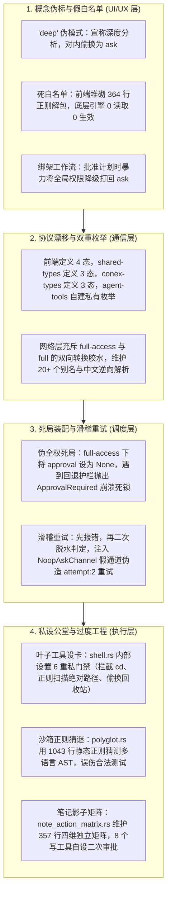
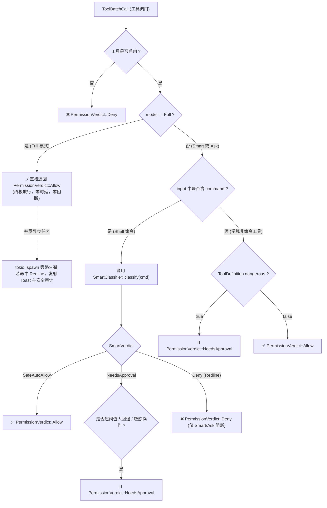
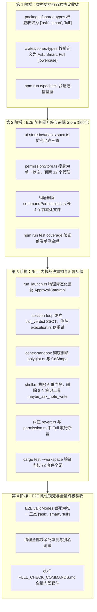

# 全系统权限体系三态收敛与极简架构终极总方案
# (Consolidated Master Plan: Permission System Three-State Convergence & Architecture Unification)

> **战役工作区**：`docs/permission-system-consolidation/`  
> **文档定位**：全战役最高权威实施总纲（战役根目录白名单文档）  
> **制定主体**：Reviewer 3（全系统架构总揽与跨层契约总控专家）汇同 Reviewer 1（前端/UX）、Reviewer 2（引擎内核/沙箱）联合终审合成  
> **用户最高指示**：  
> *“不允许打补丁，不允许硬编码，有合理的抽象，适合未来的功能需求，代码尽量简洁，具有优秀的可维护性。需要删除的代码就删除，需要系统性的重构。生成的方案应该能彻底杜绝这些问题或者未来的衍生问题，要求一次性解决掉。尽量减少不必要的兼容，最好是不兼容。权限模式统一收敛为 3 个选项：1. 每次询问（ask）；2. 智能命令放行（smart）；3. 完全允许模式（full - 系统不因命令而不允许执行，所有执行的命令都是可以运行的）。”*  
> **基线依赖**：
> - 现状剖析：[`analysis/01-05`](./analysis/) 5 份全栈深度审计报告
> - 独立分维方案：[`independent-plans/01-07`](./independent-plans/) 7 份专业实施详案
> - 评审整改裁决：[`plan-reviews/01-03`](./plan-reviews/) 3 份资深评审专家报告

---

## 目录

1. [战役总纲与背景透视](#一战役总纲与背景透视)
   - 1.1 历史顽疾与四大系统性断层
   - 1.2 用户最高指示与重构核心意志
   - 1.3 核心重构收益矩阵
2. [全栈架构铁律与设计哲学](#二全栈架构铁律与设计哲学)
   - 2.1 铁律一：彻底不兼容断代原则（Clean Break）
   - 2.2 铁律二：单一真理来源原则（Single Source of Truth, SSOT）
   - 2.3 铁律三：零死代码与零欺骗原则（Zero Deception）
   - 2.4 铁律四：基础设施全生命周期常态就绪原则（Evergreen Infrastructure）
   - 2.5 铁律五：工作流与权限正交解耦原则（Orthogonality）
3. [三选项模型权威定义与语义矩阵](#三三选项模型权威定义与语义矩阵)
   - 3.1 三态核心语义与边界界定
   - 3.2 交互表现、视觉 Token 与推荐规格
   - 3.3 模式单向收敛与极简持久化规约
4. [全栈数据契约与通信协议（Wire & API）](#四全栈数据契约与通信协议wire--api)
   - 4.1 彻底消灭 `full-access`：全栈统一小写三态字面量（`'ask' | 'smart' | 'full'`）
   - 4.2 前端权威类型定义（`packages/shared-types`）
   - 4.3 Rust 核心枚举与 Serde 序列化（`crates/conex-types`）
   - 4.4 IPC 信封强类型化（`RunTaskOptions` 升级）
   - 4.5 彻底铲除前后端转换胶水与别名网络
5. [前端极简架构改造蓝图](#五前端极简架构改造蓝图)
   - 5.1 `permissionStore` 纯粹单一状态化（瘦身至 36 行）
   - 5.2 彻底斩断 `settingsUiStore` 等 12 重跨层穿透代理
   - 5.3 彻底物理清除 364 行命令白名单与虚假存储
   - 5.4 浮动审批条（Permission Bar）极简单次裁决化
   - 5.5 设置安全页（Settings Security Tab）重构为三态 Radio Cards
   - 5.6 Plan 模式正交解耦：彻底消除批准计划降级为 `ask` 的恶劣副作用
6. [Rust 引擎内核单一裁决中心（SSOT）架构](#六rust-引擎内核单一裁决中心ssot架构)
   - 6.1 `exec_verdict::call_verdict` 唯一法定审判席地位
   - 6.2 彻底消灭死局装配：`ApprovalGateImpl` 物理常态化装配（消除 `approval: None`）
   - 6.3 彻底切除 `execution.rs` 伪重试逻辑与 `NoopAskChannel` 假通道
   - 6.4 单向确定性执行管道：`Allow` 直通、`NeedsApproval` 挂起审批、`Deny` 阻断
7. [智能命令放行（Smart Mode）与沙箱精炼](#七智能命令放行smart-mode与沙箱精炼)
   - 7.1 彻底铲除 `polyglot.rs`（1043 行正则猜谜）
   - 7.2 彻底废除 `CdShape` 与 `TOOL_CD_BLOCKED`（子进程目录切换完全合法化）
   - 7.3 `SmartClassifier` 两层判定矩阵与三态裁决（SafeAutoAllow / NeedsApproval / Deny）
   - 7.4 参数精准解包：避免良性分支切换（`git checkout -b`, `git switch`）误伤
   - 7.5 彻底拆除侵入内核的 `TaskType` 硬编码命令白名单
8. [完全允许模式（Full Mode）真放行与非阻塞告知机制](#八完全允许模式full-mode真放行与非阻塞告知机制)
   - 8.1 100% 顺从用户意志：彻底落实“所有执行的命令都是可以运行的”
   - 8.2 叶子工具纯粹 I/O 化：拔除 `shell.rs` 内置 6 重私有门禁与绝对路径围栏
   - 8.3 拔除 8 个笔记写工具中的 `maybe_ask_note_write` 与废除 `ToolContext.ask`
   - 8.4 拔除 `delete.rs` 回收站强制偷换，恢复原生物理删除能力
   - 8.5 拔除远程接口 `apply_remote_mode` 隐式降级篡改
   - 8.6 极端物理毁灭命令（Redline）的异步非阻塞 Toast 告知与全真审计旁路
9. [子代理等权无损继承与提示词净化](#九子代理等权无损继承与提示词净化)
   - 9.1 全链路权限模式透传拓扑（彻底消除 `permission_mode: None` 与缺省降级）
   - 9.2 彻底拔除系统提示词中的 `permission_relay_injection` 历史补丁
10. [全系统死代码彻底清除核验清册（净收敛 3,952 行）](#十全系统死代码彻底清除核验清册净收敛-3952-行)
11. [立体化测试与验证闭环（Test Suite & Quality Gate）](#十一立体化测试与验证闭环test-suite--quality-gate)
    - 11.1 E2E 防污染套件（`ui-store-invariants.spec.ts` & `full-journey.spec.ts`）适配
    - 11.2 前端单测纠偏重写（严格对齐单一状态，切除失效 Plan 字段测试）
    - 11.3 Rust 内核单测纠偏（纠正 Full 模式大回退报错的历史错误断言）
    - 11.4 四阶梯演进路线图（Zero-CI Breakage Ladder）
    - 11.5 门禁验证执行命令集
12. [实施里程碑与发布检查清单](#十二实施里程碑与发布检查清单)

---

## 一、战役总纲与背景透视

### 1.1 历史顽疾与四大系统性断层

在 Conex/Crish 系统的演化过程中，权限控制体系经历了多轮局部补丁、防御性加码和历史实验特性的堆叠，逐渐演变为全系统技术负债最重、架构断层最多的区域：



1. **表层虚标与欺骗性设计**：前端提供“深入分析（`deep`）”，实际内部硬编码回退为 `ask`；设置面板提供已信任命令白名单编辑、添加输入框与预设 Chip，底层引擎完全脱节；
2. **协议定义四分五裂**：前后端、跨包、引擎内部存在 4 套同名枚举，通信链路依赖 20+ 个别名折叠与复杂映射胶水；
3. **死局装配与假动作重试**：完全允许模式下审批门被设为 `None`，遇到底层护栏直接引发不可审批崩溃；同时内核存在“先报错、再用假通道伪造重试放行”的滑稽代码；
4. **叶子工具私设公堂与过度工程**：叶子工具失去 I/O 纯粹性，内置路径安全围栏、拦截子进程 `cd` 复合链，甚至剥夺用户原生删除权利；笔记工具私设独立矩阵。

### 1.2 用户最高指示与重构核心意志

针对上述沉疴顽疾，用户下达了最高指示：
> **“不允许打补丁，不允许硬编码，有合理的抽象，适合未来的功能需求，代码尽量简洁，具有优秀的可维护性。需要删除的代码就删除，需要系统性的重构。生成的方案应该能彻底杜绝这些问题或者未来的衍生问题，要求一次性解决掉。尽量减少不必要的兼容，最好是不兼容。权限模式统一收敛为 3 个选项：1. 每次询问（ask）；2. 智能命令放行（smart）；3. 完全允许模式（full - 系统不因命令而不允许执行，所有执行的命令都是可以运行的）。”**

本方案作为战役实施的最高权威大纲，全面贯彻“**零补丁、零死代码、彻底不兼容断代、单一真理源**”的重构意志，进行全栈根治性手术。

### 1.3 核心重构收益矩阵

| 评估维度 | 重构前现状 | 重构后目标状态 | 量化架构收益 |
| :--- | :--- | :--- | :--- |
| **权限模式选项** | 4 态（前端 `ask/deep/plan/full` 虚标） | **刚性 3 态**：`'ask' \| 'smart' \| 'full'` | 彻底消除伪模式与概念越界 |
| **全栈定义处数** | 4 处独立枚举（前后端互不一致） | **2 处强类型真源**（TS 与 Rust 各 1 处） | 消除 50% 冗余类型，杜绝语义漂移 |
| **协议传输规范** | `full-access` 混用，20+ 别名与中文逆向 | **纯小写字面量** `"ask" \| "smart" \| "full"` | 彻底拔除所有转换胶水与别名网络 |
| **前端 Store 状态数** | 4 个耦合状态，6 个 Action，复杂副作用 | **1 个状态**（`permissionMode`），1 个 Action | **代码精简 70%**，状态机复杂度归零 |
| **审批门装配可用性** | `full-access` 下为 `None`，必然死局 | **100% 常态化物理装配**（消灭 `None`） | 彻底根除 `ApprovalRequired` 崩溃死锁 |
| **叶子工具纯粹性** | 6 重私门禁、CD 拦截、回收站偷换、路径围栏 | **纯粹 I/O 驱动器**（只管子进程/文件系统） | 拔除全部私设公堂，回归操作系统真实行为 |
| **沙箱分析器架构** | 1043 行静态正则猜谜（`polyglot.rs`） | **轻量确定性两层矩阵**（`SmartClassifier`） | 根除 ReDoS 与内联脚本误杀 |
| **子代理权限保真度** | 硬编码 `None` 导致降级，提示词道德绑架 | **100% 无损等权继承**，纯净提示词 | 彻底解锁多 Agent 自主协作能力 |
| **死代码净消除量** | 充斥未生效算法、影子矩阵与废弃 UI | **净删除 3,952 行物理死代码** | 系统极度轻量化，实现架构净收敛 |

---

## 二、全栈架构铁律与设计哲学

为确保本次重构系统性、一次性解决问题并永不回潮，确立全栈五大架构铁律：

### 2.1 铁律一：彻底不兼容断代原则（Clean Break）
- **绝不保留任何别名腻子**：彻底销毁 `yolo`, `danger`, `unattended`, `headless`, `batch`, `cautious`, `strict`, `auto`, `readonly` 等 20 余个历史别名；
- **绝不搞中文 UI 标签逆向解析**：中文标签仅作为展现层文案，严禁配置层反向解析 `'深入分析'` 或 `'每次询问'`；
- **未知/非法值一律无条件收敛至推荐默认值 `'smart'`**：严禁针对 `deep` 或 `plan` 编写个别特判 `if` 补丁，遇到未知输入纯 O(1) 判定归一。

### 2.2 铁律二：单一真理来源原则（Single Source of Truth, SSOT）
- **协议单源**：Rust 端以 `crates/conex-types` 为权威真源，TypeScript 端以 `packages/shared-types` 为权威真源，全工程严禁自设私有同名枚举；
- **裁决单源**：`crates/session-loop/src/exec_verdict.rs::call_verdict` 是工具与命令执行的**唯一法定审判席**。叶子工具严禁二次审查，严禁再次调用审批门；
- **状态单源**：前端仅 `permissionStore.permissionMode` 维持权限真相，彻底斩断跨 Store 借道代理。

### 2.3 铁律三：零死代码与零欺骗原则（Zero Deception）
- 任何没有底层引擎支撑的功能界面（如命令白名单增删查改、预设 Chip、浮动条“始终允许”按钮）**必须 100% 物理销毁**，严禁向用户展现无法兑现的虚假控制面；
- 彻底物理删除 `commandPermissions.ts`、`settingsSecurityModel.ts`、`note_action_matrix.rs` 等历史负债文件。

### 2.4 铁律四：基础设施全生命周期常态就绪原则（Evergreen Infrastructure）
- `ApprovalGateImpl` 作为系统与用户通信的基础设施，在任务启动时**必须物理常态化装配注入**；
- 彻底消灭 `approval: None` 与 `approval_enabled: false` 分支，杜绝因模式切换或异常调用导致的断崖死局。具体工具是否放行由裁决中心动态决定，通信通道始终保持就绪。

### 2.5 铁律五：工作流与权限正交解耦原则（Orthogonality）
- **安全权限（Permission Mode）**：属于系统运行环境的安全策略防线（`ask` / `smart` / `full`），决定了工具能否静默运行；
- **任务阶段（Task/Goal Mode）**：属于 Agent 思考与执行的工作流阶段（普通对话、计划编制、执行阶段）；
- 两者彻底解耦：Plan 模式永久从权限枚举中剔除，回归会话任务状态；**用户批准计划时，严禁修改全局权限模式**。

---

## 三、三选项模型权威定义与语义矩阵

### 3.1 三态核心语义与边界界定

系统统一刚性收敛为以下 3 个标准权限模式：

| 模式 ID | 显示标签（中/英） | 胶囊短标签 | 推荐等级 | 核心安全语义与行为边界 | 引擎 Wire 传输值 |
| :--- | :--- | :--- | :---: | :--- | :--- |
| **`ask`** | **每次询问**<br>`Always Ask` | 每次询问 | 严格把关 | **零自动放行**：文件创建/编辑、删除、Git 提交/推送、任何终端命令均弹窗等待确认。仅绝对纯只读工具（`read_file`, `list_dir`）直接放行。 | `"ask"` |
| **`smart`** | **智能命令放行**<br>`Smart Allow` | 智能放行 | **⭐ 推荐默认** | **安全与只读命令自动放行**：环境探测（`ls`, `pwd`）、Git 只读（`status`, `diff`）、本地构建（`cargo check`）、自动化测试（`npm test`）无感直接运行；破坏性删除、Git 强推、提权、外链管道弹窗确认；Redline 毁灭命令硬阻断（Deny）。 | `"smart"` |
| **`full`** | **完全允许模式**<br>`Full Allow` | 完全放行 | 高效极客 | **系统不因命令而不允许执行，所有执行的命令都是可以运行的**：100% 顺从用户意志，所有正常工具与 Shell 命令全自动直接执行，零弹窗、零拦截、零自作主张报错；遇到 Redline 极端毁灭命令，顺从执行同时触发非阻塞 Toast 警示与审计留痕。 | `"full"` |

### 3.2 交互表现、视觉 Token 与推荐规格

为确保在暗色/明色主题下的精致视觉体验，遵循仓库设计规范：
- **禁用粗实黑线与厚重投影**：激活态轮廓混合度控制在 5%~10% 以内；
- **图标规格与专属映射**：
  - `ask`：图标 `shield`，中性次级灰色 `var(--text-secondary)`；
  - `smart`：图标 `shield-check`，翡翠绿 `var(--color-primary-base, #10b981)`，附带“推荐”徽标；
  - `full`：图标 `zap`，高效琥珀色 `var(--color-warning-base, #f59e0b)`；
- **药丸按钮**：统一保持 28px 高度、14px 端点圆角，背景保持克制浅灰透明过渡。

### 3.3 模式单向收敛与极简持久化规约

- **单一持久化 Key**：`crish_permission_mode`；
- **推荐默认值**：`'smart'`；
- **确定性验证函数**：
  ```typescript
  export function isPermissionMode(v: unknown): v is PermissionMode {
    return v === 'ask' || v === 'smart' || v === 'full';
  }

  export function coercePermissionMode(v: unknown): PermissionMode {
    return isPermissionMode(v) ? v : DEFAULT_PERMISSION_MODE;
  }
  ```
- **存储清理**：在应用启动加载持久化值时，同步执行一次性安全清理 `localStorage.removeItem('crish_command_permissions_v1')`，彻底清除历史白名单脏数据。

---

## 四、全栈数据契约与通信协议（Wire & API）

### 4.1 彻底消灭 `full-access`：全栈统一小写三态字面量

在本次系统性重构中，全系统坚决执行不兼容断代，**彻底废除 `full-access` 历史命名**：
- 前端 Store 的值：`'ask' | 'smart' | 'full'`；
- IPC 传输信封的值：`"ask" | "smart" | "full"`；
- Rust 内核枚举的值：`PermissionMode::Ask | Smart | Full`；
- **实现 100% 双向单射，中间层转换代码彻底清零**。

```mermaid
flowchart LR
    FE["前端 Store\n('ask' | 'smart' | 'full')"] <-->|"1:1 直通透传 (小写单射)"| Wire["Wire IPC 传输信封\n(\"ask\" | \"smart\" | \"full\")"]
    Wire <-->|"serde(rename_all = 'lowercase')"| Rust["Rust 内核枚举\n(PermissionMode::Ask | Smart | Full)"]
```

### 4.2 前端权威类型定义（`packages/shared-types`）

在 `packages/shared-types/src/generated/device/types.ts` 与 `run-control.ts` 中确立权威契约：

```typescript
// packages/shared-types/src/generated/device/types.ts
/** 权限模式权威枚举（统一三态：每次询问 / 智能命令放行 / 完全允许） */
export const PERMISSION_MODE_VALUES = ['ask', 'smart', 'full'] as const;
export type PermissionMode = (typeof PERMISSION_MODE_VALUES)[number];
```

```typescript
// packages/shared-types/src/generated/device/parser.ts
export function parsePermissionMode(v: unknown): ParseResult<PermissionMode> {
  if (typeof v === 'string' && (PERMISSION_MODE_VALUES as readonly string[]).includes(v)) {
    return parseOk(v as PermissionMode);
  }
  return parseErr(
    `PermissionMode: expected one of ${PERMISSION_MODE_VALUES.join(', ')}, got ${JSON.stringify(v)}`
  );
}
```

### 4.3 Rust 核心枚举与 Serde 序列化（`crates/conex-types`）

在 `crates/conex-types/src/device/commands/enums.rs` 中重构枚举定义：

```rust
// crates/conex-types/src/device/commands/enums.rs
/// 权限模式（统一三态：每次询问 / 智能命令放行 / 完全允许模式）
#[derive(Debug, Clone, Copy, PartialEq, Eq, Hash, Serialize, Deserialize, Default)]
#[serde(rename_all = "lowercase")]
pub enum PermissionMode {
    /// 每次询问（全安全兜底）
    Ask,
    /// 智能命令放行（系统推荐默认）
    #[default]
    Smart,
    /// 完全允许模式（系统不因命令而不允许执行，所有执行的命令都是可以运行的）
    Full,
}

impl PermissionMode {
    pub const fn as_str(&self) -> &'static str {
        match self {
            Self::Ask => "ask",
            Self::Smart => "smart",
            Self::Full => "full",
        }
    }
}
```

### 4.4 IPC 信封强类型化（`RunTaskOptions` 升级）

彻底废除将 `permission_mode` 作为弱类型字符串解析的历史做法。在 `crates/conex-run/src/run/run_launch.rs` 中，直接反序列化为强类型枚举：

```rust
// crates/conex-run/src/run/run_launch.rs
#[derive(serde::Deserialize)]
#[serde(rename_all = "camelCase")]
pub struct RunTaskOptions {
    pub run_id: String,
    pub session_id: String,
    pub prompt: Option<String>,
    pub mode: Option<String>,
    pub cwd: Option<String>,
    /// 权威权限模式枚举（直连 Serde 反序列化，未知值直接拒绝）
    pub permission_mode: Option<PermissionMode>,
    // ...
}
```

### 4.5 彻底铲除前后端转换胶水与别名网络

- **前端清理**：彻底删除 `apps/crish-desktop/src/api/permissionModes.ts` 中的 `DESKTOP_TO_ENGINE` 映射表、`toEnginePermissionMode` 函数与 `fromEnginePermissionMode` 函数；
- **后端清理**：彻底删除 `crates/agent-tools/src/permission.rs` 中私自定义的同名枚举与包含 20 余个别名的 `from_engine_str` / `as_engine_str` 胶水代码，直接 `pub use conex_types::PermissionMode;`。

---

## 五、前端极简架构改造蓝图

### 5.1 `permissionStore` 纯粹单一状态化（瘦身至 36 行）

从 `apps/crish-desktop/src/store/permissionStore.ts` 中彻底驱逐 `planModeEnabled`、`planApproved`、`commandPermissions` 及相关 5 个复杂 Action。Store 收敛为纯粹的单一状态 Store：

```typescript
// apps/crish-desktop/src/store/permissionStore.ts
import { create } from 'zustand';
import { immer } from 'zustand/middleware/immer';
import { withDevtools } from './middleware/withDevtools';
import { withLogger } from './middleware/withLogger';
import {
  loadStoredPermissionMode,
  persistPermissionMode,
  type PermissionMode,
} from '../api/permissionModes';

export interface PermissionStore {
  /** 当前权限模式（严格收敛为三选项：ask | smart | full） */
  permissionMode: PermissionMode;
  /** 设置权限模式并触发持久化落盘 */
  setPermissionMode: (mode: PermissionMode) => void;
}

export const usePermissionStore = create<PermissionStore>()(
  withDevtools(
    withLogger(
      immer((set) => ({
        permissionMode: loadStoredPermissionMode(),

        setPermissionMode: (mode: PermissionMode) => {
          set((state) => {
            state.permissionMode = mode;
          });
          persistPermissionMode(mode);
        },
      }))
    ),
    'PermissionStore'
  )
);
```

### 5.2 彻底斩断 `settingsUiStore` 等 12 重跨层穿透代理

彻底删除 `apps/crish-desktop/src/store/settingsUiStore.ts` 导出的全部 12 个权限相关代理：
`selectPermissionMode`, `selectPlanModeEnabled`, `selectPlanApproved`, `selectSetPermissionMode`, `selectSetPlanModeEnabled`, `selectSetPlanApproved`, `usePermissionMode`, `usePlanModeEnabled`, `usePlanApproved`, `getPermissionMode`, `setPermissionMode`, `setPlanModeEnabled`, `setPlanApproved`。
组件与业务层直接通过 `usePermissionStore` 订阅。

### 5.3 彻底物理清除 364 行命令白名单与虚假存储

1. 物理删除 `apps/crish-desktop/src/api/commandPermissions.ts`（364 行死算法）；
2. 物理删除 `apps/crish-desktop/src/api/commandPermissions.test.ts`（290 行单测）；
3. 物理删除 `apps/crish-desktop/src/components/settings/settingsSecurityModel.ts` 与对应测试；
4. 审批调用点（`useAgentToolApproval.ts`、`useChatApprovalExecutor.ts`）移除 `remember` 参数与对 `addCommandPermission` 的调用。

### 5.4 浮动审批条（Permission Bar）极简单次裁决化

重构 `apps/crish-desktop/src/components/chat-composer/ComposerPermissionBar.tsx`：
- 彻底删除 `[始终允许]` 按钮 DOM；
- 彻底删除 `onAlwaysAllow` 属性与 `rememberIntent` 状态；
- 浮动条只负责单次确权：`[拒绝]` 与 `[批准]`，不再向用户做出无法兑现的白名单放行承诺。

### 5.5 设置安全页（Settings Security Tab）重构为三态 Radio Cards

重构 `apps/crish-desktop/src/components/settings/SettingsSecurityTab.tsx`：
- 彻底删除“已信任命令”区块全部 DOM（添加输入框、列表项、清空按钮、预设 Chips，净减约 215 行）；
- 彻底删除“工作区路径”静态展示区块（净减约 60 行）；
- 页面由臃肿的 490 行瘦身至约 80 行现代卡片组（Radio Cards），直观展示 `ask`, `smart`, `full` 的防护边界与推荐 Badge。

### 5.6 Plan 模式正交解耦：彻底消除批准计划降级为 `ask` 的恶劣副作用

- **拔除恶意降级副作用**：
  在 `PlanApprovalRow.tsx`（L37-40）与 `ChatCard.tsx`（L291-294）中，**彻底删除 `setPermissionMode('ask')`**！
  批准计划仅代表“同意该方案”，推进执行流（`setPlanApproved(true)`），**用户的全局权限模式严格保持不变**（原先是 `full` 的继续保持 `full`，原先是 `smart` 的继续保持 `smart`）；
- **Plan 状态归位**：
  `planModeEnabled` 与 `planApproved` 归属于会话级任务目标状态（`sessionStore` 中的 `goalMode` 或局部消息状态），彻底与全局权限解耦。

---

## 六、Rust 引擎内核单一裁决中心（SSOT）架构

### 6.1 `exec_verdict::call_verdict` 唯一法定审判席地位

在 `crates/session-loop/src/exec_verdict.rs` 中，`call_verdict` 是全系统**唯一的权限审查单点**。所有工具调用在派发执行前必须经过本裁决，且后续环节绝不再进行任何二次审查：



### 6.2 彻底消灭死局装配：`ApprovalGateImpl` 物理常态化装配（消除 `approval: None`）

在 `crates/conex-run/src/run/run_launch.rs:930-936` 中：
- **彻底删除** `let approval_enabled = permission_mode.as_deref() != Some("full-access");`；
- **彻底删除** `let approval = if approval_enabled { Some(...) } else { None };`；
- **装配原则**：无论当前处于何种权限模式（`Ask` / `Smart` / `Full`），`ApprovalGateImpl` 作为底座通信基础设施**必须恒定实例化装配**！
- **类型系统刚性化升级**：将 `ToolExecutor.approval` 与 `SessionLoop.approval` 字段定义直接升级为非 Option 的 `Arc<dyn ApprovalGate>`，在底层从语法层面物理消灭 `approval: None`！

### 6.3 彻底切除 `execution.rs` 伪重试逻辑与 `NoopAskChannel` 假通道

在 `crates/session-loop/src/exec_single/execution.rs` 中，执行不可逆的物理切除：
1. **删除 `handle_retry_after_approval_required`（第 179-197 行）**；
2. **删除 `retry_after_allow`（第 199-215 行）**；
3. **删除 `handle_retry_needs_approval`（第 217-304 行）**；
4. **彻底删除 `NoopAskChannel`**（`pre_exec.rs:198-200`）：严禁用假通道蒙骗叶子工具；
5. **彻底删除 `handle_ungated_verdict`**（`pre_exec.rs:131-160`）：统一收敛为唯一的确定性管道。

### 6.4 单向确定性执行管道

执行管道的状态机严格单向、无环、确定：
1. **`PermissionVerdict::Allow`**：调用 `execute_single(..., attempt: 1)`，单次执行完毕返回；
2. **`PermissionVerdict::NeedsApproval`**：广播 `ApprovalRequested`，挂起等待用户决策：
   - 用户批准（`Approved`） $\to$ 调用 `execute_single(..., attempt: 1)` 执行；
   - 用户拒绝（`Denied`） $\to$ 返回 `ToolErrorKind::UserDenied`；
   - 超时/取消 $\to$ 返回 `ToolErrorKind::ApprovalExpired` / `Cancelled`；
3. **`PermissionVerdict::Deny`**：直接返回 `ToolErrorKind::UserDenied`，工具根本不被拉起。
系统绝无“先报错、再重试、再用假通道放行”的自相矛盾逻辑。

---

## 七、智能命令放行（Smart Mode）与沙箱精炼

### 7.1 彻底铲除 `polyglot.rs`（1043 行正则猜谜）

- **架构裁决**：放弃在静态字符串层用正则表达式去对多语言（Python, Node, Ruby, Perl, PHP）的内联脚本做 AST 深度语义分析的脆弱尝试；
- **执行动作**：**彻底物理删除 `crates/conex-sandbox/src/polyglot.rs`（1043 行）**，在 `lib.rs` 中移除相关导出；
- **解包规范**：Shell 解释器包裹（`bash -c "cmd"`, `pwsh -Command "cmd"`）仅做标准字符串引号剥离，递归提取出内部核心命令行交付统一分类器，绝不引入多语言正则猜测。

### 7.2 彻底废除 `CdShape` 与 `TOOL_CD_BLOCKED`（子进程目录切换完全合法化）

- **架构裁决**：操作系统 Shell 子进程（`tokio::process::Command`）具备独立的虚拟内存与进程级工作目录（CWD），子进程内的 `cd sub && cargo test` 执行完毕后随子进程退出而自然销毁，天然隔离，绝不污染宿主；
- **执行动作**：
  1. 从 `conex-sandbox` 中彻底删除 `CommandClass::CdShape` 与 `CD_COMMANDS`；
  2. 彻底删除 `shell_redirect.rs:375-435` 中的 `intercept_cd_shape` 函数；
  3. 彻底删除 `shell.rs:314-317` 的 CD 拦截分支，废弃 `TOOL_CD_BLOCKED` 错误常量。

### 7.3 `SmartClassifier` 两层判定矩阵与三态裁决

在 `crates/conex-sandbox/src/smart_classifier.rs` 中实现纯纯 Rust、零外部正则依赖的高性能两层判定引擎，产出三态结果：

```rust
// crates/conex-sandbox/src/smart_classifier.rs
#[derive(Debug, Clone, PartialEq, Eq, Serialize, Deserialize)]
pub enum SmartVerdict {
    /// 第一层：常规开发命令，无感自动放行
    SafeAutoAllow,
    /// 第二层：敏感操作，需结构化审批卡片弹窗确认
    NeedsApproval(ApprovalReason),
    /// 第三层：Redline 毁灭级命令（仅在 Smart/Ask 模式下硬阻断）
    Deny { reason: String },
}
```

#### 两层矩阵全景表：

| 裁决层级 | 领域分类 | 涵盖核心命令族 / 格式 | 典型示例 | 判定标准与处理策略 |
| :--- | :--- | :--- | :--- | :--- |
| **第一层**<br>(Safe Auto-Allow) | **只读探测** | `ls`, `dir`, `cat`, `head`, `tail`, `grep`, `rg`, `pwd`, `diff`, `echo`, `type`, `find` | `ls -la`<br>`rg "fn main"`<br>`pwd` | 纯读探测，零磁盘修改，无感即时直接执行。 |
| **第一层**<br>(Safe Auto-Allow) | **Git 只读状态** | `git status`, `git diff`, `git log`, `git branch`, `git show`, `git rev-parse` | `git status -s`<br>`git diff HEAD~1` | 读取版本库元数据，不修改工作区与暂存区。 |
| **第一层**<br>(Safe Auto-Allow) | **良性分支切换** | `git checkout <branch>`, `git checkout -b <branch>`, `git switch <branch>` | `git checkout -b feat/v2`<br>`git switch main` | **参数安全解包放行**。纯分支创建与切换，不包含工作区强制丢弃。 |
| **第一层**<br>(Safe Auto-Allow) | **本地构建检查** | `cargo check`, `cargo build`, `cargo clippy`, `npm run build`, `tsc`, `go build`, `make` | `cargo check --workspace`<br>`npm run build` | 编译构建产物限于 `target/`、`dist/` 缓存，保障开发流顺畅。 |
| **第一层**<br>(Safe Auto-Allow) | **自动化测试套件** | `cargo test`, `npm test`, `npx vitest`, `npx jest`, `pytest`, `go test` | `cargo test -p sandbox`<br>`npm test` | 单元测试与集成测试，流水线核心资产，畅行无阻。 |
| **第一层**<br>(Safe Auto-Allow) | **静态代码检查** | `eslint`, `prettier --check`, `cargo fmt --check`, `ruff check` | `cargo fmt -- --check`<br>`npx eslint .` | 纯代码风格与规范扫描，完全幂等。 |
| **第一层**<br>(Safe Auto-Allow) | **子进程目录切换** | `cd <dir> && <command>`, `pushd <dir>`, `popd` | `cd core && npm test` | 子进程内安全目录切换，直接放行。 |
| **第二层**<br>(Needs Approval) | **物理删除** | `rm`, `del`, `erase`, `rmdir`, `git clean -fd`, `git rm` | `rm -rf target/`<br>`git clean -fdx` | 物理清除工作区文件，弹窗展示精确路径待确认。 |
| **第二层**<br>(Needs Approval) | **Git 历史重写** | `git push -f`, `git reset --hard`, `git checkout -- .`, `git restore .` | `git reset --hard HEAD~1`<br>`git push origin -f` | 强制丢弃未暂存工作或重写远程提交图，弹窗告警确认。 |
| **第二层**<br>(Needs Approval) | **系统提权** | `sudo`, `runas`, `su`, `chmod 777`, `chown` | `sudo apt-get install`<br>`runas /user:admin` | 尝试越过当前用户沙箱，弹窗阻断待授权。 |
| **第二层**<br>(Needs Approval) | **远程管道执行** | `curl ... \| bash`, `wget ... \| sh`, `iwr ... \| iex` | `curl -fsSL ... \| bash` | 外网不可控脚本送入解释器执行，防供应链投毒。 |
| **第二层**<br>(Needs Approval) | **包公开分发** | `npm publish`, `cargo publish`, `twine upload` | `npm publish`<br>`cargo publish` | 向公开镜像源发布版本，防误发防泄密。 |
| **第三层**<br>(Deny) | **物理毁灭命令** | `rm -rf /`, `rm -rf /*`, `format C:`, `mkfs.ext4`, `dd if=/dev/zero of=/dev/sda` | `rm -rf /`<br>`format C: /y` | 确定性摧毁操作系统或主盘，在 Smart 模式下绝对阻断！ |

### 7.4 参数精准解包：避免良性分支切换误伤

在 `SmartClassifier` 的参数解析器中实现精准的上下文识别：
- 当识别到 `git checkout` 或 `git switch` 时：
  - 若参数中包含 `-- .`、`-f`、`--force` 或明确跟随文件路径（如 `git checkout -- file.txt`、`git checkout .`），判定为 `GitHistoryRewrite`，进入第二层弹窗审批；
  - 若为分支切换（`git checkout main`、`git checkout -b feature/xxx`、`git switch dev`），**100% 判定为第一层 `SafeAutoAllow`**，杜绝误伤日常开发。

### 7.5 彻底拆除侵入内核的 `TaskType` 硬编码命令白名单

- 彻底删除 `crates/agent-tools/src/readonly.rs:158-183` 中的 `command_allowed_for_task_type` 及其单元测试；
- 彻底从 `crates/agent-tools/src/tools/shell.rs:239-256` 与 `crates/session-loop/src/exec_verdict.rs:131-136` 中拔除针对 `task_type == "commit"` 等硬编码命令过滤代码。任务类型的命令限制由注册表装配阶段处理，调度主干绝不硬编码。

---

## 八、完全允许模式（Full Mode）真放行与非阻塞告知机制

### 8.1 100% 顺从用户意志：彻底落实“所有执行的命令都是可以运行的”

用户指示定海神针：
> **“完全允许模式（即系统不会因为命令而不允许执行，所有执行的命令都是可以运行的）。”**

在 `Full` 模式下，调度层裁决中心（`call_verdict`）直接返回 `PermissionVerdict::Allow`。系统绝对不在后续任何环节因为命令内容、路径范围、回退文件数而拒绝执行。

### 8.2 叶子工具纯粹 I/O 化：拔除 `shell.rs` 内置 6 重私有门禁

彻底重构 `crates/agent-tools/src/tools/shell.rs`，叶子工具退守单一职责：
1. **删除任务类型白名单阻断**（L239-256）；
2. **删除门禁层 `SHARED_GATEKEEPER` 与系统关键路径阻断**（L258-285）；
3. **删除 Plan 模式私判阻断**（L287-294）；
4. **删除删除形态强制重定向与拦截**（L296-312）及整包删除 `shell_redirect.rs`（445 行）；
5. **删除 CD 拦截阻断**（L314-317）；
6. **删除绝对路径安全围栏 `CommandPathInspector` 结构体**（L482-820，共 338 行）；
7. **删除工具内二次判定与 `ctx.ask` 调用**（L330-369）。

重构后的 `shell.rs` 仅做参数提取与 `tokio::process::Command` 子进程安全拉起，执行操作系统原生语义。

### 8.3 拔除 8 个笔记写工具中的 `maybe_ask_note_write` 与废除 `ToolContext.ask`

1. 彻底从以下 8 个笔记工具中删除 `maybe_ask_note_write` 私有审批调用：
   `note_document_apply_md`, `note_block_batch`, `note_block_delete`, `note_block_insert`, `note_block_move`, `note_block_set_attr`, `note_block_update`, `note_send_to_note`；
2. 彻底删除 `crates/agent-tools/src/note_action_matrix.rs`（357 行独立四维矩阵）；
3. **从类型系统拔除后门**：彻底从 `crates/agent-tools/src/context.rs::ToolContext` 中删除 `pub ask: Option<AskCallback>` 字段，使得叶子工具在语法层面彻底丧失私设公堂的能力！

### 8.4 拔除 `delete.rs` 回收站强制偷换，恢复原生物理删除能力

在 `crates/agent-tools/src/tools/delete.rs` 中引入可选参数 `permanent: Option<bool>`：
- 当处于 `Full` 模式或显式指定 `permanent: true` 时，直接调用底层 `std::fs::remove_file` / `std::fs::remove_dir_all` 真实执行文件系统抹除，真实释放磁盘空间；不再强行拐入 `.crish-trash`。

### 8.5 拔除远程接口 `apply_remote_mode` 隐式降级篡改

彻底重构 `apps/agent-workbench/src-tauri/src/server/core_backend/mod.rs:41-48`：
- 删除将远程下发的 `Full` 模式篡改降级为 `Ask` 的硬编码逻辑；
- 远程受信任设备配置 Full 模式即享有完全执行权，原样透传，消灭降级审计噪音。

### 8.6 极端物理毁灭命令（Redline）的异步非阻塞 Toast 告知与全真审计旁路

解决“Full 模式快速直通”与“高危通知”之间的时序悖论：
- **主执行线（零延迟直通）**：`call_verdict` 判定为 Full 模式，主线程立即返回 `PermissionVerdict::Allow`，直接交付 OS 进程启动，绝不阻塞哪怕 1 微秒；
- **异步旁路（零打扰非阻塞告知）**：
  在返回 `Allow` 的同时，调度器通过 `tokio::spawn` 启动轻量异步 Task：
  ```rust
  if mode == PermissionMode::Full {
      if let Some(cmd) = extract_command_str(&input) {
          let event_bridge = cx.event_bridge.clone();
          tokio::spawn(async move {
              if SmartClassifier::is_redline_command(&cmd) {
                  // 1. 发射全真审计事件
                  emit_security_audit(&cmd, SecurityAuditDecision::ExecutedWithWarning);
                  // 2. 向前端推送显著但非阻塞的悬浮 Toast 提醒
                  event_bridge.emit("notification", serde_json::json!({
                      "level": "critical_warning",
                      "title": "完全允许模式高危执行警示",
                      "message": format!("系统正在以完全允许模式如实执行极端高危命令：{cmd}"),
                      "command": cmd,
                      "timestamp": chrono::Utc::now().to_rfc3339(),
                  })).await.ok();
              }
          });
      }
      return PermissionVerdict::Allow;
  }
  ```
- **架构效果**：主执行流 100% 顺从用户意志绝不报错阻断，前端界面弹出显著警示 Toast，全真审计留痕在库，兼顾绝对执行权与透明知情权。

---

## 九、子代理等权无损继承与提示词净化

### 9.1 全链路权限模式透传拓扑

彻底终结子代理权限断层与缺省降级隐患：
1. **工具装配点透传**：`run_subagent` 工具执行时，将上下文持有的 `ctx.permission_mode` 显式写入 `SubagentSpawnRequest.permission_mode`；
2. **派发器权威继承**：在 `crates/conex-run/src/subagent_spawner/spawn.rs::spawn_unchecked` 中，决议逻辑修改为：
   ```rust
   let effective_mode = req.permission_mode
       .or_else(|| self.get_active_run_permission_mode(&parent_run_id))
       .unwrap_or(PermissionMode::Smart);
   ```
   **强制从父级 `ActiveRun` 中提取权限模式继承**，父级是 `Full`，子代理 100% 享有 `Full` 权限；父级是 `Smart`，子代理同样无感放行构建与测试！

### 9.2 彻底拔除系统提示词中的 `permission_relay_injection`

- 彻底删除 `crates/conex-run/src/run/run_launch.rs:1092-1106` 中调用 `permission_relay_injection` 向子代理提示词注入“*你没有权限，必须先申请*”的恶劣束缚段；
- 移除 `crates/agent-tools/src/subagent_inject.rs` 中相关注入生成器；
- 子代理执行权限由运行时底座刚性保证，不再依赖脆弱的提示词道德约束。

---

## 十、全系统死代码彻底清除核验清册（净收敛 3,952 行）

本次战役对全系统历史死代码执行**全面物理清除**，杜绝任何残余逻辑：

```mermaid
flowchart LR
    subgraph Purge["🔥 物理删除清单 (累计净减 3,952 行)"]
        F1["conex-sandbox/polyglot.rs (-1043行)"]
        F2["agent-tools/shell_redirect.rs (-445行)"]
        F3["agent-tools/note_action_matrix.rs (-357行)"]
        F4["crish-desktop/commandPermissions.ts & test (-654行)"]
        F5["agent-tools/shell.rs 绝对路径围栏 (-338行)"]
        F6["crish-desktop/permissionModes.ts 别名网 (-320行)"]
        F7["agent-tools/note_permission.rs (-250行)"]
        F8["crish-desktop/SettingsSecurityTab.tsx (-215行)"]
        F9["crish-desktop/settingsSecurityModel.ts (-150行)"]
        F10["session-loop/execution.rs 伪重试 (-126行)"]
        F11["agent-tools/readonly.rs TaskType 白名单 (-108行)"]
    end
```



| 序号 | 所在模块 / 文件路径 | 变更动作 | 删除行数 | 对应章节 | 彻底根除的历史缺陷与隐患 |
| :---: | :--- | :---: | :---: | :---: | :--- |
| **D-01** | `crates/conex-sandbox/src/polyglot.rs` | **整文件物理删除** | **-1,043** | §7.1 | 消除 35+ 个静态正则堆砌，根除 ReDoS 与多语言内联脚本误杀 |
| **D-02** | `crates/agent-tools/src/tools/shell_redirect.rs` | **整文件物理删除** | **-445** | §8.2 | 消除删除形态重定向、复合链删除阻断与 CD 拦截私门禁 |
| **D-03** | `crates/agent-tools/src/note_action_matrix.rs` | **整文件物理删除** | **-357** | §8.3 | 消除笔记模块维护的四维独立影子矩阵孤岛 |
| **D-04** | `apps/crish-desktop/src/api/commandPermissions.ts` | **整文件物理删除** | **-364** | §5.3 | 彻底消除从未生效的前端命令白名单匹配算法 |
| **D-05** | `apps/crish-desktop/src/api/commandPermissions.test.ts`| **整文件物理删除** | **-290** | §5.3 | 删除虚假白名单的全部单元测试 |
| **D-06** | `crates/agent-tools/src/tools/shell.rs` (围栏部分) | **结构体物理删除** | **-338** | §8.2 | 删除 `CommandPathInspector` 静态绝对路径扫描正则 |
| **D-07** | `apps/crish-desktop/src/api/permissionModes.ts` (冗余部分) | **就地重构清除** | **-320** | §4.5 | 彻底废除 20+ 个历史别名、折叠映射与中文逆向解析 |
| **D-08** | `crates/agent-tools/src/note_permission.rs` | **就地精简清除** | **-250** | §8.3 | 笔记操作判定彻底收拢到通用的 `dangerous` 属性 |
| **D-09** | `apps/crish-desktop/src/components/settings/SettingsSecurityTab.tsx` | **UI 就地重构清除** | **-215** | §5.5 | 删除已信任命令列表、添加输入框、清空弹窗与静态路径 |
| **D-10** | `apps/crish-desktop/src/components/settings/settingsSecurityModel.ts` | **整文件物理删除** | **-150** | §5.3 | 删除设置页白名单预设与去重辅助工具 |
| **D-11** | `crates/session-loop/src/exec_single/execution.rs` (重试部分) | **就地重构清除** | **-126** | §6.3 | 彻底消除二次重试、伪放行与 `attempt: 2` 假动作 |
| **D-12** | `crates/agent-tools/src/readonly.rs` (TaskType 门禁) | **就地重构清除** | **-108** | §7.5 | 消除侵入调度内核的硬编码任务类型命令白名单 |
| **D-13** | `crates/agent-tools/src/tools/shell.rs` (prepare 门禁) | **就地重构精简** | **-115** | §8.2 | 彻底拔除内置 6 重私有门禁与内部二次审批 |
| **D-14** | `apps/crish-desktop/src/store/settingsUiStore.ts` (代理部分) | **代码段物理删除** | **-45** | §5.2 | 彻底拔除 12 个权限相关越权代理选择器与穿透函数 |
| **D-15** | `crates/conex-run/src/run/run_launch.rs` (提示词注入) | **代码段物理删除** | **-15** | §9.2 | 彻底拔除向子代理提示词注入 `permission_relay_injection` |
| **D-16** | 8 个笔记写工具中的 `maybe_ask_note_write` | **调用点物理删除** | **-60** | §8.3 | 彻底清除叶子工具私有二次审批残留 |
| **D-17** | `crates/agent-tools/src/context.rs` (`ToolContext.ask`) | **字段与类型删除** | **-35** | §8.3 | 从 Rust 类型系统彻底清除 `AskCallback` 与 `NoopAskChannel` |
| **D-18** | `crates/conex-sandbox/src/semantics.rs` (`CdShape`) | **代码段物理删除** | **-50** | §7.2 | 彻底清除 `CommandClass::CdShape` 与相关静态常量 |
| **D-19** | `crates/agent-tools/src/tools/note_document_apply_md.rs` | **函数物理删除** | **-26** | §8.3 | 彻底删除 `maybe_ask_note_write` 函数定义全文 |
| **累计净删除代码量** | — | — | **$\approx -3,952$ 行** | 全方案 | **大幅削减系统复杂度，根除衍生 Bug，实现极简与高可维护性** |

---

## 十一、立体化测试与验证闭环（Test Suite & Quality Gate）

### 11.1 E2E 防污染套件适配

- **`tests/e2e/ui-store-invariants.spec.ts`**：
  将硬编码的 `const validModes = ['ask', 'deep', 'full', 'plan'];` 刚性收紧为集中三选项：
  ```typescript
  const validModes = ['ask', 'smart', 'full'];
  ```
  在 3 次重复交互运行中，严格断言 Store 更新频次 `< 10` 次，彻底杜绝状态漂移与死循环；
- **`tests/e2e/full-journey.spec.ts`**：
  更新任务下发断言，确保 `lastRun.permissionMode` 仅匹配 `['ask', 'smart', 'full']`。

### 11.2 前端单测纠偏重写

- **`permissionModes.test.ts` 纯粹化**：
  彻底废除 20+ 个别名单测与中文反向解析测试，仅断言 `['ask', 'smart', 'full']`，未知值单向收敛至 `'smart'`；
- **`permissionStore.test.ts` 纯粹化**：
  全面纠正 Plan 07 中的回潮断言，**彻底切除对 `planModeEnabled` 和 `planApproved` 的测试**，严格断言 `permissionStore` 仅有 1 个状态和 1 个 Action。

### 11.3 Rust 内核单测纠偏

- **纠偏 `crates/agent-tools/src/revert.rs:353`**：生产代码增加 `if mode == PermissionMode::Full { return None; }`；
- **纠偏 `crates/agent-tools/src/permission.rs:641`**：修正断言，`Full` 模式下大面积回退必须顺利返回 `PermissionVerdict::Allow`；
- **纠偏 `crates/session-loop/src/tool_exec_tests/revert.rs:57`**：修正断言，`Full` 模式下大面积回退即使无审批门介入也必须直接放行执行（`out.results[0].is_ok()`），绝不抛出 `ApprovalRequired` 报错！

### 11.4 四阶梯演进路线图（Zero-CI Breakage Ladder）



### 11.5 门禁验证执行命令集

在实施落地全流程中，必须使用 **pwsh7** 逐级跑通以下刚性命令：

```powershell
# 1. 前端类型安全检查（零 TS 编译错误）
npm run typecheck

# 2. 前端单测快层门禁（45/70/65/45 门禁达标）
npm run test:coverage -- --project=unit

# 3. 前端集成全量测试（所有 Vitest 测试全绿）
npm run test

# 4. Rust 工作区全量单测与集成测试（73+ 套件全绿，纠偏断言精准通过）
cargo test --workspace

# 5. E2E 防污染套件（3 次重复运行零 Flaky，无 Store 状态污染）
npx playwright test tests/e2e/ui-store-invariants.spec.ts

# 6. E2E 全旅程测试（任务参数精准对齐三态）
npx playwright test tests/e2e/full-journey.spec.ts

# 7. 全量行数与工程门禁巡检（行数限额零告警、零循环依赖）
npm run check:desktop
```

---

## 十二、实施里程碑与发布检查清单

- [ ] **M1（协议锁定）**：`shared-types` 与 `conex-types` 锁定三态，清除 `full-access` 传输值；
- [ ] **M2（前端净收敛）**：物理删除 `commandPermissions.ts`，重构 `permissionStore.ts` 为单一状态，解耦 Plan 模式；
- [ ] **M3（内核常态化）**：`run_launch.rs` 常态装配审批门，彻底拔除 `approval: None` 分支；
- [ ] **M4（裁决归一）**：`call_verdict` 确立 SSOT，删除 `execution.rs` 伪重试与 `NoopAskChannel`；
- [ ] **M5（沙箱精炼）**：物理删除 `polyglot.rs` 与 `CdShape`，落地 `SmartClassifier` 两层判定；
- [ ] **M6（叶子工具纯粹化）**：物理删除 `shell_redirect.rs`、`CommandPathInspector`，拔除 8 个笔记工具 `maybe_ask_note_write`，从 `ToolContext` 拔除 `ask`；
- [ ] **M7（Full 放行与纠偏）**：落实 Full 模式直通执行与非阻塞 Toast 旁路，纠偏历史大回退报错断言；
- [ ] **M8（终极验收）**：跑通 `FULL_CHECK_COMMANDS.md` 全量流水线，达成零破坏、净收敛交付。

---
*总方案编制完毕。本方案为全战役最高权威执行大纲，统领所有分维实施与代码落地。*
