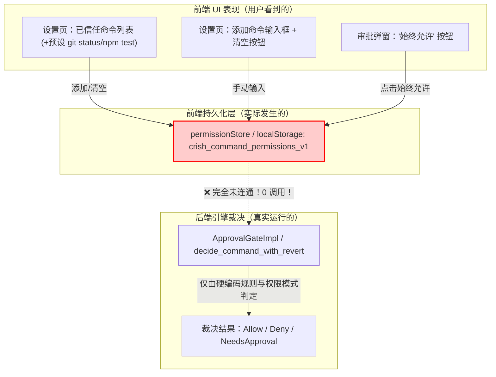
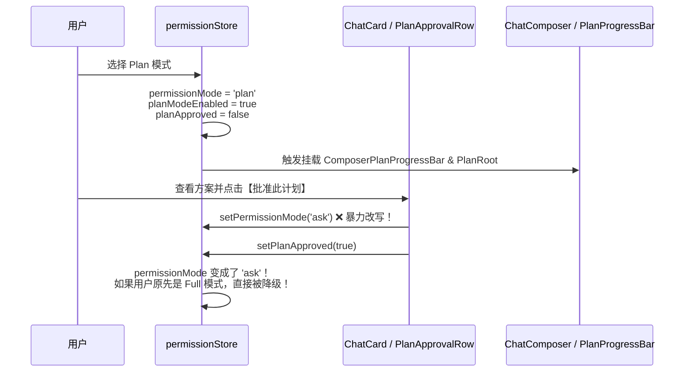
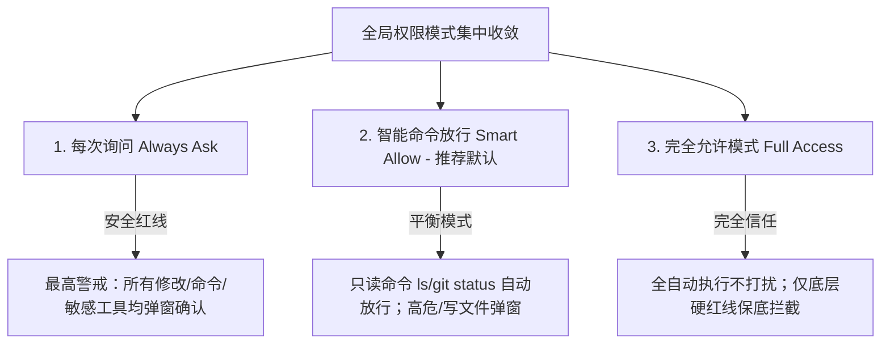

# 前端 UI 与交互现状深入剖析报告：权限体系收敛与架构治理

> **战役工作区**：`docs/permission-system-consolidation/`  
> **报告定位**：前端 UI 与交互呈现层面的现状深度调查与重构规划  
> **分析维度**：Composer 权限菜单、设置面板安全页、审批浮动条、Plan 模式耦合度、三选项收敛方案  
> **权威代码锚点**：基于当前仓库 `apps/crish-desktop/` 与 `crates/` 真实代码逐行核查  

---

## 目录

1. [执行摘要与核心论断](#一执行摘要与核心论断)
2. [维度一：Chat Composer 权限菜单与交互现状剖析](#二维度一chat-composer-权限菜单与交互现状剖析)
   - 2.1 现有 4 模式的 UI 呈现、图标与文案
   - 2.2 `deep` 模式的存在原因、实际定位与认知混淆点
   - 2.3 胶囊控件与三段式融合遗留形态
   - 2.4 浮动审批条（`ComposerPermissionBar` & `PermissionBar`）现状
3. [维度二：设置面板（Settings Security Tab）与白名单割裂深度剖析](#三维度二设置面板settings-security-tab与白名单割裂深度剖析)
   - 3.1 权限模式在设置面板中的暴露方式
   - 3.2 致命割裂：信任命令（批准记忆白名单）的“虚假信任陷阱”
   - 3.3 工作区路径在安全 Tab 中的展示逻辑与冗余度
4. [维度三：对话流与 Plan 模式的过度耦合与概念绑架](#四维度三对话流与-plan-模式的过度耦合与概念绑架)
   - 4.1 Plan 模式的本质：任务流阶段（Workflow Phase）vs 安全权限（Security Permission）
   - 4.2 代码层面的状态绑架与异常跳变链
   - 4.3 为什么必须将 Plan 模式从 Permission 体系彻底解耦
5. [维度四：收敛为“三选项”后的 UI 架构重构方案设计](#五维度四收敛为三选项后的-ui-架构重构方案设计)
   - 5.1 目标三选项定义与行为语义矩阵
   - 5.2 Chat Composer 权限菜单重构设计（视觉、图标、文案）
   - 5.3 设置面板（Settings Security Tab）重构设计（瘦身与去欺骗性）
   - 5.4 审批浮动条（Approval Bar）精简方案
   - 5.5 Plan 模式向独立 Task Mode / Ribbon 的解耦路线
6. [影响评估与死代码清理清单](#六影响评估与死代码清理清单)

---

## 一、执行摘要与核心论断

经过对前端视图层（`apps/crish-desktop/src/components/chat-composer/`、`src/components/settings/`、`src/extensions/conversation-flow/`、`src/api/`）及引擎交互契约的深入排查，当前权限体系在前端 UI 与交互呈现层面存在以下**三大系统性架构断层**：

1. **表层假档位与底层空心化（`deep` 模式的伪存在）**：
   UI 层向用户展示了 4 种权限模式（`ask`、`deep`、`plan`、`full`），但 `deep`（深入分析）在底层引擎（`crates/agent-tools/src/permission.rs:38-49`）中与 `ask` 完全等价，其 `matrixHint` 直接标注为 `“同需确认”`。用户误以为选择 `deep` 拥有不同的安全级别，实则属于 Agent 提示词思考倾向与安全权限的职责混淆。
2. **严重的虚假信任陷阱（白名单 UI 与引擎执行权威彻底断联）**：
   设置面板（`SettingsSecurityTab.tsx`）提供了耗费大量代码构建的“已信任命令”添加输入框、清空按钮、常用预设（`git status`、`npm test` 等）；审批浮动条也提供“始终允许”按钮。然而代码注释（`commandPermissions.ts:359-364`）明确说明**“白名单仅为批准记忆，不再参与任何自动放行判定”**，且核心匹配函数 `commandMatchesWhitelist` 在全工程生产代码中被调用的次数为 **0**。这造成用户产生“已将命令加白”但依然可能被弹窗或拒绝的强烈困惑与信任危机。
3. **安全模式绑架工作流阶段（Plan 模式的过度耦合）**：
   Plan 模式本应是“只做规划、不改项目”的**任务编排生命周期状态**，却被硬编码为一种 `PermissionMode`。这导致 `permissionStore.ts` 内部状态机极为脆弱——只要用户点击“批准此计划”，系统就会暴力把全局权限切回 `'ask'`，使得用户在完全允许模式下的使用流程被强行打断，且在 Composer 顶部、流内衍生出复杂的 `ComposerPlanProgressBar`、`PlanRoot` 等跨层侵入。

**结论**：将权限体系彻底收敛为用户易懂、边界清晰的 **三选项（每次询问 / 智能命令放行 / 完全允许）**，并将 Plan 模式从权限枚举中剥离为独立的任务形态，同时清理虚假的独立白名单编辑列表，是理顺架构、消灭交互欺骗、建立用户安全确定性的唯一正确路径。

---

## 二、维度一：Chat Composer 权限菜单与交互现状剖析

### 2.1 现有 4 模式的 UI 呈现、图标与文案

在 Chat Composer 底部常驻区域，权限模式通过 [`PermissionModeMenu.tsx`](file:///c:/Software/conex/apps/crish-desktop/src/components/chat-composer/PermissionModeMenu.tsx) 进行渲染。当前注册的 4 种模式及其 UI 呈现如下：

| 模式 ID | UI 标签（`label`） | 次级描述（`description`） | 矩阵提示（`matrixHint`） | Composer 菜单图标 | Settings 安全页图标 | 引擎真实下发模式（`DESKTOP_TO_ENGINE`） |
| :--- | :--- | :--- | :--- | :--- | :--- | :--- |
| `ask` | 需确认 | 改文件、推送前先问你 | 常用默认 | `<AppIcon name="shield-check" />` | `<AppIcon name="shield-check" />` | `'ask'` |
| `deep` | 深入分析 | 多读多聊，改文件仍会问你 | **同需确认** | `<AppIcon name="search" />` | `<AppIcon name="search" />` | **`'ask'`** |
| `plan` | 计划 | 只出方案，不改项目 | 只读 | `<AppIcon name="target" />` | `<AppIcon name="target" />` | `'plan'` |
| `full` | 完全访问 | 读写推送自动做，极危才问 | 少打扰 | **`<AppIcon name="alert-circle" />`** | **`<AppIcon name="zap" />`** | `'full-access'` |

#### 关键代码行号与异常点佐证：
1. **图标不一致 BUG**：
   - [`PermissionModeMenu.tsx:16-21`](file:///c:/Software/conex/apps/crish-desktop/src/components/chat-composer/PermissionModeMenu.tsx#L16-L21)：
     ```tsx
     const MODE_ICON_MAP: Record<PermissionMode, React.ReactNode> = {
       ask: <AppIcon name="shield-check" size={14} />,
       deep: <AppIcon name="search" size={14} />,
       plan: <AppIcon name="target" size={14} />,
       full: <AppIcon name="alert-circle" size={14} />,
     };
     ```
   - [`SettingsSecurityTab.tsx:41-46`](file:///c:/Software/conex/apps/crish-desktop/src/components/settings/SettingsSecurityTab.tsx#L41-L46)：
     ```tsx
     const PERM_ICON_MAP: Record<string, React.ReactNode> = {
       ask: <AppIcon name="shield-check" size={14} />,
       deep: <AppIcon name="search" size={14} />,
       plan: <AppIcon name="target" size={14} />,
       full: <AppIcon name="zap" size={14} />,
     };
     ```
     `full` 模式在 Composer 中使用了代表警告/危险的 `alert-circle`（红叹号语义），而在设置页面却使用了代表高效/快速的 `zap`（闪电语义），展现出设计语言与心理暗示的分裂。
2. **文案定义位置**：
   元数据定义在 [`apps/crish-desktop/src/api/permissionModes.ts:74-111`](file:///c:/Software/conex/apps/crish-desktop/src/api/permissionModes.ts#L74-L111) 与 i18n 文件 [`apps/crish-desktop/src/i18n/locales/zh-CN/chat.ts:81-96`](file:///c:/Software/conex/apps/crish-desktop/src/i18n/locales/zh-CN/chat.ts#L81-L96)。

---

### 2.2 `deep` 模式的存在原因、实际定位与认知混淆点

#### 为什么 UI 上会有 `deep` 模式？
溯源 [`permissionModes.ts:13-14, 84-92, 227-230`](file:///c:/Software/conex/apps/crish-desktop/src/api/permissionModes.ts#L13-L14)：
```ts
// permissionModes.ts
export const DESKTOP_TO_ENGINE: Readonly<Record<PermissionMode, EnginePermissionMode>> = {
  ask: 'ask',
  deep: 'ask',
  full: 'full-access',
  plan: 'plan',
};
```
以及引擎协议 [`crates/agent-tools/src/permission.rs:23-49`](file:///c:/Software/conex/crates/agent-tools/src/permission.rs#L23-L49)：
引擎只认 `Ask`、`FullAccess`、`Plan` 三种协议。`deep` 完全是历史演进中前端自行派生出的“概念冗余”。
当时的设计意图是给用户一个心理预期：“深入分析（多读多聊，改文件仍会问你）”，希望引导 Agent 偏向深度思考或多读只读工具。

#### 为什么造成严重混淆？
1. **权限语义完全等同 `ask`**：
   在权限矩阵判定链（`decide_command_with_revert` / `ApprovalGate`）中，`deep` 下发给引擎就是 `'ask'`。在引擎看来两者不存在任何权限区分。
2. **UI 官方承认重复**：
   元数据中的 `matrixHint` 直接写成了 `'同需确认'`（[`permissionModes.ts:91`](file:///c:/Software/conex/apps/crish-desktop/src/api/permissionModes.ts#L91)），在 i18n 英文中也是 `'Same as Ask'`（[`locales/en-US/chat.ts:100`](file:///c:/Software/conex/apps/crish-desktop/src/i18n/locales/en-US/chat.ts#L100)）。
3. **双重认知灾难**：
   普通用户打开菜单，看到“需确认”和“深入分析”，完全不知道安全区别是什么。它把**思考深度 / Prompt 指引**（类似 Thinking 档位或 Reasoning 模式）与**执行权限等级**（是否允许运行命令 / 写文件）杂糅在一个单选下拉菜单中，破坏了界面的心理模型。

---

### 2.3 胶囊控件与三段式融合遗留形态

在 [`ChatComposer.tsx:280-347`](file:///c:/Software/conex/apps/crish-desktop/src/components/chat-composer/ChatComposer.tsx#L280-L347) 中：
- Composer 底栏结构为：
  - **左控制区** `data-composer-grid="left"`：`[ ＋ 加号按钮 ]` + `[ PermissionModeMenu ]`
  - **中输入区** `data-composer-grid="text"`：`ComposerFieldSlot`（Tiptap/Textarea）
  - **右动作区** `data-composer-grid="right"`：`ComposerFusedTrigger`（模型徽标 + 思考档位）+ 语音/统计 + 发送按钮
- 在 [`PermissionModeMenu.tsx:30-32`](file:///c:/Software/conex/apps/crish-desktop/src/components/chat-composer/PermissionModeMenu.tsx#L30-L32) 与 [`PermissionModeMenu.module.css:117-120`](file:///c:/Software/conex/apps/crish-desktop/src/components/chat-composer/PermissionModeMenu.module.css#L117-L120) 中，仍然保留着针对“三段式融合胶囊”的遗留属性：
  ```tsx
  /** 隐藏折叠展开箭头（单行融合胶囊左段时使用） */
  hideChevron?: boolean;
  /** 药丸形态变体：default 独立药丸；fused 左半融入三段式胶囊 */
  variant?: 'default' | 'fused';
  ```
- 现状调查表明：**目前实际在跑的生产布局中，左侧并未采用物理融合胶囊**。`PermissionModeMenu` 是一个独立的 28px 高度、圆角 14px 的药丸按钮（Pill Button），通过 `AppIcon + 文字 + chevron-down` 展示；点击后通过统一的 `@crish/ui` `Menu` 向上弹出气泡浮层。这种独立药丸形态已被用户习惯接受，但样式和代码中遗留了大量未使用的 `fused` 选择器。

---

### 2.4 浮动审批条（`ComposerPermissionBar` & `PermissionBar`）现状

目前前端在处理引擎的审批请求时存在两套实现：
1. **主对话浮层审批条 [`ComposerPermissionBar.tsx`](file:///c:/Software/conex/apps/crish-desktop/src/components/chat-composer/ComposerPermissionBar.tsx)**：
   - 包含第一行（Line 1）：盾牌图标 + `[低风险]/[中风险]/[高风险]` 徽标 + 60s 倒计时槽位（`slotTimer`）+ 摘要 + `+N` 队列待办计数。
   - 包含第二行（Line 2）：真实待执行命令语法代码高亮 + `[拒绝]` `[批准]` `[始终允许]` 三个按钮。
2. **扩展流审批条 [`PermissionBar.tsx`](file:///c:/Software/conex/apps/crish-desktop/src/extensions/conversation-flow/PermissionBar.tsx)**：
   - 挂载在 composer 上沿，按钮为 `[允许并记住命令前缀]`、`[拒绝]`、`[允许]`，包含二次确认高危拦截状态 `confirmArmed`。
3. **“始终允许”导致的死循环债**：
   两个审批条的 `始终允许 / 记住` 逻辑（[`ComposerPermissionBar.tsx:139`](file:///c:/Software/conex/apps/crish-desktop/src/components/chat-composer/ComposerPermissionBar.tsx#L139)、[`PermissionBar.tsx:118`](file:///c:/Software/conex/apps/crish-desktop/src/extensions/conversation-flow/PermissionBar.tsx#L118)），均最终调用 `addCommandPermission(prefix)` 将命令前缀存入本地 `crish_command_permissions_v1`。然而后续执行时，引擎根本不检查这个白名单！用户以为点了“始终允许”以后就一劳永逸，结果下次遇到相同命令依然弹窗，用户体验极度糟糕。

---

## 三、维度二：设置面板（Settings Security Tab）与白名单割裂深度剖析

### 3.1 权限模式在设置面板中的暴露方式

位于 [`apps/crish-desktop/src/components/settings/SettingsSecurityTab.tsx:182-206`](file:///c:/Software/conex/apps/crish-desktop/src/components/settings/SettingsSecurityTab.tsx#L182-L206)：
- 安全 Tab 首项是一个 `SettingsCard`，内嵌单个 `Select` 下拉组件（`id="settings-security-select"`）。
- 下拉选项直接 map `PERMISSION_MODES`（`ask`、`deep`、`plan`、`full`），展示图标 + 标题 + 提示。
- 改变选项时调用 `setPermissionMode`，同步持久化到 `localStorage` 的 `crish_permission_mode`。
- **问题**：在设置页这种宏观配置中，将“深入分析”和“计划”作为全局安全级别呈现，给用户造成“我的软件全局处于计划模式（只读无法改文件）”或“全局处于深入分析模式”的误导。

---

### 3.2 致命割裂：信任命令（批准记忆白名单）的“虚假信任陷阱”

这是当前前端安全模块中**最严重的代码与体验断层**：



#### 确凿的代码证据链：
1. **前端自认白名单不生效**：
   [`apps/crish-desktop/src/components/settings/SettingsSecurityTab.tsx:3-7`](file:///c:/Software/conex/apps/crish-desktop/src/components/settings/SettingsSecurityTab.tsx#L3-L7)：
   > `* P1 权限归一（B2/B3，主控裁决 3）：白名单 = 批准记忆（记住用户批准过的命令），**不再参与任何自动放行判定**；风险展示收敛为纯 UX 提示——不再读取前端风险正则表、不再做 allow/deny 判定（放行权威 = 引擎 call_verdict / ApprovalGateImpl 单一裁决链）。`
2. **核心匹配函数被废弃为幽灵代码**：
   [`apps/crish-desktop/src/api/commandPermissions.ts:267-282`](file:///c:/Software/conex/apps/crish-desktop/src/api/commandPermissions.ts#L267-L282) 实现了复杂的 `commandMatchesWhitelist`（支持 Windows `.exe` 去除、shell 解包、Token 边界前缀匹配）。
   **然而通过全文检索，`commandMatchesWhitelist` 在整个 `apps/crish-desktop/src/` 中，除了自身的测试文件 `commandPermissions.test.ts` 以外，没有被任何业务代码调用过！**
3. **白名单成为死数据**：
   用户在设置页点击预设添加 `git status`、`npm test`，或者在输入框添加任意命令，数据被写入 `usePermissionStore.commandPermissions` 和 localStorage。但是当 Agent 执行 `git status` 时，这个白名单数组**根本不会被传递给引擎，也不会在前端拦截审批**。引擎依然根据自身的内置策略（T0 只读或当前权限模式）来判定是否弹窗。
4. **对用户的负面影响**：
   用户在“安全”设置里看到了一个看似功能完整的“白名单防火墙”，甚至可以增删改查。当他们费心配置了信任列表后，发现 Agent 执行时依然经常弹窗，或者以为配置了可以自动放行实际却不然，产生了极大的被欺骗感。

---

### 3.3 工作区路径在安全 Tab 中的展示逻辑与冗余度

在 [`SettingsSecurityTab.tsx:79-96, 209-270`](file:///c:/Software/conex/apps/crish-desktop/src/components/settings/SettingsSecurityTab.tsx#L79-L96)：
- 读取当前工作区路径 `getWorkspacePath()` 或已打开项目列表 `listProjects()`。
- 渲染一个“工作区”Section，逐行展示路径叶子名与完整路径，最多展示 5 个，超过 5 个展示 `+N 更多` 展开折叠按钮。
- **现状分析**：
  - 这是一组**纯静态文本展示**，没有任何开关、没有任何配置项、不能移除路径，也不能为特定路径配置读写权限或沙箱规则。
  - 在“安全”Tab 塞入只读的项目路径列表，既不具备安全治理功能，又占据了将近半屏的垂直空间，纯属视觉噪音与冗余堆砌。

---

## 四、维度三：对话流与 Plan 模式的过度耦合与概念绑架

### 4.1 Plan 模式的本质：任务流阶段（Workflow Phase）vs 安全权限（Security Permission）

“规划（Planning）”与“执行（Execution）”是现代 Agent 系统的两个核心工作流阶段：
- **Plan 阶段**：Agent 先调研、思考、输出方案架构文档或执行步骤，承诺在此阶段不做破坏性写操作。
- **Execute 阶段**：用户审阅并认可计划后，Agent 开始创建/编辑文件、运行测试、提交代码。

这**本质上是一个任务生命周期（Task Lifecycle）的状态流转**，绝不应该被降维混淆为系统底层的安全权限等级。

---

### 4.2 代码层面的状态绑架与异常跳变链

在现存代码中，由于 Plan 被硬塞进了 `PermissionMode`，引发了一连串荒谬的状态同步代码：



#### 关键证据行号：
1. **批准计划直接覆写安全权限模式**：
   - [`apps/crish-desktop/src/components/chat-card/ChatCard.tsx:291-294`](file:///c:/Software/conex/apps/crish-desktop/src/components/chat-card/ChatCard.tsx#L291-L294)：
     ```tsx
     onApprovePlan: () => {
       state.setPermissionMode('ask'); // 强行把全局权限置为 ask！
       state.setPlanApproved(true);
     },
     ```
   - [`apps/crish-desktop/src/components/chat-message-row/PlanApprovalRow.tsx:37-40`](file:///c:/Software/conex/apps/crish-desktop/src/components/chat-message-row/PlanApprovalRow.tsx#L37-L40)：
     ```tsx
     onClick={() => {
       setPermissionMode('ask'); // 同样强行切为 ask
       setPlanApproved(true);
     }}
     ```
2. **Store 层双向同步的双重状态**：
   [`apps/crish-desktop/src/store/permissionStore.ts:59-85`](file:///c:/Software/conex/apps/crish-desktop/src/store/permissionStore.ts#L59-L85)：
   同时维护了 `permissionMode` 与 `planModeEnabled`，每次切换模式都要通过 `planModeEnabledFor` 进行配对。
3. **对话流宿主侵入**：
   [`apps/crish-desktop/src/extensions/conversation-flow/host.tsx:51-57`](file:///c:/Software/conex/apps/crish-desktop/src/extensions/conversation-flow/host.tsx#L51-L57)：
   ```tsx
   const planNode = useMemo(
     () => projectPlanRoot({ permissionMode, planModeEnabled, planApproved }),
     [permissionMode, planModeEnabled, planApproved]
   );
   ```
   流式渲染宿主不仅要管消息，还要嗅探权限模式来决定是否在流顶部挂载 `PlanRoot`。
4. **Composer 底部状态拥挤**：
   [`ChatComposerWrapper.tsx:253-274`](file:///c:/Software/conex/apps/crish-desktop/src/components/chat-card/ChatComposerWrapper.tsx#L253-L274)：
   当 `permissionMode === 'plan'` 时，输入框上方会强行挤出 `ComposerPlanProgressBar`，与 `ChatStatusRibbons`、`ApprovalDock` 挤压视口空间。

---

### 4.3 为什么必须将 Plan 模式从 Permission 体系彻底解耦

1. **正交性原则**：
   用户应该能够选择“在智能命令放行权限下进行规划”，或者“在完全允许权限下进行规划”。一旦计划被批准，软件应该恢复用户原有的执行权限，而不是不讲道理地统一退回 `ask`。
2. **消除幽灵状态**：
   Plan 模式应该归位为 Composer 的交互指令（如 `/plan`）或者独立的任务开关（Task Mode Toggle），由 Agent 在 Prompt/System 上下文中以只读规划师（Architect）的角色运行，而不是侵入到整个软件的底座安全等级中。

---

## 五、维度四：收敛为“三选项”后的 UI 架构重构方案设计

根据用户与系统性集中化收敛目标，权限体系应当统一收敛为清晰、直观、无歧义的 **三选项模型**。

### 5.1 目标三选项定义与行为语义矩阵



| 选项名称（中/英） | 建议常量 ID | 图标（`AppIcon`） | 语义与行为边界 | 次级文案（用于下拉菜单与设置说明） |
| :--- | :--- | :--- | :--- | :--- |
| **每次询问**<br>(Always Ask) | `always_ask` (或收敛旧 `ask`) | `shield` | **零自动放行**：任何文件修改、终端命令、敏感工具执行均必须弹窗等待用户确认。 | 执行任何修改或命令均会询问 |
| **智能命令放行**<br>(Smart Allow - 推荐) | `smart_allow` (或收敛旧 `auto`) | `shield-check` | **安全与只读命令自动放行**：对 `ls`、`git status`、`git diff`、只读文件检索等安全操作静默放行；写文件、提交推送、高危命令弹窗确认。 | 安全与只读命令自动放行，敏感操作询问 |
| **完全允许模式**<br>(Full Access) | `full_access` (或旧 `full`) | `zap` (或 `shield-off`) | **系统不主动拦截**：所有正常命令与写操作均全自动执行，不弹出任何审批打扰用户（仅内核硬红线 Redline 如 `rm -rf /` 保底直接拒绝）。 | 所有命令与修改自动运行，零打扰执行 |

---

### 5.2 Chat Composer 权限菜单重构设计（视觉、图标、文案）

#### 1. 触发药丸（Pill Button）呈现
- 保留现有的 28px 高度、圆角 14px 独立药丸形态，继续常驻在 Composer 左下控制区（`data-composer-grid="left"`），与 `+` 号按钮紧邻。
- **药丸视觉状态**：
  - `always_ask`：中性灰色轮廓，图标 `shield`，文字 `每次询问`。
  - `smart_allow`：微绿色/中性强调，图标 `shield-check`，文字 `智能放行`（推荐默认）。
  - `full_access`：微琥珀/品牌高亮，图标 `zap`，文字 `完全允许`。
- **Tooltip 提示**：悬停展示精准摘要：
  `权限：智能放行 · 安全只读命令自动放行，写操作先问你`。

#### 2. 弹出菜单（Menu Popover）设计
点击药丸向上弹出 Radix 风格的轻量菜单（宽度约 220px-240px），仅包含 3 个选项：
```
┌──────────────────────────────────────────────┐
│  🛡️  每次询问                           [  ] │
│      执行任何修改或命令均会询问              │
├──────────────────────────────────────────────┤
│  🛡️✓ 智能命令放行 (推荐)                 [ ✓] │
│      安全与只读命令自动放行，敏感操作询问    │
├──────────────────────────────────────────────┤
│  ⚡   完全允许模式                        [  ] │
│      所有命令与修改自动运行，零打扰执行      │
└──────────────────────────────────────────────┘
```
- 每项严格采用：
  - 左侧：20px 统一规格的 `iconWrapper`。
  - 中间：上下结构的 `labelRow`（13px 主标题 + 11px 次级描述 `itemDesc`）。
  - 右侧：选中态显示翡翠绿 Checkmark（`<AppIcon name="check" size={13} />`）。
- 彻底消除 `matrixHint`（如“同需确认”这种暴露系统内部实现的补丁文案）。

---

### 5.3 设置面板（Settings Security Tab）重构设计（瘦身与去欺骗性）

将原本臃肿且充斥死数据的“安全”Tab 进行彻底瘦身与结构治理：

1. **权限模式卡片（核心收敛）**：
   - 将原单行小 Select 升级为带有详细说明的 3 选项单选卡片组（Radio Card Group）或标准语义 Select。
   - 每个选项清晰说明其自动放行与弹窗的严格边界，并明确标注 `(推荐默认)`。
2. **彻底废除“虚假白名单”编辑界面**：
   - **执行操作**：完全移除 `已信任命令 ({count})` Section，移除添加输入框、清空按钮及常用预设 chip（[`SettingsSecurityTab.tsx:272-486`](file:///c:/Software/conex/apps/crish-desktop/src/components/settings/SettingsSecurityTab.tsx#L272-L486)）。
   - **重构理由**：该界面不仅未连通引擎，而且在“智能命令放行”模式下，安全只读命令（`git status`、`ls` 等）本身就会由智能分类器自动放行，根本不需要用户手动在白名单中输入字符串。手动增删命令在现代权限架构下是完全过时且具有欺骗性的。
   - **若未来需要自定义规则**：必须在引擎端真正支持规则配置后，再提供专业的配置入口，坚决不在前端用死数据画饼。
3. **移除/迁移工作区路径展示**：
   - 移除安全 Tab 中的纯文本只读工作区路径列表（[`SettingsSecurityTab.tsx:209-270`](file:///c:/Software/conex/apps/crish-desktop/src/components/settings/SettingsSecurityTab.tsx#L209-L270)）。
   - 工作区路径属于项目管理属性，若用户需要查看，应在“通用”或专门的“项目”设置中呈现，避免在安全配置中产生“路径被沙箱保护”的虚假心理认知。

---

### 5.4 审批浮动条（Approval Bar）精简方案

1. **精简动作按钮**：
   - 在 [`ComposerPermissionBar.tsx:114-145`](file:///c:/Software/conex/apps/crish-desktop/src/components/chat-composer/ComposerPermissionBar.tsx#L114-L145) 中，将原有的三个按钮 `[拒绝]`、`[批准]`、`[始终允许]` 精简为两个核心动作：
     - **`[拒绝]`**（取消本次执行）
     - **`[批准]`**（单次放行本次执行）
   - 彻底删除具有误导性的 `[始终允许]` 按钮。如果用户希望后续零打扰执行，引导用户直接通过 Composer 左侧的权限药丸切换至 **完全允许模式**，使操作认知回到单一真理来源（SSOT）。
2. **完全允许模式下的静默表现**：
   - 当用户处于“完全允许模式”时，所有通过门禁的命令直接静默放行，Approval Bar 绝不弹出打扰。

---

### 5.5 Plan 模式向独立 Task Mode / Ribbon 的解耦路线

1. **从 Permission 枚举彻底剥离**：
   - 将 `plan` 从 `PermissionMode` 中彻底剔除，使 `PermissionMode` 纯粹代表安全级别（`always_ask | smart_allow | full_access`）。
2. **设立正交的 `TaskMode`**：
   - 定义独立状态：`type TaskMode = 'normal' | 'plan'`。
   - 用户可以通过快捷指令 `/plan` 或输入区专属的“规划开关”进入只读规划阶段。
3. **解绑审批与降级**：
   - 当用户在 Plan 阶段生成了方案并点击“批准此计划”时，仅将 `TaskMode` 切换回 `'normal'`（开始执行计划），**严禁修改用户的 `PermissionMode`**！
   - 原本是智能放行的继续智能放行，原本是完全允许的继续完全允许，实现工作流与权限控制的完全正交解耦。
4. **清理 Composer 浮动堆叠**：
   - 移除 [`ChatComposerWrapper.tsx`](file:///c:/Software/conex/apps/crish-desktop/src/components/chat-card/ChatComposerWrapper.tsx) 中因 `planMode` 强行插入的冗余 progress bar，统一由顶部的 Task Ribbon 或流内里程碑承载。

---

## 六、影响评估与死代码清理清单

重构收敛将涉及的文件与预估清理工作如下表所示：

| 文件路径 | 当前职责 | 重构/清理改动点 |
| :--- | :--- | :--- |
| `apps/crish-desktop/src/api/permissionModes.ts` | 权限元数据与别名转换表 | 1. 收敛枚举为 3 模式（移除 `deep` 与 `plan`）。<br/>2. 移除 `DESKTOP_TO_ENGINE` 中 `deep` 的伪映射与 `plan` 映射。<br/>3. 移除 `matrixHint: '同需确认'` 等补丁文案。<br/>4. 移除 `planModeEnabledFor`、`permissionModeAfterPlanToggle` 等跨域状态耦合。 |
| `apps/crish-desktop/src/components/chat-composer/PermissionModeMenu.tsx` | Composer 权限弹出菜单 | 1. 将 4 项收敛为 3 项（每次询问 / 智能放行 / 完全允许）。<br/>2. 统一图标映射（与设置页保持 100% 一致）。<br/>3. 清理未使用的 `variant="fused"` 与 `hideChevron` 遗留属性。 |
| `apps/crish-desktop/src/components/chat-composer/PermissionModeMenu.module.css` | 权限菜单样式 | 1. 清理 `.permPill.fused`、`.trigger.fused` 等历史冗余样式选择器。<br/>2. 微调 3 模式下的视觉主题色。 |
| `apps/crish-desktop/src/components/settings/SettingsSecurityTab.tsx` | 设置面板安全 Tab | 1. Select 选项对齐新 3 选项。<br/>2. **完全删除已信任命令 Section（删除约 215 行代码）**。<br/>3. **完全删除工作区路径展示 Section（删除约 60 行代码）**。 |
| `apps/crish-desktop/src/components/settings/settingsSecurityModel.ts` | 安全 Tab 辅助模型 | 1. 删除 `QUICK_WHITELIST_CMDS`、`dedupeWhitelist` 等无用代码。<br/>2. 删除 `pathLeaf`。 |
| `apps/crish-desktop/src/api/commandPermissions.ts` | 本地命令白名单 CRUD | 1. 废弃未被调用的 `commandMatchesWhitelist`。<br/>2. 清理 `crish_command_permissions_v1` 相关死逻辑。 |
| `apps/crish-desktop/src/components/chat-composer/ComposerPermissionBar.tsx` | 浮动权限审批条 | 1. 移除 `[始终允许]` 按钮及其回调。<br/>2. 简化为 `[拒绝]` 与 `[批准]`。 |
| `apps/crish-desktop/src/store/permissionStore.ts` | 权限全局 Store | 1. 移除 `planModeEnabled`、`planApproved`、`commandPermissions` 三个无关字段。<br/>2. 纯粹维护当前激活的 `permissionMode`，Store 实现复杂度降低 70%。 |
| `apps/crish-desktop/src/components/chat-card/ChatCard.tsx` | 主对话控制器 | 1. 移除 `onApprovePlan` 中对 `setPermissionMode('ask')` 的暴力劫持调用。 |
| `apps/crish-desktop/src/i18n/locales/zh-CN/chat.ts` & `settingsParts.ts` | 国际化文本 | 1. 更新 3 选项的准确中文/英文文案。<br/>2. 清理 `deep`、`planApprovedBadge`、`trustedCommands` 等废弃词条。 |

---

## 七、总结

通过本次深入剖析，前端 UI 权限暴露的痛点根源已经完全厘清：
1. **`deep` 是一个毫无技术实体、仅徒增混淆的“假模式”**；
2. **`白名单` 是一个与底层引擎裁决毫无通信、欺骗用户的“死界面”**；
3. **`plan` 是一个严重越权、劫持了安全权限状态机的“工作流阶段”**。

将权限模式坚决收敛为 **【每次询问】、【智能命令放行】、【完全允许模式】** 三个纯粹选项，并彻底摘除假白名单与解耦 Plan 模式，将使整个软件的交互模型从“概念杂乱、处处妥协、用户猜忌”彻底走向“清晰明了、边界刚性、安全自洽”。
