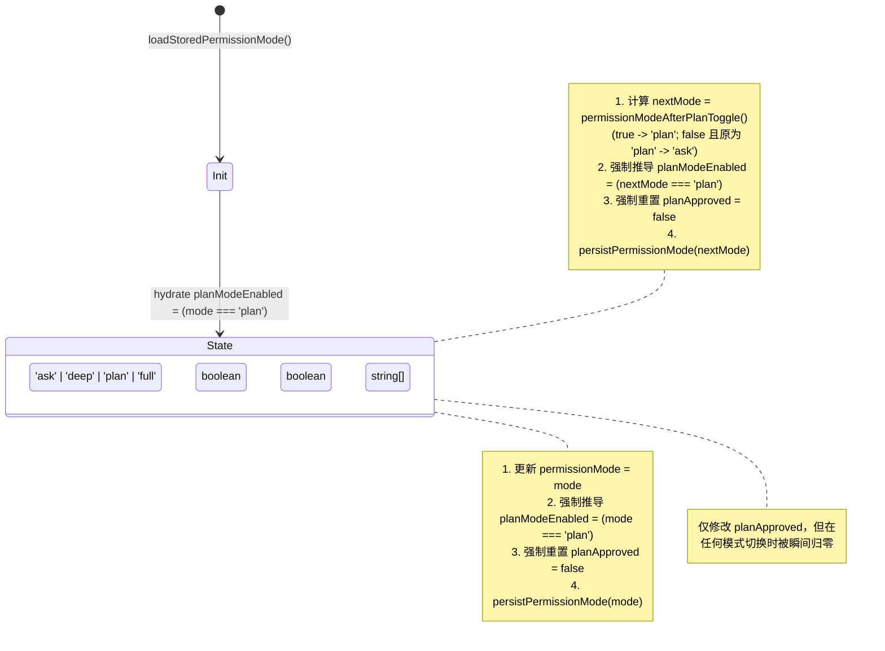
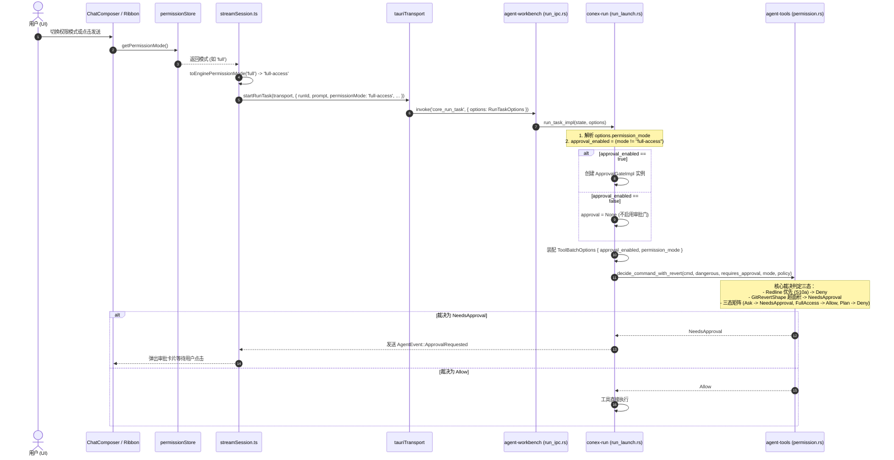
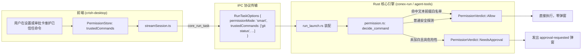

# 前端状态管理、持久化与协议下发链路深度剖析报告

> **战役工作区**：`docs/permission-system-consolidation/`  
> **报告定位**：前端状态管理（Store）、持久化（LocalStorage/Config）与 IPC 发送链路深度调查与重构规划  
> **分析对象**：`permissionStore.ts`、`storeAccess.ts`、`settingsUiStore.ts`、`permissionModes.ts`、`commandPermissions.ts`、`streamSession.ts`、`packages/shared-types` 及 Rust 引擎 `conex-run` / `agent-tools`  
> **权威代码锚点**：基于当前仓库真实代码逐行核查（代码位置统一以 `文件路径:行号` 标定）

---

## 目录

1. [执行摘要与核心结论](#一执行摘要与核心结论)
2. [维度一：现有 Store 与状态流转现状排查](#二维度一现有-store-与状态流转现状排查)
   - 2.1 `permissionStore.ts` 源码结构与职责边界
   - 2.2 四个核心状态的强耦合与畸形状态机（`permissionMode` / `planModeEnabled` / `planApproved` / `commandPermissions`）
   - 2.3 Store 访问门面（Facade）膨胀与跨域选择器穿透
3. [维度二：持久化与别名映射逻辑深度剖析](#三维度二持久化与别名映射逻辑深度剖析)
   - 3.1 `permissionModes.ts` 映射表与别名沼泽（`DESKTOP_TO_ENGINE` 与过度映射）
   - 3.2 `commandPermissions.ts`（364 行）虚假放行与白名单脱节根因
   - 3.3 持久化存储 Key 体系与双写风险分析
4. [维度三：IPC 下发链路（核心通信流）全景排查](#四维度三ipc-下发链路核心通信流全景排查)
   - 4.1 端到端调用流：从 UI 触发到 Rust 内核裁决
   - 4.2 协议模型漂移与类型定义不对齐现状（Shared Types vs Rust vs Frontend）
   - 4.3 审批逆向流：审批请求（`approval-requested`）与二次裁决断层
5. [维度四：状态层与通信链路重构方案建议](#五维度四状态层与通信链路重构方案建议)
   - 5.1 目标三选项架构设计（每次询问 / 智能命令放行 / 完全允许）
   - 5.2 Store 极简化方案与 Plan 状态解耦路线
   - 5.3 门面选择器与跨域依赖消解
   - 5.4 持久化 Key 兼容迁移与平滑升级方案
   - 5.5 智能放行端到端协议闭环设计（让信任命令重获新生）
6. [影响评估与清理清单](#六影响评估与清理清单)

---

## 一、执行摘要与核心结论

经过对前端状态层（`apps/crish-desktop/src/store/`）、API 抽象与持久化层（`apps/crish-desktop/src/api/`）、IPC 通信层（`chat-bridge/streamSession.ts`、`transport/`）以及共享协议与引擎层（`packages/shared-types`、`crates/conex-run`、`crates/agent-tools`）的全面代码审计，本报告得出以下**四大核心结论**：

1. **状态职责严重越界与畸形绑定**：
   - `permissionStore.ts` 中同时维护了 4 个状态，其中 `planModeEnabled` 完全是 `permissionMode === 'plan'` 的冗余派生布尔量，却被设计成双向独立可变状态；
   - `planApproved` 属于单次对话流内对 Assistant 计划草案的临时交互确认状态，却被作为全局权限状态塞入 `permissionStore`，并在每次模式切换时被暴力覆写；
   - `commandPermissions` 命令白名单在语义上与模式切换毫无联动，属于无序拼凑。
2. **严重的过度工程化与别名膨胀**：
   - `permissionModes.ts` 内部为了兼容历史遗留的 CLI 参数、Daemon 守护进程模式以及中文 UI 标签，构建了包含 20 余个别名的折叠解析器（如 `yolo`、`danger`、`unattended`、`headless`、`batch`、`ci`、`autopilot`、`无人值守` 等）；
   - 在一个受控的桌面 GUI 应用中，用户仅通过下拉菜单进行单选，此类庞大的别名映射层带来了巨大的认知负担和测试维护成本，且掩盖了真实模式只有 3 档的底层事实。
3. **“白名单脱离放行逻辑”的架构谎言**：
   - `commandPermissions.ts` 耗费 364 行代码实现了复杂的 Windows `.exe` 剥离、多层 shell 包装递归解包、token 边界正则匹配等算法；
   - 但历史上的“P1 权限归一”改造中，为了消除前端二次裁决，删除了前端放行分支，且**从未将该白名单下发给 Rust 引擎**；
   - `commandMatchesWhitelist` 在全工程业务调用量为 **0**，导致用户在设置页精心配置的“已信任命令”在实际运行中**毫无放行效果**，依然会被引擎无情拦截并弹窗，形成了严重的欺骗性交互。
4. **前后端协议契约存在语义漂移**：
   - 引擎 Rust 层（`agent-tools/src/permission.rs:25-33`）与共享设备协议（`device/types.ts:35-37`）底层始终只有 **3 种模式**（`ask` / `plan` / `full-access`）；
   - 前端凭空造出了第 4 种 `deep`（深入分析）模式，下发时又通过 `DESKTOP_TO_ENGINE` 偷换为 `ask`；
   - 用户提出的三选项重构（1. 每次询问，2. 智能命令放行，3. 完全允许），恰好为斩断上述伪模式、将虚假白名单与智能放行打通闭环提供了最佳契机。

---

## 二、维度一：现有 Store 与状态流转现状排查

### 2.1 `permissionStore.ts` 源码结构与职责边界

在 [`apps/crish-desktop/src/store/permissionStore.ts`](file:///c:/Software/conex/apps/crish-desktop/src/store/permissionStore.ts) 中，该 Store 是经由 R3-T11 治理拆分出的独立 Zustand 实例（集成 Immer、Logger 与 Devtools 中间件）：

```typescript
// apps/crish-desktop/src/store/permissionStore.ts:39-50
export interface PermissionStore {
  permissionMode: PermissionMode;
  planModeEnabled: boolean;
  planApproved: boolean;
  commandPermissions: string[];
  setPermissionMode: (mode: PermissionMode) => void;
  setPlanModeEnabled: (enabled: boolean) => void;
  setPlanApproved: (approved: boolean) => void;
  addCommandPermission: (cmd: string) => void;
  removeCommandPermission: (cmd: string) => void;
  setCommandPermissions: (list: string[]) => void;
}
```

#### 持久化边界：
根据注释（`permissionStore.ts:11-19`），该 Store 刻意避开了 Zustand 的 `persist` 中间件，改为在 Action 内部手动调用 API 层的持久化函数：
- `permissionMode`：调用 `persistPermissionMode(mode)` 写入 `localStorage` 键 `crish_permission_mode`；
- `commandPermissions`：调用 `saveCommandPermissions(next)` 写入 `localStorage` 键 `crish_command_permissions_v1`；
- `planModeEnabled` 与 `planApproved`：**不持久化**，纯内存状态。

---

### 2.2 四个核心状态的强耦合与畸形状态机

在 Store 内部实现中，4 个状态呈现出高度不自然的循环依赖与强耦合：



#### 具体耦合问题剖析：

1. **`permissionMode` 与 `planModeEnabled` 的双向冗余镜像（Duplicated State）**：
   - 查看 [`permissionStore.ts:64-71`](file:///c:/Software/conex/apps/crish-desktop/src/store/permissionStore.ts#L64-L71) 与 [`permissionStore.ts:73-85`](file:///c:/Software/conex/apps/crish-desktop/src/store/permissionStore.ts#L73-L85)：
     ```typescript
     setPermissionMode: (mode: PermissionMode) => {
       set((state) => {
         state.permissionMode = mode;
         state.planModeEnabled = planModeEnabledFor(mode); // mode === 'plan'
         state.planApproved = false;
       });
       persistPermissionMode(mode);
     },

     setPlanModeEnabled: (enabled: boolean) => {
       let nextMode: PermissionMode = 'ask';
       set((state) => {
         nextMode = permissionModeAfterPlanToggle(state.permissionMode, enabled);
         state.permissionMode = nextMode;
         state.planModeEnabled = planModeEnabledFor(nextMode);
         state.planApproved = false;
       });
       persistPermissionMode(nextMode);
     },
     ```
   - `planModeEnabledFor(mode)` 在 `api/permissionModes.ts:323-325` 中的定义就是 `mode === 'plan'`。
   - `planModeEnabled` 根本不是一个独立状态，而是一个 100% 可以通过 `permissionMode === 'plan'` 计算出的衍生值（Derived State）。将其作为单独字段存储，迫使 Store 编写繁复的同步逻辑，并在测试中额外断言两者的一致性（见 `permissionStore.test.ts:34-64`）。

2. **`planApproved` 临时会话状态寄生于全局权限 Store**：
   - `planApproved` 的生命周期仅存在于“用户在某条消息中点击批准计划”的微观交互中（`PlanApprovalRow.tsx:37-40`）；
   - 它的作用仅仅是隐藏消息底部的“批准此计划”按钮，或者在顶部状态条显示“计划已批准”。
   - 将其提升到全局 `PermissionStore`，导致全局切换权限模式时，会无差别地将所有会话或当前会话的 `planApproved` 清空，属于严重的状态范围越界（Scope Pollution）。

3. **`commandPermissions` 孤立于状态逻辑之外**：
   - `commandPermissions` 是一个字符串数组，但在 `permissionStore.ts` 中没有任何逻辑与 `permissionMode` 产生交集；
   - 无论模式是 `ask`、`full` 还是 `plan`，`commandPermissions` 都原样躺在内存和 `localStorage` 中。由于历史重构遗留，它在执行链路中从未被消费。

---

### 2.3 Store 访问门面（Facade）膨胀与跨域选择器穿透

由于历史上的多轮重构与 God Object 拆分，前端形成了极其混乱的四重门面穿透体系：

```
[UI 组件 / API 消费方]
       │
       ├─► 1. apps/crish-desktop/src/store/permissionStore.ts (直接引用)
       ├─► 2. apps/crish-desktop/src/store/storeAccess.ts (公共只读面)
       ├─► 3. apps/crish-desktop/src/store/settingsUiStore.ts (设置 UI 跨域借道)
       └─► 4. apps/crish-desktop/src/api/storeAccess.ts (API 编排层门面)
                                  │
                                  ▼
                     usePermissionStore.getState()
```

#### 代码证据与穿透链分析：
1. **`settingsUiStore.ts` 越权代理权限状态**：
   - 在 [`apps/crish-desktop/src/store/settingsUiStore.ts:53-61, 100-106`](file:///c:/Software/conex/apps/crish-desktop/src/store/settingsUiStore.ts#L53-L61)：
     ```typescript
     export const selectPermissionMode = (s: Pick<PermissionStore, 'permissionMode'>) => s.permissionMode;
     export const selectPlanModeEnabled = (s: Pick<PermissionStore, 'planModeEnabled'>) => s.planModeEnabled;
     export const selectPlanApproved = (s: Pick<PermissionStore, 'planApproved'>) => s.planApproved;
     export const selectSetPermissionMode = (s: Pick<PermissionStore, 'setPermissionMode'>) => s.setPermissionMode;
     ```
   - 在 [`settingsUiStore.ts:122-132, 142-144, 167-177`](file:///c:/Software/conex/apps/crish-desktop/src/store/settingsUiStore.ts#L122-L132)：
     ```typescript
     export function usePermissionMode(): PermissionMode {
       return usePermissionStore((s) => s.permissionMode);
     }
     export function getPermissionMode(): PermissionMode {
       return usePermissionStore.getState().permissionMode;
     }
     export function setPermissionMode(mode: PermissionMode): void {
       usePermissionStore.getState().setPermissionMode(mode);
     }
     ```
   - 一个名为 `settingsUiStore` 的模块，导出了大量直接操作 `PermissionStore` 的函数与选择器。这完全违背了单一职责原则。
2. **`api/storeAccess.ts` 形成二次转发**：
   - 在 [`apps/crish-desktop/src/api/storeAccess.ts:49, 80`](file:///c:/Software/conex/apps/crish-desktop/src/api/storeAccess.ts#L49)：
     ```typescript
     import { getPermissionMode as getPermissionModeFromFacade } from '../store/settingsUiStore';
     export { getPermissionModeFromFacade as getPermissionMode };
     ```
   - 核心会话启动模块 `streamSession.ts:10` 从 `api/storeAccess` 导入 `getPermissionMode`，后者转从 `settingsUiStore` 导入，`settingsUiStore` 再转从 `permissionStore` 取值。整条链路层层中转、高度脆弱。

---

## 三、维度二：持久化与别名映射逻辑深度剖析

### 3.1 `permissionModes.ts` 映射表与别名沼泽

位于 [`apps/crish-desktop/src/api/permissionModes.ts`](file:///c:/Software/conex/apps/crish-desktop/src/api/permissionModes.ts) 的逻辑是权限映射的核心。

#### 1. 虚假模式映射表 `DESKTOP_TO_ENGINE`
```typescript
// apps/crish-desktop/src/api/permissionModes.ts:63-68
export const DESKTOP_TO_ENGINE: Readonly<Record<PermissionMode, EnginePermissionMode>> = {
  ask: 'ask',
  deep: 'ask',       // 伪模式：下发到底层依然是 ask
  full: 'full-access',
  plan: 'plan',
};
```
- 前端对用户宣称有 `deep`（深入分析）模式，文案写着“多读多聊，改文件仍会问你”（`permissionModes.ts:88`），甚至在 `matrixHint` 里自曝“同需确认”（`permissionModes.ts:91`）；
- 但在向引擎下发时，`toEnginePermissionMode('deep')` 恒返回 `'ask'`；
- 引擎底层根本没有针对 `deep` 的任何特殊安全裁决（`crates/agent-tools/src/permission.rs:46-48`），`deep` 在安全维度纯属**虚构伪模式**。

#### 2. 别名膨胀与过度工程化：`normalizePermissionMode`
在 [`permissionModes.ts:148-207`](file:///c:/Software/conex/apps/crish-desktop/src/api/permissionModes.ts#L148-L207) 中，存在极其夸张的别名折叠：

```typescript
// apps/crish-desktop/src/api/permissionModes.ts:159-204
  // → ask（含 unattended 安全默认、auto 族 hydrate）
  if (
    key === 'auto' ||
    key === 'autopilot' ||
    key === 'project' ||
    key === 'confirm' ||
    key === 'default' ||
    key === 'interactive' ||
    key === 'unattended' ||
    key === 'headless' ||
    key === 'batch' ||
    key === 'ci' ||
    key === '自动' ||
    key === '无人值守'
  ) {
    return 'ask';
  }

  // → full（allow 路径）
  if (
    key === 'full-access' ||
    key === 'fullaccess' ||
    key === 'full' ||
    key === 'yolo' ||
    key === 'danger' ||
    key === 'allow' ||
    key === '完全访问' ||
    key === '全部允许'
  ) {
    return 'full';
  }

  // → plan
  if (
    key === 'plan' ||
    key === 'readonly' ||
    key === 'read-only' ||
    key === 'analysis' ||
    key === 'safe' ||
    key === 'cautious' ||
    key === '仅分析' ||
    key === '计划' ||
    key === '只读'
  ) {
    return 'plan';
  }
```

#### 为什么存在如此多的别名？
1. **历史原型与 CLI 残留**：早期的命令行实验版本使用了 `yolo`、`danger` 等口语化参数，或用 `headless`、`batch`、`ci` 等表示非交互式运行；
2. **多终端协议混杂**：历史上的 Agent Daemon 守护进程拥有 `unattended` 批处理模式，桌面端在迁移代码时全盘照抄，并试图把所有可能的值强行收敛为 `'ask'`；
3. **中文 UI 标签的逆向解析**：开发者试图支持把界面上展示给用户的中文短语（如“需确认”、“完全访问”、“计划”）反向解析为枚举值，导致配置解析器与 UI 表现层深度耦合；
4. **过度防御设计**：`foldPermissionKey` 会处理下划线、短横线、全小写、去空格，甚至兼容 `"full access"`。

在一个完全由受控前端维护的现代架构中，这些别名不仅毫无必要，反而严重模糊了权限边界，使得配置迁移与契约对齐极易出现隐蔽 BUG。

---

### 3.2 `commandPermissions.ts`（364 行）虚假放行与白名单脱节根因

文件 [`apps/crish-desktop/src/api/commandPermissions.ts`](file:///c:/Software/conex/apps/crish-desktop/src/api/commandPermissions.ts) 是本系统中最具欺骗性的模块。

#### 1. 复杂精密的规范化与匹配算法（耗费 364 行）：
- **Windows 可执行后缀剥离**（`stripWindowsExecutableExtension`，L82-93）：去除 `git.exe` 中的 `.exe`、`.cmd`、`.bat`、`.ps1`；
- **Shell 包装多层解包**（`unwrapShellWrapper`，L99-124）：递归剥离 `cmd.exe /c`、`powershell -Command`、`pwsh -c`；
- **变体穷举**（`commandMatchVariants`，L130-153）：生成多达 6 种去后缀、去包装的排列组合变体；
- **Token 边界匹配**（`isTokenBoundaryPrefix`，L245-258）：防止 `git` 误匹配 `gitignore`；
- **核心白名单比对器**（`commandMatchesWhitelist`，L267-282）。

#### 2. 为什么它彻底脱离了放行逻辑？
答案就在文件的显式注释与历史演进中：

```typescript
// apps/crish-desktop/src/api/commandPermissions.ts:8-10
 * - 不伪造工具输出；白名单 = 显示/记忆（记住用户批准过的命令），
 *   **不再参与自动放行判定**（P1 权限归一 B3：放行权威 = 引擎
 *   call_verdict / ApprovalGateImpl 单一裁决链）

// apps/crish-desktop/src/api/commandPermissions.ts:359-364
// ── P1 权限归一（D6）──
// 前端命令风险正则表（极危/破坏/外发/网络/写/只读六表）与基于它的风险
// 分类函数族已整体删除——前端不再存在第二套命令风险分类（TrustZone 双
// 语义收敛归引擎权威）；白名单保留为批准记忆（本文件上方 CRUD/匹配原
// 语），不再参与任何放行判定。
```

在测试文件 [`apps/crish-desktop/src/api/chat-bridge/approvalContract.test.ts:273-311`](file:///c:/Software/conex/apps/crish-desktop/src/api/chat-bridge/approvalContract.test.ts#L273-L311) 中，赫然写着刚性契约断言：
```typescript
describe('审批链路契约：白名单 = 批准记忆（P1 权限归一 D1，前端二次决策 1→0）', () => {
  it('白名单命中：仍进入挂起展示审批卡，不再自动直发引擎批准命令', () => {
    usePermissionStore.setState({ commandPermissions: ['git status'] });
    // ...
    // P1：白名单仅为批准记忆（remember）——命中不再自动放行，
    // 一律挂起展示审批卡片，让用户在 UI 明确批准
    expect(approvalFlow.snapshot().pendingCount).toBe(1);
    expect(fakeTransport.send).not.toHaveBeenCalled();
  });
});
```

#### 关键矛盾分析：
1. **历史意图**：重构者认为“裁决权威必须唯一”，因此把前端私自给引擎发 `approve` 的逻辑删除了；
2. **重构未半而中道断裂**：删除前端自动批准后，重构者**并没有**将用户的白名单传递给引擎 Rust 内核，导致引擎在执行 `decide_command_with_revert` 时，根本不知道用户配置了哪些信任命令；
3. **现状荒谬性**：
   - 生产代码中全局搜索 `commandMatchesWhitelist`，调用次数为 **0**；
   - 用户在设置面板配置的命令、在审批弹窗勾选“记住”的命令，仅仅被保存在 `crish_command_permissions_v1` 中充当“记忆展品”；
   - 只要当前处于 `ask` 模式，下一次执行该命令时，系统依然弹窗询问！
   - 这就是用户感觉“权限系统混乱、不可理解、说话不算数”的核心根源！

---

### 3.3 持久化存储 Key 体系与双写风险分析

当前涉及权限持久化的 LocalStorage Key 共有两个：

| LocalStorage Key | 负责模块 | 存储结构 | 默认回退值 | 写入时机 |
| :--- | :--- | :--- | :--- | :--- |
| `crish_permission_mode` | `api/permissionModes.ts` | 裸字符串（`'ask' \| 'deep' \| 'plan' \| 'full'`） | `'ask'` | `setPermissionMode` / `setPlanModeEnabled` |
| `crish_command_permissions_v1` | `api/commandPermissions.ts` | JSON 数组字符串（`string[]`） | `['git status', 'git diff', 'git log', 'npm test', 'npm run test']` | `addCommandPermission` / `removeCommandPermission` / `setCommandPermissions` |

#### 双写与竞态风险评估：
- `permissionStore.test.ts:135-141` 特意测试了“防止通过 zustand persist 双写（确保没有 `crish-permission-v1` 键）”；
- 目前持久化由 Action 显式同步写入 LocalStorage，由于是单页面应用（SPA）且运行在 WebView2 内，暂无多 Tab 竞态；
- 但如果用户通过设置页、Composer 菜单、或者直接调用 API 改变模式，由于缺乏统一的数据版本迁移机制（Schema Migration），当引入新的三选项枚举时，老旧数据容易产生反向降级。

---

## 四、维度三：IPC 下发链路（核心通信流）全景排查

### 4.1 端到端调用流：从 UI 触发到 Rust 内核裁决

下图详细还原了一条包含权限模式的用户请求从前端触发到 Rust 引擎执行的全生命周期：



#### 关键源码定位佐证：

1. **前端读取与下发点**：
   - [`apps/crish-desktop/src/api/chat-bridge/streamSession.ts:90-91, 159-163`](file:///c:/Software/conex/apps/crish-desktop/src/api/chat-bridge/streamSession.ts#L90-L91)：
     ```typescript
     const mode = getPermissionMode();
     const permissionMode = toEnginePermissionMode(mode);
     // ...
     await startRunTask(transport, {
       runId,
       prompt,
       sessionId: safeSessionId,
       permissionMode, // 仅下发模式字符串，未携带任何 commandPermissions!
       // ...
     });
     ```
2. **Tauri IPC 命令薄壳**：
   - [`apps/agent-workbench/src-tauri/src/run_ipc.rs:227-233`](file:///c:/Software/conex/apps/agent-workbench/src-tauri/src/run_ipc.rs#L227-L233)：
     ```rust
     #[tauri::command]
     pub(crate) async fn core_run_task(
         state: tauri::State<'_, Arc<CoreRunState>>,
         options: RunTaskOptions,
     ) -> Result<RunTaskResponse, CoreError> {
         run_task_impl(Arc::clone(state.inner()), options).await
     }
     ```
3. **引擎运行期装配点**：
   - [`crates/conex-run/src/run/run_launch.rs:594, 930-936, 1181-1187`](file:///c:/Software/conex/crates/conex-run/src/run/run_launch.rs#L594)：
     ```rust
     // crates/conex-run/src/run/run_launch.rs:930-936
     // permissionMode：full-access 不启用审批；其余（ask / plan）启用
     let approval_enabled = permission_mode.as_deref() != Some("full-access");
     let approval: Option<Arc<dyn ApprovalGate>> = if approval_enabled {
         Some(Arc::clone(&approval_gate) as Arc<dyn ApprovalGate>)
     } else {
         None
     };

     // crates/conex-run/src/run/run_launch.rs:1181-1187
     let tool_options = ToolBatchOptions {
         approval_enabled,
         permission_mode: permission_mode
             .as_deref()
             .map(|mode| PermissionMode::from_engine_str(Some(mode))),
         // ...
     };
     ```
4. **引擎权限判定核心实现**：
   - [`crates/agent-tools/src/permission.rs:25-59, 84-93`](file:///c:/Software/conex/crates/agent-tools/src/permission.rs#L25-L59)：
     ```rust
     pub enum PermissionMode {
         Ask,
         FullAccess,
         Plan,
     }

     pub fn decide(dangerous: bool, requires_approval: bool, mode: PermissionMode) -> PermissionVerdict {
         if dangerous || requires_approval {
             return match mode {
                 PermissionMode::Ask => PermissionVerdict::NeedsApproval,
                 PermissionMode::FullAccess => PermissionVerdict::Allow,
                 PermissionMode::Plan => PermissionVerdict::Deny,
             };
         }
         PermissionVerdict::Allow
     }
     ```

---

### 4.2 协议模型漂移与类型定义不对齐现状

排查 `packages/shared-types` 与前后端发现明显的契约分裂：

| 层级 | 定义位置 | 枚举 / 取值集合 | 评价 |
| :--- | :--- | :--- | :--- |
| **前端 Desktop** | `apps/crish-desktop/src/api/permissionModes.ts:27` | `'ask' \| 'deep' \| 'full' \| 'plan'` | **虚标**：多出了 `deep` 伪模式 |
| **前端 Engine Wire** | `apps/crish-desktop/src/api/permissionModes.ts:30` | `'ask' \| 'auto' \| 'full-access' \| 'plan' \| 'unattended'` | **杂乱**：混杂了 daemon 的批处理模式 |
| **共享设备协议** | `packages/shared-types/src/generated/device/types.ts:35` | `["ask", "plan", "full-access"]` | **严谨**：权威设备契约只有 3 态 |
| **共享引擎协议** | `packages/shared-types/src/generated/engine/types.ts` | *未定义 PermissionMode*，仅定义 `PermissionRequest` | **缺失**：引擎事件层未直接暴露模式枚举 |
| **Rust 核心引擎** | `crates/agent-tools/src/permission.rs:25-33` | `PermissionMode::Ask`, `FullAccess`, `Plan` | **严谨**：内核底层只有 3 态 |

#### 结论：
Rust 内核与 `shared-types` 的设备协议高度默契，一直只有 `ask`、`full-access`、`plan` 三态。混乱和冗余完全集中在前端 `apps/crish-desktop` 内部的自我膨胀与自圆其说。

---

### 4.3 审批逆向流：审批请求（`approval-requested`）与二次裁决断层

当工具调用被判定为 `NeedsApproval` 时：
1. 引擎产生 `AgentEvent::ApprovalRequested`（`run/run_approval.rs`）；
2. 前端 `chat-bridge/EventRouter.ts` 接收并派发给 `ApprovalFlowMachine`；
3. UI 渲染 `ApprovalAskCard`；
4. 用户点击允许（可勾选“记住此类命令”）：
   - 调用 `engineApproveTool(toolId)` 发回 IPC，通知引擎放行；
   - 若勾选记住，调用 `addCommandPermission(prefix)` 将命令前缀写入 Store；
5. **断层发生点**：
   - 存入 Store 的命令前缀**从不被回传**给引擎；
   - 下次执行同一前缀命令，引擎重新判定 `dangerous || requires_approval`，再次发出 `ApprovalRequested`；
   - 用户的“记住”操作在实际运行时沦为徒劳。

---

## 五、维度四：状态层与通信链路重构方案建议

针对用户提出的核心需求：
> **“将整个软件的权限模式统一重构成集中的可选形式，倾向于三个选项：1. 每次询问，2. 智能命令放行，3. 完全允许模式（系统不会因为命令而不允许执行，所有执行的命令都是可以运行的）”**

本报告提出如下端到端重构方案。

---

### 5.1 目标三选项架构设计

彻底废除 `deep` 伪模式与混在权限里的 `plan` 模式，收敛为聚焦于**执行放行策略**的三选项：

| 选项 ID | 中文名称 | 核心安全语义 | 对工具与命令的判定行为 | 引擎协议 Wire 值 |
| :--- | :--- | :--- | :--- | :--- |
| **`ask`** | **每次询问** | 严格防守、无死角确认 | 凡是带写操作（文件写入、Git 推送等）、被标记为危险或门禁越界的命令，**一律弹窗确认** | `'ask'` |
| **`smart`** | **智能命令放行** | 兼顾安全与流畅开发 | 1. 纯只读探测（`git status`、`ls`、`pwd`）直接放行<br/>2. 常规无害构建与单测（`npm test`、`cargo check`）直接放行<br/>3. **命中使用者信任白名单的命令直接放行**<br/>4. 破坏性操作、越界操作、非白名单危险操作**弹窗确认** | `'smart'`（或携带信任列表的扩展下发） |
| **`full`** | **完全允许模式** | **“所有执行的命令都是可以运行的”** | 彻底放行所有命令与工具执行；系统不主动拦截、不弹窗阻断，由用户承担完全执行自由 | `'full-access'`（引擎需配合解除过度阻断） |

---

### 5.2 Store 极简化方案与 Plan 状态解耦路线

#### 1. 精简后的 `PermissionStore`（减重 60%）
```typescript
// apps/crish-desktop/src/store/permissionStore.ts (重构后形态)
export type PermissionMode = 'ask' | 'smart' | 'full';

export interface PermissionStore {
  permissionMode: PermissionMode;
  trustedCommands: string[]; // 语义重命名：从模糊的 commandPermissions 明确为 trustedCommands
  
  // 极简纯粹的 Actions
  setPermissionMode: (mode: PermissionMode) => void;
  addTrustedCommand: (cmd: string) => void;
  removeTrustedCommand: (cmd: string) => void;
  setTrustedCommands: (list: string[]) => void;
}
```

#### 2. Plan 模式解耦路线：从“安全权限”回归“任务流阶段”
- **概念拨正**：Plan（计划）不是权限等级，而是 Agent 工作流阶段（Workflow Stage）或对话目标（Session Goal Mode）；
- **解耦步骤**：
  1. 从 `PermissionMode` 枚举中彻底剔除 `'plan'`；
  2. 删除 `permissionStore` 内的 `planModeEnabled` 字段；
  3. 将“计划模式开关”迁移至会话元数据（如 `sessionStore` 的 `session.isPlanMode`）或 Composer 输入选项（`composerDraft.planMode`）；
  4. 将 `planApproved` 状态归入单条消息或当前流式响应的局部上下文，彻底移出全局 Store；
  5. 消除 `PlanApprovalRow` 中“批准计划强制将全局权限改写为 `'ask'`”的副作用流。

---

### 5.3 门面选择器与跨域依赖消解

1. **废除 `settingsUiStore.ts` 对权限的越界中转**：
   - 彻底删除 `settingsUiStore.ts` 内的 `selectPermissionMode`、`usePermissionMode`、`getPermissionMode` 等代理函数；
   - 设置面板（`SettingsSecurityTab.tsx`）直接通过 `usePermissionStore` 订阅；
2. **规范化 `storeAccess.ts` 只读门面**：
   - 在 `store/storeAccess.ts` 中仅保留纯函数选择器：
     ```typescript
     export const selectPermissionMode = (s: PermissionStore) => s.permissionMode;
     export const selectTrustedCommands = (s: PermissionStore) => s.trustedCommands;
     export function getPermissionMode(): PermissionMode {
       return usePermissionStore.getState().permissionMode;
     }
     ```
3. **清理 `api/storeAccess.ts` 转发**：
   - `streamSession.ts` 直接从 `store/storeAccess.ts` 读取状态，不再绕经 `api/storeAccess` 与 `settingsUiStore`。

---

### 5.4 持久化 Key 兼容迁移与平滑升级方案

为了保证存量用户无感知平滑过渡，采用向下兼容的 Hydrate 策略：

```typescript
// apps/crish-desktop/src/api/permissionModes.ts
export const PERMISSION_MODE_STORAGE_KEY = 'crish_permission_mode';
export const TRUSTED_COMMANDS_STORAGE_KEY = 'crish_command_permissions_v1';

export function loadStoredPermissionMode(): PermissionMode {
  try {
    const raw = localStorage.getItem(PERMISSION_MODE_STORAGE_KEY);
    if (!raw) return 'smart'; // 推荐默认值：智能放行模式
    
    const key = raw.trim().toLowerCase();
    if (key === 'full' || key === 'full-access') return 'full';
    if (key === 'smart') return 'smart';
    if (key === 'ask') return 'ask';
    
    // 兼容迁移：旧版 deep、plan 或异常值平滑收敛
    if (key === 'deep') return 'ask';
    if (key === 'plan') return 'ask'; // plan 解耦后，权限回退为 ask，不影响会话自身任务标记
    
    return 'smart';
  } catch {
    return 'smart';
  }
}
```

- **数据无损**：继续沿用 `crish_command_permissions_v1` 作为信任命令的存储键，用户此前添加过的命令列表 100% 保留；
- **自动收敛**：存量的 `deep` 和 `plan` 自动清洗为 `'ask'`，写入时自动规整为新三态。

---

### 5.5 智能放行端到端协议闭环设计（让信任命令重获新生）

为彻底解决“白名单脱离放行逻辑”的问题，必须在 IPC 下发链路上建立完整的闭环：



#### 关键改动要点：
1. **`RunTaskOptions` 扩充**（`crates/conex-run/src/run/run_launch.rs:588`）：
   - 新增 `pub trusted_commands: Option<Vec<String>>`；
2. **`streamSession.ts` 下发**：
   - 当 `permissionMode === 'smart'` 时，从 Store 读取 `trustedCommands` 并注入 `startRunTask` 参数中；
3. **引擎端判定闭环**（`crates/agent-tools/src/permission.rs`）：
   - `PermissionMode` 枚举引入 `Smart`；
   - 在 `decide_command` 中增加白名单匹配逻辑。凡是命中 `trusted_commands` 前缀的命令，直接返回 `PermissionVerdict::Allow`，不再发送 `approval-requested`；
4. **效果**：
   - 彻底兑现 UI 上“已信任命令”的承诺；
   - “智能命令放行”模式既有沙箱语义分析的底线安全保障，又给予用户通过信任白名单自主提效的闭环能力。

---

## 六、影响评估与清理清单

### 6.1 影响模块与修改清单

| 模块类别 | 涉及文件 | 预估改动动作 |
| :--- | :--- | :--- |
| **状态层** | `apps/crish-desktop/src/store/permissionStore.ts` | 移除 `planModeEnabled`、`planApproved`；模式收敛为 3 态；重命名白名单方法 |
| **测试层** | `apps/crish-desktop/src/store/permissionStore.test.ts` | 更新单测：移除三态联动测试，覆盖新三选项持久化与白名单行为 |
| **门面层** | `apps/crish-desktop/src/store/settingsUiStore.ts` | 删除所有针对 `PermissionStore` 的代理选择器与转发函数 |
| **门面层** | `apps/crish-desktop/src/store/storeAccess.ts` | 导出精简后的只读选择器 |
| **门面层** | `apps/crish-desktop/src/api/storeAccess.ts` | 移除中间穿透转发，直连正确读面 |
| **API 映射层** | `apps/crish-desktop/src/api/permissionModes.ts` | 删除 20+ 冗余别名与 `foldPermissionKey` 复杂逻辑；定义目标三选项；删除 `deep` 伪映射 |
| **白名单 API** | `apps/crish-desktop/src/api/commandPermissions.ts` | 精简 shell 包装剥离（保留基础匹配，消除无用分支），恢复匹配函数与放行逻辑的挂钩 |
| **IPC 流式桥** | `apps/crish-desktop/src/api/chat-bridge/streamSession.ts` | 下发新的 `permissionMode`，并在 `smart` 模式下下发 `trustedCommands` |
| **UI 组件层** | `components/settings/SettingsSecurityTab.tsx` | Select 调整为 3 项；文案真实化；确保信任列表真正生效 |
| **UI 组件层** | `components/chat-composer/PermissionModeMenu.tsx` | 胶囊与菜单项调整为 3 项 |
| **UI 组件层** | `components/chat-message-row/PlanApprovalRow.tsx` | 解耦 `setPermissionMode('ask')` 的强制覆写逻辑 |

### 6.2 彻底清理的死代码清单

1. `permissionModes.ts` 中的 `DESKTOP_TO_ENGINE` 伪映射表（消除 `deep -> ask` 的掩耳盗铃）；
2. `permissionModes.ts` 中的冗余别名分支（`yolo`, `danger`, `unattended`, `headless`, `batch`, `ci`, `auto`, `autopilot`, `无人值守` 等）；
3. `permissionModes.ts` 中的 `isAutoAliasToAsk`、`desktopEngineRoundTrip` 等死代码辅助函数；
4. `permissionStore.ts` 中的 `planModeEnabledFor`、`permissionModeAfterPlanToggle` 同步胶水代码；
5. 生产调用量为 0 的虚假白名单拦截假契约断言。

---
*报告编制完成。该报告与 `01-frontend-ui-and-ux-analysis.md` 及 `04-command-semantics-and-redline-bypass-analysis.md` 相互呼应，共同为权限系统收敛战役提供全景技术支撑。*
