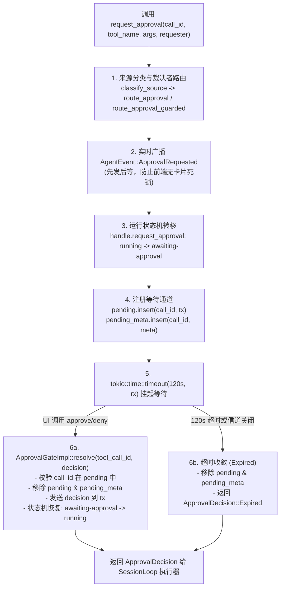

# Rust 引擎内核裁决链与审批门机制深度剖析报告

> **战役工作区**：`docs/permission-system-consolidation/`  
> **报告定位**：Rust 引擎内核（`crates/session-loop`、`crates/agent-tools`、`crates/conex-run`、`crates/conex-sandbox`）权限裁决与审批门（ApprovalGate）机制深度剖析与重构架构设计  
> **分析维度**：现有裁决主干、三态判定矩阵、ApprovalGate 生命周期、历史补丁叠加毒瘤排查、新三态收敛重构方案  
> **代码权威锚点**：基于当前仓库 `crates/session-loop/`、`crates/agent-tools/`、`crates/conex-run/`、`crates/conex-sandbox/` 真实代码逐行核查  

---

## 目录

1. [执行摘要与核心结论](#一执行摘要与核心结论)
2. [维度一：现有内核裁决链路主干剖析（Session-Loop & Conex-Run）](#二维度一现有内核裁决链路主干剖析session-loop--conex-run)
   - 2.1 裁决核心方法 `call_verdict` 逻辑走查与数据流
   - 2.2 启动时选项装配：`run_launch.rs` 中的危险分裂
   - 2.3 命令判定单链 vs 非命令判定的分叉设计
   - 2.4 legacy 分支与无 `permission_mode` 时的回退行为（`options.approval_enabled`）
   - 2.5 裁决调度的两面派：执行前拦截 vs 执行中审查 vs 执行后重试
3. [维度二：三态判定矩阵深度剖析（Agent-Tools::Permission）](#三维度二三态判定矩阵深度剖析agent-toolspermission)
   - 3.1 现存 `PermissionMode` 定义与字符串别名映射表
   - 3.2 判定结果 `PermissionVerdict` 与核心矩阵函数 `decide`
   - 3.3 `dangerous` 标记与 `requires_approval` 动态错误的判定机理
   - 3.4 红线先行原则（`decide_with_redline` / `decide_command`）
   - 3.5 远程通道（RemoteChannel）与本地执行的一致性断言
4. [维度三：审批门机制（ApprovalGate）与生命周期全景剖析](#四维度三审批门机制approvalgate与生命周期全景剖析)
   - 4.1 抽象契约：`ApprovalGate` Trait 定义与职责边界
   - 4.2 生产运行时实现：`ApprovalGateImpl` 的完整生命周期
   - 4.3 竞速等待核心：`approval_wait` 的三路收敛与强停打断
   - 4.4 权限传递层（`ApprovalRequester`）：子代理申请 vs 用户裁决与死锁防护
   - 4.5 待审批对账与审计防伪机制（`pending_meta` 与 I-02 校验）
5. [维度四：裁决链过度复杂化问题诊断与历史战役补丁排查](#五维度四裁决链过度复杂化问题诊断与历史战役补丁排查)
   - 5.1 毒瘤一：C3 回退护栏在 FullAccess 下的“假阻断与真绕过”循环
   - 5.2 毒瘤二：Pre / During / Post 三重裁决与参数可能漂移
   - 5.3 毒瘤三：Plan 模式作为权限模式的职责倒错与状态绑架
   - 5.4 毒瘤四：`task_type` 刚性命令白名单对内核主干的硬编码侵入
   - 5.5 毒瘤五：E2 扩展点 C 与 `ToolCategory` 的“空转装配”
6. [维度五：统一收敛为“新三态模型”的内核重构方案设计](#六维度五统一收敛为新三态模型的内核重构方案设计)
   - 6.1 目标内核权限模式枚举重定义（`AskEveryTime`, `SmartCommand`, `FullAllow`）
   - 6.2 统一单点裁决函数 `decide_tool_verdict` 设计
   - 6.3 ApprovalGate 物理装配常态化（彻底根除 `approval: None` 陷阱）
   - 6.4 `exec_verdict.rs` 与 `permission.rs` 深度瘦身路线
7. [重构实施影响面评估与清单](#七重构实施影响面评估与清单)

---

## 一、执行摘要与核心结论

通过对 Rust 引擎内核各 crate（`crates/session-loop`、`crates/agent-tools`、`crates/conex-run`、`crates/conex-sandbox`）的全面深入走查，现行权限裁决与审批机制在代码层面呈现出**“历经多次局部战役叠加、补丁嵌套补丁、前后矛盾且过度复杂化”**的严峻现状。

### 核心论断与三大架构断层

1. **“完全允许模式（FullAccess）”在底层并未实现真正的完全放行**：
   - 用户期望的“完全允许模式”是系统不主动阻止任何命令执行；
   - 但内核中不仅有不可豁免的 `Redline` 机制（`crates/agent-tools/src/permission.rs:108`），还叠加上了 **C3 大面积回退护栏**（`git checkout`、`git reset --hard` 在面积超阈值时一律强制拦截为 `NeedsApproval`，见 `crates/agent-tools/src/permission.rs:134-137` 与 `crates/session-loop/src/exec_verdict.rs:113-117`）；
   - 更荒谬的是，在 `crates/conex-run/src/run/run_launch.rs:931-936` 中，当模式为 `full-access` 时，系统为了“性能”直接**不注入审批门**（`approval: None` 且 `approval_enabled: false`）。导致大面积回退命令在判定为 `NeedsApproval` 时无法弹窗，直接跌入未装配报错（`ApprovalRequired`），随后在 `execution.rs:185` 靠补丁函数二次重试才放行。整个过程充满设计割裂与运行时隐患。

2. **裁决链条三重分散，同一条命令被评估 2~3 次**：
   - **第一重（Pre-execution）**：`session-loop/src/exec_single/pre_exec.rs:27` 调用 `call_verdict`，在执行前结合 `revert_policy` 判定；
   - **第二重（During-execution）**：进入 `agent-tools/src/tools/shell.rs:336` 时，又调用 `decide_analysis_with_revert`，在工具内部第二次跑语义分析与门禁审查；
   - **第三重（Post-execution Retry）**：工具若返回 `tool.requires_approval`，在 `execution.rs:179` 的 `handle_retry_after_approval_required` 中**第三次**调用 `decide` 发起重试。多点判定使得逻辑极为分散，极难维护。

3. **概念严重污染：Plan 任务阶段被当作权限模式，硬编码特化充斥主干**：
   - `crates/agent-tools/src/permission.rs:25-33` 将 `Plan`（只读规划任务）与安全权限混为一谈，导致只读模式必须在权限矩阵中硬拒绝所有写操作；
   - `crates/session-loop/src/exec_verdict.rs:131-136` 硬编码了 `task_type`（如 `commit`、`implementation`）的命令白名单过滤；
   - `ToolCategory` 在 `executing_tools.rs:89` 恒硬编码为 `Internal`，形同虚设。

### 重构结论
必须将内核权限模式收敛为纯粹的 **三选项（`AskEveryTime` 每次询问 / `SmartCommand` 智能命令放行 / `FullAllow` 完全允许）**：
- 废除 `Plan`、`deep` 等伪权限模式；
- 常态化装配 `ApprovalGate`（杜绝 `Option<ApprovalGate>` 带来的条件分支崩溃）；
- 将 `call_verdict`、`shell.rs`、`revert_policy` 收敛为单点权威裁决函数；
- 在 `FullAllow` 下忠实履行用户契约，彻底消灭“自作主张拒绝用户命令”的历史包袱。

---

## 二、维度一：现有内核裁决链路主干剖析（Session-Loop & Conex-Run）

### 2.1 裁决核心方法 `call_verdict` 逻辑走查与数据流

在批处理与单工具执行调度中，`crates/session-loop/src/exec_verdict.rs:118-172` 的 `call_verdict` 是工具调用的**前置裁决单一入口**。其源码逻辑如下：

```rust
// crates/session-loop/src/exec_verdict.rs:118-172
pub(crate) fn call_verdict(
    &self,
    call: &ToolBatchCall,
    options: &ToolBatchOptions,
) -> PermissionVerdict {
    // 1. 工具启用状态检查：未启用直接 Deny
    if !self.registry.is_tool_enabled(&call.tool_name) {
        return PermissionVerdict::Deny;
    }

    // 2. 命令类型分支判定
    if let Some(command) = call
        .input
        .get("command")
        .and_then(serde_json::Value::as_str)
    {
        // BC10-6: 任务类型命令白名单刚性前置门禁
        if let Some(task_type) = &options.task_type {
            if !agent_tools::readonly::command_allowed_for_task_type(task_type, command) {
                return PermissionVerdict::Deny;
            }
        }

        // 未设置权限模式：沿用既有语义（approval 开启 → 全批审批）
        if options.permission_mode.is_none() {
            return PermissionVerdict::NeedsApproval;
        }
        let mode = options.permission_mode.unwrap_or_default();
        let dangerous = self
            .registry
            .get(&call.tool_name)
            .map(|t| t.definition().dangerous)
            .unwrap_or(false);

        // 命令判定唯一链：红线先行 → C3 回退护栏 → 三态矩阵
        return agent_tools::permission::decide_command_with_revert(
            command,
            dangerous,
            false,
            mode,
            &self.revert_policy,
        );
    }

    // 3. 非命令类型常规工具判定
    let dangerous = self
        .registry
        .get(&call.tool_name)
        .map(|t| t.definition().dangerous)
        .unwrap_or(false);

    match options.permission_mode {
        Some(mode) => decide(dangerous, false, mode),
        // legacy：approval 开启 → 全部工具调用走审批
        None if options.approval_enabled => PermissionVerdict::NeedsApproval,
        // A3 fail-closed 配套：无审批基础设施时安全项放行执行、危险项 NeedsApproval
        None => decide(dangerous, false, PermissionMode::Ask),
    }
}
```

从数据流看，`call_verdict` 接收 `ToolBatchCall` 与 `ToolBatchOptions`，产出 `PermissionVerdict`（`Allow` / `Deny` / `NeedsApproval`）。

### 2.2 启动时选项装配：`run_launch.rs` 中的危险分裂

在 `crates/conex-run/src/run/run_launch.rs:930-936` 中，引擎在启动一个 Run 时决定是否实例化审批门：

```rust
// crates/conex-run/src/run/run_launch.rs:930-936
// permissionMode：full-access 不启用审批；其余（ask / plan）启用
let approval_enabled = permission_mode.as_deref() != Some("full-access");
let approval: Option<Arc<dyn ApprovalGate>> = if approval_enabled {
    Some(Arc::clone(&approval_gate) as Arc<dyn ApprovalGate>)
} else {
    None
};
```

紧接着在 `crates/conex-run/src/run/run_launch.rs:1181-1194` 中构造 `ToolBatchOptions`：
```rust
let tool_options = ToolBatchOptions {
    approval_enabled,
    permission_mode: permission_mode
        .as_deref()
        .map(|mode| PermissionMode::from_engine_str(Some(mode))),
    output_budget_bytes: Some(conex_shared::perf_budget::TOOL_OUTPUT_BUDGET_BYTES_DEFAULT),
    ..ToolBatchOptions::default()
};
```

这里埋下了一个极其严重的**隐性断层**：
- 当模式为 `full-access` 时，`approval_enabled` 为 `false`，且 `approval` 为 `None`；
- 但是在 `call_verdict` 中，如果命令触发了 C3 回退护栏（`RevertPolicy`），`decide_command_with_revert` 会强行返回 `PermissionVerdict::NeedsApproval`；
- 执行调度器（`pre_exec.rs:28`）在面对 `(None, false)` 状态下的 `NeedsApproval` 时，根本无法请求审批，直接报错拒绝。

### 2.3 命令判定单链 vs 非命令判定的分叉设计

- **命令调用分支**：以 `call.input.get("command")` 存在为判据。
  - 先强制跑 `task_type` 白名单检查（`agent_tools::readonly::command_allowed_for_task_type`）；
  - 再通过 `agent_tools::permission::decide_command_with_revert` 执行复合审查：红线语义检测（`Redline`） $\to$ 回退护栏（`RevertPolicy`） $\to$ 三态矩阵。
- **非命令调用分支**：
  - 仅依赖工具注册表定义的 `definition().dangerous` 布尔标记；
  - 传入 `decide(dangerous, false, mode)` 进行矩阵映射。

### 2.4 legacy 分支与无 `permission_mode` 时的回退行为

在 `options.permission_mode.is_none()` 时，系统存在多层历史回退垫片：
1. **命令分支回退**（`exec_verdict.rs:141`）：直接返回 `PermissionVerdict::NeedsApproval`，所有命令无条件进入审批；
2. **非命令分支回退**（`exec_verdict.rs:167-170`）：
   - 若 `options.approval_enabled == true`：返回 `PermissionVerdict::NeedsApproval`（旧版本的全批审批行为）；
   - 若 `options.approval_enabled == false`：回退为 `PermissionMode::Ask`，根据 `dangerous` 标记决定放行或 `NeedsApproval`（A3 fail-closed 防线）。

### 2.5 裁决调度的两面派：执行前拦截 vs 执行中审查 vs 执行后重试

系统并非只在 `call_verdict` 处判定一次，而是分散在调度生命周期的三个阶段：

```mermaid
sequenceDiagram
    participant Loop as SessionLoop (pre_exec.rs)
    participant Verdict as call_verdict (exec_verdict.rs)
    participant Tool as ShellCommandTool (shell.rs)
    participant Retry as RetryHandler (execution.rs)

    Loop->>Verdict: 1. 执行前预判 (Pre-exec)
    alt verdict == Deny
        Verdict-->>Loop: 直接返回拒绝错误 (denied_result)
    else verdict == NeedsApproval
        Verdict-->>Loop: 走 handle_gated_needs_approval (弹窗审批)
    else verdict == Allow
        Loop->>Tool: 2. 进入具体工具执行 (During-exec)
        Tool->>Tool: decide_analysis_with_revert 再次判定!
        alt 再次遇到 NeedsApproval (门禁越界)
            alt ctx.ask 有接线
                Tool->>Tool: ctx.ask.ask(...) 等待用户
            else ctx.ask 为 None
                Tool-->>Loop: 抛出 tool.requires_approval
            end
        end
    end

    alt 捕获 tool.requires_approval
        Loop->>Retry: 3. 执行后重试 (Post-exec Retry)
        Retry->>Retry: decide(false, true, mode) 重新计算
        Retry->>Tool: 第二次执行 execute_single (attempt=2)
    end
```

这种三重判定直接破坏了系统状态机的一致性，也是为什么“明明放行了却又被弹窗，或者明明设置了 full-access 却被内部重试绕了一圈”的根源。

---

## 三、维度二：三态判定矩阵深度剖析（Agent-Tools::Permission）

### 3.1 现存 `PermissionMode` 定义与字符串别名映射表

`crates/agent-tools/src/permission.rs:23-59` 定义了现有的权限模式枚举：

```rust
// crates/agent-tools/src/permission.rs:23-33
#[derive(Debug, Clone, Copy, PartialEq, Eq, Default)]
pub enum PermissionMode {
    #[default]
    Ask,        // 需确认：危险/越界操作先问（deep 在引擎侧等同 ask）
    FullAccess, // 完全访问：全部放行（T0–T3 自动）
    Plan,       // 计划：只读，写与风险拒绝
}
```

其字符串反序列化 `from_engine_str`（`permission.rs:38-49`）建立了庞大的别名收敛网络：

| 输入别名（`mode: Option<&str>`） | 映射目标枚举 | 备注说明 |
| :--- | :--- | :--- |
| `"full-access"`, `"full"`, `"full_access"`, `"allow"`, `"yolo"`, `"danger"` | `PermissionMode::FullAccess` | 完全放行别名簇 |
| `"plan"`, `"readonly"`, `"read-only"`, `"analysis"`, `"safe"`, `"cautious"` | `PermissionMode::Plan` | 只读任务别名簇 |
| `"ask"`, `"deep"`, `"unattended"`, `"auto"`, `None`, 任何未知字面量 | `PermissionMode::Ask` | **安全默认值（Fail-Closed）** |

> **关键证据**：正如前端分析报告所揭示，`deep`、`unattended`、`auto` 在 Rust 内核中**全部强制回退为 `Ask`**，在底层没有任何独立的逻辑分支。

### 3.2 判定结果 `PermissionVerdict` 与核心矩阵函数 `decide`

`PermissionVerdict`（`crates/agent-tools/src/permission.rs:61-70`）包含三种裁决结果：
- `Allow`：直接放行；
- `Deny`：直接拒绝（不弹窗）；
- `NeedsApproval`：需审批（挂起并等待外部决策）。

核心纯函数 `decide`（`permission.rs:84-93`）的真值矩阵如下：

```rust
// crates/agent-tools/src/permission.rs:84-93
pub fn decide(dangerous: bool, requires_approval: bool, mode: PermissionMode) -> PermissionVerdict {
    if dangerous || requires_approval {
        return match mode {
            PermissionMode::Ask => PermissionVerdict::NeedsApproval,
            PermissionMode::FullAccess => PermissionVerdict::Allow,
            PermissionMode::Plan => PermissionVerdict::Deny,
        };
    }
    PermissionVerdict::Allow
}
```

#### 现行三态判定真值表

| `dangerous` | `requires_approval` | `PermissionMode::Ask` | `PermissionMode::FullAccess` | `PermissionMode::Plan` |
| :---: | :---: | :---: | :---: | :---: |
| `false` | `false` | **`Allow`** | **`Allow`** | **`Allow`** |
| `true` | `false` | `NeedsApproval` | `Allow` | `Deny` |
| `false` | `true` | `NeedsApproval` | `Allow` | `Deny` |
| `true` | `true` | `NeedsApproval` | `Allow` | `Deny` |

### 3.3 `dangerous` 标记与 `requires_approval` 动态错误的判定机理

1. **`ToolDefinition.dangerous` 静态标记**：
   - 工具在注册时定义。
   - `write_file`（`fs.rs:345`）、`delete_file`/`delete_dir`（`delete.rs:64, 135`）、`multi_replace_file_content`（`replace.rs:67`）、`shell_command`（`shell.rs:134`）、笔记写操作（`note_block_*.rs`）标记为 `dangerous: true`；
   - 只读工具 `read_file`、`list_dir`、`grep_search` 等标记为 `dangerous: false`。
2. **`tool.requires_approval` 动态升级**：
   - 发生在工具运行时内部。如 `shell_command` 执行时，沙箱门禁层判定命令为 `GatekeeperResult::RequiresApproval`（越界网络请求、高危提权操作）；
   - 工具将此状态折算为 `requires_approval = true`；
   - 在矩阵中，`requires_approval` 享有与 `dangerous` 完全相同的升级权重。

### 3.4 红线先行原则（`decide_with_redline` / `decide_command`）

在 `crates/agent-tools/src/permission.rs:102-112` 中确立了所谓 **“红线先行（S10a）”** 铁律：

```rust
// crates/agent-tools/src/permission.rs:102-112
pub fn decide_with_redline(
    redline: bool,
    dangerous: bool,
    requires_approval: bool,
    mode: PermissionMode,
) -> PermissionVerdict {
    if redline {
        return PermissionVerdict::Deny;
    }
    decide(dangerous, requires_approval, mode)
}
```

- 当语义分析（`conex_sandbox::semantics::analyze`）判定整体命令为 `CommandClass::Redline` 时（如 `rm -rf /`、`mkfs`），**即使当前处于 `FullAccess` 模式，也会被无条件硬性判定为 `Deny`**；
- 官方单测 `redline_denied_in_full_access`（`permission.rs:314`）以此作为安全核心断言。

### 3.5 远程通道（RemoteChannel）与本地执行的一致性断言

在 `crates/agent-tools/src/permission.rs:478-600`，测试套件构建了 `RemoteChannel` 验证模型：
- 断言移动端或远程网关发起的命令与本地调用共用同一条判定链（`decide_with_redline` / `decide_command_with_revert`）；
- 远程通道在任何模式下均不得豁免红线，且非红线时按既有三态矩阵一视同仁。

---

## 四、审批门机制（ApprovalGate）与生命周期全景剖析

### 4.1 抽象契约：`ApprovalGate` Trait 定义与职责边界

在内核层 `crates/session-loop/src/tool_events.rs:148-162`，定义了极简的异步门禁契约：

```rust
// crates/session-loop/src/tool_events.rs:148-162
#[async_trait::async_trait]
pub trait ApprovalGate: Send + Sync {
    /// 请求审批并等待决策。实现方须保证先广播 approval-requested 再挂起。
    async fn request_approval(
        &self,
        call_id: &str,
        tool_name: &str,
        args: &Value,
        requester: Option<&ApprovalRequester>,
    ) -> ApprovalDecision;
}
```

其输出 `ApprovalDecision` 包含三态：
- `Approved`：批准；
- `Denied { reason: String }`：拒绝并携带原因；
- `Expired`：超时失效。

### 4.2 生产运行时实现：`ApprovalGateImpl` 的完整生命周期

生产环境唯一的正式实现位于 `crates/conex-run/src/run/run_approval.rs:80-365` 的 `ApprovalGateImpl`。其完整的生命周期如下图所示：



#### 关键实现细节
1. **防死锁先发后等（`run_approval.rs:267-291`）**：在通过 `rx.await` 挂起协程前，**必须先广播 `ApprovalRequested` 事件**并同步写入事件缓存。杜绝了因挂起导致事件发不出去的前端死锁。
2. **待办元数据同步维护（`run_approval.rs:320-343`）**：在注册 oneshot channel 的同时，将敏感参数脱敏后的 `PendingRequestMeta` 存入 `pending_meta` 表，专供前端和移动端进行 `/v1/status` 与 `list_pending_approvals` 轮询对账。
3. **超时收敛与竞态清除（`run_approval.rs:349-363`）**：一旦 120 秒超时触发，立即将 `call_id` 移出 `pending` 映射。后续任何迟到的 UI 批准操作都会因为找不到键返回 404/409，严防“过期后补批”伪造审计事件。

### 4.3 竞速等待核心：`approval_wait` 的三路收敛与强停打断

在 `crates/session-loop/src/exec_verdict.rs:37-71` 中，执行器将 `ApprovalGate` 包装为多路复用等待函数：

```rust
// crates/session-loop/src/exec_verdict.rs:37-71
pub(crate) async fn approval_wait(
    gate: &dyn ApprovalGate,
    call_id: &str,
    tool_name: &str,
    input: &Value,
    requester: Option<&ApprovalRequester>,
    abort: Option<&AbortSignal>,
    timeout: Option<Duration>,
) -> ApprovalWaitOutcome {
    let t = timeout.unwrap_or(DEFAULT_APPROVAL_TIMEOUT); // 120s
    let wait = gate.request_approval(call_id, tool_name, input, requester);
    let cancelled = async {
        match abort {
            Some(sig) => sig.wait_aborted().await,
            None => std::future::pending::<()>().await,
        }
    };
    tokio::select! {
        biased;
        () = cancelled => ApprovalWaitOutcome::Cancelled,
        result = tokio::time::timeout(t, wait) => {
            // 竞速兜底：等待期间 abort 与裁决/超时同时就绪 → 取消优先（L3 强停）
            if abort.map(|s| s.is_aborted()).unwrap_or(false) {
                return ApprovalWaitOutcome::Cancelled;
            }
            match result {
                Ok(decision) => ApprovalWaitOutcome::Decision(decision),
                Err(_) => ApprovalWaitOutcome::Decision(ApprovalDecision::Expired),
            }
        }
    }
}
```

- **`biased;` 强停保证**：当用户在 UI 点击“Stop”（触发 `AbortSignal`）时，`cancelled` 分支具有绝对最高优先级，即便 `ApprovalGate` 刚好返回也会被舍弃，立即返回 `ApprovalWaitOutcome::Cancelled`；
- **三路收敛**：`Cancelled`（用户中止）、`Decision(Approved/Denied)`（人工决策）、`Decision(Expired)`（超时兜底）。

### 4.4 权限传递层（`ApprovalRequester`）：子代理申请 vs 用户裁决与死锁防护

`crates/session-loop/src/approval_router.rs`（340 行）处理多 Agent 协同下的权限请求分发：
1. **身份分类（`approval_router.rs:88-96`）**：
   - 若 `parent_run_id` 为空 $\to$ `ApprovalSource::MainAgent`；
   - 若 `parent_run_id` 存在 $\to$ `ApprovalSource::Subagent`。
2. **裁决者路由（`approval_router.rs:98-105`）**：
   - `MainAgent` $\to$ 裁决者为 `Arbiter::User`（用户弹窗）；
   - `Subagent` $\to$ 裁决者默认路由为 `Arbiter::MainAgent`（主 Agent 自动决策，不打扰用户）。
3. **死锁防护机制（`approval_router.rs:107-118`）**：
   - 当主 Agent 正在执行 `wait_subagents` 工具并阻塞等待子 Agent 结束时，若子 Agent 触发了审批并路由给主 Agent，主 Agent 因被阻塞无法响应，会导致双方死锁 120 秒；
   - 引入 `deadlock_detector`（`route_approval_guarded`）：一旦检测到裁决者正处于等待状态，**自动将裁决权转交（fallback）给用户 `Arbiter::User`**，由人类打破僵局。

### 4.5 待审批对账与审计防伪机制（`pending_meta` 与 I-02 校验）

在 `run_approval.rs:168-183` 中：
- `ApprovalGateImpl::resolve` 执行前，强制校验 `tool_call_id` 是否在 `pending` 集合中；
- 若不存在，返回 `CoreError::NotFound`（在 HTTP/IPC 层映射为 `cmd.approval_mismatch` 409 Conflict）；
- 这彻底杜绝了客户端提前伪造审批、或者跨 Run 伪造 `approval-resolved` 审计事件的安全漏洞。

---

## 五、裁决链过度复杂化问题诊断与历史战役补丁排查

经过对全链条代码的梳理，可以清晰地识别出 5 个严重的历史叠加“补丁毒瘤”，这是导致系统权限混乱、代码难以阅读和维护的根源所在。

### 5.1 毒瘤一：C3 回退护栏在 FullAccess 下的“假阻断与真绕过”循环

在历史战役 `I3-S6` 中，为了防止 Agent 误执行大面积 Git 回退，引入了 `RevertPolicy` 护栏。
但是，代码在处理 `FullAccess` 时出现了荒唐的自相矛盾：

1. 在 `crates/agent-tools/src/permission.rs:134-137` 与 `165-167` 中规定：
   “大面积回退在 `FullAccess` 下**不得豁免**，必须返回 `NeedsApproval`”；
2. 然而在 `crates/conex-run/src/run/run_launch.rs:931-936` 中规定：
   “`FullAccess` 模式下**不装配审批门**，`approval = None` 且 `approval_enabled = false`”；
3. 结果导致：
   - 调度器 `pre_exec.rs:28` 收到 `NeedsApproval`，但发现没有审批门，于是通过 `handle_ungated_verdict`（`pre_exec.rs:139`）返回 `ToolErrorKind::ApprovalRequired` 错误；
   - 接着外层 `execution.rs:185` 的 `handle_retry_after_approval_required` 捕获该错误，调用 `decide(false, true, PermissionMode::FullAccess)`，而该函数在 `FullAccess` 下返回 `Allow`；
   - 然后系统发起第二次尝试（`attempt: 2`）；
   - 在第二次尝试中，`pre_exec.rs:199` 针对 `FullAccess` 注入了 `NoopAskChannel`（永远返回 `Ok(Allowed)`）；
   - 工具内部 `shell.rs:350` 问 `NoopAskChannel`，直接放行！

**诊断结论**：
所谓“FullAccess 下大面积回退不可豁免”，在实际执行中只是**先报错一次，然后自动重试并直接放行**！代码绕了巨大的弯子，不仅消耗无谓的时延与日志，而且让代码阅读者完全摸不着头脑。

### 5.2 毒瘤二：Pre / During / Post 三重裁决与参数可能漂移

裁决逻辑在三个不同层级重复编写：
1. **Pre-check**：`exec_verdict.rs:151` 调用 `decide_command_with_revert`，传入的是 `ToolExecutor` 持有的 `self.revert_policy`；
2. **During-check**：`shell.rs:336` 调用 `decide_analysis_with_revert`，传入的却是写死的 `&RevertPolicy::default()`！如果用户在运行时通过 `session_meta` 动态修改了 `ToolExecutor` 的阈值，工具内部的判定就会与执行前判定发生**策略漂移**；
3. **Post-check**：`execution.rs:186` 再次脱水调用纯函数 `decide`。

**诊断结论**：
同一概念在三个地方分别判定，违反了单一真理源（SSOT）原则。

### 5.3 毒瘤三：Plan 模式作为权限模式的职责倒错与状态绑架

`PermissionMode::Plan` 的存在是一个典型的抽象泄漏：
- “规划模式（Plan）”的本质是“任务执行阶段处于调研规划期，请只读运行”；
- 但把它作为权限模式枚举的一员（`permission.rs:25`），导致所有涉及写操作的工具（`write_file`、修改、危险命令）在矩阵中被粗暴地 `Deny`；
- 更致命的是，前端（`permissionStore.ts`）在用户批准计划后，不得不通过副作用脚本强行把全局权限从 `plan` 篡改为 `ask`，破坏了用户的原始权限预期。

### 5.4 毒瘤四：`task_type` 刚性命令白名单对内核主干的硬编码侵入

在 `crates/session-loop/src/exec_verdict.rs:131-136` 中：
```rust
if let Some(task_type) = &options.task_type {
    if !agent_tools::readonly::command_allowed_for_task_type(task_type, command) {
        return PermissionVerdict::Deny;
    }
}
```
内核主干裁决函数直接调用针对特定子代理业务类型（如 `commit` 只能用 `git`、`implementation` 只能用某些构建命令）的白名单过滤器。
子代理的工具约束本应在 Spawner 阶段通过裁剪工具注册表（`filter_registry_for_task_type`）优雅完成，却在调度器核心裁决路径上强塞了一道硬编码命令过滤，造成职责混乱。

### 5.5 毒瘤五：E2 扩展点 C 与 `ToolCategory` 的“空转装配”

在 `crates/session-loop/src/exec_verdict.rs:95-103` 与 `crates/session-loop/src/loop/handlers/executing_tools.rs:89` 中：
- 代码中声称登记了“E2 扩展点 C（审查策略承载面）”，并为此在 `ToolBatchCall` 中定义了 `ToolCategory`；
- 但在实际派发时，代码直接写道：`category: ToolCategory::Internal`，“安全判定不读类别，恒 Internal 为投影标签登记”；
- 这是一个典型的“未落地的未来设想遗留物”，长期空转，增加了数据结构和参数传递的冗余度。

---

## 六、维度五：统一收敛为“新三态模型”的内核重构方案设计

为响应用户对于“集中可选、直观清晰、言行合一”的强烈要求，系统必须彻底抛弃历史补丁包袱，实施深度的内核裁决链重构。

### 6.1 目标内核权限模式枚举重定义（`AskEveryTime`, `SmartCommand`, `FullAllow`）

将 `crates/agent-tools/src/permission.rs` 中的 `PermissionMode` 重构为语义精准的三态枚举：

```rust
/// 集中收敛后的内核权限模式（三选项）
#[derive(Debug, Clone, Copy, PartialEq, Eq, Default, serde::Serialize, serde::Deserialize)]
#[serde(rename_all = "kebab-case")]
pub enum PermissionMode {
    /// 1. 每次询问：所有写操作、文件修改与命令执行均需审批
    AskEveryTime,

    /// 2. 智能命令放行：安全只读命令自动放行；高危/破坏性操作弹窗确认（默认模式）
    #[default]
    SmartCommand,

    /// 3. 完全允许模式：所有工具与命令直接放行执行，系统绝不主动拦截或弹窗
    FullAllow,
}

impl PermissionMode {
    /// 兼容前端与历史别名的统一转换函数
    pub fn from_engine_str(mode: Option<&str>) -> Self {
        match mode {
            // 完全允许族
            Some("full-allow" | "full-access" | "full" | "allow" | "yolo") => {
                PermissionMode::FullAllow
            }
            // 每次询问族
            Some("ask-every-time" | "ask" | "strict" | "cautious") => {
                PermissionMode::AskEveryTime
            }
            // 智能放行族（包含默认与未知回退，同时平滑接纳废弃的 plan/deep）
            Some("smart-command" | "smart" | "auto" | "deep" | "plan") => {
                PermissionMode::SmartCommand
            }
            _ => PermissionMode::SmartCommand,
        }
    }

    pub fn as_engine_str(&self) -> &'static str {
        match self {
            PermissionMode::AskEveryTime => "ask-every-time",
            PermissionMode::SmartCommand => "smart-command",
            PermissionMode::FullAllow => "full-allow",
        }
    }
}
```

#### 新旧模式对照与语义迁移矩阵

| 目标三模式 | 对应旧模式 / 别名 | 写文件 / 修改文件 | 安全只读命令（`git status`、`ls`） | 常规构建/测试命令（`npm test`） | 破坏性/高危操作（`git reset`、大删除） | 毁灭性红线（`rm -rf /`） |
| :--- | :--- | :---: | :---: | :---: | :---: | :---: |
| **`AskEveryTime`** (每次询问) | `ask` (严格态) | 弹窗审批 | 弹窗审批 | 弹窗审批 | 弹窗审批 | 拦截 (Deny) |
| **`SmartCommand`** (智能放行) | 默认推荐态 | 自动放行 (或常规记录) | **自动放行** | **自动放行** | **弹窗审批** | 拦截 (Deny) |
| **`FullAllow`** (完全允许) | `full-access` (纯粹态) | **自动放行** | **自动放行** | **自动放行** | **自动放行** | **放行执行** |

> **针对完全允许模式的核心裁决落地**：
> 用户明确要求：“系统不会因为命令而不允许执行，所有执行的命令都是可以运行的”。
> 在 `FullAllow` 模式下，**必须彻底移除 C3 回退护栏的强制升级逻辑**。不再搞“假装 NeedsApproval 又悄悄重试放行”的戏码，而是真正的 `Allow`。

### 6.2 统一单点裁决函数 `decide_tool_verdict` 设计

将分散在 `exec_verdict.rs`、`permission.rs`、`shell.rs` 中的判定统一为纯粹的单点权威判定函数：

```rust
// 新统一裁决核心函数（建议归落于 agent-tools::permission）
pub fn decide_tool_verdict(
    is_dangerous: bool,
    command: Option<&str>,
    mode: PermissionMode,
    revert_policy: Option<&RevertPolicy>,
) -> PermissionVerdict {
    match mode {
        // 模式 3：完全允许模式 —— 终极放行，零阻断
        PermissionMode::FullAllow => PermissionVerdict::Allow,

        // 模式 1：每次询问 —— 任何有副作用的工具或命令必须审批
        PermissionMode::AskEveryTime => {
            if is_dangerous || command.is_some() {
                PermissionVerdict::NeedsApproval
            } else {
                PermissionVerdict::Allow
            }
        }

        // 模式 2：智能命令放行 —— 核心差异化判定
        PermissionMode::SmartCommand => {
            if let Some(cmd) = command {
                let analysis = conex_sandbox::semantics::analyze(cmd);
                
                // 1. 红线命令依然保护系统底层
                if analysis.overall_class == conex_sandbox::semantics::CommandClass::Redline {
                    return PermissionVerdict::Deny;
                }
                
                // 2. 回退护栏保护（仅在 SmartCommand 模式生效）
                if let Some(policy) = revert_policy {
                    if let Some(verdict) = policy.gate_verdict(&analysis, mode) {
                        return verdict;
                    }
                }
                
                // 3. 安全只读/构建测试命令自动放行；高危/删除类形态弹窗
                match analysis.overall_class {
                    conex_sandbox::semantics::CommandClass::Normal => PermissionVerdict::Allow,
                    _ => PermissionVerdict::NeedsApproval,
                }
            } else {
                // 非命令工具：危险工具弹窗，只读工具放行
                if is_dangerous {
                    PermissionVerdict::NeedsApproval
                } else {
                    PermissionVerdict::Allow
                }
            }
        }
    }
}
```

### 6.3 ApprovalGate 物理装配常态化（彻底根除 `approval: None` 陷阱）

修改 `crates/conex-run/src/run/run_launch.rs:930-936`：
**坚决废除“根据 permission_mode 决定是否实例化 ApprovalGate”的逻辑**。

```rust
// 【重构后】：ApprovalGate 恒定实例化并注入 SessionLoop
let approval_gate = Arc::new(ApprovalGateImpl::new(
    run_id.clone(),
    session_id.clone(),
    parent_run_id.clone(),
    broadcast,
    Arc::clone(&handle_shared),
    state.store.clone(),
    cwd.clone(),
));

// 无论当前模式是 FullAllow、SmartCommand 还是 AskEveryTime，
// 审批门始终物理存在！保证如果运行时发生升级或动态切换，系统绝不会因为找不到 Gate 而崩溃或伪报错。
let approval: Option<Arc<dyn ApprovalGate>> = Some(Arc::clone(&approval_gate) as Arc<dyn ApprovalGate>);
let approval_enabled = true; // 保持基础设施通道常开
```

### 6.4 `exec_verdict.rs` 与 `permission.rs` 深度瘦身路线

1. **`crates/session-loop/src/exec_verdict.rs` 瘦身**：
   - 移除 `options.permission_mode.is_none()` 的 legacy 全量审批分支；
   - 移除在 `call_verdict` 中强耦合的 `task_type` 命令白名单检查，将该职责完全收敛到 Spawner 的工具注册表裁剪层；
   - `call_verdict` 简化为单行调用新的 `decide_tool_verdict`。
2. **`crates/agent-tools/src/tools/shell.rs` 瘦身**：
   - 移除工具内部冗余的 `decide_analysis_with_revert` 重复判定；
   - 工具只信任 `pre_exec.rs` 的裁决，如果执行前已判定为 `Allow`，工具内部不再重复弹窗或抛出 `tool.requires_approval`。
3. **`crates/session-loop/src/exec_single/execution.rs` 瘦身**：
   - 彻底删除 `handle_retry_after_approval_required` 中的双重重试与反向放行逻辑；
   - 审批通过就执行，审批拒绝就退出，彻底消灭 `attempt: 2` 的伪重试分支。

---

## 七、重构实施影响面评估与清单

### 7.1 文件变更影响面清单

| 模块 / 文件路径 | 现行角色与缺陷 | 重构调整内容 | 预期代码净收敛 |
| :--- | :--- | :--- | :--- |
| `crates/agent-tools/src/permission.rs` | 现有 817 行，含废弃模式与分散矩阵 | 定义三态 `PermissionMode`，落地统一 `decide_tool_verdict` | 减少 ~200 行复杂分支 |
| `crates/session-loop/src/exec_verdict.rs` | 现有 420 行，含 C3 补丁与 task_type 杂质 | 简化 `call_verdict`，移除 legacy fallback 与 task_type 硬编码 | 减少 ~80 行冗余逻辑 |
| `crates/conex-run/src/run/run_launch.rs` | 现有 1829 行，存在 `approval: None` 陷阱 | 物理常态化装配 `ApprovalGate`，重构 `tool_options` 传递 | 消除 ~20 行条件跳变代码 |
| `crates/agent-tools/src/tools/shell.rs` | 现有 901 行，内部重复调用门禁与矩阵 | 消除第二次重复裁决，直接消费上下文判定结果 | 减少 ~40 行重复分析 |
| `crates/session-loop/src/exec_single/execution.rs` | 现有 304 行，包含怪异的 approval 重试机制 | 移除 `handle_retry_after_approval_required` 的反向放行 | 减少 ~60 行绕行代码 |
| `crates/session-loop/src/exec_single/pre_exec.rs` | 现有 338 行，双轨区分 gated 与 ungated | 统一走正常审批门，移除死路 `handle_ungated_verdict` | 减少 ~40 行分支代码 |

### 7.2 风险与防回归验证方案

1. **测试用例更新**：
   - 更新 `crates/agent-tools/src/permission.rs` 中的单元测试，将旧模式迁移为新三态；
   - 确保 `full_access_large_revert_needs_approval` 类测试按新规范调整（`FullAllow` 下完全放行，`SmartCommand` 下大回退仍需审批）。
2. **前后端接口对齐**：
   - 配合前端 `permissionStore.ts` 与 Composer 菜单，确保从前端下发的 `permissionMode` 字符串（`ask-every-time`、`smart-command`、`full-allow`）被 `from_engine_str` 100% 精确解析。
3. **安全基线守护**：
   - 运行 `cargo test --workspace`，确保所有原有的工具执行、并发信号量、L3 强停打断测试不受任何负面影响。
