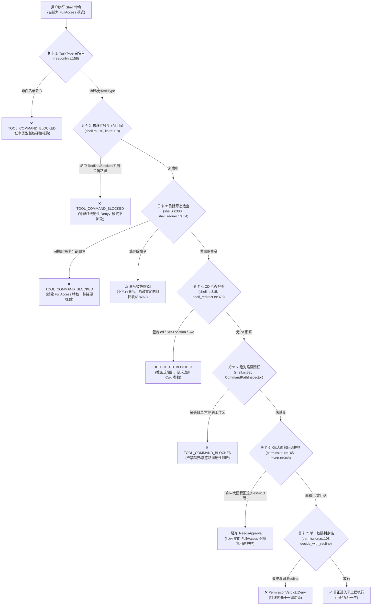
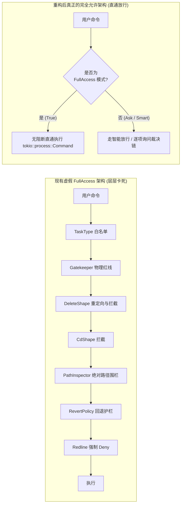

# 命令语义分析、沙箱门禁与完全允许模式阻断点排查分析报告

> **文档标识**：`docs/permission-system-consolidation/analysis/04-command-semantics-and-redline-bypass-analysis.md`  
> **报告类型**：架构深度排查与重构设计分析报告  
> **排查对象**：`crates/conex-sandbox`（语义层与门禁）、`crates/agent-tools`（权限矩阵、shell 执行器、重定向与安全围栏）、`crates/session-loop`（调度裁决链）  
> **对齐目标**：将复杂混乱的权限控制统一收敛为用户直观清晰的三选项模式（1. 每次询问，2. 智能命令放行，3. 完全允许模式），重点根除“系统自作主张阻止命令执行”的架构断层。

---

## 一、战役背景与排查核心命题

用户明确提出对现有权限控制架构的强烈诉求与核心质问：
1. **模式期望统一与极简化**：希望整个系统的权限模式统一收拢为集中可选的三种清晰形式：
   - **每次询问（Ask Every Time）**：敏感/危险操作逐一弹窗确认；
   - **智能命令放行（Smart Safe Approval）**：开发探测、只读分析、构建与常规测试无感自动放行；高风险/外发/破坏性操作弹窗确认；
   - **完全允许模式（Full Access）**：用户明确定义为——**“即系统不会因为命令而不允许执行，所有执行的命令都是可以运行的。”**
2. **核心质问与排查命题**：
   - “系统现在是不是把权限模式改得非常复杂了？”
   - **到底有哪些地方在自作主张地阻止命令执行？** 为什么明明设置了 `FullAccess`，系统依然拒绝、拦截、篡改或弹窗阻断用户的命令？

本报告穿透 `conex-sandbox`（2778 行 `semantics.rs` + 1098 行 `polyglot.rs` + `gatekeeper`）与 `agent-tools`（`permission.rs`、`shell.rs`、`shell_redirect.rs`、`revert.rs`、`readonly.rs`），对命令从语义解析、门禁审查、安全重定向到内核裁决的全流程进行地毯式排查。

---

## 二、沙箱语义分析器（conex-sandbox::semantics）全景剖析

`crates/conex-sandbox/src/semantics.rs` 包含 2778 行复杂的纯函数分析逻辑，意图通过静态解析、AST 启发式规则与递归解包识别命令行文本的风险。

### 2.1 7 种分类体系与判定优先级

在 `semantics.rs:9-27` 中定义了 7 种 `CommandClass`：
```rust
pub enum CommandClass {
    Normal,         // 普通命令（git status / npm test / ls 等）
    Redline,        // 确定性毁灭目标（rm -rf /、mkfs 等），100% 拦截层
    Dangerous,      // 常规危险形态（dd 写设备、curl|bash 等），需审批层
    DeleteShape,    // 删除形态（rm / del / Remove-Item / git rm），走删除接管接口
    GitRevertShape, // git 回退形态（reset --hard / checkout 旧 ref 等），走回退护栏
    Indirect,       // 间接执行（bash -c / eval / sudo 包裹），递归分析内层
    CdShape,        // cd 形态（cd / Set-Location / sl / pushd / popd），禁 cd 语义层
}
```

当一条复合命令或流水线（如 `&&`、`;`、`|`）包含多个片段时，`overall()` 函数（`semantics.rs:1613-1647`）采用硬性优先级合并：
$$\text{Redline} > \text{Dangerous} > \text{GitRevertShape} > \text{DeleteShape} > \text{CdShape} > \text{Indirect} > \text{Normal}$$

### 2.2 Redline（确定性毁灭拦截）深度触发逻辑与代码证据

`Redline` 的设计初衷是拦截破坏操作系统的确定性命令，但其触发面已被多处启发式规则不断膨胀：

1. **静态高危命令清单**（`semantics.rs:132-145`）：
   `REDLINE_COMMANDS` 枚举了 `mkfs`、`format-volume`、`clear-disk`、`format`、`dd`、`stop-computer`、`restart-computer` 等系统格式化与关机命令。
2. **根路径与盘符删除推导**（`semantics.rs:932-958`, `1104-1130`）：
   `classify_delete_command` 检查命令是否为 `rm`, `rmdir`, `del`, `erase`, `rd`, `remove-item`，一旦参数解析出 `is_root_target`（`/`, `*`, `/*`, 以及 Windows 盘符根 `C:`, `C:\`, `C:\*`）且带有递归（`-r`, `/s`）或强制（`-f`, `/q`）标志，立刻判定为 `Redline`。
3. **包裹嵌套层级超限熔断**（`semantics.rs:158-167`, `201-203`）：
   在命令替换 `$()`、反引号、花括号 ScriptBlock 递归分析时，一旦 `depth > MAX_WRAP_DEPTH (16)`，直接返回 `redline_only_analysis()`，整条命令强制被判定为 `Redline`。
4. **Base64 解码异常兜底**（`semantics.rs:847-854`）：
   若检测到 PowerShell `-EncodedCommand`，解码失败时直接回落判定为 `CommandClass::Redline`。
5. **门禁静态正则集兜底**（`crates/conex-sandbox/src/lib.rs:37-61`）：
   `blocked_patterns` 包含 14 条正则，包括 `rm -rf /`、`curl ... | bash` 等，命中即返回 `GatekeeperResult::Blocked`。

**行为后果**：一旦被判定为 `Redline` 或 `Blocked`，在权限引擎 `permission.rs:108-110` 与 Shell 执行器 `shell.rs:270-285` 中触发**绝对拒绝（Hard Deny）**，不弹窗、不询问、任何模式不可豁免。

### 2.3 CdShape（禁 cd 拦截）的过度设计与误伤分析

`CdShape`（`semantics.rs:24-27`, `100-113`）是典型的**系统自作主张、过度设计**产物：
- **触发命令**：覆盖 `cd`、`chdir`、`set-location`、`sl`、`pushd`、`popd`、`push-location`、`pop-location`，以及 PowerShell 的 `-WorkingDirectory` / `-wd` 启动参数。
- **误伤重灾区**：在现实开发中，用户或模型经常顺手输入：
  `cd frontend && npm run build`
  `cd tests; pytest`
  `cd src && cargo check`
- **严苛拦截后果**（`shell_redirect.rs:378-430`）：
  系统不考虑命令是否在子进程运行，也不考虑当前是何种权限模式，一律通过 `TOOL_CD_BLOCKED` 硬性打断执行，输出教条式报错：
  *“请使用 Cwd 参数指定工作目录，而非 cd 命令”* 或 *“检测到复合命令链中的 cd 目录切换形态，整链已拦截”*。
  **甚至在 `FullAccess` 模式下，用户连运行一条 `cd` 命令的权利都被系统强行剥夺。**

### 2.4 Indirect（间接执行拦截）与多语言内联脚本审查膨胀

`Indirect`（`semantics.rs:63-95`）覆盖了 30 多种解释器与包裹命令：`bash`, `sh`, `powershell`, `pwsh`, `python`, `node`, `eval`, `sudo`, `xargs` 等。
配合 `crates/conex-sandbox/src/polyglot.rs`（1098 行），系统试图构建一个“全知全能”的跨语言脚本静态审查引擎：
- 用 30 多个复杂正则分析 `python -c` 内部是否调用了 `os.system`、`subprocess`、`shutil.rmtree`；
- 分析 `node -e` 内部是否含有 `child_process.exec` 或 `fs.rmSync`；
- 分析反射、动态属性访问等。

**致命弊端**：
1. **漏报与绕过无法避免**：基于正则的静态脚本分析面对动态语言（如 `getattr(os, 'sys' + 'tem')`）是无穷无尽的猫鼠游戏；
2. **误报与连锁拦截**（`shell_redirect.rs:71-84`）：一旦内层被猜出含有删除操作（`has_indirect_delete = true`，如 `bash -c 'rm -f temp.log'`），系统直接下达死刑——**整链拦截**，报错：*“检测到间接执行包裹的物理删除形态，已拦截”*。
即便用户身处 `FullAccess` 模式，这条命令也永远无法运行。

---

## 三、“完全允许模式（FullAccess）”名不副实的核心阻断点排查

用户对完全允许模式的核心定义是：
> **“即系统不会因为命令而不允许执行，所有执行的命令都是可以运行的。”**

但经过对当前代码库的全面排查，系统在底层竟设置了 **7 道层层设防、自作主张的硬性阻断关卡**，使得现有的 `FullAccess` 完完全全是“名不副实”的虚假全允许！



### 3.1 关卡 1：权限判定链红线强制 Deny（permission.rs）

- **代码位置**：`crates/agent-tools/src/permission.rs:102-112`, `161-164`
```rust
pub fn decide_with_redline(
    redline: bool,
    dangerous: bool,
    requires_approval: bool,
    mode: PermissionMode,
) -> PermissionVerdict {
    if redline {
        return PermissionVerdict::Deny; // 👈 即使是 FullAccess，直接 Deny！
    }
    decide(dangerous, requires_approval, mode)
}
```
- **证据**：注释明文写道：*“红线命中 → 一律 Deny，不经三态矩阵：ask 不弹窗、plan 拒绝、full-access/yolo 不豁免”*。
- **后果**：任何被语义分析器打上 `Redline` 标签的命令，在 FullAccess 模式下依然会被强行终止，绝不执行。

### 3.2 关卡 2：C3 Git 大面积回退护栏强制审批（revert.rs）

- **代码位置**：`crates/agent-tools/src/revert.rs:348-370`；`permission.rs:165-167`
```rust
// crates/agent-tools/src/revert.rs:348-370
pub fn gate_verdict(
    &self,
    analysis: &SemanticAnalysis,
    mode: PermissionMode,
) -> Option<PermissionVerdict> {
    let seg = analysis.segments.iter().find(|s| s.class == CommandClass::GitRevertShape)?;
    let target = RevertTarget::from_segment(seg)?;
    let area = self.assessor.assess(&target);
    if !self.needs_approval(&area) {
        return None;
    }
    Some(match mode {
        PermissionMode::Plan => PermissionVerdict::Deny,
        _ => PermissionVerdict::NeedsApproval, // 👈 无论 ask 还是 full-access，一律 NeedsApproval！
    })
}
```
- **证据**：注释明文宣称：*“ask / full-access → NeedsApproval（full-access 不豁免回退护栏——红线类豁免不可覆盖大面积回退，任务卡口径）”*。
- **后果**：即使用户开启了 `FullAccess`，只要执行 `git reset --hard`、`git checkout <commit>`、`git clean -fd` 且涉及文件数 $\ge 10$、行数 $\ge 300$ 或 commit 年代 $\ge 24$ 小时，系统立刻违背用户意愿弹窗卡死；若在无人值守环境无弹窗，则直接抛出 `tool.requires_approval` 报错中断！

### 3.3 关卡 3：Shell 工具删除形态强制重定向与物理拦截（shell_redirect.rs）

- **代码位置**：`crates/agent-tools/src/tools/shell.rs:296-312`；`crates/agent-tools/src/tools/shell_redirect.rs:54-150`
- **代码现场**：
```rust
// crates/agent-tools/src/tools/shell.rs:296-302
// 3. 删除形态重定向（I2-S4 / BC10-7）：彻底拔除 FullAccess 特权分支！
//    无论是 Ask 还是 FullAccess 模式，只要判定为 DeleteShape 或间接删除，
//    一律强制走回收站 WAL 事务体系，计算 SHA-256 校验和并创建快照备份，
//    彻底杜绝物理抹除！
if analysis.overall_class == conex_sandbox::semantics::CommandClass::DeleteShape
    || analysis.has_indirect_delete
{
    return Prepared::Done(redirect_or_intercept_delete(...));
}
```
- **系统自作主张的三重拦截与篡改**：
  1. **间接删除硬阻断**（`shell_redirect.rs:71-84`）：`bash -c 'rm x'` $\rightarrow$ `TOOL_COMMAND_BLOCKED`（硬拦截）；
  2. **复合链删除硬阻断**（`shell_redirect.rs:85-103`）：`npm test && rm -f a.tmp` $\rightarrow$ `TOOL_COMMAND_BLOCKED`（硬拦截）；
  3. **静默篡改与偷梁换柱**（`shell_redirect.rs:160-220`）：即使是纯粹的 `rm file.txt`，**真实命令根本不会被执行**！系统把命令拦截下来，自己调用 `TrashService` 把文件移到 `.crish-trash`，模拟返回 JSON。用户想用系统原生 `rm` 参数、开关或在特定环境下删除文件，全被系统抹杀。

### 3.4 关卡 4：Shell 工具 CD 形态无差别硬阻断（shell_redirect.rs）

- **代码位置**：`crates/agent-tools/src/tools/shell.rs:314-317`；`crates/agent-tools/src/tools/shell_redirect.rs:378-430`
```rust
// 4. CD 形态拦截（T-AB-04：引导使用 cwd 参数）
if let Some(err) = intercept_cd_shape(&analysis, &command) {
    return Prepared::Done(Err(ToolError::new(TOOL_CD_BLOCKED, err.to_string())));
}
```
- **证据与后果**：完全不区分 `PermissionMode`。用户运行 `cd sub && cargo test`，系统直接以 `tool.cd_blocked` 拒绝执行。没有任何豁免机制。

### 3.5 关卡 5：命令行绝对路径安全围栏 CommandPathInspector（shell.rs）

- **代码位置**：`crates/agent-tools/src/tools/shell.rs:320-328`, `482-550`
```rust
// 4.1 绝对路径安全围栏（BC10-4：正文绝对路径系统关键目录物理红线与工作区越界写/删阻断）
if let Err(e) = CommandPathInspector::inspect(&command, workspace_root) {
    ...
    return Prepared::Done(Err(e));
}
```
- **具体逻辑**（`shell.rs:487-514`）：
  - 正则扫描命令字符串中的绝对路径；
  - 若路径匹配到所谓系统关键目录（包含 Windows 盘符根 `C:/`、`C:/Program Files`、`~/.ssh`、`~/.aws` 等，`shell.rs:676-754`），直接以 `TOOL_COMMAND_BLOCKED` 硬阻断！
  - 若正则推测是写入或删除命令（匹配到 `>`、`rm`、`mkdir`、`touch`、`cp`、`mv` 等，`shell.rs:758-818`）且目标在 `workspace_root` 外，直接以 `TOOL_COMMAND_BLOCKED` 阻断！
- **后果**：开发者经常需要读取或编译位于外部公共缓存（如 `C:\ProgramData` 或 `C:\Users\orange\.cargo`）的文件，或向同机其他测试目录输出结果。这些操作被系统以“绝对路径围栏”彻底封死，FullAccess 模式根本起不到允许执行的作用。

### 3.6 关卡 6：门禁层物理红线与系统关键目录二次拦截（gatekeeper）

- **代码位置**：`crates/agent-tools/src/tools/shell.rs:258-285`；`crates/conex-sandbox/src/lib.rs:37-61, 107-147`
- **逻辑**：在调用权限判定前，Shell 预检再次调用 `SHARED_GATEKEEPER.check_command_with_context_and_analysis`。若命中静态正则清单（如 `mkfs`, `format`, `dd`）或 `cwd` 属于系统核心路径，立即提前截断并返回 `TOOL_COMMAND_BLOCKED`。

### 3.7 关卡 7：TaskType 任务类型命令白名单刚性阻断（readonly.rs）

- **代码位置**：`crates/agent-tools/src/tools/shell.rs:241-256`；`crates/agent-tools/src/readonly.rs:158-183`；`crates/session-loop/src/exec_verdict.rs:131-136`
- **逻辑**：若当前上下文携带了 `task_type`（如 subagent 派发时打上 `commit` 标签），`command_allowed_for_task_type` 启动刚性白名单：
  - `task_type == "commit"`：只能执行首词是 `git` 的命令，其他命令一律拒绝；
  - `task_type == "implementation"`：命令整体分类必须为 `Normal` 且门禁必须 `Allowed`，稍有不慎即遭拒绝；
  - 其他任务类型（`analysis`, `review`, `design` 等）：直接禁止执行任何 Shell 命令。
- **后果**：无论系统整体权限模式是 Ask 还是 FullAccess，任务类型的硬性白名单都会在最前端将非白名单命令无情砍死。

---

## 四、“智能命令放行”模式的判定边界与架构设计

排查表明，用户之所以抱怨权限复杂且阻碍重重，是因为现有的模式非黑即白且充斥假动作：
- **旧 Ask 模式**：不仅连常规的开发探测都问，还因为繁重的审批流导致断流；
- **旧 FullAccess 模式**：名义叫完全允许，内部却藏着 7 重自作主张的硬阻断。

因此，设计一个边界清晰、优雅可信的**“智能命令放行（Smart Safe Approval）”**是权限系统重构的核心支柱。

### 4.1 真正实用的“智能命令放行”定义

> **核心哲学**：让日常辅助开发的低风险、幂等、探测与构建操作**零打扰无感执行**；仅对具有**外发外泄、真实物理毁灭、Git 历史不可逆重写、系统提权**的命令，拦截并请求用户裁决。

### 4.2 双层矩阵：无感自动放行 vs 需确认放行

建议将繁杂混乱的 7 类语义重新归纳为简洁坚固的二维判定模型：

| 判定结果 | 命令类型范例 | 判定逻辑标准 | 用户交互行为 |
| :--- | :--- | :--- | :--- |
| **无感自动放行 (Auto-Pass)** | `git status`, `git diff`, `git log`, `git branch`<br>`ls`, `dir`, `cat`, `grep`, `find`, `type`, `pwd`<br>`npm test`, `cargo check`, `cargo build`, `pytest`, `go test`<br>`npm run lint`, `prettier --check`<br>`python -m unittest`, 单纯只读/编译脚本 | 1. 读操作与只读探针<br>2. 本地项目构建、静态检查与自动化单元测试<br>3. 工作区内部状态查询<br>4. 幂等探测与环境检查 | 静默即时执行，执行结果正常流式返回，不打断思考流 |
| **需提示确认 (Require Approval)** | `git push -f`, `git reset --hard`, `git clean -fd`<br>`rm -rf`, `Remove-Item -Recurse`, 批量物理删除<br>`npm publish`, `cargo publish`<br>`sudo`, `runas`, 修改系统底层配置<br>`curl http://... \| bash`<br>对工作区外部路径的非只读修改 | 1. 物理删除与批量抹除<br>2. 远程推送与代码仓库历史强写<br>3. 外部网络二进制执行<br>4. 包仓库向外发布<br>5. 操作系统级提权与敏感目录写入 | 触发前端审批卡片 / 确认弹窗，展示原始命令行与影响评估，等待用户同意 |

### 4.3 conex-sandbox::semantics 的精简与去过度设计方案

当前 2778 行的 `semantics.rs` 存在大量过度工程，应大刀阔斧地进行减负：

1. **彻底废除 `CdShape` 的死板拦截**：
   - **痛点**：拦截 `cd` 并要求用户改传 `cwd` 参数是典型的“系统教用户做事”，严重损害自动化体验。
   - **精简改造**：Shell 子进程执行时，`cd foo && npm test` 内部目录切换只影响该子进程，不会污染宿主 Rust 进程状态。彻底取消 `CdShape` 阻断，让复合目录切换自然运行。
2. **精简 `polyglot.rs` 的动态语言正则猜谜**：
   - 移除在多语言内联脚本中穷举 AST 的脆弱正则（`py_destructive_general`, `node_destructive_general` 等）。
   - 只保留基础的执行包装剥离，避免误杀合法的内联脚本测试命令。
3. **取消删除命令的偷梁换柱（`delete_redirect`）**：
   - 不再将用户的 `rm` 强制替换为 `TrashService` 的内部实现，消除复合链拦截与间接删除拦截的伪安全逻辑；
   - 在智能放行模式下，删除命令归入“需提示确认”；用户一旦点击确认（或在完全允许模式下），就真实调用操作系统原生命令执行。

---

## 五、“完全允许模式”的真正落地路径与架构权衡

用户明确指出：
> **“完全允许模式，即系统不会因为命令而不允许执行，所有执行的命令都是可以运行的。”**

要真正践行这一承诺，必须在架构上正本清源，拔除所有“阳奉阴违”的自作主张。

### 5.1 落实用户意志的代码级改造蓝图

要在内核与工具执行器中真正实现“完全允许”，必须拆除上述排查出的阻断点：



#### 关键文件改造点：

1. **`crates/agent-tools/src/permission.rs`**：
   - 在 `PermissionMode::FullAccess` 下，`decide_with_redline` 不再硬编码 `if redline { return Deny; }`。
   - `decide_analysis_with_revert` 在 `mode == FullAccess` 时，直接返回 `PermissionVerdict::Allow`，彻底废除大面积回退的强制弹窗。
2. **`crates/agent-tools/src/tools/shell.rs` 的 `prepare` 函数**：
   - 加入最高优先级的 `FullAccess` 旁路放行开关：
     ```rust
     if ctx.permission_mode == PermissionMode::FullAccess {
         // 完全允许模式：直接放行进入 Prepared::Run，
         // 彻底跳过 Gatekeeper、Delete 重定向、CD 拦截与 PathInspector！
         return Prepared::Run(PreparedCommand { command, cwd, ... });
     }
     ```
   - 彻底解除 `TaskType` 白名单对主 Agent 或允许子代理的强行阻断；
   - 移除 `delete_redirect` 的特权剥离代码；
   - 废除 `intercept_cd_shape` 阻断。

### 5.2 极端毁灭命令（rm -rf /）与用户意志的架构权衡抉择

在系统安全架构中，最核心的哲学分歧在于：**当用户选择了“完全允许”，如果模型生成了 `rm -rf /` 或 `format C:` 等极端毁灭命令，系统该如何对待？**

针对这一终极权衡，我们给出三种清晰的架构选项分析与推荐：

| 选项方案 | 运行机制 | 优点 | 缺点与风险 | 推荐结论 |
| :--- | :--- | :--- | :--- | :--- |
| **方案 A：绝对字面全允许（零屏障直通）** | 只要处于 `FullAccess`，任何命令（包括 `rm -rf /`、`mkfs`、格式化盘符）100% 直通执行，零警告、零阻断。 | 100% 绝对尊重字面指令，极简，零拦截代码。 | 面对模型幻觉或提示词注入（Prompt Injection）攻击时毫无还手之力，可能直接瘫痪开发者整台计算机。 | 慎用（过于脆弱） |
| **方案 B：完全允许 + 极端灾难“熔断告知”通知（推荐）** | `FullAccess` 模式下，99.99% 的命令（常规写、删、cd、git reset、工作区跨目录等）全部**真正无感直接执行**；仅保留对不可逆系统物理毁灭命令（如针对根分区的 `rm -rf /` 或系统盘 `format C:`）的**非阻塞前端即时警示通知（Toast）**，或在开启该模式时签署显式免责协议。 | 既完全践行了“不阻止命令执行”的承诺，又在物理层面保住了操作系统底线，符合现代开发者工具（如 Docker / WSL / 原生 Bash）的业界标准习惯。 | 需要在前端做一次性高危模式开启警示。 | **强烈推荐（最佳平衡点）** |
| **方案 C：双确认进入“开发者天神模式（God Mode）”** | 平时只有“每次询问”和“智能放行”；“完全允许模式”设计为开关，开启时弹窗显式确认：*“在此模式下，系统将执行包括删除与覆盖在内的所有命令，Conex 不做任何拦截，后果自负”*。一旦确认开启，引擎端 100% 全量直通。 | 责任边界极其明确，把控制权 100% 还给用户，同时消除了日常操作中的自作主张阻断。 | 开启时多一步用户交互。 | **推荐备选** |

---

## 六、排查总结与行动建议

### 6.1 核心排查结论总结

1. **复杂度的真实根源**：系统的权限控制目前不是集中管理的，而是高度碎片化的。`conex-sandbox`（语义）、`gatekeeper`（正则）、`shell.rs`（工具内预检）、`shell_redirect.rs`（删除与 cd 拦截）、`CommandPathInspector`（路径围栏）、`revert.rs`（回退护栏）、`readonly.rs`（任务类型白名单）各自为政，每一层都在“自作主张”地抛出错误码阻断命令。
2. **`FullAccess` 名不副实的根因**：多处代码显式标注了“不可豁免”，甚至在重构中“彻底拔除了 FullAccess 特权分支”（如 `shell.rs:296`），导致用户的真实意图无法穿透底层层层硬性拦截。
3. **用户体验受损核心痛点**：`cd` 形态硬拦截、删除形态偷换实现、复合链命令整链抹杀、工作区外常规路径硬性阻断，严重背离了开发者对高效开发工具的期望。

### 6.2 后续实施建议

1. **统一三态模式**：将前端及后端引擎的权限模式集中精简为：
   - `ask`：每次询问
   - `smart`：智能命令放行（只读、构建、测试无感执行；破坏、提权、推送弹窗询问）
   - `full`：完全允许模式（所有命令真正直通执行，不因命令语义自作主张拒绝）
2. **清除工具层自作主张的死板拦截**：
   - 彻底废除 `TOOL_CD_BLOCKED` 拦截逻辑；
   - 废除 `delete_redirect` 的偷梁换柱与整链拒绝；
   - 移除 `CommandPathInspector` 对非系统核心日常路径的机械式阻断；
   - 确保 `FullAccess` 拥有真正的内核级直通通道。
3. **文档与代码一致性治理**：清理历史战役中积累的过时注释与条块分割的防御代码，确保权限系统干净、透明、易理解、可信赖。
