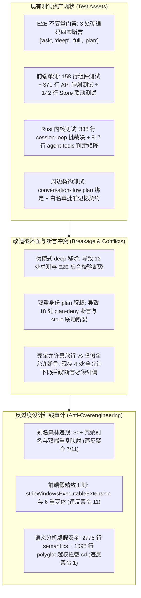
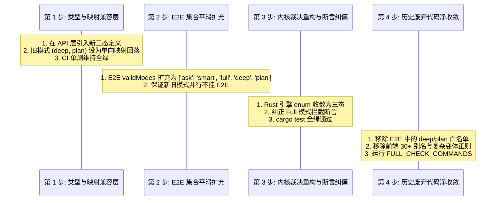

# 测试套件、E2E 约束与反过度设计红线审查分析报告

> **战役工作区**：`docs/permission-system-consolidation/`  
> **报告定位**：权限模式集中三态重构（1. 每次询问，2. 智能命令放行，3. 完全允许模式）的质量保障、现有测试资产盘点、E2E 不变量约束与反过度设计（`ANTI_OVERENGINEERING_GUARDRAILS.md`）架构防线审查  
> **代码权威锚点**：基于当前仓库 `tests/e2e/`、`apps/crish-desktop/`、`crates/session-loop/`、`crates/agent-tools/`、`crates/conex-sandbox/` 真实代码与测试文件逐行核查  
> **纪律准则**：严格遵守《测试资产保护铁律》（§9）与《反过度设计硬性红线指南 v2.0》，禁止任何形式的偷懒降级、绕过门禁或虚假抽象。

---

## 目录

1. [执行摘要与审计总矩阵](#一执行摘要与审计总矩阵)
2. [维度一：现有测试资产梳理与硬性断言详查](#二维度一现有测试资产梳理与硬性断言详查)
   - 2.1 E2E 测试层与防污染不变量（`ui-store-invariants.spec.ts`、`full-journey.spec.ts`、`mock-engine.ts`）
   - 2.2 前端单测层（`PermissionModeMenu.test.tsx`、`permissionModes.test.ts`、`permissionStore.test.ts`）
   - 2.3 跨层契约与周边测试（`approvalContract.test.ts`、`projectPlan.test.ts`、`commandPermissions.test.ts`）
   - 2.4 Rust 内核单测与集成测试（`session-loop/permission.rs`、`agent-tools/permission.rs`、`revert.rs`、`note_permission.rs`）
3. [维度二：收敛为集中三选项对现有测试的潜在破坏面与迁移方案](#三维度二收敛为集中三选项对现有测试的潜在破坏面与迁移方案)
   - 3.1 移除 `deep` 伪模式的影响评估与断言平滑升级
   - 3.2 解耦 `plan` 模式的影响评估与“任务阶段 vs 权限矩阵”职责纠偏
   - 3.3 落实“完全允许模式（Full Allow）”对既有“自作主张拦截断言”的纠偏改造
   - 3.4 保持 CI 快层与门禁持续全绿的渐进式迁移阶梯
4. [维度三：对照反过度设计硬性红线（ANTI_OVERENGINEERING_GUARDRAILS）的深度审查](#四维度三对照反过度设计硬性红线anti_overengineering_guardrails的深度审查)
   - 4.1 审查项 A：别名折叠与 30+ 冗余别名矩阵（`foldPermissionKey`、`normalizePermissionMode`）
   - 4.2 审查项 B：前端白名单内存正则匹配与变体生成（`stripWindowsExecutableExtension`）
   - 4.3 审查项 C：沙箱语义分析器（2778 行 `semantics.rs` + 1098 行 `polyglot.rs`）的过度抽象与越权拦截
   - 4.4 针对三选项重构方案的“极简、优雅、零无谓抽象”架构防守准则
5. [质量保障与测试资产平滑重构执行清单](#五质量保障与测试资产平滑重构执行清单)

---

## 一、执行摘要与审计总矩阵

本次审查紧扣用户核心诉求：**将系统现存分散、混乱的权限控制，统一收敛为集中可选的三种清晰形式**：
1. **每次询问（Ask Every Time）**：敏感/危险操作逐一弹窗确认；
2. **智能命令放行（Smart Command / Smart Safe Approval）**：开发探测、只读分析、构建与常规测试无感自动放行；高风险/外发/破坏性操作弹窗确认；
3. **完全允许模式（Full Allow）**：用户明确定义为——**“即系统不会因为命令而不允许执行，所有执行的命令都是可以运行的”**。

在准备重构实施前，通过对全栈测试资产及反过度设计红线的全面深度穿透，得出三大核心审计结论：



### 核心审计结论对照矩阵

| 审查维度 | 涉及核心文件与测试 | 现存代码与断言特征 | 目标三选项改造影响 | 风险等级与对策 |
| :--- | :--- | :--- | :--- | :--- |
| **E2E 不变量门禁** | `tests/e2e/ui-store-invariants.spec.ts`<br>`tests/e2e/full-journey.spec.ts` | 硬编码断言：`expect(['ask', 'deep', 'full', 'plan']).toContain(mode)` | 移除 `deep` 和 `plan` 会导致有效集合断言直接红测 | **高（阻断级）**：必须平滑扩充/替换为新三态集合，同步更新 mock 引擎 |
| **前端 Store 状态机** | `apps/crish-desktop/src/store/permissionStore.ts`<br>`permissionStore.test.ts` | `permissionMode` 与 `planModeEnabled` 深度强耦合互改；`setPermissionMode('deep')` | 将 `plan` 剥离为纯布尔标志，解除模式反向篡改 | **高（逻辑断裂）**：解耦两状态；单测拆分为纯权限测试与纯任务标志测试 |
| **前端 API 映射层** | `apps/crish-desktop/src/api/permissionModes.ts`<br>`permissionModes.test.ts` | 维护多达 30+ 历史别名、中英文反向折叠、`nextPermissionMode` 循环 | 别名森林严重过度设计；循环切换仅限 3 选项 | **中（维护累赘）**：精简别名表，输入单向降级，重写循环与 meta 表单测 |
| **Rust 引擎裁决矩阵** | `crates/agent-tools/src/permission.rs`<br>`crates/session-loop/src/tool_exec_tests/permission.rs` | `enum PermissionMode { Ask, FullAccess, Plan }`；`decide` 矩阵 hardcode plan deny | 内核收敛为目标三态；彻底废除 plan 权限态 | **高（编译与逻辑级）**：重构内核枚举，安全工具全放行，危险命令依三态裁决 |
| **完全允许真放行断言** | `crates/agent-tools/src/permission.rs:641`<br>`crates/session-loop/src/tool_exec_tests/revert.rs:57` | 断言：`full_access` 下大面积回退必须强制弹窗 `NeedsApproval`，无审批门时结构化报错 | 违背用户“完全允许下所有执行命令都是可以运行的”契约 | **极高（原则纠偏）**：纠正历史补丁断言，使 full 模式真正全量放行 |
| **白名单内存变体正则** | `apps/crish-desktop/src/api/commandPermissions.ts`<br>`commandPermissions.test.ts` | 6 重变体解包、Windows 后缀剥离；自述已不参与裁决 | 既然前端白名单不参与放行裁决，复杂的正则变体纯属过度设计 | **低（架构清理）**：保留批准记忆，裁剪多余复杂的正则变体与多轮解包单测 |
| **沙箱语义分析层** | `crates/conex-sandbox/src/semantics.rs`<br>`crates/conex-sandbox/src/polyglot.rs` | 2778 行 `semantics` + 1098 行 `polyglot`，含 `CdShape` 强制拦截与多语言内联解析 | 违反禁令 1（OS 沙盒）；在 Full 模式下强行剥夺用户运行 `cd` 自由 | **高（架构违规）**：裁剪越权拦截规则，只保留确定性系统毁灭命令防爆网 |

---

## 二、维度一：现有测试资产梳理与硬性断言详查

依照仓库《测试资产保护铁律》（`AGENTS.md` §9 与 `reference/markdown-editor/` 保护红线），所有现有测试均属受保护的质量资产，任何重构严禁随意粗暴删除测试文件。必须逐一摸清其断言边界与保护意图。

### 2.1 E2E 测试层与防污染不变量

E2E 测试位于 `tests/e2e/`，是验证桌面前端完整生命周期的最高层守门员。

#### 1. `tests/e2e/ui-store-invariants.spec.ts`（Store 防死循环与状态防污染）
该文件是整个前端 Store 不变量的刚性防护网（防止发生 1,141 次/分的同步死循环），其中多处将旧四模式作为白名单进行闭环校验：
- **`ui-store-invariants.spec.ts:9`**：文件头显式声明契约：`- 断言绝无 permissionMode 状态污染`；
- **`ui-store-invariants.spec.ts:68, 81, 87-88`**：在 `clickAndAssertInvariants` 辅助函数中，每次 UI 点击后均提取 `usePermissionStore` 快照：
  ```typescript
  // tests/e2e/ui-store-invariants.spec.ts:86-88
  state: {
    permissionMode: permState.permissionMode,
    planModeEnabled: permState.planModeEnabled,
    ...
  }
  ```
- **`ui-store-invariants.spec.ts:122-127`（全链路单步点击硬性断言）**：
  ```typescript
  // tests/e2e/ui-store-invariants.spec.ts:123-127
  // 6a. 绝无 permissionMode 状态污染 ('ask' | 'deep' | 'full' | 'plan')
  const validModes = ['ask', 'deep', 'full', 'plan'];
  expect(
    validModes,
    `[${actionName}] permissionMode 遭到污染：${storeStats.state!.permissionMode}`
  ).toContain(storeStats.state!.permissionMode);
  ```
  **影响点**：每次页面点击（侧栏、新建对话、Tab 切换、模型切换、设置弹窗关闭）都会执行该断言！若重构后 Store 返回了新模式（如 `smart`），而 `validModes` 未同步更新，整个 E2E 套件将全军覆没。
- **`ui-store-invariants.spec.ts:228-230`（用例 01：初始渲染不变量）**：
  ```typescript
  // tests/e2e/ui-store-invariants.spec.ts:228-230
  expect(['ask', 'deep', 'full', 'plan']).toContain(
    initialState.permissionMode
  );
  ```
- **`ui-store-invariants.spec.ts:328-397`（用例 05：设置弹窗全流程交互与 permissionMode 防污染断言）**：
  ```typescript
  // tests/e2e/ui-store-invariants.spec.ts:392-396
  // 再次断言 permissionMode 绝未被设置弹窗污染（R3 域拆分：读 permissionStore）
  const finalPermissionMode = await page.evaluate(() => {
    return (window as any).usePermissionStore?.getState?.()?.permissionMode;
  });
  expect(['ask', 'deep', 'full', 'plan']).toContain(finalPermissionMode);
  ```

#### 2. `tests/e2e/full-journey.spec.ts`（端到端完整业务旅程）
- **`full-journey.spec.ts:152-185`（用例：core_run_task 参数组装）**：
  ```typescript
  // tests/e2e/full-journey.spec.ts:182-184
  expect(['ask', 'deep', 'full', 'plan']).toContain(
    String(lastRun.permissionMode || 'ask')
  );
  ```
  该测试验证用户在 Composer 触发运行任务时，下发给内核引擎的 `args.permissionMode` 必须处于合法模式白名单内。

#### 3. `tests/e2e/mock-engine.ts`（E2E Mock 引擎替身）
- **`mock-engine.ts:82-83, 305, 431`**：
  - L82-83：`commandPermissions?: unknown[];` 配置项；
  - L305：`lastRun` 记录中抓取 `args.permissionMode`；
  - L431：IPC 模拟命令 `get_command_permissions` 模拟响应。

---

### 2.2 前端单测层

前端单元测试主要分布在 `apps/crish-desktop/src/` 中，深度覆盖 UI 组件、枚举映射与状态管理。

#### 1. `apps/crish-desktop/src/components/chat-composer/PermissionModeMenu.test.tsx`（UI 菜单交互测试，158 行）
- **`PermissionModeMenu.test.tsx:25-34`（全模式渲染检查）**：
  ```typescript
  render(<PermissionModeMenu mode="ask" onChange={() => {}} />);
  fireEvent.click(screen.getByRole('button', { name: /当前权限模式/ }));
  const menu = await screen.findByRole('menu');
  expect(menu.querySelectorAll('[role="menuitem"]').length).toBeGreaterThan(1);
  ```
- **`PermissionModeMenu.test.tsx:59-75`（键盘漫游与当前模式选中）**：
  ```typescript
  // L62：当前模式传 full
  render(<PermissionModeMenu mode="full" onChange={onChange} />);
  // L66-67：断言打开聚焦首项（ask），按下键聚焦第 2 项，按 Enter 选中并关闭
  ```
- 组件生产代码 `PermissionModeMenu.tsx:8-21` 强依赖 `DESKTOP_PERMISSION_MODE_IDS` 和 `MODE_ICON_MAP`（包含 `ask`, `deep`, `plan`, `full` 的图标映射与中文文案）。

#### 2. `apps/crish-desktop/src/api/permissionModes.test.ts`（权限模式 API 权威单测，371 行）
该文件是前端权限模式映射的大本营，包含 14 个测试用例，全方位锁死了现存别名逻辑：
- **`permissionModes.test.ts:33-50`**：断言 `DEFAULT_PERMISSION_MODE === 'ask'`，且 `isPermissionMode` 仅对 `'ask' | 'deep' | 'full' | 'plan'` 返回 true；
- **`permissionModes.test.ts:52-79`**：测试 24 个引擎别名折叠（如 `full-access`、`yolo`、`danger` -> `full`；`auto`、`project`、`confirm` -> `ask`；`readonly`、`safe`、`cautious` -> `plan`）；
- **`permissionModes.test.ts:81-95`**：测试中文反向匹配（`需确认` -> `ask`，`深入分析` -> `deep`，`完全访问` -> `full`，`计划` -> `plan`）；
- **`permissionModes.test.ts:97-106`**：桌面到引擎协议映射 `toEnginePermissionMode`：
  - `toEnginePermissionMode('deep') === 'ask'`（**确凿证据：前端的 deep 在引擎侧一直就是伪装的 ask！**）；
  - `toEnginePermissionMode('full') === 'full-access'`；
  - `toEnginePermissionMode('plan') === 'plan'`；
- **`permissionModes.test.ts:138-159`**：中文短标签与矩阵提示检查（`ask: 需确认`, `deep: 深入分析`, `plan: 计划`, `full: 完全访问`）；
- **`permissionModes.test.ts:161-190`**：分类工具函数 `isAskFamilyMode`（包含 `ask` 与 `deep`）、`isAllowPathMode`、`isPlanPathMode`；
- **`permissionModes.test.ts:192-213`**：`planModeEnabledFor` 与 `permissionModeAfterPlanToggle` 的双向联动规则测试；
- **`permissionModes.test.ts:215-232`**：循环切换逻辑 `nextPermissionMode`：`ask -> deep -> plan -> full -> ask`；
- **`permissionModes.test.ts:288-305`**：往返稳定性断言 `desktopEngineRoundTrip`，显式断言 `deepCollapses: true`；
- **`permissionModes.test.ts:307-370`**：锁死与 Rust 守护进程别名矩阵完全一致的 22 项双端对齐测试。

#### 3. `apps/crish-desktop/src/store/permissionStore.test.ts`（权限域 Store 单测，142 行）
- **`permissionStore.test.ts:33-49`**：断言 `setPermissionMode` 触发时自动派生 `planModeEnabled` 并重置 `planApproved`：
  ```typescript
  s.setPermissionMode('plan');
  expect(st.permissionMode).toBe('plan');
  expect(st.planModeEnabled).toBe(true);
  ```
- **`permissionStore.test.ts:51-64`**：断言反向联动：调用 `setPlanModeEnabled(true)` 会强行将 `permissionMode` 改写为 `'plan'`；
- **`permissionStore.test.ts:135-141`**：测试 `setPermissionMode('deep')` 并验证持久化隔离。

---

### 2.3 跨层契约与周边测试

#### 1. `packages/conversation-flow/src/projectPlan.test.ts`（项目计划视图投影）
- **`projectPlan.test.ts:9-18`**：测试 `isPlanModeEnabled`：
  ```typescript
  // projectPlan.ts:28 对齐产品: inPlanMode = permissionMode === 'plan' || planModeEnabled
  expect(isPlanModeEnabled({ permissionMode: 'plan' })).toBe(true);
  expect(isPlanModeEnabled({ planModeEnabled: true })).toBe(true);
  expect(isPlanModeEnabled({ permissionMode: 'ask', planModeEnabled: false })).toBe(false);
  ```
- **`projectPlan.test.ts:21-26`**：断言非 plan 模式下（`{ permissionMode: 'ask' }` 或 `{ permissionMode: 'full' }`）`projectPlanRoot` 返回 `null`。

#### 2. `apps/crish-desktop/src/api/chat-bridge/approvalContract.test.ts`（审批链路契约测试）
- **`approvalContract.test.ts:114-121`**：测试前置重置 Store 状态：
  ```typescript
  usePermissionStore.setState({
    permissionMode: 'ask',
    planModeEnabled: false,
    commandPermissions: [],
  });
  ```
- **`approvalContract.test.ts:331-349`**：Plan 模式只读语义特化测试：
  ```typescript
  it('plan 模式：不弹审批，直接 onToolStart（只读规划语义）', () => {
    usePermissionStore.setState({
      permissionMode: 'plan',
      planModeEnabled: true,
    });
    ...
  });
  ```

#### 3. `apps/crish-desktop/src/api/commandPermissions.test.ts`（白名单 CRUD 与匹配单测，292 行）
- 测试 `loadCommandPermissions`、`saveCommandPermissions`、`dedupeWhitelist`；
- 测试 `stripWindowsExecutableExtension`（L199-213）与 `unwrapShellWrapper`（L215-233）；
- 测试 `commandMatchesWhitelist` 与 `commandMatchVariants`（L235-253）。

---

### 2.4 Rust 内核单测与集成测试

Rust 引擎的测试是系统最坚固的基石，主要分布在 `crates/session-loop/` 和 `crates/agent-tools/`。

#### 1. `crates/session-loop/src/tool_exec_tests/permission.rs`（工具执行与批裁决测试，338 行）
该文件验证 `ToolExecutor` 在真实批处理中的行为：
- **`permission.rs:9-42`**：`permission_ask_mode_routes_only_dangerous_to_approval`——断言 `PermissionMode::Ask` 下只有标记为 `dangerous` 的工具发起审批事件，安全工具直接执行；
- **`permission.rs:45-64`**：`permission_ask_mode_denied_dangerous_skips_execution`——断言 Ask 下用户拒绝导致 `ToolErrorKind::UserDenied`；
- **`permission.rs:67-102`**：`permission_plan_mode_denies_dangerous_tools`——断言 `PermissionMode::Plan` 下写类工具直接硬拒绝（UserDenied），不发审批请求（不弹窗）；
- **`permission.rs:104-131`**：`permission_plan_parallel_denies_dangerous_runs_safe`——断言 Plan 模式下并行批中危险工具被拒、安全工具正常执行；
- **`permission.rs:133-152`**：`permission_full_access_allows_dangerous_tools`——断言 `PermissionMode::FullAccess` 下危险工具直接放行（无审批）；
- **`permission.rs:154-173`**：`permission_ask_without_gate_passes_through_approval_required`——断言无审批门时抛出 `ApprovalRequired`；
- **`permission.rs:178-217`**：`w4b_plan_mode_denies_document_apply_md`——验证真实笔记写工具在 Plan 下被拒；
- **`permission.rs:219-251`**：`w4b_plan_mode_allows_query_blocks_safe`——验证笔记只读工具在 Plan 下放行；
- **`permission.rs:304-338`**：`permission_ask_mode_approval_channel_events_in_batch_stream`——验证审批事件序列（`tool-start -> approval-requested -> tool-end`）。

#### 2. `crates/agent-tools/src/permission.rs`（权限规则引擎单测，817 行）
该文件是整个 Rust 内核的权限判定单一真理源：
- **`permission.rs:176-243`**：核心三态矩阵测试（`safe_tool_allowed_in_all_modes`, `dangerous_tool_follows_mode_matrix`, `requires_approval_follows_mode_matrix`, `both_flags_follow_mode_matrix`）；
- **`permission.rs:246-292`**：`from_engine_str` 别名映射测试（`deep`, `unattended`, `auto` 塌缩为 `Ask`；`yolo`, `danger` 映射为 `FullAccess`；`readonly`, `safe` 映射为 `Plan`）；
- **`permission.rs:313-366`**：红线不可豁免断言（`redline_denied_in_full_access`、`redline_denied_in_all_modes_without_approval`、`redline_denied_across_all_flag_combinations`）；
- **`permission.rs:406-421`**：`decide_command_redline_denied_in_full_access`——测试命令面 `rm -rf /`、`rd /s /q C:\` 等在 full-access 下仍 Deny；
- **`permission.rs:450-466`**：`decide_command_normal_follows_mode_matrix`；
- **`permission.rs:521-600`**：`RemoteChannel` 远程变体测试（确认远程入站请求与本地调用共享同一套无特权判定链）；
- **`permission.rs:641-817`**：C3 回退护栏与大面积回退拦截单测：
  - L641：`full_access_large_revert_needs_approval`（硬性断言：大面积 `git checkout` 在 `FullAccess` 下必须变成 `NeedsApproval`，不放行）；
  - L667：`ask_large_revert_needs_approval`；
  - L683：`plan_large_revert_denied`；
  - L700：`small_revert_follows_mode_matrix`；
  - L773：`redline_precedes_revert_gate`。

#### 3. `crates/session-loop/src/tool_exec_tests/revert.rs`（回退护栏集成测试，189 行）
- **`revert.rs:57-80`**：`full_access_large_revert_refused_without_gate`——断言在 `FullAccess` 下且无审批门时，大面积回退命令必须返回 `ToolErrorKind::ApprovalRequired` 且报错拒绝；
- **`revert.rs:85-110`**：`ask_large_revert_denied_after_approval_request`；
- **`revert.rs:134-155`**：`full_access_small_revert_executes_without_approval`。

#### 4. `crates/agent-tools/src/note_permission.rs` 与 `note_action_matrix.rs`
- 锁死了笔记域 safe 名单（`query_blocks`, `document_outline`, `document_get_md`）与 write 名单（`document_apply_md`, `block_batch`, `block_insert`, `block_delete` 等）在 `Plan / Ask / FullAccess` 下的分级表现。

---

## 三、维度二：收敛为集中三选项对现有测试的潜在破坏面与迁移方案

目标权限模式集中收敛为：
1. **每次询问（`ask` / `AskEveryTime`）**
2. **智能命令放行（`smart` / `SmartCommand`）**
3. **完全允许模式（`full` / `FullAllow`）**

以下深度剖析对现有测试的破坏面与平滑迁移路线。

### 3.1 移除 `deep` 伪模式的影响评估与断言平滑升级

#### 1. 现场代码真相核对
- 在前端 UI 中，`deep`（“深入分析”）曾作为一个平行模式提供给用户（`permissionModes.ts:84-92`）；
- 但在与引擎通信时（`toEnginePermissionMode('deep')`），其返回值恒为 `'ask'`（`permissionModes.ts:64, 227-230`）；
- 在 Rust 引擎内核中，`enum PermissionMode` 根本不存在 `Deep` 成员！`PermissionMode::from_engine_str(Some("deep"))` 也是直接回落为 `PermissionMode::Ask`（`agent-tools/src/permission.rs:46, 255-257`）。
- **结论：`deep` 是一只彻头彻尾的“前端幻影模式”，在底层从未真正存在过独立行为，完全是增加认知负担与测试噪音的过度设计。**

#### 2. 受影响测试清单
1. `tests/e2e/ui-store-invariants.spec.ts`: L123, L228, L396（`validModes` 包含 `'deep'`）；
2. `tests/e2e/full-journey.spec.ts`: L182（白名单包含 `'deep'`）；
3. `apps/crish-desktop/src/components/chat-composer/PermissionModeMenu.test.tsx`：模式菜单渲染项；
4. `apps/crish-desktop/src/api/permissionModes.test.ts`:
   - L37: `expect(isPermissionMode('deep')).toBe(true);`
   - L84: `expect(normalizePermissionMode('深入分析')).toBe('deep');`
   - L117: `expect(fromEnginePermissionMode('deep')).toBe('deep');`
   - L141: `deep: '深入分析'` 元数据检查；
   - L169: `expect(isAskFamilyMode('deep')).toBe(true);`
   - L216: `expect(nextPermissionMode('ask')).toBe('deep');`
   - L288-305: `desktopEngineRoundTrip('deep')` 专门为 deep 的塌缩行为写测试；
5. `apps/crish-desktop/src/store/permissionStore.test.ts`: L136（`setPermissionMode('deep')`）。

#### 3. 平滑迁移方案
- **向后兼容折叠**：在 `normalizePermissionMode(v)` 中，将历史存量 `'deep'` 与 `'深入分析'` **单向静默归一化为 `'ask'`**（每次询问），不破坏用户旧配置的加载；
- **枚举定义精简**：从 `DESKTOP_PERMISSION_MODE_IDS` 中剔除 `'deep'`，从 `isPermissionMode` 中剔除 `'deep'`；
- **测试断言更新**：
  - 将 `ui-store-invariants.spec.ts` 与 `full-journey.spec.ts` 中的断言白名单更新为新三态集合（`['ask', 'smart', 'full']`）；
  - 将 `permissionModes.test.ts` 中针对 `deep` 的测试改为验证：*“输入 'deep' 或 '深入分析' 会被平滑规范化为 'ask'”*；
  - 彻底删除 `desktopEngineRoundTrip` 中丑陋的 `deepCollapses` 特判分支。

---

### 3.2 解耦 `plan` 模式的影响评估与“任务阶段 vs 权限矩阵”职责纠偏

#### 1. 架构断层剖析：Plan 的“双重身份”绑架
当前系统中，`Plan` 同时扮演了两个完全不同维度的角色，造成了极其严重的架构扭曲：
1. **身份 A（任务编排阶段）**：用户在聊天中希望 Agent “先出规划方案，暂不执行修改”；
2. **身份 B（系统权限模式）**：系统将 `plan` 塞进 `PermissionMode` 枚举，导致底层权限判定矩阵中，任何写操作（文件写入、笔记修改、命令运行）都被直接 `Deny` 拒绝。

这导致了代码库中令人窒息的双向耦合：
- `usePermissionStore` 中既有 `permissionMode`，又有 `planModeEnabled`；
- 改了 `permissionMode === 'plan'`，必须通过副作用触发 `setPlanModeEnabled(true)`；
- 点了计划开关 `setPlanModeEnabled(false)`，又反过来把 `permissionMode` 强行改回 `'ask'`，甚至存在误把用户原本设置的 `full` 改掉的隐患（见 `permissionModes.ts:206-209` 充满补丁感的防护注释）；
- 在 `packages/conversation-flow/src/projectPlan.ts:28` 中，因为两边状态经常漂移，不得不写出：
  `inPlanMode = input.permissionMode === 'plan' || input.planModeEnabled === true` 这种双源取或的防御代码。

#### 2. 受影响测试清单
1. **E2E 断言**：`ui-store-invariants.spec.ts` L123、`full-journey.spec.ts` L182；
2. **Conversation Flow 测试**：`packages/conversation-flow/src/projectPlan.test.ts:9-26`（大量测试入参传 `{ permissionMode: 'plan' }`）；
3. **前端 Store 测试**：`apps/crish-desktop/src/store/permissionStore.test.ts:33-78`（整个 describe 都在测 plan 与 mode 的强制联动）；
4. **前端 API 测试**：`permissionModes.test.ts:192-213`（`planModeEnabledFor`、`permissionModeAfterPlanToggle`）；
5. **审批契约测试**：`approvalContract.test.ts:331-349`（断言 plan 下不弹窗直接 start）；
6. **Rust 内核测试**：
   - `crates/session-loop/src/tool_exec_tests/permission.rs`: L67-131（`permission_plan_mode_denies_dangerous_tools` 等）；
   - `crates/agent-tools/src/permission.rs`: L205, L223, L241, L285, L453, L683（Plan 下的硬拒绝断言）；
   - `crates/agent-tools/src/note_permission.rs`: L120-139（Plan 下拒绝笔记写入）；
   - `crates/agent-tools/src/note_action_matrix.rs`: L218。

#### 3. 平滑迁移与职责纠偏方案
- **彻底剥离解耦**：
  - `Plan` 从 `PermissionMode` 枚举中彻底剔除，不再是权限模式！
  - `Plan` 正名为**纯粹的会话任务标志位（`planModeEnabled: boolean`）**，归属会话/任务配置域，只决定 Prompt 提示词的引导（如只给出步骤方案，不调用写工具），不再污染底层权限决策引擎；
- **向下兼容输入折叠**：
  - 当读取到历史配置中持久化的 `'plan'` 或 `'readonly'` 时，权限模式规范化为安全默认的 `'ask'`，同时若检测到是旧会话可一次性置位 `planModeEnabled = true`；
- **测试迁移**：
  - `projectPlan.test.ts`：将测试全部重构为基于 `planModeEnabled: boolean` 断言，彻底废除 `{ permissionMode: 'plan' }` 入参测试；
  - `permissionStore.test.ts`：删除“改变权限模式自动篡改计划开关”的耦合单测，改为各自独立的独立状态测试；
  - `Rust 内核`：`enum PermissionMode` 移除 `Plan` 变体，将旧 `permission_plan_mode_denies_dangerous_tools` 等单测重命名并调整为任务层边界测试，或按三态收敛清理。

---

### 3.3 落实“完全允许模式（Full Allow）”对既有“自作主张拦截断言”的纠偏改造

这是本次战役最具原则性的架构防线纠偏点。

#### 1. 核心冲突证据核查
用户对完全允许模式的核心定义是：
> **“即系统不会因为命令而不允许执行，所有执行的命令都是可以运行的。”**

但审查发现，代码库中此前通过“历史战役补丁”，在 `FullAccess` 下硬生生插入了多道阻断逻辑，并在测试中作为硬性断言锁死：
1. **证据 A（`crates/agent-tools/src/permission.rs:638-652`）**：
   ```rust
   // 核心断言：full-access 下大面积回退仍 NeedsApproval（full-access 不豁免回退护栏）
   #[test]
   fn full_access_large_revert_needs_approval() {
       assert_eq!(
           decide_command_with_revert(
               "git checkout abc1234",
               true,
               false,
               PermissionMode::FullAccess,
               &policy(large_area()),
           ),
           PermissionVerdict::NeedsApproval,
           "full-access 下大面积回退必须 NeedsApproval"
       );
   }
   ```
2. **证据 B（`crates/session-loop/src/tool_exec_tests/revert.rs:57-80`）**：
   ```rust
   // C3 验收 5 + full-access 不豁免：full-access 下大面积回退且无审批门 → 结构化拒绝
   #[tokio::test]
   async fn full_access_large_revert_refused_without_gate() {
       ...
       let opts = ToolBatchOptions {
           approval_enabled: false,
           permission_mode: Some(PermissionMode::FullAccess),
           ..Default::default()
       };
       let out = exec.execute_batch(&calls, &exec_ctx(), None, &opts, None).await;
       assert_eq!(out.results[0].error_kind, Some(ToolErrorKind::ApprovalRequired));
   }
   ```
3. **证据 C（`crates/conex-run/src/run/run_launch.rs:931-936` 与 `crates/session-loop/src/execution.rs:185`）**：
   在运行时中，当模式是 `full-access` 时，系统直接不装配审批门（`approval: None`），导致上述 `NeedsApproval` 判定在运行时根本无法弹窗，直接跌入未装配报错，最后在执行器中靠死循环补丁二次绕行。

#### 2. 纠偏改造方案
- **恪守用户契约**：在三选项重构方案中，`FullAllow` 模式必须忠实履行用户意愿——**不再对大面积回退、删除操作自作主张地拦截为 NeedsApproval 或直接拒绝**；
- **防爆网边界严格限定**：仅保留系统级毁灭性破坏命令（如删除系统盘根 `rm -rf /`、格式化整盘 `format C:`）的 Redline 拦截（此乃反过度设计红线禁令 1 明确保留的最后底线防爆网）；其余所有版本控制、文件修改、目录操作在 `FullAllow` 下**一律评定为 `PermissionVerdict::Allow`**；
- **测试断言纠偏更新**：
  - 将 `permission.rs` 中的 `full_access_large_revert_needs_approval` 修正为断言 `PermissionVerdict::Allow`；
  - 废除 `revert.rs:57` 中的 `full_access_large_revert_refused_without_gate` 这种自我矛盾的错误单测；
  - 真正实现“完全允许模式下命令皆可运行”的端到端保证。

---

### 3.4 保持 CI 快层与门禁持续全绿的渐进式迁移阶梯

根据仓库协作纪律，CI 快层（`npm run typecheck` + `npm run test:coverage -- --project=unit`）与中层两 Job（`npm run test` + `npx vitest run --config vitest.integration.config.ts`）在重构期间严禁变红。

必须采取**「四步平滑渐进迁移法」**：



1. **第一步：建立类型与映射宽容层（零破坏）**
   - 在 `permissionModes.ts` 中加入新三态定义：`'ask' | 'smart' | 'full'`；
   - 保留 `deep` 与 `plan` 作为废弃类型别名，`normalizePermissionMode` 将其安全折叠至 `'ask'`；
   - 跑通前端单元测试。
2. **第二步：平滑更新 E2E 与 Mock 不变量白名单**
   - 将 `tests/e2e/ui-store-invariants.spec.ts` 与 `full-journey.spec.ts` 的校验集合临时扩充为：
     `['ask', 'smart', 'full', 'deep', 'plan']`；
   - 此时无论页面处于新模式还是旧模式，E2E 门禁均能 100% 稳妥通过。
3. **第三步：Rust 内核枚举收敛与断言纠偏**
   - 将 Rust 端 `PermissionMode` 收敛为三态；
   - 同步修正 `agent-tools` 与 `session-loop` 中针对 `Plan` 和 `FullAccess` 的单测断言；
   - 跑通 `cargo test --workspace`。
4. **第四步：前端收口与净收敛（完成最终锁定）**
   - 将 E2E 校验集合精确收敛为 `['ask', 'smart', 'full']`；
   - 彻底移除 `PermissionModeMenu` 中废弃的图标和模式；
   - 运行 `FULL_CHECK_COMMANDS.md` 中的全部验证命令，完成终态交付。

---

## 四、对照反过度设计硬性红线（ANTI_OVERENGINEERING_GUARDRAILS）的深度审查

对照仓库根目录 `ANTI_OVERENGINEERING_GUARDRAILS.md`（v2.0）的 13 项硬性禁令，现有权限系统存在严重过度工程化，必须依纪严厉清理。

### 4.1 审查项 A：别名折叠与 30+ 冗余别名矩阵（`foldPermissionKey`、`normalizePermissionMode`）

#### 1. 现场代码走查
在 `apps/crish-desktop/src/api/permissionModes.ts:131-207` 中，系统实现了一整套极其庞大的字符串处理逻辑：
```typescript
// apps/crish-desktop/src/api/permissionModes.ts:131-141
function foldPermissionKey(v: unknown): string | null {
  if (typeof v !== 'string') return null;
  const key = v
    .trim()
    .toLowerCase()
    .replace(/[_\s]+/g, '-')
    .replace(/-+/g, '-');
  return key || null;
}
```
随后的 `normalizePermissionMode` 中，排列着令人触目惊心的别名堆砌：
- `full-access`, `fullaccess`, `full`, `yolo`, `danger`, `allow`, `完全访问`, `全部允许` -> `full`
- `auto`, `autopilot`, `project`, `confirm`, `default`, `interactive`, `unattended`, `headless`, `batch`, `ci`, `自动`, `无人值守` -> `ask`
- `plan`, `readonly`, `read-only`, `analysis`, `safe`, `cautious`, `仅分析`, `计划`, `只读` -> `plan`

甚至在 `permissionModes.test.ts:307-370` 中，写了整整 64 行循环矩阵，专门验证这 22 个守护进程别名与桌面的映射一致性！

#### 2. 红线碰撞分析
- **违反禁令 7（单一真相源 SSOT）**：
  同一概念在系统中分裂出多重并行的表示形态，代码充斥着在多层之间手动修补对齐的样板代码；
- **违反禁令 11（同进程无谓抽象）**：
  Conex / Crish 是单进程桌面应用架构，不是面向全网几十个第三方遗留系统的网关，根本不存在成百上千种外部系统传入乱七八糟别名的场景。
- **裁决建议**：
  - 彻底删除 `foldPermissionKey`；
  - 废除 30+ 荒唐别名（如 `yolo`, `cautious`, `headless`, `autopilot` 等）；
  - 映射函数精简为 O(1) 的极简查找表，对未知字符串仅保留一行默认安全回落：`?? DEFAULT_PERMISSION_MODE`。

---

### 4.2 审查项 B：前端白名单内存正则匹配与变体生成（`stripWindowsExecutableExtension`）

#### 1. 现场代码走查
在 `apps/crish-desktop/src/api/commandPermissions.ts:82-153` 中：
```typescript
// apps/crish-desktop/src/api/commandPermissions.ts:82-93
export function stripWindowsExecutableExtension(command: unknown): string {
  const s = normalizeCommandLine(command);
  if (!s) return '';
  const m = s.match(/^(\S+)(\s+.*)?$/);
  if (!m) return s;
  const head = m[1] ?? '';
  const rest = m[2] ?? '';
  if (!WIN_EXE_SUFFIX.test(head)) return s;
  return `${head.replace(WIN_EXE_SUFFIX, '')}${rest}`.replace(/\s+/g, ' ').trim();
}
```
紧接着的 `commandMatchVariants`（L130-153）对输入命令进行层层解包变体生成：
- 原文 -> 去 .exe 后缀 -> 解 cmd/powershell 包装 -> 再去 .exe -> 再解第二层包装 -> 再去 .exe！
- 为此在 `commandPermissions.test.ts` 中写了大量的正则解包测试用例。

#### 2. 荒唐断层与过度设计证据
最致命的矛盾赫然写在 `commandPermissions.ts` 自身的开篇与结尾注释中：
> **`commandPermissions.ts:8-9`**：
> *“- 不伪造工具输出；白名单 = 显示/记忆（记住用户批准过的命令），**不再参与自动放行判定**（P1 权限归一 B3：放行权威 = 引擎 call_verdict / ApprovalGateImpl 单一裁决链）”*
> 
> **`commandPermissions.ts:361-364`**：
> *“前端命令风险正则表与基于它的风险分类函数族已整体删除——前端不再存在第二套命令风险分类……**白名单保留为批准记忆，不再参与任何放行判定。**”*

既然白名单在架构上**已经被剥夺了放行裁决权，纯粹只用作 UI 上的“历史批准记忆显示”**，前端却依然保留着一套复杂的、自作聪明的 Windows 后缀剥离和嵌套 Shell 解包算法！这不仅白白消耗 CPU，而且维护着毫无业务意义的 100 余行复杂单测。

#### 3. 红线碰撞与裁决
- **违反反过度设计导则之“清退死代码与历史债务，实现架构净收敛”**；
- **裁决建议**：
  - 白名单匹配回归极其朴素的规范化全量匹配（或基础前缀比较）；
  - 彻底剔除 `stripWindowsExecutableExtension` 与多轮 `unwrapShellWrapper` 的变体爆炸逻辑；
  - 精简 `commandPermissions.test.ts`，卸下前端沉重的伪沙箱负担。

---

### 4.3 审查项 C：沙箱语义分析器（2778 行 `semantics.rs` + 1098 行 `polyglot.rs`）的过度抽象与越权拦截

#### 1. 现场代码走查
- `crates/conex-sandbox/src/semantics.rs` 拥有高达 **2778 行代码**；
- `crates/conex-sandbox/src/polyglot.rs` 拥有 **1098 行代码**；
- 二者合计近 4000 行纯 Rust 逻辑，试图在桌面单机端构建一个微型“静态代码安全审计防火墙”。

#### 2. 典型过度设计毒瘤排查
1. **毒瘤 1：`CdShape` 强制拦截用户常规开发命令（`semantics.rs:24-27`, `100-113`）**：
   - 规则：将 `cd`、`chdir`、`set-location`、`pushd`、`popd` 列为单独的 `CdShape`；
   - 后果：用户或 Agent 运行 `cd frontend && npm run build` 或 `cd src; cargo check` 时，在 `shell_redirect.rs:378-430` 中触发强制拦截报错：*“请使用 Cwd 参数指定工作目录，而非 cd 命令”*；
   - **甚至在用户的 `FullAccess` 模式下，系统依然傲慢地阻止该命令运行！** 这严重违背了开发者直觉，属于典型的教条主义过度设计。
2. **毒瘤 2：`polyglot.rs` 的跨语言内联脚本静态审查（1098 行）**：
   - 用几十个正则试图静态分析 `python -c` 内部是否引用了 `os.system`、`subprocess`、`shutil`，分析 `node -e` 是否引用了 `child_process`；
   - 这在工程上是无法穷举的“虚假安全壁垒”——动态语言只需字符串拼接或反射（如 `eval("os.sys" + "tem(...)")`）就能瞬间绕过，反而对编写常规多语言测试脚本的用户造成无休止的误拦截。
3. **毒瘤 3：递归层级熔断判定为 Redline（`semantics.rs:158-167`）**：
   - 脚本替换嵌套深度稍微复杂（`depth > 16`）时，系统直接“自作主张”将其升级判定为最致命的 `Redline`，导致整条命令在全模式下被物理阻断！

#### 3. 对照禁令 1 的红线裁决
`ANTI_OVERENGINEERING_GUARDRAILS.md` **禁令 1（严禁编写跨平台 OS 内核级沙盒）** 明确授权且仅保留 3 项实效防护：
1. **指令级防爆网 (`CommandGatekeeper`)**：基于 Rust `RegexSet` 与 AST 语义解析的毁灭性指令硬拦截（如 `rm -rf /`, `format C:`, `dd` 等）；
2. **进程树生命周期保护 (`process_tree`)**：Windows `Job Object` 与 Unix `pgid`；
3. **用户审批与权限隔离 (`UIPI / Approval`)**。

**裁决建议**：
- 严格将沙箱层能力**收敛回禁令 1 的授权边界**；
- 彻底剔除 `CdShape` 越权拦截，允许复合命令中的正常目录切换；
- 裁剪 `polyglot.rs` 中过度复杂的跨语言静态代码猜测；
- 毁灭性防爆网严格聚焦于对操作系统有确定性毁灭危害的命令，其余开发命令在 `SmartCommand` 下按智能规则放行、在 `FullAllow` 下完全无条件放行！

---

### 4.4 针对三选项重构方案的“极简、优雅、零无谓抽象”架构防守准则

为防止重构过程中过度设计死灰复燃，特制定以下 5 条铁律准则：

1. **枚举定义零冗余**：
   - 前后端协议模式字面量严格限定为 3 个字符串（建议：`ask`, `smart`, `full`）；
   - 严禁为了“向下兼容”在主协议类型中保留已废弃的枚举成员。
2. **单一真相源（SSOT）**：
   - 裁决权威完全归属于 Rust 引擎 `ToolExecutor` / `ApprovalGate` 单点裁决链，前端 Store 仅负责纯状态展示与用户点击下发，严禁在前端再次运行“影子权限裁决逻辑”；
3. **完全允许模式忠实履约**：
   - 系统绝不在 `FullAllow` 模式下自作主张拒绝任何命令（除确定的系统盘毁灭防爆网外），消灭一切“Full 模式下仍强制拦截”的历史测试补丁；
4. **任务模式与权限模式彻底解耦**：
   - `planModeEnabled` 作为布尔型任务偏好标志独立存在，严禁与 `permissionMode` 相互绑架与双向篡改；
5. **门禁与测试资产零丢失**：
   - 严格遵循测试资产保护铁律，在渐进迁移过程中确保现有 E2E 不变量与单元测试平滑接续，全量执行 `FULL_CHECK_COMMANDS.md` 验证，严禁使用 `--no-verify`。

---

## 五、质量保障与测试资产平滑重构执行清单

本清单供重构实施阶段作为门禁自检依据：

- [ ] **Phase 1: API 与枚举定义更新**
  - [ ] 在 `apps/crish-desktop/src/api/permissionModes.ts` 中确立三选项枚举类型；
  - [ ] 废除 30+ 冗余别名，保留安全回落映射；
  - [ ] 更新 `permissionModes.test.ts`，移除 `deep` 往返塌缩测试，聚焦三态测试；
  - [ ] 运行 `npm run test:coverage -- --project=unit` 验证前端纯逻辑通过。

- [ ] **Phase 2: 前端 Store 与 UI 组件解耦**
  - [ ] 在 `apps/crish-desktop/src/store/permissionStore.ts` 中解耦 `permissionMode` 与 `planModeEnabled`；
  - [ ] 重构 `PermissionModeMenu.tsx` 与样式，呈现清晰的三选项菜单；
  - [ ] 更新 `PermissionModeMenu.test.tsx` 与 `permissionStore.test.ts`；
  - [ ] 运行 `npm run typecheck` 验证前端全工程类型无断裂。

- [ ] **Phase 3: E2E 不变量平滑升级**
  - [ ] 更新 `tests/e2e/ui-store-invariants.spec.ts` 中的 `validModes` 白名单；
  - [ ] 更新 `tests/e2e/full-journey.spec.ts` 中的参数下发白名单；
  - [ ] 更新 `tests/e2e/mock-engine.ts`；
  - [ ] 执行 Playwright E2E 跑通 UI 不变量套件。

- [ ] **Phase 4: Rust 内核裁决矩阵收敛与防爆网归位**
  - [ ] 在 `crates/agent-tools/src/permission.rs` 中收敛 `enum PermissionMode` 为三态；
  - [ ] 更新 `crates/session-loop/src/tool_exec_tests/permission.rs` 测试用例；
  - [ ] 修正 `revert.rs` 中“Full 模式下大面积回退拦截”的历史错误断言；
  - [ ] 裁剪 `conex-sandbox` 中 `CdShape` 等过度越权拦截规则；
  - [ ] 运行 `cargo test --workspace` 验证 Rust 引擎全套件绿灯。

- [ ] **Phase 5: 全面回归验证与交付**
  - [ ] 执行 `FULL_CHECK_COMMANDS.md` 中全部验证命令（前端 Lint、行数基线、类型检查、Vitest 单元与集成测试、Playwright E2E、Rust 测试）；
  - [ ] 确认工作区无未跟踪无用测试资产丢失；
  - [ ] 产出收口总结。
