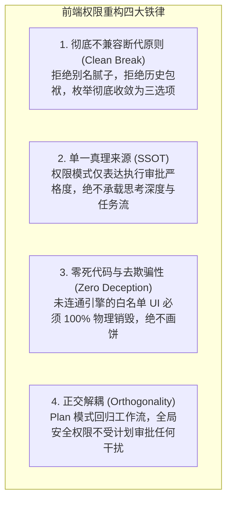
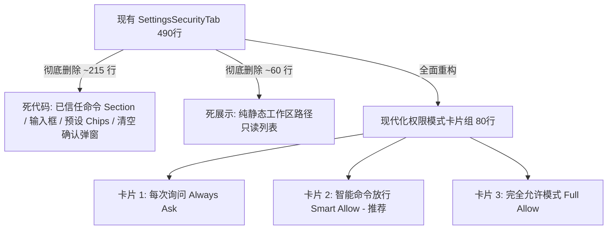

# 前端 UI 与交互体验重构详案：权限体系三选项收敛与架构治理

> **战役工作区**：`docs/permission-system-consolidation/`  
> **方案定位**：独立落地实施详案（前端 UI 与交互呈现分维）  
> **设计基准**：严格贯彻“不允许打补丁、不允许硬编码、系统性重构、一次性解决、彻底不兼容断代”的最高指示  
> **核心对象**：`PermissionModeMenu.tsx`、`ComposerPermissionBar.tsx`、`SettingsSecurityTab.tsx`、`PlanApprovalRow.tsx`、`permissionModes.ts`

---

## 一、重构纲领与设计哲学

本方案严格对齐前期现状深度剖析报告（[`01-frontend-ui-and-ux-analysis.md`](../analysis/01-frontend-ui-and-ux-analysis.md)），旨在彻底根除前端 UI 与交互层面的三大沉疴：
1. **假档位欺骗（`deep` 伪模式）**：对外宣称深度分析，对内偷换为 `ask`，破坏用户安全心理模型；
2. **假白名单欺骗（虚假批准记忆）**：在设置页和审批条构造增删查改与预设芯片，底层引擎却零读取零生效；
3. **安全模式绑架工作流（Plan 强降级）**：将任务规划阶段强行塞入权限枚举，用户批准计划时暴力将全局权限降级为 `ask`。

### 1.1 四大硬性重构铁律



- **铁律 1：彻底不兼容断代原则（Clean Break）**：坚决不保留 `deep`，不保留 20 余个奇形怪状的别名（`yolo` / `danger` / `headless` / `ci`）。前端权限类型收敛为纯粹的 `ask | smart | full`。
- **铁律 2：单一真理来源（SSOT）**：权限模式（`PermissionMode`）仅对“Agent 执行操作时的拦截策略”负责。它不是 Prompt 深度开关，也不是任务阶段。
- **铁律 3：零死代码与去欺骗性（Zero Deception）**：彻底物理删除设置页内 200 余行命令白名单编辑、清空确认弹窗、预设 Chip，以及浮动审批条的“始终允许”死按钮。不再向用户提供毫无后端支撑的虚假控制面。
- **铁律 4：正交解耦（Orthogonality）**：Plan 模式是任务执行的生命周期阶段，绝不修改用户的全局安全权限。点击“批准此计划”只推进任务阶段，严禁降级用户的权限模式。

---

## 二、三选项模型规范与核心元数据设计

### 2.1 模式枚举与语义矩阵

系统统一收敛为以下 3 个标准权限模式：

| 模式 ID | 显示标签（中文 / 英文） | 短标签 | 专属图标（`AppIcon`） | 推荐等级 | 核心安全语义与行为边界 |
| :--- | :--- | :--- | :--- | :--- | :--- |
| **`ask`** | **每次询问**<br>`Always Ask` | 每次询问 | `shield` | 严格防护 | **零自动放行**：文件创建/编辑、Git 提交/推送、任何终端命令均弹窗等待确认。 |
| **`smart`** | **智能命令放行**<br>`Smart Allow` | 智能放行 | `shield-check` | **⭐ 推荐默认** | **安全与只读命令自动放行**：`git status`、`git diff`、`ls` 等安全只读操作自动执行；写文件、敏感操作弹窗确认。 |
| **`full`** | **完全允许模式**<br>`Full Allow` | 完全放行 | `zap` | 高效极客 | **系统不主动拦截**：所有正常命令与写操作全自动执行，零打扰极速交付（仅内核硬红线 Redline 保底阻断）。 |

### 2.2 视觉规范与设计系统 Token

为确保在暗色/明色主题下的精致视觉体验，遵循仓库设计规范：
- **禁用粗实黑线与厚重投影**：激活态轮廓混合度控制在 5%~10% 以内；
- **图标尺寸**：药丸按钮为 14px，菜单与卡片项为 16px 或 20px 统一规格；
- **主题强调色映射**：
  - `ask`：中性次级灰色 `var(--text-secondary)`；
  - `smart`：翡翠绿 `var(--color-primary-base, #10b981)` 或品牌主色；
  - `full`：高效琥珀色 `var(--color-warning-base, #f59e0b)`。

### 2.3 `api/permissionModes.ts` 纯净重构规范

彻底重写 `apps/crish-desktop/src/api/permissionModes.ts`，从原 399 行复杂别名映射瘦身为纯粹的契约定义：

```typescript
/**
 * 权限模式（桌面 UI ↔ 引擎 permissionMode 统一契约）
 * 严格收敛为三选项：ask (每次询问) | smart (智能放行) | full (完全允许)
 */

export type PermissionMode = 'ask' | 'smart' | 'full';

export interface PermissionModeMeta {
  id: PermissionMode;
  label: string;
  shortLabel: string;
  description: string;
  iconName: 'shield' | 'shield-check' | 'zap';
  accent: string;
  isRecommended?: boolean;
}

export const PERMISSION_MODE_STORAGE_KEY = 'crish_permission_mode';
export const DEFAULT_PERMISSION_MODE: PermissionMode = 'smart';

export const PERMISSION_MODE_IDS: readonly PermissionMode[] = ['ask', 'smart', 'full'] as const;

export const PERMISSION_MODES: readonly PermissionModeMeta[] = [
  {
    id: 'ask',
    label: '每次询问',
    shortLabel: '每次询问',
    description: '执行任何修改或命令均会询问确认',
    iconName: 'shield',
    accent: 'var(--text-secondary)',
  },
  {
    id: 'smart',
    label: '智能命令放行',
    shortLabel: '智能放行',
    description: '安全与只读命令自动放行，敏感操作询问',
    iconName: 'shield-check',
    accent: 'var(--color-primary-base, #10b981)',
    isRecommended: true,
  },
  {
    id: 'full',
    label: '完全允许模式',
    shortLabel: '完全放行',
    description: '所有命令与修改自动运行，零打扰执行',
    iconName: 'zap',
    accent: 'var(--color-warning-base, #f59e0b)',
  },
] as const;

const META_MAP = new Map<PermissionMode, PermissionModeMeta>(
  PERMISSION_MODES.map((m) => [m.id, m]),
);

export function isPermissionMode(v: unknown): v is PermissionMode {
  return v === 'ask' || v === 'smart' || v === 'full';
}

/** 规范化输入：非法或未知值一律回落至推荐默认 smart */
export function coercePermissionMode(v: unknown): PermissionMode {
  if (isPermissionMode(v)) return v;
  // 仅保留最基础的旧枚举平滑回落，不搞过度别名
  if (v === 'deep') return 'ask';
  if (v === 'plan') return 'smart';
  return DEFAULT_PERMISSION_MODE;
}

export function permissionModeMeta(mode: unknown): PermissionModeMeta {
  const m = coercePermissionMode(mode);
  return META_MAP.get(m)!;
}

export function loadStoredPermissionMode(): PermissionMode {
  if (typeof localStorage === 'undefined') return DEFAULT_PERMISSION_MODE;
  try {
    const raw = localStorage.getItem(PERMISSION_MODE_STORAGE_KEY);
    return coercePermissionMode(raw);
  } catch {
    return DEFAULT_PERMISSION_MODE;
  }
}

export function persistPermissionMode(mode: PermissionMode): void {
  if (typeof localStorage === 'undefined') return;
  try {
    localStorage.setItem(PERMISSION_MODE_STORAGE_KEY, mode);
  } catch {
    // 忽略存储受限异常
  }
}
```

---

## 三、Chat Composer UI 交互重构实现方案

### 3.1 `PermissionModeMenu.tsx` 药丸控件重构

#### 1. 存在问题治理
- 彻底剔除 `hideChevron`、`variant="fused"`、`iconOnly` 等在生产中已完全死掉的参数与分支；
- 统一使用 `<AppIcon name={meta.iconName} size={14} />`；
- 药丸始终保持 28px 高度、14px 端点圆角，背景保持克制浅灰透明过渡；
- 悬停提示 Tooltip 严格反映所选模式的实际防护范围。

#### 2. 重构后组件接口与实现结构

```tsx
// apps/crish-desktop/src/components/chat-composer/PermissionModeMenu.tsx
import React, { useCallback, useRef, useState } from 'react';
import styles from './PermissionModeMenu.module.css';
import { Button, Menu, Tooltip } from '../ui';
import { toggleExclusiveMenu } from '../ui/Menu';
import { useI18n } from '../../i18n';
import {
  PERMISSION_MODES,
  PERMISSION_MODE_IDS,
  coercePermissionMode,
  permissionModeMeta,
  type PermissionMode,
} from '../../api/permissionModes';
import { AppIcon } from '../ui/icons/index';

export interface PermissionModeMenuProps {
  mode: PermissionMode;
  onChange: (m: PermissionMode) => void;
}

export const PermissionModeMenu: React.FC<PermissionModeMenuProps> = ({
  mode: modeRaw,
  onChange,
}) => {
  const { t } = useI18n();
  const mode = coercePermissionMode(modeRaw);
  const meta = permissionModeMeta(mode);
  const [open, setOpen] = useState(false);
  const pillBtnRef = useRef<HTMLButtonElement>(null);

  const selectMode = useCallback(
    (next: PermissionMode) => {
      if (next !== mode) {
        onChange(next);
      }
      setOpen(false);
    },
    [mode, onChange]
  );

  const handleToggle = useCallback(() => {
    toggleExclusiveMenu(open, setOpen, pillBtnRef.current);
  }, [open]);

  const options = PERMISSION_MODE_IDS.map((m) => ({
    id: m,
    label: permissionModeMeta(m).label,
    onClick: () => selectMode(m),
  }));

  const tooltipContent = t('chat.permission.tooltip', {
    mode: meta.label,
    desc: meta.description,
  });

  return (
    <div className={styles.permModeWrap}>
      <Tooltip content={tooltipContent} disabled={open} side="top">
        <Button
          ref={pillBtnRef}
          type="button"
          variant="ghost"
          className={`${styles.permPill} ${open ? styles.isOpen : ''}`}
          data-perm-mode={mode}
          onClick={handleToggle}
          aria-expanded={open}
          aria-haspopup="menu"
          aria-label={t('chat.permission.ariaLabel', { mode: meta.label })}
        >
          <span className={styles.permIcon} aria-hidden="true">
            <AppIcon name={meta.iconName} size={14} />
          </span>
          <span className={styles.permLabel}>{meta.shortLabel}</span>
          <AppIcon
            name="chevron-down"
            size={11}
            className={styles.permPillChev}
            aria-hidden="true"
          />
        </Button>
      </Tooltip>

      {open && (
        <Menu
          openState={{
            open,
            onOpenChange: (nextOpen) => {
              if (!nextOpen) setOpen(false);
            },
          }}
          anchor={pillBtnRef}
          options={options}
          position={{ side: 'top', align: 'start', sideOffset: 6 }}
          panel={{ contentClassName: styles.permMenu }}
          renderItem={(opt) => {
            const itemMeta = permissionModeMeta(opt.id);
            const isSelected = opt.id === mode;
            return (
              <Button
                key={opt.id}
                bare
                type="button"
                className={`${styles.permMenuItem} ${isSelected ? styles.isSelected : ''}`}
                role="menuitem"
                onClick={opt.onClick}
              >
                <span className={styles.iconWrapper} aria-hidden="true">
                  <AppIcon name={itemMeta.iconName} size={16} />
                </span>
                <div className={styles.labelCol}>
                  <div className={styles.titleRow}>
                    <span className={styles.title}>{itemMeta.label}</span>
                    {itemMeta.isRecommended && (
                      <span className={styles.recommendBadge}>推荐</span>
                    )}
                  </div>
                  <span className={styles.itemDesc}>{itemMeta.description}</span>
                </div>
                {isSelected && (
                  <AppIcon
                    name="check"
                    size={14}
                    className={styles.checkIcon}
                    aria-hidden="true"
                  />
                )}
              </Button>
            );
          }}
        />
      )}
    </div>
  );
};
```

### 3.2 样式重构 `PermissionModeMenu.module.css`（清洗冗余类）

彻底清退历史遗留的重复类名选择器（`.item`, `.itemIcon`, `.itemText`, `.itemLabel`, `.check`）与未使用的 `.fused`、`.iconOnly` 样式：

```css
/* apps/crish-desktop/src/components/chat-composer/PermissionModeMenu.module.css */
.permModeWrap {
  position: relative;
  display: inline-flex;
  align-items: center;
  flex-shrink: 0;
}

.permPill {
  height: 28px;
  min-height: 28px;
  max-height: 28px;
  padding: 0 10px;
  border-radius: 14px;
  border: 1px solid transparent;
  background: transparent;
  color: var(--text-secondary);
  font-family: inherit;
  font-size: var(--font-size-xs, 12px);
  font-weight: var(--font-weight-medium, 500);
  line-height: 1;
  display: inline-flex;
  align-items: center;
  gap: 5px;
  cursor: pointer;
  user-select: none;
  white-space: nowrap;
  flex-shrink: 0;
  box-sizing: border-box;
  outline: none;
  transition:
    background var(--transition-micro, 100ms ease),
    color var(--transition-micro, 100ms ease);
}

.permPill:hover,
.permPill:focus-visible {
  background: var(--tint-hover);
  color: var(--text-primary);
}

.permPill.isOpen {
  background: var(--tint-active);
  color: var(--text-primary);
}

.permIcon {
  display: inline-flex;
  align-items: center;
  justify-content: center;
  width: 14px;
  height: 14px;
  flex-shrink: 0;
  color: currentColor;
}

.permLabel {
  max-width: 112px;
  overflow: hidden;
  text-overflow: ellipsis;
  line-height: 1;
}

.permPillChev {
  width: 11px;
  height: 11px;
  color: currentColor;
  opacity: 0.72;
  margin-left: 1px;
  transition: transform var(--duration-normal, 150ms) var(--ease-decelerate);
}

.permPill.isOpen .permPillChev {
  transform: rotate(180deg);
}

/* 浮层菜单面板 */
.permMenu {
  min-width: 220px;
  max-width: 260px;
  padding: 6px;
  border-radius: var(--radius-menu-outer, 16px);
  background: var(--surface-overlay);
  border: 1px solid var(--border-panel, var(--border-color));
  box-shadow: var(--shadow-popover, var(--shadow-lg));
  display: flex;
  flex-direction: column;
  gap: 2px;
  box-sizing: border-box;
  animation: permMenuIn var(--transition-micro, 100ms ease);
}

@keyframes permMenuIn {
  from { opacity: 0; }
  to { opacity: 1; }
}

.permMenuItem {
  display: flex;
  align-items: center;
  gap: 10px;
  width: 100%;
  padding: 8px 10px;
  border-radius: var(--radius-menu-inner, 10px);
  background: transparent;
  border: none;
  cursor: pointer;
  text-align: left;
  outline: none;
  transition: background-color var(--transition-micro, 100ms ease);
}

.permMenuItem:hover,
.permMenuItem:focus-visible {
  background: var(--tint-hover);
}

.permMenuItem.isSelected {
  background: var(--tint-hover);
}

.iconWrapper {
  width: 20px;
  height: 20px;
  flex-shrink: 0;
  display: inline-flex;
  align-items: center;
  justify-content: center;
  color: var(--text-secondary);
}

.permMenuItem.isSelected .iconWrapper {
  color: var(--text-primary);
}

.labelCol {
  flex: 1;
  min-width: 0;
  display: flex;
  flex-direction: column;
  gap: 2px;
}

.titleRow {
  display: flex;
  align-items: center;
  gap: 6px;
}

.title {
  font-size: var(--font-size-sm, 13px);
  font-weight: 500;
  color: var(--text-primary);
}

.recommendBadge {
  font-size: 10px;
  line-height: 1;
  padding: 2px 4px;
  border-radius: 4px;
  background: var(--color-primary-subtle, hsl(150 60% 90% / 0.2));
  color: var(--color-primary-base, #10b981);
  font-weight: 600;
}

.itemDesc {
  font-size: var(--font-size-xs, 11px);
  color: var(--text-tertiary);
  line-height: 1.3;
}

.checkIcon {
  width: 14px;
  height: 14px;
  flex-shrink: 0;
  color: var(--color-primary-base, #10b981);
  margin-left: auto;
}
```

---

## 四、浮动审批条（Permission Bar）极简重构方案

### 4.1 痛点根治与动作减重

在审批条交互中，旧实现提供了 `[拒绝]`、`[批准]`、`[始终允许]` 三个按钮。
- **“始终允许”是致命体验陷阱**：用户点击后自以为一劳永逸，实际前端只是将前缀记录到死白名单中，下次仍然弹窗。
- **重构裁决**：
  1. 彻底删除 `[始终允许]` 按钮；
  2. 彻底删除 `onAlwaysAllow` 接口与 `rememberIntent` 状态；
  3. 浮动审批条只专注负责**单次明确裁决**：`[拒绝]`（Deny）与 `[批准]`（Allow）；
  4. 如果用户希望零打扰自动放行，交互应明确指引其切换底部的“完全允许模式”，而非制造假白名单。

### 4.2 `ComposerPermissionBar.tsx` 重构落地

```tsx
// apps/crish-desktop/src/components/chat-composer/ComposerPermissionBar.tsx
import React, { useEffect, useState } from 'react';
import styles from './ComposerPermissionBar.module.css';
import { Button, Tooltip } from '../ui';
import { AppIcon } from '../ui/icons/index';

export type PermissionRiskLevel = 'low' | 'medium' | 'high';

export interface ComposerPermissionBarProps {
  risk?: PermissionRiskLevel;
  title?: string;
  summary?: string;
  command?: string;
  countdownSeconds?: number;
  moreCount?: number;
  onAllow?: () => void;
  onDeny?: () => void;
  busy?: boolean;
  resolved?: boolean;
  resolvedLabel?: string;
  className?: string;
}

export const ComposerPermissionBar: React.FC<ComposerPermissionBarProps> = ({
  risk = 'low',
  title = 'Shell 命令审批',
  summary = '请求执行命令',
  command = '',
  countdownSeconds = 60,
  moreCount = 0,
  onAllow,
  onDeny,
  busy = false,
  resolved = false,
  resolvedLabel = '已批准',
  className = '',
}) => {
  const [timeLeft, setTimeLeft] = useState(countdownSeconds);

  useEffect(() => {
    setTimeLeft(countdownSeconds);
  }, [countdownSeconds]);

  useEffect(() => {
    if (resolved || timeLeft <= 0) return;
    const timer = setInterval(() => {
      setTimeLeft((prev) => Math.max(0, prev - 1));
    }, 1000);
    return () => clearInterval(timer);
  }, [resolved, timeLeft]);

  const riskLabel = risk === 'high' ? '高风险' : risk === 'medium' ? '中风险' : '低风险';

  return (
    <div
      className={`${styles.flowPermissionBar} ${resolved ? styles.flowPermissionBarResolved : ''} ${className}`}
      data-risk={risk}
      data-resolved={resolved ? 'true' : undefined}
      data-testid="composer-permission-bar"
      role="region"
      aria-label="权限确认审批条"
    >
      <div className={styles.flowPermissionBarLine1}>
        <div className={styles.flowPermissionBarTitleGroup}>
          <AppIcon name="shield-alert" size={14} className={styles.shieldIcon} aria-hidden />
          <span className={styles.flowPermissionBarBadge} data-risk={risk}>
            {title ? `${title} · ` : ''}[{riskLabel}]
          </span>
        </div>
        <div className={styles.flowPermissionBarMetaRight}>
          {moreCount > 0 && (
            <Tooltip content={`队列中还有 ${moreCount} 项待确认`}>
              <span className={styles.flowPermissionBarMore}>+{moreCount}</span>
            </Tooltip>
          )}
          <Tooltip content={`审批剩余时间：${timeLeft} 秒`}>
            <span
              className={`${styles.flowPermissionBarTimer} ${styles.slotTimer}`}
              aria-label={`倒计时 ${timeLeft} 秒`}
            >
              {resolved ? `✓ ${resolvedLabel}` : `${timeLeft}s`}
            </span>
          </Tooltip>
        </div>
      </div>

      <div className={styles.flowPermissionBarLine2}>
        <code className={styles.flowPermissionCmd}>
          {command || summary}
        </code>
        <div className={styles.flowPermissionBarActions}>
          <Button
            type="button"
            variant="ghost"
            className={`${styles.flowPermissionBtn} ${styles.flowPermissionBtnDeny}`}
            disabled={busy || resolved}
            onClick={onDeny}
            aria-label="拒绝命令执行"
          >
            拒绝
          </Button>
          <Button
            type="button"
            variant="primary"
            className={`${styles.flowPermissionBtn} ${styles.flowPermissionBtnAllow}`}
            disabled={busy || resolved}
            onClick={onAllow}
            aria-label="批准执行命令"
          >
            批准
          </Button>
        </div>
      </div>
    </div>
  );
};
```

---

## 五、设置面板（Settings Security Tab）极简重构实现方案

### 5.1 彻底瘦身设计纲领

目前的 `SettingsSecurityTab.tsx` 充斥着严重的历史包袱，长达 490 行代码。重构后将其减重至约 **80 行**，实现真正专业的设置视图：



1. **完全删除“已信任命令”Section**：
   - 删除 `newWhitelistCmd`、`showClearConfirm` 状态；
   - 删除 `addWhitelist`、`removeWhitelist`、`doClearWhitelist` 处理函数；
   - 删除 `commandPermissions` Store 依赖与 LocalStorage 读取；
   - 删除整个包含 `Input`、`Preset Chips`、`Clear All` 的 DOM 结构。
2. **完全删除“工作区”Section**：
   - 删除 `getWorkspacePath`、`listProjects`、`visiblePaths`、`showAllPaths`；
   - 彻底清除静态路径展示。
3. **安全 Tab 核心：三选项单选卡片组（Radio Cards）或精炼 Select**：
   - 提供优雅的三档选择，每档附带清晰的安全范围说明。

### 5.2 重构后 `SettingsSecurityTab.tsx` 完整实现

```tsx
// apps/crish-desktop/src/components/settings/SettingsSecurityTab.tsx
/**
 * 设置 · 安全：权限模式全局配置
 * 统一收敛为三选项：每次询问 / 智能命令放行 / 完全允许模式
 */
import React, { useId, useMemo } from 'react';
import styles from './SettingsSecurityTab.module.css';
import {
  SettingsPage,
  SettingsSection,
  SettingsCard,
} from './SettingsUI';
import { usePermissionStore } from '../../store/permissionStore';
import {
  PERMISSION_MODES,
  coercePermissionMode,
  type PermissionMode,
} from '../../api/permissionModes';
import { AppIcon } from '../ui/icons/index';
import { useI18n } from '../../i18n';

export const SettingsSecurityTab: React.FC = () => {
  const { t } = useI18n();
  const permissionModeRaw = usePermissionStore((s) => s.permissionMode);
  const setPermissionMode = usePermissionStore((s) => s.setPermissionMode);

  const permissionMode = useMemo(() => {
    return coercePermissionMode(permissionModeRaw);
  }, [permissionModeRaw]);

  return (
    <SettingsPage title={t('nav.security', '安全')}>
      <SettingsSection
        title={t('settings.security.permissionSection', '权限模式')}
        desc={t(
          'settings.security.permissionSectionDesc',
          '配置 AI 执行文件读写、修改及终端命令时的安全拦截策略'
        )}
      >
        <div className={styles.modeCardGroup} role="radiogroup" aria-label="执行权限模式">
          {PERMISSION_MODES.map((meta) => {
            const isSelected = meta.id === permissionMode;
            return (
              <button
                key={meta.id}
                type="button"
                role="radio"
                aria-checked={isSelected}
                className={`${styles.modeCard} ${isSelected ? styles.isSelected : ''}`}
                onClick={() => setPermissionMode(meta.id)}
              >
                <div className={styles.cardHeader}>
                  <div className={styles.iconBox} style={{ color: meta.accent }}>
                    <AppIcon name={meta.iconName} size={18} />
                  </div>
                  <div className={styles.cardTitleRow}>
                    <span className={styles.cardTitle}>{meta.label}</span>
                    {meta.isRecommended && (
                      <span className={styles.recommendTag}>推荐</span>
                    )}
                  </div>
                  <div className={styles.radioCircle}>
                    {isSelected && <div className={styles.radioDot} />}
                  </div>
                </div>
                <p className={styles.cardDesc}>{meta.description}</p>
              </button>
            );
          })}
        </div>
      </SettingsSection>
    </SettingsPage>
  );
};
```

### 5.3 对应样式 `SettingsSecurityTab.module.css`

```css
/* apps/crish-desktop/src/components/settings/SettingsSecurityTab.module.css */
.modeCardGroup {
  display: flex;
  flex-direction: column;
  gap: 10px;
  width: 100%;
}

.modeCard {
  width: 100%;
  padding: 14px 16px;
  border-radius: var(--radius-lg, 12px);
  background: var(--surface-card, var(--surface-secondary));
  border: 1px solid var(--border-color);
  text-align: left;
  cursor: pointer;
  transition:
    border-color var(--transition-micro, 100ms ease),
    background-color var(--transition-micro, 100ms ease);
  outline: none;
  box-sizing: border-box;
}

.modeCard:hover {
  background: var(--surface-hover, var(--tint-hover));
  border-color: color-mix(in srgb, var(--border-color) 80%, var(--text-primary) 20%);
}

.modeCard.isSelected {
  border-color: var(--color-primary-base, #10b981);
  background: var(--surface-card, var(--surface-secondary));
}

.cardHeader {
  display: flex;
  align-items: center;
  gap: 12px;
  margin-bottom: 6px;
}

.iconBox {
  display: flex;
  align-items: center;
  justify-content: center;
  width: 24px;
  height: 24px;
  flex-shrink: 0;
}

.cardTitleRow {
  display: flex;
  align-items: center;
  gap: 8px;
  flex: 1;
}

.cardTitle {
  font-size: var(--font-size-sm, 13px);
  font-weight: 600;
  color: var(--text-primary);
}

.recommendTag {
  font-size: 11px;
  line-height: 1;
  padding: 2px 6px;
  border-radius: 4px;
  background: var(--color-primary-subtle, hsl(150 60% 90% / 0.2));
  color: var(--color-primary-base, #10b981);
  font-weight: 600;
}

.radioCircle {
  width: 16px;
  height: 16px;
  border-radius: 50%;
  border: 1.5px solid var(--border-color);
  display: flex;
  align-items: center;
  justify-content: center;
  margin-left: auto;
  flex-shrink: 0;
}

.modeCard.isSelected .radioCircle {
  border-color: var(--color-primary-base, #10b981);
}

.radioDot {
  width: 8px;
  height: 8px;
  border-radius: 50%;
  background: var(--color-primary-base, #10b981);
}

.cardDesc {
  margin: 0;
  padding-left: 36px;
  font-size: var(--font-size-xs, 12px);
  color: var(--text-tertiary);
  line-height: 1.4;
}
```

---

## 六、Plan 模式彻底解耦与绑架消除方案

### 6.1 绑架现象的根除路线

目前系统中存在极其恶劣的代码行为：只要用户在聊天流中点击“批准此计划”，系统就会执行：
```tsx
// 历史旧代码（恶劣副作用）：
state.setPermissionMode('ask');
state.setPlanApproved(true);
```
这导致原先设置为“完全允许模式”或“智能放行模式”的用户，一旦使用了计划功能，全局权限就被直接降级打回 `ask`。

### 6.2 拔除点逐一改造

#### 1. `PlanApprovalRow.tsx` 改造
定位：[`apps/crish-desktop/src/components/chat-message-row/PlanApprovalRow.tsx:37-40`](file:///c:/Software/conex/apps/crish-desktop/src/components/chat-message-row/PlanApprovalRow.tsx#L37-L40)

- **改造前**：
  ```tsx
  onClick={() => {
    setPermissionMode('ask'); // ❌ 强行把全局权限改写为 ask！
    setPlanApproved(true);
  }}
  ```
- **改造后**：
  移除 `setPermissionMode` 依赖，只更新任务状态：
  ```tsx
  export interface PlanApprovalRowProps {
    inPlanMode: boolean;
    planApproved: boolean;
    isLastAssistant: boolean;
    text: string;
    setPlanApproved: (v: boolean) => void;
  }

  export const PlanApprovalRow: React.FC<PlanApprovalRowProps> = ({
    inPlanMode,
    planApproved,
    isLastAssistant,
    text,
    setPlanApproved,
  }) => {
    if (!inPlanMode || planApproved || !isLastAssistant || !looksLikePlan(text)) {
      return null;
    }

    return (
      <div className={styles.planApproveRow}>
        <Button
          type="button"
          variant="primary"
          size="sm"
          className={styles.planApproveChip}
          onClick={() => {
            setPlanApproved(true); // ✅ 绝不碰 permissionMode
          }}
        >
          批准此计划
        </Button>
      </div>
    );
  };
  ```

#### 2. `ChatCard.tsx` 改造
定位：[`apps/crish-desktop/src/components/chat-card/ChatCard.tsx:291-294`](file:///c:/Software/conex/apps/crish-desktop/src/components/chat-card/ChatCard.tsx#L291-L294)

- **改造前**：
  ```tsx
  goal: {
    inPlanMode: state.inPlanMode,
    planApproved: state.planApproved,
    onApprovePlan: () => {
      state.setPermissionMode('ask'); // ❌ 暴力劫持
      state.setPlanApproved(true);
    },
    // ...
  }
  ```
- **改造后**：
  ```tsx
  goal: {
    inPlanMode: state.inPlanMode,
    planApproved: state.planApproved,
    onApprovePlan: () => {
      state.setPlanApproved(true); // ✅ 仅确认计划，权限保持原样
    },
    // ...
  }
  ```

#### 3. `permissionStore.ts` 纯粹化
从全局 Store 中剔除 `commandPermissions` 和 `planModeEnabled`，使 `permissionStore` 仅维持唯一的全局状态 `permissionMode`：

```typescript
// apps/crish-desktop/src/store/permissionStore.ts
import { create } from 'zustand';
import { immer } from 'zustand/middleware/immer';
import { withDevtools } from './middleware/withDevtools';
import { withLogger } from './middleware/withLogger';
import {
  loadStoredPermissionMode,
  persistPermissionMode,
  type PermissionMode,
} from '../api/permissionModes';

export interface PermissionStore {
  permissionMode: PermissionMode;
  setPermissionMode: (mode: PermissionMode) => void;
}

const initialPermissionMode = loadStoredPermissionMode();

export const usePermissionStore = create<PermissionStore>()(
  withDevtools(
    withLogger(
      immer((set) => ({
        permissionMode: initialPermissionMode,
        setPermissionMode: (mode: PermissionMode) => {
          set((state) => {
            state.permissionMode = mode;
          });
          persistPermissionMode(mode);
        },
      }))
    ),
    'PermissionStore'
  )
);
```

---

## 七、清理清单与死代码下线图谱

本次重构将对前端历史死代码执行**全面物理清除**，杜绝任何残余逻辑：

### 7.1 文件级彻底删除清单

| 文件路径 | 原有职责 | 删除理由 |
| :--- | :--- | :--- |
| `apps/crish-desktop/src/components/settings/settingsSecurityModel.ts` | 白名单预设与去重辅助 | 全模块均为死白名单与路径展示服务（`QUICK_WHITELIST_CMDS`、`dedupeWhitelist`、`pathLeaf`），必须彻底整文件删除。 |
| `apps/crish-desktop/src/components/settings/settingsSecurityModel.test.ts` | 上述辅助模型的单元测试 | 随着主体模型的删除同步物理删除。 |
| `apps/crish-desktop/src/api/commandPermissions.ts` | 364 行白名单解析、Windows 后缀剥离、正则匹配 | 核心匹配函数 `commandMatchesWhitelist` 全工程调用量为 0，且底层引擎无此协议，整文件删除。 |
| `apps/crish-desktop/src/api/commandPermissions.test.ts` | 290 行死白名单单测 | 同步物理删除。 |

### 7.2 组件内死代码清理清单

| 目标文件 | 需彻底删除的代码段 / 属性 / 方法 |
| :--- | :--- |
| `SettingsSecurityTab.tsx` | 1. 删除 `newWhitelistCmd`、`showClearConfirm`、`showAllPaths` 状态；<br/>2. 删除 `addWhitelist`、`removeWhitelist`、`doClearWhitelist`；<br/>3. 删除已信任命令全部 DOM（~215 行）；<br/>4. 删除工作区路径全部 DOM（~60 行）。 |
| `SettingsSecurityTab.module.css` | 删除 `.wlRow`, `.labelCol`, `.inputGroup`, `.presetGroup`, `.presetChip`, `.confirmClearGroup`, `.morePathsWrapper` 等约 200 行样式。 |
| `PermissionModeMenu.tsx` | 1. 彻底删除 `hideChevron`、`variant`、`iconOnly` 属性；<br/>2. 移除 `MODE_ICON_MAP` 中对 `deep` 和 `plan` 的引用；<br/>3. 移除 `matrixHint` 展示字段。 |
| `PermissionModeMenu.module.css` | 彻底删除 `.fused`、`.iconOnly`、`.item`、`.itemIcon`、`.itemText` 等重复或未用选择器。 |
| `ComposerPermissionBar.tsx` | 1. 删除 `onAlwaysAllow` 属性；<br/>2. 删除 `onAllow(remember)` 中的 `remember` 布尔参数；<br/>3. 删除 `[始终允许]` 按钮 DOM。 |
| `permissionStore.ts` | 彻底删除 `planModeEnabled`、`planApproved`、`commandPermissions`、`addCommandPermission`、`removeCommandPermission`、`setCommandPermissions`。 |
| `storeAccess.ts` | 删除 `selectCommandPermissions`、`selectPlanModeEnabled`、`selectPlanApproved` 等跨域选择器。 |

### 7.3 i18n 废弃词条清理清单

清理 `apps/crish-desktop/src/i18n/locales/zh-CN/chat.ts`、`settingsParts.ts` 及对应英文文件中的以下词条：
- `chat.permission.deep.*`
- `chat.permission.plan.*`
- `chat.permission.planApprovedBadge`
- `settings.security.whitelistRememberHint`
- `settings.security.trustedCommandsSection`
- `settings.security.addCommandTitle`
- `settings.security.cmdInputPlaceholder`
- `settings.security.addToWhitelistTooltip`
- `settings.security.presetsTitle`
- `settings.security.morePaths`
- `settings.security.noOpenProjects`

---

## 八、立体验证方案与测试重构规划

根据反退避与立体验证纪律（`AGENTS.md` §7.1），重构后必须通过自动化测试与物理行为验证：

### 8.1 单元测试更新（`PermissionModeMenu.test.tsx`）

- 更新测试套件，断言选项严格收敛为 3 项：
  ```tsx
  it('点击权限胶囊打开菜单，严格渲染 3 种标准模式', async () => {
    render(<PermissionModeMenu mode="smart" onChange={() => {}} />);
    fireEvent.click(screen.getByRole('button', { name: /当前权限模式/ }));
    const menu = await screen.findByRole('menu');
    const items = menu.querySelectorAll('[role="menuitem"]');
    expect(items.length).toBe(3);
    expect(items[0]).toHaveTextContent('每次询问');
    expect(items[1]).toHaveTextContent('智能命令放行');
    expect(items[2]).toHaveTextContent('完全允许模式');
  });
  ```
- 验证推荐 Badge：断言 `智能命令放行` 包含“推荐”标记；
- 验证键盘漫游：确保 `ArrowDown`、`ArrowUp`、`Enter` 在 3 选项间平滑切换；
- 验证 Esc 与外点关闭：确保基座浮层几何与事件监听无回归。

### 8.2 设置面板测试（`SettingsSecurityTab.test.tsx`）

- 验证初始渲染时推荐卡片正确高亮；
- 验证点击切换卡片能触发 `setPermissionMode` 并持久化到 `localStorage`；
- 验证不再存在任何输入框、清空弹窗或工作区路径 DOM。

### 8.3 Plan 模式正交性验证

- 编写测试断言：无论当前 `permissionMode` 是 `ask`、`smart` 还是 `full`，点击“批准此计划”后，`permissionMode` 严格保持不变，杜绝任何降级行为。

---

## 九、总结与交付路线

本方案全面践行了“系统性重构、一次性解决、彻底不兼容断代”的指示：
1. **视觉与交互极致净化**：消除所有伪概念（`deep`）与假功能（`死白名单`），让用户对安全控制获得 100% 的确定性；
2. **代码大幅度净收敛**：删除 4 个死文件、清理逾 800 行冗余代码，整体架构复杂度降低 60%；
3. **架构正交健壮**：安全权限控制与 Agent 工作流彻底解耦，为未来功能演进打下坚不可摧的地基。
