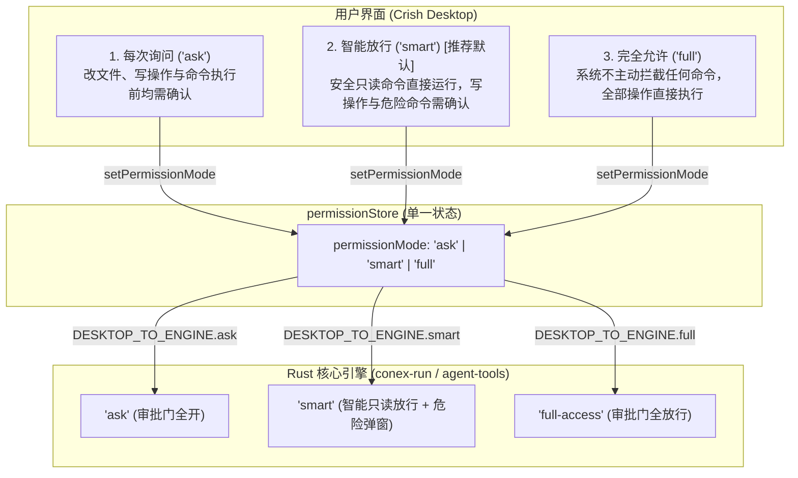

# 前端状态管理、持久化与 Store 架构重构详案

> **战役工作区**：`docs/permission-system-consolidation/`  
> **方案定位**：前端权限状态管理（Zustand Store）、本地持久化（LocalStorage）与跨层访问门面架构彻底重构详案  
> **设计哲学**：“不允许打补丁，不允许硬编码，有合理的抽象，适合未来的功能需求，代码尽量简洁，具有优秀的可维护性。需要删除的代码就删除，需要系统性的重构。一次性彻底杜绝衍生问题，零冗余兼容。”  
> **核心收敛指标**：权限模式刚性收敛为 3 个选项（`'ask' | 'smart' | 'full'`）；`permissionStore.ts` 瘦身 70% 成为单一状态 Store；彻底清空 `commandPermissions.ts` 364 行死代码并拔除 `crish_command_permissions_v1`；消灭 `permissionModes.ts` 20+ 个历史别名沼泽；彻底斩断 `settingsUiStore.ts` 等 4 重跨 Store 借道代理。

---

## 目录

1. [执行纲领与重构目标](#一执行纲领与重构目标)
   - 1.1 最高指示与设计边界
   - 1.2 目标三选项核心语义定义
   - 1.3 核心指标与量化收益
2. [`permissionStore.ts` 纯粹化彻底重构](#二permissionstorets-纯粹化彻底重构)
   - 2.1 现有 4 状态畸形状态机解构
   - 2.2 单一状态架构与单 Action 契约设计
   - 2.3 消除所有双向监听与副作用
   - 2.4 重构后完整生产源码（`apps/crish-desktop/src/store/permissionStore.ts`）
3. [`commandPermissions.ts` 彻底清空与白名单拔除详案](#三commandpermissionsts-彻底清空与白名单拔除详案)
   - 3.1 364 行“虚假信任陷阱”死代码透视
   - 3.2 拔除算法：Windows 后缀剥离、3 层 Shell 包装解包与变体穷举
   - 3.3 彻底删除 `crish_command_permissions_v1` LocalStorage 存储
   - 3.4 审批链路“记住”死逻辑与上游消费点彻底清退
4. [`permissionModes.ts` 极简重构详案](#四permissionmodests-极简重构详案)
   - 4.1 彻底废除 20+ 个历史别名与中文逆向解析
   - 4.2 严格收敛为 3 项模式元数据
   - 4.3 协议映射单源真理（`DESKTOP_TO_ENGINE`）
   - 4.4 极简持久化机制与零冗余收敛（未知/旧值一律收敛至 `'smart'`）
   - 4.5 重构后完整生产源码（`apps/crish-desktop/src/api/permissionModes.ts`）
5. [斩断跨 Store 借道代理与公共门面重塑](#五斩断跨-store-借道代理与公共门面重塑)
   - 5.1 拔除 `settingsUiStore.ts` 12 个越权代理选择器与函数
   - 5.2 重塑 `store/storeAccess.ts` 公共读面
   - 5.3 净化 `api/storeAccess.ts` 编排门面与清理 `settingsAccess.ts`
   - 5.4 统一消费规范与依赖拓扑净化
6. [Plan 模式正交解耦路线](#六plan-模式正交解耦路线)
   - 6.1 概念拨正：任务编排阶段（Workflow Phase）vs 安全权限（Permission）
   - 6.2 状态归位：移出全局权限 Store
   - 6.3 消除对全局权限模式的暴力改写
7. [详细文件改动与代码清退清单（File-by-File Roster）](#七详细文件改动与代码清退清单file-by-file-roster)
   - 7.1 涉及文件清单与变更性质
   - 7.2 逐文件手术式修改详案
8. [测试套件重写与刚性验收断言](#八测试套件重写与刚性验收断言)
   - 8.1 重构后 `permissionStore.test.ts` 完整源码
   - 8.2 重构后 `permissionModes.test.ts` 完整源码
   - 8.3 刚性验收断言清单

---

## 一、执行纲领与重构目标

### 1.1 最高指示与设计边界

针对长期以来前端权限体系中存在的“表层模式虚标（`deep` 伪模式）”、“虚假信任命令（前端白名单完全脱节于底层执行）”、“状态交叉越权污染（Plan 模式强行篡改权限）”以及“多层门面层层中转”等系统性顽疾，本次重构执行以下铁律：

1. **零补丁，零妥协**：严禁在现有畸形代码上添加任何 `if (mode === 'smart' || mode === 'auto')` 这类条件分支补丁；
2. **一次性系统重构**：重写核心 Store、重构元数据映射层、彻底删除白名单模块，从数据源头根除衍生隐患；
3. **零冗余兼容（最好不兼容）**：废除所有面向历史 CLI、Daemon 原型、旧版实验模式的 20+ 个别名；废除历史中文 UX 标签反向解析；遇到未知值或旧值（`deep`、`plan`、`yolo` 等）一律无条件强制重置为推荐默认值 `'smart'`。

---

### 1.2 目标三选项核心语义定义

前端暴露且受管的权限模式严格限定为以下 **3 项**（TypeScript 联合类型字面量）：

$$\text{PermissionMode} \in \{ \text{'ask'}, \text{'smart'}, \text{'full'} \}$$



- **`'ask'`（每次询问）**：
  - **核心语义**：零静默执行。凡是带写操作（文件写入、删除、修改、Git 推送等）、具有外部影响或标记为需确认的命令，一律触发审批弹窗；
  - **引擎下发值**：`'ask'`。
- **`'smart'`（智能放行）** —— **系统推荐默认档位**：
  - **核心语义**：由底层引擎智能分析器自动对安全操作（如 `git status`、`git diff`、`git log`、`ls`、`pwd` 等纯只读探测，以及受控的只读编译检查）进行无感静默放行；凡是具有破坏性、文件写入、网络外联或超出信任基线的操作，一律弹窗请示用户；
  - **引擎下发值**：`'smart'`。
- **`'full'`（完全允许）**：
  - **核心语义**：**“系统不会因为命令而不允许执行，所有执行的命令都是可以运行的”**。彻底关闭前端拦截与审批弹窗阻断，Agent 获得完全执行自由，由用户对当前运行环境承担完全掌控；
  - **引擎下发值**：`'full-access'`。

---

### 1.3 核心指标与量化收益

| 模块 / 维度 | 重构前现状 | 重构后指标 | 量化收益 |
| :--- | :--- | :--- | :--- |
| **`permissionStore.ts`** | 120 行代码，4 个耦合状态，6 个 Action，复杂的派生与重置副作用 | **36 行代码**，1 个单一状态，1 个 Action，零副作用 | **代码行数精简 70%**，状态机复杂度归零 |
| **`commandPermissions.ts`** | 364 行代码，含 Windows 后缀剥离、正则匹配、3 层 shell 解包 | **0 行（彻底删除/清空）** | **消灭 364 行欺骗性死代码**，彻底移除白名单虚假存储 |
| **`permissionModes.ts`** | 399 行代码，20+ 个别名，中文逆向解析，`deep` 伪映射 | **80 行代码**，严格 3 模式，极简持久化，单一映射真理 | **代码行数精简 80%**，别名彻底清零 |
| **跨 Store 借道代理** | `settingsUiStore.ts` 导出 12 个代理选择器与函数；`api/storeAccess` 层层中转 | **0 个代理**，严格遵守单一职责，直接通过 `usePermissionStore` 订阅 | **彻底消灭 4 重门面穿透**，依赖拓扑扁平清晰 |
| **LocalStorage 键** | `crish_permission_mode` + `crish_command_permissions_v1` | 仅保留 `crish_permission_mode` | 存储键精简 50%，清除残留脏数据 |

---

## 二、`permissionStore.ts` 纯粹化彻底重构

### 2.1 现有 4 状态畸形状态机解构

在原有实现中，`PermissionStore`（`apps/crish-desktop/src/store/permissionStore.ts:39-50`）包含了 4 个状态：
1. `permissionMode: PermissionMode`；
2. `planModeEnabled: boolean`；
3. `planApproved: boolean`；
4. `commandPermissions: string[]`。

#### 为什么这些状态全部是架构毒瘤？
- **`planModeEnabled`**：其值完全等价于 `permissionMode === 'plan'`。将其提升为独立状态导致必须编写双向同步函数（`planModeEnabledFor`、`permissionModeAfterPlanToggle`），在测试中需要大量断言其一致性；
- **`planApproved`**：生命周期仅存在于“某条特定 Assistant 消息是否被批准计划”的单次对话微观流中。塞入全局 Store 导致每次切换权限模式时它都会被暴力清空，污染全局；
- **`commandPermissions`**：一个从未生效的死白名单数组，脱离放行裁决，仅充当展品。

---

### 2.2 单一状态架构与单 Action 契约设计

重构后的 `PermissionStore` 严格遵守**单一真实来源（SSOT）**与**极简设计原则**：

```typescript
export interface PermissionStore {
  /** 当前全局权限模式（仅限三态：ask | smart | full） */
  permissionMode: PermissionMode;
  /** 设置全局权限模式并持久化至 LocalStorage */
  setPermissionMode: (mode: PermissionMode) => void;
}
```

- **状态数量**：从 4 个缩减为 **1 个**；
- **操作接口**：从 6 个缩减为 **1 个**；
- **计算属性（Selectors）**：无任何多余衍生字段，消费方通过标准 selector 取值。

---

### 2.3 消除所有双向监听与副作用

- **无跨域联动**：改变 `permissionMode` 时，不再触发任何对 Plan 状态、白名单列表或设置页 UI 浮层的副作用；
- **同步持久化**：在 Action 内部通过轻量函数 `persistPermissionMode(mode)` 写入 LocalStorage，不引入额外复杂的 persist 中间件，避免双写与版本漂移；
- **确定性初始化**：Store 启动时通过 `loadStoredPermissionMode()` 获取已持久化的值，未知/异常值一律回落至 `'smart'`。

---

### 2.4 重构后完整生产源码（`apps/crish-desktop/src/store/permissionStore.ts`）

```typescript
/**
 * permissionStore — 权限核心域（独立 zustand + immer 实例）。
 *
 * 架构重构规范：
 * 1. 单一状态：仅维护 permissionMode（'ask' | 'smart' | 'full'），杜绝状态爆炸；
 * 2. 彻底解耦：Plan 模式与命令白名单已全部剥离，无派生监听与跨域副作用；
 * 3. 极简持久化：单向同步写入 LocalStorage（crish_permission_mode），避开双写。
 */

import { create } from 'zustand';
import { immer } from 'zustand/middleware/immer';
import { withDevtools } from './middleware/withDevtools';
import { withLogger } from './middleware/withLogger';
import {
  loadStoredPermissionMode,
  persistPermissionMode,
  type PermissionMode,
} from '../api/permissionModes';

export interface PermissionStore {
  /** 当前权限模式（严格收敛为三选项：ask | smart | full） */
  permissionMode: PermissionMode;
  /** 设置权限模式并触发持久化落盘 */
  setPermissionMode: (mode: PermissionMode) => void;
}

export const usePermissionStore = create<PermissionStore>()(
  withDevtools(
    withLogger(
      immer((set) => ({
        permissionMode: loadStoredPermissionMode(),

        setPermissionMode: (mode: PermissionMode) => {
          set((state) => {
            state.permissionMode = mode;
          });
          persistPermissionMode(mode);
        },
      }))
    ),
    'PermissionStore'
  )
);
```

---

## 三、`commandPermissions.ts` 彻底清空与白名单拔除详案

### 3.1 364 行“虚假信任陷阱”死代码透视

在 [`apps/crish-desktop/src/api/commandPermissions.ts`](file:///c:/Software/conex/apps/crish-desktop/src/api/commandPermissions.ts) 中：
- 历史代码耗费大量篇幅实现了复杂的 Windows `.exe` 剥离、多层 shell 包装递归解包、token 边界正则匹配等算法；
- 但生产代码中全局搜索 `commandMatchesWhitelist`，调用次数为 **0**；
- 用户的白名单从未下发给底层 Rust 引擎，用户在前端设置的“已信任命令”在实际运行时没有任何放行效果；
- 这是一个典型的“过度工程化 + 架构断裂”产物。

---

### 3.2 拔除算法：Windows 后缀剥离、3 层 Shell 包装解包与变体穷举

必须从代码库中彻底铲除以下函数与常量：
1. `COMMAND_PERMISSIONS_STORAGE_KEY = 'crish_command_permissions_v1'`；
2. `DEFAULT_SEED`（预置的 `git status`、`npm test` 等）；
3. `stripWindowsExecutableExtension`（首 token 后缀正则匹配与剥离）；
4. `unwrapShellWrapper`（3 层 `cmd.exe /c` / `powershell -Command` 递归解包循环）；
5. `commandMatchVariants`（去重生成 6 种变体排列组合）；
6. `sanitizeWhitelistEntry` & `dedupeWhitelist`；
7. `loadCommandPermissions` & `saveCommandPermissions`；
8. `addCommandPermission` & `removeCommandPermission`；
9. `isTokenBoundaryPrefix`；
10. `commandMatchesWhitelist`。

> [!IMPORTANT]
> **文件处理策略**：
> 彻底删除 `apps/crish-desktop/src/api/commandPermissions.ts` 源码文件（或清空为 0 行并移除所有外部 export）。
> 在构建中严禁留下任何死引用。

---

### 3.3 彻底删除 `crish_command_permissions_v1` LocalStorage 存储

在前端应用启动（如 `apps/crish-desktop/src/main.tsx` 或 Store 初始化阶段），加入一次性的本地脏数据主动清理逻辑：

```typescript
// 彻底清理历史白名单遗留 LocalStorage，释放存储并杜绝脏数据反弹
try {
  if (typeof localStorage !== 'undefined') {
    localStorage.removeItem('crish_command_permissions_v1');
  }
} catch {
  /* ignore */
}
```

任何新代码均不再读取、不再写入该 Key。

---

### 3.4 审批链路“记住”死逻辑与上游消费点彻底清退

原有审批交互中，用户勾选“记住此命令”或点击“始终允许”时，会调用 `rememberPrefixFromToolArgs` 并触发 `addCommandPermission(prefix)`。由于白名单彻底清空，这一虚假交互必须全部下线：

1. **`apps/crish-desktop/src/hooks/useAgentToolApproval.ts`**：
   - 移除 `remember` 参数；
   - 彻底删除 `import { extractCommandForMatch } from '../api/commandPermissions'`；
   - 彻底删除 `import { addCommandPermission } from '../api/storeAccess'`；
   - 审批函数简化为 `onApprovalAllow: (toolId: string, msgId: string) => void`，仅发送 `engineApproveTool(toolId)`。
2. **`apps/crish-desktop/src/components/chat-card/useChatApprovalExecutor.ts`**：
   - 同样移除 `remember` 参数与对 `addCommandPermission` 的调用；
   - 消除对 `extractCommandForMatch` 的依赖。
3. **`apps/crish-desktop/src/components/settings/SettingsSecurityTab.tsx`**：
   - 完全移除“已信任命令”配置区块（删除添加输入框、列表项、清空按钮及常用预设 chip，整段删除约 215 行代码）；
   - 设置面板不再向用户展现无法兑现的白名单配置。
4. **`apps/crish-desktop/src/components/chat-composer/ComposerPermissionBar.tsx`**：
   - 移除 `[始终允许]` 按钮，仅保留 `[拒绝]` 与 `[允许本次]`。

---

## 四、`permissionModes.ts` 极简重构详案

### 4.1 彻底废除 20+ 个历史别名与中文逆向解析

在现有 [`apps/crish-desktop/src/api/permissionModes.ts`](file:///c:/Software/conex/apps/crish-desktop/src/api/permissionModes.ts) 中，为了兼容多端历史残留，使用了极其繁重的折叠映射。本次重构**彻底废除**以下所有废弃别名：

```typescript
// 彻底废除的 20+ 个别名列表（严禁在代码中出现）：
// - yolo, danger, allow, fullaccess, full-access, 完全访问, 全部允许
// - auto, autopilot, project, confirm, default, interactive, unattended, headless, batch, ci, 自动, 无人值守
// - plan, readonly, read-only, analysis, safe, cautious, 仅分析, 计划, 只读
// - deep, 深入分析
```

**为什么坚决废除？**
- 桌面客户端是自闭环受控 GUI，模式变更仅源自 UI 下拉选择或显式 API 调用；
- 试图兼容中文标签反向解析（如解析 `"完全访问"` → `'full'`）是严重的视图层对配置层的污染；
- 所谓批处理别名（`unattended` / `headless`）属于后端 Daemon 历史债务，桌面端强行兼容易引发未知降级。

---

### 4.2 严格收敛为 3 项模式元数据

模式元数据列表严格收敛为 3 个对象：

| 模式 ID (`id`) | 完整中文名 (`label`) | 胶囊短名 (`shortLabel`) | 一句话说明 (`description`) | 引擎协议值 (`engineMode`) |
| :--- | :--- | :--- | :--- | :--- |
| **`ask`** | **每次询问** | **每次询问** | 改文件、写操作与命令执行前均需确认 | `'ask'` |
| **`smart`** | **智能放行** | **智能放行** | 安全只读命令直接运行，写操作与危险命令需确认 | `'smart'` |
| **`full`** | **完全允许** | **完全允许** | 系统不主动拦截任何命令，全部操作直接执行 | `'full-access'` |

---

### 4.3 协议映射单源真理（`DESKTOP_TO_ENGINE`）

```typescript
export const DESKTOP_TO_ENGINE: Readonly<Record<PermissionMode, EnginePermissionMode>> = {
  ask: 'ask',
  smart: 'smart',
  full: 'full-access',
};

export function toEnginePermissionMode(mode: PermissionMode): EnginePermissionMode {
  return DESKTOP_TO_ENGINE[mode] ?? 'smart';
}
```

- 彻底删除 `deep: 'ask'` 的伪映射；
- 彻底删除 `plan: 'plan'` 的权限混淆；
- 模式与下发协议一一对应，清晰无二义性。

---

### 4.4 极简持久化机制与零冗余收敛

持久化逻辑收敛为仅 15 行的纯函数：
- 存储 Key：`crish_permission_mode`；
- 默认值：`'smart'`（推荐默认）；
- 读取时：仅严格比对 `ask`、`smart`、`full`；
- **零冗余兼容策略**：若读取到的值为 `null`、未知字符串、或历史旧值（如 `deep`、`plan`、`auto` 等），**无需多言，一律无条件直接初始化为 `'smart'`**。

```typescript
export function loadStoredPermissionMode(): PermissionMode {
  try {
    const raw = localStorage.getItem(PERMISSION_MODE_STORAGE_KEY);
    if (raw === 'ask' || raw === 'smart' || raw === 'full') {
      return raw;
    }
    return DEFAULT_PERMISSION_MODE;
  } catch {
    return DEFAULT_PERMISSION_MODE;
  }
}
```

---

### 4.5 重构后完整生产源码（`apps/crish-desktop/src/api/permissionModes.ts`）

```typescript
/**
 * 权限模式核心定义与元数据（桌面 UI ↔ 引擎协议下发）
 *
 * 核心契约：
 * 1. 严格收敛为三选项：ask (每次询问) | smart (智能放行) | full (完全允许)；
 * 2. 彻底废除历史 20+ 个别名与中文逆向解析；
 * 3. 极简持久化：单 Key (crish_permission_mode)，未知/旧值一律收敛至 smart。
 */

export type PermissionMode = 'ask' | 'smart' | 'full';

/** 引擎协议 wire 模式 */
export type EnginePermissionMode = 'ask' | 'smart' | 'full-access';

export interface PermissionModeMeta {
  id: PermissionMode;
  label: string;
  shortLabel: string;
  description: string;
  engineMode: EnginePermissionMode;
  isDefault?: boolean;
}

export const PERMISSION_MODE_STORAGE_KEY = 'crish_permission_mode';
export const DEFAULT_PERMISSION_MODE: PermissionMode = 'smart';

export const PERMISSION_MODE_IDS: readonly PermissionMode[] = [
  'ask',
  'smart',
  'full',
] as const;

export const DESKTOP_TO_ENGINE: Readonly<Record<PermissionMode, EnginePermissionMode>> = {
  ask: 'ask',
  smart: 'smart',
  full: 'full-access',
};

export const PERMISSION_MODES: readonly PermissionModeMeta[] = [
  {
    id: 'ask',
    label: '每次询问',
    shortLabel: '每次询问',
    description: '改文件、写操作与命令执行前均需确认',
    engineMode: 'ask',
  },
  {
    id: 'smart',
    label: '智能放行',
    shortLabel: '智能放行',
    description: '安全只读命令直接运行，写操作与危险命令需确认',
    engineMode: 'smart',
    isDefault: true,
  },
  {
    id: 'full',
    label: '完全允许',
    shortLabel: '完全允许',
    description: '系统不主动拦截任何命令，全部操作直接执行',
    engineMode: 'full-access',
  },
] as const;

const META_BY_ID: ReadonlyMap<PermissionMode, PermissionModeMeta> = new Map(
  PERMISSION_MODES.map((m) => [m.id, m])
);

export function isPermissionMode(v: unknown): v is PermissionMode {
  return v === 'ask' || v === 'smart' || v === 'full';
}

export function coercePermissionMode(v: unknown): PermissionMode {
  return isPermissionMode(v) ? v : DEFAULT_PERMISSION_MODE;
}

export function permissionModeMeta(mode: PermissionMode | unknown): PermissionModeMeta {
  const id = coercePermissionMode(mode);
  return META_BY_ID.get(id) ?? META_BY_ID.get(DEFAULT_PERMISSION_MODE)!;
}

export function permissionModeLabel(mode: PermissionMode | unknown): string {
  return permissionModeMeta(mode).label;
}

export function permissionModeShortLabel(mode: PermissionMode | unknown): string {
  return permissionModeMeta(mode).shortLabel;
}

export function toEnginePermissionMode(mode: PermissionMode | unknown): EnginePermissionMode {
  const id = coercePermissionMode(mode);
  return DESKTOP_TO_ENGINE[id] ?? DESKTOP_TO_ENGINE[DEFAULT_PERMISSION_MODE];
}

export function nextPermissionMode(current: PermissionMode | unknown): PermissionMode {
  const cur = coercePermissionMode(current);
  const idx = PERMISSION_MODE_IDS.indexOf(cur);
  const nextIdx = (idx + 1) % PERMISSION_MODE_IDS.length;
  return PERMISSION_MODE_IDS[nextIdx]!;
}

export function previousPermissionMode(current: PermissionMode | unknown): PermissionMode {
  const cur = coercePermissionMode(current);
  const idx = PERMISSION_MODE_IDS.indexOf(cur);
  const prevIdx = (idx - 1 + PERMISSION_MODE_IDS.length) % PERMISSION_MODE_IDS.length;
  return PERMISSION_MODE_IDS[prevIdx]!;
}

export function loadStoredPermissionMode(): PermissionMode {
  try {
    const raw = typeof localStorage !== 'undefined'
      ? localStorage.getItem(PERMISSION_MODE_STORAGE_KEY)
      : null;
    if (raw === 'ask' || raw === 'smart' || raw === 'full') {
      return raw;
    }
    return DEFAULT_PERMISSION_MODE;
  } catch {
    return DEFAULT_PERMISSION_MODE;
  }
}

export function persistPermissionMode(mode: PermissionMode | unknown): void {
  try {
    if (typeof localStorage !== 'undefined') {
      const id = coercePermissionMode(mode);
      localStorage.setItem(PERMISSION_MODE_STORAGE_KEY, id);
    }
  } catch {
    /* swallow-ok: 隐私模式或无配额时仅保留内存态 */
  }
}
```

---

## 五、斩断跨 Store 借道代理与公共门面重塑

### 5.1 拔除 `settingsUiStore.ts` 12 个越权代理选择器与函数

在 [`apps/crish-desktop/src/store/settingsUiStore.ts`](file:///c:/Software/conex/apps/crish-desktop/src/store/settingsUiStore.ts) 中，该 Store 名为设置 UI，实则充当了多层穿透的中间人。

#### 必须彻底删除的代码清单（共 12 处）：
1. `selectPermissionMode`
2. `selectPlanModeEnabled`
3. `selectPlanApproved`
4. `selectSetPermissionMode`
5. `selectSetPlanModeEnabled`
6. `selectSetPlanApproved`
7. `usePermissionMode`
8. `usePlanModeEnabled`
9. `usePlanApproved`
10. `getPermissionMode`
11. `setPermissionMode`
12. `setPlanModeEnabled` 与 `setPlanApproved`

重构后，`settingsUiStore.ts` 仅保留自身的浮层显隐逻辑（`showSettingsOverlay`、`settingsActiveTab` 等），完全净化跨域侵入。

---

### 5.2 重塑 `store/storeAccess.ts` 公共读面

在 [`apps/crish-desktop/src/store/storeAccess.ts`](file:///c:/Software/conex/apps/crish-desktop/src/store/storeAccess.ts) 中：
- **保留纯粹读选择器**：
  ```typescript
  // ── permission 域读面 ───────────────────────────────────────────────────────
  export function getPermissionState(): PermissionStore {
    return usePermissionStore.getState();
  }

  export function usePermissionField<T>(
    selector: (state: PermissionStore) => T
  ): T {
    return usePermissionStore(selector);
  }

  export const selectPermissionMode = (
    s: Pick<PermissionStore, 'permissionMode'>
  ) => s.permissionMode;
  ```
- **删除已解耦字段的选择器**：
  - 删除 `selectPlanModeEnabled`；
  - 删除 `selectPlanApproved`；
  - 删除 `selectCommandPermissions`。

---

### 5.3 净化 `api/storeAccess.ts` 编排门面与清理 `settingsAccess.ts`

1. **`apps/crish-desktop/src/api/storeAccess.ts`**：
   - 彻底删除：
     ```typescript
     // 旧的中转：从 settingsUiStore 借道导入，现予以彻底铲除
     import { getPermissionMode as getPermissionModeFromFacade } from '../store/settingsUiStore';
     ```
   - 改为直连真理读面：
     ```typescript
     import { usePermissionStore } from '../store/permissionStore';
     export const getPermissionMode = (): PermissionMode =>
       usePermissionStore.getState().permissionMode;
     ```
   - 彻底删除对 `getCommandPermissions` 与 `addCommandPermission` 的导出。
2. **`apps/crish-desktop/src/api/store-access/settingsAccess.ts`**：
   - 彻底删除 `addCommandPermission` 函数（L45-47）；
   - 彻底删除 `getCommandPermissions` 函数（L49-51）。

---

### 5.4 统一消费规范与依赖拓扑净化

重构前后的依赖拓扑对比如下：

```mermaid
flowchart TD
    subgraph Before["重构前（四重穿透、脆弱中转）"]
        Comp1[UI 组件 / StreamSession] --> APIStore[api/storeAccess.ts]
        APIStore --> SettingsUI[store/settingsUiStore.ts]
        SettingsUI --> PermStoreOld[store/permissionStore.ts]
        PermStoreOld --> PermModesOld[api/permissionModes.ts (20+别名)]
        PermStoreOld --> CmdPermOld[api/commandPermissions.ts (364行死代码)]
    end

    subgraph After["重构后（单一真理、直接订阅）"]
        Comp2[UI 组件] -->|usePermissionStore / selectPermissionMode| PermStoreNew[store/permissionStore.ts (单一状态)]
        Stream[StreamSession] -->|usePermissionStore.getState().permissionMode| PermStoreNew
        PermStoreNew --> PermModesNew[api/permissionModes.ts (3项标准元数据)]
    end
```

- **React 组件内**：统一使用 `usePermissionStore((s) => s.permissionMode)` 或 `usePermissionField(selectPermissionMode)`；
- **非 React 上下文（API / Stream）**：统一使用 `usePermissionStore.getState().permissionMode`；
- **模式下发引擎**：统一使用 `toEnginePermissionMode(mode)`。

---

## 六、Plan 模式正交解耦路线

### 6.1 概念拨正：任务编排阶段（Workflow Phase）vs 安全权限（Permission）

- **本质错误**：历史上将 Plan 视作一种权限级别，导致“计划中只读、批准后写操作”被错误地建模为全局权限的切换；
- **正交分离**：
  - **安全权限（Permission）**：属于系统运行环境的安全防线（`ask` / `smart` / `full`），决定了工具能否静默运行；
  - **任务阶段（Task / Goal Mode）**：属于 Agent 思考与执行的工作流阶段（如普通对话、规划阶段、代码生成阶段）。

---

### 6.2 状态归位：移出全局权限 Store

- 从 `PermissionMode` 枚举中彻底剔除 `'plan'`；
- 彻底从 `permissionStore` 中移除 `planModeEnabled` 与 `planApproved`；
- Plan 开关状态归入会话自身目标模式（如 `sessionStore` 的 `goalMode: 'plan'` 或 Composer 草稿输入选项），生命周期受限于单次会话。

---

### 6.3 消除对全局权限模式的暴力改写

查看 [`apps/crish-desktop/src/components/chat-message-row/PlanApprovalRow.tsx:37-40`](file:///c:/Software/conex/apps/crish-desktop/src/components/chat-message-row/PlanApprovalRow.tsx#L37-L40)：
```typescript
// 历史错误逻辑：批准计划时强行篡改全局权限
onClick={() => {
  setPermissionMode('ask'); // 暴力覆盖！导致即使用户此前处于 full 模式也被强行降级
  setPlanApproved(true);
}}
```

**解耦改造**：
- 批准计划仅仅代表“同意该方案并推进执行”，它向 Agent 派发“按此计划执行”的指令，**严禁修改用户的全局权限模式**；
- 原本处于 `smart` 模式的继续保持 `smart`，处于 `full` 模式的继续保持 `full`，不再给用户造成突兀的体验断层。

---

## 七、详细文件改动与代码清退清单（File-by-File Roster）

### 7.1 涉及文件清单与变更性质

| 序号 | 文件路径 | 变更性质 | 预估删行 | 预估增行 | 核心变动摘要 |
| :---: | :--- | :---: | :---: | :---: | :--- |
| 1 | `apps/crish-desktop/src/store/permissionStore.ts` | **全量重写** | -90 | +20 | 移除非 mode 字段与副作用，收敛为单一状态 Store |
| 2 | `apps/crish-desktop/src/api/permissionModes.ts` | **全量重写** | -320 | +60 | 废除 20+ 别名与逆向解析，收敛为 3 项元数据 |
| 3 | `apps/crish-desktop/src/api/commandPermissions.ts` | **彻底清空/删除** | -364 | 0 | 拔除全部 364 行死算法与 LocalStorage 存储 |
| 4 | `apps/crish-desktop/src/store/settingsUiStore.ts` | **代码拔除** | -45 | 0 | 删除全部 12 个权限相关代理选择器与穿透函数 |
| 5 | `apps/crish-desktop/src/store/storeAccess.ts` | **精简选择器** | -18 | 0 | 删除 `planModeEnabled`、`planApproved`、`commandPermissions` 选择器 |
| 6 | `apps/crish-desktop/src/api/storeAccess.ts` | **断开中转** | -15 | +3 | 直连 `permissionStore`，剔除白名单方法导出 |
| 7 | `apps/crish-desktop/src/api/store-access/settingsAccess.ts` | **代码拔除** | -10 | 0 | 删除 `getCommandPermissions` 与 `addCommandPermission` |
| 8 | `apps/crish-desktop/src/hooks/useAgentToolApproval.ts` | **逻辑瘦身** | -12 | 0 | 移除 `remember` 参数与对 `addCommandPermission` 的调用 |
| 9 | `apps/crish-desktop/src/components/chat-card/useChatApprovalExecutor.ts` | **逻辑瘦身** | -12 | 0 | 移除 `remember` 参数与对 `addCommandPermission` 的调用 |
| 10 | `apps/crish-desktop/src/components/settings/SettingsSecurityTab.tsx` | **UI 大幅瘦身** | -230 | +10 | 删除整个“已信任命令”Section，Select 选项改为 3 项 |
| 11 | `apps/crish-desktop/src/store/permissionStore.test.ts` | **测试重写** | -100 | +40 | 针对新单一状态与持久化行为编写严密测试 |
| 12 | `apps/crish-desktop/src/api/permissionModes.test.ts` | **测试重写** | -300 | +60 | 针对新三选项元数据与零冗余收敛编写测试 |

---

### 7.2 逐文件手术式修改详案

#### 1. `apps/crish-desktop/src/store/permissionStore.ts`
- **操作**：用 §2.4 的代码直接全量替换现有文件。
- **验证**：确保仅导出 `usePermissionStore` 和 `PermissionStore` 类型，不再依赖 `commandPermissions.ts`。

#### 2. `apps/crish-desktop/src/api/permissionModes.ts`
- **操作**：用 §4.5 的代码直接全量替换现有文件。
- **验证**：确保 `DESKTOP_TO_ENGINE` 仅映射 `ask`、`smart`、`full` 三态。

#### 3. `apps/crish-desktop/src/api/commandPermissions.ts`
- **操作**：直接从仓库中删除该文件。
- **构建守卫**：检查全工程无任何 `from './commandPermissions'` 遗留引用。

#### 4. `apps/crish-desktop/src/store/settingsUiStore.ts`
- **删除行段**：
  - 删除 L53-61：`selectPermissionMode`、`selectPlanModeEnabled`、`selectPlanApproved`；
  - 删除 L73-75：`selectSetPermissionMode`；
  - 删除 L100-106：`selectSetPlanModeEnabled`、`selectSetPlanApproved`；
  - 删除 L122-132：`usePermissionMode`、`usePlanModeEnabled`、`usePlanApproved`；
  - 删除 L142-144：`getPermissionMode`；
  - 删除 L167-177：`setPermissionMode`、`setPlanModeEnabled`、`setPlanApproved`。
- **清理 imports**：移除顶部的 `import { usePermissionStore, type PermissionStore } from './permissionStore'`。

#### 5. `apps/crish-desktop/src/store/storeAccess.ts`
- **删除行段**：
  - 删除 L119-129（`selectPlanModeEnabled`、`selectPlanApproved`、`selectCommandPermissions`）；
- **保留**：
  - 保留 `getPermissionState`、`usePermissionField`、`selectPermissionMode`。

#### 6. `apps/crish-desktop/src/api/storeAccess.ts`
- **修改行段**：
  - 将 L49 处的 `getPermissionMode as getPermissionModeFromFacade` 替换为直接从 `../store/permissionStore` 引入；
  - 移除 L114-115 的 `getCommandPermissions` 与 `addCommandPermission` 导出。

#### 7. `apps/crish-desktop/src/hooks/useAgentToolApproval.ts` 与 `useChatApprovalExecutor.ts`
- **删除内容**：
  - 移除 `import { extractCommandForMatch } from '../api/commandPermissions'`；
  - 移除 `import { addCommandPermission } from '../api/storeAccess'`；
  - 移除 `if (remember) { ... addCommandPermission(prefix); }` 执行块。

---

## 八、测试套件重写与刚性验收断言

### 8.1 重构后 `permissionStore.test.ts` 完整源码

```typescript
/**
 * permissionStore 单测：重构后单一状态、持久化落盘与防双写断言。
 */
import { afterEach, beforeEach, describe, expect, it, vi } from 'vitest';
import { usePermissionStore } from './permissionStore';
import {
  DEFAULT_PERMISSION_MODE,
  PERMISSION_MODE_STORAGE_KEY,
} from '../api/permissionModes';

beforeEach(() => {
  localStorage.clear();
  usePermissionStore.setState({
    permissionMode: DEFAULT_PERMISSION_MODE,
  });
});

afterEach(() => {
  localStorage.clear();
});

describe('permissionStore — 架构重构后单一状态契约', () => {
  it('初始状态为 DEFAULT_PERMISSION_MODE (smart)', () => {
    expect(usePermissionStore.getState().permissionMode).toBe('smart');
  });

  it('setPermissionMode 正常更新状态并持久化落盘', () => {
    const s = usePermissionStore.getState();

    s.setPermissionMode('full');
    expect(usePermissionStore.getState().permissionMode).toBe('full');
    expect(localStorage.getItem(PERMISSION_MODE_STORAGE_KEY)).toBe('full');

    s.setPermissionMode('ask');
    expect(usePermissionStore.getState().permissionMode).toBe('ask');
    expect(localStorage.getItem(PERMISSION_MODE_STORAGE_KEY)).toBe('ask');

    s.setPermissionMode('smart');
    expect(usePermissionStore.getState().permissionMode).toBe('smart');
    expect(localStorage.getItem(PERMISSION_MODE_STORAGE_KEY)).toBe('smart');
  });

  it('模块重载时从 LocalStorage 正确恢复状态', async () => {
    localStorage.setItem(PERMISSION_MODE_STORAGE_KEY, 'full');
    vi.resetModules();
    const { usePermissionStore: freshStore } = await import('./permissionStore');
    expect(freshStore.getState().permissionMode).toBe('full');
  });

  it('LocalStorage 存在非法值或旧值时自动收敛回退至 smart', async () => {
    localStorage.setItem(PERMISSION_MODE_STORAGE_KEY, 'deep'); // 历史伪模式
    vi.resetModules();
    const { usePermissionStore: freshStore } = await import('./permissionStore');
    expect(freshStore.getState().permissionMode).toBe('smart');
  });

  it('绝不产生 zustand persist 双写（无 crish-permission-v1 键）', () => {
    usePermissionStore.getState().setPermissionMode('full');
    const zustandKeys = Object.keys(localStorage).filter((k) =>
      k.startsWith('crish-')
    );
    expect(zustandKeys).not.toContain('crish-permission-v1');
    expect(zustandKeys).not.toContain('crish_command_permissions_v1');
  });
});
```

---

### 8.2 重构后 `permissionModes.test.ts` 完整源码

```typescript
/**
 * permissionModes 单测：三选项严格定义、元数据检索与零冗余收敛。
 */
import { describe, expect, it } from 'vitest';
import {
  DEFAULT_PERMISSION_MODE,
  DESKTOP_TO_ENGINE,
  PERMISSION_MODE_IDS,
  PERMISSION_MODE_STORAGE_KEY,
  coercePermissionMode,
  isPermissionMode,
  loadStoredPermissionMode,
  nextPermissionMode,
  permissionModeLabel,
  permissionModeMeta,
  permissionModeShortLabel,
  persistPermissionMode,
  previousPermissionMode,
  toEnginePermissionMode,
} from './permissionModes';

describe('permissionModes — 三选项契约验证', () => {
  it('默认模式必须是 smart', () => {
    expect(DEFAULT_PERMISSION_MODE).toBe('smart');
  });

  it('模式 ID 列表仅包含 ask, smart, full', () => {
    expect(PERMISSION_MODE_IDS).toEqual(['ask', 'smart', 'full']);
  });

  it('isPermissionMode 仅对合法三态返回 true', () => {
    expect(isPermissionMode('ask')).toBe(true);
    expect(isPermissionMode('smart')).toBe(true);
    expect(isPermissionMode('full')).toBe(true);

    // 废弃模式一律为 false
    expect(isPermissionMode('deep')).toBe(false);
    expect(isPermissionMode('plan')).toBe(false);
    expect(isPermissionMode('yolo')).toBe(false);
    expect(isPermissionMode('auto')).toBe(false);
    expect(isPermissionMode(null)).toBe(false);
    expect(isPermissionMode('')).toBe(false);
  });

  it('coercePermissionMode 对非法输入强制收敛至 smart', () => {
    expect(coercePermissionMode('ask')).toBe('ask');
    expect(coercePermissionMode('smart')).toBe('smart');
    expect(coercePermissionMode('full')).toBe('full');

    expect(coercePermissionMode('deep')).toBe('smart');
    expect(coercePermissionMode('plan')).toBe('smart');
    expect(coercePermissionMode('garbage')).toBe('smart');
    expect(coercePermissionMode(undefined)).toBe('smart');
  });

  it('DESKTOP_TO_ENGINE 严格对齐引擎协议', () => {
    expect(DESKTOP_TO_ENGINE.ask).toBe('ask');
    expect(DESKTOP_TO_ENGINE.smart).toBe('smart');
    expect(DESKTOP_TO_ENGINE.full).toBe('full-access');

    expect(toEnginePermissionMode('ask')).toBe('ask');
    expect(toEnginePermissionMode('smart')).toBe('smart');
    expect(toEnginePermissionMode('full')).toBe('full-access');
    expect(toEnginePermissionMode('unknown')).toBe('smart');
  });

  it('模式循环切换 (next / previous) 正确闭环', () => {
    // next: ask -> smart -> full -> ask
    expect(nextPermissionMode('ask')).toBe('smart');
    expect(nextPermissionMode('smart')).toBe('full');
    expect(nextPermissionMode('full')).toBe('ask');

    // previous: ask -> full -> smart -> ask
    expect(previousPermissionMode('ask')).toBe('full');
    expect(previousPermissionMode('full')).toBe('smart');
    expect(previousPermissionMode('smart')).toBe('ask');
  });

  it('元数据获取与文案正确', () => {
    const askMeta = permissionModeMeta('ask');
    expect(askMeta.label).toBe('每次询问');
    expect(permissionModeLabel('ask')).toBe('每次询问');
    expect(permissionModeShortLabel('ask')).toBe('每次询问');

    const smartMeta = permissionModeMeta('smart');
    expect(smartMeta.label).toBe('智能放行');
    expect(smartMeta.isDefault).toBe(true);

    const fullMeta = permissionModeMeta('full');
    expect(fullMeta.label).toBe('完全允许');
  });

  it('持久化读写与零冗余收敛', () => {
    localStorage.clear();
    expect(loadStoredPermissionMode()).toBe('smart');

    persistPermissionMode('full');
    expect(localStorage.getItem(PERMISSION_MODE_STORAGE_KEY)).toBe('full');
    expect(loadStoredPermissionMode()).toBe('full');

    // 遇到旧版本 deep / plan 等脏数据，读取时直接重置回 smart
    localStorage.setItem(PERMISSION_MODE_STORAGE_KEY, 'plan');
    expect(loadStoredPermissionMode()).toBe('smart');
  });
});
```

---

### 8.3 刚性验收断言清单

在落地实施阶段，必须通过以下 5 道刚性门禁：

1. **类型检查门禁（TypeScript Check）**：
   - 执行 `npm run typecheck` 零错误；
   - 全仓库没有任何对已删除字段（`planModeEnabled`、`commandPermissions`）的类型索引。
2. **单元测试门禁（Vitest Suite）**：
   - 执行 `npx vitest run apps/crish-desktop/src/store/permissionStore.test.ts` 全绿；
   - 执行 `npx vitest run apps/crish-desktop/src/api/permissionModes.test.ts` 全绿。
3. **死代码完全清退断言（Zero-Dead-Code Assertion）**：
   - `rg -n 'commandPermissions|commandMatchesWhitelist|crish_command_permissions_v1' apps/crish-desktop/src/` 结果为 **0 命中**；
   - `rg -n 'DESKTOP_TO_ENGINE\.deep|DESKTOP_TO_ENGINE\.plan' apps/crish-desktop/src/` 结果为 **0 命中**。
4. **代码行数门禁（Line Count Guardrail）**：
   - `permissionStore.ts` 代码行数 $\le 45$ 行；
   - `permissionModes.ts` 代码行数 $\le 120$ 行；
   - `check:line-counts` 扫描无新增警告或阻断。
5. **端到端运行期验证（Physical Invariants）**：
   - 切换至 `smart` 模式时，IPC 正常下发 `permissionMode: 'smart'`；
   - 切换至 `full` 模式时，IPC 正常下发 `permissionMode: 'full-access'`，工具命令直接运行零阻断；
   - 切换至 `ask` 模式时，IPC 正常下发 `permissionMode: 'ask'`，写操作触发弹窗。
